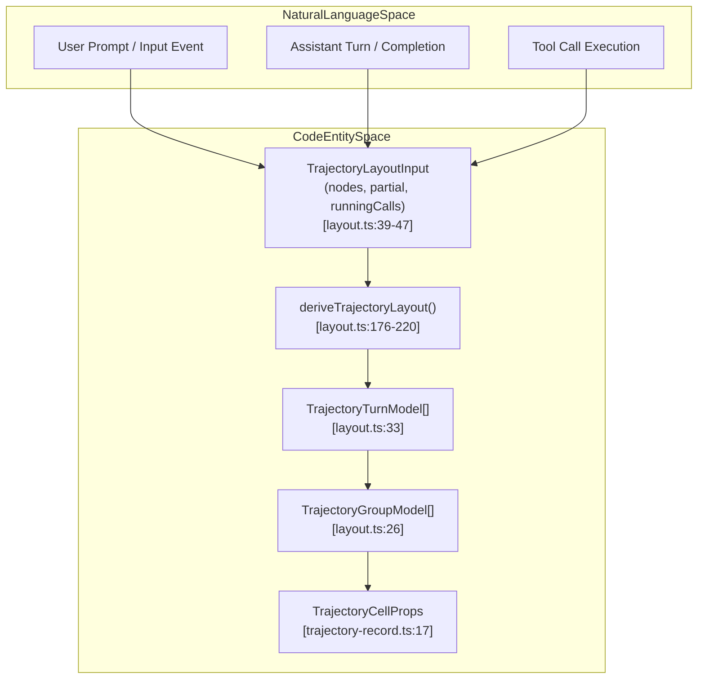
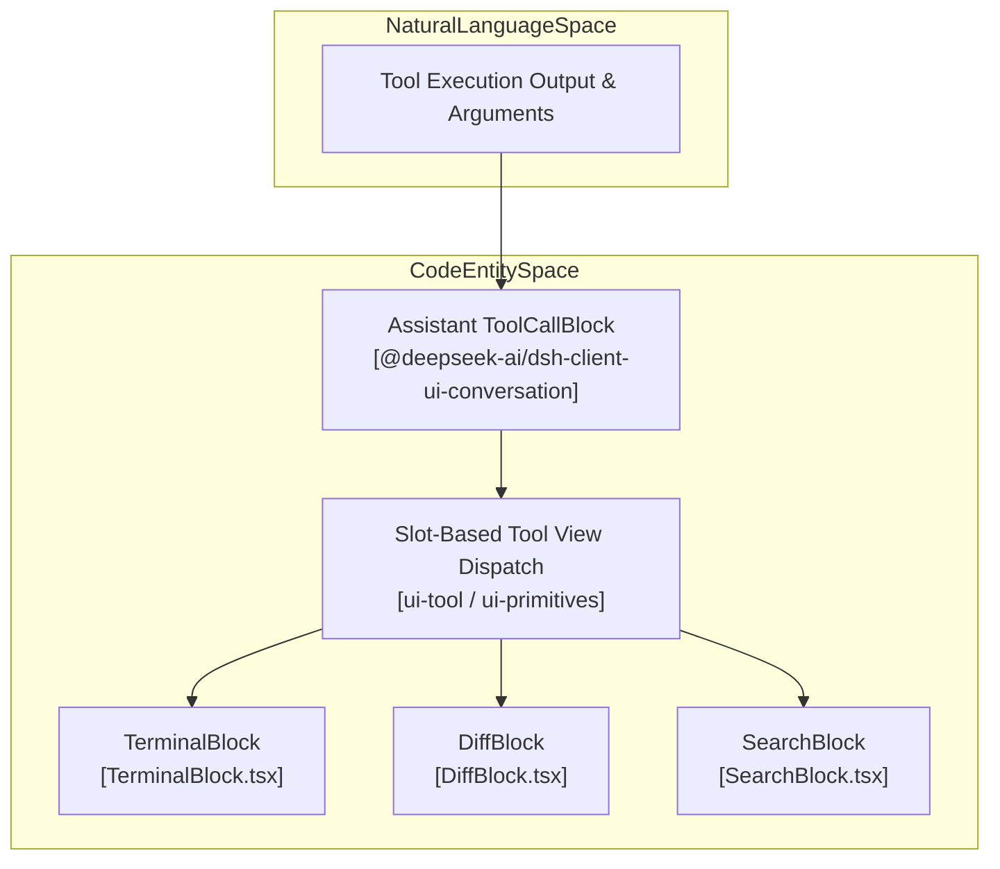

<!-- source: DeepWiki mcp.deepwiki.com · repo deepseek-ai/deepseek-harness · page 6.3 UI Primitives, Trajectory & Tool Views · fetched 2026-10-27 -->

# UI Primitives, Trajectory & Tool Views

Relevant source files

The following files were used as context for generating this wiki page:

- [apps/web/tests/changed-files-turn.e2e.ts](apps/web/tests/changed-files-turn.e2e.ts)
- [apps/web/tests/clickable-links-gallery.e2e.ts](apps/web/tests/clickable-links-gallery.e2e.ts)
- [apps/web/tests/expected/clickable-links-gallery/ui.expected.md](apps/web/tests/expected/clickable-links-gallery/ui.expected.md)
- [apps/web/tests/expected/shortcuts-desktop/font-sizes.expected.md](apps/web/tests/expected/shortcuts-desktop/font-sizes.expected.md)
- [apps/web/tests/expected/shortcuts-workspace/macos-defaults.expected.md](apps/web/tests/expected/shortcuts-workspace/macos-defaults.expected.md)
- [apps/web/tests/expected/shortcuts/en-US.expected.md](apps/web/tests/expected/shortcuts/en-US.expected.md)
- [apps/web/tests/expected/shortcuts/zh-CN.expected.md](apps/web/tests/expected/shortcuts/zh-CN.expected.md)
- [apps/web/tests/expected/thinking-markdown/ui.expected.md](apps/web/tests/expected/thinking-markdown/ui.expected.md)
- [apps/web/tests/markdown-wide-table.e2e.ts](apps/web/tests/markdown-wide-table.e2e.ts)
- [apps/web/tests/open-in-app-ssh.e2e.ts](apps/web/tests/open-in-app-ssh.e2e.ts)
- [apps/web/tests/present.e2e.ts](apps/web/tests/present.e2e.ts)
- [apps/web/tests/produced-file-mentions.e2e.ts](apps/web/tests/produced-file-mentions.e2e.ts)
- [apps/web/tests/question-composer.e2e.ts](apps/web/tests/question-composer.e2e.ts)
- [apps/web/tests/shortcuts-desktop.e2e.ts](apps/web/tests/shortcuts-desktop.e2e.ts)
- [apps/web/tests/shortcuts.e2e.ts](apps/web/tests/shortcuts.e2e.ts)
- [apps/web/tests/thinking-markdown.e2e.ts](apps/web/tests/thinking-markdown.e2e.ts)
- [packages/client/ui-chat/src/client/chat/TurnTriggerNodeView.module.css](packages/client/ui-chat/src/client/chat/TurnTriggerNodeView.module.css)
- [packages/client/ui-chat/src/client/chat/register-node-renderers.ts](packages/client/ui-chat/src/client/chat/register-node-renderers.ts)
- [packages/client/ui-chat/src/client/conversation-nodes/inbox.ts](packages/client/ui-chat/src/client/conversation-nodes/inbox.ts)
- [packages/client/ui-chat/src/client/conversation-nodes/request-prompt.ts](packages/client/ui-chat/src/client/conversation-nodes/request-prompt.ts)
- [packages/client/ui-conversation/package.json](packages/client/ui-conversation/package.json)
- [packages/client/ui-conversation/src/client/locales.ts](packages/client/ui-conversation/src/client/locales.ts)
- [packages/client/ui-conversation/tsconfig.json](packages/client/ui-conversation/tsconfig.json)
- [packages/client/ui-deliverables/README.i18n.yaml](packages/client/ui-deliverables/README.i18n.yaml)
- [packages/client/ui-deliverables/README.md](packages/client/ui-deliverables/README.md)
- [packages/client/ui-deliverables/README.zh.md](packages/client/ui-deliverables/README.zh.md)
- [packages/client/ui-deliverables/package.json](packages/client/ui-deliverables/package.json)
- [packages/client/ui-deliverables/src/client/ChangedFiles.tsx](packages/client/ui-deliverables/src/client/ChangedFiles.tsx)
- [packages/client/ui-deliverables/src/client/Deliverables.module.css](packages/client/ui-deliverables/src/client/Deliverables.module.css)
- [packages/client/ui-deliverables/src/client/Deliverables.tsx](packages/client/ui-deliverables/src/client/Deliverables.tsx)
- [packages/client/ui-deliverables/src/client/PresentedFileCard.tsx](packages/client/ui-deliverables/src/client/PresentedFileCard.tsx)
- [packages/client/ui-deliverables/src/client/ReviewTab.module.css](packages/client/ui-deliverables/src/client/ReviewTab.module.css)
- [packages/client/ui-deliverables/src/client/ReviewTab.tsx](packages/client/ui-deliverables/src/client/ReviewTab.tsx)
- [packages/client/ui-deliverables/src/client/file-actions.ts](packages/client/ui-deliverables/src/client/file-actions.ts)
- [packages/client/ui-deliverables/src/client/index.ts](packages/client/ui-deliverables/src/client/index.ts)
- [packages/client/ui-deliverables/src/client/locales.ts](packages/client/ui-deliverables/src/client/locales.ts)
- [packages/client/ui-deliverables/src/client/present-open.ts](packages/client/ui-deliverables/src/client/present-open.ts)
- [packages/client/ui-deliverables/src/client/turn-deliverables.ts](packages/client/ui-deliverables/src/client/turn-deliverables.ts)
- [packages/client/ui-deliverables/src/index.ts](packages/client/ui-deliverables/src/index.ts)
- [packages/client/ui-deliverables/tests/changes-open.host.spec.ts](packages/client/ui-deliverables/tests/changes-open.host.spec.ts)
- [packages/client/ui-deliverables/tests/deliverables.client.spec.tsx](packages/client/ui-deliverables/tests/deliverables.client.spec.tsx)
- [packages/client/ui-deliverables/tests/file-actions.tsx](packages/client/ui-deliverables/tests/file-actions.tsx)
- [packages/client/ui-deliverables/tests/present-open.client.spec.ts](packages/client/ui-deliverables/tests/present-open.client.spec.ts)
- [packages/client/ui-deliverables/tests/presented-file-card.client.spec.tsx](packages/client/ui-deliverables/tests/presented-file-card.client.spec.tsx)
- [packages/client/ui-deliverables/tests/review-tab.client.spec.tsx](packages/client/ui-deliverables/tests/review-tab.client.spec.tsx)
- [packages/client/ui-deliverables/tsconfig.client.json](packages/client/ui-deliverables/tsconfig.client.json)
- [packages/client/ui-layout/package.json](packages/client/ui-layout/package.json)
- [packages/client/ui-open-in-app/src/client/file-applications.ts](packages/client/ui-open-in-app/src/client/file-applications.ts)
- [packages/client/ui-primitives/README.i18n.yaml](packages/client/ui-primitives/README.i18n.yaml)
- [packages/client/ui-primitives/README.md](packages/client/ui-primitives/README.md)
- [packages/client/ui-primitives/README.zh.md](packages/client/ui-primitives/README.zh.md)
- [packages/client/ui-primitives/package.json](packages/client/ui-primitives/package.json)
- [packages/client/ui-primitives/src/ImageLightbox.module.css](packages/client/ui-primitives/src/ImageLightbox.module.css)
- [packages/client/ui-primitives/src/ImageLightbox.tsx](packages/client/ui-primitives/src/ImageLightbox.tsx)
- [packages/client/ui-primitives/src/index.ts](packages/client/ui-primitives/src/index.ts)
- [packages/client/ui-primitives/src/markdown/MarkdownText.module.css](packages/client/ui-primitives/src/markdown/MarkdownText.module.css)
- [packages/client/ui-primitives/src/markdown/MarkdownText.tsx](packages/client/ui-primitives/src/markdown/MarkdownText.tsx)
- [packages/client/ui-primitives/src/markdown/render.tsx](packages/client/ui-primitives/src/markdown/render.tsx)
- [packages/client/ui-shortcuts/README.i18n.yaml](packages/client/ui-shortcuts/README.i18n.yaml)
- [packages/client/ui-shortcuts/README.md](packages/client/ui-shortcuts/README.md)
- [packages/client/ui-shortcuts/README.zh.md](packages/client/ui-shortcuts/README.zh.md)
- [packages/client/ui-shortcuts/src/client/Reference.tsx](packages/client/ui-shortcuts/src/client/Reference.tsx)
- [packages/client/ui-shortcuts/tests/commands.client.spec.ts](packages/client/ui-shortcuts/tests/commands.client.spec.ts)
- [packages/client/ui-shortcuts/tests/reference.client.spec.tsx](packages/client/ui-shortcuts/tests/reference.client.spec.tsx)
- [packages/client/ui-sidebar-documentpreview/src/client/LoadingIndicator.tsx](packages/client/ui-sidebar-documentpreview/src/client/LoadingIndicator.tsx)
- [packages/client/ui-sidebar-documentpreview/tests/loading-indicator.client.spec.tsx](packages/client/ui-sidebar-documentpreview/tests/loading-indicator.client.spec.tsx)
- [packages/client/ui-sidebar/package.json](packages/client/ui-sidebar/package.json)
- [packages/client/ui-theme/README.i18n.yaml](packages/client/ui-theme/README.i18n.yaml)
- [packages/client/ui-theme/README.md](packages/client/ui-theme/README.md)
- [packages/client/ui-theme/README.zh.md](packages/client/ui-theme/README.zh.md)
- [packages/client/ui-theme/package.json](packages/client/ui-theme/package.json)
- [packages/client/ui-theme/src/client/index.ts](packages/client/ui-theme/src/client/index.ts)
- [packages/client/ui-theme/src/styles/design-platform.css](packages/client/ui-theme/src/styles/design-platform.css)
- [packages/client/ui-theme/tests/apply.client.spec.ts](packages/client/ui-theme/tests/apply.client.spec.ts)
- [packages/client/ui-tool/README.i18n.yaml](packages/client/ui-tool/README.i18n.yaml)
- [packages/client/ui-tool/README.md](packages/client/ui-tool/README.md)
- [packages/client/ui-tool/README.zh.md](packages/client/ui-tool/README.zh.md)
- [packages/client/ui-tool/src/client/tool/components/ToolRow.tsx](packages/client/ui-tool/src/client/tool/components/ToolRow.tsx)
- [packages/client/ui-tool/src/client/tool/models/terminal-card-model.ts](packages/client/ui-tool/src/client/tool/models/terminal-card-model.ts)
- [packages/client/ui-tool/src/client/tool/toolviews/bash-sample.tsx](packages/client/ui-tool/src/client/tool/toolviews/bash-sample.tsx)
- [packages/client/ui-tool/tests/terminal-card.client.spec.tsx](packages/client/ui-tool/tests/terminal-card.client.spec.tsx)
- [packages/client/ui-trajectory/README.i18n.yaml](packages/client/ui-trajectory/README.i18n.yaml)
- [packages/client/ui-trajectory/README.md](packages/client/ui-trajectory/README.md)
- [packages/client/ui-trajectory/README.zh.md](packages/client/ui-trajectory/README.zh.md)
- [packages/client/ui-trajectory/package.json](packages/client/ui-trajectory/package.json)
- [packages/client/ui-trajectory/src/client/TrajectoryCell.module.css](packages/client/ui-trajectory/src/client/TrajectoryCell.module.css)
- [packages/client/ui-trajectory/src/client/TrajectoryCell.tsx](packages/client/ui-trajectory/src/client/TrajectoryCell.tsx)
- [packages/client/ui-trajectory/src/client/TrajectoryTable.module.css](packages/client/ui-trajectory/src/client/TrajectoryTable.module.css)
- [packages/client/ui-trajectory/src/client/TrajectoryTable.tsx](packages/client/ui-trajectory/src/client/TrajectoryTable.tsx)
- [packages/client/ui-trajectory/src/client/TrajectoryTimeline.module.css](packages/client/ui-trajectory/src/client/TrajectoryTimeline.module.css)
- [packages/client/ui-trajectory/src/client/TrajectoryTimeline.tsx](packages/client/ui-trajectory/src/client/TrajectoryTimeline.tsx)
- [packages/client/ui-trajectory/src/client/TrajectoryToolbar.module.css](packages/client/ui-trajectory/src/client/TrajectoryToolbar.module.css)
- [packages/client/ui-trajectory/src/client/TrajectoryToolbar.tsx](packages/client/ui-trajectory/src/client/TrajectoryToolbar.tsx)
- [packages/client/ui-trajectory/src/client/TrajectoryView.tsx](packages/client/ui-trajectory/src/client/TrajectoryView.tsx)
- [packages/client/ui-trajectory/src/client/index.ts](packages/client/ui-trajectory/src/client/index.ts)
- [packages/client/ui-trajectory/src/client/layout.ts](packages/client/ui-trajectory/src/client/layout.ts)
- [packages/client/ui-trajectory/src/client/locales.ts](packages/client/ui-trajectory/src/client/locales.ts)
- [packages/client/ui-trajectory/src/client/timeline.ts](packages/client/ui-trajectory/src/client/timeline.ts)
- [packages/client/ui-trajectory/src/client/trajectory-assistant-definition.ts](packages/client/ui-trajectory/src/client/trajectory-assistant-definition.ts)
- [packages/client/ui-trajectory/src/client/trajectory-compaction-definition.ts](packages/client/ui-trajectory/src/client/trajectory-compaction-definition.ts)
- [packages/client/ui-trajectory/src/client/trajectory-contract.ts](packages/client/ui-trajectory/src/client/trajectory-contract.ts)
- [packages/client/ui-trajectory/src/client/trajectory-definition-common.ts](packages/client/ui-trajectory/src/client/trajectory-definition-common.ts)
- [packages/client/ui-trajectory/src/client/trajectory-message-definitions.ts](packages/client/ui-trajectory/src/client/trajectory-message-definitions.ts)
- [packages/client/ui-trajectory/src/client/trajectory-record.ts](packages/client/ui-trajectory/src/client/trajectory-record.ts)
- [packages/client/ui-trajectory/src/client/trajectory-request-header-definition.ts](packages/client/ui-trajectory/src/client/trajectory-request-header-definition.ts)
- [packages/client/ui-trajectory/src/client/trajectory-snapshot-builder.ts](packages/client/ui-trajectory/src/client/trajectory-snapshot-builder.ts)
- [packages/client/ui-trajectory/src/client/trajectory-tool-definition.ts](packages/client/ui-trajectory/src/client/trajectory-tool-definition.ts)
- [packages/client/ui-trajectory/src/client/views.module.css](packages/client/ui-trajectory/src/client/views.module.css)
- [packages/client/ui-trajectory/tests/conversation-definitions.client.spec.ts](packages/client/ui-trajectory/tests/conversation-definitions.client.spec.ts)
- [packages/client/ui-trajectory/tests/table.client.spec.tsx](packages/client/ui-trajectory/tests/table.client.spec.tsx)
- [packages/client/ui-user-questions/README.i18n.yaml](packages/client/ui-user-questions/README.i18n.yaml)
- [packages/client/ui-user-questions/README.md](packages/client/ui-user-questions/README.md)
- [packages/client/ui-user-questions/README.zh.md](packages/client/ui-user-questions/README.zh.md)
- [packages/client/ui-user-questions/package.json](packages/client/ui-user-questions/package.json)
- [packages/client/ui-user-questions/src/client/PlanReviewPanel.tsx](packages/client/ui-user-questions/src/client/PlanReviewPanel.tsx)
- [packages/client/ui-user-questions/src/client/QuestionComposer.module.css](packages/client/ui-user-questions/src/client/QuestionComposer.module.css)
- [packages/client/ui-user-questions/src/client/QuestionComposer.tsx](packages/client/ui-user-questions/src/client/QuestionComposer.tsx)
- [packages/client/ui-user-questions/src/client/contract/slots.ts](packages/client/ui-user-questions/src/client/contract/slots.ts)
- [packages/client/ui-user-questions/src/client/index.ts](packages/client/ui-user-questions/src/client/index.ts)
- [packages/client/ui-user-questions/src/client/locales.ts](packages/client/ui-user-questions/src/client/locales.ts)
- [packages/client/ui-user-questions/tests/browser-plugin.client.spec.ts](packages/client/ui-user-questions/tests/browser-plugin.client.spec.ts)
- [packages/client/ui-user-questions/tests/plan-review-panel.client.spec.tsx](packages/client/ui-user-questions/tests/plan-review-panel.client.spec.tsx)
- [packages/client/ui-user-questions/tests/user-questions-composer.client.spec.tsx](packages/client/ui-user-questions/tests/user-questions-composer.client.spec.tsx)
- [packages/client/ui-user-questions/tsconfig.json](packages/client/ui-user-questions/tsconfig.json)
- [packages/deliverables/tool-present/README.i18n.yaml](packages/deliverables/tool-present/README.i18n.yaml)
- [packages/deliverables/tool-present/README.md](packages/deliverables/tool-present/README.md)
- [packages/deliverables/tool-present/README.zh.md](packages/deliverables/tool-present/README.zh.md)
- [packages/deliverables/tool-present/src/index.ts](packages/deliverables/tool-present/src/index.ts)
- [packages/interaction/user-questions/src/projection.ts](packages/interaction/user-questions/src/projection.ts)
- [packages/interaction/user-questions/tests/projection.spec.ts](packages/interaction/user-questions/tests/projection.spec.ts)
- [snapshots/web/goal-multi-turn-actions/ui-expanded.expected.md](snapshots/web/goal-multi-turn-actions/ui-expanded.expected.md)
- [snapshots/web/open-in-app-ssh/header.expected.md](snapshots/web/open-in-app-ssh/header.expected.md)
- [snapshots/web/open-in-app-ssh/snapshot.yml](snapshots/web/open-in-app-ssh/snapshot.yml)
- [snapshots/web/present/ui.expected.md](snapshots/web/present/ui.expected.md)
- [snapshots/web/seeded-history/file-preview.expected.md](snapshots/web/seeded-history/file-preview.expected.md)

This leaf wiki page details the shared UI foundation in the DeepSeek Harness (`dsh`) web client. It covers atomic React controls, the turn-aware trajectory inspection ledger, deliverables/present cards, and tool-call view rendering across packages `@deepseek-ai/dsh-client-ui-primitives`, `ui-trajectory`, `ui-deliverables`, and `ui-tool`.

---

## 1. UI Primitives (`@deepseek-ai/dsh-client-ui-primitives`)

The `@deepseek-ai/dsh-client-ui-primitives` package provides a pure, Cordis-free React component library styled exclusively through `--dsw-*` design tokens [packages/client/ui-primitives/README.md:1-13](), [packages/client/ui-primitives/src/index.ts:1-3](). 

### 1.1 Architecture & Security Rules
- **Zero Cordis Runtime:** Components import no runtime services or state managers; callers supply localized labels and callbacks [packages/client/ui-primitives/README.md:10-13]().
- **Untrusted Output Defense:** Renderers drop raw HTML, restrict HTTP(S) links, and safely parse ANSI escape codes [packages/client/ui-primitives/README.md:10-13]().
- **Styling Seam:** The components rely on design tokens (`--dsw-*`), enabling seamless adaptation across plugins and themes [packages/client/ui-primitives/README.md:10-13]().

### 1.2 Core Component Catalog
The package exports standard controls, overlays, icons, and specialized agent output blocks:

| Export | Role / Implementation |
|---|---|
| `Button`, `Switch`, `Checkbox`, `Input` | Interactive form primitives with focus ring management via `focusWithoutRing` [packages/client/ui-primitives/README.md:41-47]() |
| `SegmentedControl`, `SegmentedTabs` | Mode switchers with sliding indicators and ARIA bindings [packages/client/ui-primitives/README.md:45-52]() |
| `Menu`, `MenuItemButton`, `Modal` | Overlay components managed by `useModalLayer` and keyboard trap handlers [packages/client/ui-primitives/README.md:28-31]() |
| `TerminalBlock` | ANSI-decoded terminal output renderer with column buffering [packages/client/ui-primitives/src/index.ts:86-89]() |
| `MarkdownText`, `CodeBlock` | GFM parser enhanced with KaTeX math and Shiki code highlighting [packages/client/ui-primitives/src/index.ts:103-109]() |
| `DiffBlock`, `SearchBlock`, `ReadBlock`, `WebBlock` | Specialized agent output cards for file comparison, grep results, and web retrievals [packages/client/ui-primitives/src/index.ts:90-102]() |

Sources: [packages/client/ui-primitives/README.md:1-75](), [packages/client/ui-primitives/src/index.ts:1-118]()

---

## 2. Trajectory Inspection Ledger (`ui-trajectory`)

The `ui-trajectory` package converts linear session event logs into a turn-aware, virtualized inspection matrix [packages/client/ui-trajectory/src/client/TrajectoryTable.tsx:1-10]().

### 2.1 Layout Folding & Data Flow
Raw event nodes, partial tool outputs, and running calls are folded into hierarchical structures via `deriveTrajectoryLayout(input, t)` [packages/client/ui-trajectory/src/client/layout.ts:38-180]().

Sources: [packages/client/ui-trajectory/src/client/layout.ts:30-195]()

### 2.2 Table Virtualization & Inspection
- **Virtualization:** Uses `@tanstack/react-virtual` in `TrajectoryTable` to render only visible items with overscan rows [packages/client/ui-trajectory/src/client/TrajectoryTable.tsx:5-51]().
- **Event Kinds:** Categorizes entries into `system`, `user`, `context`, `compacted`, `message`, `tool`, and `subtool`, mapped to dedicated SVG icons [packages/client/ui-trajectory/src/client/TrajectoryTable.tsx:52-131]().
- **Detail Panes:** Selecting any row opens a split inspector tab with raw JSON, timing profiles, diffs, and schema inspection [packages/client/ui-trajectory/src/client/TrajectoryTable.tsx:169-182]().

Sources: [packages/client/ui-trajectory/src/client/TrajectoryTable.tsx:1-220](), [packages/client/ui-trajectory/src/client/TrajectoryTable.module.css:1-50]()

---

## 3. Deliverables and Present Cards (`ui-deliverables`)

The `ui-deliverables` package renders the artifacts produced during an agent turn [packages/client/ui-deliverables/README.md:1-15]().

### 3.1 Changed-Files Card & Review Tab
- **Workspace Changes:** Reads server-served summaries of `workspace/changes` announcements [packages/client/ui-deliverables/README.md:41-47]().
- **Interactive Review:** Clicking a changed file opens the `changes-review` sidebar tab, utilizing structured diff patches (`structuredPatch`) with Shiki token highlighting [packages/client/ui-deliverables/README.md:45-55]().
- **Explicit Deliveries:** Parses `present` tool calls (`files: [{ path, description? }]`) to render delivery cards equipped with file-type icons and native open/reveal controls [packages/client/ui-deliverables/README.md:32-40]().

Sources: [packages/client/ui-deliverables/README.md:1-58](), [packages/client/ui-deliverables/src/client/ReviewTab.tsx:1-30]()

---

## 4. Tool-Call Rendering via `ui-tool`

The `ui-tool` package bridges raw tool executions to structured visualization cards [packages/client/ui-tool/README.md:1-30]().

### 4.1 Rendering Pipeline & Dispatch
- **Tree Resolution:** Decodes nested tool execution trees, including PTC (Programmatic Tool Calling) subcalls [packages/client/ui-trajectory/src/client/TrajectoryTable.tsx:42-45]().
- **Slot Registration:** Dispatches tool view rendering via slot bindings to dedicated tool cards [packages/client/ui-tool/README.md:1-40]().

Sources: [packages/client/ui-tool/README.md:1-60](), [packages/client/ui-primitives/src/index.ts:86-102]()

---

