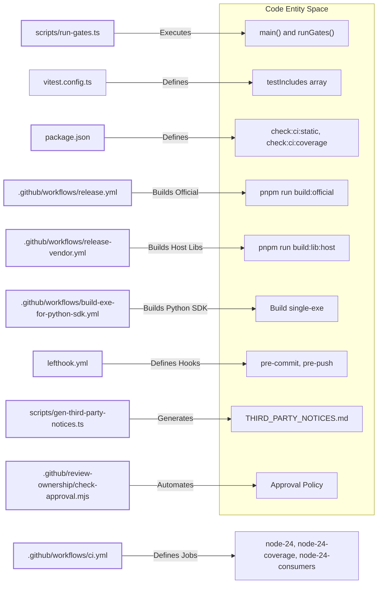

<!-- source: DeepWiki mcp.deepwiki.com · repo deepseek-ai/deepseek-harness · page 8.3 CI/CD Pipeline · fetched 2026-10-27 -->

# CI/CD Pipeline

<details>
<summary>Relevant source files</summary>

The following files were used as context for generating this wiki page:

- [.agents/notes/implemented/process/2026-07-21-serial-cross-platform-ci-reference.i18n.yaml](.agents/notes/implemented/process/2026-07-21-serial-cross-platform-ci-reference.i18n.yaml)
- [.agents/notes/implemented/process/2026-07-21-serial-cross-platform-ci-reference.md](.agents/notes/implemented/process/2026-07-21-serial-cross-platform-ci-reference.md)
- [.agents/notes/implemented/process/2026-07-21-serial-cross-platform-ci-reference.zh.md](.agents/notes/implemented/process/2026-07-21-serial-cross-platform-ci-reference.zh.md)
- [.agents/notes/implemented/process/2026-07-26-ci-failover-runbook.i18n.yaml](.agents/notes/implemented/process/2026-07-26-ci-failover-runbook.i18n.yaml)
- [.agents/notes/implemented/process/2026-07-26-ci-failover-runbook.md](.agents/notes/implemented/process/2026-07-26-ci-failover-runbook.md)
- [.agents/notes/implemented/process/2026-07-26-ci-failover-runbook.zh.md](.agents/notes/implemented/process/2026-07-26-ci-failover-runbook.zh.md)
- [.agents/notes/implemented/process/2026-07-27-worktree-local-lefthook.i18n.yaml](.agents/notes/implemented/process/2026-07-27-worktree-local-lefthook.i18n.yaml)
- [.agents/notes/implemented/process/2026-07-27-worktree-local-lefthook.md](.agents/notes/implemented/process/2026-07-27-worktree-local-lefthook.md)
- [.agents/notes/implemented/process/2026-07-27-worktree-local-lefthook.zh.md](.agents/notes/implemented/process/2026-07-27-worktree-local-lefthook.zh.md)
- [.agents/notes/implemented/process/2026-07-30-generated-third-party-notices.i18n.yaml](.agents/notes/implemented/process/2026-07-30-generated-third-party-notices.i18n.yaml)
- [.agents/notes/implemented/process/2026-07-30-generated-third-party-notices.md](.agents/notes/implemented/process/2026-07-30-generated-third-party-notices.md)
- [.agents/notes/implemented/process/2026-07-30-generated-third-party-notices.zh.md](.agents/notes/implemented/process/2026-07-30-generated-third-party-notices.zh.md)
- [.agents/notes/implemented/process/2026-08-08-native-windows-pull-request-ci.i18n.yaml](.agents/notes/implemented/process/2026-08-08-native-windows-pull-request-ci.i18n.yaml)
- [.agents/notes/implemented/process/2026-08-08-native-windows-pull-request-ci.md](.agents/notes/implemented/process/2026-08-08-native-windows-pull-request-ci.md)
- [.agents/notes/implemented/process/2026-08-08-native-windows-pull-request-ci.zh.md](.agents/notes/implemented/process/2026-08-08-native-windows-pull-request-ci.zh.md)
- [.agents/notes/implemented/process/2026-08-10-npm-release-sequences.i18n.yaml](.agents/notes/implemented/process/2026-08-10-npm-release-sequences.i18n.yaml)
- [.agents/notes/implemented/process/2026-08-10-npm-release-sequences.md](.agents/notes/implemented/process/2026-08-10-npm-release-sequences.md)
- [.agents/notes/implemented/process/2026-08-10-npm-release-sequences.zh.md](.agents/notes/implemented/process/2026-08-10-npm-release-sequences.zh.md)
- [.github/AGENTS.md](.github/AGENTS.md)
- [.github/review-ownership/README.md](.github/review-ownership/README.md)
- [.github/review-ownership/check-approval.mjs](.github/review-ownership/check-approval.mjs)
- [.github/review-ownership/check-approval.test.mjs](.github/review-ownership/check-approval.test.mjs)
- [.github/workflows/build-exe-for-python-sdk.yml](.github/workflows/build-exe-for-python-sdk.yml)
- [.github/workflows/ci-master.yml](.github/workflows/ci-master.yml)
- [.github/workflows/ci.yml](.github/workflows/ci.yml)
- [.github/workflows/docs-pages.yml](.github/workflows/docs-pages.yml)
- [.github/workflows/e2e.yml](.github/workflows/e2e.yml)
- [.github/workflows/pi-ai-provider-e2e.yml](.github/workflows/pi-ai-provider-e2e.yml)
- [.github/workflows/release-vendor.yml](.github/workflows/release-vendor.yml)
- [.github/workflows/release.yml](.github/workflows/release.yml)
- [.github/workflows/sandbox.yml](.github/workflows/sandbox.yml)
- [.github/workflows/weighted-approval-review-event.yml](.github/workflows/weighted-approval-review-event.yml)
- [.github/workflows/weighted-approval.yml](.github/workflows/weighted-approval.yml)
- [.gitlab-ci.yml](.gitlab-ci.yml)
- [AGENTS.md](AGENTS.md)
- [Makefile](Makefile)
- [THIRD_PARTY_NOTICES.md](THIRD_PARTY_NOTICES.md)
- [docs/development.i18n.yaml](docs/development.i18n.yaml)
- [docs/development.md](docs/development.md)
- [docs/development.zh.md](docs/development.zh.md)
- [lefthook.yml](lefthook.yml)
- [package.json](package.json)
- [packages/README.i18n.yaml](packages/README.i18n.yaml)
- [packages/README.md](packages/README.md)
- [packages/README.zh.md](packages/README.zh.md)
- [packages/llm/llm-pi-ai/package.json](packages/llm/llm-pi-ai/package.json)
- [packages/llm/llm-pi-ai/tests/provider-apis.e2e.ts](packages/llm/llm-pi-ai/tests/provider-apis.e2e.ts)
- [packages/sandbox/sandbox-local/tests/packed-install.e2e.ts](packages/sandbox/sandbox-local/tests/packed-install.e2e.ts)
- [pnpm-workspace.yaml](pnpm-workspace.yaml)
- [scripts/AGENTS.md](scripts/AGENTS.md)
- [scripts/ci-compatible-selfhosted.spec.ts](scripts/ci-compatible-selfhosted.spec.ts)
- [scripts/ci-workflow.spec.ts](scripts/ci-workflow.spec.ts)
- [scripts/gen-third-party-notices.spec.ts](scripts/gen-third-party-notices.spec.ts)
- [scripts/gen-third-party-notices.ts](scripts/gen-third-party-notices.ts)
- [scripts/install-lefthook.mjs](scripts/install-lefthook.mjs)
- [scripts/install-lefthook.spec.ts](scripts/install-lefthook.spec.ts)
- [scripts/release/bump.ts](scripts/release/bump.ts)
- [scripts/release/families.spec.ts](scripts/release/families.spec.ts)
- [scripts/release/families.ts](scripts/release/families.ts)
- [scripts/release/pack.ts](scripts/release/pack.ts)
- [scripts/release/process.ts](scripts/release/process.ts)
- [scripts/release/publish.spec.ts](scripts/release/publish.spec.ts)
- [scripts/release/publish.ts](scripts/release/publish.ts)
- [scripts/release/tarball.ts](scripts/release/tarball.ts)
- [scripts/release/verify-packed-install.ts](scripts/release/verify-packed-install.ts)
- [scripts/release/verify.ts](scripts/release/verify.ts)
- [scripts/run-gates.spec.ts](scripts/run-gates.spec.ts)
- [scripts/run-gates.ts](scripts/run-gates.ts)
- [scripts/tests/ci-release-selfhosted.spec.ts](scripts/tests/ci-release-selfhosted.spec.ts)
- [scripts/workspace-package-globs.spec.ts](scripts/workspace-package-globs.spec.ts)
- [scripts/workspace-package-globs.ts](scripts/workspace-package-globs.ts)
- [tsconfig.json](tsconfig.json)
- [tsdown.config.ts](tsdown.config.ts)
- [vitest.config.ts](vitest.config.ts)

</details>


The DeepSeek Harness (DSH) CI/CD infrastructure provides a robust, multi-platform verification system leveraging GitHub Actions workflows. Its design carefully balances throughput, fidelity, and resource efficiency by orchestrating a combination of Linux and Windows jobs across hosted and self-hosted runners. A key focus is on low-latency feedback loops enforced by strict quality gates such as 100% per-file test coverage, while maintaining failover resilience and automation in pull request management.

---

## Pipeline Architecture

The central CI orchestration is defined within `.github/workflows/ci.yml` [.github/workflows/ci.yml:1-763](). Here, Linux verification consolidates into concurrent high-core runner jobs. Windows verification employs a dual-path strategy: Wine-based compatibility checks on Linux runners and parallel, native Windows tests on dedicated Windows hosts. This topology reduces redundant setup such as source checkout, dependency installation, and caching, optimizing wall-clock times.

### Triggering and Concurrency Control

- **Trigger:**
  - The main workflow triggers on pull requests (`pull_request` event) [.github/workflows/ci.yml:3-4]().
- **Concurrency:**
  - Concurrency groups executions by workflow and git reference (`${{ github.workflow }}-${{ github.ref }}`) [.github/workflows/ci.yml:17-19]().
  - Automatically cancels superseded runs to minimize queue congestion on paid runners [.github/workflows/ci.yml:14-19]().
  - Cancellation is disabled on certain protected push events tracking readiness jobs [scripts/ci-workflow.spec.ts:47-54]().

### Environment Variables

| Variable                | Purpose                                                  |
|-------------------------|----------------------------------------------------------|
| `PRIMARY_NODE_VERSION`  | Fixed Node.js version (`24`) used across jobs [.github/workflows/ci.yml:9]().            |
| `DSH_TELEMETRY_DISABLED` | Disables telemetry in CI environments (`1`) [.github/workflows/ci.yml:11-12]().             |
| `DSH_CI_FAILOVER_LINUX` | Switches Linux jobs to self-hosted runner pools (`selfhosted`, `blacksmith`) [.github/workflows/ci.yml:27-41](). |
| `DSH_CI_FAILOVER_WINDOWS`| Switches Windows jobs to internal self-hosted runners [.github/workflows/ci.yml:40-41]().  |

Sources:
- [.github/workflows/ci.yml:1-57]()
- [scripts/ci-workflow.spec.ts:47-54]()

---

## Key CI Jobs Overview

| Job                   | Platform           | Functionality                                            | Blocking for Merge                |
|-----------------------|--------------------|---------------------------------------------------------|---------------------------------|
| `node-24`             | Linux (16-core)    | Runs static analysis: lint, typechecks, docs            | Yes                             |
| `node-24-coverage`    | Linux (16-core)    | Enforces 100% per-file test coverage via Vitest         | Yes                             |
| `node-24-consumers`   | Linux (16-core)    | Runs consumers like snapshot tests, publishing checks   | Yes                             |
| `windows`             | Linux (Wine)       | Runs Windows toolchain gate under Wine (fast feedback)  | Yes                             |
| `windows-build`       | Native Windows     | Native Windows build and static checks                   | Yes (blocking)                  |
| `windows-coverage`    | Native Windows     | Partitioned coverage on Windows                          | Observational (non-blocking)    |
| `windows-native-tests`| Native Windows     | Native Windows tests                                     | Yes                             |
| `windows-observational`| Native Windows    | Observational static and smoke tests                     | No                              |

Sources:
- [.github/workflows/ci.yml:42-134]()

---

### Linux Primary Job - Static Analysis (`node-24`)

- Runs on `dsh-ubuntu-24-04-16core` runner (16-core hosted Linux) [.github/workflows/ci.yml:44-49]().
- Performs static gates including linter, contract-readiness typechecks, and documentation checks [.github/workflows/ci.yml:104-108]().
- Full git history checkout (`fetch-depth: 0`) for archive gate integrity [.github/workflows/ci.yml:64-66]().
- Controlled concurrency via `DSH_GATE_CONCURRENCY=8` [.github/workflows/ci.yml:53]().
- Fail-fast on first blocking gate failure (`DSH_GATE_FAIL_FAST=1`) [.github/workflows/ci.yml:55-56]().
- Executes `pnpm run check:ci:static` script for all static validations [.github/workflows/ci.yml:107]().

Sources:
- [.github/workflows/ci.yml:42-108]()

---

### Coverage Job with Partitioning (`node-24-coverage`)

- Runs on the same 16-core Linux runner [.github/workflows/ci.yml:111-116]().
- Implements coverage partitioning splitting coverage workload into shards plus exempt heavy workers [.github/workflows/ci.yml:121-123]().
- Environment tuned for Vitest:
  - `DSH_COVERAGE_MAX_WORKERS=6` [.github/workflows/ci.yml:120]()
  - `DSH_COVERAGE_PARTITIONS=4` [.github/workflows/ci.yml:121]()
  - `DSH_GATE_CONCURRENCY=3` [.github/workflows/ci.yml:122]()
- Allows an extended test timeout (`DSH_COVERAGE_TEST_TIMEOUT_MS=90000`) [.github/workflows/ci.yml:130]().

Sources:
- [.github/workflows/ci.yml:109-134]()

---

## Failover and Resilience

Failover is implemented to ensure CI continuity in case of interruptions in hosted runners for Linux or Windows:

| Environment Variable      | Description                         | Affected Jobs                                                          |
|--------------------------|----------------------------------|------------------------------------------------------------------------|
| `DSH_CI_FAILOVER_LINUX`  | Switches Linux jobs to `selfhosted` or `blacksmith` runner pools | All Linux jobs (`node-24`, `node-24-coverage`, `node-24-consumers`). |
| `DSH_CI_FAILOVER_WINDOWS`| Switches Windows jobs to internal self-hosted runners | All native Windows jobs (`windows-build`, `windows-coverage`, etc.).    |

- Failover variable control is limited to repository collaborators; no PR merge required [.github/workflows/ci.yml:27-41]().
- Under Linux failover, cache restore steps for pnpm are conditionally skipped [.github/workflows/ci.yml:93-94]().
- Serial standby lanes run on `master` pushes continually verifying readiness of failover pools [.github/workflows/ci.yml:38-39]().

Sources:
- [.github/workflows/ci.yml:27-41]()
- [.github/workflows/ci.yml:93-94]()

---

## CI Gate Orchestration (`scripts/run-gates.ts`)

The `scripts/run-gates.ts` [scripts/run-gates.ts:1-1697]() script is central to managing the execution of quality gates.

Key features include:
- Defines predicates and data structures for `Gate` verification units such as lint checks, coverage partitions, and snapshot validations [scripts/run-gates.ts:42-58]().
- Manages execution of gates respecting concurrency limits and dependency graphs [scripts/run-gates.ts:103-112]().
- Implements fail-fast control to abort remaining checks on blocking failures [scripts/run-gates.ts:112-113]().
- Streams gate output in real time, supporting detailed logging and diagnostics [scripts/run-gates.ts:56]().

Sources:
- [scripts/run-gates.ts:1-1697]()

---

## Vitest Configuration for CI (`vitest.config.ts`)

The `vitest.config.ts` [vitest.config.ts:1-406]() file configures the Vitest test runner for the CI environment with advanced controls:
- Splits test suites into mutually exclusive sets and process-bound long tests.
- Defines platform-specific exclusions such as bash-dependent shells skipped on Windows [vitest.config.ts:22-41]().
- Supports coverage partitioning via environment variables like `DSH_COVERAGE_PARTITIONS` [vitest.config.ts:8]().

Sources:
- [vitest.config.ts:1-406]()

---

## Release and Publish Workflows

The CI/CD pipeline also includes dedicated workflows for releasing and publishing packages. These workflows ensure that artifacts are built, packaged, and published correctly, often with specific build profiles and checks.

### `release.yml` and `release-vendor.yml`

These workflows handle the packaging and publishing of the main DeepSeek Harness application and its vendored dependencies.
- The `pack` job in `release.yml` builds the official artifacts. For pull requests, it runs `pnpm run build:artifacts --profile official`, while for pushes, it runs `pnpm run build:official` [scripts/ci-workflow.spec.ts:97-98]().
- Similarly, `release-vendor.yml`'s `pack` job builds host libraries. For pull requests, it runs `pnpm exec tsx scripts/compile-referenced-projects.ts host-libraries`, and for pushes, `pnpm run build:lib:host` [scripts/ci-workflow.spec.ts:99-100]().
- These build commands are defined in `package.json` [package.json:21-25]().

### Python SDK Executable Builder (`build-exe-for-python-sdk.yml`)

This workflow is responsible for building the single-file executable for the Python SDK.
- It includes jobs for `plan`, `sdk-wheel`, and `build` [scripts/ci-workflow.spec.ts:51-52]().
- The `build` job uses a matrix strategy based on the output of the `plan` job to build for different targets [scripts/ci-workflow.spec.ts:63-64]().
- Importantly, this workflow does not run `pnpm run build:artifacts` directly, but rather orchestrates the build of the single-exe [scripts/ci-workflow.spec.ts:123-124]().

Sources:
- [.github/workflows/release.yml]()
- [.github/workflows/release-vendor.yml]()
- [.github/workflows/build-exe-for-python-sdk.yml]()
- [scripts/ci-workflow.spec.ts:94-124]()
- [package.json:21-25]()

---

## Lefthook Hooks

Lefthook is used to manage Git hooks, ensuring that pre-commit and pre-push checks are run locally.
- During `pnpm install`, `scripts/install-lefthook.mjs` is executed to configure worktree-local Lefthook hooks [docs/development.md:35-36]().
- If hooks are missing (e.g., due to cache restore), they can be manually installed via `node scripts/install-lefthook.mjs` [docs/development.md:43-44]().
- The `lefthook.yml` file defines the actual hooks, such as `pre-commit` and `pre-push` checks.

Sources:
- [docs/development.md:35-44]()
- [scripts/install-lefthook.mjs]()
- [lefthook.yml]()

---

## Third-Party Notices

The CI/CD pipeline includes a gate to ensure that third-party notices are up-to-date.
- `scripts/gen-third-party-notices.ts` generates the `THIRD_PARTY_NOTICES.md` file [THIRD_PARTY_NOTICES.md:1-2]().
- `scripts/gen-third-party-notices.spec.ts` asserts that the committed `THIRD_PARTY_NOTICES.md` matches the generated output, ensuring freshness [THIRD_PARTY_NOTICES.md:8]().
- The `pnpm run gen-third-party-notices` command regenerates the file, and `pnpm run verify-third-party-notices` performs a standalone check [THIRD_PARTY_NOTICES.md:8]().

Sources:
- [THIRD_PARTY_NOTICES.md:1-14]()
- [scripts/gen-third-party-notices.ts]()
- [scripts/gen-third-party-notices.spec.ts]()

---

## Issue and Review-Ownership Automation

The repository employs automation for issue management and review ownership to streamline development and maintain code quality.
- `test:approval-policy` script runs tests for approval policy, blame ownership, and author weight using `check-approval.test.mjs`, `blame-ownership.test.mjs`, and `author-weight.test.mjs` [package.json:70]().
- `test:issue-management` script runs issue management policy tests using `policy.test.mjs` [package.json:71]().
- These scripts are located in the `.github/review-ownership/` directory.

Sources:
- [package.json:70-71]()
- [.github/review-ownership/check-approval.test.mjs]()
- [.github/review-ownership/README.md]()

---

# Natural Language to Code Entity Mapping Diagrams

## Pipeline Job to GitHub Workflow Job ID Mapping

```mermaid
graph TD
  "StaticAnalysis" -->|"Triggers"| node24["node-24"]
  "CoverageGate" -->|"Triggers"| node24cov["node-24-coverage"]
  "ConsumersJob" -->|"Triggers"| node24cons["node-24-consumers"]
  "GateOrchestrator" -->|"Executes"| runGates["runGates()"]
  "VitestConfig" -->|"Configures"| vitestConfig["vitest.config.ts"]

  subgraph "Code Entity Space"
    node24
    node24cov
    node24cons
    runName["scripts/run-gates.ts"]
    vitestName["vitest.config.ts"]
  end

  style node24 stroke-width: 2px
  style node24cov stroke-width: 2px
  style node24cons stroke-width: 2px
```
Sources:
- [.github/workflows/ci.yml:42-205]()
- [scripts/run-gates.ts:1-115]()
- [vitest.config.ts:1-25]()

## CI Workflow Files to Key Functions and Scripts


Sources:
- [.github/workflows/ci.yml:1-763]()
- [scripts/run-gates.ts:98-119]()
- [vitest.config.ts:125-131]()
- [package.json:85-95]()
- [.github/workflows/release.yml]()
- [.github/workflows/release-vendor.yml]()
- [.github/workflows/build-exe-for-python-sdk.yml]()
- [lefthook.yml]()
- [scripts/gen-third-party-notices.ts]()
- [.github/review-ownership/check-approval.mjs]()

---

# Summary

The DeepSeek Harness (DSH) CI/CD pipeline combines sophistication and pragmatism:
- Uses high-core runners with controlled concurrency for faster wall-clock times [.github/workflows/ci.yml:44-49]().
- Implements dual-path verification to optimize feedback and accuracy.
- Enforces strict verification standards including 100% per-file test coverage enforced via partitioned Vitest runs [.github/workflows/ci.yml:121-123]().
- Facilitates robustness with failover switches for Linux and Windows platforms [.github/workflows/ci.yml:27-41]().
- Integrates tooling orchestration with `scripts/run-gates.ts` for concurrency and dependency management [scripts/run-gates.ts:98-119]().
- Manages release and publishing processes with dedicated workflows and build profiles.
- Ensures local quality gates via Lefthook Git hooks.
- Automates third-party notice generation and verification.
- Implements issue and review-ownership automation for streamlined development.

Sources:
- [.github/workflows/ci.yml:1-763]()
- [scripts/run-gates.ts:1-1697]()
- [vitest.config.ts:1-406]()
- [.github/workflows/release.yml]()
- [.github/workflows/release-vendor.yml]()
- [.github/workflows/build-exe-for-python-sdk.yml]()
- [lefthook.yml]()
- [scripts/gen-third-party-notices.ts]()
- [.github/review-ownership/check-approval.mjs]()

---

