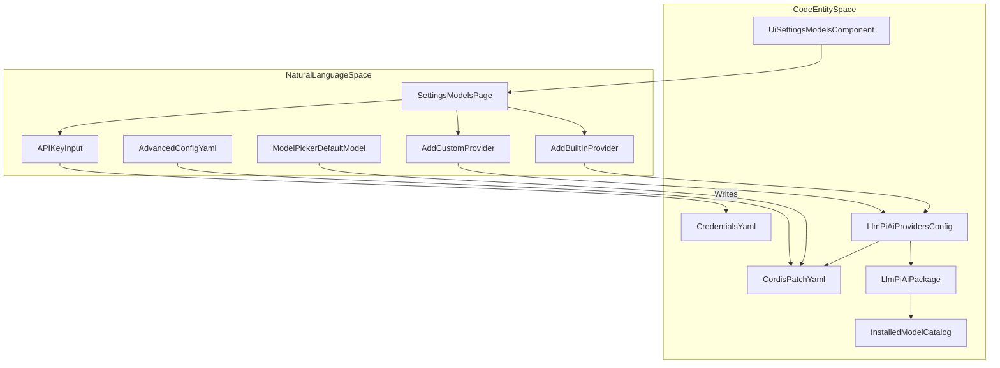
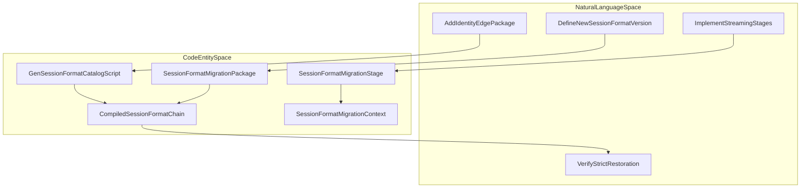
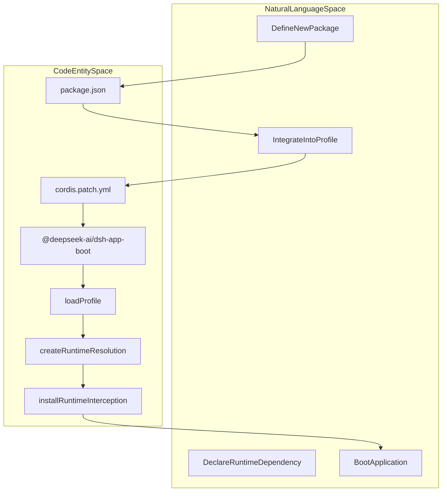

<!-- source: DeepWiki mcp.deepwiki.com · repo deepseek-ai/deepseek-harness · page 9.3 User Guides & Cookbooks · fetched 2026-10-27 -->

# User Guides & Cookbooks

<details>
<summary>Relevant source files</summary>

The following files were used as context for generating this wiki page:

- [.agents/notes/implemented/architecture/2026-09-09-consumer-owned-startup-strictness.i18n.yaml](.agents/notes/implemented/architecture/2026-09-09-consumer-owned-startup-strictness.i18n.yaml)
- [.agents/notes/implemented/architecture/2026-09-09-consumer-owned-startup-strictness.md](.agents/notes/implemented/architecture/2026-09-09-consumer-owned-startup-strictness.md)
- [.agents/notes/implemented/architecture/2026-09-09-consumer-owned-startup-strictness.zh.md](.agents/notes/implemented/architecture/2026-09-09-consumer-owned-startup-strictness.zh.md)
- [.agents/notes/implemented/architecture/2026-09-09-profile-resolution-generations.i18n.yaml](.agents/notes/implemented/architecture/2026-09-09-profile-resolution-generations.i18n.yaml)
- [.agents/notes/implemented/architecture/2026-09-09-profile-resolution-generations.md](.agents/notes/implemented/architecture/2026-09-09-profile-resolution-generations.md)
- [.agents/notes/implemented/architecture/2026-09-09-profile-resolution-generations.zh.md](.agents/notes/implemented/architecture/2026-09-09-profile-resolution-generations.zh.md)
- [.agents/notes/implemented/architecture/2026-09-19-profile-resolution-lookup-order.i18n.yaml](.agents/notes/implemented/architecture/2026-09-19-profile-resolution-lookup-order.i18n.yaml)
- [.agents/notes/implemented/architecture/2026-09-19-profile-resolution-lookup-order.md](.agents/notes/implemented/architecture/2026-09-19-profile-resolution-lookup-order.md)
- [.agents/notes/implemented/architecture/2026-09-19-profile-resolution-lookup-order.zh.md](.agents/notes/implemented/architecture/2026-09-19-profile-resolution-lookup-order.zh.md)
- [apps/cli/tests/profiles/headless/tests/profile-resolution.ts](apps/cli/tests/profiles/headless/tests/profile-resolution.ts)
- [apps/cli/tests/profiles/web/tests/web-best-effort-startup.expected.e2e.ts](apps/cli/tests/profiles/web/tests/web-best-effort-startup.expected.e2e.ts)
- [apps/cli/tests/profiles/web/tests/web-failure-matrix.expected.e2e.ts](apps/cli/tests/profiles/web/tests/web-failure-matrix.expected.e2e.ts)
- [docs/user/develop/basic/publish.i18n.yaml](docs/user/develop/basic/publish.i18n.yaml)
- [docs/user/develop/basic/publish.md](docs/user/develop/basic/publish.md)
- [docs/user/develop/basic/publish.zh.md](docs/user/develop/basic/publish.zh.md)
- [docs/user/guide/providers.i18n.yaml](docs/user/guide/providers.i18n.yaml)
- [docs/user/guide/providers.md](docs/user/guide/providers.md)
- [docs/user/guide/providers.zh.md](docs/user/guide/providers.zh.md)
- [packages/boot/app-boot/README.i18n.yaml](packages/boot/app-boot/README.i18n.yaml)
- [packages/boot/app-boot/README.md](packages/boot/app-boot/README.md)
- [packages/boot/app-boot/README.zh.md](packages/boot/app-boot/README.zh.md)
- [packages/boot/app-boot/src/index.ts](packages/boot/app-boot/src/index.ts)
- [packages/boot/app-boot/src/profile-resolution/legacy-links.ts](packages/boot/app-boot/src/profile-resolution/legacy-links.ts)
- [packages/boot/app-boot/src/profile-resolution/resolver.ts](packages/boot/app-boot/src/profile-resolution/resolver.ts)
- [packages/boot/app-boot/src/profile-resolution/service.ts](packages/boot/app-boot/src/profile-resolution/service.ts)
- [packages/boot/app-boot/src/profile-resolution/worker-bootstrap.ts](packages/boot/app-boot/src/profile-resolution/worker-bootstrap.ts)
- [packages/boot/app-boot/src/profile.ts](packages/boot/app-boot/src/profile.ts)
- [packages/boot/app-boot/tests/app-boot.spec.ts](packages/boot/app-boot/tests/app-boot.spec.ts)
- [packages/boot/app-boot/tests/profile-resolution-service.spec.ts](packages/boot/app-boot/tests/profile-resolution-service.spec.ts)
- [packages/boot/app-boot/tests/profile-resolution-worker-bootstrap.spec.ts](packages/boot/app-boot/tests/profile-resolution-worker-bootstrap.spec.ts)
- [packages/boot/app-boot/tests/profile-resolution.spec.ts](packages/boot/app-boot/tests/profile-resolution.spec.ts)
- [packages/boot/app-boot/tests/profile.spec.ts](packages/boot/app-boot/tests/profile.spec.ts)
- [packages/boot/app-boot/tests/user-patches.spec.ts](packages/boot/app-boot/tests/user-patches.spec.ts)

</details>


This documentation section "User Guides & Cookbooks" (9.3) provides technical guidance specifically targeted at end-users and developers working with DeepSeek Harness (`dsh`). It focuses on user-facing documentation, such as how to configure providers in the Web UI, and on cookbook-style recipes for extending the codebase by adding new packages, tools, session format versions, and vendored dependencies.

These guides serve two main roles:

- **User Guides** describe setup and usage patterns, especially configuration of models and providers to use DeepSeek in various workflows [docs/user/guide/providers.md:1-49]().
- **Cookbooks** provide practical patterns, checklists, and code reference implementations to help developers author extensions, such as new tools, plugins, or session log format version migrations, consistent with the `dsh` architecture [docs/cookbook/adding-a-session-format-version.md:1-56]().

---

## 1. User Guides Overview

The user guides cover essential steps for working with `dsh` in real scenarios, focusing primarily on *provider configuration* in the Web UI. This includes adding built-in or custom LLM providers, managing API keys, selecting models, and adjusting advanced settings like image input support, reasoning effort, and compatibility tweaks [docs/user/guide/providers.md:7-187]().

### 1.1 Configuring Providers in the Web UI

The primary user-facing entry for model configuration is the **Settings → Models** page in the `dsh` Web UI [docs/user/guide/providers.md:8-9](). Key points:

- **API Keys** are write-only: upon save, keys are stored securely under `$DSH_HOME/.credentials.yaml` and only masked descriptors are exposed to the client page [docs/user/guide/providers.md:13-14]().
- **Built-in Providers** can be selected from a predefined catalog (`anthropic`, `openai`, `moonshotai`, `zai`, etc.) with endpoint, protocol, and models configured automatically [docs/user/guide/providers.md:16-18]().
- **Custom Providers** support company gateways or self-hosted endpoints [docs/user/guide/providers.md:21-24](). Key required fields:
  - Lowercase Provider ID (permanent, used in requests, saved sessions, and credential references) [docs/user/guide/providers.md:23-27]()
  - Base URL [docs/user/guide/providers.md:23]()
  - API Protocol: one of `openai-completions`, `openai-responses`, or `anthropic-messages` [docs/user/guide/providers.md:23]()
  - Credential (API key) [docs/user/guide/providers.md:23]()
  - Models: at least one model with its ID and attributes [docs/user/guide/providers.md:23]()
  
A custom provider can ask the endpoint for a list of available models via **Model catalog → Fetch available models**, which populates a searchable picker interface [docs/user/guide/providers.md:29-31]().

If the discovery fails or is unsupported, users can manually enter model IDs and configure their attributes [docs/user/guide/providers.md:31-33](). Selecting a model on this page sets the **default model for new sessions**; existing sessions retain their selected model [docs/user/guide/providers.md:35-37]().

Sources: `docs/user/guide/providers.md` (lines 8-37)

### 1.2 Advanced Model Configuration Fields

Advanced users can directly edit `$DSH_HOME/profiles/<profile>/cordis.patch.yml` or open it from the UI when the browser runs locally, enabling on-the-fly changes without restarting `dsh` [docs/user/guide/providers.md:46-48](). The `dsh-app-boot` package is responsible for loading these profile patches and composing them into the running application's configuration [packages/boot/app-boot/README.md:12]().

Important advanced fields include:

- **Image input support:** To enable image input support for a model, add an `input` attribute listing supported modalities, e.g., `[text, image]` [docs/user/guide/providers.md:53-71]().

  ```yaml
  - id: llm-pi-ai
    config:
      providers:
        my-gateway:
          apiKeyEnv: GATEWAY_API_KEY
          api: openai-completions
          baseURL: https://gateway.example/v1
          models:
            - id: legacy-chat
            - id: vision-preview
              input: [text, image]
  ```
  [docs/user/guide/providers.md:60-71]()

- **Reasoning Effort Levels:** Models can declare different reasoning effort levels via the `reasoningEfforts` map [docs/user/guide/providers.zh.md:113-130]().

  ```yaml
        models:
          - id: my-reasoner
            reasoningEfforts:
              off:
              high: high
              max: max
  ```
  [docs/user/guide/providers.zh.md:126-130]()

  The special `off` level's behavior can be customized (including sending a special thinking format like `compat.thinkingFormat: deepseek`) to support compatibility quirks of various gateways [docs/user/guide/providers.zh.md:134-145]().

- **Request Compatibility:** Endpoints often differ in expected request shapes. Fields like `compat.supportsDeveloperRole` and `compat.maxTokensField` configure how system prompts and token limits are sent [docs/user/guide/providers.zh.md:159-173]().

Sources: `docs/user/guide/providers.md` (lines 41-94), `docs/user/guide/providers.zh.md` (lines 111-187), `packages/boot/app-boot/README.md` (line 12)

---

## 2. Cookbooks: Expansion Patterns and Recipes

Cookbooks offer step-by-step guidance for engineers to extend `dsh` by adding packages, defining tools, building plugins, and adding session log format versions.

### 2.1 Adding a Session Log Format Version

When introducing a new Session log format version (e.g., from version $N$ to $N+1$), engineers follow a rigorous migration protocol to avoid rewriting released data [docs/cookbook/adding-a-session-format-version.md:7-8]()]:

1.  **Choose the version and release base:** Bump the format integer only when structural changes to headers, event envelopes, or event semantics require it [docs/cookbook/adding-a-session-format-version.md:23-24]().
2.  **Add an identity edge:** Create a migration package under packages (e.g., implementing `SessionFormatMigration`) declaring `dsh.sessionFormatMigration` with numeric `from: N` and `to: N+1` [docs/cookbook/adding-a-session-format-version.md:38-40](). Run `pnpm run gen-session-format-catalog` to compile the catalog [docs/cookbook/adding-a-session-format-version.md:44-46]().
3.  **Implement per-artifact stages and validation:** Use stateful synchronous `Stage` interfaces (`transformEvent`, `transformRun`, `finish`) to stream items efficiently without materializing whole-artifact arrays [docs/cookbook/adding-a-session-format-version.md:51-56]().
4.  **Update current-version consumers:** Update session creation, recovery, JSONL filename resolution, and SDK records [docs/cookbook/adding-a-session-format-version.md:76-80]().
5.  **Create snapshot successors & validate:** Refresh snapshot fixtures using test commands [docs/cookbook/adding-a-session-format-version.md:87-92]() and run strict recovery validation via `sessionFormatCatalog.createRestore(header, { recovery: 'strict', validation: 'current' })` [docs/cookbook/adding-a-session-format-version.md:71-72]().

Sources: `docs/cookbook/adding-a-session-format-version.md` (lines 7-72), `.agents/notes/implemented/architecture/2026-08-31-released-session-format-migrations.md:26-55`()

### 2.2 Adding a New Package

Adding a new package to the DeepSeek Harness monorepo involves several steps, particularly concerning its integration into the profile system and runtime resolution. The `dsh-app-boot` package manages how profiles are loaded, bundles are composed, and how runtime dependencies are resolved [packages/boot/app-boot/README.md:12]().

1.  **Create the Package Structure**:
    *   Create a new directory under `packages/` for your new package.
    *   Initialize `package.json` with appropriate `name`, `version`, `type`, and `dependencies`.
    *   If the package is a Cordis plugin, ensure it exports a default plugin object.

2.  **Define Profile Integration**:
    *   If your package is intended to be part of a `dsh` profile, it might be declared as a bundle. A bundle's `dsh.bundle.patch` field in its `package.json` specifies patch files (`cordis.patch.yml`) that define its configuration entries [packages/boot/app-boot/README.md:49-50]().
    *   These patch files are loaded by `dsh-app-boot` using `bundlePatchFiles` and `bundlePatchPaths` functions [packages/boot/app-boot/src/profile.ts:58-75]().

3.  **Runtime Resolution**:
    *   The `dsh-app-boot` package handles runtime resolution for packages. This involves creating an immutable runtime resolution graph from the installation's dependency graph and the ordered bundle dependency graph [packages/boot/app-boot/README.md:67-68]().
    *   This resolution is installed into Node's ESM and CommonJS resolvers [packages/boot/app-boot/README.md:68]().
    *   The `createRuntimeResolution` function [packages/boot/app-boot/src/profile.ts:400-402]() is central to this process, taking the install anchor, profile, and home directory to build the resolution.
    *   The `installRuntimeInterception` function [packages/boot/app-boot/src/profile-resolution/resolver.ts:190-191]() intercepts Node's module resolution to apply the computed runtime resolution.

4.  **Testing**:
    *   Ensure your package integrates correctly with the profile system by writing tests that load profiles and verify module resolution. The `profile-resolution.spec.ts` [packages/boot/app-boot/tests/profile-resolution.spec.ts:1-2710]() and `profile.spec.ts` [packages/boot/app-boot/tests/profile.spec.ts:1-814]() test files in `dsh-app-boot` provide examples of how to test profile loading and runtime resolution.

Sources: `packages/boot/app-boot/README.md` (lines 12, 49-50, 67-68), `packages/boot/app-boot/src/profile.ts` (lines 58-75, 400-402), `packages/boot/app-boot/src/profile-resolution/resolver.ts` (lines 190-191), `packages/boot/app-boot/tests/profile-resolution.spec.ts` (lines 1-2711), `packages/boot/app-boot/tests/profile.spec.ts` (lines 1-815)

---

## 3. Diagram: Natural Language Space to Code Entities — Provider Configuration

This diagram maps user-facing concepts in the Web UI to the relevant code entities and configuration files involved in provider setup.



**Explanation:**  
Users configure providers through the Web UI's Settings page, entering API keys and provider details. Keys are stored securely in `.credentials.yaml`. Provider definitions, including custom or built-in models, are persisted in `cordis.patch.yml` under the `llm-pi-ai:providers` key. The `llm-pi-ai` package loads this to resolve runtime behaviors and model catalogs.

Sources: `docs/user/guide/providers.md` (lines 8-94), `docs/user/guide/providers.zh.md` (lines 9-183)

---

## 4. Diagram: Natural Language Space to Code Entities — Session Format Migration Chain

This diagram connects cookbook topics for session log migrations to the underlying streaming stage architecture.



**Explanation:**  
Developers adding a session format version implement immutable migration declarations and stateful streaming stages (`SessionFormatMigrationStage`). The `CompiledSessionFormatChain` orchestrates these stages sequentially using `SessionFormatMigrationContext` emitters without loading full artifact arrays into memory.

Sources: `docs/cookbook/adding-a-session-format-version.md` (lines 35-56), `.agents/notes/implemented/architecture/2026-08-31-released-session-format-migrations.md:26-66`()

---

## 5. Diagram: Natural Language Space to Code Entities — Package Integration

This diagram illustrates the flow from defining a new package to its integration and runtime resolution within `dsh` profiles.



**Explanation:**
A new package is defined with its `package.json`. If it's a bundle, its `cordis.patch.yml` specifies configuration. `dsh-app-boot`'s `loadProfile` function reads these configurations. `createRuntimeResolution` then builds a dependency graph, which `installRuntimeInterception` uses to modify Node's module resolution, making the new package available at application boot.

Sources: `packages/boot/app-boot/README.md` (lines 12, 49-50, 67-68), `packages/boot/app-boot/src/profile.ts` (lines 58-75, 400-402), `packages/boot/app-boot/src/profile-resolution/resolver.ts` (lines 190-191)

---

## 6. Summary Tables

### 6.1 User Guide – Configuring Providers

| Operation | UI Location | Config Files/Keys | Related Package/Code |
|---|---|---|---|
| Add built-in provider | Settings → Models → Add provider | `$DSH_HOME/.credentials.yaml`, `$DSH_HOME/profiles/<profile>/cordis.patch.yml` | `packages/llm/llm-pi-ai` [docs/user/guide/providers.md:9-48]() |
| Add custom provider | Settings → Models → Add custom provider | Same as above plus protocol and model fields | `llm-pi-ai` config loader [docs/user/guide/providers.md:21-27]() |
| Fetch model catalog | Models page "Fetch available models" button | API call to provider endpoint | Provider adapter implementations [docs/user/guide/providers.md:29-33]() |
| Advanced configuration | `$DSH_HOME/profiles/<profile>/cordis.patch.yml` | `input` modalities, reasoning levels, compatibility flags | See config catalog & pi-ai adapter [docs/user/guide/providers.md:43-46]() |

Sources: `docs/user/guide/providers.md` (lines 8-94)

---

### 6.2 Cookbook – Session Format Migration Checklist

| Step | Files / Location | Description & Remarks |
|---|---|---|
| 1. Choose Version & Base | `packages/session/session-format-*` | Identify release base $N \to N+1$ [docs/cookbook/adding-a-session-format-version.md:21-28]() |
| 2. Add Identity Edge | `packages/session/session-format-vN-to-vN1/` | Declare `dsh.sessionFormatMigration`, export codec & validators [docs/cookbook/adding-a-session-format-version.md:36-41]() |
| 3. Implement Stages | `src/migration.ts`, `src/codec.ts` | Use `SessionFormatMigrationStage` and context emitters [docs/cookbook/adding-a-session-format-version.md:51-56]() |
| 4. Generate Catalog | `scripts/gen-session-format-catalog.ts` | Run `pnpm run gen-session-format-catalog` [docs/cookbook/adding-a-session-format-version.md:44-48]() |
| 5. Verify Integration | `scripts/migrate-sessions-to-v4.spec.ts` | Validate strict restoration and snapshots [docs/cookbook/adding-a-session-format-version.md:71-96]() |

Sources: `docs/cookbook/adding-a-session-format-version.md` (lines 21-96), `scripts/migrate-sessions-to-v4.spec.ts` (lines 1-158)

---

### 6.3 Cookbook – Adding a New Package Checklist

| Step | Files / Location | Description & Remarks |
|---|---|---|
| 1. Create Package Structure | `packages/<new-package-name>/` | `package.json`, source files, plugin entry point if applicable. |
| 2. Define Profile Integration | `package.json`, `cordis.patch.yml` | If a bundle, define `dsh.bundle.patch` and create patch files. |
| 3. Configure Runtime Resolution | `package.json` dependencies | Declare dependencies; `dsh-app-boot` handles resolution. |
| 4. Test Integration | `packages/boot/app-boot/tests/` | Write tests for profile loading and module resolution. |

Sources: `packages/boot/app-boot/README.md` (lines 12, 49-50), `packages/boot/app-boot/src/profile.ts` (lines 58-75), `packages/boot/app-boot/tests/profile-resolution.spec.ts` (lines 1-2711), `packages/boot/app-boot/tests/profile.spec.ts` (lines 1-815)

---

