# Page: Overview

# Overview

<details>
<summary>Relevant source files</summary>

The following files were used as context for generating this wiki page:

- [apps/cli/package.json](apps/cli/package.json)
- [apps/cli/tsconfig.json](apps/cli/tsconfig.json)
- [apps/cli/tsdown.config.ts](apps/cli/tsdown.config.ts)
- [apps/web/tests/scaffold.ts](apps/web/tests/scaffold.ts)
- [apps/web/tsconfig.json](apps/web/tsconfig.json)
- [docs/architecture.i18n.yaml](docs/architecture.i18n.yaml)
- [docs/architecture.md](docs/architecture.md)
- [docs/architecture.zh.md](docs/architecture.zh.md)
- [docs/config-catalog.i18n.yaml](docs/config-catalog.i18n.yaml)
- [docs/config-catalog.md](docs/config-catalog.md)
- [docs/config-catalog.zh.md](docs/config-catalog.zh.md)
- [docs/event-producer-consumer.i18n.yaml](docs/event-producer-consumer.i18n.yaml)
- [docs/event-producer-consumer.md](docs/event-producer-consumer.md)
- [docs/event-producer-consumer.zh.md](docs/event-producer-consumer.zh.md)
- [docs/module-graph.i18n.yaml](docs/module-graph.i18n.yaml)
- [docs/module-graph.md](docs/module-graph.md)
- [docs/module-graph.zh.md](docs/module-graph.zh.md)
- [docs/subsystems/core.i18n.yaml](docs/subsystems/core.i18n.yaml)
- [docs/subsystems/core.md](docs/subsystems/core.md)
- [docs/subsystems/core.zh.md](docs/subsystems/core.zh.md)
- [packages/core/agent-loop/README.i18n.yaml](packages/core/agent-loop/README.i18n.yaml)
- [packages/core/agent-loop/README.md](packages/core/agent-loop/README.md)
- [packages/core/agent-loop/README.zh.md](packages/core/agent-loop/README.zh.md)
- [packages/core/agent-loop/src/agent.ts](packages/core/agent-loop/src/agent.ts)
- [packages/core/agent-loop/tests/cancel.spec.ts](packages/core/agent-loop/tests/cancel.spec.ts)
- [packages/core/agent-loop/tests/contract-regressions.spec.ts](packages/core/agent-loop/tests/contract-regressions.spec.ts)
- [packages/core/agent-loop/tests/coverage-edges.spec.ts](packages/core/agent-loop/tests/coverage-edges.spec.ts)
- [packages/core/agent-loop/tests/interception.spec.ts](packages/core/agent-loop/tests/interception.spec.ts)
- [packages/core/agent-loop/tests/loop.spec.ts](packages/core/agent-loop/tests/loop.spec.ts)
- [packages/core/agent/README.i18n.yaml](packages/core/agent/README.i18n.yaml)
- [packages/core/agent/README.md](packages/core/agent/README.md)
- [packages/core/agent/README.zh.md](packages/core/agent/README.zh.md)
- [packages/core/agent/src/types.ts](packages/core/agent/src/types.ts)
- [packages/extensions/tool-cordis/src/api-catalog.ts](packages/extensions/tool-cordis/src/api-catalog.ts)
- [pnpm-lock.yaml](pnpm-lock.yaml)
- [scripts/gen-cordis-catalog.ts](scripts/gen-cordis-catalog.ts)
- [scripts/type-equiv.manifest.json](scripts/type-equiv.manifest.json)
- [scripts/verify-package-readme-model-experience.ts](scripts/verify-package-readme-model-experience.ts)
- [tsconfig.base.json](tsconfig.base.json)
- [tsconfig.host.json](tsconfig.host.json)

</details>


DeepSeek Harness (`dsh`) is a modular, plugin-based agent harness designed to build, test, and deploy LLM-based agents across diverse execution environments [docs/architecture.md:1-12]().

Sources: [docs/architecture.md:1-12]()

---

## Core Philosophy: Everything is a Plugin & Capability Seams

The cornerstone of DeepSeek Harness architecture is its **everything-is-a-plugin** design, realized through a vendored version of the `Cordis` framework [docs/architecture.md:7-12](). 

Every system component—model adapters, tool registries, session persistence stores, agent driving loops—is implemented as a Cordis plugin. This allows features to be introduced, replaced, or extended solely by layering plugins without any privileged core component [docs/architecture.md:7-12]().

Functionality is organized via the **capability seam** pattern, dividing roles as follows:
1. **Service Definition**: Abstract interface declarations for capabilities (e.g., `ctx.llm`, `ctx.tools`, `ctx.sessions`) [packages/extensions/tool-cordis/src/api-catalog.ts:83-146]().
2. **Service Provider**: Concrete implementations fulfilling those contracts [docs/architecture.md:55-66]().
3. **Consumers**: Features or tools consuming these capabilities [docs/architecture.md:55-66]().

Sources: [docs/architecture.md:7-66](), [packages/extensions/tool-cordis/src/api-catalog.ts:83-146]()

---

## System Architecture: Bridging Natural Language Space and Code Entities

DeepSeek Harness bridges the agent’s natural language operational space with concrete code entities implementing core functionality.

### Diagram 1: Natural Language Concepts to Code Entities (Agent Loop)

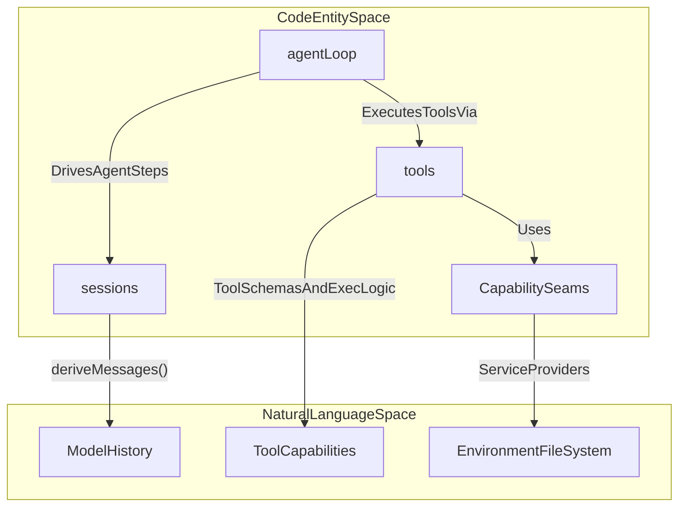
Sources: [docs/architecture.md:55-66](), [packages/extensions/tool-cordis/src/api-catalog.ts:104-131]()

### Diagram 2: Natural Language Concepts to Code Entities (LLM & Execution)

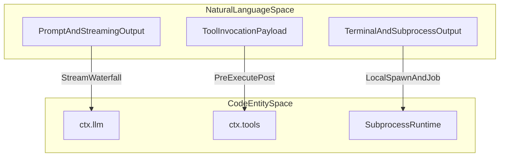
Sources: [docs/architecture.md:65-66](), [packages/extensions/tool-cordis/src/api-catalog.ts:83-146]()

Sources: [docs/architecture.md:55-66](), [packages/extensions/tool-cordis/src/api-catalog.ts:83-146]()

---

## Monorepo Layout & Package Families

The repository is structured to group packages into meaningful capability families [docs/module-graph.md:4-7](). For details, see [Monorepo Structure & Package Families](#1.2).

- **apps/** — Entry points including CLI, desktop, and web UI.
- **packages/** — Core logic organized by function (`core/`, `llm/`, `client/`, `fs/`, `session/`, etc.) [docs/module-graph.md:10-123]().
- **vendor/** — Vendored Cordis framework source.
- **native/, python/, scripts/, benchmarks/** — Support utilities and native addons.

### Diagram 3: High-Level Monorepo Structure and Dependency Flow

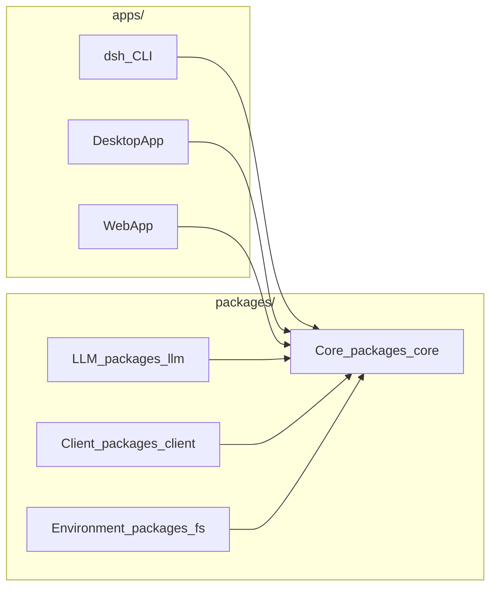
Sources: [docs/module-graph.md:4-123](), [docs/architecture.md:41-54]()

For details, see [Monorepo Structure & Package Families](#1.2).

Sources: [docs/module-graph.md:4-123](), [docs/architecture.md:41-54]()

---

## Getting Started & Development Setup

Developing or contributing to DeepSeek Harness requires a modern Node.js environment and `pnpm` [apps/web/tests/scaffold.ts:25-30]().

For details on how to clone, install, run, and develop locally, see [Getting Started & Development Setup](#1.1).

Sources: [apps/web/tests/scaffold.ts:25-30](), [docs/architecture.md:31-40]()

---

## Wiki Navigation

- **[Getting Started & Development Setup](#1.1)** — Setup, CLI usage, TypeScript aggregates, and quality gates.
- **[Monorepo Structure & Package Families](#1.2)** — Directory layout, package grouping, and rules.
- **[Core Architecture](#2)** — Cordis plugin framework, plugin composition, capability seams, and event system.
- **[Agent System](#3)** — Agent lifecycle, tools, session persistence, subagent orchestration, and LLM adapters.
- **[Execution Environment](#4)** — Filesystem, shell, sandboxing, native platform binaries.
- **[API Layer & Host-Client Bridge](#5)** — Host-server JSON-RPC, Typert RPC generation, client runtime.
- **[Web UI](#6)** — Browser-side plugin UI composition and views.
- **[Extensions & Integrations](#7)** — Optional packages including ACP protocol, Python SDK, skill systems.
- **[Testing & Quality Infrastructure](#8)** — Testing strategies, CI/CD, benchmarks.
- **[Documentation & Internationalization](#9)** — Docs, bilingual verification, VitePress site.
- **[Glossary](#10)** — Definitions of terms and jargon for onboarding.

Sources: [docs/architecture.md:1-74]()

---

# Page: Getting Started & Development Setup

# Getting Started & Development Setup

<details>
<summary>Relevant source files</summary>

The following files were used as context for generating this wiki page:

- [.agents/notes/implemented/architecture/2026-09-09-consumer-owned-startup-strictness.i18n.yaml](.agents/notes/implemented/architecture/2026-09-09-consumer-owned-startup-strictness.i18n.yaml)
- [.agents/notes/implemented/architecture/2026-09-09-consumer-owned-startup-strictness.md](.agents/notes/implemented/architecture/2026-09-09-consumer-owned-startup-strictness.md)
- [.agents/notes/implemented/architecture/2026-09-09-consumer-owned-startup-strictness.zh.md](.agents/notes/implemented/architecture/2026-09-09-consumer-owned-startup-strictness.zh.md)
- [.agents/notes/implemented/architecture/2026-09-09-profile-resolution-generations.i18n.yaml](.agents/notes/implemented/architecture/2026-09-09-profile-resolution-generations.i18n.yaml)
- [.agents/notes/implemented/architecture/2026-09-09-profile-resolution-generations.md](.agents/notes/implemented/architecture/2026-09-09-profile-resolution-generations.md)
- [.agents/notes/implemented/architecture/2026-09-09-profile-resolution-generations.zh.md](.agents/notes/implemented/architecture/2026-09-09-profile-resolution-generations.zh.md)
- [.agents/notes/implemented/architecture/2026-09-19-profile-resolution-lookup-order.i18n.yaml](.agents/notes/implemented/architecture/2026-09-19-profile-resolution-lookup-order.i18n.yaml)
- [.agents/notes/implemented/architecture/2026-09-19-profile-resolution-lookup-order.md](.agents/notes/implemented/architecture/2026-09-19-profile-resolution-lookup-order.md)
- [.agents/notes/implemented/architecture/2026-09-19-profile-resolution-lookup-order.zh.md](.agents/notes/implemented/architecture/2026-09-19-profile-resolution-lookup-order.zh.md)
- [.agents/notes/implemented/process/2026-07-21-serial-cross-platform-ci-reference.i18n.yaml](.agents/notes/implemented/process/2026-07-21-serial-cross-platform-ci-reference.i18n.yaml)
- [.agents/notes/implemented/process/2026-07-21-serial-cross-platform-ci-reference.md](.agents/notes/implemented/process/2026-07-21-serial-cross-platform-ci-reference.md)
- [.agents/notes/implemented/process/2026-07-21-serial-cross-platform-ci-reference.zh.md](.agents/notes/implemented/process/2026-07-21-serial-cross-platform-ci-reference.zh.md)
- [.agents/notes/implemented/process/2026-07-26-ci-failover-runbook.i18n.yaml](.agents/notes/implemented/process/2026-07-26-ci-failover-runbook.i18n.yaml)
- [.agents/notes/implemented/process/2026-07-26-ci-failover-runbook.md](.agents/notes/implemented/process/2026-07-26-ci-failover-runbook.md)
- [.agents/notes/implemented/process/2026-07-26-ci-failover-runbook.zh.md](.agents/notes/implemented/process/2026-07-26-ci-failover-runbook.zh.md)
- [.agents/notes/implemented/process/2026-08-08-native-windows-pull-request-ci.i18n.yaml](.agents/notes/implemented/process/2026-08-08-native-windows-pull-request-ci.i18n.yaml)
- [.agents/notes/implemented/process/2026-08-08-native-windows-pull-request-ci.md](.agents/notes/implemented/process/2026-08-08-native-windows-pull-request-ci.md)
- [.agents/notes/implemented/process/2026-08-08-native-windows-pull-request-ci.zh.md](.agents/notes/implemented/process/2026-08-08-native-windows-pull-request-ci.zh.md)
- [.github/AGENTS.md](.github/AGENTS.md)
- [.github/workflows/build-exe-for-python-sdk.yml](.github/workflows/build-exe-for-python-sdk.yml)
- [.github/workflows/ci-master.yml](.github/workflows/ci-master.yml)
- [.github/workflows/ci.yml](.github/workflows/ci.yml)
- [.github/workflows/docs-pages.yml](.github/workflows/docs-pages.yml)
- [.github/workflows/e2e.yml](.github/workflows/e2e.yml)
- [.github/workflows/pi-ai-provider-e2e.yml](.github/workflows/pi-ai-provider-e2e.yml)
- [.github/workflows/sandbox.yml](.github/workflows/sandbox.yml)
- [.gitlab-ci.yml](.gitlab-ci.yml)
- [AGENTS.md](AGENTS.md)
- [apps/cli/README.i18n.yaml](apps/cli/README.i18n.yaml)
- [apps/cli/README.md](apps/cli/README.md)
- [apps/cli/README.zh.md](apps/cli/README.zh.md)
- [apps/cli/reference/README.i18n.yaml](apps/cli/reference/README.i18n.yaml)
- [apps/cli/reference/README.md](apps/cli/reference/README.md)
- [apps/cli/reference/README.zh.md](apps/cli/reference/README.zh.md)
- [apps/cli/src/args.ts](apps/cli/src/args.ts)
- [apps/cli/src/bin.ts](apps/cli/src/bin.ts)
- [apps/cli/src/profile-boot.ts](apps/cli/src/profile-boot.ts)
- [apps/cli/tests/args.spec.ts](apps/cli/tests/args.spec.ts)
- [apps/cli/tests/built-bin.e2e.ts](apps/cli/tests/built-bin.e2e.ts)
- [apps/cli/tests/profiles/headless/tests/profile-resolution.ts](apps/cli/tests/profiles/headless/tests/profile-resolution.ts)
- [apps/cli/tests/profiles/web/tests/web-best-effort-startup.expected.e2e.ts](apps/cli/tests/profiles/web/tests/web-best-effort-startup.expected.e2e.ts)
- [apps/cli/tests/profiles/web/tests/web-failure-matrix.expected.e2e.ts](apps/cli/tests/profiles/web/tests/web-failure-matrix.expected.e2e.ts)
- [apps/cli/tests/web-agent-presets.e2e.ts](apps/cli/tests/web-agent-presets.e2e.ts)
- [docs/development.i18n.yaml](docs/development.i18n.yaml)
- [docs/development.md](docs/development.md)
- [docs/development.zh.md](docs/development.zh.md)
- [docs/user/develop/basic/publish.i18n.yaml](docs/user/develop/basic/publish.i18n.yaml)
- [docs/user/develop/basic/publish.md](docs/user/develop/basic/publish.md)
- [docs/user/develop/basic/publish.zh.md](docs/user/develop/basic/publish.zh.md)
- [package.json](package.json)
- [packages/README.i18n.yaml](packages/README.i18n.yaml)
- [packages/README.md](packages/README.md)
- [packages/README.zh.md](packages/README.zh.md)
- [packages/boot/app-boot/README.i18n.yaml](packages/boot/app-boot/README.i18n.yaml)
- [packages/boot/app-boot/README.md](packages/boot/app-boot/README.md)
- [packages/boot/app-boot/README.zh.md](packages/boot/app-boot/README.zh.md)
- [packages/boot/app-boot/src/index.ts](packages/boot/app-boot/src/index.ts)
- [packages/boot/app-boot/src/profile-resolution/legacy-links.ts](packages/boot/app-boot/src/profile-resolution/legacy-links.ts)
- [packages/boot/app-boot/src/profile-resolution/resolver.ts](packages/boot/app-boot/src/profile-resolution/resolver.ts)
- [packages/boot/app-boot/src/profile-resolution/service.ts](packages/boot/app-boot/src/profile-resolution/service.ts)
- [packages/boot/app-boot/src/profile-resolution/worker-bootstrap.ts](packages/boot/app-boot/src/profile-resolution/worker-bootstrap.ts)
- [packages/boot/app-boot/src/profile.ts](packages/boot/app-boot/src/profile.ts)
- [packages/boot/app-boot/tests/app-boot.spec.ts](packages/boot/app-boot/tests/app-boot.spec.ts)
- [packages/boot/app-boot/tests/profile-resolution-service.spec.ts](packages/boot/app-boot/tests/profile-resolution-service.spec.ts)
- [packages/boot/app-boot/tests/profile-resolution-worker-bootstrap.spec.ts](packages/boot/app-boot/tests/profile-resolution-worker-bootstrap.spec.ts)
- [packages/boot/app-boot/tests/profile-resolution.spec.ts](packages/boot/app-boot/tests/profile-resolution.spec.ts)
- [packages/boot/app-boot/tests/profile.spec.ts](packages/boot/app-boot/tests/profile.spec.ts)
- [packages/boot/app-boot/tests/user-patches.spec.ts](packages/boot/app-boot/tests/user-patches.spec.ts)
- [packages/llm/llm-pi-ai/tests/provider-apis.e2e.ts](packages/llm/llm-pi-ai/tests/provider-apis.e2e.ts)
- [packages/sandbox/sandbox-local/tests/packed-install.e2e.ts](packages/sandbox/sandbox-local/tests/packed-install.e2e.ts)
- [packages/subagent/subagent-claude-code/package.json](packages/subagent/subagent-claude-code/package.json)
- [packages/subagent/subagent-codex/package.json](packages/subagent/subagent-codex/package.json)
- [scripts/AGENTS.md](scripts/AGENTS.md)
- [scripts/ci-compatible-selfhosted.spec.ts](scripts/ci-compatible-selfhosted.spec.ts)
- [scripts/ci-workflow.spec.ts](scripts/ci-workflow.spec.ts)
- [scripts/run-gates.spec.ts](scripts/run-gates.spec.ts)
- [scripts/run-gates.ts](scripts/run-gates.ts)
- [tsconfig.json](tsconfig.json)
- [vitest.config.ts](vitest.config.ts)

</details>


This page provides the technical foundation for setting up, building, and developing DeepSeek Harness (`dsh`) locally. It covers monorepo prerequisites, pnpm workspace rules, the `dsh` CLI and profile booting system, the isolated Host vs. Client TypeScript aggregate architecture, and the bounded quality gate runner.

---

## 1. Environment Prerequisites

The repository relies on strict runtime versions and workspace layout rules to manage its plugin-based architecture and native modules.

- **Node.js**: Supports versions `^22.19.0` or `>=24.0.0`. Continuous Integration validates compatibility across Node versions 22.19, 24, and 26 `[package.json:8-10]`, `[docs/development.md:11]`.
- **pnpm**: Version `11.28.5` is pinned via `package.json`. If `pnpm --version` does not resolve, enable Corepack using `corepack enable` `[package.json:7]`, `[docs/development.md:13]`.
- **Git**: Version 2.26 or newer is required to support worktree-specific configuration extensions `[docs/development.md:14]`.
- **API Key**: A `DEEPSEEK_API_KEY` stored in a root `.env` file is required for live model integration tests, headless demos, and end-to-end scenarios `[docs/development.md:15]`.

Sources: `[package.json:7-10]()`, `[docs/development.md:9-16]()`

---

## 2. Installation & Initial Setup

To clone the repository and install workspace dependencies:

```bash
git clone https://github.com/deepseek-ai/deepseek-harness.git
cd deepseek-harness
pnpm install
```

### Monorepo Workspaces and Git Hooks

- The root `package.json` defines workspaces across `vendor/*`, `packages/*/*`, `native/system`, `native/system/packages/*`, `apps/*`, and `website` `[package.json:11-18]`.
- `pnpm install` triggers repository setup scripts that configure worktree-local Lefthook hooks through `scripts/install-lefthook.mjs` `[docs/development.md:32-35]`.
- A custom translation-pairing Git merge driver is installed for `.i18n.yaml` sidecar files to maintain synchronization between documentation pairs `[docs/development.i18n.yaml:1-5]`.

If hooks are missing because dependencies were restored from cache or `postinstall` was skipped, install them manually:

```bash
node scripts/install-lefthook.mjs
```

Sources: `[package.json:11-18]`, `[docs/development.md:25-44]()`

---

## Diagram: Natural Language Space to Code Entity Space (Boot & Execution)

The following diagram bridges natural language concepts of booting and test execution to their concrete code entities in the repository.

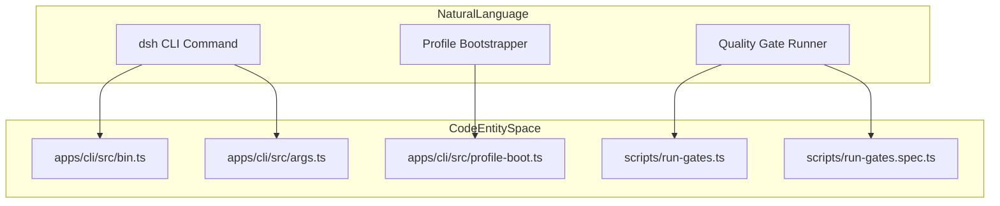

Sources: `[apps/cli/src/bin.ts:1-1]`, `[apps/cli/src/args.ts:1-1]`, `[apps/cli/src/profile-boot.ts:1-1]`, `[scripts/run-gates.ts:1-10]()`

---

## 3. The dsh CLI & Profile Booting

The primary command-line entry point is managed through `apps/cli/src/bin.ts`, parsing arguments via `apps/cli/src/args.ts`.

### Profile Booting Implementation

The profile boot process (`apps/cli/src/profile-boot.ts`) is responsible for:
- Resolving configuration layers and environment variables.
- Assembling ordered patch files and active plugin bundles.
- Bootstrapping the Cordis service container and context tree.

| Command                                   | Purpose                                                        |
|-------------------------------------------|----------------------------------------------------------------|
| `pnpm dsh web`                            | Launches the Web UI server and client runtime.                 |
| `pnpm dsh --profile headless "<task>"`    | Runs a single task headlessly and exits.                       |
| `pnpm run demo:ptc -- "<task>"`            | Runs plaintext chat (PTC) headless demo.                       |

Sources: `[AGENTS.md:101-105]`, `[apps/cli/src/profile-boot.ts:1-10]()`

---

## 4. TypeScript Aggregates: Host vs. Client Build System

Because both Host (Node.js) and Client (Browser) codebases declaration-merge the Cordis `Context` interface under identical keys with different service definitions, combining them into a single `ts.Program` causes type collisions. DeepSeek Harness maintains two isolated TypeScript aggregates `[docs/development.md:57-73]`:

- **Host Aggregate (`tsconfig.host.json`)**: Covers Node.js runtime code, agent logic, tool execution, and server-side API remotes `[docs/development.md:64]`.
- **Client Aggregate (`tsconfig.client.json`)**: Covers browser UI components, client runtime, and remote stubs `[docs/development.md:65]`.

### Build Pipeline & Data Flow

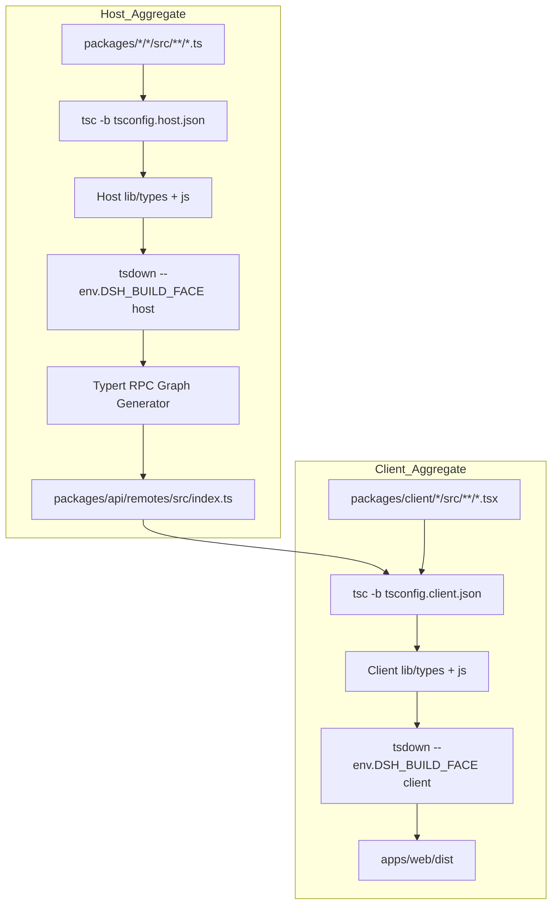

Sources: `[package.json:23-26]`, `[docs/development.md:57-96]()`

---

## 5. Quality Gate System & Execution Runner

Quality gates, static analysis, unit tests, and coverage checks are orchestrated by `scripts/run-gates.ts` and validated via bounded worker scheduling.

### Gate Modes and Concurrency

- **Modes**: Named aggregates such as `ci-primary`, `ci-static`, `ci-coverage`, `ci-unit`, `ci-snapshot`, and `check-all` control which suites run `[scripts/run-gates.ts:18-37]`.
- **Concurrency**: Default worker allocations are computed based on available system CPUs or overridden via `DSH_GATE_CONCURRENCY` `[scripts/run-gates.ts:104-110]`.
- **Fail Fast**: Enabled via `DSH_GATE_FAIL_FAST=1` to abort remaining gates upon the first blocking failure `[scripts/run-gates.ts:111-118]`.

### Diagram: Quality Gate Execution Flow

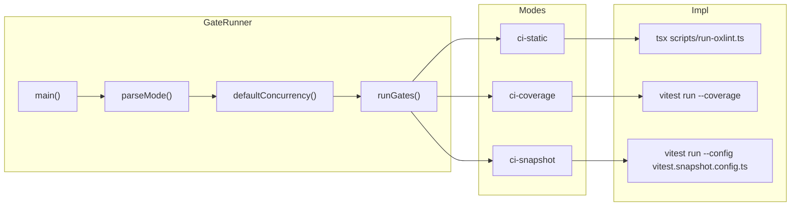

Sources: `[scripts/run-gates.ts:1-187]()`, `[scripts/run-gates.spec.ts:1-50]()`

---

## 6. Local Development Workflow & Best Practices

- **Typecheck Verification**: Run `pnpm run typecheck` to validate the complete Host aggregate and client contracts `[package.json:51-52]`.
- **Test Coverage**: Run `pnpm run test:coverage` to execute Vitest suites under the per-file 100% coverage gate `[package.json:59]`.
- **Bilingual Documentation Sync**: After updating `.i18n.yaml` translation files, synchronize pairs using:
  ```bash
  pnpm run verify-translation-pairing --write <target>
  ```
- **Cleanup**: To safely purge build artifacts and workspace residue, run `pnpm run clean` `[package.json:49]`, `[AGENTS.md:85]`.

Sources: `[package.json:49-65]`, `[AGENTS.md:83-105]()`

---

# Page: Monorepo Structure & Package Families

# Monorepo Structure & Package Families

<details>
<summary>Relevant source files</summary>

The following files were used as context for generating this wiki page:

- [.agents/notes/implemented/process/2026-08-10-npm-release-sequences.i18n.yaml](.agents/notes/implemented/process/2026-08-10-npm-release-sequences.i18n.yaml)
- [.agents/notes/implemented/process/2026-08-10-npm-release-sequences.md](.agents/notes/implemented/process/2026-08-10-npm-release-sequences.md)
- [.agents/notes/implemented/process/2026-08-10-npm-release-sequences.zh.md](.agents/notes/implemented/process/2026-08-10-npm-release-sequences.zh.md)
- [.agents/notes/implemented/process/2026-08-26-published-dependency-faces.i18n.yaml](.agents/notes/implemented/process/2026-08-26-published-dependency-faces.i18n.yaml)
- [.agents/notes/implemented/process/2026-08-26-published-dependency-faces.md](.agents/notes/implemented/process/2026-08-26-published-dependency-faces.md)
- [.agents/notes/implemented/process/2026-08-26-published-dependency-faces.zh.md](.agents/notes/implemented/process/2026-08-26-published-dependency-faces.zh.md)
- [.agents/notes/implemented/process/2026-10-14-experimental-dependency-policy.i18n.yaml](.agents/notes/implemented/process/2026-10-14-experimental-dependency-policy.i18n.yaml)
- [.agents/notes/implemented/process/2026-10-14-experimental-dependency-policy.md](.agents/notes/implemented/process/2026-10-14-experimental-dependency-policy.md)
- [.agents/notes/implemented/process/2026-10-14-experimental-dependency-policy.zh.md](.agents/notes/implemented/process/2026-10-14-experimental-dependency-policy.zh.md)
- [.github/workflows/release-vendor.yml](.github/workflows/release-vendor.yml)
- [.github/workflows/release.yml](.github/workflows/release.yml)
- [Makefile](Makefile)
- [packages/boot/app-boot/src/package-meta.ts](packages/boot/app-boot/src/package-meta.ts)
- [packages/boot/app-boot/tests/package-meta.spec.ts](packages/boot/app-boot/tests/package-meta.spec.ts)
- [packages/client/AGENTS.md](packages/client/AGENTS.md)
- [packages/experimental/client-ui-agent-team/package.json](packages/experimental/client-ui-agent-team/package.json)
- [packages/experimental/client-ui-claude-code-mods/package.json](packages/experimental/client-ui-claude-code-mods/package.json)
- [packages/experimental/client-ui-cot-translation/package.json](packages/experimental/client-ui-cot-translation/package.json)
- [packages/experimental/client-ui-voice-input/package.json](packages/experimental/client-ui-voice-input/package.json)
- [packages/experimental/cua-macos/package.json](packages/experimental/cua-macos/package.json)
- [packages/experimental/inspector/package.json](packages/experimental/inspector/package.json)
- [scripts/benchmark-next-package-dependency.ts](scripts/benchmark-next-package-dependency.ts)
- [scripts/check-workspace-constraints.spec.ts](scripts/check-workspace-constraints.spec.ts)
- [scripts/check-workspace-constraints.ts](scripts/check-workspace-constraints.ts)
- [scripts/no-unknown-casts.baseline.json](scripts/no-unknown-casts.baseline.json)
- [scripts/package-dependency-policy.ts](scripts/package-dependency-policy.ts)
- [scripts/release/bump.ts](scripts/release/bump.ts)
- [scripts/release/families.spec.ts](scripts/release/families.spec.ts)
- [scripts/release/families.ts](scripts/release/families.ts)
- [scripts/release/pack.ts](scripts/release/pack.ts)
- [scripts/release/process.ts](scripts/release/process.ts)
- [scripts/release/publish.spec.ts](scripts/release/publish.spec.ts)
- [scripts/release/publish.ts](scripts/release/publish.ts)
- [scripts/release/tarball.ts](scripts/release/tarball.ts)
- [scripts/release/verify-packed-install.ts](scripts/release/verify-packed-install.ts)
- [scripts/release/verify.ts](scripts/release/verify.ts)
- [scripts/tests/ci-release-selfhosted.spec.ts](scripts/tests/ci-release-selfhosted.spec.ts)
- [scripts/verify-package-dependencies.spec.ts](scripts/verify-package-dependencies.spec.ts)
- [scripts/verify-package-dependencies.ts](scripts/verify-package-dependencies.ts)
- [scripts/verify-package-meta.spec.ts](scripts/verify-package-meta.spec.ts)
- [scripts/verify-package-meta.ts](scripts/verify-package-meta.ts)
- [scripts/workspace-package-globs.spec.ts](scripts/workspace-package-globs.spec.ts)
- [scripts/workspace-package-globs.ts](scripts/workspace-package-globs.ts)
- [tsdown.config.ts](tsdown.config.ts)

</details>


## Purpose and Scope

This page details the DeepSeek Harness (`dsh`) monorepo layout, describing the directory structure (`apps/`, `packages/`, `vendor/`, `examples/`, `native/`, `python/`, `scripts/`), package grouping into capability families, workspace invariant checks, dependency protocols, and publication sequences [pnpm-workspace.yaml:1-30](), [scripts/check-workspace-constraints.ts:27-33](), [.agents/notes/implemented/process/2026-08-10-npm-release-sequences.md:19-28](). It governs how the core product, extensions, native components, and tooling coexist in a unified workspace.

Sources: [pnpm-workspace.yaml:1-30](), [scripts/check-workspace-constraints.ts:27-33](), [.agents/notes/implemented/process/2026-08-10-npm-release-sequences.md:19-28]()

---

## Directory Layout & Workspaces

The monorepo is organized as a `pnpm` workspace defined across multiple directory trees. Workspace discovery walks configured globs in `scripts/check-workspace-constraints.ts` to validate manifest invariants [scripts/check-workspace-constraints.ts:27-33](), [scripts/check-workspace-constraints.ts:140-152]().

| Directory | Role / Scope | Notable Contents |
|---|---|---|
| `apps/` | Deployable applications and runtime shells | CLI launcher (`apps/cli`), Electron desktop shell (`apps/desktop`), SPA Web UI (`apps/web`) [scripts/check-workspace-constraints.ts:32]() |
| `packages/` | Main functional npm packages organized by domain | Core logic, agent system, LLM integration, UI components, API, sandboxing, and experimental modules [scripts/check-workspace-constraints.ts:29]() |
| `vendor/` | Source-vendored and locally patched upstream dependencies | Cordis framework (`@deepseek-ai/cordis`, `@deepseek-ai/cosmokit`, etc.) forked in place [scripts/check-workspace-constraints.ts:28](), [scripts/check-workspace-constraints.ts:34-44]() |
| `examples/` | Standalone example applications and demonstration setups | Integration examples, custom adapters, and SDK usage references |
| `native/` | Platform-specific system integration layers | Node native addons, prebuild packages, and sandbox confinement binaries [scripts/check-workspace-constraints.ts:30-31](), [scripts/check-workspace-constraints.ts:45-51]() |
| `python/` | Python SDK and standalone runtime distribution | Python SDK (`deepseek-harness-sdk`) and executable build scaffolding |
| `scripts/` | Developer tooling, release pipelines, and CI/CD helpers | Workspace constraint checks, release pack/publish scripts, and dependency verification tools [scripts/check-workspace-constraints.ts:1-6](), [.agents/notes/implemented/process/2026-08-10-npm-release-sequences.md:15]() |

### Monorepo Entity Mapping: Natural Language to Code Space

This diagram links major functional domains in informal terms to precise code entities and build configuration entrypoints.

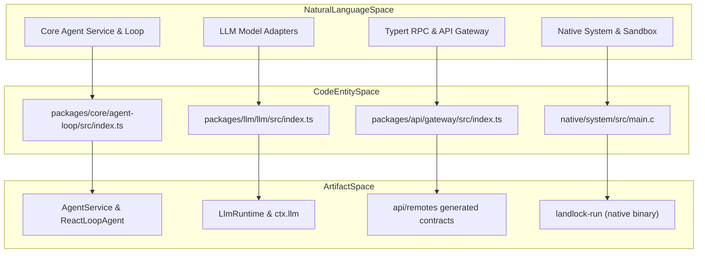
Sources: [scripts/check-workspace-constraints.ts:27-55](), [tsdown.config.ts:1-37]()

---

## Package Families & Capability Groups

Packages within `packages/` and `vendor/` are grouped into capability families. The build process uses `tsdown` with environment flags (`DSH_BUILD_FACE`) to compile host and client artifacts concurrently across workspace packages [tsdown.config.ts:7-37]().

### 1. Core Spine & Agent Loop (`packages/core/`)
- **`dsh-core` / `dsh-agent`**: Core domain logic for agent services, session integration, and prompt compilation spine.
- **`dsh-agent-loop`**: Implements stateful agent logic managing turn/step lifecycles and inbox execution.
- **`dsh-tools`**: Central tool registry managing execution pipelines.

### 2. LLM & Inference Adapters (`packages/llm/`)
- **`dsh-llm`**: Declares the `LlmRuntime` service interface abstracting streaming LLM providers.
- **`dsh-llm-deepseek`**, **`dsh-llm-pi-ai`**: Concrete adapters implementing LLM runtimes.

### 3. Execution Environments & Sandboxing (`packages/fs/`, `packages/sandbox/`)
- **`dsh-fs` / `dsh-fs-local`**: Filesystem service definitions and local OS-native implementation.
- **`dsh-sandbox`**: Process confinement layer supporting Landlock on Linux and Windows ACL restrictions.

### 4. Durable Storage & Session Retrieval (`packages/session/`)
- **`dsh-session`**: Manages append-only logs of `SessionEvent`s with SQLite and JSONL backends.
- **`dsh-session-query`**: Logical session corpus retrieval and lineage traversal.

### 5. API Layer & Client Runtime (`packages/api/`, `packages/client/`)
- **`dsh-api-gateway`**: HTTP/SSE gateway exposing backend services [scripts/verify-package-dependencies.spec.ts:146-147]().
- **`dsh-client-*`**: Modular browser-side UI client plugins, slot renderers, and state stores.

### Capability Seam Data Flow

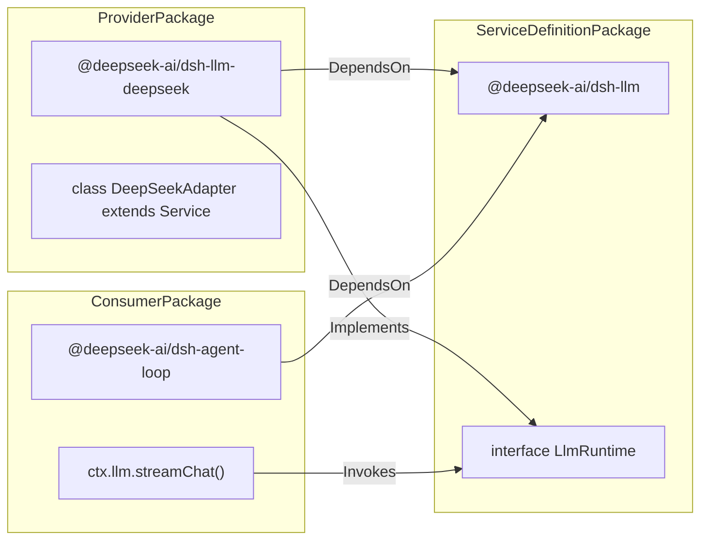
Sources: [tsdown.config.ts:7-37](), [scripts/verify-package-dependencies.spec.ts:146-147]()

---

## Workspace Constraints, Dependency Protocols & Release Sequences

Monorepo integrity is enforced by automated constraint checks (`scripts/check-workspace-constraints.ts`) and dependency policy validation (`scripts/verify-package-dependencies.ts`) [scripts/check-workspace-constraints.ts:1-6](), [scripts/verify-package-dependencies.spec.ts:10-28]().

### 1. Workspace Dependency Protocols
- **Internal DSH References:** All dependencies between workspace members belonging to the `dsh` family must use the exact `workspace:*` protocol [scripts/check-workspace-constraints.spec.ts:53-58]().
- **Vendored & Native References:** Dependencies pointing to vendored Cordis packages or native addons must use the `workspace:~` protocol [scripts/check-workspace-constraints.spec.ts:61-67]().

### 2. Three Independent Publication Sequences
As documented in release specifications, packages are categorized into three independent release sequences, preventing cross-family version locking issues [.agents/notes/implemented/process/2026-08-10-npm-release-sequences.md:19-28]():
- **`dsh` Family:** Public members of `packages/*/*` and `apps/*` sharing a unified version baseline (`0.0.x`) with the workspace root [.agents/notes/implemented/process/2026-08-10-npm-release-sequences.md:25]().
- **Vendored Framework (`vendor/`):** Nine rescoped Cordis packages, each maintaining independent version lines [.agents/notes/implemented/process/2026-08-10-npm-release-sequences.md:26]().
- **Native System Packages (`native/system/packages/*`):** Platform-specific binaries with separate build workflows [.agents/notes/implemented/process/2026-08-10-npm-release-sequences.md:27]().

### 3. Package Dependency & Optional Import Policies
- **Client/Host Policies:** The dependency policy (`scripts/package-dependency-policy.ts`) classifies packages into client-facing UI components and host services, governing allowed peer relays and flattened host dependencies [scripts/package-dependency-policy.ts:13-96]().
- **Optional Dependencies:** Optional dependencies or peer dependencies marked optional are strictly guarded against module-scope execution loads to prevent runtime failures in installations missing those optional packages [.agents/notes/implemented/process/2026-08-10-npm-release-sequences.md:95-101]().

Sources: [scripts/check-workspace-constraints.ts:1-6](), [scripts/check-workspace-constraints.spec.ts:53-67](), [.agents/notes/implemented/process/2026-08-10-npm-release-sequences.md:19-101](), [scripts/package-dependency-policy.ts:13-96]()

---

# Page: Core Architecture

# Core Architecture

<details>
<summary>Relevant source files</summary>

The following files were used as context for generating this wiki page:

- [docs/architecture.i18n.yaml](docs/architecture.i18n.yaml)
- [docs/architecture.md](docs/architecture.md)
- [docs/architecture.zh.md](docs/architecture.zh.md)
- [docs/capability-seams.i18n.yaml](docs/capability-seams.i18n.yaml)
- [docs/capability-seams.md](docs/capability-seams.md)
- [docs/capability-seams.zh.md](docs/capability-seams.zh.md)
- [packages/core/agent-loop/README.i18n.yaml](packages/core/agent-loop/README.i18n.yaml)
- [packages/core/agent-loop/README.md](packages/core/agent-loop/README.md)
- [packages/core/agent-loop/README.zh.md](packages/core/agent-loop/README.zh.md)
- [packages/core/agent-loop/src/agent.ts](packages/core/agent-loop/src/agent.ts)
- [packages/core/agent-loop/tests/cancel.spec.ts](packages/core/agent-loop/tests/cancel.spec.ts)
- [packages/core/agent-loop/tests/contract-regressions.spec.ts](packages/core/agent-loop/tests/contract-regressions.spec.ts)
- [packages/core/agent-loop/tests/coverage-edges.spec.ts](packages/core/agent-loop/tests/coverage-edges.spec.ts)
- [packages/core/agent-loop/tests/interception.spec.ts](packages/core/agent-loop/tests/interception.spec.ts)
- [packages/core/agent-loop/tests/loop.spec.ts](packages/core/agent-loop/tests/loop.spec.ts)
- [packages/core/agent/README.i18n.yaml](packages/core/agent/README.i18n.yaml)
- [packages/core/agent/README.md](packages/core/agent/README.md)
- [packages/core/agent/README.zh.md](packages/core/agent/README.zh.md)
- [packages/core/agent/src/types.ts](packages/core/agent/src/types.ts)
- [scripts/gen-doc-graphs.ts](scripts/gen-doc-graphs.ts)

</details>


This page provides an overview of the core architectural foundations of DeepSeek Harness (`dsh`), powered by the **Cordis** plugin framework. Every functional subsystem—from model adapters and tool registries to session logging and the core agent loop—is implemented as a modular plugin contributing services, typed events, and reversible effects to a shared context [docs/architecture.md:9-11](). 

For deep technical details on each subsystem, refer to the child pages:
- [Cordis Framework & Vendored Dependencies](#2.1) — Deep dive into the vendored Cordis framework: plugin lifecycle, service injection, Context declaration merging, fiber disposal, and local modifications to upstream source.
- [Plugin Composition: Profiles, Bundles & Configuration](#2.2) — How a running dsh instance is assembled from ordered patch layers. Covers profiles, bundles, cordis.yml, the config catalog, and dump-config.
- [Event Bus & Capability Seams](#2.3) — Explains the event-driven communication model: session/event, agent/pre-step, llm/stream waterfalls, and the capability seam pattern. Covers the event producer-consumer map.

---

## 2.1 Cordis Framework & Vendored Dependencies

At the core of DeepSeek Harness's extensibility lies the **Cordis** plugin framework [docs/architecture.md:9-14](). Cordis enables `dsh` to be composed entirely from plugins, each contributing typed services, typed events, and reversible side effects so that unloading a plugin cleanly removes all traces of its state and registrations [docs/architecture.md:9-14]().

Plugins declare their required dependencies and exports, leveraging TypeScript declaration merging to compose a rich, typed `Context` object representing the full runtime environment [packages/core/agent/src/types.ts:17-26](). There is no privileged monolithic core; subsystems like the model adapter, tool registry, session log, and agent loop are fully replaceable via configuration [docs/architecture.md:9-11]().

For an in-depth deep dive into Cordis lifecycle, service injection, Context declaration merging, and local vendored modifications, see [Cordis Framework & Vendored Dependencies](#2.1).

Sources: [docs/architecture.md:9-14](), [packages/core/agent/src/types.ts:17-26]()

---

## 2.2 Plugin Composition: Profiles, Bundles & Configuration

A running instance of `dsh` is assembled at startup by layering ordered patch sets into a coherent plugin tree [docs/architecture.md:15-42]():
- **Profiles** are named compositions (e.g., `web`, `headless`, `sdk`, `sdk-minimal`, `acp`) stored within the Harness home directory [docs/architecture.md:17-18]().
- **Bundles** are the distribution units of configuration rows and their corresponding code modules [docs/architecture.md:19-21]().
- **Patches** (`cordis.patch.yml`) are YAML overlays that selectively replace or insert config rows identified by ID [docs/architecture.md:25-27]().

The boot composition order applies empty configuration first, then each bundle in the profile's order, followed by the profile patch, the home patch, and finally any CLI `--patch` overlay [docs/architecture.md:25-27](). To inspect the effective plugin tree and configuration for a profile:

```bash
dsh --profile web --dump-config
```

For detailed mechanics of profiles, bundles, patching, and the generated configuration catalog, see [Plugin Composition: Profiles, Bundles & Configuration](#2.2).

Sources: [docs/architecture.md:15-42]()

---

## 2.3 Event Bus & Capability Seams

`dsh` uses a typed, centralized event bus combined with a **capability seam** pattern to organize runtime communication and enable swappable extensions [docs/architecture.md:71-76]().
- **Session Events** are durable facts appended to the append-only session log and broadcast on `session/event` [docs/architecture.md:71-72]().
- **Agent Events** (`agent/*`) convey live agent runtime information, including inbox state, step transitions, ongoing request status, and tool executions [docs/architecture.md:73-74]().
- **Capability Seams** abstract core subsystems (e.g., `ctx.llm`, `ctx.tools`, `ctx.fs`) behind service interfaces allowing multiple interchangeable implementations to coexist [docs/architecture.md:75-76]().

For complete details on the event model, waterfall semantics, and the event producer-consumer mappings, see [Event Bus & Capability Seams](#2.3).

Sources: [docs/architecture.md:71-76]()

---

## Subsystem Architecture & Code Mapping

This diagram bridges key system concepts in natural language to precise code artifacts and service names in the monorepo.

### Core Architecture Component Map
```mermaid
graph TD
    subgraph "Cordis_Context"
        direction LR
        svc_llm[""ctx.llm: LlmRuntime (packages/llm/llm)""]
        svc_agents[""ctx.agents: AgentRegistry (packages/core/agent)""]
        svc_tools[""ctx.tools: ToolRuntime (packages/core/tools)""]
        svc_sessions[""ctx.sessions: SessionStore (packages/core/session)""]
    end

    subgraph "Core_Packages"
        pkg_agent_loop[""packages/core/agent-loop""]
        pkg_llm[""packages/llm/llm""]
        pkg_tools[""packages/core/tools""]
        pkg_session[""packages/core/session""]
    end

    pkg_agent_loop --> svc_agents
    pkg_llm --> svc_llm
    pkg_tools --> svc_tools
    pkg_session --> svc_sessions

    svc_agents -- "drives agent instances" --> ReactLoopAgent[""ReactLoopAgent (packages/core/agent-loop/src/agent.ts)""]
    svc_llm -- "manages LLM adapters" --> LlmAdapter[""LlmAdapter (packages/llm/llm/src/types.ts)""]
    svc_tools -- "executes registered tools" --> Tool[""Tool (packages/core/tools/src/types.ts)""]
```
Sources: [docs/architecture.md:59-71](), [packages/core/agent-loop/src/agent.ts:98-138]()

---

## Turn Flow and Execution Pipeline

The core agent driver in `dsh-agent-loop` (`ReactLoopAgent`) manages interaction as a flow of turns composed of ordered steps [docs/architecture.md:86-118](), [packages/core/agent-loop/src/agent.ts:120-170]().

### Step Execution Pipeline Illustration
```mermaid
sequenceDiagram
    participant AL as "ReactLoopAgent"
    participant EV as "EventBus (ctx.emit / ctx.waterfall)"
    participant LLM as "LlmRuntime (ctx.llm)"
    participant TR as "ToolRuntime (packages/core/tools)"

    Note over AL,TR: "Turn starts on inbox claim"
    AL->>EV: "agent/pre-step (waterfall)"
    AL->>LLM: "agent/request -> prepareCall()"
    LLM-->>AL: "agent/assistant-stream (chunked token events)"
    AL->>EV: "tools/pre-execute (waterfall)"
    AL->>TR: "executeToolCalls()"
    TR-->>AL: "tool/result"
    AL->>EV: "tools/post-execute (waterfall)"
    Note over AL,TR: "Step ends; check for followup or next step"
```
Sources: [docs/architecture.md:86-118](), [packages/core/agent-loop/src/agent.ts:154-170](), [packages/core/agent-loop/src/tool-calls.ts:1-25]()

---

## Subsystem Navigation

Further exploration of each core component is available in these linked child pages:
- [Cordis Framework & Vendored Dependencies](#2.1) — Plugin lifecycle, service injection, Context declaration merging, and vendored source.
- [Plugin Composition: Profiles, Bundles & Configuration](#2.2) — Profiles, bundles, patch layering, and the configuration catalog.
- [Event Bus & Capability Seams](#2.3) — Event taxonomy, waterfall semantics, and capability seam pattern.

Sources: [docs/architecture.md:1-77](), [packages/core/agent-loop/src/agent.ts:1-171](), [packages/core/agent/src/types.ts:1-88]()

---

# Page: Cordis Framework & Vendored Dependencies

# Cordis Framework & Vendored Dependencies

<details>
<summary>Relevant source files</summary>

The following files were used as context for generating this wiki page:

- [docs/cordis-api/fiber.i18n.yaml](docs/cordis-api/fiber.i18n.yaml)
- [docs/cordis-api/fiber.md](docs/cordis-api/fiber.md)
- [docs/cordis-api/fiber.zh.md](docs/cordis-api/fiber.zh.md)
- [packages/boot/app-boot/tests/loader-shape.compat.spec.ts](packages/boot/app-boot/tests/loader-shape.compat.spec.ts)
- [packages/extensions/tool-cordis/tests/cordis-lifecycle.spec.ts](packages/extensions/tool-cordis/tests/cordis-lifecycle.spec.ts)
- [vendor/README.md](vendor/README.md)
- [vendor/cordis/package.json](vendor/cordis/package.json)
- [vendor/cordis/src/context.ts](vendor/cordis/src/context.ts)
- [vendor/cordis/src/events.ts](vendor/cordis/src/events.ts)
- [vendor/cordis/src/fiber.ts](vendor/cordis/src/fiber.ts)
- [vendor/cordis/src/logger.ts](vendor/cordis/src/logger.ts)
- [vendor/cordis/src/reflect.ts](vendor/cordis/src/reflect.ts)
- [vendor/cordis/src/registry.ts](vendor/cordis/src/registry.ts)
- [vendor/cordis/src/service.ts](vendor/cordis/src/service.ts)
- [vendor/cosmokit/package.json](vendor/cosmokit/package.json)
- [vendor/group/package.json](vendor/group/package.json)
- [vendor/hmr/package.json](vendor/hmr/package.json)
- [vendor/hmr/src/index.ts](vendor/hmr/src/index.ts)
- [vendor/include/package.json](vendor/include/package.json)
- [vendor/include/src/index.ts](vendor/include/src/index.ts)
- [vendor/loader/package.json](vendor/loader/package.json)
- [vendor/loader/src/config/entry.ts](vendor/loader/src/config/entry.ts)
- [vendor/loader/src/config/group.ts](vendor/loader/src/config/group.ts)
- [vendor/loader/src/config/isolate.ts](vendor/loader/src/config/isolate.ts)
- [vendor/loader/src/config/tree.ts](vendor/loader/src/config/tree.ts)
- [vendor/loader/src/index.ts](vendor/loader/src/index.ts)
- [vendor/loader/src/internal.ts](vendor/loader/src/internal.ts)
- [vendor/logger-console/package.json](vendor/logger-console/package.json)
- [vendor/logger-console/src/browser.ts](vendor/logger-console/src/browser.ts)
- [vendor/logger-console/src/index.ts](vendor/logger-console/src/index.ts)
- [vendor/schemastery/package.json](vendor/schemastery/package.json)
- [vendor/timer/package.json](vendor/timer/package.json)

</details>


DeepSeek Harness (`dsh`) is architected around the **Cordis** plugin framework, a modular system enabling a fully pluggable runtime via scoped `Context`s (`[vendor/cordis/src/context.ts:1-40]()`), plugin lifecycles, and reversible effect management. This design ensures that all subsystems—from agents and tools to event buses and configuration loaders—are implemented as composable and replaceable plugins, connected through Cordis's capability seam pattern.

To ensure auditability, deterministic behavior, and allow local patching for harness-specific requirements, the Cordis framework and its primary dependencies are **vendored** into the `vendor/` directory under the `@deepseek-ai` namespace `[vendor/README.md:3-5]()`. This page provides a comprehensive deep dive into the vendored Cordis sources: detailing the plugin lifecycle and fiber disposal, service injection via `Context` declaration merging, local modifications, and the loader's configuration patching mechanisms.

---

## 1. Vendored Dependencies & Local Modifications

### 1.1 Vendored Package Catalog

The `vendor/` directory holds full source copies of the Cordis framework and foundational libraries, pinned to specific upstream commits to guarantee stability and control over the framework layer `[vendor/README.md:10-26]`.

| Directory (`vendor/`) | Scoped npm Name | Upstream Package | Version | Role in Cordis Framework |
|---|---|---|---|---|
| `cordis/` | `@deepseek-ai/cordis` | cordis | 4.0.5 | Core plugin lifecycle, DI context, fiber lifecycle, event bus `[vendor/README.md:19]()`. |
| `loader/` | `@deepseek-ai/cordis-plugin-loader` | `@cordisjs/plugin-loader` | 1.0.6 | Implements hierarchical plugin loading, config patching, entry trees `[vendor/README.md:20]`, `[vendor/loader/package.json:2-4]()`. |
| `schemastery/` | `@deepseek-ai/schemastery` | schemastery | 3.18.5 | Structural schema validation for configuration `[vendor/README.md:18]`, `[vendor/schemastery/package.json:2-4]()`. |
| `cosmokit/` | `@deepseek-ai/cosmokit` | cosmokit | 1.8.6 | General utilities like `deepEqual`, volatile refs `[vendor/README.md:17]`, `[vendor/cosmokit/package.json:2-4]()`. |
| `include/` | `@deepseek-ai/cordis-plugin-include` | `@cordisjs/plugin-include` | 1.0.10 | Entry patching engine for layered configs (`applyEntryPatches`) `[vendor/README.md:21]`, `[vendor/include/package.json:2-4]()`. |
| `group/` | `@deepseek-ai/cordis-plugin-group` | `@cordisjs/plugin-group` | 1.0.5 | Support for grouped plugin entries `[vendor/README.md:22]`, `[vendor/group/package.json:2-4]()`. |
| `timer/` | `@deepseek-ai/cordis-plugin-timer` | `@cordisjs/plugin-timer` | 1.1.7 | Timer services exposed via Cordis `[vendor/README.md:23]`, `[vendor/timer/package.json:2-4]()`. |
| `hmr/` | `@deepseek-ai/cordis-plugin-hmr` | `@cordisjs/plugin-hmr` | 1.0.20 | Hot Module Replacement (HMR) framework integration `[vendor/README.md:24]`, `[vendor/hmr/package.json:2-4]()`. |
| `logger-console/` | `@deepseek-ai/cordis-plugin-logger-console` | `@cordisjs/plugin-logger-console` | 1.0.5 | Console logging plugin service `[vendor/README.md:25]`, `[vendor/logger-console/package.json:2-4]()`. |

Third-party dependencies like `js-yaml`, `chokidar`, `picomatch`, etc., remain external on npm and are not vendored `[vendor/README.md:27-28]()`. Certain Cordis packages (e.g., `reggol`, `@cordisjs/unyaml`) are intentionally excluded since they are unused by the harness `[vendor/README.md:29]()`.

Sources: `[vendor/README.md:1-30]()`, `[vendor/loader/package.json:1-45]()`, `[vendor/cordis/package.json:1-51]()`

---

### 1.2 Local Modifications & Hardening

The vendored Cordis sources include extensive patches and local adaptations for lifecycle correctness and ease of integration:

- **Fiber lifecycle hardening** (`[vendor/cordis/src/fiber.ts]()`): Locally closes three reentrant disposal gaps. An effect's owner-list wrapper is registered before its setup body runs, so an unload begun from inside setup awaits setup and every collected cleanup; synchronous setup failure removes the wrapper and rolls back collected cleanup. Async cleanup stays owner-visible until quiescence, and Cordis's internal effect composition joins an already-running cleanup while repeated public disposer calls retain their upstream single-shot result. Effect creation is rejected while the owner is `UNLOADING` (`[vendor/README.md:40]()`).
- **Manifest and tsconfig regeneration**: All vendored `package.json` and `tsconfig.json` files are regenerated for Harness releases, scoped under `@deepseek-ai`, with precise type declaration metadata and build outputs. Internal TypeScript imports use explicit `.ts` extensions, compliant with NodeNext module resolution `[vendor/README.md:36-38]()`.
- **HMR localization removal**: Removed `.yml` locale imports and i18n calls from `[vendor/hmr/src/index.ts]()` due to missing runtime YAML loader hooks (`@cordisjs/unyaml`). These only supplied config description translations which are unused in the harness context `[vendor/README.md:35]()`.
- **JSDoc enrichments**: Added parameter and return tags, and detailed contract documentation across public Cordis APIs (`Context`, `Fiber`, `Service`, `ReflectService`, etc.) to improve generated API references and facilitate tooling `[vendor/README.md:41]()`.

Sources: `[vendor/README.md:31-41]()`, `[vendor/hmr/src/index.ts:1-40]()`

---

## 2. Cordis Plugin Lifecycle & Fiber Disposal

The fundamental runtime unit in Cordis is the **`Fiber`** (`[vendor/cordis/src/fiber.ts]()`), representing an isolated plugin instance controlling resource lifecycles and effect management.

### 2.1 Fiber State Machine & Disposal Flow

Fibers transition through explicit lifecycle states:

| State | Meaning |
|---|---|
| `PENDING` | Setup is in progress; effect registration allowed. |
| `LOADING` | Configuration/loading phase. |
| `ACTIVE` | Fully activated; normal operation. |
| `UNLOADING` | Disposal has started; no new effects accepted. |
| `DISPOSED` | Final state; all resources released. |

Disposal is invoked via `fiber.dispose()`. The disposal logic carefully manages reentrancy and cleanup:
- Prevents registration of new effects once unloading starts.
- Runs cleanup callbacks in the reverse order of registration (`[vendor/cordis/src/reflect.ts]()`) to properly unwind side-effects.
- Child fibers are disposed prior to the parent fiber.
- Captures exceptions from teardown callbacks individually so one observer cannot block others.

Diagram: Cordis Fiber Disposal Sequence
```mermaid
sequenceDiagram
    participant Caller as "Caller"
    participant Fiber as "Fiber"
    participant ReflectService as "ReflectService"
    participant Service as "Service"

    Caller->>Fiber: "dispose()"
    Fiber->>Fiber: "set_state_to_UNLOADING; reject new effects"
    Fiber->>ReflectService: "run cleanup callbacks in reverse order"
    ReflectService->>Service: "unregister and stop dependent services"
    Fiber->>Fiber: "set state to DISPOSED"
    Fiber-->>Caller: "disposal promise resolves"
```

Sources: `[vendor/cordis/src/fiber.ts:1-50]()`, `[vendor/cordis/src/reflect.ts:1-30]()`, `[vendor/cordis/src/service.ts:1-40]()`

---

## 3. Service Injection & Context Declaration Merging

Cordis provides a hierarchical dependency injection system centered on the **`Context`** object (`[vendor/cordis/src/context.ts:1-40]()`) which acts as a container for service instances managed by the **`Service`** base class (`[vendor/cordis/src/service.ts:1-40]()`).

- `Context` instances are layered; child contexts prototype-link to parents, supporting scoped service lifetimes (e.g., per-agent or per-fiber).
- Services declare their dependencies which Cordis resolves and injects at runtime (`[vendor/cordis/src/service.ts:1-40]()`).
- TypeScript **declaration merging** is used heavily to extend `Context` interfaces with subsystem-specific service keys, such as `ctx.agents`, `ctx.session`, `ctx.tools`, and `ctx.llm`.

Effect registrations (event listeners, disposers, service initializations) are managed as reversible composite effects tracked by a fiber's lifecycle through **`ReflectService`** (`[vendor/cordis/src/reflect.ts:1-30]()`), ensuring automatic cleanup on unload.

Sources: `[vendor/cordis/src/context.ts:1-40]()`, `[vendor/cordis/src/service.ts:1-40]()`, `[vendor/cordis/src/reflect.ts:1-30]()`

---

## 4. Cordis Loader & Configuration Patching

The Cordis **Loader plugin** (`[vendor/loader/src/index.ts]()`) composes the plugin runtime tree from declarative config files written in YAML or JSON. Key aspects include:
- Defines nested plugin entries via **`Entry`** (`[vendor/loader/src/config/entry.ts:43-62]()`), **`EntryGroup`** (`[vendor/loader/src/config/group.ts]()`), and **`EntryTree`** (`[vendor/loader/src/config/tree.ts]()`) classes, enabling complex hierarchical plugin activation.
- Supports composable patch layers through the include plugin's **`applyEntryPatches`** function (`[vendor/include/src/index.ts:57-127]()`), which merges patch lists into base entries immutably.
- Allows runtime evaluation of configuration using `!!js` expressions against the `Context` of the loader entry, enabling dynamic enabling/disabling and computed values `[vendor/loader/src/config/entry.ts:88-95]()`.

Diagram: Loader Entry Tree & Patch Application
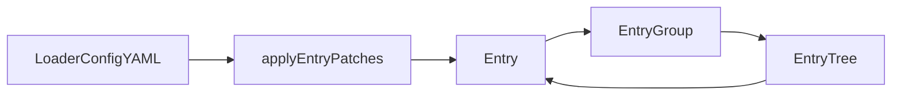

Sources: `[vendor/loader/src/index.ts:1-50]()`, `[vendor/include/src/index.ts:57-127]()`, `[vendor/loader/src/config/entry.ts:43-110]()`, `[vendor/loader/src/config/group.ts:1-30]()`, `[vendor/loader/src/config/tree.ts:1-30]()`

---

## 5. Cordis Event Bus & Waterfall Semantics

Cordis includes an event bus (**`EventsService`**, `[vendor/cordis/src/events.ts]()`) that supports:
- **Persistent events**, such as session logs (`agent/created`) that append to durable stores.
- **Transient lifecycle events** (`agent/pre-step`), which repeatedly occur during agent operation.
- **Capability seam events**, like `llm/stream`, allowing runtime interception and gradual effect handling.

Some event classes use a **waterfall pattern**: listeners receive a `next()` callback they must call to pass control downstream, enabling interceptors to veto or augment processing. This pattern supports flexible inter-plugin cooperation and capability orchestration `[vendor/cordis/src/events.ts:1-60]()`.

Sources: `[vendor/cordis/src/events.ts:1-60]()`

---

## 6. Architecture Association Diagrams

The following diagrams map natural language components of the Cordis framework to the key code entities referenced in DeepSeek Harness, aiding comprehension and navigation.

### 6.1 Cordis Core & Fiber Plugin Structure

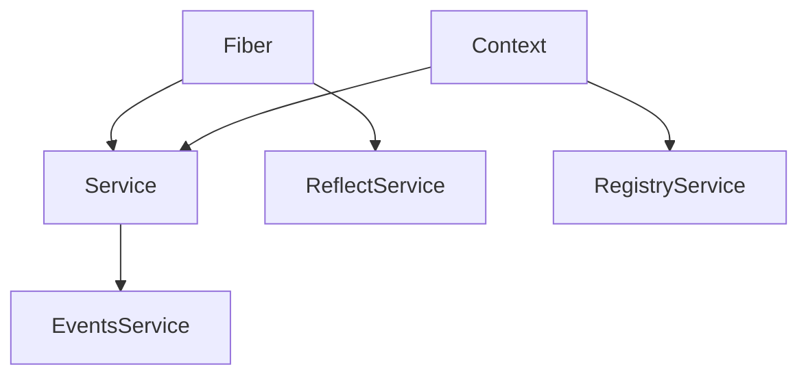

This diagram shows the central role of `Context` and `Fiber` in managing services, reflecting registrations, events, and plugin states.

Sources: `[vendor/cordis/src/context.ts:1-40]()`, `[vendor/cordis/src/fiber.ts:1-50]()`, `[vendor/cordis/src/service.ts:1-40]()`, `[vendor/cordis/src/reflect.ts:1-30]()`, `[vendor/cordis/src/events.ts:1-60]()`, `[vendor/cordis/src/registry.ts:1-40]()`

---

# Page: Plugin Composition: Profiles, Bundles & Configuration

# Plugin Composition: Profiles, Bundles & Configuration

<details>
<summary>Relevant source files</summary>

The following files were used as context for generating this wiki page:

- [apps/cli/composition.md](apps/cli/composition.md)
- [apps/web/tests/expected/deepseek-messages-settings/cards.expected.md](apps/web/tests/expected/deepseek-messages-settings/cards.expected.md)
- [apps/web/tests/expected/onboarding-deepseek-config/default-models.expected.md](apps/web/tests/expected/onboarding-deepseek-config/default-models.expected.md)
- [apps/web/tests/onboarding-deepseek-config.e2e.ts](apps/web/tests/onboarding-deepseek-config.e2e.ts)
- [docs/subsystems/boot.i18n.yaml](docs/subsystems/boot.i18n.yaml)
- [docs/subsystems/boot.md](docs/subsystems/boot.md)
- [docs/subsystems/boot.zh.md](docs/subsystems/boot.zh.md)
- [packages/boot/plugin-manager/README.i18n.yaml](packages/boot/plugin-manager/README.i18n.yaml)
- [packages/boot/plugin-manager/README.md](packages/boot/plugin-manager/README.md)
- [packages/boot/plugin-manager/README.zh.md](packages/boot/plugin-manager/README.zh.md)
- [packages/boot/plugin-manager/src/index.ts](packages/boot/plugin-manager/src/index.ts)
- [packages/boot/plugin-manager/src/types.ts](packages/boot/plugin-manager/src/types.ts)
- [packages/boot/plugin-manager/tests/manager.spec.ts](packages/boot/plugin-manager/tests/manager.spec.ts)
- [packages/bundle/base/README.i18n.yaml](packages/bundle/base/README.i18n.yaml)
- [packages/bundle/base/README.md](packages/bundle/base/README.md)
- [packages/bundle/base/README.zh.md](packages/bundle/base/README.zh.md)
- [packages/bundle/base/cordis.patch.yml](packages/bundle/base/cordis.patch.yml)
- [packages/bundle/base/package.json](packages/bundle/base/package.json)
- [packages/bundle/base/tests/base.spec.ts](packages/bundle/base/tests/base.spec.ts)
- [packages/bundle/headless/README.i18n.yaml](packages/bundle/headless/README.i18n.yaml)
- [packages/bundle/headless/README.md](packages/bundle/headless/README.md)
- [packages/bundle/headless/README.zh.md](packages/bundle/headless/README.zh.md)
- [packages/bundle/headless/src/index.ts](packages/bundle/headless/src/index.ts)
- [packages/bundle/headless/src/json-stream.ts](packages/bundle/headless/src/json-stream.ts)
- [packages/bundle/headless/src/startup.ts](packages/bundle/headless/src/startup.ts)
- [packages/bundle/headless/tests/headless.spec.ts](packages/bundle/headless/tests/headless.spec.ts)
- [packages/bundle/headless/tests/json-stream.spec.ts](packages/bundle/headless/tests/json-stream.spec.ts)
- [packages/bundle/headless/tests/startup.spec.ts](packages/bundle/headless/tests/startup.spec.ts)
- [packages/bundle/web-app/README.i18n.yaml](packages/bundle/web-app/README.i18n.yaml)
- [packages/bundle/web-app/README.md](packages/bundle/web-app/README.md)
- [packages/bundle/web-app/README.zh.md](packages/bundle/web-app/README.zh.md)
- [packages/bundle/web-app/cordis.patch.yml](packages/bundle/web-app/cordis.patch.yml)
- [packages/bundle/web-app/package.json](packages/bundle/web-app/package.json)
- [packages/llm/llm-deepseek-account/src/resolve-catalog.ts](packages/llm/llm-deepseek-account/src/resolve-catalog.ts)
- [packages/llm/llm-deepseek-account/tests/resolve-catalog.spec.ts](packages/llm/llm-deepseek-account/tests/resolve-catalog.spec.ts)
- [packages/llm/llm-deepseek/src/models.ts](packages/llm/llm-deepseek/src/models.ts)
- [packages/llm/llm-deepseek/tests/runtime.spec.ts](packages/llm/llm-deepseek/tests/runtime.spec.ts)
- [tsconfig.client.json](tsconfig.client.json)

</details>


## Purpose and Scope

This page details the implementation mechanics of how a running DeepSeek Harness (`dsh`) instance is assembled from ordered patch layers organized into **profiles** and **bundles**, merged with configuration files (`cordis.yml` and `cordis.patch.yml`), and projected into the active Cordis service graph tree. It covers profile discovery, bundle patch resolution (`bundlePatchPaths`), runtime package resolution interception (`createRuntimeResolution`), plugin management (`PluginManager`), the configuration catalog, and introspection utilities such as `--dump-config` and `--dump-config-schema`.

Sources: `packages/boot/app-boot/src/index.ts:1-1070`(), `packages/boot/app-boot/src/profile.ts:1-148`(), `packages/boot/plugin-manager/src/index.ts:1-100`()

---

## Composition Layers: Profiles & Bundles

A running `dsh` instance is instantiated by selecting a **Profile**, which anchors a specific configuration and plugin set, and loading an ordered list of **Bundles**, which package related plugins along with their declarative patch files (`cordis.patch.yml`).

### Profiles

- A **profile** is stored under `$DSH_HOME/profiles/<profile-name>` and contains a `package.json` declaring `dsh.profile` (with an ordered `bundles` list) alongside a user-editable `cordis.patch.yml` override file [packages/boot/app-boot/src/profile.ts:1-14]().
- Profiles allow a single installation to ship multiple distinct application surfaces (e.g., `web`, `headless`, `acp`, `sdk`) [packages/boot/app-boot/README.md:46-51]().
- `loadProfile()` reads the profile manifest, validates its structure, and gathers its resolved layers [packages/boot/app-boot/src/profile.ts:67-104]().

### Bundles

- Bundles are npm packages declaring a `"dsh.bundle.patch"` field that references one or more patch files [packages/boot/app-boot/src/profile.ts:58-75]().
- `bundlePatchFiles()` and `bundlePatchPaths()` parse and resolve these declarations into absolute filesystem paths [packages/boot/app-boot/src/profile.ts:58-76]().
- Shipped bundles include `@deepseek-ai/dsh-base` (the core plugin runtime) and surface overlays like `@deepseek-ai/dsh-web-app` [packages/bundle/base/cordis.patch.yml:1-15](), [packages/bundle/web-app/cordis.patch.yml:1-16]().

### Diagram: Composition Assembly & Profile Boot Flow

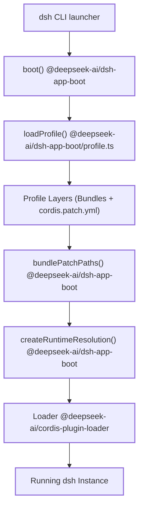

Sources: `packages/boot/app-boot/src/index.ts:9-108`(), `packages/boot/app-boot/src/profile.ts:58-104`()

---

## Profile Resolution and Package Routing

The profile resolution subsystem isolates dependency graphs across installations and profiles:

- `createRuntimeResolution()` constructs an immutable `RuntimeResolution` structure mapping package names, physical directories, versions, and scopes (`installation` vs `profile`) [packages/boot/app-boot/src/profile.ts:124-147]().
- Runtime resolution interception hooks into Node.js ESM and CommonJS loaders to route bare specifier imports to the correct physical paths without breaking fallback behavior [packages/boot/app-boot/tests/profile-resolution.spec.ts:1-30]().

Sources: `packages/boot/app-boot/src/profile.ts:124-147`(), `packages/boot/app-boot/tests/profile-resolution.spec.ts:1-30`()

---

## Plugin Lifecycle, Toggles & Plugin Manager

The `@deepseek-ai/dsh-plugin-manager` package provides administrative control over running profile plugins:

- `PluginManager` handles runtime enabling, disabling, bundle installation, and removal [packages/boot/plugin-manager/src/index.ts:1-78]().
- Toggling a plugin modifies the `disabled` property of the matching entry in the profile's `cordis.patch.yml` [packages/boot/plugin-manager/README.md:36-41]().
- Peer dependency versions against `@deepseek-ai/dsh` are verified via `evaluatePluginCompatibility()` before loading or installing plugins [packages/boot/app-boot/src/index.ts:22-26]().

### Diagram: Plugin Management and Configuration Pipeline

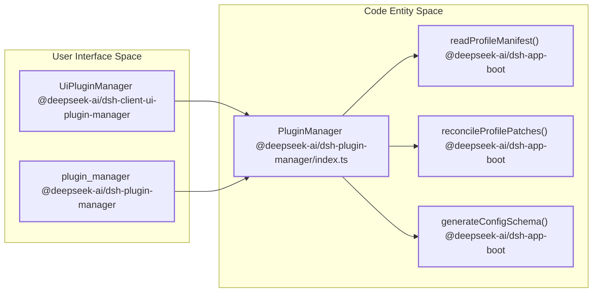

Sources: `packages/boot/plugin-manager/src/index.ts:1-30`(), `packages/boot/app-boot/src/index.ts:20-33`()

---

## Configuration Mechanism, Expressions (`!!js`) & Config Catalog

Cordis Loader entries define declarative plugins with an `id`, `name`, `inject`, and a `config` block [packages/bundle/web-app/cordis.patch.yml:1-56]().

- JavaScript expressions are interpolated using the `!!js` YAML tag, allowing values to dynamically access the Cordis `Context` or host environment [packages/boot/app-boot/src/index.ts:41-45]().
- `generateConfigSchema()` and `createConfigProjector()` inspect loaded modules to generate JSON Schema 2020-12 representations of the configuration tree [packages/boot/app-boot/src/index.ts:31-33]().

Sources: `packages/boot/app-boot/src/index.ts:31-45`(), `packages/bundle/web-app/cordis.patch.yml:40-56`()

---

scripts/verify-cordis-config.ts:1-88()

---

## Summary

- A **Profile** serves as a personalized or deployment runtime environment wrapping ordered **Bundles**.
- `loadProfile()` and `bundlePatchPaths()` assemble patch layers into an ordered execution stack [packages/boot/app-boot/src/profile.ts:58-104]().
- `createRuntimeResolution()` intercepts module resolution to ensure correct package boundaries [packages/boot/app-boot/tests/profile-resolution.spec.ts:1-30]().
- `PluginManager` handles persistent state modifications, dependency validation, and HMR reloads [packages/boot/plugin-manager/src/index.ts:1-78]().
- Configuration evaluation supports `!!js` expressions evaluated against the active Cordis Context [packages/boot/app-boot/src/index.ts:41-45]().

Sources: `packages/boot/app-boot/src/index.ts:41-45`(), `packages/boot/app-boot/src/profile.ts:58-104`(), `packages/boot/plugin-manager/src/index.ts:1-78`()

---

# Page: Event Bus & Capability Seams

# Event Bus & Capability Seams

<details>
<summary>Relevant source files</summary>

The following files were used as context for generating this wiki page:

- [apps/cli/package.json](apps/cli/package.json)
- [apps/cli/tsconfig.json](apps/cli/tsconfig.json)
- [apps/cli/tsdown.config.ts](apps/cli/tsdown.config.ts)
- [apps/web/tests/scaffold.ts](apps/web/tests/scaffold.ts)
- [apps/web/tsconfig.json](apps/web/tsconfig.json)
- [docs/capability-seams.i18n.yaml](docs/capability-seams.i18n.yaml)
- [docs/capability-seams.md](docs/capability-seams.md)
- [docs/capability-seams.zh.md](docs/capability-seams.zh.md)
- [docs/config-catalog.i18n.yaml](docs/config-catalog.i18n.yaml)
- [docs/config-catalog.md](docs/config-catalog.md)
- [docs/config-catalog.zh.md](docs/config-catalog.zh.md)
- [docs/event-producer-consumer.i18n.yaml](docs/event-producer-consumer.i18n.yaml)
- [docs/event-producer-consumer.md](docs/event-producer-consumer.md)
- [docs/event-producer-consumer.zh.md](docs/event-producer-consumer.zh.md)
- [docs/module-graph.i18n.yaml](docs/module-graph.i18n.yaml)
- [docs/module-graph.md](docs/module-graph.md)
- [docs/module-graph.zh.md](docs/module-graph.zh.md)
- [docs/subsystems/core.i18n.yaml](docs/subsystems/core.i18n.yaml)
- [docs/subsystems/core.md](docs/subsystems/core.md)
- [docs/subsystems/core.zh.md](docs/subsystems/core.zh.md)
- [packages/extensions/tool-cordis/src/api-catalog.ts](packages/extensions/tool-cordis/src/api-catalog.ts)
- [pnpm-lock.yaml](pnpm-lock.yaml)
- [scripts/gen-cordis-catalog.ts](scripts/gen-cordis-catalog.ts)
- [scripts/gen-doc-graphs.ts](scripts/gen-doc-graphs.ts)
- [scripts/type-equiv.manifest.json](scripts/type-equiv.manifest.json)
- [scripts/verify-package-readme-model-experience.ts](scripts/verify-package-readme-model-experience.ts)
- [tsconfig.base.json](tsconfig.base.json)
- [tsconfig.host.json](tsconfig.host.json)

</details>


This page explains the event-driven communication model of DeepSeek Harness (`dsh`), covering session and agent events, pre-step and stream waterfalls via the Cordis plugin framework (`vendor/cordis`), the capability seam abstraction pattern, and comprehensive event producer-consumer mappings across harness packages.

---

## 1. Event-Driven Communication Model

DeepSeek Harness employs an event-driven architecture built upon the Cordis plugin framework (`vendor/cordis`). Communication between decoupled subsystems is mediated by a central event bus supporting three primary dispatch patterns:

- **`emit`**: One-to-many notifications where multiple listeners receive the event without affecting each other.
- **`serial`**: Ordered, synchronous delivery where handlers run one after another.
- **`waterfall`**: Sequential data transformation where each handler receives input from the previous and may modify or short-circuit the flow.

This design allows structured and extensible composition of asynchronous operations in complex workflows such as agent turns and streaming LLM generation.

### 1.1 Session & Agent Events

The lifecycle of an agent and its interactions are broadcast via the event bus. The `sessions` service manages runtime state persistence and event distribution. The agent loop (`agent-loop`) emits pivotal events during its lifecycle, allowing other plugins and subsystems to listen and react accordingly.

Key events declared in `packages/core/agent/src/runtime-types.ts` include:

| Event Name | Dispatch Mode | Declared Line Range | Description |
| --- | --- | --- | --- |
| `agent/created` | `serial` | `[packages/core/agent/src/runtime-types.ts:261-268]()` | Dispatched when a new agent instance is initialized. Serves for initialization hooks. |
| `agent/pre-step` | `waterfall` | `[packages/core/agent/src/runtime-types.ts:320-335]()` | A critical waterfall where plugins inject context and modify agent steps before LLM calls execute. |
| `agent/status` | `emit` | `[packages/core/agent/src/runtime-types.ts:280-286]()` | Broadcasts state changes (`idle`, `running`) of the agent loop. |
| `agent/inbox/claimed` | `emit` | `[packages/core/agent/src/runtime-types.ts:299-305]()` | The driver claims a message from the inbox to start processing a turn. |

Packages such as `agent-instructions`, `goal-round-driver`, `hooks-codex`, and `plan-mode` listen on these events to enrich agent behavior, coordinate tooling, or adjust execution flow.

Sources:
- `[packages/core/agent/src/runtime-types.ts:260-395]()`
- `[vendor/cordis]()`

---

### 1.2 LLM & Stream Waterfalls

LLM interactions are managed via the `llm` service registry, which dispatches to provider adapters (e.g., `llm-deepseek`, `llm-pi-ai`). Streaming responses occur as waterfalls over token chunks (`agent/assistant-stream`), allowing middleware such as token metering, reasoning extractors, or error recovery components (`llm-retry`) to intercept and transform streams before they arrive at clients or UI views.

Sources:
- `[docs/event-producer-consumer.md:11-30]()`
- `[packages/core/agent/src/runtime-types.ts:360-375]()`

---

### Diagram 1: Agent Step Execution — From Natural Language Space to Code Entities

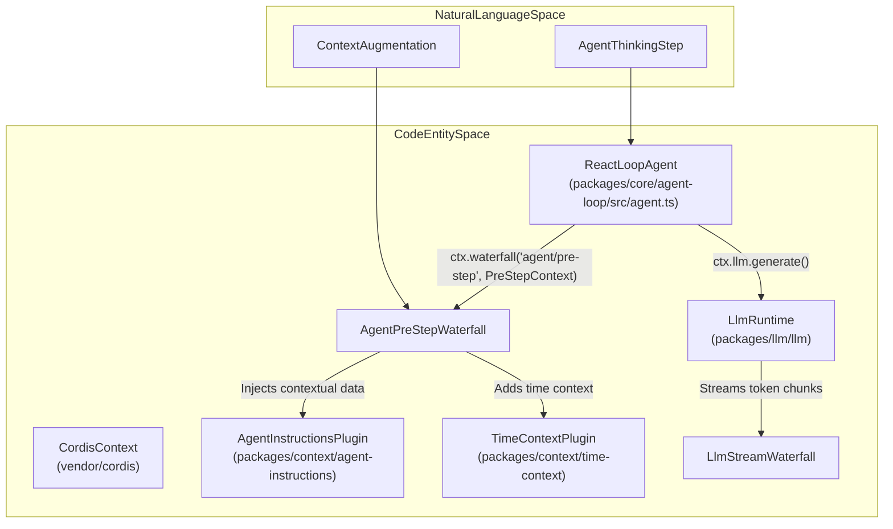

This diagram illustrates how the agent loop interprets a conceptual step in natural language and triggers concrete code workflows using Cordis `ctx` event waterfalls and service method calls.

Sources:
- `[docs/event-producer-consumer.md:11-23]()`
- `[vendor/cordis]()`

---

## 2. Capability Seams Pattern

Capability seams are Cordis service keys representing abstract interfaces for sensitive or environment-specific functionalities. Instead of hard-coding environment dependencies, DeepSeek Harness relies on seams to supply implementations at runtime via Cordis injection.

This enables the core agent and tool loops to remain portable and environment agnostic, allowing the same plugins to operate transparently over local filesystems, sandboxes, remote APIs, or other runtime environments.

### 2.1 Key Capability Seams

| Seam (Cordis Service Key) | Purpose | Primary Implementation | Key Consumers |
|---------------------------|---------|------------------------|---------------|
| `ctx.llm` | LLM Provider Abstraction | `llm-deepseek`, `llm-pi-ai` | `agent-loop`, `compaction-basic` |
| `ctx.fs` | Filesystem Access | `fs-local` | `tool-fs`, `agent-instructions` |
| `ctx.tools` | Tool Registry & Execution | `tools` | `agent-loop`, `subagent` |
| `ctx.agents` | Agent Registry & Lifecycle | `agent` | `api-gateway`, `acp` |
| `ctx.systemPrompt` | Prompt Assembly & Injection | `system-prompt` | `agent-loop` |

Sources:
- `[docs/config-catalog.md:15-56]()`
- `[docs/module-graph.md:40-49]()`

---

### Diagram 2: Capability Seam Pattern — Mapping User Intent to Abstracted Code Entities

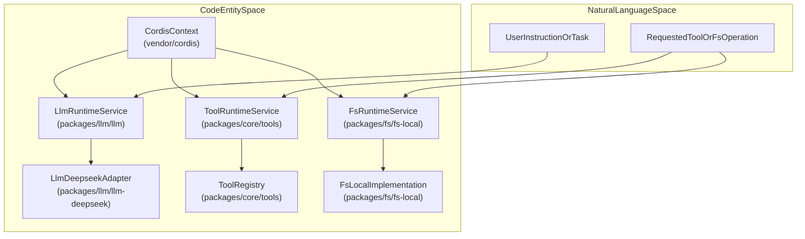

This diagram shows that user or agent instructions (natural language) map to invocation of abstracted capability seams via the Cordis context, which then dispatch to runtime implementations in the codebase.

Sources:
- `[docs/config-catalog.md:15-56]()`
- `[docs/module-graph.md:40-49]()`

---

## 3. Event Producer-Consumer Map & Data Flow

Harness packages communicate strictly via events declared on the Cordis context, enabling loosely coupled and extensible integration. The complete matrix of producers and consumers is automatically verified during doc sync (`[docs/event-producer-consumer.md:4-30]`).

### 3.1 Event Producer-Consumer Matrix Highlights

| Event | Mode | Producer Package | Consumer Packages (Listeners) |
|---|---|---|---|
| `agent/inbox/inserted` | `emit` | `agent-loop` | `goal-round-driver`, `subagent` |
| `agent/request` | `waterfall` | `agent-loop` | `agent`, `webhook` |
| `agent/pre-step` | `waterfall` | `agent-loop` | `agent-instructions`, `time-context`, `plan-mode`, `tool-skill` |
| `agent/status` | `emit` | `agent-loop` | `agent`, `goal-round-driver`, `session-controller` |
| `agent/assistant-stream` | `emit` | `agent-loop` | `headless`, `session-controller` |

Sources:
- `[docs/event-producer-consumer.md:8-30]()`

---

### 3.2 Data Flow: Tool Execution Seam & Event Interception

The invocation and execution of a tool by an agent proceeds through well-defined event waterfalls using the `tools` capability seam:

1. The `agent-loop` detects tool call requests extracted from streaming LLM output.
2. The `tools/pre-execute` waterfall runs, where interceptors like `hooks-codex` or `hooks-claude-code` can inspect or modify the call parameters.
3. The tool registry dispatches to the concrete tool implementation, which may reach into environment seams like `ctx.fs` or `ctx.shell`.
4. After execution, the `tools/post-execute` waterfall processes results for cleanup or enrichment.
5. Execution outcome events are recorded and published through the session log for consistent replay or auditing.

Sources:
- `[docs/event-producer-consumer.md:8-30]()`
- `[packages/extensions/tool-cordis/src/api-catalog.ts:15-48]()`

---

# Page: Agent System

# Agent System

<details>
<summary>Relevant source files</summary>

The following files were used as context for generating this wiki page:

- [docs/architecture.i18n.yaml](docs/architecture.i18n.yaml)
- [docs/architecture.md](docs/architecture.md)
- [docs/architecture.zh.md](docs/architecture.zh.md)
- [packages/core/agent-loop/README.i18n.yaml](packages/core/agent-loop/README.i18n.yaml)
- [packages/core/agent-loop/README.md](packages/core/agent-loop/README.md)
- [packages/core/agent-loop/README.zh.md](packages/core/agent-loop/README.zh.md)
- [packages/core/agent-loop/src/agent.ts](packages/core/agent-loop/src/agent.ts)
- [packages/core/agent-loop/tests/cancel.spec.ts](packages/core/agent-loop/tests/cancel.spec.ts)
- [packages/core/agent-loop/tests/contract-regressions.spec.ts](packages/core/agent-loop/tests/contract-regressions.spec.ts)
- [packages/core/agent-loop/tests/coverage-edges.spec.ts](packages/core/agent-loop/tests/coverage-edges.spec.ts)
- [packages/core/agent-loop/tests/interception.spec.ts](packages/core/agent-loop/tests/interception.spec.ts)
- [packages/core/agent-loop/tests/loop.spec.ts](packages/core/agent-loop/tests/loop.spec.ts)
- [packages/core/agent/README.i18n.yaml](packages/core/agent/README.i18n.yaml)
- [packages/core/agent/README.md](packages/core/agent/README.md)
- [packages/core/agent/README.zh.md](packages/core/agent/README.zh.md)
- [packages/core/agent/src/types.ts](packages/core/agent/src/types.ts)

</details>


The Agent System is the core orchestration layer of DeepSeek Harness (`dsh`) [packages/core/agent/src/types.ts:15-46](). It manages the lifecycle, creation, driving, conversation turn progression, and tool execution of autonomous agents within the modular, plugin-driven Cordis framework [packages/core/agent-loop/src/agent.ts:70-160](). This system operates by composing durable session logs, live agent handles, scoped contexts, and event-driven workflows [docs/architecture.md:74-87]().

This page provides a high-level overview of the key components and their relationships in the agent system. For detailed technical information, implementation specifics, and advanced features, see the linked child pages:
- [Agent Loop & Lifecycle](#3.1) — Deep dive into `ReactLoopAgent`: turn/step state machine, inbox management, cancellation, epoch headers, maintenance mode, and publication transactions.
- [Tool Registry & Execution Pipeline](#3.2) — Covers `ToolRuntime`: tool registration, pre/execute/post waterfall, Code Mode (`run_code` + SDK generation), scheduling, and SDK rendering.
- [Session Log & Persistence](#3.3) — Explains the append-only `SessionEvent` log, Surface projection, `deriveMessages()`, forking/lineage, and persistence backends.
- [Subagent Orchestration](#3.4) — How parent agents delegate to child agents: one-shot vs. continuable, in-process vs. out-of-process drivers (ACP, Codex, Claude Code, DSH SDK).
- [LLM Adapters & Streaming](#3.5) — The `LlmRuntime` seam, adapter registration, streaming protocol, retry policies, and token metering.

---

## Core Components & Entity Mapping

At the heart of the agent system are agents modeled as turn-based state machines [packages/core/agent-loop/src/agent.ts:18-37](). A **Turn** may consist of zero or more **Steps**, where each step typically corresponds to an LLM request and tool-call execution [packages/core/agent-loop/README.md:11-94](). This flow is carefully recorded in the durable session log and projected live for UI, plugins, and orchestrators to consume [docs/architecture.md:59-64]().

Key packages and services orchestrate the agent lifecycle and execution:

| Service / Class | Context Key | Responsibility |
|-----------------|-------------|----------------|
| `AgentRegistry` (`@deepseek-ai/dsh-agent`) [packages/core/agent/src/types.ts:15-46]() | `ctx.agents` | Provides live agent handles and registry. Manages creation, resuming, cancellation, and event observability for agents. |
| `AgentLoop` (`@deepseek-ai/dsh-agent-loop`) [packages/core/agent-loop/README.md:26-38]() | `ctx.agentLoop` | Implements the default agent driver—the event loop driving turns, steps, and requests. |
| `ReactLoopAgent` (`@deepseek-ai/dsh-agent-loop/src/agent.ts`) [packages/core/agent-loop/src/agent.ts:98-138]() | N/A | Concrete `Agent` implementation driving turn/step state machine, inbox management, and interaction with system prompt and runtime context projections. |
| `ReactLoopInbox` | N/A | Manages pending message queues (`next-turn` and `next-step`) for the agent [packages/core/agent-loop/src/agent.ts:132-132](). |
| `Scope` (`@deepseek-ai/dsh-scope`) | Library, no key | Agent-scoped registrations and lifecycles supporting per-agent isolated registrations of tools, prompt sections, and listeners [docs/architecture.md:64-64](). |

Diagram: Natural Language to Code Entity Mapping
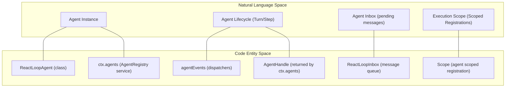
Sources: [packages/core/agent-loop/src/agent.ts:98-169](), [packages/core/agent/src/types.ts:15-46](), [packages/core/agent/README.md:28-67](), [docs/architecture.md:74-87]()

---

## 3.1 Agent Loop & Lifecycle

The `@deepseek-ai/dsh-agent-loop` package implements the default agent lifecycle driver, realized primarily by the `ReactLoopAgent` class [packages/core/agent-loop/src/agent.ts:98-138](). This driver manages:

- Creation and resumption of agent sessions bound to durable logs [packages/core/agent-loop/README.md:59-71]().
- Driving the agent as a turn- and step-based state machine [packages/core/agent-loop/src/agent.ts:42-51]().
- Managing pending inputs in per-agent inboxes (with separate queues for `next-turn` and `next-step`) [packages/core/agent/src/types.ts:38-45]().
- Assembling prompt sections including user messages, system prompt, and tool schemas [packages/core/agent-loop/src/agent.ts:132-138]().
- Executing the lifecycle workflow: dispatching model requests, streaming responses, executing tool calls, and appending new session events [packages/core/agent-loop/src/agent.ts:100-112]().

For detailed implementation specifics, see [Agent Loop & Lifecycle](#3.1).

Sources: [docs/architecture.md:74-101](), [packages/core/agent-loop/src/agent.ts:70-160](), [packages/core/agent-loop/README.md:11-94]()

---

## 3.2 Tool Registry & Execution Pipeline

Central to agent capabilities is the tool execution pipeline managed by the `ToolRuntime` service (`ctx.tools`) [docs/architecture.md:61-61](). It provides:

- Registration and scoping of tools to agents and contexts.
- A guarded waterfall lifecycle for tool calls broken into `pre-execute`, `execute`, and `post-execute` hooks [packages/core/agent-loop/tests/contract-regressions.spec.ts:99-105]().
- Support for parallel-safe concurrent tool calls with a configurable limit (`maxParallelToolCalls`), alongside exclusive calls [packages/core/agent-loop/README.md:46-57]().
- A "Code Mode" combining tool execution with SDK code generation.

For full functional and configuration details, see [Tool Registry & Execution Pipeline](#3.2).

Sources: [docs/architecture.md:65-65](), [packages/core/agent-loop/README.md:73-74](), [packages/core/agent-loop/tests/contract-regressions.spec.ts:99-105]()

---

## 3.3 Session Log & Persistence

The session log, managed by the `SessionStore` (`ctx.sessions`), is the single source of truth for conversation state and tool outcomes [docs/architecture.md:59-59]().

- An append-only log of `SessionEvent` objects representing user, assistant, system messages, tool calls, and boundaries [packages/core/agent/src/types.ts:89-104]().
- Session projections derive live in-memory views such as message chains (`deriveMessages()`), inbox states, and rich runtime context [packages/core/agent-loop/tests/contract-regressions.spec.ts:75-78]().
- Persistence backends support JSONL and SQLite file formats.

See [Session Log & Persistence](#3.3) for an extensive technical exposition.

Sources: [docs/architecture.md:61-64](), [docs/architecture.md:68-71](), [packages/core/agent-loop/src/inbox.ts:10-40]()

---

## 3.4 Subagent Orchestration

Complex agent scenarios require delegation and teamwork. The subagent orchestration subsystem enables agents to manage child agents with flexible lifecycles.

- Subagents operate in one-shot mode (single turn) or as continuable multi-turn sessions [packages/core/agent/README.md:30-33]().
- Drivers include in-process loops, or out-of-process agents connected via protocols such as ACP (Agent Client Protocol), Codex, Claude Code, or through the DSH SDK.
- Policy inheritance mechanisms allow parent agents to control or restrict child agent capabilities.

For a deeper understanding, see [Subagent Orchestration](#3.4).

Sources: [packages/core/agent/README.md:28-35]()

---

## 3.5 LLM Adapters & Streaming

The `LlmRuntime` seam, accessible via `ctx.llm`, abstracts the heterogeneity of LLM providers and streaming protocols [docs/architecture.md:65-65]().

- Registers adapters that normalize prompt preparation, request routing, and streaming response consumption.
- Supports advanced features like token metering, retry policies, and reasoning effort metadata [packages/core/agent-loop/README.md:50-52]().
- Implements streaming chunk and block assembly facilitating continuous streaming of assistant responses [packages/core/agent-loop/tests/loop.spec.ts:103-111]().
- Includes out-of-the-box adapter implementations for DeepSeek and Pi.ai services.

Consult [LLM Adapters & Streaming](#3.5) for the detailed adapter lifecycle and streaming protocol.

Sources: [docs/architecture.md:60-62](), [packages/core/agent-loop/src/agent.ts:19-28](), [packages/core/agent-loop/tests/loop.spec.ts:103-111]()

---

## Service Interaction Overview

Diagram: Agent Step Subsystem Interaction
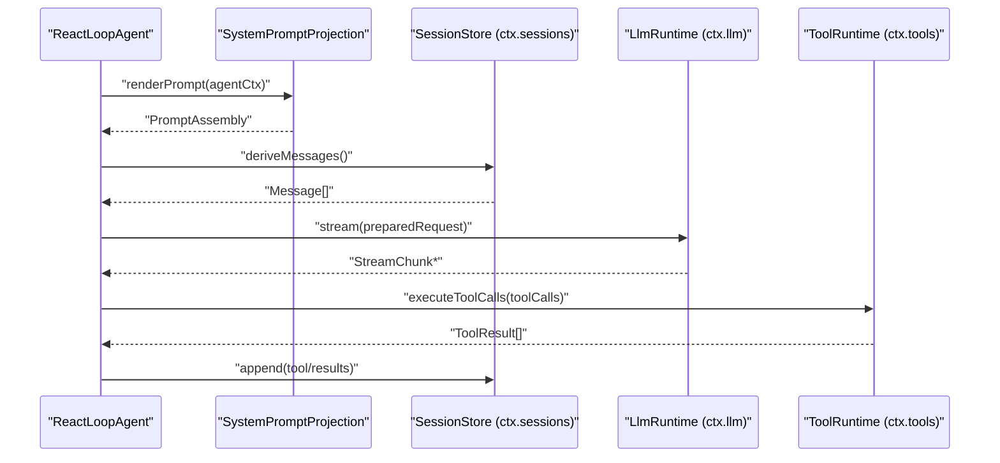
Sources: [packages/core/agent-loop/src/agent.ts:18-37](), [packages/core/agent-loop/src/tool-calls.ts:10-60](), [docs/architecture.md:74-102]()

---

# See Also

- [Agent Loop & Lifecycle](#3.1)
- [Tool Registry & Execution Pipeline](#3.2)
- [Session Log & Persistence](#3.3)
- [Subagent Orchestration](#3.4)
- [LLM Adapters & Streaming](#3.5)

---
Sources:
- docs/architecture.md:3-77
- packages/core/agent-loop/src/agent.ts:1-171
- packages/core/agent-loop/README.md:1-94
- packages/core/agent/src/types.ts:1-56

---

# Page: Agent Loop & Lifecycle

# Agent Loop & Lifecycle

<details>
<summary>Relevant source files</summary>

The following files were used as context for generating this wiki page:

- [docs/architecture.i18n.yaml](docs/architecture.i18n.yaml)
- [docs/architecture.md](docs/architecture.md)
- [docs/architecture.zh.md](docs/architecture.zh.md)
- [packages/core/agent-loop/README.i18n.yaml](packages/core/agent-loop/README.i18n.yaml)
- [packages/core/agent-loop/README.md](packages/core/agent-loop/README.md)
- [packages/core/agent-loop/README.zh.md](packages/core/agent-loop/README.zh.md)
- [packages/core/agent-loop/src/agent.ts](packages/core/agent-loop/src/agent.ts)
- [packages/core/agent-loop/src/index.ts](packages/core/agent-loop/src/index.ts)
- [packages/core/agent-loop/tests/agent.spec.ts](packages/core/agent-loop/tests/agent.spec.ts)
- [packages/core/agent-loop/tests/cancel.spec.ts](packages/core/agent-loop/tests/cancel.spec.ts)
- [packages/core/agent-loop/tests/config-session-id.spec.ts](packages/core/agent-loop/tests/config-session-id.spec.ts)
- [packages/core/agent-loop/tests/contract-regressions.spec.ts](packages/core/agent-loop/tests/contract-regressions.spec.ts)
- [packages/core/agent-loop/tests/coverage-edges.spec.ts](packages/core/agent-loop/tests/coverage-edges.spec.ts)
- [packages/core/agent-loop/tests/interception.spec.ts](packages/core/agent-loop/tests/interception.spec.ts)
- [packages/core/agent-loop/tests/loop.spec.ts](packages/core/agent-loop/tests/loop.spec.ts)
- [packages/core/agent-loop/tests/resume.spec.ts](packages/core/agent-loop/tests/resume.spec.ts)
- [packages/core/agent-loop/tests/scope-lifecycle.spec.ts](packages/core/agent-loop/tests/scope-lifecycle.spec.ts)
- [packages/core/agent-loop/tests/tool-order.spec.ts](packages/core/agent-loop/tests/tool-order.spec.ts)
- [packages/core/agent/README.i18n.yaml](packages/core/agent/README.i18n.yaml)
- [packages/core/agent/README.md](packages/core/agent/README.md)
- [packages/core/agent/README.zh.md](packages/core/agent/README.zh.md)
- [packages/core/agent/src/index.ts](packages/core/agent/src/index.ts)
- [packages/core/agent/src/types.ts](packages/core/agent/src/types.ts)
- [packages/core/agent/tests/agent.spec.ts](packages/core/agent/tests/agent.spec.ts)
- [packages/core/scope/README.i18n.yaml](packages/core/scope/README.i18n.yaml)
- [packages/core/scope/README.md](packages/core/scope/README.md)
- [packages/core/scope/README.zh.md](packages/core/scope/README.zh.md)
- [packages/core/scope/src/index.ts](packages/core/scope/src/index.ts)
- [packages/core/scope/src/store.ts](packages/core/scope/src/store.ts)
- [packages/core/scope/tests/scope.spec.ts](packages/core/scope/tests/scope.spec.ts)
- [packages/core/scope/tests/store.spec.ts](packages/core/scope/tests/store.spec.ts)
- [packages/core/system-prompt/README.i18n.yaml](packages/core/system-prompt/README.i18n.yaml)
- [packages/core/system-prompt/README.md](packages/core/system-prompt/README.md)
- [packages/core/system-prompt/README.zh.md](packages/core/system-prompt/README.zh.md)
- [packages/core/system-prompt/src/index.ts](packages/core/system-prompt/src/index.ts)
- [packages/core/system-prompt/tests/scoped.spec.ts](packages/core/system-prompt/tests/scoped.spec.ts)
- [packages/core/system-prompt/tests/system-prompt.spec.ts](packages/core/system-prompt/tests/system-prompt.spec.ts)
- [packages/core/system-prompt/tests/tool-order.spec.ts](packages/core/system-prompt/tests/tool-order.spec.ts)
- [packages/core/tools/tests/scoped.spec.ts](packages/core/tools/tests/scoped.spec.ts)

</details>


This page provides a deep technical dive into the `ReactLoopAgent` implementation within DeepSeek Harness (`dsh`), covering its internal turn/step state machine, inbox management, cancellation protocols, maintenance mode, epoch headers for request consistency, and publication transaction patterns [packages/core/agent-loop/src/agent.ts:68-170](), [packages/core/agent-loop/src/index.ts:96-146]().

---

## Overview of ReactLoopAgent

The `ReactLoopAgent` class serves as the default concrete agent driver in `dsh`, fulfilling the public `Agent` contract [packages/core/agent-loop/src/agent.ts:72](). It handles the complete lifecycle of an execution session from message intake through model requests and tool execution loops [packages/core/agent-loop/src/agent.ts:72-112]().

Key architectural characteristics include:
- Consumes incoming user messages via an append-only `ReactLoopInbox` instance backed by session projections that reflect `agent/inbox/spliced` events [packages/core/agent-loop/src/agent.ts:36,99-106]().
- Manages conversation progress across discrete `turn` and `step` boundaries, materialized as durable session log events `turn/start`, `turn/end`, `step/start`, and `step/end` [docs/architecture.zh.md:86-107]().
- Uses Cordis event taxonomies for plugin-based observation and extension, emitting `agent/*` domain events such as `agent/pre-step`, `agent/request`, `agent/assistant-stream`, and `agent/turn-stopping` [docs/architecture.md:11-14]().
- Implements cooperative cancellation of active turns and queued input via `AbortController` signals passing JSON-safe cancellation causes [packages/core/agent-loop/src/agent.ts:79-94,149-155]().
- Supports a dedicated maintenance mode to run exclusive background jobs, pausing main loop execution, latching wake requests during maintenance [packages/core/agent-loop/src/agent.ts:44-50,157-174]().

### Natural Language to Code Entity Relationship for ReactLoopAgent

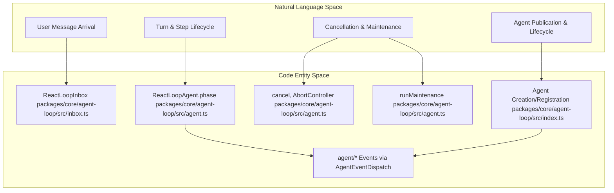

Sources:
- [docs/architecture.md:11-14]()
- [docs/architecture.zh.md:86-107]()
- [packages/core/agent-loop/src/agent.ts:35-50]()
- [packages/core/agent-loop/src/agent.ts:72-112]()
- [packages/core/agent-loop/src/index.ts:96-146]()

---

## Turn/Step State Machine

### Concepts
- **Turn:** A logical conversation segment spanning zero or more steps. A turn opens when the first input message is claimed and closes when no further work remains owed, coordinated by durable `turn/start` and `turn/end` events [docs/architecture.zh.md:86-107]().
- **Step:** A single request-response cycle with the LLM, including execution of any called tools; bound by `step/start` and `step/end` events [docs/architecture.zh.md:86-107]().

### Internal State Phases
`ReactLoopAgent` manages its lifecycle via a private `phase` variable representing one of three discriminated states [packages/core/agent-loop/src/agent.ts:41-50]():
- `idle`: Waiting passively for new input or maintenance wakes.
- `maintenance`: Running an exclusive maintenance job. Incoming wake requests during maintenance are latched and deferred.
- `running`: Actively processing a turn and step, including message intake, model requests, streaming, and tool execution.

### Agent Phase State Machine

```mermaid
stateDiagram-v2
    direction TB
    idle["idle"] --> running["running"] : "wakeDriver() / send(wakeup=true)"
    idle --> maintenance["maintenance"] : "runMaintenance(job)"
    running --> idle["idle"] : "turn/end"
    maintenance --> idle["idle"] : "maintenance job completion"
    maintenance --> running : "wakeup latched (wakeRequested = true)"
    running --> running : "next step / tool results"
```

Sources:
- [docs/architecture.zh.md:86-107]()
- [packages/core/agent-loop/src/agent.ts:41-50]()
- [packages/core/agent-loop/src/agent.ts:74]()
- [packages/core/agent-loop/src/agent.ts:157-174]()

---

## Inbox Management: Followup, Steer, Inject

`ReactLoopAgent` manages input via a strongly consistent durable inbox implemented by `ReactLoopInbox` [packages/core/agent-loop/src/agent.ts:36,99-106](). This inbox tracks two distinct message queues reflected as session projections, modifiable only via normalized splice operations recorded as `agent/inbox/spliced` session events [packages/core/agent/README.md:71]().

### Inbox Targets
- `next-turn`: Messages intended to start a new conversation turn [packages/core/agent/src/types.ts:39]().
- `next-step`: Messages targeted at the next step inside the current turn [packages/core/agent/src/types.ts:39]().

### Public Input API

| Method | Inbox Target | Wakes Driver? | Description |
|---|---|---|---|
| `followup()` | `next-turn` | Yes | Queue a message for the next conversation turn [packages/core/agent/README.md:47]() |
| `steer()` | `next-step` | Yes | Queue a message for insertion at the next step of ongoing turn [packages/core/agent/README.md:47]() |
| `inject()` | `next-step` | No | Injects model-facing context messages without waking the driver [packages/core/agent/README.md:47]() |

All methods enqueue messages into the inbox via the `splice()` function, which normalizes all inserts, edits, and removals into `agent/inbox/spliced` events to preserve durability and enable live projections [packages/core/agent-loop/src/agent.ts:154-171]().

Sources:
- [packages/core/agent-loop/README.md:71]()
- [packages/core/agent-loop/src/agent.ts:128-171]()
- [packages/core/agent/src/types.ts:39-45]()

---

## Execution Lifecycle (Turn Flow)

The agent orchestrates a turn and step lifecycle with strict sequencing to assemble prompts, submit model requests, stream responses, perform tool execution, and log all facts durably [docs/architecture.zh.md:84-110](), [packages/core/agent-loop/src/agent.ts:39]().

### Turn & Step Flow Summary
1. **Turn Start**: Claim `next-step` input plus one queued `next-turn` message [docs/architecture.zh.md:88-89]().
2. **Prompt Assembly**: Build system prompt, tool schemas, and runtime context projections. Assemble full prompt history with `assembleContextFor()` [packages/core/agent-loop/src/agent.ts:31-33]().
3. **Pre-Step Decision**: Emit synchronous waterfall `agent/pre-step` to accept, reject, or rewrite the input batch [docs/architecture.zh.md:90-93]().
4. **Step Start**: Log `step/start`, commit `agent/request` event with the resolved LLM call configuration, and append accepted user messages [docs/architecture.zh.md:94-97]().
5. **Model Request**: Issue streaming request to the LLM adapter via `ctx.llm.prepareCall()` and `ctx.llm.stream()` [docs/architecture.zh.md:95,100]().
6. **Stream Processing**: Emit `agent/assistant-stream` lifecycle events to signal start, chunks, and completion of output [docs/architecture.zh.md:100-102]().
7. **Tool Execution**: Execute called tools through guarded pre/execute/post waterfalls (`tools/pre-execute`, `tools/execute`, `tools/post-execute`) [docs/architecture.zh.md:103]().
8. **Step End**: Log `step/end` event. If more owed work or input arrives, continue next step; otherwise, emit `agent/turn-stopping` and close turn with `turn/end` [docs/architecture.zh.md:104-107]().

### Mapping: Natural Language to Code Entities

```mermaid
graph TD
    subgraph "Natural Language Space"
        NL_Turn["Start a Conversation Turn"]
        NL_Prompt["Assemble Prompt & Tool Schemas"]
        NL_PreStep["agent/pre-step Waterfall"]
        NL_Request["Invoke Language Model"]
        NL_Stream["Stream LLM Output agent/assistant-stream"]
        NL_Tools["Execute Guarded Tool Calls tools/pre-execute -> execute -> post-execute"]
        NL_StepEnd["Close Step step/end"]
        NL_TurnEnd["Close Turn agent/turn-stopping -> turn/end"]
    end

    subgraph "Code Entity Space"
        ReactLoopAgent["ReactLoopAgent packages/core/agent-loop/src/agent.ts"]
        AssembleContext["SystemPromptProjection + assembleContextFor()"]
        AgentEvents["agent/* Events agent/pre-step, agent/request, etc"]
        LlmRuntime["ctx.llm.stream() packages/llm/llm"]
        ToolCalls["executeToolCalls() packages/core/agent-loop/src/tool-calls.ts"]
    end

    NL_Turn --> ReactLoopAgent
    NL_Prompt --> AssembleContext
    AssembleContext --> AgentEvents
    NL_PreStep --> AgentEvents
    NL_Request --> AgentEvents
    AgentEvents --> LlmRuntime
    LlmRuntime --> NL_Stream
    NL_Stream --> AgentEvents
    NL_Stream --> ToolCalls
    ToolCalls --> NL_StepEnd
    NL_StepEnd --> NL_TurnEnd
```

Sources:
- [docs/architecture.zh.md:84-110]()
- [packages/core/agent-loop/src/agent.ts:31-40]()
- [packages/core/agent-loop/src/agent.ts:103-106]()

---

## Cancellation & Maintenance Mechanics

### Cooperative Cancellation via `cancel()`
The `ReactLoopAgent` provides a cancellation API that aborts current turn activities and clears or optionally preserves the inbox [packages/core/agent-loop/src/agent.ts:149-171]().

Cancellation uses an `AbortController` signal per turn, which aborts ongoing LLM streams and tool execution. Internally, `cancel()`:
- Aborts the active abort signal with a JSON-safe cancellation cause sanitized by `abortedCancelCause()` [packages/core/agent-loop/src/agent.ts:79-95]().
- Clears inbox messages unless `keepInbox` option is set [packages/core/agent-loop/README.md:75]().
- Emits `agent/inbox` events reflecting removals with `outcome: 'canceled'` [packages/core/agent/src/types.ts:101]().
- Allows application code to distinguish if cancellation was triggered by user, parent, hook, or disposal [packages/core/agent-loop/src/agent.ts:79-95]().

### Maintenance Mode via `runMaintenance()`
The agent supports an exclusive maintenance mode to run background jobs without concurrency conflicts [packages/core/agent-loop/src/agent.ts:44-50,157-174]():
- When invoked, the agent enters a `maintenance` phase with a dedicated abort controller.
- Incoming wake requests during maintenance do not start turns immediately but are latched.
- After maintenance completes successfully, if wake requests were latched, the agent transitions to running with a wakeup call.

Sources:
- [packages/core/agent-loop/src/agent.ts:80-95]()
- [packages/core/agent-loop/src/agent.ts:149-174]()
- [packages/core/agent-loop/tests/cancel.spec.ts:62-145]()

---

## Epoch Headers & Publication Transaction Pattern

### Epoch Headers: Anchoring Model Requests
Each model request starts with an immutable `EpochHeader` capturing the exact resolved call configuration and adapter defaults at that request time to ensure stable replay [packages/core/agent-loop/src/agent.ts:63-70]().
- Adapter default fields like `reasoningEffort` or `maxTokens` are removed from proposals before pre-step listeners revise to re-resolve them, preserving protocol correctness [packages/core/agent-loop/src/agent.ts:64-70]().
- The header is durably appended as a `request/header` event in the session log [packages/core/agent-loop/README.md:92]().
- `request/context` events capture provider, model, and context window, but only logged when changed [packages/core/agent-loop/README.md:92-93]().

### Atomic Publication Transaction for Agent Lifecycle
Agent creation and session registration utilize an atomic publish pattern [packages/core/agent-loop/src/index.ts:96-146]():
1. **Preparation**: Instantiate a `ReactLoopAgent` with scoped context, create a new or resume an existing session without publishing [packages/core/agent-loop/README.md:61]().
2. **Setup**: Run the optional user-supplied `setup(agentCtx, agent)` callback that configures tools, prompts, and listeners scoped to the agent [packages/core/agent/README.md:43]().
3. **Publication**: Atomically publish the agent's session to `ctx.sessions` and register the agent instance in `ctx.agents`. Duplicate session detection disallows multiple agents sharing the same session [packages/core/agent-loop/tests/config-session-id.spec.ts:112-129]().
4. **Teardown**: Disposing the agent aborts loops, unregisters events, disposes the scope, and removes it from registries, ensuring resource cleanup [packages/core/agent/README.md:40]().

### Agent & Registry Interaction Diagram

```mermaid
graph LR
    subgraph "Registry Space"
        AgentRegistry["AgentRegistry ctx.agents"]
        SessionStore["SessionStore ctx.sessions"]
    end

    subgraph "Agent Instance Space"
        ReactLoopAgent["ReactLoopAgent"]
        AgentScope["Scope ctx.scope"]
        ReactLoopInbox["ReactLoopInbox"]
        Dispatcher["AgentEventDispatch agent/* events"]
    end

    AgentRegistry -->|"tracks live agent instance"| ReactLoopAgent
    SessionStore -->|"persists session/event log"| ReactLoopAgent
    ReactLoopAgent -->|"owns"| AgentScope
    ReactLoopAgent -->|"owns"| ReactLoopInbox
    ReactLoopAgent -->|"emits"| Dispatcher
```

Sources:
- [packages/core/agent-loop/README.md:61]()
- [packages/core/agent-loop/README.md:92-94]()
- [packages/core/agent-loop/src/agent.ts:63-70]()
- [packages/core/agent-loop/src/agent.ts:96-112]()
- [packages/core/agent-loop/src/index.ts:96-146]()
- [packages/core/agent-loop/tests/config-session-id.spec.ts:112-129]()

---

# Summary

The `ReactLoopAgent` implements the core conversational lifecycle inside DeepSeek Harness using:
- A well-defined finite state machine that manages `idle`, `maintenance`, and `running` phases [packages/core/agent-loop/src/agent.ts:41-50]().
- A durable inbox based on recorded session events for consistent user and steering input management [packages/core/agent/src/types.ts:95-103]().
- A detailed turn and step lifecycle handing prompt assembly, model invocation, streaming, tool execution, and rich event hooks [docs/architecture.zh.md:84-110]().
- Cooperative cancellation and robust management of asynchronous LLM streaming and tool calls [packages/core/agent-loop/src/agent.ts:79-95]().
- Atomic transaction patterns for creation, publication, and teardown of agents to guarantee consistent system state [packages/core/agent-loop/src/index.ts:96-146]().

---

# Additional References
- For detailed implementation and dispatch logic of `ReactLoopAgent`, see [packages/core/agent-loop/src/agent.ts:68-170]().
- For agent creation, lifecycle orchestration, and projection definitions, see [packages/core/agent-loop/src/index.ts:96-146]().
- For inbox projections and message type declarations, see [packages/core/agent/src/types.ts:38-70]().

---

# Page: Tool Registry & Execution Pipeline

# Tool Registry & Execution Pipeline

<details>
<summary>Relevant source files</summary>

The following files were used as context for generating this wiki page:

- [apps/cli/tests/profiles/headless/tests/ptc.e2e.ts](apps/cli/tests/profiles/headless/tests/ptc.e2e.ts)
- [docs/subsystems/ptc-runtime.i18n.yaml](docs/subsystems/ptc-runtime.i18n.yaml)
- [docs/subsystems/ptc-runtime.md](docs/subsystems/ptc-runtime.md)
- [docs/subsystems/ptc-runtime.zh.md](docs/subsystems/ptc-runtime.zh.md)
- [docs/tool-catalog.i18n.yaml](docs/tool-catalog.i18n.yaml)
- [docs/tool-catalog.md](docs/tool-catalog.md)
- [docs/tool-catalog.zh.md](docs/tool-catalog.zh.md)
- [packages/core/tools/README.i18n.yaml](packages/core/tools/README.i18n.yaml)
- [packages/core/tools/README.md](packages/core/tools/README.md)
- [packages/core/tools/README.zh.md](packages/core/tools/README.zh.md)
- [packages/core/tools/src/index.ts](packages/core/tools/src/index.ts)
- [packages/core/tools/src/presentation.ts](packages/core/tools/src/presentation.ts)
- [packages/core/tools/src/ptc.ts](packages/core/tools/src/ptc.ts)
- [packages/core/tools/src/py-types.ts](packages/core/tools/src/py-types.ts)
- [packages/core/tools/src/schema.ts](packages/core/tools/src/schema.ts)
- [packages/core/tools/src/ts-types.ts](packages/core/tools/src/ts-types.ts)
- [packages/core/tools/tests/gen-tool-catalog.spec.ts](packages/core/tools/tests/gen-tool-catalog.spec.ts)
- [packages/core/tools/tests/ptc-calls.spec.ts](packages/core/tools/tests/ptc-calls.spec.ts)
- [packages/core/tools/tests/ptc.spec.ts](packages/core/tools/tests/ptc.spec.ts)
- [packages/core/tools/tests/py-types.spec.ts](packages/core/tools/tests/py-types.spec.ts)
- [packages/core/tools/tests/tools.spec.ts](packages/core/tools/tests/tools.spec.ts)
- [packages/core/tools/tests/ts-types.spec.ts](packages/core/tools/tests/ts-types.spec.ts)
- [packages/ptc-runtime/ptc-runtime-node/README.i18n.yaml](packages/ptc-runtime/ptc-runtime-node/README.i18n.yaml)
- [packages/ptc-runtime/ptc-runtime-node/README.md](packages/ptc-runtime/ptc-runtime-node/README.md)
- [packages/ptc-runtime/ptc-runtime-node/README.zh.md](packages/ptc-runtime/ptc-runtime-node/README.zh.md)
- [packages/ptc-runtime/ptc-runtime-node/src/bootstrap.ts](packages/ptc-runtime/ptc-runtime-node/src/bootstrap.ts)
- [packages/ptc-runtime/ptc-runtime-node/src/config.ts](packages/ptc-runtime/ptc-runtime-node/src/config.ts)
- [packages/ptc-runtime/ptc-runtime-node/src/index.ts](packages/ptc-runtime/ptc-runtime-node/src/index.ts)
- [packages/ptc-runtime/ptc-runtime-node/src/persistent-process.ts](packages/ptc-runtime/ptc-runtime-node/src/persistent-process.ts)
- [packages/ptc-runtime/ptc-runtime-node/src/persistent.ts](packages/ptc-runtime/ptc-runtime-node/src/persistent.ts)
- [packages/ptc-runtime/ptc-runtime-node/src/policy-processes.ts](packages/ptc-runtime/ptc-runtime-node/src/policy-processes.ts)
- [packages/ptc-runtime/ptc-runtime-node/tests/host-failures.spec.ts](packages/ptc-runtime/ptc-runtime-node/tests/host-failures.spec.ts)
- [packages/ptc-runtime/ptc-runtime-node/tests/persistent-built.e2e.ts](packages/ptc-runtime/ptc-runtime-node/tests/persistent-built.e2e.ts)
- [packages/ptc-runtime/ptc-runtime-node/tests/persistent-host.spec.ts](packages/ptc-runtime/ptc-runtime-node/tests/persistent-host.spec.ts)
- [packages/ptc-runtime/ptc-runtime-node/tests/persistent-process.spec.ts](packages/ptc-runtime/ptc-runtime-node/tests/persistent-process.spec.ts)
- [packages/ptc-runtime/ptc-runtime-node/tests/persistent-sandbox.spec.ts](packages/ptc-runtime/ptc-runtime-node/tests/persistent-sandbox.spec.ts)
- [packages/ptc-runtime/ptc-runtime-node/tests/persistent.spec.ts](packages/ptc-runtime/ptc-runtime-node/tests/persistent.spec.ts)
- [packages/ptc-runtime/ptc-runtime-node/tests/policy-processes.spec.ts](packages/ptc-runtime/ptc-runtime-node/tests/policy-processes.spec.ts)
- [packages/ptc-runtime/ptc-runtime-node/tsdown.config.ts](packages/ptc-runtime/ptc-runtime-node/tsdown.config.ts)
- [packages/ptc-runtime/ptc-runtime/src/index.ts](packages/ptc-runtime/ptc-runtime/src/index.ts)
- [packages/shell/shell/README.i18n.yaml](packages/shell/shell/README.i18n.yaml)
- [packages/shell/shell/README.md](packages/shell/shell/README.md)
- [packages/shell/shell/README.zh.md](packages/shell/shell/README.zh.md)
- [packages/shell/shell/src/render.ts](packages/shell/shell/src/render.ts)
- [packages/shell/shell/tests/render.spec.ts](packages/shell/shell/tests/render.spec.ts)
- [packages/shell/tool-bash/tests/tools.spec.ts](packages/shell/tool-bash/tests/tools.spec.ts)
- [packages/shell/tool-pwsh/tests/tools.spec.ts](packages/shell/tool-pwsh/tests/tools.spec.ts)
- [packages/workflow/workflow-ptc/src/host.ts](packages/workflow/workflow-ptc/src/host.ts)
- [packages/workflow/workflow-ptc/tests/workflow-ptc.spec.ts](packages/workflow/workflow-ptc/tests/workflow-ptc.spec.ts)
- [scripts/gen-config-catalog.spec.ts](scripts/gen-config-catalog.spec.ts)
- [scripts/gen-tool-catalog.ts](scripts/gen-tool-catalog.ts)
- [snapshots/session/computer-use-cua-driver-mcp/system-prompt.expected.md](snapshots/session/computer-use-cua-driver-mcp/system-prompt.expected.md)
- [snapshots/session/mcp-resources-ptc/system-prompt.expected.md](snapshots/session/mcp-resources-ptc/system-prompt.expected.md)
- [snapshots/session/mcp-resources/system-prompt.expected.md](snapshots/session/mcp-resources/system-prompt.expected.md)
- [snapshots/session/mcp-resources/tool-schemas.expected.json](snapshots/session/mcp-resources/tool-schemas.expected.json)
- [snapshots/session/ptc-node-read-only/system-prompt.expected.md](snapshots/session/ptc-node-read-only/system-prompt.expected.md)
- [snapshots/session/ptc-node-workspace/system-prompt.expected.md](snapshots/session/ptc-node-workspace/system-prompt.expected.md)
- [snapshots/session/ptc-persistent/cordis.snapshot.yml](snapshots/session/ptc-persistent/cordis.snapshot.yml)
- [snapshots/session/ptc-persistent/cordis.yml](snapshots/session/ptc-persistent/cordis.yml)
- [snapshots/session/ptc-persistent/replay.override.json](snapshots/session/ptc-persistent/replay.override.json)
- [snapshots/session/ptc-persistent/session.v4.jsonl](snapshots/session/ptc-persistent/session.v4.jsonl)
- [snapshots/session/ptc-persistent/snapshot.yml](snapshots/session/ptc-persistent/snapshot.yml)
- [snapshots/session/ptc-persistent/system-prompt.expected.md](snapshots/session/ptc-persistent/system-prompt.expected.md)
- [snapshots/session/ptc-persistent/tool-schemas.expected.json](snapshots/session/ptc-persistent/tool-schemas.expected.json)
- [snapshots/session/ptc-persistent/workspace.expected/persistent-count.txt](snapshots/session/ptc-persistent/workspace.expected/persistent-count.txt)
- [snapshots/session/ptc-python-turn/system-prompt.expected.md](snapshots/session/ptc-python-turn/system-prompt.expected.md)
- [snapshots/session/ptc-read-image/system-prompt.expected.md](snapshots/session/ptc-read-image/system-prompt.expected.md)
- [snapshots/session/ptc-turn/system-prompt.expected.md](snapshots/session/ptc-turn/system-prompt.expected.md)
- [snapshots/web/cordis-tool-round/tool-schemas.expected.json](snapshots/web/cordis-tool-round/tool-schemas.expected.json)
- [snapshots/web/fresh-round-trip/tool-schemas.expected.json](snapshots/web/fresh-round-trip/tool-schemas.expected.json)
- [snapshots/web/ptc-round/system-prompt.expected.md](snapshots/web/ptc-round/system-prompt.expected.md)

</details>


The `ToolRuntime` service (registered under the Cordis context key `tools`) is the centralized subsystem in DeepSeek Harness responsible for managing the lifecycle of tools: their registration, discovery, policy enforcement, and execution. It coordinates how tools are presented to the model (either via native Function Calling schemas or through Code Mode with SDK generation), enforces concurrent execution limits and cancellation, and exposes tool schemas into the system prompt assembly for model consumption.

This page provides a comprehensive technical overview of the `ToolRuntime` implementation, the execution pipeline’s structured waterfall events, Code Mode orchestration, scheduling with cooperative cancellation, and the generated tool catalog which documents all shipped tools.

Sources: [packages/core/tools/src/index.ts:1-133](), [packages/core/tools/README.md:7-92]()

---

## 1. Tool Registration & Discovery

Tools are primarily registered as `ToolDefinition` objects that specify:

- A model-visible tool `name` and `description`.
- JSON Schema definitions for the tool parameters.
- The declared output shape and optional renderers.
- An asynchronous `execute` function implementing the tool’s core logic.
- Optional lifecycle hooks (e.g. `finalizeContent`, `projectContent`) and concurrency hints.

### Registration Architecture

- **Scoped Layers:** Tools are registered in _scoped layers_ using `@deepseek-ai/dsh-scope` (`ScopedLayers`, `scopeOf`, `scopeTarget`), enabling global, per-agent, or other context-sensitive overrides. An agent-local tool registration shadows global definitions of the same name. [packages/core/tools/src/index.ts:10-10]()
- **Visibility Filtering:** Using `ctx.tools.restrict(filter)` per-agent allow/deny masks can be applied dynamically, intersecting and respecting scoped registrations, thus limiting which tools an agent can see and call. [packages/core/tools/README.md:83-87]()
- **Schema Projection:** The registry projects registered `ToolDefinition`s into wire-visible `ToolSchema` objects that expose only the necessary properties (`name`, `description`, `parameters`). Host-only callbacks like `execute` or `presentCall` do not leak to the model. [packages/core/tools/README.md:83-87]()
- **Schema Validation:** Tools' JSON Schemas are validated against a subset spec during registration with functions like `assertSupportedJsonSchema` and `validateJsonSchemaValue` to ensure correctness and compatibility. [packages/core/tools/src/index.ts:24-25]()
- **Runtime Registration:** Most tools are registered at runtime during plugin boot in the `ToolRuntime` service, enabling dynamic schema features such as runtime-enum expansions. [docs/tool-catalog.md:8-10]()

### Usage Example

```ts
import { readFile } from 'node:fs/promises'
import type { Context } from '@deepseek-ai/cordis'
import { defineTool } from '@deepseek-ai/dsh-tools'

declare const ctx: Context

ctx.tools.register(defineTool({
  name: 'read_file',
  description: 'Read a file from disk.',
  parameters: {
    path: { type: 'string', required: true, description: 'Absolute file path' },
    offset: { type: 'number' },
    limit: { type: 'number' },
  },
  output: {
    schema: { type: 'string' },
    render: (_args, value) => [{ type: 'text', text: value }],
  },
  async execute(args, exec) {
    return readFile(args.path, { encoding: 'utf8', signal: exec.signal })
  },
}))
```

This example demonstrates defining a typed tool with parameters and output using `defineTool`, which automatically becomes visible to the model unless restricted.

Sources: [packages/core/tools/src/index.ts:7-82](), [packages/core/tools/README.md:28-84](), [docs/tool-catalog.md:8-10]()

---

## 2. Execution Pipeline Waterfall

The tool execution pipeline is a rigorously structured waterfall sequence of asynchronous events and synchronous guards that manage the flow of a tool call from initial model invocation through policy decisions and result finalization.

### Pipeline Stages

1. **`tools/pre-execute`** (asynchronous waterfall event)  
   - Listeners decide whether to `allow`, `deny`, or `ask` for approval before execution via `PreToolDecision`.  
   - Supports cancellation observation (`exec.signal`); events are scope-filtered via `@deepseek-ai/dsh-scope`. [packages/core/tools/src/index.ts:138-154]()
2. **Monotonic Guards**  
   - Synchronously registered via `ctx.tools.guard()` after `pre-execute`; only allow rejection reasons and cannot be overridden back to allow later. [packages/core/tools/README.md:88-89]()
3. **`tools/execute`** (around-dispatch waterfall)  
   - Wraps the actual call dispatch, supporting retries, timeout enforcement, or instrumentation. Call identity (`name`, `callId`) is fixed; only the cancellation signal may be replaced temporarily. [packages/core/tools/src/index.ts:155-171]()
4. **Tool Body Dispatch**  
   - Calls the registered tool’s `execute` method with validated args and given cancellation signal. [packages/core/tools/README.md:109-110]()
5. **`tools/post-execute`** (asynchronous waterfall)  
   - Allows inspection or replacement of results and attaching contextual metadata after execution. [packages/core/tools/README.md:109-110]()
6. **`finalizeContent`**  
   - The tool's optional final content normalization step producing the canonical presentation content. [packages/core/tools/README.md:90-91]()
7. **`tools/result`** (observe-only event)  
   - Publishes the frozen final result for observers without any capability to modify it. [packages/core/tools/README.md:109-110]()

### Pipeline Data Flow Diagram

Title: Tool Execution Pipeline Flow

```mermaid
graph TD
  subgraph "Natural_Language_Space"
    LLMCall["Model JSON Tool Call"]
  end

  subgraph "Code_Entity_Space_ToolRuntime"
    Exec["ToolRuntime.execute()"]
    PreExec["Event: tools/pre-execute"]
    Guards["Monotonic Guards (ctx.tools.guard)"]
    Dispatch["Event: tools/execute (around-dispatch)"]
    Body["ToolDefinition.execute()"]
    PostExec["Event: tools/post-execute"]
    Finalize["ToolDefinition.finalizeContent()"]
    Result["Event: tools/result (observe-only)"]
  end

  LLMCall --> Exec
  Exec --> PreExec
  PreExec --> Guards
  Guards --> Dispatch
  Dispatch --> Body
  Body --> PostExec
  PostExec --> Finalize
  Finalize --> Result
```

This flow ensures precise control over tool calls, error handling, content projection, and policy enforcement at every stage.

Sources: [packages/core/tools/src/index.ts:137-190](), [packages/core/tools/README.md:83-87]()

---

## 3. Code Mode (run_code + SDK Generation)

DeepSeek Harness supports an advanced Code Mode where the LLM produces programs (code) that invoke tools indirectly, adding expressiveness beyond flat JSON tool calls.

### Core Components

- **`run_code` Tool**  
  - A reserved tool with the name `RUN_CODE_NAME` (defined internally as `'run_code'`) via `createRunCodeTool()` serves as a program execution host within the tool pipeline. [packages/core/tools/src/index.ts:26-26](), [packages/core/tools/src/ptc.ts:1-20]()
  - It accepts a program text and dispatches nested calls inside the harness asynchronously.  
  - Nested calls are scheduled respecting concurrency limits (`maxParallelSubCalls`), allowing multiple overlapping sub-calls belonging to the same program invocation. [packages/core/tools/README.md:76-80]()
  - Calls inside program execution must go through this route; direct calls to other tools in `ptc` mode are disallowed by `PTC_ONLY_INSTRUCTION`. [packages/core/tools/src/index.ts:55-60]()

- **SDK Generation**  
  - Depending on the runtime language (`ctx.ptcRuntime.language`), the registry looks up `SDK_RENDERERS` to generate a strongly typed SDK for the model that describes available tools and signatures. [packages/core/tools/src/index.ts:40-54]()
  - SDKs are injected into the system prompt as a `tools:sdk` section, enabling model-written programs to call these tools with type safety guarantees. [packages/core/tools/README.md:66-82]()
  - Supported languages and associated SDK renderers currently include:  
    - **TypeScript:** via `renderToolsSdk()` in `ts-types.ts`. [packages/core/tools/src/index.ts:28-28]()
    - **Python:** via `renderToolsSdkPy()` in `py-types.ts`. [packages/core/tools/src/index.ts:30-30]()

### SDK Renderer Dispatch Table

| Language   | SDK Renderer Function          | File Reference                     |
|------------|-------------------------------|----------------------------------|
| `typescript` | `renderToolsSdk`              | `packages/core/tools/src/ts-types.ts` |
| `python`    | `renderToolsSdkPy`            | `packages/core/tools/src/py-types.ts` |

The Python SDK generator (`py-types.ts`) emits tools as Python `TypedDict` classes preserving JSON Schema details, with Unicode-aware identifier validation via `isBareIdentifier()` to ensure generated names are compatible with CPython’s rules. [packages/core/tools/src/py-types.ts:1-100]()

### Code Mode Logical Pipeline Diagram

Title: Code Mode SDK Generation and Dispatch Pipeline

```mermaid
graph LR
  subgraph "Code_Entity_Space"
    ToolRuntime["ToolRuntime Service"]
    PtcRuntime["PtcRuntime Service"]
    TSRenderer["renderToolsSdk (TypeScript)"]
    PyRenderer["renderToolsSdkPy (Python)"]
    SdkLoad["SDK_RENDERERS Lookup Table"]
  end

  subgraph "Natural_Language_Space"
    TS_SDK["TypeScript SDK in System Prompt"]
    Py_SDK["Python SDK in System Prompt"]
    RunCodeTool["run_code Tool Instruction"]
  end

  ToolRuntime -- "Uses config.mode" --> PtcRuntime
  PtcRuntime -- "ctx.ptcRuntime.language" --> SdkLoad
  SdkLoad -- "typescript" --> TSRenderer
  SdkLoad -- "python" --> PyRenderer
  TSRenderer -- "Renders tool schemas" --> TS_SDK
  PyRenderer -- "Renders tool schemas" --> Py_SDK
  ToolRuntime -- "Injects run_code instruction & SDK" --> RunCodeTool
```

This design enforces execution through the `run_code` tool for programmatic calls in `ptc` mode and communicates the tool API via SDK injected into the prompt.

Sources: [packages/core/tools/src/index.ts:24-65](), [packages/core/tools/src/py-types.ts:1-101](), [packages/core/tools/README.md:66-79]()

---

## 4. Scheduling & Cooperative Cancellation

### Concurrency Control

- The configuration `maxParallelSubCalls` (default 10) sets the concurrency cap for overlapping sub-calls spawned by a `run_code` program. [packages/core/tools/README.md:76-80]()
- Tools can mark concurrency safety hints to declare if they can be safely called in parallel without side-effect corruption. [packages/core/tools/README.md:108-110]()

### Cancellation Protocol

- Every tool execution receives an `AbortSignal` (`exec.signal`) which tool bodies must observe for cooperative cancellation. [packages/core/tools/README.md:124-127]()
- Early cancellation (before actual dispatch) results in the special outcome code `TOOL_ABORTED_BEFORE_DISPATCH`. [packages/core/tools/tests/tools.spec.ts:10-15]()
- Cancellation during execution produces a `TOOL_ABORTED` result if possible, replacing any successful outcome. [packages/core/tools/tests/tools.spec.ts:10-15]()
- Wrappers in the pipeline and concurrency schedulers consistently propagate and respect cancellation signals, ensuring clean shutdown and no stray tasks. [packages/core/tools/src/index.ts:149-163]()

This coordination enables reliable interruption and resource cleanup across nested and native tool executions.

Sources: [packages/core/tools/src/index.ts:149-163](), [packages/core/tools/README.md:53-56](), [packages/core/tools/tests/tools.spec.ts:10-15]()

---

## 5. Generated Tool Catalog Overview

The `docs/tool-catalog.md` file is an important generated artifact documenting every model-visible tool schema delivered by shipped plugins.

### Generation Process

- The generation script (`scripts/gen-tool-catalog.ts`) boots all declared `tool-*` plugin packages in a real Cordis context, loading them with default configuration to harvest their runtime-assembled tool schemas. [docs/tool-catalog.md:8-10](), [scripts/gen-tool-catalog.ts:1-128]()
- This runtime approach captures dynamic constructs such as runtime-expanded enums, configuration-driven names, and raw JSON Schema tools originating from MCP. [docs/tool-catalog.md:8-10]()
- Completeness is enforced by cross-referencing the on-disk tool packages with a manifest, preventing undocumented or orphaned tools. [docs/tool-catalog.md:8-10]()

### Catalog Contents

- The catalog contains a mapping from a model-facing tool name to its registering package and service seams. [docs/tool-catalog.md:12-16]()
- Each tool entry includes its `name`, `description`, and canonical JSON Schema `parameters` available to the model. [docs/tool-catalog.md:4-6]()
- Optional deployment and alias notes are recorded. [docs/tool-catalog.md:10-10]()

### Catalog Usage & Maintenance

- The tool catalog informs documentation, testing, and system prompt assembly for model tool capabilities. [docs/tool-catalog.md:6-8]()
- It is rebuilt via `pnpm run gen-tool-catalog` and validated in CI via `pnpm run verify-tool-catalog`. [docs/tool-catalog.md:1-8]()
- It serves as the definitive source listing all tools available to models. [docs/tool-catalog.md:6-10]()

Sources: [docs/tool-catalog.md:1-40](), [scripts/gen-tool-catalog.ts:1-128](), [packages/core/tools/tests/gen-tool-catalog.spec.ts:25-96]()

---

# Summary

The `ToolRuntime` is the backbone of the DeepSeek Harness tool subsystem. It encapsulates:

- Typed tool registration with scoped and restricted visibility.
- An extensible, robust execution pipeline with pre/post policy events, monotonic guards, and cooperative cancellation.
- Advanced Code Mode support with program execution via the `run_code` tool and multi-language SDK generation for controlled and typed tool APIs.
- Scheduling mechanisms that enforce concurrency caps and cancellation propagation.
- Automated catalog generation to verify and document all delivered tools for models.

This design supports a flexible, scalable, and safe platform for agent tool integration, exposing rich capabilities to LLMs with strong consistency between the tooling environment and model interface.

---

# References and Sources

- Tool Runtime core and events: [packages/core/tools/src/index.ts:1-190]()
- Tool authoring and pipeline overview: [packages/core/tools/README.md:26-92]()
- Code Mode and SDK rendering: [packages/core/tools/src/index.ts:24-57](), [packages/core/tools/src/py-types.ts:1-101]()
- Tool catalog generation and verification: [docs/tool-catalog.md:1-40](), [scripts/gen-tool-catalog.ts:1-128]()
- Execution and cancellation tests: [packages/core/tools/tests/tools.spec.ts:1-141]()

---

# Page: Session Log & Persistence

# Session Log & Persistence

<details>
<summary>Relevant source files</summary>

The following files were used as context for generating this wiki page:

- [.agents/notes/implemented/architecture/2026-08-10-session-log-version-mechanism.i18n.yaml](.agents/notes/implemented/architecture/2026-08-10-session-log-version-mechanism.i18n.yaml)
- [.agents/notes/implemented/architecture/2026-08-10-session-log-version-mechanism.md](.agents/notes/implemented/architecture/2026-08-10-session-log-version-mechanism.md)
- [.agents/notes/implemented/architecture/2026-08-10-session-log-version-mechanism.zh.md](.agents/notes/implemented/architecture/2026-08-10-session-log-version-mechanism.zh.md)
- [.agents/notes/implemented/architecture/2026-08-31-released-session-format-migrations.i18n.yaml](.agents/notes/implemented/architecture/2026-08-31-released-session-format-migrations.i18n.yaml)
- [.agents/notes/implemented/architecture/2026-08-31-released-session-format-migrations.md](.agents/notes/implemented/architecture/2026-08-31-released-session-format-migrations.md)
- [.agents/notes/implemented/architecture/2026-08-31-released-session-format-migrations.zh.md](.agents/notes/implemented/architecture/2026-08-31-released-session-format-migrations.zh.md)
- [docs/cookbook/adding-a-session-format-version.i18n.yaml](docs/cookbook/adding-a-session-format-version.i18n.yaml)
- [docs/cookbook/adding-a-session-format-version.md](docs/cookbook/adding-a-session-format-version.md)
- [docs/cookbook/adding-a-session-format-version.zh.md](docs/cookbook/adding-a-session-format-version.zh.md)
- [docs/persistence-catalog.i18n.yaml](docs/persistence-catalog.i18n.yaml)
- [docs/persistence-catalog.md](docs/persistence-catalog.md)
- [docs/persistence-catalog.zh.md](docs/persistence-catalog.zh.md)
- [docs/persistence-changes/historical-formats/README.i18n.yaml](docs/persistence-changes/historical-formats/README.i18n.yaml)
- [docs/persistence-changes/historical-formats/README.md](docs/persistence-changes/historical-formats/README.md)
- [docs/persistence-changes/historical-formats/README.zh.md](docs/persistence-changes/historical-formats/README.zh.md)
- [docs/persistence-schema.json](docs/persistence-schema.json)
- [docs/subsystems/persistence.i18n.yaml](docs/subsystems/persistence.i18n.yaml)
- [docs/subsystems/persistence.md](docs/subsystems/persistence.md)
- [docs/subsystems/persistence.zh.md](docs/subsystems/persistence.zh.md)
- [docs/subsystems/session-projection.i18n.yaml](docs/subsystems/session-projection.i18n.yaml)
- [docs/subsystems/session-projection.md](docs/subsystems/session-projection.md)
- [docs/subsystems/session-projection.zh.md](docs/subsystems/session-projection.zh.md)
- [docs/subsystems/session.i18n.yaml](docs/subsystems/session.i18n.yaml)
- [docs/subsystems/session.md](docs/subsystems/session.md)
- [docs/subsystems/session.zh.md](docs/subsystems/session.zh.md)
- [packages/core/agent-loop/tests/request-reconstruction.spec.ts](packages/core/agent-loop/tests/request-reconstruction.spec.ts)
- [packages/core/session/README.i18n.yaml](packages/core/session/README.i18n.yaml)
- [packages/core/session/README.md](packages/core/session/README.md)
- [packages/core/session/README.zh.md](packages/core/session/README.zh.md)
- [packages/core/session/src/index.ts](packages/core/session/src/index.ts)
- [packages/core/session/src/surface.ts](packages/core/session/src/surface.ts)
- [packages/core/session/src/types.ts](packages/core/session/src/types.ts)
- [packages/core/session/tests/session.spec.ts](packages/core/session/tests/session.spec.ts)
- [packages/core/session/tests/surface.spec.ts](packages/core/session/tests/surface.spec.ts)
- [packages/session-query/session-query-sqlite/README.md](packages/session-query/session-query-sqlite/README.md)
- [packages/session-query/session-query-sqlite/src/index.ts](packages/session-query/session-query-sqlite/src/index.ts)
- [packages/session-query/session-query-sqlite/src/query.ts](packages/session-query/session-query-sqlite/src/query.ts)
- [packages/session-query/session-query-sqlite/src/schema.ts](packages/session-query/session-query-sqlite/src/schema.ts)
- [packages/session-query/session-query-sqlite/tests/query.spec.ts](packages/session-query/session-query-sqlite/tests/query.spec.ts)
- [packages/session-query/session-query-sqlite/tests/sqlite.spec.ts](packages/session-query/session-query-sqlite/tests/sqlite.spec.ts)
- [packages/session-query/session-query/README.i18n.yaml](packages/session-query/session-query/README.i18n.yaml)
- [packages/session-query/session-query/README.md](packages/session-query/session-query/README.md)
- [packages/session-query/session-query/README.zh.md](packages/session-query/session-query/README.zh.md)
- [packages/session-query/session-query/src/corpus.ts](packages/session-query/session-query/src/corpus.ts)
- [packages/session-query/session-query/src/index.ts](packages/session-query/session-query/src/index.ts)
- [packages/session-query/session-query/src/observation.ts](packages/session-query/session-query/src/observation.ts)
- [packages/session-query/session-query/src/tracing.ts](packages/session-query/session-query/src/tracing.ts)
- [packages/session-query/session-query/tests/observation.spec.ts](packages/session-query/session-query/tests/observation.spec.ts)
- [packages/session-query/session-query/tests/session-query.spec.ts](packages/session-query/session-query/tests/session-query.spec.ts)
- [packages/session-query/session-query/tests/tracing.spec.ts](packages/session-query/session-query/tests/tracing.spec.ts)
- [packages/session/session-format-catalog/tests/catalog.spec.ts](packages/session/session-format-catalog/tests/catalog.spec.ts)
- [packages/session/session-format-v2-to-v3/README.i18n.yaml](packages/session/session-format-v2-to-v3/README.i18n.yaml)
- [packages/session/session-format-v2-to-v3/README.md](packages/session/session-format-v2-to-v3/README.md)
- [packages/session/session-format-v2-to-v3/README.zh.md](packages/session/session-format-v2-to-v3/README.zh.md)
- [packages/session/session-format-v2-to-v3/package.json](packages/session/session-format-v2-to-v3/package.json)
- [packages/session/session-format-v2-to-v3/src/codec.ts](packages/session/session-format-v2-to-v3/src/codec.ts)
- [packages/session/session-format-v2-to-v3/src/index.ts](packages/session/session-format-v2-to-v3/src/index.ts)
- [packages/session/session-format-v2-to-v3/src/migration.ts](packages/session/session-format-v2-to-v3/src/migration.ts)
- [packages/session/session-format-v2-to-v3/src/payload.ts](packages/session/session-format-v2-to-v3/src/payload.ts)
- [packages/session/session-format-v2-to-v3/src/validation.ts](packages/session/session-format-v2-to-v3/src/validation.ts)
- [packages/session/session-format-v2-to-v3/tests/admission.spec.ts](packages/session/session-format-v2-to-v3/tests/admission.spec.ts)
- [packages/session/session-format-v2-to-v3/tests/migration.spec.ts](packages/session/session-format-v2-to-v3/tests/migration.spec.ts)
- [packages/session/session-format-v2-to-v3/tsconfig.json](packages/session/session-format-v2-to-v3/tsconfig.json)
- [packages/session/session-format-v3-to-v4/README.i18n.yaml](packages/session/session-format-v3-to-v4/README.i18n.yaml)
- [packages/session/session-format-v3-to-v4/README.md](packages/session/session-format-v3-to-v4/README.md)
- [packages/session/session-format-v3-to-v4/README.zh.md](packages/session/session-format-v3-to-v4/README.zh.md)
- [packages/session/session-format-v3-to-v4/src/content.ts](packages/session/session-format-v3-to-v4/src/content.ts)
- [packages/session/session-format-v3-to-v4/src/facts.ts](packages/session/session-format-v3-to-v4/src/facts.ts)
- [packages/session/session-format-v3-to-v4/src/migration.ts](packages/session/session-format-v3-to-v4/src/migration.ts)
- [packages/session/session-format-v3-to-v4/tests/catalog-completion.spec.ts](packages/session/session-format-v3-to-v4/tests/catalog-completion.spec.ts)
- [packages/session/session-format-v3-to-v4/tests/content.spec.ts](packages/session/session-format-v3-to-v4/tests/content.spec.ts)
- [packages/session/session-format-v3-to-v4/tests/migration.spec.ts](packages/session/session-format-v3-to-v4/tests/migration.spec.ts)
- [packages/session/session-persistence-jsonl/README.i18n.yaml](packages/session/session-persistence-jsonl/README.i18n.yaml)
- [packages/session/session-persistence-jsonl/README.md](packages/session/session-persistence-jsonl/README.md)
- [packages/session/session-persistence-jsonl/README.zh.md](packages/session/session-persistence-jsonl/README.zh.md)
- [packages/session/session-persistence-jsonl/src/format.ts](packages/session/session-persistence-jsonl/src/format.ts)
- [packages/session/session-persistence-jsonl/src/generation.ts](packages/session/session-persistence-jsonl/src/generation.ts)
- [packages/session/session-persistence-jsonl/src/index.ts](packages/session/session-persistence-jsonl/src/index.ts)
- [packages/session/session-persistence-jsonl/src/migration-verifier.ts](packages/session/session-persistence-jsonl/src/migration-verifier.ts)
- [packages/session/session-persistence-jsonl/src/worker.ts](packages/session/session-persistence-jsonl/src/worker.ts)
- [packages/session/session-persistence-jsonl/tests/built-migration-worker.e2e.ts](packages/session/session-persistence-jsonl/tests/built-migration-worker.e2e.ts)
- [packages/session/session-persistence-jsonl/tests/catalog-migration.spec.ts](packages/session/session-persistence-jsonl/tests/catalog-migration.spec.ts)
- [packages/session/session-persistence-jsonl/tests/generation.spec.ts](packages/session/session-persistence-jsonl/tests/generation.spec.ts)
- [packages/session/session-persistence-jsonl/tests/jsonl.spec.ts](packages/session/session-persistence-jsonl/tests/jsonl.spec.ts)
- [packages/session/session-persistence-jsonl/tests/migration-refusal.spec.ts](packages/session/session-persistence-jsonl/tests/migration-refusal.spec.ts)
- [packages/session/session-persistence-jsonl/tests/migration-verifier-real.spec.ts](packages/session/session-persistence-jsonl/tests/migration-verifier-real.spec.ts)
- [packages/session/session-persistence-jsonl/tests/migration-verifier.spec.ts](packages/session/session-persistence-jsonl/tests/migration-verifier.spec.ts)
- [packages/session/session-persistence-jsonl/tests/zstd.spec.ts](packages/session/session-persistence-jsonl/tests/zstd.spec.ts)
- [packages/session/session-persistence-jsonl/tsdown.config.ts](packages/session/session-persistence-jsonl/tsdown.config.ts)
- [packages/session/session-persistence/README.i18n.yaml](packages/session/session-persistence/README.i18n.yaml)
- [packages/session/session-persistence/README.md](packages/session/session-persistence/README.md)
- [packages/session/session-persistence/README.zh.md](packages/session/session-persistence/README.zh.md)
- [packages/session/session-persistence/src/index.ts](packages/session/session-persistence/src/index.ts)
- [packages/session/session-persistence/tests/storage-contract.spec.ts](packages/session/session-persistence/tests/storage-contract.spec.ts)
- [packages/session/session-projection-cache/README.i18n.yaml](packages/session/session-projection-cache/README.i18n.yaml)
- [packages/session/session-projection-cache/README.md](packages/session/session-projection-cache/README.md)
- [packages/session/session-projection-cache/README.zh.md](packages/session/session-projection-cache/README.zh.md)
- [packages/session/session-projection-cache/package.json](packages/session/session-projection-cache/package.json)
- [packages/session/session-projection-cache/src/index.ts](packages/session/session-projection-cache/src/index.ts)
- [packages/session/session-projection-cache/src/spec.ts](packages/session/session-projection-cache/src/spec.ts)
- [packages/session/session-projection-cache/tests/cache.spec.ts](packages/session/session-projection-cache/tests/cache.spec.ts)
- [packages/session/session-projection-cache/tests/fixtures.spec.ts](packages/session/session-projection-cache/tests/fixtures.spec.ts)
- [packages/session/session-projection-cache/tsconfig.json](packages/session/session-projection-cache/tsconfig.json)
- [packages/session/session-projection/README.i18n.yaml](packages/session/session-projection/README.i18n.yaml)
- [packages/session/session-projection/README.md](packages/session/session-projection/README.md)
- [packages/session/session-projection/README.zh.md](packages/session/session-projection/README.zh.md)
- [packages/session/session-projection/src/index.ts](packages/session/session-projection/src/index.ts)
- [packages/session/session-projection/tests/registry.spec.ts](packages/session/session-projection/tests/registry.spec.ts)
- [scripts/migrate-sessions-to-v4.spec.ts](scripts/migrate-sessions-to-v4.spec.ts)
- [scripts/migrate-sessions-to-v4.ts](scripts/migrate-sessions-to-v4.ts)
- [scripts/migration-failure-summary.spec.ts](scripts/migration-failure-summary.spec.ts)
- [scripts/migration-failure-summary.ts](scripts/migration-failure-summary.ts)

</details>


## Purpose and Scope
This page describes the core event-sourced session system (`@deepseek-ai/dsh-session`), the derived LLM message history projection (`@deepseek-ai/dsh-session/surface`), session forking and lineage management, persistence backends including JSONL and SQLite (`@deepseek-ai/dsh-session-persistence-jsonl`, `@deepseek-ai/dsh-session-query-sqlite`), state projections (`@deepseek-ai/dsh-session-projection`), and session-query/tracing capabilities (`@deepseek-ai/dsh-session-query`). It explains how user interactions and agent steps are durably recorded as an append-only event log, how a model-visible Surface is derived, and how events are persisted and queried.

Sources: [packages/core/session/README.md:1-13](), [packages/core/session/src/index.ts:1-7]()

---

## Session Event Log

A `Session` maintains an immutable append-only log of `SessionEvent`s, each containing a typed payload and enveloping metadata [packages/core/session/src/index.ts:1-7](), [packages/core/session/src/types.ts:31-131](). This event log is the single source of truth for reconstructing conversational history and agent states.

### Event Envelope Structure

Each `SessionEvent` is an object with these key fields:

| Field | Type | Description |
|-------|------|-------------|
| `type` | `SessionEventType` | The unique event type, e.g. `user/message`, `turn/start`. |
| `seq` | `SessionSeq` | Monotonically increasing zero-based sequence number within this session. |
| `time` | `number` | Unix epoch milliseconds timestamp of event creation. |
| `data` | `SessionEventMap[K]` | The event-specific payload data. |
| `sourceEventSeqs?` | `SessionSeq[]` | For surface events, references to prior source events affecting this event. |
| `surfaceOp?` | `SurfaceOp` | Surface projection operation metadata, indicating if the event appends or replaces part of the model-visible conversation surface. |
| `ignorable?` | `true` | Marks an event that clients can safely skip if unrecognized or unsupported. |

Every event is sequence-ordered and immutable. The current session format version is `4` per `SESSION_FORMAT_VERSION` [packages/core/session/src/types.ts:88-89]().

Title: Natural Language Space to Code Entity Space: Event Ingestion
```mermaid
graph TD
    subgraph "NaturalLanguageSpace"
        NLUserInput["UserPromptOrToolOutput"]
    end

    subgraph "CodeEntitySpace"
        NLUserInput --> SessionAppend["Session.append()"]
        SessionAppend --> ValidateData["validateSessionEventData()"]
        ValidateData --> FreezePayload["deepFreeze()"]
        FreezePayload --> SessionEventStruct["SessionEventEnvelope"]
    end
```
Sources: [packages/core/session/src/index.ts:40-48](), [packages/core/session/src/surface.ts:140-158](), [packages/core/session/src/types.ts:31-131](), [packages/core/session/README.md:40-50](), [docs/persistence-catalog.md:1-12]()

---

## Surface Projection & `deriveMessages()`

The **Surface** is a specialized projection of the session log consisting only of **surface-eligible events** that produce LLM-consuming messages: 

- `system/message`
- `developer/message`
- `user/message`
- `assistant/message`
- `tool/result`

The Surface is mutable by **positional replacement** operations on ranges of the surface, allowing history compaction or correction of prior entries while preserving older log data [packages/core/session/src/surface.ts:50-56](), [packages/core/session/src/surface.ts:89-106]().

### Message Derivation with `deriveMessages()`

The session method `deriveMessages()` recomputes the current LLM-visible message array from the Surface by projecting each surface node event to a `Message` instance using `deriveEventMessage()` [packages/core/session/src/index.ts:42-47](), [packages/core/session/src/surface.ts:119-158]().

Key behaviors include:  
- Events of type `user/message` and others return their own message content directly.  
- Empty content system, developer, and assistant messages are projected as `null` (no message).  
- Intermediate assistant attempt events and log-only events do not produce surface messages.  
- Plugins may declare custom content-changing events with `@messageProjection` and register pure projection definitions (`ctx.sessions.registerMessageProjection()`) [packages/core/session/README.md:54]().

Title: Natural Language Space to Code Entity Space: Surface Derivation
```mermaid
graph TD
    subgraph "NaturalLanguageSpace"
        NLModelTranscript["ModelMessageContext"]
    end

    subgraph "CodeEntitySpace"
        SessionLog["Session.snapshotEvents()"] --> FoldSurface["foldSurface()"]
        FoldSurface --> SurfaceManager["SurfaceManager"]
        SurfaceManager --> DeriveMsg["deriveEventMessage()"]
        DeriveMsg --> NLModelTranscript
    end
```
Sources: [packages/core/session/src/surface.ts:22-158](), [packages/core/session/README.md:40-56]()

---

## Session Forking & Lineage

The `SessionStore` (`ctx.sessions`) manages `Session` instances, enabling creation and *forking* of sessions. Forking clones a prefix of an existing live session's event log into a new session, establishing a parent-child lineage [packages/core/session/src/index.ts:39-41](), [packages/core/session/README.md:32-38]().

### Forking Implementation Details

- **Fork Method:** `ctx.sessions.fork(sourceSession, boundary?, childSessionId?)` copies events from the parent's start up to the inclusive boundary `SessionSeq` (defaulting to the last event) into a new child session.  
- **Fork Seed:** The `buildForkSeed()` function (in `dsh-session/fork`) attaches a special inherited marker event identifying the fork boundary, adds necessary tool result error events, and closes steps and turns inherited to the child to maintain consistency [packages/core/session/README.md:66-69](), [packages/core/session/src/index.ts:25-27]().  
- **Session Header:** The child session header records the `parentSession` id and sets `isSeeded: true` to mark its fork provenance [packages/core/session/src/types.ts:94-131]().  

This mechanism allows agents to resume or branch conversation threads with historical fidelity.

Sources: [packages/core/session/README.md:32-69](), [packages/core/session/src/index.ts:25-41](), [packages/core/session/src/types.ts:94-131]()

---

## Persistence Backends & Projections

Persistence is implemented as a plugin concern that subscribes to the session event feed (`session/event`) for live event ingestion and to the `session/flush` event for durability checkpoints [packages/core/session/src/index.ts:70-87]().

### JSONL Backend (`session-persistence-jsonl`)

- Stores event log data and session headers as compressed or plain-text JSON Lines files on disk, called *generation files* [packages/session/session-persistence-jsonl/tests/jsonl.spec.ts:1-24]().  
- Supports checksummed Zstandard (`zstd`) compression or plain JSONL (`none`).  
- Uses atomic rename and generation numbering to ensure consistent durable writes.  
- The session header is a distinct JSON object stored as the first line.  
- Events are appended continuously in order, supporting efficient recovery and streaming reads.  
- Format version stamp `4` is included for backward compatibility and migration support.

### SQLite Backend (`session-query-sqlite`)

- Provides text indexing (FTS5) and query capabilities over session events [packages/session-query/session-query-sqlite/src/index.ts]().  
- Opens a SQLite database file with schema optimized for full-text search and event filtering.  
- Indexes text content extracted from relevant surface events (`user/message`, `assistant/message`, `tool/result`).  
- Enables fast session queries for tooling, UI search, and diagnostic tracing.  

### Session Projections (`dsh-session-projection`)

- The session projection registry (`ctx.sessionProjections`) hosts multiple **projection units**, each a pure synchronous fold driven over the session event stream to maintain derived state [packages/session/session-projection/src/index.ts:1-93]().  
- Each `ProjectionDefinition` registers: a `key` namespace, JSON-schema validated `stateSchema`, initial state `init()`, pure event `apply(state,event)`, and optionally a client-view `wire` projection.  
- Projections update internal state incrementally as new events arrive, enabling low-latency read caching.  
- Durable projection checkpoints are persisted and cached with helpers like `SessionProjectionCache` [packages/session/session-projection-cache/tests/cache.spec.ts:1-12]().

Title: Persistence and Event Flow
```mermaid
graph LR
    subgraph "CordisContext"
        SessionStore["SessionStore"] -- "session/event" --> EventBus["CordisEventBus"]
    end

    subgraph "PersistenceImplementations"
        EventBus --> JsonlPersistence["JsonlSessionPersistence"]
        EventBus --> SqliteQueryEngine["SqliteSessionQueryEngine"]
        EventBus --> ProjectionRegistry["SessionProjectionRegistry"]
    end

    subgraph "PhysicalStorage"
        JsonlPersistence --> JsonlFile["File: *.jsonl.zst / *.jsonl"]
        SqliteQueryEngine --> SqliteFile["File: search.db"]
    end
```
Sources: [packages/core/session/src/index.ts:70-87](), [packages/session/session-persistence-jsonl/tests/jsonl.spec.ts:1-24](), [packages/session-query/session-query-sqlite/src/index.ts](), [packages/session/session-projection/src/index.ts:1-93](), [packages/session/session-projection-cache/tests/cache.spec.ts:1-12]()

---

## Format Migrations & Durability

- Session log format versioning uses a monotonic integer (`SESSION_FORMAT_VERSION` = 4), stamped into headers and emitted events [packages/core/session/src/types.ts:88-89]().  
- Format migrations are controlled by strict semantic rules; minimal breaking changes require new versions and careful migration workflows documented in `.agents/notes/implemented/architecture/2026-08-31-released-session-format-migrations.md`.  
- Appends reject invalid or unsupported event payloads to maintain durability of read/caching consumers [packages/core/session/src/index.ts:92-135]().

Sources: [packages/core/session/src/index.ts:92-135](), [packages/core/session/src/types.ts:88-89]()

---

## Session Query & Tracing

- The SQLite-backed session query engine supports rich corpus-wide session querying and event tracing [packages/session-query/session-query-sqlite/src/index.ts]().  
- Event metadata fields enable correlation and filtering.  
- Query APIs serve UI tools and diagnostics for tracing session lineage, examining event sequences, and cross-session analysis.

Sources: [packages/session-query/session-query-sqlite/src/index.ts]()

---

# Summary Table

| Domain | Key Components | Description |
| ------ | -------------- | ----------- |
| **Session Log** | `Session`, `SessionEvent`, `SessionSeq`, `SessionId` | Append-only immutable event streams recording agent interactions. |
| **Surface Projection** | `SurfaceManager`, `deriveMessages()`, `SurfaceEvent` | Derives model-visible message history with append/replace operations. |
| **Forking & Lineage** | `SessionStore.fork()`, `buildForkSeed`, session `parentSession` header | Copies event prefixes and tracks session ancestry. |
| **Persistence Backends** | `JsonlSessionPersistence`, `SqliteSessionQueryEngine` | JSONL generation files (+ zstd compression) and SQLite full-text search storage. |
| **Projections** | `SessionProjectionRegistry`, `ProjectionDefinition` units, `SessionProjectionCache` | Pure state folds updating derived session state and views. |
| **Format Migrations** | `SESSION_FORMAT_VERSION`, migration notes/documents | Controlled evolution of storage format with backward compatibility. |
| **Session-Query & Tracing** | SQLite FTS, query API | Corpus search, event lookup, and tracing across sessions. |

Sources: [packages/core/session/README.md:1-69](), [packages/core/session/src/index.ts:1-138](), [packages/core/session/src/surface.ts:1-162](), [packages/core/session/src/types.ts:1-131](), [packages/session/session-persistence-jsonl/tests/jsonl.spec.ts:1-174](), [packages/session/session-projection/src/index.ts:1-93](), [packages/session/session-projection-cache/tests/cache.spec.ts:1-174](), [packages/session-query/session-query-sqlite/src/index.ts](), [docs/persistence-catalog.md:1-42]()

---

# Page: Subagent Orchestration

# Subagent Orchestration

<details>
<summary>Relevant source files</summary>

The following files were used as context for generating this wiki page:

- [.agents/notes/implemented/architecture/2026-08-31-explicit-agent-runtime-identity.i18n.yaml](.agents/notes/implemented/architecture/2026-08-31-explicit-agent-runtime-identity.i18n.yaml)
- [.agents/notes/implemented/architecture/2026-08-31-explicit-agent-runtime-identity.md](.agents/notes/implemented/architecture/2026-08-31-explicit-agent-runtime-identity.md)
- [.agents/notes/implemented/architecture/2026-08-31-explicit-agent-runtime-identity.zh.md](.agents/notes/implemented/architecture/2026-08-31-explicit-agent-runtime-identity.zh.md)
- [.agents/notes/implemented/feature/2026-08-15-product-subagent-noninteractive-permissions.i18n.yaml](.agents/notes/implemented/feature/2026-08-15-product-subagent-noninteractive-permissions.i18n.yaml)
- [.agents/notes/implemented/feature/2026-08-15-product-subagent-noninteractive-permissions.md](.agents/notes/implemented/feature/2026-08-15-product-subagent-noninteractive-permissions.md)
- [.agents/notes/implemented/feature/2026-08-15-product-subagent-noninteractive-permissions.zh.md](.agents/notes/implemented/feature/2026-08-15-product-subagent-noninteractive-permissions.zh.md)
- [docs/subsystems/subagent.i18n.yaml](docs/subsystems/subagent.i18n.yaml)
- [docs/subsystems/subagent.md](docs/subsystems/subagent.md)
- [docs/subsystems/subagent.zh.md](docs/subsystems/subagent.zh.md)
- [packages/subagent/subagent-acp/README.i18n.yaml](packages/subagent/subagent-acp/README.i18n.yaml)
- [packages/subagent/subagent-acp/README.md](packages/subagent/subagent-acp/README.md)
- [packages/subagent/subagent-acp/README.zh.md](packages/subagent/subagent-acp/README.zh.md)
- [packages/subagent/subagent-acp/src/index.ts](packages/subagent/subagent-acp/src/index.ts)
- [packages/subagent/subagent-acp/src/run.ts](packages/subagent/subagent-acp/src/run.ts)
- [packages/subagent/subagent-acp/tests/mock-acp-server.ts](packages/subagent/subagent-acp/tests/mock-acp-server.ts)
- [packages/subagent/subagent-acp/tests/subagent-acp.spec.ts](packages/subagent/subagent-acp/tests/subagent-acp.spec.ts)
- [packages/subagent/subagent-claude-code/README.i18n.yaml](packages/subagent/subagent-claude-code/README.i18n.yaml)
- [packages/subagent/subagent-claude-code/README.md](packages/subagent/subagent-claude-code/README.md)
- [packages/subagent/subagent-claude-code/README.zh.md](packages/subagent/subagent-claude-code/README.zh.md)
- [packages/subagent/subagent-claude-code/src/index.ts](packages/subagent/subagent-claude-code/src/index.ts)
- [packages/subagent/subagent-claude-code/src/process.ts](packages/subagent/subagent-claude-code/src/process.ts)
- [packages/subagent/subagent-claude-code/src/run.ts](packages/subagent/subagent-claude-code/src/run.ts)
- [packages/subagent/subagent-claude-code/tests/messages-fixture.ts](packages/subagent/subagent-claude-code/tests/messages-fixture.ts)
- [packages/subagent/subagent-claude-code/tests/real-product.spec.ts](packages/subagent/subagent-claude-code/tests/real-product.spec.ts)
- [packages/subagent/subagent-claude-code/tests/subagent-claude-code.spec.ts](packages/subagent/subagent-claude-code/tests/subagent-claude-code.spec.ts)
- [packages/subagent/subagent-codex/README.i18n.yaml](packages/subagent/subagent-codex/README.i18n.yaml)
- [packages/subagent/subagent-codex/README.md](packages/subagent/subagent-codex/README.md)
- [packages/subagent/subagent-codex/README.zh.md](packages/subagent/subagent-codex/README.zh.md)
- [packages/subagent/subagent-codex/src/run.ts](packages/subagent/subagent-codex/src/run.ts)
- [packages/subagent/subagent-codex/src/wire.ts](packages/subagent/subagent-codex/src/wire.ts)
- [packages/subagent/subagent-codex/tests/real-deepseek.e2e.ts](packages/subagent/subagent-codex/tests/real-deepseek.e2e.ts)
- [packages/subagent/subagent-codex/tests/real-product.spec.ts](packages/subagent/subagent-codex/tests/real-product.spec.ts)
- [packages/subagent/subagent-codex/tests/responses-fixture.ts](packages/subagent/subagent-codex/tests/responses-fixture.ts)
- [packages/subagent/subagent-codex/tests/subagent-codex.spec.ts](packages/subagent/subagent-codex/tests/subagent-codex.spec.ts)
- [packages/subagent/subagent/README.i18n.yaml](packages/subagent/subagent/README.i18n.yaml)
- [packages/subagent/subagent/README.md](packages/subagent/subagent/README.md)
- [packages/subagent/subagent/README.zh.md](packages/subagent/subagent/README.zh.md)
- [packages/subagent/subagent/src/index.ts](packages/subagent/subagent/src/index.ts)
- [packages/subagent/subagent/src/out-of-process.ts](packages/subagent/subagent/src/out-of-process.ts)
- [packages/subagent/subagent/src/types.ts](packages/subagent/subagent/src/types.ts)
- [packages/subagent/subagent/tests/continuation.spec.ts](packages/subagent/subagent/tests/continuation.spec.ts)
- [packages/subagent/subagent/tests/run-settlement.spec.ts](packages/subagent/subagent/tests/run-settlement.spec.ts)
- [packages/subagent/subagent/tests/service.spec.ts](packages/subagent/subagent/tests/service.spec.ts)
- [packages/subagent/tool-subagent/README.i18n.yaml](packages/subagent/tool-subagent/README.i18n.yaml)
- [packages/subagent/tool-subagent/README.md](packages/subagent/tool-subagent/README.md)
- [packages/subagent/tool-subagent/README.zh.md](packages/subagent/tool-subagent/README.zh.md)
- [packages/subagent/tool-subagent/src/index.ts](packages/subagent/tool-subagent/src/index.ts)
- [packages/subagent/tool-subagent/tests/model-selection-settings.spec.ts](packages/subagent/tool-subagent/tests/model-selection-settings.spec.ts)
- [packages/subagent/tool-subagent/tests/tool-subagent.spec.ts](packages/subagent/tool-subagent/tests/tool-subagent.spec.ts)

</details>


## Purpose and Scope

Subagent orchestration in DeepSeek Harness (`dsh`) provides a dedicated capability seam that enables parent agents to delegate tasks to child agents. This system abstracts various child execution modes—whether one-shot or continuable—and supports multiple provider backends, including in-process and out-of-process drivers such as Agent Client Protocol (ACP), Codex, Claude Code, and the DSH SDK. The orchestration layer encompasses unified lifecycle management, capability validation, policy inheritance, and result reporting [packages/subagent/subagent/src/index.ts:1-62]().

Sources:
- [packages/subagent/subagent/src/index.ts:1-62]()

---

## Overview of the Subagent Seam

The core service for delegation is `SubagentRuntime` exposed as `ctx.subagents`, which acts as a registry for named subagent providers. Each provider implements a unique backend mechanism for creating and managing child agents, and the runtime routes requests according to the selected provider name [packages/subagent/subagent/src/index.ts:1-29]().

Two principal delegation modes exist:

| Mode | Lifecycle Characteristics | Ownership Model |
| --- | --- | --- |
| **One-shot** | The child agent runs a single session to completion, produces a final result, and is then disposed. | Ownership transfers fully to the caller via a returned `SubagentRun` object [packages/subagent/subagent/README.md:12](). |
| **Continuable** | The child agent session is durable, lives across multiple turns, and processes follow-up messages or interruptions. | Managed by `SubagentManager`, which maintains an in-process activation handle representing the child [packages/subagent/subagent/README.md:12](). |

Sources:
- [packages/subagent/subagent/src/index.ts:1-29]()
- [packages/subagent/subagent/README.md:10-22]()

---

## Architecture and Data Flow

The orchestration process bridges natural language level delegation (such as a model's tool invocation) and the underlying code entities and infrastructure that execute the child run.

### Diagram 1: Subagent Delegation Entry & Provider Routing

```mermaid
graph TD
    subgraph "NaturalLanguageSpace"
        A["ModelToolCall (prompt, description)"] -->|Calls tool-subagent tool| B["ToolDefinition: @deepseek-ai/dsh-tool-subagent"]
    end

    subgraph "CodeEntitySpace"
        B -->|ctx.subagents.start() or startContinuable()| C["SubagentRuntime (packages/subagent/subagent/src/index.ts)"]
        C -->|Delegation validation and routing| D["SubagentProvider Interface Implementations"]

        subgraph "Providers"
          D --> E["In-Process Providers"]
          D --> F["Out-of-Process Providers"]

          subgraph "In-Process"
            E1["SpawnProvider\n(packages/subagent/subagent-spawn-in-process)"]
            E2["ForkProvider\n(packages/subagent/subagent-fork-in-process)"]
          end

          subgraph "Out-of-Process"
            F1["AcpProvider\n(packages/subagent/subagent-acp)"]
            F2["ClaudeCodeProvider\n(packages/subagent/subagent-claude-code)"]
            F3["CodexProvider\n(packages/subagent/subagent-codex)"]
          end
        end

        F1 -->|spawns ACP subprocess & manages JSON-RPC protocol\n(packages/subagent/subagent-acp/src/run.ts)| G1["SubprocessHandle"]
        F2 -->|manages Anthropic Claude SDK process\n(packages/subagent/subagent-claude-code/src/run.ts)| G2["ManagedClaudeCodeProcess"]
        F3 -->|spawns codex app-server subprocess & wire protocol\n(packages/subagent/subagent-codex/src/run.ts)| G3["CodexAppServerWire"]

        E1 -->|local AgentLoop instance\n(packages/subagent/subagent-spawn-in-process)| H1["AgentLoop"]
        E2 -->|forked AgentLoop instance with inherited state\n(packages/subagent/subagent-fork-in-process)| H2["AgentLoop"]

        H1 --> I["SessionEvent Log"]
        H2 --> I
        G1 --> I
        G2 --> I
        G3 --> I
    end
```

Sources:
- [packages/subagent/tool-subagent/src/index.ts:1-23]()
- [packages/subagent/subagent/src/index.ts:1-62]()
- [packages/subagent/subagent-acp/src/run.ts:27-87]()
- [packages/subagent/subagent-claude-code/src/run.ts:39-52]()
- [packages/subagent/subagent-codex/src/run.ts:30-155]()

---

## Subagent Providers

Providers implement the `SubagentProvider` interface and register themselves under a unique symbolic name. The runtime consults provider capabilities and validates delegation requests to ensure requested features like `agentOptions`, `maxDepth`, or `toolFilter` are supported [packages/subagent/subagent/src/types.ts:1-60]().

### Types of Providers

#### 1. In-Process Providers
- **Spawn Provider**: Creates a fresh child agent running in the same Node.js process as the parent, instantiating a separate `AgentLoop` with isolated session and execution context [packages/subagent/subagent/tests/continuation.spec.ts:81-110]().
- **Fork Provider**: Creates a child agent that forks the parent's last completed turns into its context, allowing subagent lineage and state inheritance within the same process [packages/subagent/subagent/tests/continuation.spec.ts:81-110]().

#### 2. Out-of-Process Providers
- **Agent Client Protocol (ACP)**: A subprocess-based child agent that communicates using the ACP JSON-RPC protocol over stdio. It implements permission prompt auto-replies (`allow` or `reject`), graceful disposal with EOF, `SIGTERM`, and `SIGKILL` escalation, and maps ACP native stop reasons to harness stop reasons [packages/subagent/subagent-acp/src/run.ts:20-160](), [packages/subagent/subagent-acp/tests/subagent-acp.spec.ts:1-63]().
- **Claude Code**: Wraps the official Anthropic Claude SDK, managing a native managed process, permission modes, and lifecycle with disposal including protocol closure, process termination, and result settlement [packages/subagent/subagent-claude-code/src/run.ts:40-100]().
- **Codex**: Spawns an OpenAI Codex app-server subprocess, managing communication using the `CodexAppServerWire` protocol. Implements permission modes and error diagnostics mapping native Codex failures to subagent stop reasons with safe diagnostics [packages/subagent/subagent-codex/src/run.ts:30-203]().

### Provider Capabilities and Validation

Providers declare support for capabilities including:
- `depthLimit`: Enforces maximum delegation depth settable per child through `maxDepth`.
- `toolFilter`: Filters accessible tools for child agents by allow/deny lists.
- `persona`: Allows per-child persona shadowing different from parent.
- `agentOptions`: Allows overriding child agent's model selection, token limits, and reasoning parameters.

Requests containing options unsupported by the selected provider fail promptly to prevent silent errors [packages/subagent/subagent/src/types.ts:85-92](), [packages/subagent/tool-subagent/src/index.ts:67-72]().

Sources:
- [packages/subagent/subagent/src/types.ts:1-92]()
- [packages/subagent/subagent/tests/continuation.spec.ts:81-110]()
- [packages/subagent/subagent-acp/src/run.ts:20-160]()
- [packages/subagent/subagent-acp/tests/subagent-acp.spec.ts:1-63]()
- [packages/subagent/subagent-claude-code/src/run.ts:40-100]()
- [packages/subagent/subagent-codex/src/run.ts:30-203]()
- [packages/subagent/tool-subagent/src/index.ts:67-72]()

---

## Continuable Subagents

Continuable subagents maintain persistent child sessions that accept multiple messages and interruptions across turns, enabling sophisticated parent-child workflows [packages/subagent/subagent/README.md:59-66]().

### The Continuation Manager

The `SubagentManager` oversees continuable children with these key concepts:
- **Activation**: An in-process data structure holding the child's `AgentHandle` and managing an inbox that sequentially processes parent-to-child messages [packages/subagent/subagent/src/index.ts:14-26]().
- **Cold Resume**: If a direct continuable child is not currently resident in process, the manager loads and reconstructs the child's state from persisted session logs, then activates its `AgentHandle` [packages/subagent/subagent/README.md:61]().
- **Messaging and Interruption**: The parent calls `sendMessage()` to queue or steer messages directly at the child. Interruptions are supported, and settlement notifications from the child flow back into the parent's session log via injected events [packages/subagent/subagent/README.md:63-66]().

### Diagram 2: Continuable Subagent Message Flow & Lifecycle

```mermaid
sequenceDiagram
    participant P as "ParentAgent"
    participant CM as "SubagentManager"
    participant C as "ChildAgentActivation"

    P->>CM: "startContinuable(spec)"  
    CM->>C: "Instantiate AgentHandle & Start child Agent loop"  
    CM-->>P: "{ childId, initialPromptId }"  

    Note over P,C: Ongoing interaction loop

    P->>CM: "sendMessage(content, mode: queue or steer)"
    CM->>C: "Enqueue message in child inbox (Queue or Steer)"
    C->>CM: "Child generates output, notifies settlement"
    CM->>P: "Inject SubagentSettledMessage into parent's event stream"
```

Sources:
- [packages/subagent/subagent/README.md:59-66]()
- [packages/subagent/subagent/src/index.ts:14-26]()

---

## Policy Inheritance and Depth Control

To manage recursive delegation safely and enforce policy, subagents inherit and compose delegation policies from their parents [packages/subagent/subagent/src/depth.ts:1-38]().

### Delegation Depth Control

Delegation depth limits prevent runaway recursive agent invocation. The function `assertSubagentMaxDepth()` validates that the child's delegation depth does not exceed configured limits, throwing a `SubagentDepthError` on violation [packages/subagent/subagent/src/depth.ts:1-38](). Depth `0` means delegation through tools inheriting this setting is disabled [packages/subagent/subagent/README.md:49]().

### Policy Composition and Child Overrides

Policy composition occurs during child creation, merging:
- Parent's delegation policy and session metadata [packages/subagent/subagent/README.md:28]().
- Child-specific overrides such as tool filtering (whitelists or blacklists) or persona shadowing [packages/subagent/tool-subagent/src/index.ts:67-80]().
- Adjusted `maxDepth` and runtime options [packages/subagent/tool-subagent/src/index.ts:81-92]().

This is handled by `applyChildComposition()` and related utilities that produce the child's effective session metadata and delegation filters before child startup [packages/subagent/subagent/src/child-agent.ts:115-124]().

Sources:
- [packages/subagent/subagent/src/depth.ts:1-38]()
- [packages/subagent/subagent/README.md:28-49]()
- [packages/subagent/tool-subagent/src/index.ts:67-92]()
- [packages/subagent/subagent/src/child-agent.ts:115-124]()

---

## Implementation Details

### SubagentRuntime Service

`SubagentRuntime` is the core service exposing subagent orchestration APIs as `ctx.subagents` [packages/subagent/subagent/src/index.ts:131-134](). It provides:

| Method | Description |
| --- | --- |
| `start(request: SubagentStartRequest)` | Starts a one-shot child run; returns a `SubagentRun` that manages lifecycle and produces the final result asynchronously [packages/subagent/subagent/src/index.ts:14-20](). |
| `startContinuable(spec: ContinuableCreateRequest)` | Starts a durable continuable child session that persists across turns, returning child identifiers and controlling lifecycle [packages/subagent/subagent/src/index.ts:55-66](). |
| `sendMessage(options: SubagentSendMessageOptions)` | Sends a message or interrupt to a direct continuable child, utilizing a local Activation or routing via the runtime [packages/subagent/subagent/src/index.ts:64](). |
| `listChildren(parentId: SessionId)` | Enumerates direct child agents of a given parent session without needing to load or resume the child [packages/subagent/subagent/README.md:65](). |

### SubagentRun Interface

One-shot runs expose these key properties:
- `runId`: Unique string identifier for the subagent run session [packages/subagent/subagent/src/types.ts:62-63]().
- `result`: A Promise resolving to `SubagentResult` containing output content blocks, stop reason, and optional diagnostic strings [packages/subagent/subagent/src/types.ts:62-98]().
- `dispose()`: Release resources asynchronously with provider-specific logic (e.g., subprocess termination, protocol closure) [packages/subagent/subagent/README.md:69]().

Providers implement `dispose()` hooks such as:
- `disposeCodexChild(wire, childHandle)`: cleans up Codex app server subprocess and closes protocol [packages/subagent/subagent-codex/src/run.ts:190-203]().
- `disposeClaudeCodeChild(managedProcess)`: cleans up Claude Code child process and resources [packages/subagent/subagent-claude-code/src/run.ts:47-60]().
- `disposeAcpChild(childHandle)`: handles graceful and forced termination of ACP subprocesses with signal escalation and EOF grace periods [packages/subagent/subagent-acp/src/run.ts:18-66]().

### Stop Reason Mapping

Each product provider translates its native stop reasons to the harness-wide `SubagentStopReason` union:
- `completed`: Child finished successfully [packages/subagent/subagent/src/types.ts:97]().
- `aborted`: Child run was cancelled [packages/subagent/subagent/src/types.ts:97]().
- `error`: Child failed with an error [packages/subagent/subagent/src/types.ts:97]().
- `max-tokens`: Stopped due to output token limit [packages/subagent/subagent/src/types.ts:97]().
- `refusal`: Child refused to perform the task [packages/subagent/subagent/src/types.ts:97]().

Sources:
- [packages/subagent/subagent/src/index.ts:14-66]()
- [packages/subagent/subagent/src/types.ts:62-98]()
- [packages/subagent/subagent/README.md:65-69]()
- [packages/subagent/subagent-codex/src/run.ts:190-203]()
- [packages/subagent/subagent-claude-code/src/run.ts:47-60]()
- [packages/subagent/subagent-acp/src/run.ts:18-66]()

---

# Page: LLM Adapters & Streaming

# LLM Adapters & Streaming

<details>
<summary>Relevant source files</summary>

The following files were used as context for generating this wiki page:

- [docs/subsystems/llm-streaming.i18n.yaml](docs/subsystems/llm-streaming.i18n.yaml)
- [docs/subsystems/llm-streaming.md](docs/subsystems/llm-streaming.md)
- [docs/subsystems/llm-streaming.zh.md](docs/subsystems/llm-streaming.zh.md)
- [docs/user/guide/providers.i18n.yaml](docs/user/guide/providers.i18n.yaml)
- [docs/user/guide/providers.md](docs/user/guide/providers.md)
- [docs/user/guide/providers.zh.md](docs/user/guide/providers.zh.md)
- [packages/llm/llm-deepseek/README.i18n.yaml](packages/llm/llm-deepseek/README.i18n.yaml)
- [packages/llm/llm-deepseek/README.md](packages/llm/llm-deepseek/README.md)
- [packages/llm/llm-deepseek/README.zh.md](packages/llm/llm-deepseek/README.zh.md)
- [packages/llm/llm-deepseek/src/adapter.ts](packages/llm/llm-deepseek/src/adapter.ts)
- [packages/llm/llm-deepseek/src/index.ts](packages/llm/llm-deepseek/src/index.ts)
- [packages/llm/llm-deepseek/src/serialize.ts](packages/llm/llm-deepseek/src/serialize.ts)
- [packages/llm/llm-deepseek/tests/adapter.e2e.ts](packages/llm/llm-deepseek/tests/adapter.e2e.ts)
- [packages/llm/llm-deepseek/tests/adapter.spec.ts](packages/llm/llm-deepseek/tests/adapter.spec.ts)
- [packages/llm/llm-deepseek/tests/dynamic-config.spec.ts](packages/llm/llm-deepseek/tests/dynamic-config.spec.ts)
- [packages/llm/llm-deepseek/tests/serialize.spec.ts](packages/llm/llm-deepseek/tests/serialize.spec.ts)
- [packages/llm/llm-pi-ai/README.i18n.yaml](packages/llm/llm-pi-ai/README.i18n.yaml)
- [packages/llm/llm-pi-ai/README.md](packages/llm/llm-pi-ai/README.md)
- [packages/llm/llm-pi-ai/README.zh.md](packages/llm/llm-pi-ai/README.zh.md)
- [packages/llm/llm-pi-ai/src/adapter.ts](packages/llm/llm-pi-ai/src/adapter.ts)
- [packages/llm/llm-pi-ai/src/catalog.ts](packages/llm/llm-pi-ai/src/catalog.ts)
- [packages/llm/llm-pi-ai/src/config.ts](packages/llm/llm-pi-ai/src/config.ts)
- [packages/llm/llm-pi-ai/src/context.ts](packages/llm/llm-pi-ai/src/context.ts)
- [packages/llm/llm-pi-ai/src/index.ts](packages/llm/llm-pi-ai/src/index.ts)
- [packages/llm/llm-pi-ai/src/replay.ts](packages/llm/llm-pi-ai/src/replay.ts)
- [packages/llm/llm-pi-ai/src/stream.ts](packages/llm/llm-pi-ai/src/stream.ts)
- [packages/llm/llm-pi-ai/tests/adapter.e2e.ts](packages/llm/llm-pi-ai/tests/adapter.e2e.ts)
- [packages/llm/llm-pi-ai/tests/adapter.spec.ts](packages/llm/llm-pi-ai/tests/adapter.spec.ts)
- [packages/llm/llm-pi-ai/tests/catalog.spec.ts](packages/llm/llm-pi-ai/tests/catalog.spec.ts)
- [packages/llm/llm-pi-ai/tests/context.spec.ts](packages/llm/llm-pi-ai/tests/context.spec.ts)
- [packages/llm/llm-pi-ai/tests/conversation-updates.spec.ts](packages/llm/llm-pi-ai/tests/conversation-updates.spec.ts)
- [packages/llm/llm-pi-ai/tests/convert.spec.ts](packages/llm/llm-pi-ai/tests/convert.spec.ts)
- [packages/llm/llm-pi-ai/tests/dynamic-config.spec.ts](packages/llm/llm-pi-ai/tests/dynamic-config.spec.ts)
- [packages/llm/llm-pi-ai/tests/protocol-roundtrip.spec.ts](packages/llm/llm-pi-ai/tests/protocol-roundtrip.spec.ts)
- [packages/llm/llm-pi-ai/tests/tool-argument-streaming.spec.ts](packages/llm/llm-pi-ai/tests/tool-argument-streaming.spec.ts)
- [packages/llm/llm/README.i18n.yaml](packages/llm/llm/README.i18n.yaml)
- [packages/llm/llm/README.md](packages/llm/llm/README.md)
- [packages/llm/llm/README.zh.md](packages/llm/llm/README.zh.md)
- [packages/llm/llm/src/index.ts](packages/llm/llm/src/index.ts)
- [packages/llm/llm/src/types.ts](packages/llm/llm/src/types.ts)
- [packages/llm/llm/tests/service.spec.ts](packages/llm/llm/tests/service.spec.ts)

</details>


## Purpose and Scope

This page provides a deep technical overview of the Large Language Model (LLM) subsystem in DeepSeek Harness (DSH). It covers the `LlmRuntime` service seam, adapter registration mechanics, the streaming protocol for model output, retry policies for robust request handling, token metering, and the detailed implementations of the two primary adapter plugins: DeepSeek’s official adapter (`@deepseek-ai/dsh-llm-deepseek`) and the multi-provider Pi.ai adapter (`@deepseek-ai/dsh-llm-pi-ai`).

This is a leaf page with no children, focused on explaining the full data flow, key classes/functions, protocol semantics, and configuration details.

Sources:  
[packages/llm/llm/src/index.ts:1-87](),  
[packages/llm/llm-deepseek/README.md:10-83](),  
[packages/llm/llm-pi-ai/README.md:10-102]()

---

## LlmRuntime & Adapter Registration

The `LlmRuntime` is the core LLM service seam registered into the Cordis plugin framework that acts as the centralized registry for model provider adapters and the orchestrator of LLM calls [packages/llm/llm/src/index.ts:40-100]().

### Key Concepts

- **LlmRuntime Service:**  
  Exposes the main interface for streaming model requests and manages provider adapters. It allows registering adapters to named provider routes, resolving and validating model metadata, executing streams with retry policies, and listing configurable provider routes [packages/llm/llm/src/index.ts:167-178]().

- **Adapter Registration:**  
  Adapters implementing the `LlmAdapter` abstract class are mounted for specific route identifiers (e.g., `deepseek-official`, `pi-ai`), guaranteeing exclusive ownership. Registration captures the provider’s retry policy for the runtime to apply during execution [packages/llm/llm/src/index.ts:167-178]().

- **Prepare Call:**  
  The `prepareCall(config, signal, configure?)` method pre-resolves the exact model info, the retry policy, and the bound adapter stream execution function, forming an immutable executable representation of the request context [packages/llm/llm/src/index.ts:63-64]().

- **Stream:**  
  The main runtime entry point is a streaming invocation returning an asynchronous iterable of `StreamChunk`s representing incremental tokens, reasoning, tool calls, usage, and finish events [packages/llm/llm/src/index.ts:71-78]().

### Diagram: Adapter Registration Flow Between Natural Language and Code Entities

```mermaid
graph TD
    subgraph "NaturalLanguageSpace"
        Config[""Provider Configuration (YAML / GUI)""]
        AdapterImpl[""LLM Adapter Implementation""]
    end

    subgraph "CodeEntitySpace"
        LRT[""LlmRuntime Service (packages/llm/llm/src/index.ts)""]
        ARH[""AdapterRegistrationHandle""]
        PAA[""PiAiAdapter Class (packages/llm/llm-pi-ai/src/adapter.ts)""]
        DSA[""DeepSeekAdapter Class (packages/llm/llm-deepseek/src/adapter.ts)""]
        ProfileResolver[""resolveProfiles() / resolveAdapterOptions()""]
    end

    Config -->|"Parses & resolves"| ProfileResolver
    ProfileResolver -->|"Instantiates"| PAA
    ProfileResolver -->|"Instantiates"| DSA
    PAA -->|"registerAdapter()"| LRT
    DSA -->|"registerAdapter()"| LRT
    LRT --> ARH
    ARH -.->|"Disposed on fiber exit"| FiberDispose[""Fiber Disposal""]
```

Sources:  
[packages/llm/llm/src/index.ts:167-178](),  
[packages/llm/llm-pi-ai/src/adapter.ts:84-115](),  
[packages/llm/llm-deepseek/src/adapter.ts:20-46]()

---

## Streaming Protocol & Chunk Assembly

Streaming completions from all adapters flow over a common protocol: an async iterable yielding fine-grained, *normalized* `StreamChunk` objects which represent fragments of a message or control signals. This protocol abstracts away provider-specific wire formats.

### StreamChunk Types

- **block-start / block-end:** Mark boundaries of logical content blocks (e.g., text blocks, reasoning steps, tool calls) [packages/llm/llm/src/types.ts:110-120]().
- **text-delta:** Contains incremental text fragment data from the model’s output [packages/llm/llm/src/types.ts:122-126]().
- **reasoning-delta:** Represents incremental internal reasoning text emitted by the model [packages/llm/llm/src/types.ts:128-132]().
- **usage:** Reports token usage metrics including input tokens, output tokens, total tokens [packages/llm/llm/src/types.ts:152-162]().
- **finish:** Denotes stream termination with success (`stop`), length cutoffs (`length`), content filter triggers, or errors (`error`, `aborted`) [packages/llm/llm/src/types.ts:164-184]().

### BlockAssembler

The raw `StreamChunk`s are processed by the `BlockAssembler` class to reconstruct full `Message` objects reflecting complete assistant/user/system turns. It maintains a state machine across chunk iteration and properly sequences block boundaries, handling potentially interleaved block types [packages/llm/llm/src/assembler.ts:49-65]().

### Diagram: Streaming Execution Flow with Retry Integration

```mermaid
sequenceDiagram
    participant NL as ""User or Agent: Natural Language Model Request""
    participant LRT as ""LlmRuntime.stream() (packages/llm/llm/src/index.ts)""
    participant RTY as ""llm-retry Middleware (packages/llm/llm-retry/src/index.ts)""
    participant ADP as ""Adapter Stream (DeepSeekAdapter / PiAiAdapter)""
    participant ASM as ""BlockAssembler (packages/llm/llm/src/assembler.ts)""

    NL->>RTY: "Request model generation stream"
    RTY->>LRT: "Intercept and start llm/stream waterfall"
    LRT->>ADP: "Execute requested adapter with bound options"
    ADP->>RTY: "Yield StreamChunk events"
    RTY->>ASM: "Assemble chunks into complete messages"
```

Sources:  
[packages/llm/llm/src/index.ts:71-78](),  
[packages/llm/llm/src/assembler.ts:49-65]()

---

## Implementation: DeepSeek Adapter

The `DeepSeekAdapter` provides direct integration with DeepSeek’s official API route `deepseek-official` [packages/llm/llm-deepseek/src/adapter.ts:20-28](). It is implemented in the package `@deepseek-ai/dsh-llm-deepseek` and typically configured with an API key environment variable.

### Key Features

- Uses **HTTP fetch** calls to the DeepSeek Messages endpoint (`/v1/messages`) and Files API (`/v1/files`) for attachments and uploads [packages/llm/llm-deepseek/README.md:79-83]().
- Implements streaming via Server-Sent Events (SSE) using a custom SSE parser to handle incremental message chunks [packages/llm/llm-deepseek/src/adapter.ts:15-16]().
- Supports rich data types such as text segments, reasoning blocks, tool calls and results, and image inputs via `DeepSeekFileStore` file upload offloading with fallback to inline base64 encoding [packages/llm/llm-deepseek/README.md:92-100]().
- Injects request metadata headers such as `userAgent()`, session identifiers, and timeout watchdogs (`idleWatchdog`) for robustness [packages/llm/llm-deepseek/src/adapter.ts:51-68]().

Sources:  
[packages/llm/llm-deepseek/README.md:12-83](),  
[packages/llm/llm-deepseek/src/adapter.ts:20-75](),  
[packages/llm/llm-deepseek/tests/adapter.spec.ts:66-133]()

---

## Implementation: Pi.ai Adapter

The `PiAiAdapter` integrates multiple LLM providers and OpenAI-compatible gateways under one roof via the `pi-ai` library, enabling routing, catalog merging, and unified streaming [packages/llm/llm-pi-ai/README.md:12-28]().

### Key Features

- Supports multiple provider routes configured dynamically, each with its own endpoint, models, and credentials [packages/llm/llm-pi-ai/README.md:12-102]().
- Resolves provider profiles and credentials on each request, supporting OAuth and interactive key sign-in flows [packages/llm/llm-pi-ai/README.md:90-110]().
- Maps reasoning effort levels (`off`, `low`, `high`, `max`) to provider-specific wire spellings [packages/llm/llm-pi-ai/src/config.ts:38-40]().
- Includes dynamic model catalog discovery and normalization, supporting built-in and hand-declared models together [packages/llm/llm-pi-ai/src/index.ts:70-90]().

### Diagram: Mapping Natural Language Provider Routing to Code Entities

```mermaid
graph TD
    subgraph "NaturalLanguageSpace"
        Config[""Profile Providers Config (YAML/GUI)""]
        CredentialStore[""Credentials (OAuth, API Keys)""]
        ModelRequests[""User / Agent Model Call Requests""]
    end

    subgraph "CodeEntitySpace"
        Resolution[""Profile Resolver (resolveProfiles in src/config.ts)""]
        AuthResolver[""Credential Resolver (resolveApiKey in PiAiAdapter)""]
        PiAiAdpt[""PiAiAdapter Class (packages/llm/llm-pi-ai/src/adapter.ts)""]
        PiAiLibrary[""pi-ai Provider Library""]
        LlmRt[""LlmRuntime (packages/llm/llm/src/index.ts)""]
    end

    Config --> Resolution
    CredentialStore --> AuthResolver
    ModelRequests --> LlmRt
    LlmRt --> PiAiAdpt
    PiAiAdpt --> AuthResolver
    PiAiAdpt --> PiAiLibrary
    PiAiLibrary --> PiAiAdpt
```

Sources:  
[packages/llm/llm-pi-ai/README.md:12-102](),  
[packages/llm/llm-pi-ai/src/adapter.ts:84-145](),  
[packages/llm/llm-pi-ai/tests/adapter.spec.ts:70-130]()

---

## Retry Policies & Error Handling

The LLM subsystem implements robust retry capabilities structured in two layers:

1. **Provider-Level Retry Policy:** Each adapter declares a `RetryPolicy` in its provider info, capturing its own recommended retry modes, delay patterns, and max retries [packages/llm/llm/src/retry-policy.ts:39-55]().
2. **Retry Middleware:** Implemented as a Cordis waterfall extension on the `llm/stream` event, wrapping the `stream` call, intercepting failures, and retrying according to the resolved policy [packages/llm/llm/src/index.ts:62-78]().

### Error Normalization

Adapters normalize HTTP or protocol-specific errors into stable `LlmError` codes [packages/llm/llm/src/index.ts:96-131]():

| Error Code | Meaning | Source |
|---|---|---|
| `INVALID_CREDENTIAL` | Malformed API key or invalid credential format | [packages/llm/llm/src/error.ts:32-40]() |
| `MISSING_CREDENTIAL` | No API key found for the route | [packages/llm/llm/src/index.ts:151-160]() |
| `RATE_LIMIT` | Provider responded HTTP 429 | [packages/llm/llm/src/types.ts:197-200]() |
| `CONTEXT_WINDOW_EXCEEDED` | Request token count exceeds model limit | [packages/llm/llm/src/types.ts:198-202]() |

Sources:  
[packages/llm/llm/src/index.ts:80-131](),  
[packages/llm/llm/src/types.ts:194-205]()

---

## Token Metering and Request Limits

Both adapters enforce configurable caps on output tokens (`maxTokens`), image payload byte sizes and counts, request timeout limits (`streamIdleTimeoutMs`), and file upload expiry & quota cleanup for images uploaded to file endpoints. Usage statistics are tracked in `usage` chunks for accounting and operational telemetry [packages/llm/llm/src/types.ts:152-162]().

Sources:  
[packages/llm/llm/src/types.ts:152-162](),  
[packages/llm/llm-deepseek/README.md:54-74](),  
[packages/llm/llm-pi-ai/README.md:75-90]()

---

# Summary

- `LlmRuntime` is the core seam that registers and dispatches among multiple adapters, offers a unified streaming interface via `StreamChunk`, and enforces retry policies.
- The DeepSeek Adapter provides direct integration with the DeepSeek official API, including rich image input support and a custom SSE streaming protocol.
- The Pi.ai Adapter multiplexes multiple providers under the pi-ai ecosystem, supports dynamic routing and catalogs, and interfaces with OAuth and API key credentials.
- Retry policies are configured on registration and executed via middleware to allow transparent robust recovery.
- The streaming protocol normalizes all output into incremental `StreamChunk` events assembled by `BlockAssembler` into fully typed messages.

---

# Page: Execution Environment

# Execution Environment

<details>
<summary>Relevant source files</summary>

The following files were used as context for generating this wiki page:

- [packages/fs/fs-local/README.i18n.yaml](packages/fs/fs-local/README.i18n.yaml)
- [packages/fs/fs-local/README.md](packages/fs/fs-local/README.md)
- [packages/fs/fs-local/README.zh.md](packages/fs/fs-local/README.zh.md)
- [packages/fs/fs-local/src/fsio.ts](packages/fs/fs-local/src/fsio.ts)
- [packages/fs/fs-local/src/index.ts](packages/fs/fs-local/src/index.ts)
- [packages/fs/fs-local/tests/filesystem.spec.ts](packages/fs/fs-local/tests/filesystem.spec.ts)
- [packages/fs/fs-local/tests/fsio.spec.ts](packages/fs/fs-local/tests/fsio.spec.ts)
- [packages/fs/fs/README.i18n.yaml](packages/fs/fs/README.i18n.yaml)
- [packages/fs/fs/README.md](packages/fs/fs/README.md)
- [packages/fs/fs/README.zh.md](packages/fs/fs/README.zh.md)
- [packages/fs/fs/src/index.ts](packages/fs/fs/src/index.ts)
- [packages/fs/fs/src/types.ts](packages/fs/fs/src/types.ts)
- [packages/fs/fs/tests/service.spec.ts](packages/fs/fs/tests/service.spec.ts)

</details>


The **Execution Environment** in `dsh` manages how the system interacts with the host filesystem, spawns native processes, applies security policies, and distributes native platform binaries. It is built on the **Capability Seam** pattern, where high-level tools and agents interact with abstract interfaces (`ctx.fs`, `ctx.subprocess`, `ctx.sandbox`) that are fulfilled by specific provider plugins (e.g., `LocalFileSystem`, `LocalSubprocessRuntime`) [packages/fs/fs-local/src/fsio.ts:2-5]().

This is a parent overview page. For granular details on specific sub-topics, see the child pages:
- [Filesystem Tools & Observation](#4.1)
- [Shell, Subprocess & Terminal](#4.2)
- [Sandboxing & Security](#4.3)
- [Native System Packages & Platform Binaries](#4.4)

---

## 4.1 Filesystem Tools & Observation

The filesystem layer offers a unified interface for file operations focusing on safety, atomicity, and observation tracking. Writes use a "write-then-rename" pattern inside private sibling directories, preventing partial file corruption and ensuring consistency by atomic replacement [packages/fs/fs-local/src/fsio.ts:2-5](). Files are resolved to realpath-based target keys so symlinks share a single backing store state [packages/fs/fs-local/src/fsio.ts:106-111](). 

For granular details on the filesystem capability seam, local provider implementations, file search tools, observation policies, and the string-replace editor, see the dedicated child page [Filesystem Tools & Observation](#4.1).

Sources: [packages/fs/fs-local/src/fsio.ts:1-152]()

---

## 4.2 Shell, Subprocess & Terminal

The `dsh` subprocess layer manages detached and well-contained OS process trees, ensuring descendant processes do not outlive their parent handles. It relies on POSIX process groups and Windows Job objects to maintain containment [packages/subprocess/subprocess-local/src/spawn.ts:2-6](). The local subprocess runtime (`LocalSubprocessRuntime`) supports spawning ordinary child processes with flexible stdio dispositions, bounded output collection, and complex process lifecycle management including signal delivery ordering [packages/subprocess/subprocess-local/src/spawn.ts:126-143]().

For a deep dive into spawning, job object support, persistent PTY sessions, terminal tool support, and cloud sandbox backends, see [Shell, Subprocess & Terminal](#4.2).

Sources: [packages/subprocess/subprocess-local/src/index.ts:37-156](), [packages/subprocess/subprocess-local/src/spawn.ts:1-160]()

---

## 4.3 Sandboxing & Security

The execution environment enforces isolation and security boundaries by sandboxing subprocess execution. On Linux, Landlock-based restrictions are implemented via native bindings to confine filesystem access and capabilities. On Windows, sandboxing uses restricted security tokens and DACL modifiers for access control list enforcement [packages/sandbox/sandbox-windows-acl/src/index.ts:1-130](). High-risk filesystem mutations and external subprocesses are gated by user approval flows.

For detailed coverage of sandbox policy construction, Landlock rule configuration, Windows ACL handling, and approval seam integration, see [Sandboxing & Security](#4.3).

Sources: [packages/sandbox/sandbox-windows-acl/src/index.ts:1-130](), [packages/subprocess/subprocess-local/src/spawn.ts:43-53]()

---

## 4.4 Native System Packages & Platform Binaries

Native system packages and platform binaries live in the `native/` sub-workspace and include platform-specific launcher executables, native addons like `flock`, and prebuilt packages targeting combinations of `linux` and `darwin` on `x64` and `arm64` architectures. These components enforce CLI contracts and packager scripts to build, release, and publish platform-specific binaries.

See [Native System Packages & Platform Binaries](#4.4) for full exposition on launcher binaries, prebuild package management, and release automation.

Sources: [packages/subprocess/subprocess-local/README.md:10-57]()

---

## Execution Lifecycle Overview

The execution environment coordinates subprocess startup, lifecycle, output collection, and teardown through a well-defined multi-stage lifecycle. This process ensures subprocess containment, reliable output retrieval, and proper resource release, especially during host shutdown.

Subprocess Lifecycle & Cleanup
```mermaid
sequenceDiagram
    participant C as "Context"
    participant R as "LocalSubprocessRuntime"
    participant S as "spawn.ts"
    participant P as "OSProcess"

    C->>R: "spawn(spec)"
    R->>S: "spawnSubprocess()"
    S->>P: "child_process.spawn()"
    R->>R: "live.add(handle)"
    
    alt Host Exit (SIGINT/SIGTERM)
        R->>R: "terminateForHostExit()"
        R->>P: "terminate (SIGTERM -> SIGKILL)"
    else Normal Disposal
        C->>R: "dispose()"
        R->>P: "terminate()"
        P-->>R: "waitForExit()"
        R->>R: "live.delete(handle)"
    end
```
Sources: [packages/subprocess/subprocess-local/src/index.ts:49-105](), [packages/subprocess/subprocess-local/src/spawn.ts:132-157]()

---

## Bridging Natural Language Tools to Code Entities in the Execution Environment

The following diagrams illustrate how `dsh` translates natural language tool requests into concrete code entities responsible for filesystem and subprocess management.

Tool to Execution Flow Mapping
```mermaid
graph TD
  subgraph NaturalLanguageSpace
    A["Agent -> Tool Runtime"] -- "read/write/edit files" --> B["tool-fs"]
    A -- "search files (glob, ripgrep)" --> C["tool-fs-search"]
    A -- "bash command or shell script" --> D["tool-bash"]
  end

  subgraph CapabilitySeams
    B --> E["Filesystem Capability Seam (ctx.fs)"]
    C --> E
    D --> F["Subprocess Capability Seam (ctx.subprocess)"]
  end

  subgraph PlatformProviders
    E --> G["LocalFileSystem (fs-local)"]
    F --> H["LocalSubprocessRuntime (subprocess-local)"]
  end

  subgraph OSOperations
    G --> I["Host Filesystem APIs"]
    H --> J["Child Process & PTY APIs"]
  end
```
Sources: [packages/fs/tool-fs/src/read.ts:136-163](), [packages/subprocess/subprocess-local/src/index.ts:37-156]()

Key Code Entities and Providers
```mermaid
graph LR
  LocalSubprocessRuntime["LocalSubprocessRuntime\n(packages/subprocess/subprocess-local/src/index.ts)"]
  spawnTS["spawn.ts\n(packages/subprocess/subprocess-local/src/spawn.ts)"]
  runnerLaunchTS["runner-launch.ts\n(packages/subprocess/subprocess-local/src/runner-launch.ts)"]
  runnerProtocolTS["runner-protocol.ts\n(packages/subprocess/subprocess-local/src/runner-protocol.ts)"]

  LocalFileSystem["LocalFileSystem\n(packages/fs/fs-local/src/index.ts)"]
  fsioTS["fsio.ts\n(packages/fs/fs-local/src/fsio.ts)"]

  LocalSubprocessRuntime --> spawnTS
  spawnTS --> runnerLaunchTS
  spawnTS --> runnerProtocolTS

  LocalFileSystem --> fsioTS
```
Sources: [packages/subprocess/subprocess-local/src/index.ts:20-47](), [packages/fs/fs-local/src/index.ts:1-20]()

---

# Page: Filesystem Tools & Observation

# Filesystem Tools & Observation

<details>
<summary>Relevant source files</summary>

The following files were used as context for generating this wiki page:

- [apps/web/tests/minimal-preset.snapshot.ts](apps/web/tests/minimal-preset.snapshot.ts)
- [packages/fs/fs-local/README.i18n.yaml](packages/fs/fs-local/README.i18n.yaml)
- [packages/fs/fs-local/README.md](packages/fs/fs-local/README.md)
- [packages/fs/fs-local/README.zh.md](packages/fs/fs-local/README.zh.md)
- [packages/fs/fs-local/src/fsio.ts](packages/fs/fs-local/src/fsio.ts)
- [packages/fs/fs-local/src/index.ts](packages/fs/fs-local/src/index.ts)
- [packages/fs/fs-local/tests/filesystem.spec.ts](packages/fs/fs-local/tests/filesystem.spec.ts)
- [packages/fs/fs-local/tests/fsio.spec.ts](packages/fs/fs-local/tests/fsio.spec.ts)
- [packages/fs/fs/README.i18n.yaml](packages/fs/fs/README.i18n.yaml)
- [packages/fs/fs/README.md](packages/fs/fs/README.md)
- [packages/fs/fs/README.zh.md](packages/fs/fs/README.zh.md)
- [packages/fs/fs/src/index.ts](packages/fs/fs/src/index.ts)
- [packages/fs/fs/src/types.ts](packages/fs/fs/src/types.ts)
- [packages/fs/fs/tests/service.spec.ts](packages/fs/fs/tests/service.spec.ts)
- [packages/fs/tool-fs/README.i18n.yaml](packages/fs/tool-fs/README.i18n.yaml)
- [packages/fs/tool-fs/README.md](packages/fs/tool-fs/README.md)
- [packages/fs/tool-fs/README.zh.md](packages/fs/tool-fs/README.zh.md)
- [packages/fs/tool-fs/package.json](packages/fs/tool-fs/package.json)
- [packages/fs/tool-fs/src/edit.ts](packages/fs/tool-fs/src/edit.ts)
- [packages/fs/tool-fs/src/index.ts](packages/fs/tool-fs/src/index.ts)
- [packages/fs/tool-fs/src/read-image.ts](packages/fs/tool-fs/src/read-image.ts)
- [packages/fs/tool-fs/src/read-target.ts](packages/fs/tool-fs/src/read-target.ts)
- [packages/fs/tool-fs/src/read.ts](packages/fs/tool-fs/src/read.ts)
- [packages/fs/tool-fs/src/session-cwd.ts](packages/fs/tool-fs/src/session-cwd.ts)
- [packages/fs/tool-fs/src/write.ts](packages/fs/tool-fs/src/write.ts)
- [packages/fs/tool-fs/tests/integration.spec.ts](packages/fs/tool-fs/tests/integration.spec.ts)
- [packages/fs/tool-fs/tests/read-image.spec.ts](packages/fs/tool-fs/tests/read-image.spec.ts)
- [packages/fs/tool-fs/tests/tools.spec.ts](packages/fs/tool-fs/tests/tools.spec.ts)
- [snapshots/sdk/minimal-image-compaction/notifications.expected.jsonl](snapshots/sdk/minimal-image-compaction/notifications.expected.jsonl)
- [snapshots/sdk/minimal-image-compaction/session.v4.jsonl](snapshots/sdk/minimal-image-compaction/session.v4.jsonl)
- [snapshots/sdk/sdk.snapshot.ts](snapshots/sdk/sdk.snapshot.ts)
- [snapshots/web/minimal-compact/session.v4.jsonl](snapshots/web/minimal-compact/session.v4.jsonl)
- [snapshots/web/minimal-compact/snapshot.yml](snapshots/web/minimal-compact/snapshot.yml)
- [snapshots/web/minimal-compact/system-prompt.expected.md](snapshots/web/minimal-compact/system-prompt.expected.md)
- [snapshots/web/minimal-compact/tool-schemas.expected.json](snapshots/web/minimal-compact/tool-schemas.expected.json)
- [snapshots/web/minimal-compact/ui.expected.md](snapshots/web/minimal-compact/ui.expected.md)
- [snapshots/web/minimal-preset/ui.expected.md](snapshots/web/minimal-preset/ui.expected.md)

</details>


This page covers the filesystem subsystem of the DeepSeek Harness (DSH), providing a comprehensive technical overview of the `ctx.fs` capability seam, the host-local filesystem backend (`@deepseek-ai/dsh-fs-local`), model-facing filesystem tools (`@deepseek-ai/dsh-tool-fs`), filesystem search capabilities, observation policies, attachments, and string-replacement editor mechanics.

Sources: [`packages/fs/fs-local/README.md:10-13`](), [`packages/fs/tool-fs/README.md:10-13`]()

---

## 1. Filesystem Capability Seam (`ctx.fs`)

The central abstraction for all file operations in DSH is defined by the abstract `FileSystem` class in the `ctx.fs` capability seam. This class provides a unified interface for path resolution, metadata inspection, file reading/streaming, and atomic mutations.

### Core Primitives

- **`resolve(path, opts)`**: Maps a logical path to an `FsTarget`, encapsulating a stable `targetKey` (typically the file's realpath) and a `displayPath` for user-facing surfaces `[packages/fs/fs-local/src/fsio.ts:106-112]`, `[packages/fs/fs-local/src/fsio.ts:145-151]()`.
- **`stat(target, signal?)` / `lstat(path, opts?, signal?)`**: Retrieves file metadata including an opaque version token `FsVersion` encoding device, inode, size, and nanosecond timestamps for optimistic concurrency checks `[packages/fs/fs-local/src/fsio.ts:74-77]()`.
- **`readText(target, signal?)` / `streamText(target, signal?)`**: Reads or streams UTF-8 files while proactively rejecting binary payloads via early sampling `[packages/fs/fs-local/src/fsio.ts:17-22]()`.
- **`writeText(target, content, intent?)` / `editText(target, edit, expected?, signal?, sandbox?)`**: Performs atomic mutations guarded by optional intent-based concurrency checks, serializing concurrent writes via per-target FIFO locks `[packages/fs/fs-local/src/index.ts:101-130]`, `[packages/fs/fs-local/src/index.ts:157-175]()`.

### Identity and Concurrency

The `FsTarget` identity (`targetKey`) relies on the file's resolved `realpath`, ensuring that symlink aliases resolve to the same underlying entity for consistent locking and version validation `[packages/fs/fs-local/README.md:69-76]()`.

Mutation concurrency is governed by a map of per-target promises (`locks`) inside `LocalFileSystem` that serialize write and edit operations per `targetKey` `[packages/fs/fs-local/src/index.ts:101-130]()`.

Sources: `[packages/fs/fs-local/src/index.ts:68-130]`, `[packages/fs/fs-local/src/fsio.ts:74-151]()`

---

## 2. Local Filesystem Implementation (`fs-local`)

The `LocalFileSystem` class implements the `ctx.fs` seam over the host filesystem `[packages/fs/fs-local/src/index.ts:62-68]()`.

### Path Resolution and Realpath Identity

Relative paths resolve against a configurable `cwd` (defaulting to `process.cwd()`), while absolute paths ignore it. Symlinks are resolved to their physical targets to maintain stable identities across creates and modifications `[packages/fs/fs-local/src/index.ts:133-138]`, `[packages/fs/fs-local/src/fsio.ts:145-151]()`.

### Atomic Writes and Edits

Mutations follow a safe multi-step lifecycle:
1. **Private Staging**: Writes stage into a temporary file inside a private sibling directory next to the target path `[packages/fs/fs-local/src/fsio.ts:4-5]()`.
2. **Security Descriptor Preservation**: POSIX permissions are preserved; Windows ACLs and DACLs are retained using specialized Win32 helpers (`copyFileDaclWin32` and `replaceFileWin32`) `[packages/fs/fs-local/src/fsio.ts:15]()`.
3. **Fsync and Atomic Publish**: The temp file is flushed and atomically renamed to replace the target.
4. **Edits**: Literal edits parse content under version locks, apply string substitutions with LF normalization, restore dominant line endings, and republish atomically `[packages/fs/fs-local/src/index.ts:157-175]()`.

### Watching Filesystem Changes

The backend utilizes `chokidar` to monitor file and directory mutations, establishing scoped watchers that track creations, updates, and removals efficiently `[packages/fs/fs-local/src/index.ts:69-90]()`.

Title: "Natural Language Path Resolution to Code Entities"
```mermaid
graph "TD"
    A["UserRequestedPath"] --> B["LocalFileSystem.resolve()"]
    B --> C["resolveLocalTarget(cwd, path)"]
    C --> D["realpath()"]
    D --> E["FsTarget"]
    E --> F["LocalFileSystem.locks"]
```
Sources: `[packages/fs/fs-local/src/index.ts:133-138]`, `[packages/fs/fs-local/src/fsio.ts:106-151]`

Sources: `[packages/fs/fs-local/src/index.ts:62-175]`, `[packages/fs/fs-local/src/fsio.ts:1-153]()`

---

## 3. Model-Facing Filesystem Tools (`tool-fs`)

The `@deepseek-ai/dsh-tool-fs` package provides model-facing tools for reading, writing, editing, and inspecting files `[packages/fs/tool-fs/README.md:10-13]()`.

### Tool Suite

| Tool | Arguments | Behavior |
|---|---|---|
| `read` | `file_path`, `offset?`, `limit?` | Returns line-numbered UTF-8 text with pagination controls and streaming support for large files `[packages/fs/tool-fs/src/read.ts:78-84]` |
| `read_image` | `file_path` | Inspects and persists PNG, JPEG, WebP, or GIF images via durable attachment stores `[packages/fs/tool-fs/README.md:49]` |
| `write` | `file_path`, `content` | Creates or atomically replaces files with optional version guards `[packages/fs/tool-fs/src/write.ts]` |
| `edit` | `file_path`, `old_string`, `new_string`, `replace_all?` | Executes unique literal text substitutions under concurrency guards `[packages/fs/tool-fs/src/edit.ts]` |

### Tool Behavior and Observation

- **Path Context**: Relative paths resolve against the active session's working directory `[packages/fs/tool-fs/README.md:28]()`.
- **Read Operations**: Perform a single backend `stat` to check file type, size routing, and version `[packages/fs/tool-fs/src/read.ts:139-141]()`.
- **Mutation Guards**: Writes and edits request permission via intent slots (`ctx.waterfall('fs/write-intent'|'fs/edit-intent')`) provided by the observation policy `[packages/fs/tool-fs/README.md:78]()`.
- **Observed Events**: Successful reads and mutations trigger `fs/observed` events to record version history `[packages/fs/tool-fs/README.md:72]()`.

Title: "Model-Facing Tools & Policies Interaction Flow"
```mermaid
graph "LR"
    R["readTool"]
    W["writeTool"]
    E["editTool"]
    RG["readImageTool"]
    FS["FileSystemSeam"]
    LP["LocalFileSystem"]
    PO["ObservationPolicy"]
    AT["AttachmentStore"]
    R --> FS --> LP
    W --> PO --> FS --> LP
    E --> PO --> FS --> LP
    RG --> AT --> FS --> LP
```
Sources: `[packages/fs/tool-fs/src/read.ts]`, `[packages/fs/tool-fs/src/write.ts]`, `[packages/fs/tool-fs/src/edit.ts]`, `[packages/fs/fs-local/src/index.ts]`

Sources: `[packages/fs/tool-fs/README.md:25-78]`, `[packages/fs/tool-fs/src/read.ts:1-155]`

---

## 4. Filesystem Search Tools (`tool-fs-search`)

The `@deepseek-ai/dsh-tool-fs-search` package equips agents with discovery tools for finding files and matching patterns `[packages/fs/tool-fs-search/tests/tools.spec.ts:1-167]()`.

### Features

- **Glob**: Locates files matching glob patterns while ignoring version control directories like `.git` `[packages/fs/tool-fs-search/src/glob.ts]()`.
- **Ripgrep Search**: Executes fast regular expression searches inside files using the `rg` binary `[packages/fs/tool-fs-search/src/grep.ts]()`.

### Execution Pipeline

Search tool invocations are managed through `ToolRuntime`, which parses arguments, generates CLI commands, and spawns subprocesses via `SubprocessRuntime` `[packages/fs/tool-fs-search/tests/tools.spec.ts:66-150]()`.

Title: "Search Execution Data Flow"
```mermaid
graph "LR"
    T["ToolRuntime"]
    P["parseGlobArgs / parseGrepArgs"]
    C["buildGlobCommand / buildGrepCommand"]
    S["SubprocessRuntime.spawn()"]
    RG["ripgrepBinary"]
    O["SubprocessCollectedOutputs"]
    F["formatGrepMatches / presentGlobResult"]
    T --> P --> C --> S --> RG --> O --> F
```
Sources: `[packages/fs/tool-fs-search/tests/tools.spec.ts:1-167]`, `[packages/fs/tool-fs-search/src/search-core.ts]()`

---

## 5. Observation Policy, Attachments & Editors

### Observation Enforcement Policy (`fs-observation-policy`)

The observation policy plugin enforces read-before-write/edit invariants:
- Files must be previously observed (read) at their exact version before mutations are permitted `[packages/fs/tool-fs/README.md:78]()`.
- Stale versions or unobserved targets trigger structured errors such as `FS_NOT_OBSERVED` or `FS_STALE_VERSION` with recovery instructions `[packages/fs/tool-fs/README.md:78-82]()`.

### Durable Attachments (`attachment-local`)

The `read_image` tool relies on a durable local attachment store (`attachment-local`) to persist images under `DSH_HOME`, sniff content signatures regardless of extensions, and downscale large images to optimize token consumption `[packages/fs/tool-fs/README.md:49]()`.

### Str-Replace Editor (`str-replace-editor`)

String-replacement tools perform precise literal edits:
- Enforce unique text matching unless global replacement is specified `[packages/fs/tool-fs/README.md:51]()`.
- Maintain line endings and indentation consistency.
- Generate diff metadata for UI trajectory rendering `[packages/fs/tool-fs/README.md:53]()`.

Sources: `[packages/fs/tool-fs/README.md:42-53]`, `[packages/attachment/attachment-local/src/request-image.ts]()`

---

# Page: Shell, Subprocess & Terminal

# Shell, Subprocess & Terminal

<details>
<summary>Relevant source files</summary>

The following files were used as context for generating this wiki page:

- [.agents/notes/implemented/architecture/2026-09-19-remote-duplex-stream.i18n.yaml](.agents/notes/implemented/architecture/2026-09-19-remote-duplex-stream.i18n.yaml)
- [.agents/notes/implemented/architecture/2026-09-19-remote-duplex-stream.md](.agents/notes/implemented/architecture/2026-09-19-remote-duplex-stream.md)
- [.agents/notes/implemented/architecture/2026-09-19-remote-duplex-stream.zh.md](.agents/notes/implemented/architecture/2026-09-19-remote-duplex-stream.zh.md)
- [.agents/notes/implemented/feature/2026-07-16-persistent-pty-sessions.i18n.yaml](.agents/notes/implemented/feature/2026-07-16-persistent-pty-sessions.i18n.yaml)
- [.agents/notes/implemented/feature/2026-07-16-persistent-pty-sessions.md](.agents/notes/implemented/feature/2026-07-16-persistent-pty-sessions.md)
- [.agents/notes/implemented/feature/2026-07-16-persistent-pty-sessions.zh.md](.agents/notes/implemented/feature/2026-07-16-persistent-pty-sessions.zh.md)
- [.agents/notes/implemented/feature/2026-09-09-web-sidebar-terminal.i18n.yaml](.agents/notes/implemented/feature/2026-09-09-web-sidebar-terminal.i18n.yaml)
- [.agents/notes/implemented/feature/2026-09-09-web-sidebar-terminal.md](.agents/notes/implemented/feature/2026-09-09-web-sidebar-terminal.md)
- [.agents/notes/implemented/feature/2026-09-09-web-sidebar-terminal.zh.md](.agents/notes/implemented/feature/2026-09-09-web-sidebar-terminal.zh.md)
- [apps/web/tests/sidebar-terminal.e2e.ts](apps/web/tests/sidebar-terminal.e2e.ts)
- [packages/api/terminal-controller/README.i18n.yaml](packages/api/terminal-controller/README.i18n.yaml)
- [packages/api/terminal-controller/README.md](packages/api/terminal-controller/README.md)
- [packages/api/terminal-controller/README.zh.md](packages/api/terminal-controller/README.zh.md)
- [packages/api/terminal-controller/package.json](packages/api/terminal-controller/package.json)
- [packages/api/terminal-controller/src/client/index.ts](packages/api/terminal-controller/src/client/index.ts)
- [packages/api/terminal-controller/src/client/model.ts](packages/api/terminal-controller/src/client/model.ts)
- [packages/api/terminal-controller/src/index.ts](packages/api/terminal-controller/src/index.ts)
- [packages/api/terminal-controller/tests/controller.spec.ts](packages/api/terminal-controller/tests/controller.spec.ts)
- [packages/api/terminal-controller/tests/model.client.spec.ts](packages/api/terminal-controller/tests/model.client.spec.ts)
- [packages/api/terminal-controller/tests/recovery.client.spec.ts](packages/api/terminal-controller/tests/recovery.client.spec.ts)
- [packages/api/terminal-controller/tests/terminal.spec.ts](packages/api/terminal-controller/tests/terminal.spec.ts)
- [packages/api/terminal-controller/tsconfig.client.json](packages/api/terminal-controller/tsconfig.client.json)
- [packages/client/ui-sidebar-terminal/README.i18n.yaml](packages/client/ui-sidebar-terminal/README.i18n.yaml)
- [packages/client/ui-sidebar-terminal/README.md](packages/client/ui-sidebar-terminal/README.md)
- [packages/client/ui-sidebar-terminal/README.zh.md](packages/client/ui-sidebar-terminal/README.zh.md)
- [packages/client/ui-sidebar-terminal/package.json](packages/client/ui-sidebar-terminal/package.json)
- [packages/client/ui-sidebar-terminal/src/client/index.ts](packages/client/ui-sidebar-terminal/src/client/index.ts)
- [packages/client/ui-sidebar-terminal/tests/apply.client.spec.ts](packages/client/ui-sidebar-terminal/tests/apply.client.spec.ts)
- [packages/client/ui-sidebar-terminal/tests/terminal-body.client.spec.tsx](packages/client/ui-sidebar-terminal/tests/terminal-body.client.spec.tsx)
- [packages/client/ui-sidebar-terminal/tsconfig.json](packages/client/ui-sidebar-terminal/tsconfig.json)
- [packages/shell/tool-bash-persistent/README.i18n.yaml](packages/shell/tool-bash-persistent/README.i18n.yaml)
- [packages/shell/tool-bash-persistent/README.md](packages/shell/tool-bash-persistent/README.md)
- [packages/shell/tool-bash-persistent/README.zh.md](packages/shell/tool-bash-persistent/README.zh.md)
- [packages/shell/tool-bash-persistent/src/index.ts](packages/shell/tool-bash-persistent/src/index.ts)
- [packages/shell/tool-bash-persistent/tests/loader-composition.spec.ts](packages/shell/tool-bash-persistent/tests/loader-composition.spec.ts)
- [packages/shell/tool-bash-persistent/tests/tools.spec.ts](packages/shell/tool-bash-persistent/tests/tools.spec.ts)
- [packages/shell/tool-pwsh-persistent/README.i18n.yaml](packages/shell/tool-pwsh-persistent/README.i18n.yaml)
- [packages/shell/tool-pwsh-persistent/README.md](packages/shell/tool-pwsh-persistent/README.md)
- [packages/shell/tool-pwsh-persistent/README.zh.md](packages/shell/tool-pwsh-persistent/README.zh.md)
- [packages/shell/tool-pwsh-persistent/package.json](packages/shell/tool-pwsh-persistent/package.json)
- [packages/shell/tool-pwsh-persistent/src/index.ts](packages/shell/tool-pwsh-persistent/src/index.ts)
- [packages/shell/tool-pwsh-persistent/tests/loader-composition.spec.ts](packages/shell/tool-pwsh-persistent/tests/loader-composition.spec.ts)
- [packages/shell/tool-pwsh-persistent/tests/readiness-timeline.spec.ts](packages/shell/tool-pwsh-persistent/tests/readiness-timeline.spec.ts)
- [packages/shell/tool-pwsh-persistent/tests/readiness-timeline.ts](packages/shell/tool-pwsh-persistent/tests/readiness-timeline.ts)
- [packages/shell/tool-pwsh-persistent/tests/tools.spec.ts](packages/shell/tool-pwsh-persistent/tests/tools.spec.ts)
- [packages/shell/tool-pwsh-persistent/tsconfig.json](packages/shell/tool-pwsh-persistent/tsconfig.json)
- [packages/subprocess/subprocess-local/README.i18n.yaml](packages/subprocess/subprocess-local/README.i18n.yaml)
- [packages/subprocess/subprocess-local/README.md](packages/subprocess/subprocess-local/README.md)
- [packages/subprocess/subprocess-local/README.zh.md](packages/subprocess/subprocess-local/README.zh.md)
- [packages/subprocess/subprocess-local/src/index.ts](packages/subprocess/subprocess-local/src/index.ts)
- [packages/subprocess/subprocess-local/src/linux-scope.ts](packages/subprocess/subprocess-local/src/linux-scope.ts)
- [packages/subprocess/subprocess-local/src/managed-owner.ts](packages/subprocess/subprocess-local/src/managed-owner.ts)
- [packages/subprocess/subprocess-local/src/runner-launch.ts](packages/subprocess/subprocess-local/src/runner-launch.ts)
- [packages/subprocess/subprocess-local/src/spawn-runner.ts](packages/subprocess/subprocess-local/src/spawn-runner.ts)
- [packages/subprocess/subprocess-local/src/spawn.ts](packages/subprocess/subprocess-local/src/spawn.ts)
- [packages/subprocess/subprocess-local/src/windows-job.ts](packages/subprocess/subprocess-local/src/windows-job.ts)
- [packages/subprocess/subprocess-local/tests/linux-scope.spec.ts](packages/subprocess/subprocess-local/tests/linux-scope.spec.ts)
- [packages/subprocess/subprocess-local/tests/local.spec.ts](packages/subprocess/subprocess-local/tests/local.spec.ts)
- [packages/subprocess/subprocess-local/tests/native-containment.spec.ts](packages/subprocess/subprocess-local/tests/native-containment.spec.ts)
- [packages/subprocess/subprocess-local/tests/native-windows.spec.ts](packages/subprocess/subprocess-local/tests/native-windows.spec.ts)
- [packages/subprocess/subprocess-local/tests/spawn-runner.spec.ts](packages/subprocess/subprocess-local/tests/spawn-runner.spec.ts)
- [packages/subprocess/subprocess-local/tests/spawn.spec.ts](packages/subprocess/subprocess-local/tests/spawn.spec.ts)
- [packages/subprocess/subprocess-local/tests/windows-job.spec.ts](packages/subprocess/subprocess-local/tests/windows-job.spec.ts)
- [packages/subprocess/win32-process/README.i18n.yaml](packages/subprocess/win32-process/README.i18n.yaml)
- [packages/subprocess/win32-process/README.md](packages/subprocess/win32-process/README.md)
- [packages/subprocess/win32-process/README.zh.md](packages/subprocess/win32-process/README.zh.md)
- [packages/subprocess/win32-process/src/abi.ts](packages/subprocess/win32-process/src/abi.ts)
- [packages/subprocess/win32-process/src/ffi.ts](packages/subprocess/win32-process/src/ffi.ts)
- [packages/subprocess/win32-process/src/index.ts](packages/subprocess/win32-process/src/index.ts)
- [packages/subprocess/win32-process/src/process.ts](packages/subprocess/win32-process/src/process.ts)
- [packages/subprocess/win32-process/tests/ordinary-process.spec.ts](packages/subprocess/win32-process/tests/ordinary-process.spec.ts)
- [packages/subprocess/win32-process/verify/abi-probe.cpp](packages/subprocess/win32-process/verify/abi-probe.cpp)
- [packages/terminal/terminal-bash/tests/local.spec.ts](packages/terminal/terminal-bash/tests/local.spec.ts)
- [packages/test-support/session-snapshot/tests/fixtures/subagent-settlement-barrier.ts](packages/test-support/session-snapshot/tests/fixtures/subagent-settlement-barrier.ts)
- [snapshots/session/advanced-toolchain-runtime/runtime.cordis.yml](snapshots/session/advanced-toolchain-runtime/runtime.cordis.yml)
- [snapshots/session/advanced-toolchain-runtime/session.v4.jsonl](snapshots/session/advanced-toolchain-runtime/session.v4.jsonl)
- [snapshots/session/advanced-toolchain/runtime.cordis.yml](snapshots/session/advanced-toolchain/runtime.cordis.yml)
- [snapshots/session/advanced-toolchain/session.v4.jsonl](snapshots/session/advanced-toolchain/session.v4.jsonl)
- [snapshots/session/persistent-pwsh-tool-turn/session.v2.jsonl](snapshots/session/persistent-pwsh-tool-turn/session.v2.jsonl)
- [snapshots/session/persistent-pwsh-tool-turn/system-prompt.expected.md](snapshots/session/persistent-pwsh-tool-turn/system-prompt.expected.md)
- [snapshots/session/persistent-pwsh-tool-turn/tool-schemas.expected.json](snapshots/session/persistent-pwsh-tool-turn/tool-schemas.expected.json)
- [snapshots/session/pwsh-tool-turn/session.v2.jsonl](snapshots/session/pwsh-tool-turn/session.v2.jsonl)
- [snapshots/session/pwsh-tool-turn/system-prompt.expected.md](snapshots/session/pwsh-tool-turn/system-prompt.expected.md)
- [snapshots/session/pwsh-tool-turn/tool-schemas.expected.json](snapshots/session/pwsh-tool-turn/tool-schemas.expected.json)

</details>


The Shell, Subprocess, and Terminal subsystems provide DeepSeek Harness (`dsh`) with the capability to execute code, manage subprocess lifecycles, and maintain interactive terminal sessions. This is achieved via a **Capability Seam** pattern (`SubprocessRuntime`), allowing the system to flexibly run processes either locally (`LocalSubprocessRuntime`) or in a cloud sandbox backend while presenting a uniform interface.

This page details the subprocess seam, implementation of local process spawning, Windows job object containment, bash and PowerShell terminal tools, persistent PTY sessions, terminal utilities, and cloud sandbox backends.

Sources: [packages/subprocess/subprocess-local/src/index.ts:1-156]()

---

## 1. Overview of the Subprocess Seam & Data Flow

The core abstract service `SubprocessRuntime` defines the interface to spawn one-shot processes or allocate persistent terminal sessions. There are multiple runtime implementations:

- **`LocalSubprocessRuntime`**: Manages native local subprocesses with OS-level controls.
- **`E2BSubprocessRuntime`**: Projects subprocess capabilities onto a remote cloud sandbox environment.

### Key Entities & Structures

| Entity | Description | Code Reference |
|---|---|---|
| `SubprocessSpawnSpec` | Specifies the command-line, working directory, environment, stdio dispositions (pipe, collect, inherit), and timeouts for subprocess creation. | [packages/subprocess/subprocess-local/src/spawn.ts:17-23]() |
| `SubprocessHandle` | Represents a running process: exposes stdin/write access, stdout/stderr streams, and a `done` Promise signaling exit. | [packages/subprocess/subprocess-local/tests/spawn.spec.ts:15-18]() |
| `SubprocessOutcome` | Final completion result indicating exit code or termination signal. | [packages/subprocess/subprocess-local/src/spawn.ts:19-21]() |
| `SubprocessTerminalHandle` | Represents a persistent PTY terminal session, exposing streams and control APIs for terminal lifecycle and signaling. | [packages/subprocess/subprocess-local/src/terminal.ts:1-60]() |

### Spawn Data Flow Diagram (Natural Language to Code Entity Space)

```mermaid
sequenceDiagram
    participant NL1 as "AgentSubprocessRequest"
    participant CE1 as "SubprocessRuntime"
    participant CE2 as "LocalSubprocessRuntime"
    participant CE3 as "spawnSubprocess"

    NL1->>CE1: "resolveExecutable(command, env, signal)"
    CE1->>CE2: "resolveExecutable()"
    CE2-->>NL1: "absolutePath"

    NL1->>CE1: "spawn(spec)"
    CE1->>CE2: "spawnSubprocess(spec, env, internals)"
    CE2->>CE3: "bindManagedProcess()"
    CE3-->>CE1: "SubprocessHandle"
    CE1-->>NL1: "SubprocessHandle"
```

This sequence illustrates how tooling commands are resolved and executed on the chosen backend, bridging high-level agent requests to concrete code entities like `LocalSubprocessRuntime` and `spawnSubprocess`.

Sources: [packages/subprocess/subprocess-local/src/index.ts:53-155](), [packages/subprocess/subprocess-local/src/spawn.ts:11-35]()

---

## 2. Local Subprocess Spawning & Windows Job Objects

The `LocalSubprocessRuntime` implements subprocess spawning on the host OS, managing process lifetimes within OS-level containment to avoid orphaned subprocesses.

### Process Ownership & Lifetime Management

- **POSIX/Linux/macOS**: Uses either process groups or transient *user-systemd scopes* — systemd-managed cgroups with guaranteed cleanup — to own subprocesses and their descendants. The `launchLinuxScope` and related functions in `packages/subprocess/subprocess-local/src/linux-scope.ts` probe and operate these scopes, launching subprocesses within user-scopes and observing them via `/proc` and systemd interfaces. Signals are sent by group or by direct PID injection, with careful rejection handling for inaccessible process groups. [packages/subprocess/subprocess-local/src/linux-scope.ts:6-180]()

- **Windows**: Uses Windows Job Objects to contain the process tree. Spawning occurs via the `spawnCurrentTokenJobProcess` API from the internal `@deepseek-ai/dsh-win32-process` package, which ensures all processes in the job terminate when the job handle closes. The helper process is spawned with windows hidden (`windowsHide`) to avoid UI disruption. Job termination is performed with `taskkill /PID <pid> /T /F` as a fallback. The spawn runner isolates `fd 0-2`, reserves `fd 3` for internal IPC, and passes stdio carriers on `fd 4-6`, closing extraneous descriptors after launch. [packages/subprocess/subprocess-local/src/spawn-runner.ts:40-213](), [packages/subprocess/subprocess-local/src/spawn.ts:110-138]()

### Output Collection & Spill Files

To handle potentially large outputs without exhausting memory, output collecting follows this scheme:

1. **In-memory tail buffer:** Keeps the most recent `maxBytes` of the output stream for quick access.
2. **Spill files:** Optionally spills the complete output to a per-process private directory under the OS temp directory, with secure permissions (directory `0700`, files `0600`). This prevents symlink attacks and ensures privacy.
3. **Fail-safe spill:** On spill failures (e.g., directory removed, permission errors, full disk, or `EMFILE`), the spill is disabled but the memory tail collection continues, ensuring no exceptions propagate to the host causing process kill. An error is logged through the plugin logger once per failure. The result then shows a truncated tail with no spill path. [packages/subprocess/subprocess-local/src/spawn.ts:15-72](), [packages/subprocess/subprocess-local/tests/spawn-runner.spec.ts:130-170]()

### Host-Exit Cleanup Flow

The `LocalSubprocessRuntime` installs a process `exit` handler with the highest priority (prepended) to synchronously terminate and clean live subprocess handles and terminal sessions on host process exit. This prevents process leakage on abnormal termination. The termination semantics are platform-specific:

- POSIX sends `TERM` signal before escalating to `KILL` if necessary.
- Windows immediately terminates the job and all children with `taskkill`.

The exit finalizer owns no Promises or timers to guarantee synchronous execution. After termination, handles and terminals are cleaned from live sets. This cleanup is invoked both on process exit event and normal disposal of the runtime instance. [packages/subprocess/subprocess-local/src/index.ts:75-105](), [packages/subprocess/subprocess-local/tests/local.spec.ts:120-167]()

Sources:  
- [packages/subprocess/subprocess-local/src/index.ts:59-105]()  
- [packages/subprocess/subprocess-local/src/spawn-runner.ts:40-213]()  
- [packages/subprocess/subprocess-local/src/spawn.ts:110-160]()  
- [packages/subprocess/subprocess-local/src/linux-scope.ts:6-180]()  
- [packages/subprocess/subprocess-local/tests/local.spec.ts:110-167]()  
- [packages/subprocess/subprocess-local/tests/spawn-runner.spec.ts:130-170]()

---

## 3. Persistent PTY Sessions & Terminal Tools

Interactive terminal sessions allow stateful, persistent shells with pseudo-terminal (PTY) allocation and control.

### Terminal Session Overview

- Allocated PTYs are handled with the `node-pty` native pseudo-terminal library, lazily required to avoid startup costs on hosts not needing terminals.
- Terminal sessions are represented by `LocalTerminalHandle` which manages lifecycle, UTF-8 bridging, and provides methods for sending signals and termination.
- The service can detect the default terminal shell environment dynamically:
  - On POSIX platforms it reads non-empty `SHELL` environment or falls back to the user login shell via `os.userInfo()`.
  - On Windows, it reads non-empty `ComSpec` environment or falls back silently.
- Terminal readiness involves detecting terminal control sequences and prompt readiness reported by supported shells like bash and zsh.
- On Linux, detailed process inspection via `/proc` extracts information about session foreground processes, their syscall states, and input readiness to drive robust terminal activity detection.
- Windows terminals handle signals like Ctrl-C by sending terminal input events; unsupported signals like SIGHUP and SIGTSTP remain unimplemented. Process table polling confirms shell process termination when PTY exit events are unreliable.

This functionality is centered in `packages/subprocess/subprocess-local/src/terminal.ts` and integrated into the local runtime as persistent terminal handles. [packages/subprocess/subprocess-local/src/index.ts:59-90](), [packages/subprocess/subprocess-local/src/terminal.ts:1-60](), [packages/subprocess/subprocess-local/tests/local.spec.ts:60-110]()

### Terminal Capability Mapping Diagram (Natural Language to Code Entity Space)

```mermaid
graph TD
    subgraph "NaturalLanguageSpace"
        T1["OpenATerminalSession"]
        T2["RunPythonInPersistentShell"]
        T3["SendCtrlCSignal"]
    end

    subgraph "CodeEntitySpace"
        SubprocessRuntime["LocalSubprocessRuntime"]
        TerminalHandle["LocalTerminalHandle"]
        LinuxScope["launchLinuxScope"]
        WindowsJob["launchWindowsJob"]
    end

    T1 --> SubprocessRuntime
    T2 --> SubprocessRuntime
    T3 --> SubprocessRuntime

    SubprocessRuntime --> TerminalHandle
    TerminalHandle --> LinuxScope
    TerminalHandle --> WindowsJob
```

This diagram demonstrates the mapping from user-level concepts (open terminal, run shell commands, send signals) to concrete classes (`LocalSubprocessRuntime`, `LocalTerminalHandle`) and OS-containment mechanisms (`launchLinuxScope`, `launchWindowsJob`).

Sources:  
- [packages/subprocess/subprocess-local/src/index.ts:59-90]()  
- [packages/subprocess/subprocess-local/src/terminal.ts:1-60]()  
- [packages/subprocess/subprocess-local/tests/local.spec.ts:60-110]()

---

## 4. Cloud Sandbox Backends (E2B)

DeepSeek Harness supports cloud-sandboxed subprocess execution via cloud sandbox runtimes:

- Runs code on a cloud-hosted ephemeral VM sandbox.
- Enforces environment isolation and serializes the execution environment across the sandbox boundary.
- Pipes outputs through stream encoder/decoder chains to maintain data integrity and encoding.
- Supports persistent PTY sessions allocated remotely but streamed back.
- The cloud backend translates local subprocess semantics to remote API calls, providing near-transparent usage to the rest of the agent system.

Though separate from local subprocess packages, cloud sandbox runtimes integrate via the same `SubprocessRuntime` seam, allowing seamless backend switching without tool-level changes.

Sources:  
- [packages/subprocess/subprocess-local/src/spawn.ts:44-54]()  
- [packages/subprocess/subprocess-local/src/runner-launch.ts:68-86]()

---

## Summary Table: System Components & Responsibilities

| Component | Role | Location | Notes |
|---|---|---|---|
| `SubprocessRuntime` | Abstract subprocess seam | `@deepseek-ai/dsh-subprocess` | Interface to spawn processes or terminals |
| `LocalSubprocessRuntime` | Local OS subprocess management | `packages/subprocess/subprocess-local/src/index.ts` | Handles native execution, containment, lifecycle, terminal sessions |
| `spawnSubprocess` | Platform-aware process spawning | `packages/subprocess/subprocess-local/src/spawn.ts` | Low-level spawning with stdio and spill files |
| `LinuxScopeOwner` | Linux user-systemd scope management | `packages/subprocess/subprocess-local/src/linux-scope.ts` | Creates transient systemd scopes ensuring cleanup |
| `WindowsJobRunner` | Windows Job object helper | `packages/subprocess/subprocess-local/src/windows-job.ts` | Spawns and manages Windows Job for containment |
| `LocalTerminalHandle` | Represents PTY terminal session | `packages/subprocess/subprocess-local/src/terminal.ts` | Manages pty allocation, I/O bridging, lifecycle |
| `OutputCollector` | Stream output buffering & spill | `packages/subprocess/subprocess-local/src/output.ts` | Tail buffer plus spill file management |
| `SpawnRunner` | Windows/Linux subprocess bootstrap helper | `packages/subprocess/subprocess-local/src/spawn-runner.ts` | Handles native exec calls and Windows Job runner IPC |

Sources:  
- [packages/subprocess/subprocess-local/src/index.ts:1-156]()  
- [packages/subprocess/subprocess-local/src/spawn.ts:1-167]()  
- [packages/subprocess/subprocess-local/src/spawn-runner.ts:1-213]()  
- [packages/subprocess/subprocess-local/src/linux-scope.ts:1-180]()  
- [packages/subprocess/subprocess-local/src/terminal.ts:1-60]()  
- [packages/subprocess/subprocess-local/tests/local.spec.ts:1-169]()  
- [packages/subprocess/subprocess-local/tests/spawn-runner.spec.ts:1-182]()

---

# Page: Sandboxing & Security

# Sandboxing & Security

<details>
<summary>Relevant source files</summary>

The following files were used as context for generating this wiki page:

- [.agents/notes/implemented/feature/2026-08-08-windows-acl-restricted-token-sandbox.i18n.yaml](.agents/notes/implemented/feature/2026-08-08-windows-acl-restricted-token-sandbox.i18n.yaml)
- [.agents/notes/implemented/feature/2026-08-08-windows-acl-restricted-token-sandbox.md](.agents/notes/implemented/feature/2026-08-08-windows-acl-restricted-token-sandbox.md)
- [.agents/notes/implemented/feature/2026-08-08-windows-acl-restricted-token-sandbox.zh.md](.agents/notes/implemented/feature/2026-08-08-windows-acl-restricted-token-sandbox.zh.md)
- [packages/sandbox/sandbox-local/README.i18n.yaml](packages/sandbox/sandbox-local/README.i18n.yaml)
- [packages/sandbox/sandbox-local/README.md](packages/sandbox/sandbox-local/README.md)
- [packages/sandbox/sandbox-local/README.zh.md](packages/sandbox/sandbox-local/README.zh.md)
- [packages/sandbox/sandbox-local/src/index.ts](packages/sandbox/sandbox-local/src/index.ts)
- [packages/sandbox/sandbox-local/src/profiles.ts](packages/sandbox/sandbox-local/src/profiles.ts)
- [packages/sandbox/sandbox-local/tests/local.spec.ts](packages/sandbox/sandbox-local/tests/local.spec.ts)
- [packages/sandbox/sandbox-local/tests/seatbelt.e2e.ts](packages/sandbox/sandbox-local/tests/seatbelt.e2e.ts)
- [packages/sandbox/sandbox-policy/package.json](packages/sandbox/sandbox-policy/package.json)
- [packages/sandbox/sandbox-policy/tsconfig.json](packages/sandbox/sandbox-policy/tsconfig.json)
- [packages/sandbox/sandbox-windows-acl/README.i18n.yaml](packages/sandbox/sandbox-windows-acl/README.i18n.yaml)
- [packages/sandbox/sandbox-windows-acl/README.md](packages/sandbox/sandbox-windows-acl/README.md)
- [packages/sandbox/sandbox-windows-acl/README.zh.md](packages/sandbox/sandbox-windows-acl/README.zh.md)
- [packages/sandbox/sandbox-windows-acl/src/acl.ts](packages/sandbox/sandbox-windows-acl/src/acl.ts)
- [packages/sandbox/sandbox-windows-acl/src/ffi.ts](packages/sandbox/sandbox-windows-acl/src/ffi.ts)
- [packages/sandbox/sandbox-windows-acl/src/grant.ts](packages/sandbox/sandbox-windows-acl/src/grant.ts)
- [packages/sandbox/sandbox-windows-acl/src/index.ts](packages/sandbox/sandbox-windows-acl/src/index.ts)
- [packages/sandbox/sandbox-windows-acl/src/spawn.ts](packages/sandbox/sandbox-windows-acl/src/spawn.ts)
- [packages/sandbox/sandbox-windows-acl/src/token.ts](packages/sandbox/sandbox-windows-acl/src/token.ts)
- [packages/sandbox/sandbox-windows-acl/src/win32-abi.ts](packages/sandbox/sandbox-windows-acl/src/win32-abi.ts)
- [packages/sandbox/sandbox-windows-acl/tests/acl-failure-paths.spec.ts](packages/sandbox/sandbox-windows-acl/tests/acl-failure-paths.spec.ts)
- [packages/sandbox/sandbox-windows-acl/tests/acl.spec.ts](packages/sandbox/sandbox-windows-acl/tests/acl.spec.ts)
- [packages/sandbox/sandbox-windows-acl/tests/grant-failure-paths.spec.ts](packages/sandbox/sandbox-windows-acl/tests/grant-failure-paths.spec.ts)
- [packages/sandbox/sandbox-windows-acl/tests/index-failure-paths.spec.ts](packages/sandbox/sandbox-windows-acl/tests/index-failure-paths.spec.ts)
- [packages/sandbox/sandbox-windows-acl/tests/runner.spec.ts](packages/sandbox/sandbox-windows-acl/tests/runner.spec.ts)
- [packages/sandbox/sandbox-windows-acl/tests/token-failure-paths.spec.ts](packages/sandbox/sandbox-windows-acl/tests/token-failure-paths.spec.ts)
- [packages/sandbox/sandbox/README.md](packages/sandbox/sandbox/README.md)
- [packages/subprocess/win32-process/tests/process-allocation-failure.spec.ts](packages/subprocess/win32-process/tests/process-allocation-failure.spec.ts)
- [packages/subprocess/win32-process/tests/process-failure-paths.spec.ts](packages/subprocess/win32-process/tests/process-failure-paths.spec.ts)
- [packages/subprocess/win32-process/tests/process.spec.ts](packages/subprocess/win32-process/tests/process.spec.ts)

</details>


This page covers the execution environment's sandboxing strategy within DeepSeek Harness (`dsh`), detailing the sandbox seam, platform-specific sandbox providers (`@deepseek-ai/dsh-sandbox-local`), the native Linux `landlock-run` binary, the Windows restricted-token ACL backend (`@deepseek-ai/dsh-sandbox-windows-acl`), the approval seam, and sandbox policy configuration.

---

Sandboxing confines subprocesses (mainly `bash` and `pwsh` tools) to strict file system write boundaries aligned with the `dsh` sandbox vocabulary modes: `read-only` and `workspace-write`. It uses platform-specific mechanisms:

- **Linux**: Landlock with fallback to Bubblewrap (`bwrap`).
- **macOS**: Seatbelt profiles via `sandbox-exec`.
- **Windows**: Restricted Tokens with write ACL enforcement (`WRITE_RESTRICTED` + Low integrity).

The system integrates seamlessly with the approval seam and the broader configuration model in the harness monorepo.

Sources:
[packages/sandbox/sandbox-local/src/index.ts:1-22](),
[.agents/notes/implemented/feature/2026-08-08-windows-acl-restricted-token-sandbox.md:1-13]()

---

## Sandbox Seam and `sandbox-local` Provider

The sandboxing foundation is the Cordis plugin package `@deepseek-ai/dsh-sandbox-local`. Its core service is exposed via the `ctx.sandbox` context variable. The `LocalSandboxProvider` class implements the sandbox seam and selects the appropriate platform confinement strategy dynamically at runtime based on the OS environment.

### Key Types & Configuration

- **`Config`**: Plugin configuration, including:
  - `runnerCommand` — path or command to spawn a confined subprocess [packages/sandbox/sandbox-local/src/index.ts:55-55]().
  - `runnerFailureSignatures` — strings to recognize runner failure messages [packages/sandbox/sandbox-local/src/index.ts:63-63]().
  - `probeTimeoutMs` — timeouts for probing sandbox availability [packages/sandbox/sandbox-local/src/index.ts:65-65]().

- **`SandboxMode`** (union type):
  - `read-only`
  - `workspace-write`
  - `danger-full-access` (unconfined)

- **`SandboxEnforcement`**: Capability enforcement completeness [packages/sandbox/sandbox-local/src/index.ts:38-38]().

### Data Flow: Subprocess Confinement

The sandbox seam sits between the shell executor and raw OS process spawning. The agent's turn executes a command via a shell executor, which asks the sandbox provider to confine the subprocess arguments.

Title: "Subprocess Confinement Data Flow"

```mermaid
graph TD
    subgraph "NaturalLanguageSpace"
        Agent["ReactLoopAgent Turn"] --> Shell["Shell Execution"]
        Shell --> Sandbox["Sandbox Confinement"]
    end

    subgraph "CodeEntitySpace"
        ReactLoopAgent["ReactLoopAgent"] -- "exec(cmd)" --> LocalBash["LocalBashExecutor"]
        LocalBash -- "confine(argv, policy)" --> SandboxProvider["LocalSandboxProvider"]
        SandboxProvider -- "Returns wrappedArgv" --> LocalBash
        LocalBash -- "spawn(wrappedArgv)" --> OSProcess["OS Subprocess"]
    end

    Agent -.-> ReactLoopAgent
    Shell -.-> LocalBash
    Sandbox -.-> SandboxProvider
```

Sources:
[packages/sandbox/sandbox-local/src/index.ts:1-75]()

---

## Linux Sandboxing: Landlock & Bubblewrap

The `LocalSandboxProvider` prefers to use `bwrap` (Bubblewrap) for sandboxing on Linux if available (`defaultProbeBwrap`), otherwise it falls back to the native `landlock-run` binary.

### `landlock-run` Native Binary

- Implemented in C11, located in the `native/system` workspace.
- Installs Landlock rulesets via syscalls on Linux kernels ≥ 5.13.
- Accepts `--ro <path>` and `--rw <path>` arguments to set read-only or writable paths.
- Features a `--probe` mode (`defaultProbeLandlock`) which returns exit 0 if Landlock kernel support and ruleset creation succeed.
- On launcher failure, outputs a line prefixed with `landlock-run:` and exits with a special code `LAUNCHER_FAILURE_EXIT = 125`, which is recognized separately from child process failures by the runner wrapper.

Sources:
[packages/sandbox/sandbox-local/src/index.ts:28-35](),
[packages/sandbox/sandbox-local/src/index.ts:69-75]()

---

## macOS Sandboxing: Seatbelt

On macOS, `LocalSandboxProvider` uses the system `sandbox-exec` utility with dynamically generated Seatbelt profiles via `seatbeltProfileArgs`.

- The `read-only` profile denies all file system writes except to `/dev/null`.
- The `workspace-write` profile allows recursive write access to the canonical workspace root and the OS temp locations.
- Probing calls `sandbox-exec -p` with a test profile (`defaultProbeSeatbelt`) [packages/sandbox/sandbox-local/src/index.ts:86-92]().
- If `sandbox-exec` is unavailable or if the kernel refuses the profile, it fails closed.

Sources:
[packages/sandbox/sandbox-local/src/index.ts:78-93]()

---

## Windows Sandboxing: Restricted Tokens (`sandbox-windows-acl`)

### Overview

Windows sandboxing uses the `WRITE_RESTRICTED` token capability coupled with ACL (Access Control List) management to restrict subprocess writes and deletions only to authorized directories: the workspace root and a private temporary directory.

The implementation is encapsulated in the `@deepseek-ai/dsh-sandbox-windows-acl` package. It is the default backend selected when mounting `dsh-sandbox-local` on Windows.

### How It Works

1. **Token Creation**  
   The caller’s token is duplicated to a restricted token using `CreateRestrictedToken` with flags `WRITE_RESTRICTED | DISABLE_MAX_PRIVILEGE | LUA_TOKEN` [.agents/notes/implemented/feature/2026-08-08-windows-acl-restricted-token-sandbox.md:12-13]().

2. **Capability SIDs**  
   - **Workspace Write SID**: Deterministically generated from the canonical workspace path using `workspaceWriteSid(workspacePath)` [packages/sandbox/sandbox-windows-acl/src/index.ts:16-18]().
   - **Temp Write SID**: A random SID specific to the private temp directory, generated per live session, using `tempWriteSid(tempDir)` [packages/sandbox/sandbox-windows-acl/src/index.ts:20-22]().

3. **ACL Grants and Labels**  
   Each writable directory receives an ACL modification adding allow/deny ACEs and a Low integrity label to prevent write/delete escalation [.agents/notes/implemented/feature/2026-08-08-windows-acl-restricted-token-sandbox.md:12-13]().

4. **Runner & Fail-Closed API**  
   The runner executable uses the `AclSandbox` class (`packages/sandbox/sandbox-windows-acl/src/index.ts:63-102`()) to initialize grants and spawn the child process under the lowered restricted token, throwing `Win32Error` on any API failure to prevent unsafe execution [packages/sandbox/sandbox-windows-acl/src/index.ts:23-24]().

### Example Usage

```ts
import { mkdtempSync, rmSync } from 'node:fs'
import { tmpdir } from 'node:os'
import { join } from 'node:path'
import { AclSandbox, tempWriteSid, workspaceWriteSid } from '@deepseek-ai/dsh-sandbox-windows-acl'

const workspaceRoot = process.cwd()
const tempDir = mkdtempSync(join(tmpdir(), 'dsh-'))

const sandbox = new AclSandbox({
  writableDirs: [workspaceRoot],
  tempDir,
  writeSid: workspaceWriteSid(workspaceRoot),
  tempWriteSid: tempWriteSid(tempDir),
  mode: 'workspace-write',
})

await sandbox.init() // throws on any failure

const child = sandbox.spawn({
  command: 'pwsh',
  args: ['-NoProfile', '-Command', 'your commands here'],
  cwd: workspaceRoot,
})

const { stdout, stderr, exitCode } = await child.wait()

sandbox.dispose() // removes revocable grants and cleans up
rmSync(tempDir, { recursive: true, force: true })
```

Sources:
[packages/sandbox/sandbox-windows-acl/src/index.ts:1-134](),
[.agents/notes/implemented/feature/2026-08-08-windows-acl-restricted-token-sandbox.md:1-20]()

---

## Approval Seam and Escalation

The deep layering of sandbox confinement supports an **approval seam** for user-mediated security escalation:

- When a sandbox denies a requested operation, the approval seam may prompt the user for consent to widen access or relax the sandbox policy.
- After user approval, the agent can retry the operation under a more permissive policy.
- This is integrated via `ctx.approval` (`ApprovalService`) and `ShellExecRequest.sandboxPolicy` tracking.

Title: "Approval Seam and Policy Execution"

```mermaid
graph LR
    subgraph "NaturalLanguageSpace"
        User["User approval prompt"]
        Retry["Retry denied operation"]
        User --> Retry
    end

    subgraph "CodeEntitySpace"
        ApprovalSeam["ApprovalService"]
        ShellReq["ShellExecRequest.sandboxPolicy"]
        SandboxExec["SandboxExecutionPolicy"]
        LocalSandProv["LocalSandboxProvider.confine()"]

        ApprovalSeam --> ShellReq
        ShellReq --> SandboxExec
        SandboxExec --> LocalSandProv
    end

    User -.-> ApprovalSeam
    Retry -.-> ShellReq
```

Sources:
[packages/sandbox/sandbox-local/src/index.ts:35-43]()

---

## Sandbox Policy Configuration

Sandbox policies and modes are configured declaratively in the monorepo's Cordis plugin manifests (`cordis.yml`):

```yaml
- id: sandbox
  name: '@deepseek-ai/dsh-sandbox-local'

- id: bash
  name: '@deepseek-ai/dsh-bash-sandbox'
  config:
    mode: workspace-write
    workspaceRoot: !!js process.cwd()

- id: approval
  name: '@deepseek-ai/dsh-user-approval'
  config:
    policy: ask
```

This configuration ensures consistent policy control and sandbox backend selection, integrated with the approval seam for dynamic escalation.

Sources:
[packages/sandbox/sandbox-local/src/index.ts:35-66]()

---

## Security Boundaries and Limitations

| Feature               | Linux (Landlock/Bubblewrap)                                   | Windows (`sandbox-windows-acl`)                          |
|-----------------------|---------------------------------------------------------------|----------------------------------------------------------|
| **Write Restriction**  | Full (or partial fallback on older kernels)                   | Partial:<br>- Write allowed only in workspace & temp grants<br>- Hard links aliasing can bypass | 
| **Read Restriction**   | Supported (via Landlock rulesets)                             | Not enforced (ambient SIDs allow reads)                   |
| **Network Restriction**| Not enforced                                                  | Not enforced                                             |
| **Process Visibility** | Not enforced                                                  | Not enforced                                             |
| **Console Isolation**  | Supported (isolated consoles)                                 | Unavailable:<br>- Children share host console<br>- `CREATE_NO_WINDOW` children fail | 

The Windows sandbox implementation carefully limits writes and deletes but cannot fully prohibit aliasing via NTFS hard links. Both platforms fail closed on API call errors.

Sources:
[packages/sandbox/sandbox-windows-acl/README.md:70-76](),
[.agents/notes/implemented/feature/2026-08-08-windows-acl-restricted-token-sandbox.md:33-36]()

---

# Page: Native System Packages & Platform Binaries

# Native System Packages & Platform Binaries

<details>
<summary>Relevant source files</summary>

The following files were used as context for generating this wiki page:

- [.agents/notes/implemented/process/2026-08-10-npm-release-sequences.i18n.yaml](.agents/notes/implemented/process/2026-08-10-npm-release-sequences.i18n.yaml)
- [.agents/notes/implemented/process/2026-08-10-npm-release-sequences.md](.agents/notes/implemented/process/2026-08-10-npm-release-sequences.md)
- [.agents/notes/implemented/process/2026-08-10-npm-release-sequences.zh.md](.agents/notes/implemented/process/2026-08-10-npm-release-sequences.zh.md)
- [.github/workflows/release-vendor.yml](.github/workflows/release-vendor.yml)
- [.github/workflows/release.yml](.github/workflows/release.yml)
- [Makefile](Makefile)
- [packages/api/workspace-controller/src/default-directory.ts](packages/api/workspace-controller/src/default-directory.ts)
- [packages/api/workspace-controller/tests/default-directory.host.spec.ts](packages/api/workspace-controller/tests/default-directory.host.spec.ts)
- [packages/client/ui-open-in-app/src/client/open-path.ts](packages/client/ui-open-in-app/src/client/open-path.ts)
- [packages/host/open-in-app/README.i18n.yaml](packages/host/open-in-app/README.i18n.yaml)
- [packages/host/open-in-app/README.md](packages/host/open-in-app/README.md)
- [packages/host/open-in-app/README.zh.md](packages/host/open-in-app/README.zh.md)
- [packages/host/open-in-app/src/icons.ts](packages/host/open-in-app/src/icons.ts)
- [packages/host/open-in-app/src/resolver.ts](packages/host/open-in-app/src/resolver.ts)
- [packages/host/open-in-app/tests/host-routes.spec.ts](packages/host/open-in-app/tests/host-routes.spec.ts)
- [packages/host/open-in-app/tests/resolver.spec.ts](packages/host/open-in-app/tests/resolver.spec.ts)
- [packages/util/native-command/README.i18n.yaml](packages/util/native-command/README.i18n.yaml)
- [packages/util/native-command/README.md](packages/util/native-command/README.md)
- [packages/util/native-command/README.zh.md](packages/util/native-command/README.zh.md)
- [packages/util/native-command/src/desktop-entry.ts](packages/util/native-command/src/desktop-entry.ts)
- [packages/util/native-command/src/file-applications-linux.ts](packages/util/native-command/src/file-applications-linux.ts)
- [packages/util/native-command/src/file-applications-windows.ts](packages/util/native-command/src/file-applications-windows.ts)
- [packages/util/native-command/src/file-applications.ts](packages/util/native-command/src/file-applications.ts)
- [packages/util/native-command/src/index.ts](packages/util/native-command/src/index.ts)
- [packages/util/native-command/src/path-opener.ts](packages/util/native-command/src/path-opener.ts)
- [packages/util/native-command/src/runner.ts](packages/util/native-command/src/runner.ts)
- [packages/util/native-command/src/types.ts](packages/util/native-command/src/types.ts)
- [packages/util/native-command/tests/file-applications-linux-native.spec.ts](packages/util/native-command/tests/file-applications-linux-native.spec.ts)
- [packages/util/native-command/tests/file-applications-linux.spec.ts](packages/util/native-command/tests/file-applications-linux.spec.ts)
- [packages/util/native-command/tests/file-applications-windows.spec.ts](packages/util/native-command/tests/file-applications-windows.spec.ts)
- [packages/util/native-command/tests/file-applications.spec.ts](packages/util/native-command/tests/file-applications.spec.ts)
- [packages/util/native-command/tests/path-opener.spec.ts](packages/util/native-command/tests/path-opener.spec.ts)
- [scripts/release/bump.ts](scripts/release/bump.ts)
- [scripts/release/families.spec.ts](scripts/release/families.spec.ts)
- [scripts/release/families.ts](scripts/release/families.ts)
- [scripts/release/pack.ts](scripts/release/pack.ts)
- [scripts/release/process.ts](scripts/release/process.ts)
- [scripts/release/publish.spec.ts](scripts/release/publish.spec.ts)
- [scripts/release/publish.ts](scripts/release/publish.ts)
- [scripts/release/tarball.ts](scripts/release/tarball.ts)
- [scripts/release/verify-packed-install.ts](scripts/release/verify-packed-install.ts)
- [scripts/release/verify.ts](scripts/release/verify.ts)
- [scripts/tests/ci-release-selfhosted.spec.ts](scripts/tests/ci-release-selfhosted.spec.ts)
- [scripts/workspace-package-globs.spec.ts](scripts/workspace-package-globs.spec.ts)
- [scripts/workspace-package-globs.ts](scripts/workspace-package-globs.ts)
- [tsdown.config.ts](tsdown.config.ts)

</details>


The native/system sub-workspace delivers a set of foundational, platform-specific packages and binaries essential for DeepSeek Harness's low-level OS integrations. It includes the native launcher process, the flock native addon, prebuilt platform binaries, command-line interface (CLI) contracts, platform directory pickers, and the release orchestration scripts. These components bridge Node.js and the host OS, manage subprocess lifecycles, and provide native UI and desktop integrations.

---

## 1. Sub-Workspace Overview & Architectural Scope

The `native/system` workspace is structured around platform abstraction, subprocess spawning, native OS UI dialogs, and release workflows:

- **Launcher Binary & Native Addons**: The launcher binary manages process bootstrap, and the flock native addon provides native OS-level capability extensions.
- **Per-Platform Prebuild Packages**: Binary packages are prebuilt per target platform (Windows, Linux, macOS, ARM/x64 flavors) and independently released.
- **CLI & Flock Contracts**: Defines platform commands and interop contracts for consistent invocation and capabilities.
- **Build/Pack/Publish Scripts**: Independent release families `dsh`, `vendor`, and `native/system/packages/*` maintain strict publish sequence control and package integrity.
- **Native Command Utilities & Directory Pickers**: Provide shell-free native command execution, desktop path opening, and native directory selection dialogs for Windows and other OSes.

```mermaid
graph TD
    nativeSub["native/system Sub-Workspace"]
    subLocal["@deepseek-ai/dsh-subprocess-local"]
    win32Process["@deepseek-ai/dsh-win32-process"]
    dirPickerNative["@deepseek-ai/dsh-directory-picker-native"]
    nativeCmd["@deepseek-ai/dsh-native-command"]
    releaseScripts["Release & Packaging Scripts"]
    cliContracts["CLI & Flock Contracts"]

    nativeSub --> subLocal
    nativeSub --> win32Process
    nativeSub --> dirPickerNative
    nativeSub --> nativeCmd
    nativeSub --> releaseScripts
    nativeSub --> cliContracts

    subLocal -->|uses| win32Process
    dirPickerNative -->|implements| dirPickerNative

    classDef default stroke:#000,fill:#fff;
```

Sources: `scripts/release/families.ts:100-164`, `packages/util/native-command/README.md:1-80`, `packages/host/directory-picker-native/tests/win32-dialog.spec.ts:67-159`

---

## 2. Platform-Specific Native Launchers and Addons

### 2.1. Subprocess Launching and Windows Job Objects

The package `@deepseek-ai/dsh-subprocess-local` manages local subprocess spawning with detailed platform abstraction.

- Supports Linux `execve`-style one-shot launching and Windows Job Object-based containment to reliably manage subprocess lifecycle.
- The Windows Job Object containment ensures that all subprocess trees are cleaned up properly on connection termination or process exit.
- The core function `launchWindowsJob()` orchestrates the setup of IPC pipes and invokes the runner with the necessary rights and stdio redirections [packages/subprocess/subprocess-local/src/windows-job.ts:124-188]().

The `@deepseek-ai/dsh-win32-process` package exposes native Windows API bindings through Koffi FFI:

- Offers APIs such as `CreateProcessW`, token and security descriptor management, anonymous pipe creation, and Job Object control.
- Implements `spawnPipedProcess()` which spawns processes in a detached or contained manner, integrating with Windows Job objects [packages/subprocess/win32-process/src/process.ts:1-208]().

```mermaid
graph TD
    WindowsJob["Windows Job Object Containment"]
    launchWinJob["launchWindowsJob()"]
    spawnProc["spawnPipedProcess()"]
    KoffiBindings["FFI Bindings via Koffi"]
    SubprocessLocal["@deepseek-ai/dsh-subprocess-local"]

    SubprocessLocal --> launchWinJob
    launchWinJob --> spawnProc
    spawnProc --> KoffiBindings
    KoffiBindings --> WindowsJob

    classDef default stroke:#000,fill:#fff;
```

Sources: `packages/subprocess/subprocess-local/src/windows-job.ts:124-188`, `packages/subprocess/win32-process/src/process.ts:1-208`

### 2.2. Runner Bootstrap and Environment Setup

The bootstrap process differs per platform:

- On Linux, a direct `execve` one-shot spawn is used for lightweight process launch.
- On Windows, the runner process owns the Job Object lifecycle and manages subprocess containment reliably.

The module `runner-launch.ts` prepares the runner invocation environment by stripping environment variables associated with Node.js and TSX influences and sets the `DSH_SUBPROCESS_RUNNER` environment variable for lifecycle management hooks [packages/subprocess/subprocess-local/src/runner-launch.ts:27-84](). The prepared invocation ensures subprocesses run in an isolated and clean environment without unexpected inherited state.

```mermaid
graph TD
    RunnerLaunch["runner-launch.ts"]
    EnvBuild["runnerEnvironment()"]
    Invocation["spawnRunnerInvocation()"]
    ExecLinux["execLinuxTarget()"]
    WinJobRunner["Windows Job Runner"]

    RunnerLaunch --> Invocation
    RunnerLaunch --> EnvBuild
    Invocation --> ExecLinux
    Invocation --> WinJobRunner

    classDef default stroke:#000,fill:#fff;
```

Sources: `packages/subprocess/subprocess-local/src/runner-launch.ts:27-84`

---

## 3. Native Command Execution & Path Opening Utilities

The `@deepseek-ai/dsh-native-command` package provides stateless utilities for shell-free native command execution and desktop path opening, critical for reliable OS integration [packages/util/native-command/README.md:10-13]().

### 3.1 Core Features

- **Shell-Free Execution:** The main function `runNativeCommand()` is a thin wrapper over Node.js's `execFile`, spawning native executables directly with argument arrays, never using a shell [packages/util/native-command/README.md:12-40]().
- **Cancellation Support:** Supports `AbortSignal` for cancellation propagation to subprocesses [packages/util/native-command/README.md:40-75]().
- **Windows Window Visibility:** Explicit control over window visibility during process startup (`hidden` or `visible`) [packages/util/native-command/README.md:40-41]().
- **Path Opening with Intent:** Functions such as `openNativePath()`, `openNativeAssociatedPath()`, and `openNativeTextFile()` open file paths using OS-specific intents [packages/util/native-command/README.md:46-51]().
- **Querying Native File Associations:** Functions like `nativeFileApplications()` retrieve registered handlers via macOS LaunchServices/JXA, Windows Shell associations, and Linux GIO [packages/util/native-command/README.md:52-53]().

Sources: `packages/util/native-command/README.md:10-53`, `packages/util/native-command/src/runner.ts:1-50`

### 3.2 Internal Architecture & File Association Queries

Platform-specific query logic handles native registration lookup:
- On macOS, `MAC_APPLICATIONS` uses AppKit via JXA to query `NSWorkspace` for registered application URLs and extract icons [packages/util/native-command/src/file-applications.ts:10-46]().
- On Windows, `WINDOWS_ASSOCIATIONS` uses C# COM interop (`SHAssocEnumHandlers`, `IShellItem`) to extract application names, icons, and recommended flags [packages/util/native-command/src/file-applications-windows.ts:8-139]().

```mermaid
graph TD
    QueryApps["nativeFileApplications()"]
    PlatformCheck["desktopTarget()"]
    MacBranch["osascript JXA (MAC_APPLICATIONS)"]
    WinBranch["windowsFileApplications() (C# COM)"]
    LinuxBranch["linuxFileApplications() (GIO/XDG)"]

    QueryApps --> PlatformCheck
    PlatformCheck -->|darwin| MacBranch
    PlatformCheck -->|win32| WinBranch
    PlatformCheck -->|linux| LinuxBranch

    classDef default stroke:#000,fill:#fff;
```

Sources: `packages/util/native-command/src/file-applications.ts:56-81`, `packages/util/native-command/src/file-applications-windows.ts:8-139`

---

## 4. Native Directory Pickers

### 4.1 Native Directory Picker for Windows

The `@deepseek-ai/dsh-directory-picker-native` package provides native folder selection dialogs integrated with Windows Shell APIs.

- Uses a dedicated worker thread to display the folder picker dialog without blocking the main host process UI thread.
- Listens for abort signals; upon cancellation, sends a `WM_CLOSE` message to gracefully close the dialog.

Sources: `packages/host/directory-picker-native/tests/win32-dialog.spec.ts:67-159`

### 4.2 Alternative Directory Picker Backend: Browse Directory Picker

For environments that cannot use OS-native dialogs (remote browser clients, SSH sessions, or unattended hosts), the package `@deepseek-ai/dsh-host-directory-picker-browse` provides an in-app directory picker backend [packages/host/directory-picker-browse/README.md:10-13]().

- Lists one directory level of subdirectories, sorted by name, including hidden status [packages/host/directory-picker-browse/README.md:12-32]().
- Supports creation of a single child directory under an existing path with segment validation [packages/host/directory-picker-browse/README.md:34-37]().
- Enforces fully qualified absolute paths and handles `AbortSignal` for cancellation [packages/host/directory-picker-browse/README.md:38-41]().

Sources: `packages/host/directory-picker-browse/README.md:10-54`

---

## 5. Release & Packaging Pipelines for Native System Packages

### 5.1 Release Families and Independent Sequences

The release orchestration in `scripts/release/families.ts` organizes three independent publish sequences (`packages/` + `apps/`, `vendor/`, and `native/system/packages/*`) [scripts/release/families.ts:1-164](). Each family carries its own version baseline, tag naming convention, and publish set so releasing one never forces republishing another [.agents/notes/implemented/process/2026-08-10-npm-release-sequences.md:19-28]().

- **dsh family:** Main runtime surface of `@deepseek-ai/dsh`, public members of `packages/*/*` + `apps/*` (excluding private exceptions), tagged with `dsh-v<version>` [.agents/notes/implemented/process/2026-08-10-npm-release-sequences.md:25]().
- **vendor family:** Nine rescoped Cordis framework packages in `vendor/*`, tagged per-package with `vendor-<package>-v<version>` [.agents/notes/implemented/process/2026-08-10-npm-release-sequences.md:26]().
- **native family:** Platform binary and addon packages under `native/system/packages/*`, tagged with `node-addon-system-v<version>` [.agents/notes/implemented/process/2026-08-10-npm-release-sequences.md:27]().

The `ReleaseFamily` base class discovers workspace members, validates their `package.json` manifests, and computes publish order and dependency constraints [scripts/release/families.ts:100-164]().

Sources: `scripts/release/families.ts:1-164`, `.agents/notes/implemented/process/2026-08-10-npm-release-sequences.md:19-75`

---

## Summary Diagrams: Mapping Natural Language Spaces to Code Entity Space

### Diagram A: Native Command Execution & Association Code Mappings
```mermaid
graph TD
    NL_NativeCommand["Native Command Runner"] --> Code_Runner["runNativeCommand() in packages/util/native-command/src/runner.ts"]
    NL_FileAssociations["Native File Associations Lookup"] --> Code_FileApps["nativeFileApplications() in packages/util/native-command/src/file-applications.ts"]
    NL_WinAssociations["Windows Shell Associations Handler"] --> Code_WinApps["nativeFileApplications() in packages/util/native-command/src/file-applications-windows.ts"]
    NL_BrowsePicker["Browse Directory Picker Backend"] --> Code_BrowseIndex["BrowseDirectoryPicker in packages/host/directory-picker-browse/src/index.ts"]

    classDef default stroke:#000,fill:#fff;
```
Sources: `packages/util/native-command/src/runner.ts:1-80`, `packages/util/native-command/src/file-applications.ts:56-81`, `packages/util/native-command/src/file-applications-windows.ts:8-139`, `packages/host/directory-picker-browse/src/index.ts:1-100`

### Diagram B: Release Orchestration Code Mappings
```mermaid
graph TD
    NL_ReleaseFamily["Release Family Orchestrator"] --> Code_ReleaseFamilyClass["ReleaseFamily in scripts/release/families.ts"]
    NL_ReleasePack["Release Packing Pipeline"] --> Code_PackScript["packReleaseTarballs in scripts/release/pack.ts"]
    NL_ReleaseVerify["Workspace Version Verification"] --> Code_VerifyScript["verifyReleaseVersion in scripts/release/verify.ts"]
    NL_SubprocessJob["Windows Subprocess Job Contributor"] --> Code_SubprocessJob["launchWindowsJob in packages/subprocess/subprocess-local/src/windows-job.ts"]

    classDef default stroke:#000,fill:#fff;
```
Sources: `scripts/release/families.ts:100-164`, `scripts/release/pack.ts:1-50`, `scripts/release/verify.ts:1-50`, `packages/subprocess/subprocess-local/src/windows-job.ts:124-188`

---

# References & Sources

- `scripts/release/families.ts:1-164`
- `scripts/release/families.spec.ts:46-100`
- `packages/util/native-command/README.md:1-80`
- `packages/util/native-command/src/runner.ts:1-80`
- `packages/util/native-command/src/file-applications.ts:10-81`
- `packages/util/native-command/src/file-applications-windows.ts:8-139`
- `packages/host/directory-picker-native/tests/win32-dialog.spec.ts:67-159`
- `packages/host/directory-picker-browse/README.md:10-54`
- `packages/subprocess/subprocess-local/src/windows-job.ts:124-188`
- `packages/subprocess/win32-process/src/process.ts:1-208`
- `packages/subprocess/subprocess-local/src/runner-launch.ts:27-84`
- `.agents/notes/implemented/process/2026-08-10-npm-release-sequences.md:19-75`

---

# Page: API Layer & Host-Client Bridge

# API Layer & Host-Client Bridge

<details>
<summary>Relevant source files</summary>

The following files were used as context for generating this wiki page:

- [.agents/notes/implemented/architecture/2026-10-12-peer-principal-and-remote-access.i18n.yaml](.agents/notes/implemented/architecture/2026-10-12-peer-principal-and-remote-access.i18n.yaml)
- [.agents/notes/implemented/architecture/2026-10-12-peer-principal-and-remote-access.md](.agents/notes/implemented/architecture/2026-10-12-peer-principal-and-remote-access.md)
- [.agents/notes/implemented/architecture/2026-10-12-peer-principal-and-remote-access.zh.md](.agents/notes/implemented/architecture/2026-10-12-peer-principal-and-remote-access.zh.md)
- [packages/api/gateway/README.i18n.yaml](packages/api/gateway/README.i18n.yaml)
- [packages/api/gateway/README.md](packages/api/gateway/README.md)
- [packages/api/gateway/README.zh.md](packages/api/gateway/README.zh.md)
- [packages/api/gateway/package.json](packages/api/gateway/package.json)
- [packages/api/gateway/src/client/index.ts](packages/api/gateway/src/client/index.ts)
- [packages/api/gateway/src/client/stream-client.ts](packages/api/gateway/src/client/stream-client.ts)
- [packages/api/gateway/src/index.ts](packages/api/gateway/src/index.ts)
- [packages/api/gateway/src/stream-server.ts](packages/api/gateway/src/stream-server.ts)
- [packages/api/gateway/src/types.ts](packages/api/gateway/src/types.ts)
- [packages/api/gateway/tests/gateway-access.host.spec.ts](packages/api/gateway/tests/gateway-access.host.spec.ts)
- [packages/api/gateway/tests/gateway-stream.host.spec.ts](packages/api/gateway/tests/gateway-stream.host.spec.ts)
- [packages/api/gateway/tests/gateway.client.spec.ts](packages/api/gateway/tests/gateway.client.spec.ts)
- [packages/api/gateway/tests/gateway.host.spec.ts](packages/api/gateway/tests/gateway.host.spec.ts)
- [packages/api/gateway/tests/stream-server.host.spec.ts](packages/api/gateway/tests/stream-server.host.spec.ts)
- [packages/api/remote-access/README.i18n.yaml](packages/api/remote-access/README.i18n.yaml)
- [packages/api/remote-access/README.md](packages/api/remote-access/README.md)
- [packages/api/remote-access/README.zh.md](packages/api/remote-access/README.zh.md)
- [packages/api/session-controller/tests/remote-access.host.spec.ts](packages/api/session-controller/tests/remote-access.host.spec.ts)
- [packages/typert/protocol/src/types.ts](packages/typert/protocol/src/types.ts)

</details>


The **API Layer & Host-Client Bridge** constitutes the central infrastructure enabling communication between the Node.js Host environment and the browser Client UI in DeepSeek Harness (`dsh`). It exposes services on the Host as secure, typed remote procedure calls (RPCs) and multiplexed streaming endpoints consumable by the browser client through HTTP and WebSocket protocols.

This layer abstracts:
- Carrier-neutral RPC transport.
- Authentication and trust enforcement using signed browser cookies and strict Host/Origin validation [packages/client/connection/src/index.ts:124-161]().
- Multiplexed logical streams over WebSockets with reconnect and backoff [packages/api/gateway/src/index.ts:1-70]().
- Type-safe remote invocation built on the Typert system with generated contracts [packages/api/gateway/src/client/index.ts:1-36]().
- Efficient multipart handling extending JSON with byte attachments [packages/api/gateway/src/index.ts:105-115]().

This page provides a high-level overview of the main components and their integration. Detailed technical documentation is available in dedicated child pages for each major subsystem:
- [API Proxy & RPC Protocol](#5.1)
- [Typert: Type-Safe RPC Generation](#5.2)
- [Client Runtime & Session Management](#5.3)

---

## System Entity Map: Host to Client

The following diagram maps core system entities by their code identities and shows their connections across the bridge layer, illustrating host services, transport carriers, and client runtime components.

### Diagram: Host-Client Bridge Entity Topology
```mermaid
graph TD
    subgraph "Host Space (Node.js)"
        HC["HostConnectionService"]
        TG["TypertGatewayService"]
        TR["TypertRegistry"]
        RM["@Remote Methods"]
        BA["BrowserAuth"]
        SC["Signed Cookies"]
        HC -->|dispatches| TG
        TG -->|resolves descriptors| TR
        TR -->|invokes methods| RM
        BA -->|validates auth| SC
    end

    subgraph "Bridge (HTTP/WS)"
        BR["bridge() HTTP bridge service"]
        RSM["RemoteStreamMuxClient <br> Client-side stream mux"]
        BR <--> RSM
    end

    subgraph "Client Space (Browser)"
        CH["ConnectionHandle"]
        CC["ConnectionController"]
        CRS["ClientRemoteService"]
        CRC["ctx.remote <br> typed RPC context"]
        RS["RemoteStream"]
        CH -->|manages connection| CC
        CRS -->|provides| CRC
        RS -->|consumes streams| RSM
    end

    classDef default stroke:#000,fill:#fff;
```

Sources:  
- [packages/client/connection/src/index.ts:124-161]()  
- [packages/api/gateway/src/client/index.ts:140-183]()  

---

## 5.1 API Proxy & RPC Protocol

The **API Proxy & RPC Protocol** forms the transport and gateway abstraction exposed to browser clients. This subsystem is primarily implemented in the `client-connection` package and the Host-side `TypertGatewayService` [packages/api/gateway/src/index.ts:1-70]().

Key responsibilities include:

- **HostConnectionService**: Creates and manages connection generations linking browser requests to Host state. It performs browser session authentication using `BrowserAuth`, which manages signed cookies with authority-bound signatures to securely authenticate the browser client [packages/client/connection/src/index.ts:124-157]().
- **HTTP Bridge**: The `/api` prefix routes incoming HTTP requests exactly to handlers registered on the Host. The `bridge()` function manages body parsing, trust checks, authentication, and dispatch to either the API Gateway or registered fetch handlers [packages/client/connection/README.md:10-48]().
- **Trust Boundary Enforcement**: Incoming requests must originate from loopback or enumerated trusted hosts and have matching `Origin` headers. Cross-site or DNS-rebinding attempts are rejected at this layer, preventing forged browser calls [packages/api/gateway/README.md:31-33]().
- **RPC Wire Protocol**: Supports unary JSON calls optionally carrying separated byte attachments encoded as multipart, which extend beyond simple JSON for richer payloads [packages/api/gateway/README.md:29-31]().
- **Connection Generation**: Manages connection lifecycle with retries and backoff. A generation becomes ready only when its source signals so, ensuring client-side cache consistency and event ordering [packages/client/connection/src/index.ts:13-16]().

For in-depth protocol details including SSE streaming, request trust validation, retry policy, and fetch handler internals, see [API Proxy & RPC Protocol](#5.1).

Sources:  
- [packages/client/connection/src/index.ts:124-157]()  
- [packages/client/connection/README.md:10-48]()  
- [packages/api/gateway/README.md:31-33]()  

---

## 5.2 Typert: Type-Safe RPC Generation

The **Typert** subsystem enables end-to-end type safety for remote procedure calls between Host and Client using generated code declarations.

Highlights:

- **Host Declaration**: Host services declare Remote methods with `@Remote` and `@RemoteScope` decorators. This marks methods for generation of invocation descriptors encoding parameter codecs, cancellation signals (via `AbortSignal`), and return types [packages/api/gateway/README.md:27-29]().
- **Invocation Descriptors**: Generated method descriptors provide strict validation of argument shapes on the Host side and type-safe contracts in Client runtime [packages/api/gateway/README.md:29-31]().
- **TypertRegistry**: Maintains all registered remote endpoints and performs invocation dispatching by resolving descriptors at runtime [packages/api/gateway/src/index.ts:28-36]().
- **Gateway Service**: The `TypertGatewayService` acts as the Host-side gateway, validating incoming JSON payloads, performing identity URI lookups, and invoking the underlying Host business methods [packages/api/gateway/README.md:27-31]().
- **Streaming Support**: Remote streaming methods annotated with `@Remote({ mode: 'stream' })` return iterable or async iterable sequences that the Gateway multiplexes over a shared `/api/remote.mux` WebSocket [packages/api/gateway/README.zh.md:39-44]().
- **Error Handling**: Typed failures and protocol violations are wrapped as `RemoteError` with standardized error codes recognizable across the wire [packages/api/gateway/src/index.ts:173-194]().

For full technical details on decorators, type analysis, build pipeline, and generated contracts, see [Typert: Type-Safe RPC Generation](#5.2).

Sources:  
- [packages/api/gateway/README.md:27-38]()  
- [packages/api/gateway/src/index.ts:1-198]()  
- [packages/api/gateway/src/client/index.ts:1-143]()  

---

## 5.3 Client Runtime & Session Management

On the browser side, the **Client Runtime** offers a rich Cordis service that exposes typed remote method namespaces and multiplexed streaming atop the connection transport [packages/api/gateway/src/client/index.ts:140-183]().

Highlights:

- **ClientRemoteService**: Installs as `ctx.remote` into the Cordis context, composed of contributions loaded via the Typert-generated descriptors [packages/api/gateway/src/client/index.ts:127-143]().
- **ConnectionHandle**: Manages connection state, retries, and loopback detection. It wraps the underlying transport layer and exposes generic RPC facilities [packages/client/connection/client.ts:1-20]().
- **RemoteStreamMuxClient**: Implements multiplexing of many logical Remote streams concurrently over a single WebSocket connection. It manages stream lifecycle, reconnection, and dispatch [packages/api/gateway/src/client/stream-client.ts:1-35]().
- **Typed Namespaces**: Generated namespaces under `ctx.remote.<namespace>` expose type-safe methods that marshal calls into the connection RPC layer with codec validation [packages/api/gateway/src/client/index.ts:103-132]().
- **Host Facts**: The service exposes fixed Host facts (e.g., home directory path, loopback status) via `ctx.remote.$host`, which clients can read reactively [packages/api/gateway/src/client/index.ts:116-125]().
- **Cancellation & AbortSignal**: Methods accept optional `AbortSignal` parameters supporting cooperative cancellation [packages/api/gateway/tests/gateway.client.spec.ts:95-104]().
- **Session & History Management**: The client runtime mediates session lifecycles, conversation assembly, and workspace loading, supporting HMR and client-side module runtime.

For thorough coverage of session management, multiplexed dispatch, history paging, and runtime extensibility, see [Client Runtime & Session Management](#5.3).

Sources:  
- [packages/api/gateway/src/client/index.ts:140-201]()  
- [packages/api/gateway/tests/gateway.client.spec.ts:95-104]()  

---

## Communication Flow Diagram

The following sequence demonstrates the life cycle of a typical typed API call from browser to Host and back, mapping runtime calls directly to code methods and services.

### Diagram: RPC Invocation and Stream Dispatch Sequence
```mermaid
sequenceDiagram
    participant BrowserClient as "ClientRemoteService (ctx.remote)"
    participant HostConnection as "HostConnectionService"
    participant GatewayService as "TypertGatewayService (ctx.typertGateway)"
    participant RemoteService as "@Remote Host Service"

    BrowserClient->>HostConnection: "POST /api/remote/service.method {payload}"
    HostConnection->>HostConnection: "BrowserAuth.validate signed cookie"
    HostConnection->>GatewayService: "invoke(service.method, args)"
    GatewayService->>RemoteService: "method(args, AbortSignal)"
    RemoteService-->>GatewayService: "Result or Stream sequence"
    GatewayService-->>HostConnection: "RpcResult envelope"
    HostConnection-->>BrowserClient: "HTTP 200 with result or stream frames"
```

Sources:  
- [packages/client/connection/src/index.ts:124-157]()  
- [packages/api/gateway/src/client/index.ts:140-183]()  

---

# Summary

The **API Layer & Host-Client Bridge** orchestrates the exposure of Node.js Host services as type-safe, authenticated RPC endpoints for consumption by the browser client.

Key constituents are:

- **Client-Connection Package**: Provides a carrier-neutral HTTP and WebSocket bridge equipped with browser authentication, request body limits, and retry-aware connection generation [packages/client/connection/src/index.ts:124-161]().
- **Typert Gateway Service**: Hosts the typed invocation dispatch and Remote streaming protocol atop the connection layer, enforcing argument validation and cancellation [packages/api/gateway/README.md:27-38]().
- **Client Runtime**: Implements the browser client proxies for typed Remote method calls and multiplexed streams integrated into Cordis service contexts [packages/api/gateway/src/client/index.ts:103-143]().

Together these layers compose a secure, extensible, and robust communication infrastructure crucial to DeepSeek Harness's plugin-based architecture.

---

For detailed technical working within each subsystem, please proceed to the following child pages:

- [API Proxy & RPC Protocol](#5.1)  
- [Typert: Type-Safe RPC Generation](#5.2)  
- [Client Runtime & Session Management](#5.3)

---

# Page: API Proxy & RPC Protocol

# API Proxy & RPC Protocol

<details>
<summary>Relevant source files</summary>

The following files were used as context for generating this wiki page:

- [.agents/notes/implemented/architecture/2026-07-28-api-browser-trust-boundary.i18n.yaml](.agents/notes/implemented/architecture/2026-07-28-api-browser-trust-boundary.i18n.yaml)
- [.agents/notes/implemented/architecture/2026-07-28-api-browser-trust-boundary.md](.agents/notes/implemented/architecture/2026-07-28-api-browser-trust-boundary.md)
- [.agents/notes/implemented/architecture/2026-07-28-api-browser-trust-boundary.zh.md](.agents/notes/implemented/architecture/2026-07-28-api-browser-trust-boundary.zh.md)
- [.agents/notes/implemented/architecture/2026-10-12-peer-principal-and-remote-access.i18n.yaml](.agents/notes/implemented/architecture/2026-10-12-peer-principal-and-remote-access.i18n.yaml)
- [.agents/notes/implemented/architecture/2026-10-12-peer-principal-and-remote-access.md](.agents/notes/implemented/architecture/2026-10-12-peer-principal-and-remote-access.md)
- [.agents/notes/implemented/architecture/2026-10-12-peer-principal-and-remote-access.zh.md](.agents/notes/implemented/architecture/2026-10-12-peer-principal-and-remote-access.zh.md)
- [packages/api/gateway/README.i18n.yaml](packages/api/gateway/README.i18n.yaml)
- [packages/api/gateway/README.md](packages/api/gateway/README.md)
- [packages/api/gateway/README.zh.md](packages/api/gateway/README.zh.md)
- [packages/api/gateway/package.json](packages/api/gateway/package.json)
- [packages/api/gateway/src/client/index.ts](packages/api/gateway/src/client/index.ts)
- [packages/api/gateway/src/client/stream-client.ts](packages/api/gateway/src/client/stream-client.ts)
- [packages/api/gateway/src/index.ts](packages/api/gateway/src/index.ts)
- [packages/api/gateway/src/stream-server.ts](packages/api/gateway/src/stream-server.ts)
- [packages/api/gateway/src/types.ts](packages/api/gateway/src/types.ts)
- [packages/api/gateway/tests/gateway-access.host.spec.ts](packages/api/gateway/tests/gateway-access.host.spec.ts)
- [packages/api/gateway/tests/gateway-stream.host.spec.ts](packages/api/gateway/tests/gateway-stream.host.spec.ts)
- [packages/api/gateway/tests/gateway.client.spec.ts](packages/api/gateway/tests/gateway.client.spec.ts)
- [packages/api/gateway/tests/gateway.host.spec.ts](packages/api/gateway/tests/gateway.host.spec.ts)
- [packages/api/gateway/tests/stream-server.host.spec.ts](packages/api/gateway/tests/stream-server.host.spec.ts)
- [packages/api/remote-access/README.i18n.yaml](packages/api/remote-access/README.i18n.yaml)
- [packages/api/remote-access/README.md](packages/api/remote-access/README.md)
- [packages/api/remote-access/README.zh.md](packages/api/remote-access/README.zh.md)
- [packages/api/session-controller/tests/remote-access.host.spec.ts](packages/api/session-controller/tests/remote-access.host.spec.ts)
- [packages/client/connection/README.i18n.yaml](packages/client/connection/README.i18n.yaml)
- [packages/client/connection/README.md](packages/client/connection/README.md)
- [packages/client/connection/README.zh.md](packages/client/connection/README.zh.md)
- [packages/client/connection/package.json](packages/client/connection/package.json)
- [packages/client/connection/src/api-request-trust.ts](packages/client/connection/src/api-request-trust.ts)
- [packages/client/connection/src/client/api.ts](packages/client/connection/src/client/api.ts)
- [packages/client/connection/src/client/connection.ts](packages/client/connection/src/client/connection.ts)
- [packages/client/connection/src/client/index.ts](packages/client/connection/src/client/index.ts)
- [packages/client/connection/src/client/random-uuid.ts](packages/client/connection/src/client/random-uuid.ts)
- [packages/client/connection/src/client/rpc.ts](packages/client/connection/src/client/rpc.ts)
- [packages/client/connection/src/http-bridge.ts](packages/client/connection/src/http-bridge.ts)
- [packages/client/connection/src/index.ts](packages/client/connection/src/index.ts)
- [packages/client/connection/src/rpc-host.ts](packages/client/connection/src/rpc-host.ts)
- [packages/client/connection/src/rpc.ts](packages/client/connection/src/rpc.ts)
- [packages/client/connection/tests/client-apply.client.spec.ts](packages/client/connection/tests/client-apply.client.spec.ts)
- [packages/client/connection/tests/connection.client.spec.ts](packages/client/connection/tests/connection.client.spec.ts)
- [packages/client/connection/tests/fetch-routes.host.spec.ts](packages/client/connection/tests/fetch-routes.host.spec.ts)
- [packages/client/connection/tests/http-bridge.host.spec.ts](packages/client/connection/tests/http-bridge.host.spec.ts)
- [packages/client/connection/tests/node-half.host.spec.ts](packages/client/connection/tests/node-half.host.spec.ts)
- [packages/client/connection/tsconfig.client.json](packages/client/connection/tsconfig.client.json)
- [packages/client/connection/tsconfig.host.json](packages/client/connection/tsconfig.host.json)
- [packages/typert/protocol/src/types.ts](packages/typert/protocol/src/types.ts)

</details>


The API Proxy module orchestrates communication between the DeepSeek Harness (dsh) Host environment (Node.js) and the Client (Browser UI or in-process) through a carefully designed type-safe Remote Procedure Call (RPC) protocol. It serves as a gateway combining:

- Unary RPC over HTTP POST with multiplexed streaming (using SSE or WebSocket mux).
- Structured payload envelope validation and encoding, including multipart byte attachments.
- A strict trust boundary enforcing browser request authentication and host-origin checks.
- Session export endpoints and exact HTTP fetch routing.
- Integration of a typed RPC method map powered by Typert-generated descriptors.

This page provides an in-depth technical overview, describing core service implementations, data flow, key classes and interfaces, and relations bridging natural language UI concepts to actual code entities. Mermaid diagrams illustrate protocol components and trust boundaries.

Sources: [packages/client/connection/README.md:1-35](), [packages/client/connection/src/index.ts:1-161](), [packages/api/gateway/src/client/index.ts:1-203](), [packages/api/gateway/src/index.ts:1-199]()

---

## System Architecture & Trust Boundary

The API Proxy architecture separates concerns between:

- **Carrier-neutral RPC and fetch registries** hosted by the `HostConnectionService` in the `client-connection` package (`[packages/client/connection/src/rpc-host.ts]()`).
- **Typed RPC client facades and stream muxers** residing in the `api-gateway` client service (`[packages/api/gateway/src/client/index.ts]()`).
- **Browser-trust-enforcing HTTP routes** guarded by origin and authority validation (`[packages/client/connection/src/api-request-trust.ts]()`).
- **Authentication layers** issuing signed, authority-bound cookies (`[packages/client/connection/src/browser-auth.ts]()`).

### Key Components

| Component                  | Code Entity                          | Location                                    | Role                                                                                      |
|---------------------------|------------------------------------|-------------|-------------------------------------------------------------------------------------------|
| HostConnectionService      | `HostConnectionService`             | `[packages/client/connection/src/rpc-host.ts]()` | Manages HTTP fetch routing, RPC endpoint dispatch, and trust boundary enforcement on host.|
| API `/api` HTTP bridge     | `bridge()`                         | `[packages/client/connection/src/index.ts:10]()` | Bridges requests to RPC handlers with exact route matching and request body modes.       |
| Trust verification         | `assertTrustedAuthority()`         | `[packages/client/connection/src/api-request-trust.ts]()` | Enforces strict checks on Host headers and Origins to prevent DNS rebinding and CSRF.     |
| Browser authentication     | `BrowserAuth`                      | `[packages/client/connection/src/browser-auth.ts]()` | Manages cryptographic signed cookies for browser session authentication.                   |
| Typed RPC client facade    | `ClientRemoteService`               | `[packages/api/gateway/src/client/index.ts:144]()` | Client-side typed proxy exposing generated `@Remote` namespaces, multiplexed streams.     |
| Gateway RPC dispatch       | `TypertGatewayService`              | `[packages/api/gateway/src/index.ts:199]()` | Host-side typed RPC dispatcher invoking Cordis services using generated method maps.       |
| RPC envelope and schema    | Types and schema sets               | `[packages/client/connection/src/rpc-schema.ts]()` & `[packages/client/connection/src/rpc.ts]()` | Define the standardized message envelope for RPC requests and responses with validation.  |

Sources: [packages/client/connection/src/rpc-host.ts](), [packages/client/connection/src/index.ts:10](), [packages/client/connection/src/api-request-trust.ts](), [packages/client/connection/src/browser-auth.ts](), [packages/api/gateway/src/client/index.ts:144](), [packages/api/gateway/src/index.ts:199]()

### Browser Request Trust & Authentication Flow

Every host-side RPC method and WebSocket stream requires an authenticated browser session. This is established using a signed cookie whose secret key is provisioned by `BrowserAuth`:

- Incoming requests first pass through `assertTrustedAuthority` which verifies:
  - The `Host` is either a recognized loopback address or matches an explicit trusted entry (`[packages/client/connection/README.md:41-47]()`).
  - The `Origin` header matches the `Host` exactly when present (`[packages/client/connection/README.md:41-47]()`).
  - Requests with cross-site `sec-fetch-site` headers are refused (`[packages/client/connection/README.md:41-47]()`).
- Requests without a valid signed cookie return HTTP `401 Unauthorized` (`[packages/client/connection/README.md:41-47]()`).
- Requests failing trust checks return HTTP `403 Forbidden` (`[packages/client/connection/README.md:41-47]()`).

This trust boundary protects the API gateway against DNS rebinding and cross-site request forgery attacks.

#### Diagram: RPC Request & Trust Verification Flow

```mermaid
sequenceDiagram
    participant Client as "ClientRemoteService"
    participant WebServer as "WebServer"
    participant ApiTrust as "assertTrustedAuthority"
    participant HostConnection as "HostConnectionService"
    participant Cordis as "CordisService"
    participant BrowserAuth as "BrowserAuth"

    Client->>WebServer: "HTTP POST /api/<endpoint>"
    WebServer->>ApiTrust: "assertTrustedAuthority(host, origin)"
    ApiTrust-->>WebServer: "trusted or reject (403)"
    alt trusted
      WebServer->>BrowserAuth: "validate and decode signed cookie"
      BrowserAuth-->>WebServer: "session context or reject (401)"
      WebServer->>HostConnection: "bridge request"
      HostConnection->>Cordis: "invoke registered @Remote method"
      Cordis-->>HostConnection: "return result"
      HostConnection-->>WebServer: "respond with RpcResult"
      WebServer-->>Client: "HTTP Response"
    else reject
      WebServer-->>Client: "HTTP 401 or 403"
    end
```

Sources: [packages/client/connection/src/api-request-trust.ts](), [packages/client/connection/src/browser-auth.ts](), [packages/client/connection/src/index.ts:139-156](), [packages/client/connection/README.md:41-47]()

---

## RPC Protocol Definition & Typert Gateway

The system uses Typert-generated invocation descriptors combined with Cordis services to implement typed RPC on both Host and Client sides.

- The **API Gateway Host service** (`TypertGatewayService`, `[packages/api/gateway/src/index.ts:199]()`) manages invocation dispatch:
  - Validates payloads against generated codecs and parameter lookup contexts (`[packages/api/gateway/README.md:27-30]()`).
  - Supports cancellation-aware methods with `AbortSignal` (`[packages/api/gateway/README.md:37]()`).
  - Implements unary calls and stream invocations over the WebSocket mux (`[packages/api/gateway/README.md:39-43]()`).
- The **Client Remote facade** (`ClientRemoteService`, `[packages/api/gateway/src/client/index.ts:144]()`) exposes typed namespaces accessible via generated proxies:
  - Manages multiplexed logical streams over WebSocket `/api/remote.mux` (`[packages/api/gateway/README.md:39-43]()`).
  - Provides `$stream()` for creating reconnecting typed streams (`[packages/api/gateway/src/client/index.ts:196-201]()`).
  - Offers a `$host` read-only object exposing static Host facts (`[packages/api/gateway/src/client/index.ts:116-125]()`).

The RPC envelope includes:

- A unique RPC ID (`rpcId`) for correlation.
- Typed result or error payloads.
- Support for multipart MIME encoding with binary attachments encoded separately (`[packages/client/connection/README.md:32]()`).
- Strict client- and server-side validation via `@deepseek-ai/schemastery` schemas (`[packages/client/connection/src/index.ts:4]()`).

Sources: [packages/api/gateway/src/index.ts:199](), [packages/api/gateway/src/client/index.ts:116-201](), [packages/client/connection/README.md:32](), [packages/client/connection/src/index.ts:4]()

### RPC Transport Model

| Transport Mode         | Protocol     | Location                              | Description                                                        |
|-----------------------|--------------|-------------------------------------|--------------------------------------------------------------------|
| Unary JSON calls       | HTTP POST    | `/api/<endpoint>` routes             | JSON request/response with typed envelopes and binary attachments (`[packages/client/connection/README.md:32]`).|
| Streaming RPC          | WebSocket    | `/api/remote.mux` multiplexed stream | Logical streams multiplexed over a single WebSocket connection (`[packages/api/gateway/README.md:39]`). |
| In-process Carrier     | Direct call  | Within Node.js via `connection.rpc.open` | Bypasses WebSocket, uses direct iterable streams for flow control (`[packages/client/connection/README.md:34]`). |

Sources: [packages/client/connection/README.md:32-34](), [packages/api/gateway/README.md:39]()

#### Diagram: Client to Host RPC Bridges & Components

```mermaid
graph TD
    subgraph Client_Side ["Client Space"]
        CRS[ClientRemoteService]
        RSM[RemoteStreamMuxClient]
        CC[ConnectionHandle]
    end

    subgraph Host_Side ["Host Space"]
        HCS[HostConnectionService]
        ART[assertTrustedAuthority]
        BA[BrowserAuth]
    end

    CRS -->|"creates streams with"| RSM
    CC -->|"manages connection generation"| CRS
    HCS -->|"routes via"| ART
    HCS -->|"validates sessions with"| BA
```

Sources: [packages/api/gateway/src/index.ts:1-199](), [packages/api/gateway/src/client/index.ts:142-183]()

---

## Session Export Endpoint & Exact Fetch Routes

The proxy exposes exact Fetch routes for session export and other file-related REST endpoints besides the main RPC `/api` path (`[packages/client/connection/README.md:34]()`).

- The `HostConnectionService` registers exact HTTP verbs and paths with the Host web server (`[packages/client/connection/README.md:34]()`).
- Request bodies are either fully buffered or streamed, depending on route definitions (`[packages/client/connection/README.md:34]()`).
- Non-JSON payloads like multipart session logs or file uploads are handled in specialized endpoints (`[packages/client/connection/README.md:34]()`).
- Request size limits ensure in-memory buffering is safe, with a default maximum request size of 300 MiB (configurable via `maxRequestBodyBytes`, `[packages/client/connection/README.md:80-81]()`).

Sources: [packages/client/connection/README.md:34](), [packages/client/connection/README.md:80-81]()

---

## Streaming & Event Multiplexing

Beyond unary RPC, real-time synchronization and eventing leverage streaming:

- The client opens a shared WebSocket `/api/remote.mux` owned by the API Gateway (`[packages/api/gateway/README.md:39-43]()`).
- Logical streams multiplex over this socket, identified by stream IDs.
- The Gateway hosts event streams (`$events`) that continuously publish Host-side Cordis events (`[packages/api/gateway/README.md:47-50]()`).
- The `RemoteStreamMuxClient` on Client side manages stream lifecycle, delivery, backpressure, and retries.
- Stream uplinks carry client-to-host "input" events; downlinks carry server responses or events (`[packages/api/gateway/README.md:43-46]()`).

### Connection Generations & Recovery

The Client-Connection controller tracks connection generations for resilience (`[packages/client/connection/README.md:56-65]()`):

- Registered generation sources report readiness with an initial `{ type: 'ready', clientId, host }` event (`[packages/client/connection/README.md:56-65]()`).
- Upon readiness, a new generation is published making that connection available (`[packages/client/connection/README.md:56-65]()`).
- In case of network failure or server disconnect, exponential backoff with jitter governs automatic reconnect retries (`[packages/client/connection/README.md:56-65]()`).
- A manual `ctx.connection.reconnect()` triggers restart and state reset (`[packages/client/connection/README.md:56-65]()`).
- Browser offline/online events toggle auto reconnect strategies (`[packages/client/connection/README.md:56-65]()`).

Sources: [packages/api/gateway/README.md:39-50](), [packages/client/connection/README.md:56-65]()

---

# Summary Table of Key Classes and Interfaces

| Name                    | Description                                                                                          | Location                                              |
|-------------------------|--------------------------------------------------------------------------------------------------|-------------------------------------------------------|
| `HostConnectionService` | Core host-side service managing HTTP API routing, RPC endpoints, and authentication enforcement. | `[packages/client/connection/src/rpc-host.ts]()`            |
| `ClientRemoteService`   | Client-side implementation exposing typed RPC facade and managing multiplexed streams.            | `[packages/api/gateway/src/client/index.ts]()`               |
| `TypertGatewayService`  | Host-side supervisor resolving descriptors, dispatching @Remote methods, validating calls.        | `[packages/api/gateway/src/index.ts]()`                      |
| `assertTrustedAuthority`| Function enforcing network-level browser request trust boundaries.                               | `[packages/client/connection/src/api-request-trust.ts]()`    |
| `BrowserAuth`           | Utility class for managing signed browser session cookies and cryptographic keys.                 | `[packages/client/connection/src/browser-auth.ts]()`         |
| `bridge`                | HTTP bridge function routing `/api` requests to RPC handlers with exact Fetch routing logic.     | `[packages/client/connection/src/http-bridge.ts]()`          |
| `RpcId`                 | Type branding RPC request identifiers for correlation tracking.                                  | `[packages/client/connection/src/rpc.ts]()`                   |

Sources: [packages/client/connection/src/rpc-host.ts](), [packages/api/gateway/src/client/index.ts](), [packages/api/gateway/src/index.ts](), [packages/client/connection/src/api-request-trust.ts](), [packages/client/connection/src/browser-auth.ts](), [packages/client/connection/src/http-bridge.ts](), [packages/client/connection/src/rpc.ts]()

---

# Natural Language to Code Entity Space Diagrams

### Diagram 1: API Proxy Core Components and Relations

```mermaid
flowchart TB
    UI["BrowserUI"] -->|"calls"| CRS["ClientRemoteService"]
    CRS -->|"uses"| CC["ConnectionHandle"]
    CC -->|"opens streams"| RSM["RemoteStreamMuxClient"]
    CC --- HCS["HostConnectionService"]

    subgraph HostSide
      HCS --> ART["assertTrustedAuthority"]
      HCS --> BA["BrowserAuth"]
      HCS --> RPCM["TypertGatewayService"]
      RPCM --> Cordis["CordisRemoteServices"]
    end

    subgraph ClientSide
      CRS --> RSM
      RSM -.-> CC
    end

    UI -.->|"Fetch / WebSocket"| HCS
```

Sources: [packages/client/connection/src/index.ts](), [packages/client/connection/README.md](), [packages/api/gateway/src/index.ts](), [packages/api/gateway/src/client/index.ts]()

### Diagram 2: Browser Request Trust and Authentication Layers

```mermaid
flowchart LR
    BrowserRequest["BrowserHTTPRequest"]
    BrowserRequest -->|"Host header + Origin"| ART["assertTrustedAuthority"]
    ART -->|"pass"| BA["BrowserAuth"]
    BA -->|"valid"| HCS["HostConnectionService"]
    ART -->|"fail"| Reject403["HTTP403"]
    BA -->|"fail"| Reject401["HTTP401"]
    HCS --> RPC["TypertGatewayService"]
    RPC --> HostServices["CordisRemoteServices"]
```

Sources: [packages/client/connection/src/api-request-trust.ts](), [packages/client/connection/src/browser-auth.ts](), [packages/client/connection/src/rpc-host.ts]()

---

# Page: Typert: Type-Safe RPC Generation

# Typert: Type-Safe RPC Generation

<details>
<summary>Relevant source files</summary>

The following files were used as context for generating this wiki page:

- [packages/typert/generator/README.i18n.yaml](packages/typert/generator/README.i18n.yaml)
- [packages/typert/generator/README.md](packages/typert/generator/README.md)
- [packages/typert/generator/README.zh.md](packages/typert/generator/README.zh.md)
- [packages/typert/generator/src/analyzer.ts](packages/typert/generator/src/analyzer.ts)
- [packages/typert/generator/src/build-output-guard.ts](packages/typert/generator/src/build-output-guard.ts)
- [packages/typert/generator/src/emitter.ts](packages/typert/generator/src/emitter.ts)
- [packages/typert/generator/src/tsdown-plugin.ts](packages/typert/generator/src/tsdown-plugin.ts)
- [packages/typert/generator/src/worker.ts](packages/typert/generator/src/worker.ts)
- [packages/typert/generator/src/workspace.ts](packages/typert/generator/src/workspace.ts)
- [packages/typert/generator/tests/__snapshots__/type-model.spec.ts.snap](packages/typert/generator/tests/__snapshots__/type-model.spec.ts.snap)
- [packages/typert/generator/tests/fixtures/type-model/packages/host/src/index.ts](packages/typert/generator/tests/fixtures/type-model/packages/host/src/index.ts)
- [packages/typert/generator/tests/fixtures/type-model/tsconfig.base.json](packages/typert/generator/tests/fixtures/type-model/tsconfig.base.json)
- [packages/typert/generator/tests/remote-metadata.spec.ts](packages/typert/generator/tests/remote-metadata.spec.ts)
- [packages/typert/generator/tests/remote-model.spec.ts](packages/typert/generator/tests/remote-model.spec.ts)
- [packages/typert/generator/tests/schema-emitter.spec.ts](packages/typert/generator/tests/schema-emitter.spec.ts)
- [packages/typert/generator/tests/tsdown-plugin-worker.spec.ts](packages/typert/generator/tests/tsdown-plugin-worker.spec.ts)
- [packages/typert/generator/tests/tsdown-plugin.spec.ts](packages/typert/generator/tests/tsdown-plugin.spec.ts)
- [packages/typert/generator/tests/type-model-workspace.ts](packages/typert/generator/tests/type-model-workspace.ts)
- [packages/typert/generator/tests/type-model.spec.ts](packages/typert/generator/tests/type-model.spec.ts)
- [packages/typert/loader/tests/lazy-info.spec.ts](packages/typert/loader/tests/lazy-info.spec.ts)
- [packages/typert/loader/tests/loader.spec.ts](packages/typert/loader/tests/loader.spec.ts)
- [packages/typert/protocol/README.i18n.yaml](packages/typert/protocol/README.i18n.yaml)
- [packages/typert/protocol/README.md](packages/typert/protocol/README.md)
- [packages/typert/protocol/README.zh.md](packages/typert/protocol/README.zh.md)
- [packages/typert/protocol/src/index.ts](packages/typert/protocol/src/index.ts)
- [packages/typert/protocol/src/remote-info.ts](packages/typert/protocol/src/remote-info.ts)
- [packages/typert/protocol/tests/built-runtime.e2e.ts](packages/typert/protocol/tests/built-runtime.e2e.ts)
- [packages/typert/protocol/tests/protocol.spec.ts](packages/typert/protocol/tests/protocol.spec.ts)
- [packages/typert/registry/src/service.ts](packages/typert/registry/src/service.ts)
- [packages/typert/registry/src/types.ts](packages/typert/registry/src/types.ts)
- [packages/typert/registry/tests/typert.spec.ts](packages/typert/registry/tests/typert.spec.ts)
- [scripts/generate-typert.spec.ts](scripts/generate-typert.spec.ts)
- [scripts/typert-workspace.fixture.ts](scripts/typert-workspace.fixture.ts)

</details>


Typert is the type-safe Remote Procedure Call (RPC) generation system within DeepSeek Harness (`dsh`) that enables seamless, type-safe interaction between the Node.js Host environment and the browser Client runtime. It automates the transformation of decorated Host service classes into remote callable contracts and client proxies, ensuring compile-time type safety without manual proxy boilerplate.

Sources: `[packages/typert/generator/src/analyzer.ts:1-82](), [packages/typert/protocol/src/index.ts:1-35]()`

---

## 5.2.1 Purpose and Scope

Typert bridges the API surface of Host Cordis services to the browser Client transparently and type-safely. Instead of importing Host code directly into the Client, Typert generates a set of platform-neutral contracts describing remote callable APIs with analyzed argument and return types.

This architectural separation guarantees:
- **Strong type safety** bridging Host implementations and Client usage.
- **Simplified client code** with zero runtime dependency on upstream Host source files.
- **Automatic synchronization** of service API surfaces and underlying transport contracts.

Sources: `[packages/typert/generator/src/analyzer.ts:1-44](), [packages/typert/protocol/src/index.ts:1-25]()`

---

## 5.2.2 Decorators for Host Service Annotation: `@Remote` and `@RemoteScope`

Typert leverages the Cordis plugin system and TypeScript decorators to mark Host-side service classes and methods as remotely accessible.

### `@Remote`

- Applied at the **method** level of a service class.
- Marks that the Host method is accessible over the RPC gateway.
- Supports unary and streaming RPC calls (using `Iterable`, `AsyncIterable`, or `RemoteStream<Out, In>` return types via `RemoteMethodOptions`).
- Attaches metadata including unique method identifiers, parameter types, codec validation schemas, and optional resource readers.

### `@RemoteScope`

- Applied at the **class** or **method** level.
- Specifies a named contextual resolution scope for the receiver service.
- Used to resolve execution identities via context adapters before accessing the service instance and invoking the targeted method.

These decorators provide the static metadata that `WorkspaceAnalyzer` (`[packages/typert/generator/src/analyzer.ts:67-93]()`) discovers for RPC contract generation.

Sources: `[packages/typert/generator/src/analyzer.ts:67-93](), [packages/typert/protocol/src/index.ts:110-178]()`

---

## 5.2.3 `TypertRemoteService`: The Runtime Remote Service Host Facade

`TypertRemoteService` is a base class specialized for remote services in Typert. It standardizes the binding of service implementations, offering:

- Registration keys to identify implementations in Cordis contexts.
- Default namespaces for Remote method resolution.
- Support for alternative inheritance hierarchies via helper registrations (`bindTypertRemote`).
- Tight integration with gateway services to manage:
  - Parameter decoding (`method.input(options)` supporting normal and strict parsing).
  - Scoped container resolution.
  - Execution lifecycle and `AbortSignal` cancellation management.

This base class encapsulates conventions and runtime helpers to expose Cordis services as remotely callable endpoints.

Sources: `[packages/typert/protocol/src/index.ts:109-142]()`

---

## 5.2.4 Build Pipeline: Analysis and Emission of RPC Contracts

### Analyzer (`WorkspaceAnalyzer`)

`WorkspaceAnalyzer` (`[packages/typert/generator/src/analyzer.ts:67-93]()`) scans the Host TypeScript program (`ts.Program`) for classes and methods decorated with `@Remote` and `@RemoteScope`. It constructs an in-memory graph of metadata objects that describe every remote callable method, including:

- Method identifiers and dispatch patterns.
- Parameter schemas, names, and mapping sources (normal vs. strict Zod codecs via `createTypertRemoteInfo` `[packages/typert/protocol/src/index.ts:20-20]()`).
- Return types and streaming classifications (`mode: 'stream'`).
- Cancellation support modeling (`AbortSignal`).

### Emitter (`FaceModelEmitter` & `WorkspaceTypertGenerator`)

Using information from the analyzer, `FaceModelEmitter` (`[packages/typert/generator/src/emitter.ts:90-128]()`) generates:

- Static TypeScript declaration files (`.d.ts`), describing the remote API contracts.
- Source maps (`.d.ts.map`) for debugging `[packages/typert/generator/src/emitter.ts:43-48]()`.
- Runtime JavaScript files (`.js`) for client proxies and server dispatch registration.

Additionally, build tools integrate this process to automatically emit artifacts at package roots (`lib/typert.host.js`, `lib/typert.host.d.ts`, and `lib/typert.remote-client.js`).

Sources: `[packages/typert/generator/src/analyzer.ts:67-93](), [packages/typert/generator/src/emitter.ts:33-48]()`

---

## 5.2.5 `api/remotes`: Generated Contracts and Runtime Metadata

The registry service (`TypertRegistry`) aggregates selected Host business packages that employ Typert and manages runtime contributions.

### Key RPC Descriptor Fields (`InvocationDescriptor`)

| Field        | Description                                                                                   |
|--------------|-----------------------------------------------------------------------------------------------|
| `id`         | Unique remote method identifier (`<package>#<namespace>/<method>`)                            |
| `service`    | Underlying Cordis service key or explicit namespace string                                    |
| `namespace`  | Logical grouping namespace for client dispatch routing                                       |
| `method`     | Remote method name on the target service                                                     |
| `invocation` | Invocation pattern indicating direct call or scoped context resolution                        |
| `parameters` | Array of parameter descriptors with names, wire keys, sources, and codec validation schemas |
| `cancellation` | Optional configuration for supporting `AbortSignal` propagation                            |
| `result`     | Result codec descriptor, including streaming flags and optional byte serialization            |

Sources: `[packages/typert/protocol/src/index.ts:36-51]()`

---

## Typert Architecture and Data Flow

```mermaid
graph TD
    subgraph HostEnvironment["Node.js Host Environment"]
        ServiceClass["TypertRemoteService subclass"]
        Decorators["@Remote & @RemoteScope decorators"]
        GatewayService["TypertGatewayService / ctx.typertGateway"]
        
        Decorators -- "annotates" --> ServiceClass
        ServiceClass -- "registers with" --> GatewayService
    end

    subgraph BuildPipeline["Build Pipeline"]
        Analyzer["WorkspaceAnalyzer in analyzer.ts"]
        Emitter["FaceModelEmitter in emitter.ts"]
        InvocationDescriptor["InvocationDescriptor metadata"]

        ServiceClass -- "scanned by" --> Analyzer
        Analyzer -- "extracts" --> InvocationDescriptor
        InvocationDescriptor -- "emitted as JS/d.ts via" --> Emitter
    end

    subgraph ClientEnvironment["Browser Client Environment"]
        ClientRemote["ctx.remote / TypertClientRemote"]
        ConnectionHandle["ctx.connection.rpc"]
        
        Emitter -- "generates contracts for" --> ClientRemote
        ClientRemote -- "dispatches via" --> ConnectionHandle
    end

    ConnectionHandle -- "RPC over /api channel" --> GatewayService
    GatewayService -- "resolves & invokes" --> ServiceClass
```

Figure 1: High-level Typert build and runtime execution pipeline.
Sources: `[packages/typert/generator/src/analyzer.ts:67-93](), [packages/typert/generator/src/emitter.ts:33-48]()`

---

## Natural Language Space to Code Entity Space Bridge

```mermaid
graph TB
    subgraph NaturalLanguageSpace["Natural Language Space"]
        NLService["Remote Service API"]
        NLMethod["Targeted Method Call"]
        NLProxy["Client Proxy Invocation"]
    end

    subgraph CodeEntitySpace["Code Entity Space"]
        CService["TypertRemoteService subclasses in protocol/src/index.ts"]
        CMethod["Methods annotated with @Remote / @RemoteScope"]
        CDescriptor["InvocationDescriptor in typert/protocol"]
        CClient["ClientRemote methods on ctx.remote"]

        CService -- "contains" --> CMethod
        CMethod -- "compiles to" --> CDescriptor
        CDescriptor -- "materializes as" --> CClient
    end

    NLService --- CService
    NLMethod --- CMethod
    NLProxy --- CClient
```

Figure 2: Mapping between conceptual remote API entities and concrete classes/functions in the codebase.
Sources: `[packages/typert/generator/src/analyzer.ts:67-93](), [packages/typert/protocol/src/index.ts:36-142]()`

---

## 5.2.6 End-to-End RPC Usage Example

### Host-Side Service Definition

```ts
class FixtureProbeService extends TypertRemoteService {
  constructor(ctx: Context) {
    super(ctx, 'fixtures')
  }

  @Remote('create')
  async create(agentId: string): Promise<string> {
    return 'probe-created'
  }
}
```

Here, `FixtureProbeService` extends `TypertRemoteService` with the service key `'fixtures'`. The `create` method is decorated with `@Remote`, exposing it as a callable remote method.

Sources: `[packages/typert/protocol/src/index.ts:109-142]()`

### Client-Side Invocation

```ts
const result = await ctx.remote['fixtures'].create('agent-123')
```

On the browser Client, the generated contract exposes the remote service on `ctx.remote['fixtures']`. Invoking `create` acts as a native asynchronous function call, carrying fully typed parameters and return values with transparent RPC communication to the Host gateway.

Sources: `[packages/typert/protocol/src/index.ts:36-57]()`

---

# Summary

Typert provides a robust architecture for generating type-safe, platform-neutral, and strongly typed RPC contracts that expose Host Cordis services to the browser Client without direct dependency. Its decorator-driven Host annotations, combined with `WorkspaceAnalyzer` (`[packages/typert/generator/src/analyzer.ts:67-93]()`) and `FaceModelEmitter` (`[packages/typert/generator/src/emitter.ts:90-128]()`), produce precise invocation metadata and client proxies. This system enhances developer experience by eliminating boilerplate and runtime errors, maintaining full type safety across the Host-Client boundary.

Sources: `[packages/typert/generator/src/analyzer.ts:67-93](), [packages/typert/generator/src/emitter.ts:90-128](), [packages/typert/protocol/src/index.ts:1-185]()`

---

# Page: Client Runtime & Session Management

# Client Runtime & Session Management

<details>
<summary>Relevant source files</summary>

The following files were used as context for generating this wiki page:

- [.agents/notes/implemented/architecture/2026-07-23-client-plugin-loading-model.i18n.yaml](.agents/notes/implemented/architecture/2026-07-23-client-plugin-loading-model.i18n.yaml)
- [.agents/notes/implemented/architecture/2026-07-23-client-plugin-loading-model.md](.agents/notes/implemented/architecture/2026-07-23-client-plugin-loading-model.md)
- [.agents/notes/implemented/architecture/2026-07-23-client-plugin-loading-model.zh.md](.agents/notes/implemented/architecture/2026-07-23-client-plugin-loading-model.zh.md)
- [.agents/notes/implemented/architecture/2026-08-25-session-observations-and-projection-owned-client-state.i18n.yaml](.agents/notes/implemented/architecture/2026-08-25-session-observations-and-projection-owned-client-state.i18n.yaml)
- [.agents/notes/implemented/architecture/2026-08-25-session-observations-and-projection-owned-client-state.md](.agents/notes/implemented/architecture/2026-08-25-session-observations-and-projection-owned-client-state.md)
- [.agents/notes/implemented/architecture/2026-08-25-session-observations-and-projection-owned-client-state.zh.md](.agents/notes/implemented/architecture/2026-08-25-session-observations-and-projection-owned-client-state.zh.md)
- [docs/subsystems/client-modules.i18n.yaml](docs/subsystems/client-modules.i18n.yaml)
- [docs/subsystems/client-modules.md](docs/subsystems/client-modules.md)
- [docs/subsystems/client-modules.zh.md](docs/subsystems/client-modules.zh.md)
- [packages/api/session-controller/README.i18n.yaml](packages/api/session-controller/README.i18n.yaml)
- [packages/api/session-controller/README.md](packages/api/session-controller/README.md)
- [packages/api/session-controller/README.zh.md](packages/api/session-controller/README.zh.md)
- [packages/api/session-controller/src/client/contract/events.ts](packages/api/session-controller/src/client/contract/events.ts)
- [packages/api/session-controller/src/client/contract/session.ts](packages/api/session-controller/src/client/contract/session.ts)
- [packages/api/session-controller/src/client/contract/sessions.ts](packages/api/session-controller/src/client/contract/sessions.ts)
- [packages/api/session-controller/src/client/contract/snapshot.ts](packages/api/session-controller/src/client/contract/snapshot.ts)
- [packages/api/session-controller/src/client/index.ts](packages/api/session-controller/src/client/index.ts)
- [packages/api/session-controller/src/client/sessions/assistant-stream.ts](packages/api/session-controller/src/client/sessions/assistant-stream.ts)
- [packages/api/session-controller/src/client/sessions/lineage.ts](packages/api/session-controller/src/client/sessions/lineage.ts)
- [packages/api/session-controller/src/client/sessions/manager.ts](packages/api/session-controller/src/client/sessions/manager.ts)
- [packages/api/session-controller/src/client/sessions/projection-store.ts](packages/api/session-controller/src/client/sessions/projection-store.ts)
- [packages/api/session-controller/src/client/sessions/remotes.ts](packages/api/session-controller/src/client/sessions/remotes.ts)
- [packages/api/session-controller/src/client/sessions/service.ts](packages/api/session-controller/src/client/sessions/service.ts)
- [packages/api/session-controller/src/client/sessions/session.ts](packages/api/session-controller/src/client/sessions/session.ts)
- [packages/api/session-controller/src/commands.ts](packages/api/session-controller/src/commands.ts)
- [packages/api/session-controller/src/index.ts](packages/api/session-controller/src/index.ts)
- [packages/api/session-controller/src/types.ts](packages/api/session-controller/src/types.ts)
- [packages/api/session-controller/tests/assistant-stream.client.spec.ts](packages/api/session-controller/tests/assistant-stream.client.spec.ts)
- [packages/api/session-controller/tests/client-apply.client.spec.ts](packages/api/session-controller/tests/client-apply.client.spec.ts)
- [packages/api/session-controller/tests/client-contract.client.spec.ts](packages/api/session-controller/tests/client-contract.client.spec.ts)
- [packages/api/session-controller/tests/inbox-projection.client.spec.ts](packages/api/session-controller/tests/inbox-projection.client.spec.ts)
- [packages/api/session-controller/tests/manager.client.spec.ts](packages/api/session-controller/tests/manager.client.spec.ts)
- [packages/api/session-controller/tests/projection-store.client.spec.ts](packages/api/session-controller/tests/projection-store.client.spec.ts)
- [packages/api/session-controller/tests/session-pending-submissions.client.spec.ts](packages/api/session-controller/tests/session-pending-submissions.client.spec.ts)
- [packages/api/session-controller/tests/session.client.spec.ts](packages/api/session-controller/tests/session.client.spec.ts)
- [packages/api/session-controller/tests/sessions-service.client.spec.ts](packages/api/session-controller/tests/sessions-service.client.spec.ts)
- [packages/api/session-controller/tsconfig.client.json](packages/api/session-controller/tsconfig.client.json)
- [packages/client/modules/README.i18n.yaml](packages/client/modules/README.i18n.yaml)
- [packages/client/modules/README.md](packages/client/modules/README.md)
- [packages/client/modules/README.zh.md](packages/client/modules/README.zh.md)
- [packages/client/modules/src/index.ts](packages/client/modules/src/index.ts)
- [packages/client/modules/tests/node-half.client.spec.ts](packages/client/modules/tests/node-half.client.spec.ts)
- [packages/client/ui-conversation/tests/apply-inject.client.spec.tsx](packages/client/ui-conversation/tests/apply-inject.client.spec.tsx)
- [packages/client/ui-conversation/tests/apply-wiring.client.spec.tsx](packages/client/ui-conversation/tests/apply-wiring.client.spec.tsx)
- [packages/client/ui-conversation/tests/assembly-surfaces.client.spec.tsx](packages/client/ui-conversation/tests/assembly-surfaces.client.spec.tsx)
- [packages/client/ui-layout/tests/apply.client.spec.ts](packages/client/ui-layout/tests/apply.client.spec.ts)
- [packages/client/ui-tool/tests/assembly-surfaces.client.spec.tsx](packages/client/ui-tool/tests/assembly-surfaces.client.spec.tsx)
- [packages/client/ui-tool/tests/toolview-slot.client.spec.tsx](packages/client/ui-tool/tests/toolview-slot.client.spec.tsx)
- [packages/client/ui-workspace/src/client/navigation.ts](packages/client/ui-workspace/src/client/navigation.ts)
- [packages/client/ui-workspace/tests/workspaces-service.client.spec.ts](packages/client/ui-workspace/tests/workspaces-service.client.spec.ts)
- [packages/extensions/cordis-client-runner/src/client/api-catalog.ts](packages/extensions/cordis-client-runner/src/client/api-catalog.ts)
- [packages/extensions/cordis-client-runner/tests/api-catalog.client.spec.ts](packages/extensions/cordis-client-runner/tests/api-catalog.client.spec.ts)
- [packages/test-support/client-runtime/src/sessions.ts](packages/test-support/client-runtime/src/sessions.ts)

</details>


The purpose of this page is to detail the browser-side client runtime of DeepSeek Harness (`dsh`), covering conversation session orchestration (`SessionRuntime`, `SessionManager`, `Session`), workspace integration (`WorkspaceRuntime`), multiplexed event stream dispatch, history paging, gap repair, and client-side dynamic module loading with Hot Module Replacement (HMR). Leveraging the Cordis dependency injection framework, it exposes services that isolate session data flow from UI composition, ensuring the React layer operates on consistent snapshot projections.

Sources: `packages/client/runtime/src/client/index.ts:1-13()`, `packages/api/session-controller/README.md:1-64()`, `packages/api/session-controller/src/client/sessions/manager.ts:84-140()`, `packages/api/session-controller/src/client/sessions/session.ts:96-150()`, `packages/client/modules/src/index.ts:1-59()`

---

## Overview & Service Architecture

The client runtime declares core services into the browser context using Cordis’s `Context`, notably the `sessions` and `workspaces` namespaces. This architecture abstracts raw event streams and projections from UI, providing reactive, consistent snapshots for consumption.

### Primary Runtime Services

| Service/Component           | Role/Responsibility                                                                                          | File & Lines                                              |
|----------------------------|-------------------------------------------------------------------------------------------------------------|-----------------------------------------------------------|
| **SessionRuntime**          | Root service that owns the session list mirror (`SessionManager`) and maintains the agent scope tree mirror | `packages/client/runtime/src/client/sessions/service.ts:1-40()`     |
| **SessionManager**          | Routes incoming host multiplexed frames to sessions, manages session instances and projections              | `packages/api/session-controller/src/client/sessions/manager.ts:84-140()` |
| **Session**                 | Represents one conversation session; manages in-memory event windows, history paging, and projection states| `packages/api/session-controller/src/client/sessions/session.ts:96-150()` |
| **ConversationNodeAssembler** | Folds raw `SessionEvent` streams into conversation nodes usable by the chat UI                               | `packages/client/runtime/src/client/sessions/conversation-assembler.ts:1-50()` |
| **WorkspaceRuntime**        | Tracks workspace file system contexts and maps sessions to workspace paths                                   | `packages/client/runtime/src/client/workspaces/service.ts:50-116()`      |
| **ClientModuleRegistry**    | Browser-side loader scanning host declarations for client module plugins and building the boot graph         | `packages/client/modules/src/index.ts:1-59()`                       |

These services compose a layered runtime separating concerns of session state, persistence projections, event folding, workspace filesystems, and dynamic client module loading.

Sources: `packages/client/runtime/src/client/index.ts:1-13()`, `packages/client/runtime/src/client/sessions/service.ts:1-40()`, `packages/api/session-controller/src/client/sessions/manager.ts:84-140()`, `packages/api/session-controller/src/client/sessions/session.ts:96-150()`, `packages/client/modules/src/index.ts:1-59()`

---

## Session Management, History Paging & Gap Repair

### Session Model

A `Session` models a conversation thread as an append-only event log. It maintains an in-memory sliding window of events streamed from Host, including history pagination state, pending submissions, and projection caches. The session enables reactive views via snapshot generation (`packages/api/session-controller/src/client/sessions/session.ts:96-150()`).

**Key Fields & Concepts (in `Session` class):**

- `baseSeq`: Lowest sequence offset for loaded events (`packages/api/session-controller/src/client/sessions/session.ts:98-98()`)
- `hasMore`: Indicator if backward paging is still possible (`packages/api/session-controller/src/client/sessions/session.ts:99-99()`)
- `openState`: Session open lifecycle state (`cold`, `loading`, `ready`, or `error`) (`packages/api/session-controller/src/client/sessions/session.ts:100-100()`)
- `pendingHistory`: Batched older pages awaiting incorporation (`packages/api/session-controller/src/client/sessions/session.ts:64-68()`)
- `assistantStream`: `ClientAssistantStream` handles incremental assistant message streaming (`packages/api/session-controller/src/client/sessions/session.ts:113-113()`)
- `pendingSubmissions`: Local synchronous echoes of user input prior to host confirmation (`packages/api/session-controller/src/client/sessions/session.ts:131-131()`)
- `events`: The `SessionEventStream` handling paging and realtime updates (`packages/api/session-controller/src/client/sessions/session.ts:149-149()`)

These are modulated by paging options such as `PAGE_MESSAGES = 50` for normal pages and larger page sizes for jump paging (`JUMP_PAGE_MESSAGES = 200`) (`packages/api/session-controller/src/client/sessions/session.ts:51-62()`).

Sources: `packages/api/session-controller/src/client/sessions/session.ts:51-150()`

### Opening & Validation

Sessions open by either creating a new session or resuming an existing one through the `session.create` or `session.resume` commands. Before emitting updates from history pages or live event streams, the client journal applies precise envelope validation using browser-safe validators to ensure event integrity and consistency, based on Surface projection semantics (`packages/api/session-controller/README.md:27-33()`).

Sources: `packages/api/session-controller/README.md:27-33()`

### History Paging

Two paging verbs support backward navigation:

- `loadOlder()`: Fetches a fixed-size older page of events aligned to turn boundaries (`packages/api/session-controller/src/client/sessions/session.ts:106-106()`).
- `loadThrough(seq)`: Iteratively fetches history pages until a target sequence number (cursor) is covered, supporting turn jump scrolling (`packages/api/session-controller/src/client/sessions/session.ts:108-111()`).

Paging maintains partial pages to splice live frames into consistent views and supports mid-history reconnection gap repair (`packages/api/session-controller/README.md:48-61()`).

Sources: `packages/api/session-controller/src/client/sessions/session.ts:106-111()`, `packages/api/session-controller/README.md:48-61()`

### Submission Echoes & Retirements

`session.beginSubmission` allows synchronous publishing of a local echo for user input before asynchronous serialization and dispatch, improving UI responsiveness. Echoes keep insertion order and map to eventual durable event settlements. Failed or abandoned submissions are promptly retired locally (`packages/api/session-controller/src/client/sessions/session.ts:54-55()`).

Sources: `packages/api/session-controller/src/client/sessions/session.ts:54-55()`

### Gap Repair & Stream Reconnection

The client runtime manages SSE disconnections with automated tail-page repair protocols and sequence gap detection. Missing sequences in event streams prompt selective replaying of pages to close gaps without resetting the client state or losing pending user inputs (`packages/api/session-controller/README.md:52-52()`).

Sources: `packages/api/session-controller/README.md:52-52()`

---

## Conversation Node Assembly

The `ConversationNodeAssembler` translates flat chronological event sequences (`SessionEvent`) into hierarchical conversation nodes with semantic grouping, enabling performant rendering in chat UI.

- Transforms events such as `user/message`, `assistant/attempt`, `tool/call`, and turn markers into typed node data structures (`packages/client/runtime/src/client/sessions/conversation-assembler.ts:1-30()`).
- Ensures stable node identity across history paging and new event appends (`packages/client/runtime/src/client/sessions/conversation-assembler.ts:31-45()`).
- Maintains turn and step indexes for viewport navigation, steering, and scroll location hints (`packages/client/runtime/src/client/sessions/conversation-assembler.ts:46-50()`).

This abstraction decouples raw event transport logic from UI rendering details, yielding a coherent conversation model for components (`packages/client/runtime/src/client/sessions/conversation-assembler.ts:1-50()`, `packages/client/ui-conversation/src/client/conversation/assembler.ts:1-200()`).

Sources: `packages/client/runtime/src/client/sessions/conversation-assembler.ts:1-50()`, `packages/client/ui-conversation/src/client/conversation/assembler.ts:1-200()`

---

## Host Stream Dispatch & Multiplexing

Sessions receive multiplexed event streams (`MuxFrame`) from the Host API gateway. The `SessionManager` is the core dispatcher (`packages/api/session-controller/src/client/sessions/manager.ts:84-140()`):

- Inspects incoming multiplexed frames, identifies the `sessionId` from headers (`packages/api/session-controller/src/client/sessions/manager.ts:84-105()`).
- Routes the payload and event data to the corresponding `Session` instance or retains in cache if not active (`packages/api/session-controller/src/client/sessions/manager.ts:86-102()`).
- Manages SSE connection lifecycle with automatic retries, cancellation support, and event listener cleanup (`packages/api/session-controller/src/client/sessions/manager.ts:103-140()`).

This ensures that each client session maintains an up-to-date event window despite network or server disruptions (`packages/api/session-controller/src/client/sessions/manager.ts:84-140()`, `packages/api/session-controller/README.md:44-49()`).

Sources: `packages/api/session-controller/src/client/sessions/manager.ts:84-140()`, `packages/api/session-controller/README.md:44-49()`

---

## Client Module Loading & Hot Module Replacement (HMR)

The client module system (`@deepseek-ai/dsh-client-modules`) takes host-side Cordis plugin loader declarations with attribute `dsh.client` and produces a browser-side boot graph (`packages/client/modules/src/index.ts:1-59()`):

- Scans the host module loader entries for all client-enabled plugins (`packages/client/modules/src/index.ts:1-25()`).
- Constructs `window.__DSH_BOOT__` as a dependency-ordered graph of plugin chunks (single or combo bundles) (`packages/client/modules/src/index.ts:26-40()`).
- Provides endpoints under `/plugins/??` that serve revisioned single/multi-plugin JavaScript bundles with source maps (`packages/client/modules/src/index.ts:41-50()`).
- Integrates incremental HMR by polling filesystem baseline manifests (`ClientArtifactBaseline`) for bundle hash changes (`packages/client/modules/src/index.ts:51-59()`).
- Fires `rebuilt(id)` invocations on detected edits to update the revision references and broadcast reloads via SSE without full reloads (`packages/client/modules/src/index.ts:51-59()`).
- Maintains lifecycle hooks for style tag claiming, script injection, and rev replacement (`packages/client/modules/src/index.ts:1-59()`).

This fine-grained module loading system supports client-side extensibility and live update of UI and runtime code (`packages/client/modules/src/index.ts:1-59()`, `docs/subsystems/client-modules.zh.md:11-104()`).

Sources: `packages/client/modules/src/index.ts:1-59()`, `docs/subsystems/client-modules.zh.md:11-104()`

---

## Architecture & Code Entity Diagrams

### Diagram 1: Client Runtime Service Architecture

```mermaid
graph TD
    subgraph ClientRuntimeCodeSpace ["Client Runtime Code Entities"]
        SessionRuntime["SessionRuntime\npackages/client/runtime/src/client/sessions/service.ts"]
        SessionManager["SessionManager\npackages/api/session-controller/src/client/sessions/manager.ts"]
        Session["Session\npackages/api/session-controller/src/client/sessions/session.ts"]
        ConversationNodeAssembler["ConversationNodeAssembler\npackages/client/runtime/src/client/sessions/conversation-assembler.ts"]
        ClientModuleRegistry["ClientModuleRegistry\npackages/client/modules/src/index.ts"]
        WorkspaceRuntime["WorkspaceRuntime\npackages/client/runtime/src/client/workspaces/service.ts"]
    end

    SessionRuntime -->|"owns / coordinates"| SessionManager
    SessionManager -->|"dispatches Events to"| Session
    Session -->|"uses conversation folding"| ConversationNodeAssembler
    ClientModuleRegistry -->|"provides boot graph to"| SessionRuntime
    SessionRuntime -->|"coordinates workspace file context"| WorkspaceRuntime
```

Sources: `packages/client/runtime/src/client/sessions/service.ts:1-40()`, `packages/api/session-controller/src/client/sessions/manager.ts:84-140()`, `packages/api/session-controller/src/client/sessions/session.ts:96-150()`, `packages/client/modules/src/index.ts:1-59()`, `packages/client/runtime/src/client/workspaces/service.ts:50-116()`

---

### Diagram 2: Stream Dispatch & Event Processing Pipeline

```mermaid
graph LR
    subgraph StreamProcessingSpace ["Server-to-Client Event Stream Handling"]
        HostStream["HostMuxStream\nMuxFrame"]
        SessionManager["SessionManager\npackages/api/session-controller/src/client/sessions/manager.ts"]
        Session["Session\npackages/api/session-controller/src/client/sessions/session.ts"]
        ConversationNodeAssembler["ConversationNodeAssembler\npackages/client/runtime/src/client/sessions/conversation-assembler.ts"]
        UI["ConversationRoot\nui-conversation"]
    end

    HostStream -->|"incoming frame with sessionId"| SessionManager
    SessionManager -->|"dispatches frame to session by ID"| Session
    Session -->|"session events batch"| ConversationNodeAssembler
    ConversationNodeAssembler -->|"structured conversation nodes"| UI
```

Sources: `packages/api/session-controller/src/client/sessions/manager.ts:84-140()`, `packages/client/runtime/src/client/sessions/conversation-assembler.ts:1-50()`, `packages/api/session-controller/src/client/sessions/session.ts:96-150()`

---

### Diagram 3: Client Module Loader & HMR Workflow

```mermaid
graph TD
    subgraph ClientModuleLoading ["Client Module System & HMR"]
        HostLoader["CordisPluginLoader\nmodules with dsh.client"]
        Scan["ModuleGraphScanner\npackages/client/modules/src/index.ts"]
        BootGraph["window.__DSH_BOOT__\nboot graph entries"]
        BundleEndpoint["ComboBundleEndpoints\n/plugins/??..."]
        Loader["ClientModuleSystem\nload, materialize, cache"]
        HMR["ClientHmrPoll\npoll file baseline hashes"]
        Browser["BrowserRuntime\ndynamic import, inject scripts"]
    end

    HostLoader --> Scan
    Scan --> BootGraph
    BootGraph --> BundleEndpoint
    Browser --> Loader
    HMR --> Loader
    HMR --> BundleEndpoint
```

Sources: `packages/client/modules/src/index.ts:1-59()`, `docs/subsystems/client-modules.zh.md:11-104()`

---

# Summary

The DeepSeek Harness client runtime composes a robust and modular system that:

- Manages session lifecycle as append-only, event-sourced logs with paging and gap repair (`packages/api/session-controller/src/client/sessions/session.ts:96-150()`).
- Routes multiplexed frames from the host to session instances efficiently (`packages/api/session-controller/src/client/sessions/manager.ts:84-140()`).
- Assembles conversation nodes from raw events for consistent UI rendering (`packages/client/runtime/src/client/sessions/conversation-assembler.ts:1-50()`).
- Integrates workspace filesystem context and workspace/session bindings (`packages/client/runtime/src/client/workspaces/service.ts:50-116()`).
- Provides incremental client module loading with complex combo bundles and HMR (`packages/client/modules/src/index.ts:1-59()`).

Together, these aspects enable a scalable, resilient, and dynamically extensible client experience over DeepSeek’s distributed agent model.

Sources: `packages/api/session-controller/src/client/sessions/session.ts:96-150()`, `packages/api/session-controller/src/client/sessions/manager.ts:84-140()`, `packages/client/runtime/src/client/sessions/conversation-assembler.ts:1-50()`, `packages/client/runtime/src/client/workspaces/service.ts:50-116()`, `packages/client/modules/src/index.ts:1-59()`

---

**End of Section 5.3: Client Runtime & Session Management**

---

# Page: Web UI

# Web UI

<details>
<summary>Relevant source files</summary>

The following files were used as context for generating this wiki page:

- [.agents/notes/implemented/architecture/2026-10-13-chat-single-fold-motion.i18n.yaml](.agents/notes/implemented/architecture/2026-10-13-chat-single-fold-motion.i18n.yaml)
- [.agents/notes/implemented/architecture/2026-10-13-chat-single-fold-motion.md](.agents/notes/implemented/architecture/2026-10-13-chat-single-fold-motion.md)
- [.agents/notes/implemented/architecture/2026-10-13-chat-single-fold-motion.zh.md](.agents/notes/implemented/architecture/2026-10-13-chat-single-fold-motion.zh.md)
- [apps/web/tests/chat-scroll-contract.e2e.ts](apps/web/tests/chat-scroll-contract.e2e.ts)
- [apps/web/tests/fold-blank-matrix.e2e.ts](apps/web/tests/fold-blank-matrix.e2e.ts)
- [docs/subsystems/slots.i18n.yaml](docs/subsystems/slots.i18n.yaml)
- [docs/subsystems/slots.md](docs/subsystems/slots.md)
- [docs/subsystems/slots.zh.md](docs/subsystems/slots.zh.md)
- [packages/client/ui-chat/README.i18n.yaml](packages/client/ui-chat/README.i18n.yaml)
- [packages/client/ui-chat/README.md](packages/client/ui-chat/README.md)
- [packages/client/ui-chat/README.zh.md](packages/client/ui-chat/README.zh.md)
- [packages/client/ui-chat/package.json](packages/client/ui-chat/package.json)
- [packages/client/ui-chat/src/client/apply.ts](packages/client/ui-chat/src/client/apply.ts)
- [packages/client/ui-chat/src/client/chat/ChatNodeSeat.tsx](packages/client/ui-chat/src/client/chat/ChatNodeSeat.tsx)
- [packages/client/ui-chat/src/client/chat/ChatView.tsx](packages/client/ui-chat/src/client/chat/ChatView.tsx)
- [packages/client/ui-chat/src/client/chat/flow-motion.ts](packages/client/ui-chat/src/client/chat/flow-motion.ts)
- [packages/client/ui-chat/src/client/chat/use-chat-reading.ts](packages/client/ui-chat/src/client/chat/use-chat-reading.ts)
- [packages/client/ui-chat/src/client/chat/use-chat-scroll.ts](packages/client/ui-chat/src/client/chat/use-chat-scroll.ts)
- [packages/client/ui-chat/src/client/chat/use-chat-viewport.ts](packages/client/ui-chat/src/client/chat/use-chat-viewport.ts)
- [packages/client/ui-chat/src/client/contract/slots.ts](packages/client/ui-chat/src/client/contract/slots.ts)
- [packages/client/ui-chat/src/client/index.ts](packages/client/ui-chat/src/client/index.ts)
- [packages/client/ui-chat/src/client/locale.ts](packages/client/ui-chat/src/client/locale.ts)
- [packages/client/ui-chat/tests/chat-apply.client.spec.tsx](packages/client/ui-chat/tests/chat-apply.client.spec.tsx)
- [packages/client/ui-chat/tests/chat-scroll.client.spec.tsx](packages/client/ui-chat/tests/chat-scroll.client.spec.tsx)
- [packages/client/ui-chat/tests/chat-view.client.spec.tsx](packages/client/ui-chat/tests/chat-view.client.spec.tsx)
- [packages/client/ui-chat/tests/conversation-node-definitions.client.spec.ts](packages/client/ui-chat/tests/conversation-node-definitions.client.spec.ts)
- [packages/client/ui-chat/tests/flow-motion-scope.client.spec.tsx](packages/client/ui-chat/tests/flow-motion-scope.client.spec.tsx)
- [packages/client/ui-chat/tests/flow-motion.client.spec.tsx](packages/client/ui-chat/tests/flow-motion.client.spec.tsx)
- [packages/client/ui-chat/tests/fold-follow.client.spec.ts](packages/client/ui-chat/tests/fold-follow.client.spec.ts)
- [packages/client/ui-chat/tests/transcript-view-row.client.spec.tsx](packages/client/ui-chat/tests/transcript-view-row.client.spec.tsx)
- [packages/client/ui-chat/tsconfig.json](packages/client/ui-chat/tsconfig.json)
- [packages/extensions/cordis-client-runner/src/client/slot-catalog.ts](packages/extensions/cordis-client-runner/src/client/slot-catalog.ts)

</details>


The DeepSeek Harness (`dsh`) Web UI is a modular, plugin-based React application built on the **Cordis** framework. It provides a rich, extensible environment for interacting with AI agents, managing code workspaces, and inspecting execution trajectories. The architecture emphasizes a strict separation between browser-side presentation logic and host-side execution, bridged by a type-safe RPC layer. Theme-facing colors and styles rely on `--dsw-*` design tokens [packages/extensions/cordis-client-runner/src/client/slot-catalog.ts:67-75]().

This page acts as a parent overview. For specific subsystem details, refer to the child pages:
- [Conversation UI & Chat View](#6.1)
- [Workspace Browser & Sidebar](#6.2)
- [UI Primitives, Trajectory & Tool Views](#6.3)
- [Settings, Agent Presets & Onboarding](#6.4)
- [Desktop App & Web Shell Packaging](#6.5)

---

## Plugin Architecture & Slot System

The Web UI is built from independent packages that contribute UI components via a slot-based plugin system. Browser-half packages register React components into named slots exposed by the Cordis client runtime using `ctx.slots.register()` and `ctx.slots.inject()` [packages/extensions/cordis-client-runner/src/client/slot-catalog.ts:67-75](). This mechanism enables flexible dynamic UI composition without hard dependencies or imports of implementation internals, preserving strong decoupling between packages [docs/subsystems/slots.md:5-7]().

Slots have a compile-time contract specifying the slot key name, cardinality (`single`, `list`, `keyed`, or `chain`), data scope (`root`, `session`, or `session-maybe`), exposed props, and owning component entry requirements. The slot catalog source is generated and forms the definitive contract between the shell and dynamic packages [packages/extensions/cordis-client-runner/src/client/slot-catalog.ts:1-75]().

### UI Slot Registration and Composition Flow

```mermaid
graph TD
    subgraph "NaturalLanguageSpace"
        UserInterface["Browser Client UI Composition"]
    end

    subgraph "CodeEntitySpace"
        SlotRegister["ctx.slots.register()"]
        SlotInject["ctx.slots.inject()"]
        ClientSlotApi["CLIENT_SLOT_API (slot-catalog.ts)"]
    end

    subgraph "UIImplementations"
        ChatView["ChatView.tsx (ui-chat)"]
        InputBar["InputBar.tsx (ui-conversation)"]
        Primitives["ui-primitives (MarkdownText.tsx)"]
    end

    UserInterface --> SlotRegister
    SlotRegister --> SlotInject
    SlotInject --> ClientSlotApi
    ClientSlotApi --> ChatView
    ClientSlotApi --> InputBar
    ChatView --> Primitives
```

Sources: [packages/extensions/cordis-client-runner/src/client/slot-catalog.ts:67-75](), [docs/subsystems/slots.md:5-7]()

---

## Key UI Subdomains & Child Pages

### 1. Conversation UI & Chat View  
The `ui-conversation` package provides the core conversation skeleton (`ConversationRoot`), the `ChatView` component for rendering conversation nodes [packages/client/ui-chat/src/client/chat/ChatView.tsx:60-64](), the input bar with a Lexical editor, and integrates features like streaming assistant messages, steering commands, and queue docking. It uses a slot-based extensibility model to allow plugins to augment or replace UI pieces dynamically [docs/subsystems/slots.md:5-7]().  
For details, see [Conversation UI & Chat View](#6.1).

### 2. Workspace Browser & Sidebar  
The `ui-workspace` package handles browsing and selecting workspaces, rendering the session tree hierarchy, and managing directory pickers. It cooperates closely with the `ui-sidebar` package, which maintains sidebar states, and `ui-layout` which manages the overall app frame layout including column partitioning and document preview panes [docs/subsystems/slots.md:85-92]().  
For details, see [Workspace Browser & Sidebar](#6.2).

### 3. UI Primitives, Trajectory & Tool Views  
Shared UI primitives (`ui-primitives`) provide essential UI building blocks like icons, markdown renderers, syntax-highlighted code blocks, and file-type icons that all other UI packages consume. The `ui-tool` package renders tool-call details, deliverables, present cards, and user questions within the trajectory inspection ledger. These packages are designed to avoid importing the Cordis plugin runtime to remain lightweight and reusable [docs/subsystems/slots.md:5-7]().  
For details, see [UI Primitives, Trajectory & Tool Views](#6.3).

### 4. Settings, Agent Presets & Onboarding  
User configurability is handled by the `ui-settings` package family, which manages model and account settings, general preferences, and plugin toggles. It also includes the UI for authoring agent presets and the onboarding flow that new users see.  
For details, see [Settings, Agent Presets & Onboarding](#6.4).

### 5. Desktop App & Web Shell Packaging  
The desktop Electron app packages the Web UI with additional host capabilities like process and project management, packaging, signing, and auto-updates through `apps/desktop` and `desktop-host`. The Web shell is built with Vite under `apps/web`, which provides the runtime boot graph and client entrypoints.  
For details, see [Desktop App & Web Shell Packaging](#6.5).

Sources: [packages/extensions/cordis-client-runner/src/client/slot-catalog.ts:67-75](), [docs/subsystems/slots.md:5-7]()

---

## Component & Data Flow Mapping

The Web UI consumes session controller events and related backend services exposed over a type-safe RPC API proxy. These feeds are projected via observable snapshot stores and selector hooks into React components that render the UI state and respond to interactions [packages/client/ui-chat/src/client/chat/ChatView.tsx:60-70]().

The `ChatView` component maps conversation view snapshot data into keyed React node renderer seats and integrates features like turn navigation, running status indicators, and client-side link handlers [packages/client/ui-chat/src/client/chat/ChatView.tsx:60-75]().

### Web UI Component and Data Flow Mapping

```mermaid
graph LR
    subgraph "NaturalLanguageSpace"
        SessionEventSpace["Session Event Stream"]
    end

    subgraph "CodeEntitySpace"
        ChatViewComp["ChatView.tsx (ChatView)"]
        ChatNodeSeatComp["ChatNodeSeat.tsx (ChatNodeSeat)"]
        MarkdownTextComp["MarkdownText.tsx (MarkdownText)"]
        UiPrims["ui-primitives (index.ts)"]
    end

    SessionEventSpace --> ChatViewComp
    ChatViewComp --> ChatNodeSeatComp
    ChatNodeSeatComp --> MarkdownTextComp
    MarkdownTextComp --> UiPrims
```

Sources: [packages/client/ui-chat/src/client/chat/ChatView.tsx:60-75](), [packages/extensions/cordis-client-runner/src/client/slot-catalog.ts:67-75]()

---

## Summary

The DeepSeek Harness Web UI embraces plugin-driven composition via a robust slot architecture defined by compile-time contracts. It divides concerns cleanly across conversation, workspace management, basic UI primitives, settings, and desktop app packaging. Observables and selector hooks tightly couple backend session state streams to React renderers, ensuring scalable, maintainable UI logic. This parent page orients new contributors to the broad design and provides links to detailed documentation of each core UI sub-area.


# Child Pages

- [Conversation UI & Chat View](#6.1)  
- [Workspace Browser & Sidebar](#6.2)  
- [UI Primitives, Trajectory & Tool Views](#6.3)  
- [Settings, Agent Presets & Onboarding](#6.4)  
- [Desktop App & Web Shell Packaging](#6.5)

---

# Page: Conversation UI & Chat View

# Conversation UI & Chat View

<details>
<summary>Relevant source files</summary>

The following files were used as context for generating this wiki page:

- [.agents/notes/implemented/architecture/2026-10-13-chat-single-fold-motion.i18n.yaml](.agents/notes/implemented/architecture/2026-10-13-chat-single-fold-motion.i18n.yaml)
- [.agents/notes/implemented/architecture/2026-10-13-chat-single-fold-motion.md](.agents/notes/implemented/architecture/2026-10-13-chat-single-fold-motion.md)
- [.agents/notes/implemented/architecture/2026-10-13-chat-single-fold-motion.zh.md](.agents/notes/implemented/architecture/2026-10-13-chat-single-fold-motion.zh.md)
- [apps/web/tests/chat-scroll-contract.e2e.ts](apps/web/tests/chat-scroll-contract.e2e.ts)
- [apps/web/tests/composer-draft-scroll.e2e.ts](apps/web/tests/composer-draft-scroll.e2e.ts)
- [apps/web/tests/draft-initialization.e2e.ts](apps/web/tests/draft-initialization.e2e.ts)
- [apps/web/tests/expected/markdown-cjk-strong/ui.expected.md](apps/web/tests/expected/markdown-cjk-strong/ui.expected.md)
- [apps/web/tests/expected/markdown-images/ui.expected.md](apps/web/tests/expected/markdown-images/ui.expected.md)
- [apps/web/tests/expected/markdown-inline-code-links/ui.expected.md](apps/web/tests/expected/markdown-inline-code-links/ui.expected.md)
- [apps/web/tests/expected/math-rendering/ui.expected.md](apps/web/tests/expected/math-rendering/ui.expected.md)
- [apps/web/tests/fold-blank-matrix.e2e.ts](apps/web/tests/fold-blank-matrix.e2e.ts)
- [apps/web/tests/markdown-cjk-strong.e2e.ts](apps/web/tests/markdown-cjk-strong.e2e.ts)
- [apps/web/tests/markdown-inline-code-links.e2e.ts](apps/web/tests/markdown-inline-code-links.e2e.ts)
- [docs/subsystems/slots.i18n.yaml](docs/subsystems/slots.i18n.yaml)
- [docs/subsystems/slots.md](docs/subsystems/slots.md)
- [docs/subsystems/slots.zh.md](docs/subsystems/slots.zh.md)
- [packages/client/ui-chat/README.i18n.yaml](packages/client/ui-chat/README.i18n.yaml)
- [packages/client/ui-chat/README.md](packages/client/ui-chat/README.md)
- [packages/client/ui-chat/README.zh.md](packages/client/ui-chat/README.zh.md)
- [packages/client/ui-chat/package.json](packages/client/ui-chat/package.json)
- [packages/client/ui-chat/src/client/apply.ts](packages/client/ui-chat/src/client/apply.ts)
- [packages/client/ui-chat/src/client/chat/AssistantMarkdown.tsx](packages/client/ui-chat/src/client/chat/AssistantMarkdown.tsx)
- [packages/client/ui-chat/src/client/chat/AssistantNodeView.tsx](packages/client/ui-chat/src/client/chat/AssistantNodeView.tsx)
- [packages/client/ui-chat/src/client/chat/ChatNodeSeat.tsx](packages/client/ui-chat/src/client/chat/ChatNodeSeat.tsx)
- [packages/client/ui-chat/src/client/chat/ChatView.tsx](packages/client/ui-chat/src/client/chat/ChatView.tsx)
- [packages/client/ui-chat/src/client/chat/GenericCommandCard.module.css](packages/client/ui-chat/src/client/chat/GenericCommandCard.module.css)
- [packages/client/ui-chat/src/client/chat/GenericCommandCard.tsx](packages/client/ui-chat/src/client/chat/GenericCommandCard.tsx)
- [packages/client/ui-chat/src/client/chat/MessageItem.tsx](packages/client/ui-chat/src/client/chat/MessageItem.tsx)
- [packages/client/ui-chat/src/client/chat/ReasoningRow.module.css](packages/client/ui-chat/src/client/chat/ReasoningRow.module.css)
- [packages/client/ui-chat/src/client/chat/ReasoningRow.tsx](packages/client/ui-chat/src/client/chat/ReasoningRow.tsx)
- [packages/client/ui-chat/src/client/chat/flow-motion.ts](packages/client/ui-chat/src/client/chat/flow-motion.ts)
- [packages/client/ui-chat/src/client/chat/turn-rail-items.ts](packages/client/ui-chat/src/client/chat/turn-rail-items.ts)
- [packages/client/ui-chat/src/client/chat/use-chat-reading.ts](packages/client/ui-chat/src/client/chat/use-chat-reading.ts)
- [packages/client/ui-chat/src/client/chat/use-chat-scroll.ts](packages/client/ui-chat/src/client/chat/use-chat-scroll.ts)
- [packages/client/ui-chat/src/client/chat/use-chat-viewport.ts](packages/client/ui-chat/src/client/chat/use-chat-viewport.ts)
- [packages/client/ui-chat/src/client/contract/chat-nodes.ts](packages/client/ui-chat/src/client/contract/chat-nodes.ts)
- [packages/client/ui-chat/src/client/contract/chat-visibility.ts](packages/client/ui-chat/src/client/contract/chat-visibility.ts)
- [packages/client/ui-chat/src/client/contract/group-tree.ts](packages/client/ui-chat/src/client/contract/group-tree.ts)
- [packages/client/ui-chat/src/client/contract/slots.ts](packages/client/ui-chat/src/client/contract/slots.ts)
- [packages/client/ui-chat/src/client/contract/snapshot.ts](packages/client/ui-chat/src/client/contract/snapshot.ts)
- [packages/client/ui-chat/src/client/contract/turn-process.ts](packages/client/ui-chat/src/client/contract/turn-process.ts)
- [packages/client/ui-chat/src/client/conversation-nodes/README.i18n.yaml](packages/client/ui-chat/src/client/conversation-nodes/README.i18n.yaml)
- [packages/client/ui-chat/src/client/conversation-nodes/README.md](packages/client/ui-chat/src/client/conversation-nodes/README.md)
- [packages/client/ui-chat/src/client/conversation-nodes/README.zh.md](packages/client/ui-chat/src/client/conversation-nodes/README.zh.md)
- [packages/client/ui-chat/src/client/conversation-nodes/assistant.ts](packages/client/ui-chat/src/client/conversation-nodes/assistant.ts)
- [packages/client/ui-chat/src/client/conversation-nodes/chat-snapshot-builder.ts](packages/client/ui-chat/src/client/conversation-nodes/chat-snapshot-builder.ts)
- [packages/client/ui-chat/src/client/conversation-nodes/message.ts](packages/client/ui-chat/src/client/conversation-nodes/message.ts)
- [packages/client/ui-chat/src/client/conversation-nodes/process-groups.ts](packages/client/ui-chat/src/client/conversation-nodes/process-groups.ts)
- [packages/client/ui-chat/src/client/conversation-nodes/retry.ts](packages/client/ui-chat/src/client/conversation-nodes/retry.ts)
- [packages/client/ui-chat/src/client/conversation-nodes/turn-error.ts](packages/client/ui-chat/src/client/conversation-nodes/turn-error.ts)
- [packages/client/ui-chat/src/client/conversation-nodes/turn-max-tokens.ts](packages/client/ui-chat/src/client/conversation-nodes/turn-max-tokens.ts)
- [packages/client/ui-chat/src/client/conversation-nodes/turn-navigation.ts](packages/client/ui-chat/src/client/conversation-nodes/turn-navigation.ts)
- [packages/client/ui-chat/src/client/conversation-nodes/turn-process-presentation.ts](packages/client/ui-chat/src/client/conversation-nodes/turn-process-presentation.ts)
- [packages/client/ui-chat/src/client/conversation-nodes/turn-process.ts](packages/client/ui-chat/src/client/conversation-nodes/turn-process.ts)
- [packages/client/ui-chat/src/client/conversation-nodes/turn-tail.ts](packages/client/ui-chat/src/client/conversation-nodes/turn-tail.ts)
- [packages/client/ui-chat/src/client/index.ts](packages/client/ui-chat/src/client/index.ts)
- [packages/client/ui-chat/src/client/locale.ts](packages/client/ui-chat/src/client/locale.ts)
- [packages/client/ui-chat/tests/assistant-markdown-path-images.client.spec.tsx](packages/client/ui-chat/tests/assistant-markdown-path-images.client.spec.tsx)
- [packages/client/ui-chat/tests/chat-apply.client.spec.tsx](packages/client/ui-chat/tests/chat-apply.client.spec.tsx)
- [packages/client/ui-chat/tests/chat-node-source.client.spec.ts](packages/client/ui-chat/tests/chat-node-source.client.spec.ts)
- [packages/client/ui-chat/tests/chat-scroll.client.spec.tsx](packages/client/ui-chat/tests/chat-scroll.client.spec.tsx)
- [packages/client/ui-chat/tests/chat-snapshot-fixture.client.ts](packages/client/ui-chat/tests/chat-snapshot-fixture.client.ts)
- [packages/client/ui-chat/tests/chat-view.client.spec.tsx](packages/client/ui-chat/tests/chat-view.client.spec.tsx)
- [packages/client/ui-chat/tests/conversation-node-definitions.client.spec.ts](packages/client/ui-chat/tests/conversation-node-definitions.client.spec.ts)
- [packages/client/ui-chat/tests/flow-motion-scope.client.spec.tsx](packages/client/ui-chat/tests/flow-motion-scope.client.spec.tsx)
- [packages/client/ui-chat/tests/flow-motion.client.spec.tsx](packages/client/ui-chat/tests/flow-motion.client.spec.tsx)
- [packages/client/ui-chat/tests/fold-follow.client.spec.ts](packages/client/ui-chat/tests/fold-follow.client.spec.ts)
- [packages/client/ui-chat/tests/reasoning-component-fixture.tsx](packages/client/ui-chat/tests/reasoning-component-fixture.tsx)
- [packages/client/ui-chat/tests/reasoning-content.client.spec.tsx](packages/client/ui-chat/tests/reasoning-content.client.spec.tsx)
- [packages/client/ui-chat/tests/reasoning-render-fixture.tsx](packages/client/ui-chat/tests/reasoning-render-fixture.tsx)
- [packages/client/ui-chat/tests/reasoning-row.client.spec.tsx](packages/client/ui-chat/tests/reasoning-row.client.spec.tsx)
- [packages/client/ui-chat/tests/transcript-view-row.client.spec.tsx](packages/client/ui-chat/tests/transcript-view-row.client.spec.tsx)
- [packages/client/ui-chat/tests/turn-rail-items.client.spec.ts](packages/client/ui-chat/tests/turn-rail-items.client.spec.ts)
- [packages/client/ui-chat/tsconfig.json](packages/client/ui-chat/tsconfig.json)
- [packages/client/ui-conversation/README.i18n.yaml](packages/client/ui-conversation/README.i18n.yaml)
- [packages/client/ui-conversation/README.md](packages/client/ui-conversation/README.md)
- [packages/client/ui-conversation/README.zh.md](packages/client/ui-conversation/README.zh.md)
- [packages/client/ui-conversation/src/client/apply.ts](packages/client/ui-conversation/src/client/apply.ts)
- [packages/client/ui-conversation/src/client/contract/draft-editor.ts](packages/client/ui-conversation/src/client/contract/draft-editor.ts)
- [packages/client/ui-conversation/src/client/contract/input.ts](packages/client/ui-conversation/src/client/contract/input.ts)
- [packages/client/ui-conversation/src/client/contract/slots.ts](packages/client/ui-conversation/src/client/contract/slots.ts)
- [packages/client/ui-conversation/src/client/draft.ts](packages/client/ui-conversation/src/client/draft.ts)
- [packages/client/ui-conversation/src/client/index.ts](packages/client/ui-conversation/src/client/index.ts)
- [packages/client/ui-conversation/src/client/input/decorations.ts](packages/client/ui-conversation/src/client/input/decorations.ts)
- [packages/client/ui-conversation/src/client/input/editor/runtime.ts](packages/client/ui-conversation/src/client/input/editor/runtime.ts)
- [packages/client/ui-conversation/src/client/input/facade.ts](packages/client/ui-conversation/src/client/input/facade.ts)
- [packages/client/ui-conversation/src/client/input/hub.ts](packages/client/ui-conversation/src/client/input/hub.ts)
- [packages/client/ui-conversation/src/client/input/machine.ts](packages/client/ui-conversation/src/client/input/machine.ts)
- [packages/client/ui-conversation/src/client/skeleton/ConversationContent.tsx](packages/client/ui-conversation/src/client/skeleton/ConversationContent.tsx)
- [packages/client/ui-conversation/src/client/skeleton/ConversationRoot.module.css](packages/client/ui-conversation/src/client/skeleton/ConversationRoot.module.css)
- [packages/client/ui-conversation/src/client/skeleton/ConversationRoot.tsx](packages/client/ui-conversation/src/client/skeleton/ConversationRoot.tsx)
- [packages/client/ui-conversation/src/client/skeleton/ConversationSession.tsx](packages/client/ui-conversation/src/client/skeleton/ConversationSession.tsx)
- [packages/client/ui-conversation/src/client/skeleton/InputBar.module.css](packages/client/ui-conversation/src/client/skeleton/InputBar.module.css)
- [packages/client/ui-conversation/src/client/skeleton/InputBar.tsx](packages/client/ui-conversation/src/client/skeleton/InputBar.tsx)
- [packages/client/ui-conversation/tests/draft-document.client.spec.ts](packages/client/ui-conversation/tests/draft-document.client.spec.ts)
- [packages/client/ui-conversation/tests/draft-hub.client.spec.ts](packages/client/ui-conversation/tests/draft-hub.client.spec.ts)
- [packages/client/ui-conversation/tests/input-bar.client.spec.tsx](packages/client/ui-conversation/tests/input-bar.client.spec.tsx)
- [packages/client/ui-conversation/tests/input-matrix.client.spec.tsx](packages/client/ui-conversation/tests/input-matrix.client.spec.tsx)
- [packages/client/ui-conversation/tests/input-scenarios.client.spec.tsx](packages/client/ui-conversation/tests/input-scenarios.client.spec.tsx)
- [packages/client/ui-conversation/tests/skeleton.client.spec.tsx](packages/client/ui-conversation/tests/skeleton.client.spec.tsx)
- [packages/client/ui-conversation/tests/submit-machine.client.spec.ts](packages/client/ui-conversation/tests/submit-machine.client.spec.ts)
- [packages/client/ui-primitives/src/DisclosureRow.tsx](packages/client/ui-primitives/src/DisclosureRow.tsx)
- [packages/client/ui-primitives/src/TextShimmer.module.css](packages/client/ui-primitives/src/TextShimmer.module.css)
- [packages/client/ui-primitives/src/TextShimmer.tsx](packages/client/ui-primitives/src/TextShimmer.tsx)
- [packages/client/ui-primitives/tests/markdown-path-images.client.spec.tsx](packages/client/ui-primitives/tests/markdown-path-images.client.spec.tsx)
- [packages/client/ui-tool/src/client/tool/components/ToolRow.module.css](packages/client/ui-tool/src/client/tool/components/ToolRow.module.css)
- [packages/client/ui-tool/src/client/tool/models/image-card-model.ts](packages/client/ui-tool/src/client/tool/models/image-card-model.ts)
- [packages/client/ui-tool/src/client/tool/toolviews/bash-sample.module.css](packages/client/ui-tool/src/client/tool/toolviews/bash-sample.module.css)
- [packages/client/ui-tool/tests/image-card.client.spec.tsx](packages/client/ui-tool/tests/image-card.client.spec.tsx)
- [packages/client/ui-tool/tests/tool-row-styles.client.spec.ts](packages/client/ui-tool/tests/tool-row-styles.client.spec.ts)
- [packages/client/ui-user-questions/src/client/question-reply.ts](packages/client/ui-user-questions/src/client/question-reply.ts)
- [packages/extensions/cordis-client-runner/src/client/slot-catalog.ts](packages/extensions/cordis-client-runner/src/client/slot-catalog.ts)
- [packages/session/session-turn-outline/package.json](packages/session/session-turn-outline/package.json)
- [scripts/verify-client-route-resolution.spec.ts](scripts/verify-client-route-resolution.spec.ts)
- [scripts/verify-client-route-resolution.ts](scripts/verify-client-route-resolution.ts)

</details>


The purpose and scope of this leaf page is to provide a full technical detail of the `ui-conversation` package and the related `ui-chat` package, which together implement the conversation UI experience of DeepSeek Harness (`dsh`). This includes target-neutral conversation assembly, the `ConversationRoot` layout skeleton, slot-based extensibility architecture, the main `InputBar` with its internal Lexical editor and attachment handling, streaming delta reconciliation, steering input management, queue dock integration, and markdown rendering within the chat transcript.

Sources:
- `packages/client/ui-conversation/README.md:12-15`
- `packages/client/ui-chat/README.md:11-14`

---

## Conversation Skeleton & Root

The `ConversationRoot` component (`packages/client/ui-conversation/src/client/skeleton/ConversationRoot.tsx`) forms the core layout shell of the conversation interface. It manages presentation phases such as empty hero state and active conversation sessions, orchestrating transitions between session lifecycle states and active conversation targets.

### Implementation Details

- The presentation phase is computed using session lifecycle data and the active conversation target `packages/client/ui-conversation/README.md:39](), [packages/client/ui-conversation/src/client/skeleton/ConversationRoot.tsx:1-13()`.
- The content width of the conversation transcript and composer is controlled via CSS custom properties supporting dynamic scaling and user drag adjustments `packages/client/ui-conversation/src/client/skeleton/ConversationRoot.tsx:13()`.
- When no active session exists, the root renders an inert editor and a workspace picker component (via the hero state) to prompt workspace selection `packages/client/ui-conversation/README.md:41](), [packages/client/ui-conversation/src/client/skeleton/ConversationRoot.module.css:31-40()`.
- The `ConversationRoot` layout nests a header (`ConversationSessionHeader`), body (`ConversationSession`), a flexible `ViewArea` for conversation views, and a composer seat supporting a slot chain for input bar extensibility `packages/client/ui-conversation/src/client/skeleton/ConversationRoot.module.css:193-246()`.

### Component Hierarchy Diagram

```mermaid
graph TD
  CR["ConversationRoot (packages/client/ui-conversation/src/client/skeleton/ConversationRoot.tsx)"]
  CR --> Header["ConversationSessionHeader (packages/client/ui-conversation/src/client/skeleton/ConversationSession.tsx)"]
  CR --> Body["ConversationSession (packages/client/ui-conversation/src/client/skeleton/ConversationSession.tsx)"]
  Body --> ViewArea["ViewArea (.viewArea CSS)"]
  ViewArea --> SlotView["Slot: conversation.view (slot list)"]
  Body --> ComposerSeat["Composer Seat (.composerSeat CSS)"]
  ComposerSeat --> ComposerChain["Slot: conversation.composer (chain slot)"]
  ComposerChain --> InputBar["InputBar (packages/client/ui-conversation/src/client/skeleton/InputBar.tsx)"]
  ComposerSeat --> InputDock["Slot: conversation.input.dock (list slot)"]
  InputDock --> QueueDock["QueueDock (packages/client/ui-conversation/src/client/skeleton/QueueDock.tsx)"]
```

Sources:
- `packages/client/ui-conversation/src/client/skeleton/ConversationRoot.tsx:1-70`
- `packages/client/ui-conversation/src/client/skeleton/ConversationRoot.module.css:1-35`
- `packages/client/ui-conversation/README.md:39-41`
- `packages/client/ui-conversation/src/client/contract/slots.ts:118-152`

---

## Conversation Assembly & Streaming

The `UiConversation` service provides the foundation for target-neutral conversation assembly from incoming session event streams.

### Key Concepts and Features

- The service consumes a feed of `SessionEventLikeEntry` objects from the Session Controller and incrementally assembles a coherent, session-wide state of conversation targets without UI assumptions `packages/client/ui-conversation/README.md:28-35()`.
- `UiConversation.events` is the single registry for event Definitions—these decode and match events into context for targets `packages/client/ui-conversation/README.md:31()`.
- `UiConversation.views` registers target snapshot builders that materialize target-specific views from the core context state `packages/client/ui-conversation/README.md:31()`.
- Incremental assembly handles live appends, historical prepends, and settlement of transient assistant deltas, rebuilding contexts as necessary `packages/client/ui-conversation/README.md:35()`.
- An image URL cache bound to the session supplies durable, session-authorized URLs for message attachments with automatic revocation upon session binding disposal `packages/client/ui-conversation/README.md:14()`.

Sources:
- `packages/client/ui-conversation/README.md:28-35`
- `packages/client/ui-conversation/src/client/apply.ts:135-142`

---

## Composer & Input System

The conversation input system is built around a slot chain allowing temporary capability takeover (e.g., approval UI). The default input area is the `InputBar` backed by the Lexical editor runtime.

### InputBar - Default Composer

- The `InputBar` component (`packages/client/ui-conversation/src/client/skeleton/InputBar.tsx`) is the default `conversation.composer.bar` slot entry `packages/client/ui-conversation/src/client/skeleton/InputBar.tsx:1-14()`.
- It receives machine state through the standard hook interface `useInput` plus `inputActions` `packages/client/ui-conversation/src/client/skeleton/InputBar.tsx:46-54()`.
- The underlying text surface uses the `DraftEditor` component which attaches to a Lexical editor instance supporting decorator portals and rich editor commands `packages/client/ui-conversation/src/client/skeleton/InputBar.tsx:32-36()`.
- It handles file and image attachments, asynchronous image dimension probing, upload lifecycle state tracking, and recovery from failures `packages/client/ui-conversation/src/client/skeleton/InputBar.tsx:76-130()`.

### Composer Takeover Mechanism

```mermaid
sequenceDiagram
  participant BusinessPackage as "Business Package"
  participant SlotsService as "Slots Service"
  participant ConversationShell as "Conversation Shell"

  BusinessPackage->>SlotsService: register("conversation.composer", {selector, priority})
  Note over BusinessPackage, SlotsService: Activation condition met
  ConversationShell->>SlotsService: select top-priority composer entry for current owner context
  SlotsService-->>ConversationShell: isolate matched Business Component
  ConversationShell->>ConversationShell: render takeover UI (approval/question prompt)
  BusinessPackage->>SlotsService: dispose() upon completion
  ConversationShell->>ConversationShell: restore default InputBar composer
```

Sources:
- `packages/client/ui-conversation/README.md:41-80`
- `packages/client/ui-conversation/src/client/contract/slots.ts:68-76`
- `packages/client/ui-conversation/src/client/skeleton/InputBar.tsx:1-130`

---

## Extensibility via Slots

The `ui-conversation` package employs slot-based UI extensibility with SlotMap declarations that allow plugins or packages to register composable UI fragments.

### Key Slot Declarations

| Slot Name | Kind | Scope | Description |
|---|---|---|---|
| `main.conversation` | single | session-maybe | Root shell container for the conversation UI `[packages/extensions/cordis-client-runner/src/client/slot-catalog.ts:81-125]()` |
| `conversation.session` | single | session | Strict per-Session conversation body component `[packages/extensions/cordis-client-runner/src/client/slot-catalog.ts:81-125]()` |
| `conversation.header` | single | session-maybe | Resident navigation header container `[packages/extensions/cordis-client-runner/src/client/slot-catalog.ts:81-125]()` |
| `conversation.view` | list | session | Registered conversation views/tabs (e.g., chat) `[packages/extensions/cordis-client-runner/src/client/slot-catalog.ts:81-125]()` |
| `conversation.composer` | chain | session | Composer input chain slot for multiple composer UIs `[packages/extensions/cordis-client-runner/src/client/slot-catalog.ts:81-125]()` |
| `conversation.composer.bar` | single | session | The default composer input bar (`InputBar` component) `[packages/extensions/cordis-client-runner/src/client/slot-catalog.ts:81-125]()` |
| `conversation.input.dock` | list | session | Panels docked beneath the input bar (`QueueDock`) `[packages/extensions/cordis-client-runner/src/client/slot-catalog.ts:81-125]()` |

Sources:
- `packages/client/ui-conversation/src/client/contract/slots.ts:128-152`
- `packages/extensions/cordis-client-runner/src/client/slot-catalog.ts:81-125`

---

## Chat View & Markdown Rendering

The `ui-chat` package specializes in rendering the conversation transcript as a chat interface, registering a primary chat view under the `conversation.view` slot.

### Features

- The `ChatView` component (`packages/client/ui-chat/src/client/chat/ChatView.tsx`) renders conversation nodes with histories, image previews, and action handlers `[packages/client/ui-chat/README.md:11-14]()`.
- Supports streaming updates, folding of turn processes, and token usage statistics `[packages/client/ui-chat/README.md:13-28]()`.
- Integrates with markdown delegates to provide file and HTTP(S) link navigation within messages, sidebar previews, and attachment lightboxes `[packages/client/ui-chat/README.md:38-48]()`.
- Implements scroll ownership rules to preserve user reading position and support bottom-following scroll modes `[packages/client/ui-chat/README.md:13]()`.

Sources:
- `packages/client/ui-chat/src/client/chat/ChatView.tsx:1-40`
- `packages/client/ui-chat/README.md:11-63`

---

## Natural Language to Code Entity Mappings

### Diagram 1: Architectural Components
```mermaid
graph TD
  NL_ConvAssembly["Natural Language: Conversation Assembly"]
  NL_InputBar["Natural Language: Default Input Composer / InputBar"]
  NL_Root["Natural Language: Conversation Layout Shell (ConversationRoot)"]
  NL_Slots["Natural Language: Slot Declarations (SlotMap)"]
  NL_ChatView["Natural Language: Chat Transcript View (ChatView)"]

  NL_ConvAssembly --> UiConversation["Code: UiConversation (packages/client/ui-conversation/src/client/conversation/assembly.ts)"]
  NL_InputBar --> InputBarComp["Code: InputBar (packages/client/ui-conversation/src/client/skeleton/InputBar.tsx)"]
  NL_Root --> ConversationRootComp["Code: ConversationRoot (packages/client/ui-conversation/src/client/skeleton/ConversationRoot.tsx)"]
  NL_Slots --> SlotDeclarations["Code: SlotMap declarations (packages/client/ui-conversation/src/client/contract/slots.ts)"]
  NL_ChatView --> ChatViewComp["Code: ChatView (packages/client/ui-chat/src/client/chat/ChatView.tsx)"]
```

### Diagram 2: Input and Execution Pipeline
```mermaid
graph TD
  NL_DraftEditor["Natural Language: Lexical Draft Editor Runtime"]
  NL_SubmissionPolicy["Natural Language: Submission Policy & Enter Behavior"]
  NL_QueueDock["Natural Language: Queue Dock & Submission Queue"]

  NL_DraftEditor --> DraftEditorComp["Code: DraftEditor (packages/client/ui-conversation/src/client/input/editor/DraftEditor.tsx)"]
  NL_SubmissionPolicy --> SubmissionPolicyComp["Code: resolveSubmitMode (packages/client/ui-conversation/src/client/input/submission-policy.ts)"]
  NL_QueueDock --> QueueDockComp["Code: queueDockEntry (packages/client/ui-conversation/src/client/queue/QueueDock.tsx)"]
```

Sources:
- `packages/client/ui-conversation/README.md:12-34`
- `packages/client/ui-conversation/src/client/skeleton/ConversationRoot.tsx:10-13`
- `packages/client/ui-conversation/src/client/skeleton/InputBar.tsx:40-50`
- `packages/client/ui-conversation/src/client/contract/slots.ts:118-135`
- `packages/client/ui-chat/src/client/chat/ChatView.tsx:1-20`

---

## Conversation UI Data Flow & Composition

```mermaid
flowchart TD
  subgraph SessionController["Session Controller Stream"]
    SC["SessionEventLikeEntry Streams"]
  end

  SC -->|feeds| UiConvBinding["UiConversation.binding(sessionId)"]
  UiConvBinding -->|assembles| ConversationSnapshot["ConversationSnapshot (target-neutral)"]
  ConversationSnapshot --> ChatView["ChatView (conversation.view slot)"]

  UiConvBinding --> InputHub["InputHub (manages input state & actions)"]
  InputHub --> InputBar["InputBar (conversation.composer.bar slot)"]

  ConversationRoot["ConversationRoot Layout Shell"] --> ConversationSnapshot
  ConversationRoot --> InputBar
  ConversationRoot --> SlotRenderer["Slot Renderer: conversation.view, conversation.composer, input.dock"]
  SlotRenderer --> ChatView
  SlotRenderer --> QueueDock["QueueDock (packages/client/ui-conversation/src/client/skeleton/QueueDock.tsx)"]
```

Sources:
- `packages/client/ui-conversation/README.md:12-32`
- `packages/client/ui-conversation/src/client/skeleton/ConversationRoot.tsx:1-47`
- `packages/client/ui-conversation/src/client/skeleton/InputBar.tsx:40-90`
- `packages/client/ui-conversation/src/client/contract/slots.ts:118-160`
- `packages/client/ui-chat/src/client/chat/ChatView.tsx:1-20`

---

# Summary

The `ui-conversation` package implements a target-neutral conversation assembly and shell framework, exposing flexible slot-based extensibility and robust input state management. The `ConversationRoot` component provides the structural skeleton for conversation presentation and user interaction. The `InputBar` leverages a Lexical-based rich text editor with attachment management and submission policies.

The `ui-chat` package builds upon this foundation to provide a feature-complete conversation transcript view including streaming message updates, tool-call rendering, markdown navigation, process folding, and token usage display.

Sources:
- `packages/client/ui-conversation/README.md:12-15`
- `packages/client/ui-chat/README.md:11-14`

---

# References

- `packages/client/ui-conversation/README.md`
- `packages/client/ui-conversation/src/client/skeleton/ConversationRoot.tsx`
- `packages/client/ui-conversation/src/client/skeleton/InputBar.tsx`
- `packages/client/ui-conversation/src/client/contract/slots.ts`
- `packages/client/ui-conversation/src/client/apply.ts`
- `packages/client/ui-chat/src/client/chat/ChatView.tsx`
- `packages/client/ui-chat/README.md`
- `packages/extensions/cordis-client-runner/src/client/slot-catalog.ts`

---

# Page: Workspace Browser & Sidebar

# Workspace Browser & Sidebar

<details>
<summary>Relevant source files</summary>

The following files were used as context for generating this wiki page:

- [.agents/notes/implemented/architecture/2026-09-08-document-preview-operations.i18n.yaml](.agents/notes/implemented/architecture/2026-09-08-document-preview-operations.i18n.yaml)
- [.agents/notes/implemented/architecture/2026-09-08-document-preview-operations.md](.agents/notes/implemented/architecture/2026-09-08-document-preview-operations.md)
- [.agents/notes/implemented/architecture/2026-09-08-document-preview-operations.zh.md](.agents/notes/implemented/architecture/2026-09-08-document-preview-operations.zh.md)
- [.agents/notes/implemented/feature/2026-09-16-browser-excel-preview.i18n.yaml](.agents/notes/implemented/feature/2026-09-16-browser-excel-preview.i18n.yaml)
- [.agents/notes/implemented/feature/2026-09-16-browser-excel-preview.md](.agents/notes/implemented/feature/2026-09-16-browser-excel-preview.md)
- [.agents/notes/implemented/feature/2026-09-16-browser-excel-preview.zh.md](.agents/notes/implemented/feature/2026-09-16-browser-excel-preview.zh.md)
- [apps/desktop/tests/preload-platform.client.spec.ts](apps/desktop/tests/preload-platform.client.spec.ts)
- [apps/web/tests/client-plugin-live.e2e.ts](apps/web/tests/client-plugin-live.e2e.ts)
- [apps/web/tests/cordis-tool-round.e2e.ts](apps/web/tests/cordis-tool-round.e2e.ts)
- [apps/web/tests/document-preview.e2e.ts](apps/web/tests/document-preview.e2e.ts)
- [apps/web/tests/expected/client-plugin-live/session-actions.expected.md](apps/web/tests/expected/client-plugin-live/session-actions.expected.md)
- [apps/web/tests/expected/menu-material/session-menu.expected.md](apps/web/tests/expected/menu-material/session-menu.expected.md)
- [apps/web/tests/expected/office-font-notice.md](apps/web/tests/expected/office-font-notice.md)
- [apps/web/tests/expected/shortcuts-workspace/session-menu.expected.md](apps/web/tests/expected/shortcuts-workspace/session-menu.expected.md)
- [apps/web/tests/feedback-release.e2e.ts](apps/web/tests/feedback-release.e2e.ts)
- [apps/web/tests/fixtures/plugins/fixture-live-client/client.js](apps/web/tests/fixtures/plugins/fixture-live-client/client.js)
- [apps/web/tests/github-ready-review.e2e.ts](apps/web/tests/github-ready-review.e2e.ts)
- [apps/web/tests/live-interactions.e2e.ts](apps/web/tests/live-interactions.e2e.ts)
- [apps/web/tests/markdown-images.e2e.ts](apps/web/tests/markdown-images.e2e.ts)
- [apps/web/tests/message-actions.e2e.ts](apps/web/tests/message-actions.e2e.ts)
- [apps/web/tests/navigation-panes.e2e.ts](apps/web/tests/navigation-panes.e2e.ts)
- [apps/web/tests/pinned-clock.e2e.ts](apps/web/tests/pinned-clock.e2e.ts)
- [apps/web/tests/queue-actions.e2e.ts](apps/web/tests/queue-actions.e2e.ts)
- [apps/web/tests/queue-image.e2e.ts](apps/web/tests/queue-image.e2e.ts)
- [apps/web/tests/reference-composer.e2e.ts](apps/web/tests/reference-composer.e2e.ts)
- [apps/web/tests/replay-round-trip.e2e.ts](apps/web/tests/replay-round-trip.e2e.ts)
- [apps/web/tests/seeded-history.e2e.ts](apps/web/tests/seeded-history.e2e.ts)
- [apps/web/tests/sidebar-title-hover-scroll.e2e.ts](apps/web/tests/sidebar-title-hover-scroll.e2e.ts)
- [apps/web/tests/smoke-real.e2e.ts](apps/web/tests/smoke-real.e2e.ts)
- [apps/web/tests/steering.e2e.ts](apps/web/tests/steering.e2e.ts)
- [apps/web/tests/support.ts](apps/web/tests/support.ts)
- [apps/web/tests/turn-tail-actions.e2e.ts](apps/web/tests/turn-tail-actions.e2e.ts)
- [apps/web/tests/workspace-management.e2e.ts](apps/web/tests/workspace-management.e2e.ts)
- [docs/subsystems/sidebar-right.i18n.yaml](docs/subsystems/sidebar-right.i18n.yaml)
- [docs/subsystems/sidebar-right.md](docs/subsystems/sidebar-right.md)
- [docs/subsystems/sidebar-right.zh.md](docs/subsystems/sidebar-right.zh.md)
- [packages/api/session-controller/tests/session-open-workspace-path.host.spec.ts](packages/api/session-controller/tests/session-open-workspace-path.host.spec.ts)
- [packages/client/locale/src/locales/en.ts](packages/client/locale/src/locales/en.ts)
- [packages/client/locale/src/locales/zh.ts](packages/client/locale/src/locales/zh.ts)
- [packages/client/ui-attachment/src/FileCard.module.css](packages/client/ui-attachment/src/FileCard.module.css)
- [packages/client/ui-attachment/src/client/ComposerAttachments.module.css](packages/client/ui-attachment/src/client/ComposerAttachments.module.css)
- [packages/client/ui-attachment/src/client/labels.ts](packages/client/ui-attachment/src/client/labels.ts)
- [packages/client/ui-chat/src/client/chat/MessageItem.module.css](packages/client/ui-chat/src/client/chat/MessageItem.module.css)
- [packages/client/ui-chat/src/client/markdown-labels.ts](packages/client/ui-chat/src/client/markdown-labels.ts)
- [packages/client/ui-chat/tests/sticky-header-styles.client.spec.ts](packages/client/ui-chat/tests/sticky-header-styles.client.spec.ts)
- [packages/client/ui-conversation/src/client/queue/QueueDock.module.css](packages/client/ui-conversation/src/client/queue/QueueDock.module.css)
- [packages/client/ui-conversation/src/client/queue/QueueDock.tsx](packages/client/ui-conversation/src/client/queue/QueueDock.tsx)
- [packages/client/ui-conversation/tests/queue-dock.client.spec.tsx](packages/client/ui-conversation/tests/queue-dock.client.spec.tsx)
- [packages/client/ui-layout/README.i18n.yaml](packages/client/ui-layout/README.i18n.yaml)
- [packages/client/ui-layout/README.md](packages/client/ui-layout/README.md)
- [packages/client/ui-layout/README.zh.md](packages/client/ui-layout/README.zh.md)
- [packages/client/ui-layout/src/client/AppFrame.module.css](packages/client/ui-layout/src/client/AppFrame.module.css)
- [packages/client/ui-layout/src/client/AppFrame.tsx](packages/client/ui-layout/src/client/AppFrame.tsx)
- [packages/client/ui-layout/src/client/columns.ts](packages/client/ui-layout/src/client/columns.ts)
- [packages/client/ui-layout/src/client/index.ts](packages/client/ui-layout/src/client/index.ts)
- [packages/client/ui-layout/src/client/service.ts](packages/client/ui-layout/src/client/service.ts)
- [packages/client/ui-layout/src/client/stores.ts](packages/client/ui-layout/src/client/stores.ts)
- [packages/client/ui-layout/tests/app-frame.client.spec.tsx](packages/client/ui-layout/tests/app-frame.client.spec.tsx)
- [packages/client/ui-layout/tests/service.client.spec.ts](packages/client/ui-layout/tests/service.client.spec.ts)
- [packages/client/ui-open-in-app/tests/open-path.client.spec.ts](packages/client/ui-open-in-app/tests/open-path.client.spec.ts)
- [packages/client/ui-primitives/src/HoverCard.module.css](packages/client/ui-primitives/src/HoverCard.module.css)
- [packages/client/ui-primitives/src/HoverCard.tsx](packages/client/ui-primitives/src/HoverCard.tsx)
- [packages/client/ui-primitives/src/ReadBlock.tsx](packages/client/ui-primitives/src/ReadBlock.tsx)
- [packages/client/ui-sidebar-documentpreview/README.i18n.yaml](packages/client/ui-sidebar-documentpreview/README.i18n.yaml)
- [packages/client/ui-sidebar-documentpreview/README.md](packages/client/ui-sidebar-documentpreview/README.md)
- [packages/client/ui-sidebar-documentpreview/README.zh.md](packages/client/ui-sidebar-documentpreview/README.zh.md)
- [packages/client/ui-sidebar-documentpreview/src/client/TextPreview.module.css](packages/client/ui-sidebar-documentpreview/src/client/TextPreview.module.css)
- [packages/client/ui-sidebar-documentpreview/src/client/TextPreview.tsx](packages/client/ui-sidebar-documentpreview/src/client/TextPreview.tsx)
- [packages/client/ui-sidebar-documentpreview/src/client/document/contract.ts](packages/client/ui-sidebar-documentpreview/src/client/document/contract.ts)
- [packages/client/ui-sidebar-documentpreview/src/client/document/registry.ts](packages/client/ui-sidebar-documentpreview/src/client/document/registry.ts)
- [packages/client/ui-sidebar-documentpreview/src/client/excel/ExcelBody.module.css](packages/client/ui-sidebar-documentpreview/src/client/excel/ExcelBody.module.css)
- [packages/client/ui-sidebar-documentpreview/src/client/excel/excel.tsx](packages/client/ui-sidebar-documentpreview/src/client/excel/excel.tsx)
- [packages/client/ui-sidebar-documentpreview/src/client/excel/locales.ts](packages/client/ui-sidebar-documentpreview/src/client/excel/locales.ts)
- [packages/client/ui-sidebar-documentpreview/src/client/excel/xls.ts](packages/client/ui-sidebar-documentpreview/src/client/excel/xls.ts)
- [packages/client/ui-sidebar-documentpreview/src/client/face.ts](packages/client/ui-sidebar-documentpreview/src/client/face.ts)
- [packages/client/ui-sidebar-documentpreview/src/client/office/OfficeBody.tsx](packages/client/ui-sidebar-documentpreview/src/client/office/OfficeBody.tsx)
- [packages/client/ui-sidebar-documentpreview/src/client/office/index.ts](packages/client/ui-sidebar-documentpreview/src/client/office/index.ts)
- [packages/client/ui-sidebar-documentpreview/src/client/pdf/PdfBody.module.css](packages/client/ui-sidebar-documentpreview/src/client/pdf/PdfBody.module.css)
- [packages/client/ui-sidebar-documentpreview/src/client/pdf/document.ts](packages/client/ui-sidebar-documentpreview/src/client/pdf/document.ts)
- [packages/client/ui-sidebar-documentpreview/src/client/pdf/pdf.tsx](packages/client/ui-sidebar-documentpreview/src/client/pdf/pdf.tsx)
- [packages/client/ui-sidebar-documentpreview/src/client/store.ts](packages/client/ui-sidebar-documentpreview/src/client/store.ts)
- [packages/client/ui-sidebar-documentpreview/src/client/zoom/ZoomViewport.tsx](packages/client/ui-sidebar-documentpreview/src/client/zoom/ZoomViewport.tsx)
- [packages/client/ui-sidebar-documentpreview/tests/document-toolbar.client.spec.tsx](packages/client/ui-sidebar-documentpreview/tests/document-toolbar.client.spec.tsx)
- [packages/client/ui-sidebar-documentpreview/tests/excel-body.client.spec.tsx](packages/client/ui-sidebar-documentpreview/tests/excel-body.client.spec.tsx)
- [packages/client/ui-sidebar-documentpreview/tests/excel-convert.client.spec.ts](packages/client/ui-sidebar-documentpreview/tests/excel-convert.client.spec.ts)
- [packages/client/ui-sidebar-documentpreview/tests/excel-fixture.ts](packages/client/ui-sidebar-documentpreview/tests/excel-fixture.ts)
- [packages/client/ui-sidebar-documentpreview/tests/excel-formats.client.spec.ts](packages/client/ui-sidebar-documentpreview/tests/excel-formats.client.spec.ts)
- [packages/client/ui-sidebar-documentpreview/tests/excel-registration.client.spec.ts](packages/client/ui-sidebar-documentpreview/tests/excel-registration.client.spec.ts)
- [packages/client/ui-sidebar-documentpreview/tests/face.client.spec.ts](packages/client/ui-sidebar-documentpreview/tests/face.client.spec.ts)
- [packages/client/ui-sidebar-documentpreview/tests/fixtures.client.ts](packages/client/ui-sidebar-documentpreview/tests/fixtures.client.ts)
- [packages/client/ui-sidebar-documentpreview/tests/office-registration.client.spec.ts](packages/client/ui-sidebar-documentpreview/tests/office-registration.client.spec.ts)
- [packages/client/ui-sidebar-documentpreview/tests/pdf-body.client.spec.tsx](packages/client/ui-sidebar-documentpreview/tests/pdf-body.client.spec.tsx)
- [packages/client/ui-sidebar-documentpreview/tests/renderer-loading.client.spec.tsx](packages/client/ui-sidebar-documentpreview/tests/renderer-loading.client.spec.tsx)
- [packages/client/ui-sidebar-documentpreview/tests/text-preview.client.spec.tsx](packages/client/ui-sidebar-documentpreview/tests/text-preview.client.spec.tsx)
- [packages/client/ui-sidebar-documentpreview/tests/zoom-viewport.client.spec.tsx](packages/client/ui-sidebar-documentpreview/tests/zoom-viewport.client.spec.tsx)
- [packages/client/ui-sidebar/README.i18n.yaml](packages/client/ui-sidebar/README.i18n.yaml)
- [packages/client/ui-sidebar/README.md](packages/client/ui-sidebar/README.md)
- [packages/client/ui-sidebar/README.zh.md](packages/client/ui-sidebar/README.zh.md)
- [packages/client/ui-sidebar/src/client/HeaderLeadingControls.tsx](packages/client/ui-sidebar/src/client/HeaderLeadingControls.tsx)
- [packages/client/ui-sidebar/src/client/SidebarRoot.module.css](packages/client/ui-sidebar/src/client/SidebarRoot.module.css)
- [packages/client/ui-sidebar/src/client/SidebarRoot.tsx](packages/client/ui-sidebar/src/client/SidebarRoot.tsx)
- [packages/client/ui-sidebar/src/client/contract/slots.ts](packages/client/ui-sidebar/src/client/contract/slots.ts)
- [packages/client/ui-sidebar/src/client/index.ts](packages/client/ui-sidebar/src/client/index.ts)
- [packages/client/ui-sidebar/tests/__snapshots__/sidebar-snapshot.client.spec.tsx.snap](packages/client/ui-sidebar/tests/__snapshots__/sidebar-snapshot.client.spec.tsx.snap)
- [packages/client/ui-sidebar/tests/apply.client.spec.tsx](packages/client/ui-sidebar/tests/apply.client.spec.tsx)
- [packages/client/ui-sidebar/tests/panel-list.client.spec.tsx](packages/client/ui-sidebar/tests/panel-list.client.spec.tsx)
- [packages/client/ui-sidebar/tests/sidebar-root.client.spec.tsx](packages/client/ui-sidebar/tests/sidebar-root.client.spec.tsx)
- [packages/client/ui-workspace/README.i18n.yaml](packages/client/ui-workspace/README.i18n.yaml)
- [packages/client/ui-workspace/README.md](packages/client/ui-workspace/README.md)
- [packages/client/ui-workspace/README.zh.md](packages/client/ui-workspace/README.zh.md)
- [packages/client/ui-workspace/src/client/WorkspacePicker.tsx](packages/client/ui-workspace/src/client/WorkspacePicker.tsx)
- [packages/client/ui-workspace/src/client/contract/slots.ts](packages/client/ui-workspace/src/client/contract/slots.ts)
- [packages/client/ui-workspace/src/client/index.ts](packages/client/ui-workspace/src/client/index.ts)
- [packages/client/ui-workspace/src/client/locales.ts](packages/client/ui-workspace/src/client/locales.ts)
- [packages/client/ui-workspace/src/client/rows/Rows.module.css](packages/client/ui-workspace/src/client/rows/Rows.module.css)
- [packages/client/ui-workspace/src/client/rows/Rows.tsx](packages/client/ui-workspace/src/client/rows/Rows.tsx)
- [packages/client/ui-workspace/src/client/rows/WorkspaceBrowser.module.css](packages/client/ui-workspace/src/client/rows/WorkspaceBrowser.module.css)
- [packages/client/ui-workspace/src/client/rows/WorkspaceBrowser.tsx](packages/client/ui-workspace/src/client/rows/WorkspaceBrowser.tsx)
- [packages/client/ui-workspace/src/client/session-actions/RowActionToast.tsx](packages/client/ui-workspace/src/client/session-actions/RowActionToast.tsx)
- [packages/client/ui-workspace/src/client/session-actions/SessionId.tsx](packages/client/ui-workspace/src/client/session-actions/SessionId.tsx)
- [packages/client/ui-workspace/src/client/stores.ts](packages/client/ui-workspace/src/client/stores.ts)
- [packages/client/ui-workspace/src/client/tree.ts](packages/client/ui-workspace/src/client/tree.ts)
- [packages/client/ui-workspace/tests/apply.client.spec.ts](packages/client/ui-workspace/tests/apply.client.spec.ts)
- [packages/client/ui-workspace/tests/browser-styles.client.spec.ts](packages/client/ui-workspace/tests/browser-styles.client.spec.ts)
- [packages/client/ui-workspace/tests/rename-assembly.client.spec.tsx](packages/client/ui-workspace/tests/rename-assembly.client.spec.tsx)
- [packages/client/ui-workspace/tests/rows.client.spec.tsx](packages/client/ui-workspace/tests/rows.client.spec.tsx)
- [packages/client/ui-workspace/tests/session-actions.client.spec.tsx](packages/client/ui-workspace/tests/session-actions.client.spec.tsx)
- [packages/client/ui-workspace/tests/tree.client.spec.ts](packages/client/ui-workspace/tests/tree.client.spec.ts)
- [packages/client/ui-workspace/tests/workspace-browser.client.spec.tsx](packages/client/ui-workspace/tests/workspace-browser.client.spec.tsx)
- [packages/util/native-command/package.json](packages/util/native-command/package.json)
- [snapshots/web/document-preview/document.expected.md](snapshots/web/document-preview/document.expected.md)
- [snapshots/web/seeded-history/sticky-geometry.expected.md](snapshots/web/seeded-history/sticky-geometry.expected.md)

</details>


The Workspace Browser and Sidebar system is the central navigation and workspace/session management interface in the DeepSeek Harness (`dsh`) web client. It orchestrates the display and interaction of sessions grouped into workspaces, supports searching across sessions, manages operations such as add, rename, reorder, fork, archive, and handles layout transitions between expanded and collapsed (rail) sidebar states. The system spans multiple UI packages, combining reactive state management, slot-based UI composition, host API data, capability-based directory picking, and document preview engines.

Sources: [packages/client/ui-sidebar/src/client/SidebarRoot.tsx:1-222](), [packages/client/ui-workspace/src/client/rows/WorkspaceBrowser.tsx:1-12](), [packages/client/ui-layout/src/client/AppFrame.tsx:1-140](), [packages/client/ui-workspace/src/client/contract/slots.ts:1-75]()

---

## 1. Sidebar Lifecycle & Layout (`ui-sidebar` & `ui-layout`)

The `ui-sidebar` package provides the main Sidebar container component `SidebarRoot` that hosts the Workspace Browser and related UI regions. It manages three primary visual states via CSS class toggling and React state:

| State            | Description                                                                                         | CSS Class                         |
|------------------|-------------------------------------------------------------------------------------------------|----------------------------------|
| Expanded         | Full-width sidebar (~260px width) showing all contents, branding, workspace tree, and controls.  | `.wide` [packages/client/ui-sidebar/src/client/SidebarRoot.module.css:141-144]()  |
| Fading           | Transition phase during collapse: freezes width and fades out content opacity over 150ms without reflow. | `.fading` [packages/client/ui-sidebar/src/client/SidebarRoot.module.css:133-138]() |
| Collapsed (Rail) | Narrow rail mode (56px width) showing only icons; controls centered in 36px rail with padding.   | `.collapsed` [packages/client/ui-sidebar/src/client/SidebarRoot.module.css:34-36]() |

### SidebarRoot Component Structure & Transition

- `SidebarRoot` contains several logical regions including the brand/logo row, new session button, region area (workspace browser), and footer.
- The layout is coordinated alongside `ui-layout` (`AppFrame`), which manages application columns via CSS grid and informs components of layout shifts.

```mermaid
%% Title: SidebarRoot Component Layout and State Architecture
graph TD
  "SidebarRoot"["SidebarRoot"] --> "LogoRow"["LogoRow (.logoRow)"]
  "SidebarRoot" --> "BrandToggle"["Brand + Toggle (.brand)"]
  "SidebarRoot" --> "NewSessionBtn"["NewSessionButton (.newSession)"]
  "SidebarRoot" --> "RegionArea"["RegionArea (.regionArea)"]
  "RegionArea" --> "WorkspacesSlot"["WorkspaceBrowser (sidebar.workspaces)"]
  "SidebarRoot" --> "FootArea"["FootArea (.footArea)"]
```
Sources: [packages/client/ui-sidebar/src/client/SidebarRoot.tsx:1-222](), [packages/client/ui-sidebar/src/client/SidebarRoot.module.css:1-207](), [packages/client/ui-layout/src/client/AppFrame.tsx:1-140]()

---

## 2. Workspace Browser & Tree Management (`ui-workspace`)

The `ui-workspace` package implements the Workspace Browser UI which displays and manages Workspace and Session lists. It handles grouping modes, ordering, searching, and session operations. The main components include `WorkspaceBrowser` and `WorkspacePicker` [packages/client/ui-workspace/src/client/contract/slots.ts:1-15]().

### 2.1 Data Model & Presentation Tree

- Sessions are organized into Workspaces identified by `workspaceId`; sessions not assigned to any workspace fall under the special **Ungrouped** bucket [packages/client/ui-workspace/src/client/tree.ts:1-35]().
- Watermarks manage pagination per workspace: an open workspace shows sessions up to a per-workspace watermark (initially five) which rises dynamically to cover active, running, or unread sessions [packages/client/ui-workspace/README.md:30-32]().
- Ordering modes include **Manual** (user-dragged sequence persisted to workspace view accounts) and **Last Updated** (sorted by last user prompt or steering time descending) [packages/client/ui-workspace/README.md:36-41]().

### Data Flow and Derivation

```mermaid
%% Title: Workspace Data Flow and Derivation Pipeline
graph TD
  "HostAPI"["Host API: Workspace & Session snapshots"] --> "UseWorkspaces"["useWorkspaces() hook"]
  "UseWorkspaces" --> "TreeDerive"["deriveGroups() / deriveFlat()"]
  "TreeDerive" --> "WorkspaceBrowser"["WorkspaceBrowser.tsx"]
  "WorkspaceBrowser" --> "Rows"["Rows.tsx (Row components)"]
```
Sources: [packages/client/ui-workspace/src/client/tree.ts:1-172](), [packages/client/ui-workspace/src/client/rows/WorkspaceBrowser.tsx:1-12]()

### 2.2 Search Functionality

- Search expands across the header when activated [packages/client/ui-workspace/README.md:50-52]().
- Case-insensitive title and workspace substring matches appear immediately, while a 250ms debounced Host request via `sessions.search()` queries content matches and snippets [packages/client/ui-workspace/README.md:50-52]().
- Choosing an unarchived result clears search, opens the session, and scrolls its row into view [packages/client/ui-workspace/README.md:50-52]().

Sources: [packages/client/ui-workspace/src/client/rows/WorkspaceBrowser.tsx:39-81](), [packages/client/ui-workspace/README.md:50-52]()

### 2.3 Row Components & User Interactions (`Rows.tsx`)

- Session rows include status dots, rename/fork/archive actions, and slot-composed menu items (`sidebar.workspaces.session.menu.item` and `sidebar.workspaces.session.row.action`) [packages/client/ui-workspace/src/client/rows/Rows.tsx:1-12]().
- Titles wider than one-line cells marquee programmatically on hover to reveal clipped text (such as incremented fork titles) [packages/client/ui-workspace/src/client/rows/Rows.tsx:90-135]().

Sources: [packages/client/ui-workspace/src/client/rows/Rows.tsx:1-144](), [packages/client/ui-workspace/src/client/contract/slots.ts:25-40]()

---

## 3. Directory Flow & Workspace Pickers

- Directory picking for adding new workspaces is handled by child slot areas declared as `sidebar.workspaces.directoryFlow` and `conversation.hero.workspace.directoryFlow` [packages/client/ui-workspace/src/client/contract/slots.ts:1-125]().
- These slots host implementations from either native directory choosers or in-app browse dialogs.
- The directory picker component reports the picked absolute host path back to the Workspace Browser, which invokes `createWorkspace({ path })` and establishes a blank session [packages/client/ui-workspace/src/client/contract/slots.ts:64-75]().

```mermaid
%% Title: Directory Flow Slot Composition
graph TD
  "SidebarHole"["sidebar.workspaces.directoryFlow"] --> "NativePicker"["directory-picker-native"]
  "SidebarHole" --> "BrowsePicker"["directory-picker-browse"]
  "HeroHole"["conversation.hero.workspace.directoryFlow"] --> "NativePicker"
  "HeroHole" --> "BrowsePicker"
  "SidebarHole" --> "WorkspaceBrowser"["WorkspaceBrowser"]
  "HeroHole" --> "WorkspacePicker"["WorkspacePicker"]
```
Sources: [packages/client/ui-workspace/README.md:1-50](), [packages/client/ui-workspace/src/client/contract/slots.ts:1-75]()

---

## 4. Document Preview System

- The `ui-sidebar-documentpreview` package delivers specialized document preview renderers within the sidebar and file inspection views.
- Supports PDF rendering, office document text extraction, tabular spreadsheet inspection (Excel/XLS), and media rendering with selection overlay alignment and fallback native application controls.

Sources: [packages/client/ui-sidebar-documentpreview/README.md:1-40](), [apps/web/tests/document-preview.e2e.ts:1-110]()

---

## 5. Natural Language to Code Entity Space Mappings

### UI Architecture to Code Entity Mapping

```mermaid
%% Title: Mapping Natural Language Architecture Concepts to UI Code Entities
graph TD
  "NL_Browser"["Natural Language: Workspace Browser & Sidebar UI"] --> "Code_Workspace"["Code: WorkspaceBrowser.tsx & Rows.tsx"]
  "NL_Sidebar"["Natural Language: Sidebar Rail & States"] --> "Code_Sidebar"["Code: SidebarRoot.tsx & SidebarRoot.module.css"]
  "NL_Layout"["Natural Language: App Grid Layout"] --> "Code_Layout"["Code: AppFrame.tsx"]
  "NL_Picker"["Natural Language: Directory Picker Backends"] --> "Code_Picker"["Code: WorkspacePicker.tsx & DirectoryFlowOwnerProps"]
```
Sources: [packages/client/ui-sidebar/src/client/SidebarRoot.tsx:1-222](), [packages/client/ui-workspace/src/client/rows/WorkspaceBrowser.tsx:1-12](), [packages/client/ui-workspace/src/client/contract/slots.ts:1-75](), [packages/client/ui-layout/src/client/AppFrame.tsx:1-140]()

### Tree Derivation & View State to Code Mapping

```mermaid
%% Title: Mapping Tree Derivation and State Storage to Code Entities
graph TD
  "NL_Tree"["Natural Language: Session Grouping & Ordering Tree"] --> "Code_Tree"["Code: tree.ts (deriveGroups / deriveFlat)"]
  "NL_Search"["Natural Language: Hybrid Search & Debounce"] --> "Code_Search"["Code: WorkspaceBrowser.tsx search handler"]
  "NL_Stores"["Natural Language: View State Persistence"] --> "Code_Stores"["Code: stores.ts (createWorkspaceViewStore)"]
  "NL_Rows"["Natural Language: Project and Session Rows"] --> "Code_Rows"["Code: Rows.tsx (ProjectRowItem & SessionNodeItem)"]
```
Sources: [packages/client/ui-workspace/src/client/tree.ts:1-172](), [packages/client/ui-workspace/src/client/stores.ts:1-35](), [packages/client/ui-workspace/src/client/rows/Rows.tsx:1-144](), [packages/client/ui-workspace/src/client/rows/WorkspaceBrowser.tsx:1-12]()

---

## Known Limitations and Deferred Work

- The current search implementation supports literal substring matching and token matching only; fuzzy or semantic search is deferred.
- Permanent deletion or restoration of archived sessions from the UI is restricted; archive remains a soft state.
- The native OS directory chooser operates locally and is disabled in remote or browser-only execution environments.

Sources: [packages/client/ui-workspace/README.md:1-50]()

---

# Page: UI Primitives, Trajectory & Tool Views

# UI Primitives, Trajectory & Tool Views

<details>
<summary>Relevant source files</summary>

The following files were used as context for generating this wiki page:

- [apps/web/tests/changed-files-turn.e2e.ts](apps/web/tests/changed-files-turn.e2e.ts)
- [apps/web/tests/clickable-links-gallery.e2e.ts](apps/web/tests/clickable-links-gallery.e2e.ts)
- [apps/web/tests/expected/clickable-links-gallery/ui.expected.md](apps/web/tests/expected/clickable-links-gallery/ui.expected.md)
- [apps/web/tests/expected/shortcuts-desktop/font-sizes.expected.md](apps/web/tests/expected/shortcuts-desktop/font-sizes.expected.md)
- [apps/web/tests/expected/shortcuts-workspace/macos-defaults.expected.md](apps/web/tests/expected/shortcuts-workspace/macos-defaults.expected.md)
- [apps/web/tests/expected/shortcuts/en-US.expected.md](apps/web/tests/expected/shortcuts/en-US.expected.md)
- [apps/web/tests/expected/shortcuts/zh-CN.expected.md](apps/web/tests/expected/shortcuts/zh-CN.expected.md)
- [apps/web/tests/expected/thinking-markdown/ui.expected.md](apps/web/tests/expected/thinking-markdown/ui.expected.md)
- [apps/web/tests/markdown-wide-table.e2e.ts](apps/web/tests/markdown-wide-table.e2e.ts)
- [apps/web/tests/open-in-app-ssh.e2e.ts](apps/web/tests/open-in-app-ssh.e2e.ts)
- [apps/web/tests/present.e2e.ts](apps/web/tests/present.e2e.ts)
- [apps/web/tests/produced-file-mentions.e2e.ts](apps/web/tests/produced-file-mentions.e2e.ts)
- [apps/web/tests/question-composer.e2e.ts](apps/web/tests/question-composer.e2e.ts)
- [apps/web/tests/shortcuts-desktop.e2e.ts](apps/web/tests/shortcuts-desktop.e2e.ts)
- [apps/web/tests/shortcuts.e2e.ts](apps/web/tests/shortcuts.e2e.ts)
- [apps/web/tests/thinking-markdown.e2e.ts](apps/web/tests/thinking-markdown.e2e.ts)
- [packages/client/ui-chat/src/client/chat/TurnTriggerNodeView.module.css](packages/client/ui-chat/src/client/chat/TurnTriggerNodeView.module.css)
- [packages/client/ui-chat/src/client/chat/register-node-renderers.ts](packages/client/ui-chat/src/client/chat/register-node-renderers.ts)
- [packages/client/ui-chat/src/client/conversation-nodes/inbox.ts](packages/client/ui-chat/src/client/conversation-nodes/inbox.ts)
- [packages/client/ui-chat/src/client/conversation-nodes/request-prompt.ts](packages/client/ui-chat/src/client/conversation-nodes/request-prompt.ts)
- [packages/client/ui-conversation/package.json](packages/client/ui-conversation/package.json)
- [packages/client/ui-conversation/src/client/locales.ts](packages/client/ui-conversation/src/client/locales.ts)
- [packages/client/ui-conversation/tsconfig.json](packages/client/ui-conversation/tsconfig.json)
- [packages/client/ui-deliverables/README.i18n.yaml](packages/client/ui-deliverables/README.i18n.yaml)
- [packages/client/ui-deliverables/README.md](packages/client/ui-deliverables/README.md)
- [packages/client/ui-deliverables/README.zh.md](packages/client/ui-deliverables/README.zh.md)
- [packages/client/ui-deliverables/package.json](packages/client/ui-deliverables/package.json)
- [packages/client/ui-deliverables/src/client/ChangedFiles.tsx](packages/client/ui-deliverables/src/client/ChangedFiles.tsx)
- [packages/client/ui-deliverables/src/client/Deliverables.module.css](packages/client/ui-deliverables/src/client/Deliverables.module.css)
- [packages/client/ui-deliverables/src/client/Deliverables.tsx](packages/client/ui-deliverables/src/client/Deliverables.tsx)
- [packages/client/ui-deliverables/src/client/PresentedFileCard.tsx](packages/client/ui-deliverables/src/client/PresentedFileCard.tsx)
- [packages/client/ui-deliverables/src/client/ReviewTab.module.css](packages/client/ui-deliverables/src/client/ReviewTab.module.css)
- [packages/client/ui-deliverables/src/client/ReviewTab.tsx](packages/client/ui-deliverables/src/client/ReviewTab.tsx)
- [packages/client/ui-deliverables/src/client/file-actions.ts](packages/client/ui-deliverables/src/client/file-actions.ts)
- [packages/client/ui-deliverables/src/client/index.ts](packages/client/ui-deliverables/src/client/index.ts)
- [packages/client/ui-deliverables/src/client/locales.ts](packages/client/ui-deliverables/src/client/locales.ts)
- [packages/client/ui-deliverables/src/client/present-open.ts](packages/client/ui-deliverables/src/client/present-open.ts)
- [packages/client/ui-deliverables/src/client/turn-deliverables.ts](packages/client/ui-deliverables/src/client/turn-deliverables.ts)
- [packages/client/ui-deliverables/src/index.ts](packages/client/ui-deliverables/src/index.ts)
- [packages/client/ui-deliverables/tests/changes-open.host.spec.ts](packages/client/ui-deliverables/tests/changes-open.host.spec.ts)
- [packages/client/ui-deliverables/tests/deliverables.client.spec.tsx](packages/client/ui-deliverables/tests/deliverables.client.spec.tsx)
- [packages/client/ui-deliverables/tests/file-actions.tsx](packages/client/ui-deliverables/tests/file-actions.tsx)
- [packages/client/ui-deliverables/tests/present-open.client.spec.ts](packages/client/ui-deliverables/tests/present-open.client.spec.ts)
- [packages/client/ui-deliverables/tests/presented-file-card.client.spec.tsx](packages/client/ui-deliverables/tests/presented-file-card.client.spec.tsx)
- [packages/client/ui-deliverables/tests/review-tab.client.spec.tsx](packages/client/ui-deliverables/tests/review-tab.client.spec.tsx)
- [packages/client/ui-deliverables/tsconfig.client.json](packages/client/ui-deliverables/tsconfig.client.json)
- [packages/client/ui-layout/package.json](packages/client/ui-layout/package.json)
- [packages/client/ui-open-in-app/src/client/file-applications.ts](packages/client/ui-open-in-app/src/client/file-applications.ts)
- [packages/client/ui-primitives/README.i18n.yaml](packages/client/ui-primitives/README.i18n.yaml)
- [packages/client/ui-primitives/README.md](packages/client/ui-primitives/README.md)
- [packages/client/ui-primitives/README.zh.md](packages/client/ui-primitives/README.zh.md)
- [packages/client/ui-primitives/package.json](packages/client/ui-primitives/package.json)
- [packages/client/ui-primitives/src/ImageLightbox.module.css](packages/client/ui-primitives/src/ImageLightbox.module.css)
- [packages/client/ui-primitives/src/ImageLightbox.tsx](packages/client/ui-primitives/src/ImageLightbox.tsx)
- [packages/client/ui-primitives/src/index.ts](packages/client/ui-primitives/src/index.ts)
- [packages/client/ui-primitives/src/markdown/MarkdownText.module.css](packages/client/ui-primitives/src/markdown/MarkdownText.module.css)
- [packages/client/ui-primitives/src/markdown/MarkdownText.tsx](packages/client/ui-primitives/src/markdown/MarkdownText.tsx)
- [packages/client/ui-primitives/src/markdown/render.tsx](packages/client/ui-primitives/src/markdown/render.tsx)
- [packages/client/ui-shortcuts/README.i18n.yaml](packages/client/ui-shortcuts/README.i18n.yaml)
- [packages/client/ui-shortcuts/README.md](packages/client/ui-shortcuts/README.md)
- [packages/client/ui-shortcuts/README.zh.md](packages/client/ui-shortcuts/README.zh.md)
- [packages/client/ui-shortcuts/src/client/Reference.tsx](packages/client/ui-shortcuts/src/client/Reference.tsx)
- [packages/client/ui-shortcuts/tests/commands.client.spec.ts](packages/client/ui-shortcuts/tests/commands.client.spec.ts)
- [packages/client/ui-shortcuts/tests/reference.client.spec.tsx](packages/client/ui-shortcuts/tests/reference.client.spec.tsx)
- [packages/client/ui-sidebar-documentpreview/src/client/LoadingIndicator.tsx](packages/client/ui-sidebar-documentpreview/src/client/LoadingIndicator.tsx)
- [packages/client/ui-sidebar-documentpreview/tests/loading-indicator.client.spec.tsx](packages/client/ui-sidebar-documentpreview/tests/loading-indicator.client.spec.tsx)
- [packages/client/ui-sidebar/package.json](packages/client/ui-sidebar/package.json)
- [packages/client/ui-theme/README.i18n.yaml](packages/client/ui-theme/README.i18n.yaml)
- [packages/client/ui-theme/README.md](packages/client/ui-theme/README.md)
- [packages/client/ui-theme/README.zh.md](packages/client/ui-theme/README.zh.md)
- [packages/client/ui-theme/package.json](packages/client/ui-theme/package.json)
- [packages/client/ui-theme/src/client/index.ts](packages/client/ui-theme/src/client/index.ts)
- [packages/client/ui-theme/src/styles/design-platform.css](packages/client/ui-theme/src/styles/design-platform.css)
- [packages/client/ui-theme/tests/apply.client.spec.ts](packages/client/ui-theme/tests/apply.client.spec.ts)
- [packages/client/ui-tool/README.i18n.yaml](packages/client/ui-tool/README.i18n.yaml)
- [packages/client/ui-tool/README.md](packages/client/ui-tool/README.md)
- [packages/client/ui-tool/README.zh.md](packages/client/ui-tool/README.zh.md)
- [packages/client/ui-tool/src/client/tool/components/ToolRow.tsx](packages/client/ui-tool/src/client/tool/components/ToolRow.tsx)
- [packages/client/ui-tool/src/client/tool/models/terminal-card-model.ts](packages/client/ui-tool/src/client/tool/models/terminal-card-model.ts)
- [packages/client/ui-tool/src/client/tool/toolviews/bash-sample.tsx](packages/client/ui-tool/src/client/tool/toolviews/bash-sample.tsx)
- [packages/client/ui-tool/tests/terminal-card.client.spec.tsx](packages/client/ui-tool/tests/terminal-card.client.spec.tsx)
- [packages/client/ui-trajectory/README.i18n.yaml](packages/client/ui-trajectory/README.i18n.yaml)
- [packages/client/ui-trajectory/README.md](packages/client/ui-trajectory/README.md)
- [packages/client/ui-trajectory/README.zh.md](packages/client/ui-trajectory/README.zh.md)
- [packages/client/ui-trajectory/package.json](packages/client/ui-trajectory/package.json)
- [packages/client/ui-trajectory/src/client/TrajectoryCell.module.css](packages/client/ui-trajectory/src/client/TrajectoryCell.module.css)
- [packages/client/ui-trajectory/src/client/TrajectoryCell.tsx](packages/client/ui-trajectory/src/client/TrajectoryCell.tsx)
- [packages/client/ui-trajectory/src/client/TrajectoryTable.module.css](packages/client/ui-trajectory/src/client/TrajectoryTable.module.css)
- [packages/client/ui-trajectory/src/client/TrajectoryTable.tsx](packages/client/ui-trajectory/src/client/TrajectoryTable.tsx)
- [packages/client/ui-trajectory/src/client/TrajectoryTimeline.module.css](packages/client/ui-trajectory/src/client/TrajectoryTimeline.module.css)
- [packages/client/ui-trajectory/src/client/TrajectoryTimeline.tsx](packages/client/ui-trajectory/src/client/TrajectoryTimeline.tsx)
- [packages/client/ui-trajectory/src/client/TrajectoryToolbar.module.css](packages/client/ui-trajectory/src/client/TrajectoryToolbar.module.css)
- [packages/client/ui-trajectory/src/client/TrajectoryToolbar.tsx](packages/client/ui-trajectory/src/client/TrajectoryToolbar.tsx)
- [packages/client/ui-trajectory/src/client/TrajectoryView.tsx](packages/client/ui-trajectory/src/client/TrajectoryView.tsx)
- [packages/client/ui-trajectory/src/client/index.ts](packages/client/ui-trajectory/src/client/index.ts)
- [packages/client/ui-trajectory/src/client/layout.ts](packages/client/ui-trajectory/src/client/layout.ts)
- [packages/client/ui-trajectory/src/client/locales.ts](packages/client/ui-trajectory/src/client/locales.ts)
- [packages/client/ui-trajectory/src/client/timeline.ts](packages/client/ui-trajectory/src/client/timeline.ts)
- [packages/client/ui-trajectory/src/client/trajectory-assistant-definition.ts](packages/client/ui-trajectory/src/client/trajectory-assistant-definition.ts)
- [packages/client/ui-trajectory/src/client/trajectory-compaction-definition.ts](packages/client/ui-trajectory/src/client/trajectory-compaction-definition.ts)
- [packages/client/ui-trajectory/src/client/trajectory-contract.ts](packages/client/ui-trajectory/src/client/trajectory-contract.ts)
- [packages/client/ui-trajectory/src/client/trajectory-definition-common.ts](packages/client/ui-trajectory/src/client/trajectory-definition-common.ts)
- [packages/client/ui-trajectory/src/client/trajectory-message-definitions.ts](packages/client/ui-trajectory/src/client/trajectory-message-definitions.ts)
- [packages/client/ui-trajectory/src/client/trajectory-record.ts](packages/client/ui-trajectory/src/client/trajectory-record.ts)
- [packages/client/ui-trajectory/src/client/trajectory-request-header-definition.ts](packages/client/ui-trajectory/src/client/trajectory-request-header-definition.ts)
- [packages/client/ui-trajectory/src/client/trajectory-snapshot-builder.ts](packages/client/ui-trajectory/src/client/trajectory-snapshot-builder.ts)
- [packages/client/ui-trajectory/src/client/trajectory-tool-definition.ts](packages/client/ui-trajectory/src/client/trajectory-tool-definition.ts)
- [packages/client/ui-trajectory/src/client/views.module.css](packages/client/ui-trajectory/src/client/views.module.css)
- [packages/client/ui-trajectory/tests/conversation-definitions.client.spec.ts](packages/client/ui-trajectory/tests/conversation-definitions.client.spec.ts)
- [packages/client/ui-trajectory/tests/table.client.spec.tsx](packages/client/ui-trajectory/tests/table.client.spec.tsx)
- [packages/client/ui-user-questions/README.i18n.yaml](packages/client/ui-user-questions/README.i18n.yaml)
- [packages/client/ui-user-questions/README.md](packages/client/ui-user-questions/README.md)
- [packages/client/ui-user-questions/README.zh.md](packages/client/ui-user-questions/README.zh.md)
- [packages/client/ui-user-questions/package.json](packages/client/ui-user-questions/package.json)
- [packages/client/ui-user-questions/src/client/PlanReviewPanel.tsx](packages/client/ui-user-questions/src/client/PlanReviewPanel.tsx)
- [packages/client/ui-user-questions/src/client/QuestionComposer.module.css](packages/client/ui-user-questions/src/client/QuestionComposer.module.css)
- [packages/client/ui-user-questions/src/client/QuestionComposer.tsx](packages/client/ui-user-questions/src/client/QuestionComposer.tsx)
- [packages/client/ui-user-questions/src/client/contract/slots.ts](packages/client/ui-user-questions/src/client/contract/slots.ts)
- [packages/client/ui-user-questions/src/client/index.ts](packages/client/ui-user-questions/src/client/index.ts)
- [packages/client/ui-user-questions/src/client/locales.ts](packages/client/ui-user-questions/src/client/locales.ts)
- [packages/client/ui-user-questions/tests/browser-plugin.client.spec.ts](packages/client/ui-user-questions/tests/browser-plugin.client.spec.ts)
- [packages/client/ui-user-questions/tests/plan-review-panel.client.spec.tsx](packages/client/ui-user-questions/tests/plan-review-panel.client.spec.tsx)
- [packages/client/ui-user-questions/tests/user-questions-composer.client.spec.tsx](packages/client/ui-user-questions/tests/user-questions-composer.client.spec.tsx)
- [packages/client/ui-user-questions/tsconfig.json](packages/client/ui-user-questions/tsconfig.json)
- [packages/deliverables/tool-present/README.i18n.yaml](packages/deliverables/tool-present/README.i18n.yaml)
- [packages/deliverables/tool-present/README.md](packages/deliverables/tool-present/README.md)
- [packages/deliverables/tool-present/README.zh.md](packages/deliverables/tool-present/README.zh.md)
- [packages/deliverables/tool-present/src/index.ts](packages/deliverables/tool-present/src/index.ts)
- [packages/interaction/user-questions/src/projection.ts](packages/interaction/user-questions/src/projection.ts)
- [packages/interaction/user-questions/tests/projection.spec.ts](packages/interaction/user-questions/tests/projection.spec.ts)
- [snapshots/web/goal-multi-turn-actions/ui-expanded.expected.md](snapshots/web/goal-multi-turn-actions/ui-expanded.expected.md)
- [snapshots/web/open-in-app-ssh/header.expected.md](snapshots/web/open-in-app-ssh/header.expected.md)
- [snapshots/web/open-in-app-ssh/snapshot.yml](snapshots/web/open-in-app-ssh/snapshot.yml)
- [snapshots/web/present/ui.expected.md](snapshots/web/present/ui.expected.md)
- [snapshots/web/seeded-history/file-preview.expected.md](snapshots/web/seeded-history/file-preview.expected.md)

</details>


This leaf wiki page details the shared UI foundation in the DeepSeek Harness (`dsh`) web client. It covers atomic React controls, the turn-aware trajectory inspection ledger, deliverables/present cards, and tool-call view rendering across packages `@deepseek-ai/dsh-client-ui-primitives`, `ui-trajectory`, `ui-deliverables`, and `ui-tool`.

---

## 1. UI Primitives (`@deepseek-ai/dsh-client-ui-primitives`)

The `@deepseek-ai/dsh-client-ui-primitives` package provides a pure, Cordis-free React component library styled exclusively through `--dsw-*` design tokens [packages/client/ui-primitives/README.md:1-13](), [packages/client/ui-primitives/src/index.ts:1-3](). 

### 1.1 Architecture & Security Rules
- **Zero Cordis Runtime:** Components import no runtime services or state managers; callers supply localized labels and callbacks [packages/client/ui-primitives/README.md:10-13]().
- **Untrusted Output Defense:** Renderers drop raw HTML, restrict HTTP(S) links, and safely parse ANSI escape codes [packages/client/ui-primitives/README.md:10-13]().
- **Styling Seam:** The components rely on design tokens (`--dsw-*`), enabling seamless adaptation across plugins and themes [packages/client/ui-primitives/README.md:10-13]().

### 1.2 Core Component Catalog
The package exports standard controls, overlays, icons, and specialized agent output blocks:

| Export | Role / Implementation |
|---|---|
| `Button`, `Switch`, `Checkbox`, `Input` | Interactive form primitives with focus ring management via `focusWithoutRing` [packages/client/ui-primitives/README.md:41-47]() |
| `SegmentedControl`, `SegmentedTabs` | Mode switchers with sliding indicators and ARIA bindings [packages/client/ui-primitives/README.md:45-52]() |
| `Menu`, `MenuItemButton`, `Modal` | Overlay components managed by `useModalLayer` and keyboard trap handlers [packages/client/ui-primitives/README.md:28-31]() |
| `TerminalBlock` | ANSI-decoded terminal output renderer with column buffering [packages/client/ui-primitives/src/index.ts:86-89]() |
| `MarkdownText`, `CodeBlock` | GFM parser enhanced with KaTeX math and Shiki code highlighting [packages/client/ui-primitives/src/index.ts:103-109]() |
| `DiffBlock`, `SearchBlock`, `ReadBlock`, `WebBlock` | Specialized agent output cards for file comparison, grep results, and web retrievals [packages/client/ui-primitives/src/index.ts:90-102]() |

Sources: [packages/client/ui-primitives/README.md:1-75](), [packages/client/ui-primitives/src/index.ts:1-118]()

---

## 2. Trajectory Inspection Ledger (`ui-trajectory`)

The `ui-trajectory` package converts linear session event logs into a turn-aware, virtualized inspection matrix [packages/client/ui-trajectory/src/client/TrajectoryTable.tsx:1-10]().

### 2.1 Layout Folding & Data Flow
Raw event nodes, partial tool outputs, and running calls are folded into hierarchical structures via `deriveTrajectoryLayout(input, t)` [packages/client/ui-trajectory/src/client/layout.ts:38-180]().

```mermaid
flowchart TD
    subgraph "NaturalLanguageSpace"
        UserPrompt["User Prompt / Input Event"]
        AssistantMsg["Assistant Turn / Completion"]
        ToolInvocation["Tool Call Execution"]
    end

    subgraph "CodeEntitySpace"
        LayoutInput["TrajectoryLayoutInput\n(nodes, partial, runningCalls)\n[layout.ts:39-47]"]
        DeriveLayout["deriveTrajectoryLayout()\n[layout.ts:176-220]"]
        TurnModel["TrajectoryTurnModel[]\n[layout.ts:33]"]
        GroupModel["TrajectoryGroupModel[]\n[layout.ts:26]"]
        CellProps["TrajectoryCellProps\n[trajectory-record.ts:17]"]
    end

    UserPrompt --> LayoutInput
    AssistantMsg --> LayoutInput
    ToolInvocation --> LayoutInput
    LayoutInput --> DeriveLayout
    DeriveLayout --> TurnModel
    TurnModel --> GroupModel
    GroupModel --> CellProps
```
Sources: [packages/client/ui-trajectory/src/client/layout.ts:30-195]()

### 2.2 Table Virtualization & Inspection
- **Virtualization:** Uses `@tanstack/react-virtual` in `TrajectoryTable` to render only visible items with overscan rows [packages/client/ui-trajectory/src/client/TrajectoryTable.tsx:5-51]().
- **Event Kinds:** Categorizes entries into `system`, `user`, `context`, `compacted`, `message`, `tool`, and `subtool`, mapped to dedicated SVG icons [packages/client/ui-trajectory/src/client/TrajectoryTable.tsx:52-131]().
- **Detail Panes:** Selecting any row opens a split inspector tab with raw JSON, timing profiles, diffs, and schema inspection [packages/client/ui-trajectory/src/client/TrajectoryTable.tsx:169-182]().

Sources: [packages/client/ui-trajectory/src/client/TrajectoryTable.tsx:1-220](), [packages/client/ui-trajectory/src/client/TrajectoryTable.module.css:1-50]()

---

## 3. Deliverables and Present Cards (`ui-deliverables`)

The `ui-deliverables` package renders the artifacts produced during an agent turn [packages/client/ui-deliverables/README.md:1-15]().

### 3.1 Changed-Files Card & Review Tab
- **Workspace Changes:** Reads server-served summaries of `workspace/changes` announcements [packages/client/ui-deliverables/README.md:41-47]().
- **Interactive Review:** Clicking a changed file opens the `changes-review` sidebar tab, utilizing structured diff patches (`structuredPatch`) with Shiki token highlighting [packages/client/ui-deliverables/README.md:45-55]().
- **Explicit Deliveries:** Parses `present` tool calls (`files: [{ path, description? }]`) to render delivery cards equipped with file-type icons and native open/reveal controls [packages/client/ui-deliverables/README.md:32-40]().

Sources: [packages/client/ui-deliverables/README.md:1-58](), [packages/client/ui-deliverables/src/client/ReviewTab.tsx:1-30]()

---

## 4. Tool-Call Rendering via `ui-tool`

The `ui-tool` package bridges raw tool executions to structured visualization cards [packages/client/ui-tool/README.md:1-30]().

### 4.1 Rendering Pipeline & Dispatch
- **Tree Resolution:** Decodes nested tool execution trees, including PTC (Programmatic Tool Calling) subcalls [packages/client/ui-trajectory/src/client/TrajectoryTable.tsx:42-45]().
- **Slot Registration:** Dispatches tool view rendering via slot bindings to dedicated tool cards [packages/client/ui-tool/README.md:1-40]().

```mermaid
flowchart TD
    subgraph "NaturalLanguageSpace"
        ToolExecution["Tool Execution Output & Arguments"]
    end

    subgraph "CodeEntitySpace"
        ToolNode["Assistant ToolCallBlock\n[@deepseek-ai/dsh-client-ui-conversation]"]
        SlotDispatch["Slot-Based Tool View Dispatch\n[ui-tool / ui-primitives]"]
        TerminalCard["TerminalBlock\n[TerminalBlock.tsx]"]
        DiffCard["DiffBlock\n[DiffBlock.tsx]"]
        SearchCard["SearchBlock\n[SearchBlock.tsx]"]
    end

    ToolExecution --> ToolNode
    ToolNode --> SlotDispatch
    SlotDispatch --> TerminalCard
    SlotDispatch --> DiffCard
    SlotDispatch --> SearchCard
```
Sources: [packages/client/ui-tool/README.md:1-60](), [packages/client/ui-primitives/src/index.ts:86-102]()

---

# Page: Settings, Agent Presets & Onboarding

# Settings, Agent Presets & Onboarding

<details>
<summary>Relevant source files</summary>

The following files were used as context for generating this wiki page:

- [.agents/notes/implemented/feature/2026-10-14-host-release-change-refresh-prompt.i18n.yaml](.agents/notes/implemented/feature/2026-10-14-host-release-change-refresh-prompt.i18n.yaml)
- [.agents/notes/implemented/feature/2026-10-14-host-release-change-refresh-prompt.md](.agents/notes/implemented/feature/2026-10-14-host-release-change-refresh-prompt.md)
- [.agents/notes/implemented/feature/2026-10-14-host-release-change-refresh-prompt.zh.md](.agents/notes/implemented/feature/2026-10-14-host-release-change-refresh-prompt.zh.md)
- [apps/web/tests/README.i18n.yaml](apps/web/tests/README.i18n.yaml)
- [apps/web/tests/README.md](apps/web/tests/README.md)
- [apps/web/tests/README.zh.md](apps/web/tests/README.zh.md)
- [apps/web/tests/agent-preset-authoring.e2e.ts](apps/web/tests/agent-preset-authoring.e2e.ts)
- [apps/web/tests/agent-preset-selection.e2e.ts](apps/web/tests/agent-preset-selection.e2e.ts)
- [apps/web/tests/bonus-notice.e2e.ts](apps/web/tests/bonus-notice.e2e.ts)
- [apps/web/tests/declared-reasoning.e2e.ts](apps/web/tests/declared-reasoning.e2e.ts)
- [apps/web/tests/deepseek-messages-settings.e2e.ts](apps/web/tests/deepseek-messages-settings.e2e.ts)
- [apps/web/tests/default-model.e2e.ts](apps/web/tests/default-model.e2e.ts)
- [apps/web/tests/desktop-updates.e2e.ts](apps/web/tests/desktop-updates.e2e.ts)
- [apps/web/tests/developer-tools-settings.e2e.ts](apps/web/tests/developer-tools-settings.e2e.ts)
- [apps/web/tests/expected/agent-preset-authoring/section.expected.md](apps/web/tests/expected/agent-preset-authoring/section.expected.md)
- [apps/web/tests/expected/agent-preset-selection/menu.expected.md](apps/web/tests/expected/agent-preset-selection/menu.expected.md)
- [apps/web/tests/expected/bonus-notice/notice-flow.expected.md](apps/web/tests/expected/bonus-notice/notice-flow.expected.md)
- [apps/web/tests/expected/declared-reasoning/pointer-menu.expected.md](apps/web/tests/expected/declared-reasoning/pointer-menu.expected.md)
- [apps/web/tests/expected/deepseek-messages-settings/picker.expected.md](apps/web/tests/expected/deepseek-messages-settings/picker.expected.md)
- [apps/web/tests/expected/default-model/model-labels.expected.md](apps/web/tests/expected/default-model/model-labels.expected.md)
- [apps/web/tests/expected/default-model/search.expected.md](apps/web/tests/expected/default-model/search.expected.md)
- [apps/web/tests/expected/default-model/unselected.expected.md](apps/web/tests/expected/default-model/unselected.expected.md)
- [apps/web/tests/expected/desktop-locale/automatic.expected.md](apps/web/tests/expected/desktop-locale/automatic.expected.md)
- [apps/web/tests/expected/desktop-locale/selected.expected.md](apps/web/tests/expected/desktop-locale/selected.expected.md)
- [apps/web/tests/expected/models-settings/declared-edit.expected.md](apps/web/tests/expected/models-settings/declared-edit.expected.md)
- [apps/web/tests/expected/models-settings/image-only.expected.md](apps/web/tests/expected/models-settings/image-only.expected.md)
- [apps/web/tests/expected/onboarding-deepseek-config/welcome.expected.md](apps/web/tests/expected/onboarding-deepseek-config/welcome.expected.md)
- [apps/web/tests/expected/plugin-config/subagent.expected.md](apps/web/tests/expected/plugin-config/subagent.expected.md)
- [apps/web/tests/expected/plugin-install-registry/installed.expected.md](apps/web/tests/expected/plugin-install-registry/installed.expected.md)
- [apps/web/tests/expected/plugin-install-registry/picker.expected.md](apps/web/tests/expected/plugin-install-registry/picker.expected.md)
- [apps/web/tests/expected/settings-chrome/dialog-en.expected.md](apps/web/tests/expected/settings-chrome/dialog-en.expected.md)
- [apps/web/tests/expected/settings-chrome/dialog-no-browser.expected.md](apps/web/tests/expected/settings-chrome/dialog-no-browser.expected.md)
- [apps/web/tests/expected/settings-chrome/dialog.expected.md](apps/web/tests/expected/settings-chrome/dialog.expected.md)
- [apps/web/tests/expected/settings-chrome/plugin-instances.expected.md](apps/web/tests/expected/settings-chrome/plugin-instances.expected.md)
- [apps/web/tests/expected/settings-chrome/plugins.expected.md](apps/web/tests/expected/settings-chrome/plugins.expected.md)
- [apps/web/tests/idle-submission-handoff.e2e.ts](apps/web/tests/idle-submission-handoff.e2e.ts)
- [apps/web/tests/models-settings.e2e.ts](apps/web/tests/models-settings.e2e.ts)
- [apps/web/tests/plan-review.e2e.ts](apps/web/tests/plan-review.e2e.ts)
- [apps/web/tests/plugin-config.e2e.ts](apps/web/tests/plugin-config.e2e.ts)
- [apps/web/tests/plugin-install-registry.e2e.ts](apps/web/tests/plugin-install-registry.e2e.ts)
- [apps/web/tests/plugin-manager.e2e.ts](apps/web/tests/plugin-manager.e2e.ts)
- [apps/web/tests/settings-chrome.e2e.ts](apps/web/tests/settings-chrome.e2e.ts)
- [docs/upgrade-guide/v0.2.1-alpha.4/account-notification-fields/guide.i18n.yaml](docs/upgrade-guide/v0.2.1-alpha.4/account-notification-fields/guide.i18n.yaml)
- [docs/upgrade-guide/v0.2.1-alpha.4/account-notification-fields/guide.md](docs/upgrade-guide/v0.2.1-alpha.4/account-notification-fields/guide.md)
- [docs/upgrade-guide/v0.2.1-alpha.4/account-notification-fields/guide.zh.md](docs/upgrade-guide/v0.2.1-alpha.4/account-notification-fields/guide.zh.md)
- [packages/client/locale/README.i18n.yaml](packages/client/locale/README.i18n.yaml)
- [packages/client/locale/README.md](packages/client/locale/README.md)
- [packages/client/locale/README.zh.md](packages/client/locale/README.zh.md)
- [packages/client/locale/src/client/index.ts](packages/client/locale/src/client/index.ts)
- [packages/client/locale/tests/apply.client.spec.ts](packages/client/locale/tests/apply.client.spec.ts)
- [packages/client/locale/tests/document-language.client.spec.ts](packages/client/locale/tests/document-language.client.spec.ts)
- [packages/client/locale/tests/locale.client.spec.ts](packages/client/locale/tests/locale.client.spec.ts)
- [packages/client/modules/src/client/entries.ts](packages/client/modules/src/client/entries.ts)
- [packages/client/modules/src/client/index.ts](packages/client/modules/src/client/index.ts)
- [packages/client/modules/src/client/manifest.ts](packages/client/modules/src/client/manifest.ts)
- [packages/client/modules/src/client/release-change.ts](packages/client/modules/src/client/release-change.ts)
- [packages/client/modules/src/client/system.ts](packages/client/modules/src/client/system.ts)
- [packages/client/modules/tests/entries.client.spec.ts](packages/client/modules/tests/entries.client.spec.ts)
- [packages/client/modules/tests/loader.client.spec.ts](packages/client/modules/tests/loader.client.spec.ts)
- [packages/client/ui-agent-preset/README.i18n.yaml](packages/client/ui-agent-preset/README.i18n.yaml)
- [packages/client/ui-agent-preset/README.md](packages/client/ui-agent-preset/README.md)
- [packages/client/ui-agent-preset/README.zh.md](packages/client/ui-agent-preset/README.zh.md)
- [packages/client/ui-agent-preset/src/client/AgentPresetSeat.tsx](packages/client/ui-agent-preset/src/client/AgentPresetSeat.tsx)
- [packages/client/ui-agent-preset/src/client/AgentPresetSection.module.css](packages/client/ui-agent-preset/src/client/AgentPresetSection.module.css)
- [packages/client/ui-agent-preset/src/client/AgentPresetSection.tsx](packages/client/ui-agent-preset/src/client/AgentPresetSection.tsx)
- [packages/client/ui-agent-preset/src/client/index.ts](packages/client/ui-agent-preset/src/client/index.ts)
- [packages/client/ui-agent-preset/src/client/locales.ts](packages/client/ui-agent-preset/src/client/locales.ts)
- [packages/client/ui-agent-preset/src/client/seat-store.ts](packages/client/ui-agent-preset/src/client/seat-store.ts)
- [packages/client/ui-agent-preset/src/client/section-store.ts](packages/client/ui-agent-preset/src/client/section-store.ts)
- [packages/client/ui-agent-preset/src/client/settings-store.ts](packages/client/ui-agent-preset/src/client/settings-store.ts)
- [packages/client/ui-agent-preset/tests/apply.client.spec.ts](packages/client/ui-agent-preset/tests/apply.client.spec.ts)
- [packages/client/ui-agent-preset/tests/components.client.spec.tsx](packages/client/ui-agent-preset/tests/components.client.spec.tsx)
- [packages/client/ui-agent-preset/tests/section-store.client.spec.ts](packages/client/ui-agent-preset/tests/section-store.client.spec.ts)
- [packages/client/ui-agent-preset/tests/section.client.spec.tsx](packages/client/ui-agent-preset/tests/section.client.spec.tsx)
- [packages/client/ui-agent-preset/tests/settings-store.client.spec.ts](packages/client/ui-agent-preset/tests/settings-store.client.spec.ts)
- [packages/client/ui-input-trigger/tests/apply.client.spec.ts](packages/client/ui-input-trigger/tests/apply.client.spec.ts)
- [packages/client/ui-model-selection/README.i18n.yaml](packages/client/ui-model-selection/README.i18n.yaml)
- [packages/client/ui-model-selection/README.md](packages/client/ui-model-selection/README.md)
- [packages/client/ui-model-selection/README.zh.md](packages/client/ui-model-selection/README.zh.md)
- [packages/client/ui-model-selection/src/client/ModelSelect.module.css](packages/client/ui-model-selection/src/client/ModelSelect.module.css)
- [packages/client/ui-model-selection/src/client/ModelSelect.tsx](packages/client/ui-model-selection/src/client/ModelSelect.tsx)
- [packages/client/ui-model-selection/src/client/catalog.ts](packages/client/ui-model-selection/src/client/catalog.ts)
- [packages/client/ui-model-selection/src/client/directory.ts](packages/client/ui-model-selection/src/client/directory.ts)
- [packages/client/ui-model-selection/src/client/index.ts](packages/client/ui-model-selection/src/client/index.ts)
- [packages/client/ui-model-selection/src/client/locales.ts](packages/client/ui-model-selection/src/client/locales.ts)
- [packages/client/ui-model-selection/src/client/service.ts](packages/client/ui-model-selection/src/client/service.ts)
- [packages/client/ui-model-selection/src/client/slots.ts](packages/client/ui-model-selection/src/client/slots.ts)
- [packages/client/ui-model-selection/tests/browser-plugin.client.spec.ts](packages/client/ui-model-selection/tests/browser-plugin.client.spec.ts)
- [packages/client/ui-model-selection/tests/expected/unselected-model.txt](packages/client/ui-model-selection/tests/expected/unselected-model.txt)
- [packages/client/ui-model-selection/tests/model-select.client.spec.tsx](packages/client/ui-model-selection/tests/model-select.client.spec.tsx)
- [packages/client/ui-plan/README.i18n.yaml](packages/client/ui-plan/README.i18n.yaml)
- [packages/client/ui-plan/README.md](packages/client/ui-plan/README.md)
- [packages/client/ui-plan/README.zh.md](packages/client/ui-plan/README.zh.md)
- [packages/client/ui-plan/package.json](packages/client/ui-plan/package.json)
- [packages/client/ui-plan/src/client/PlanCard.tsx](packages/client/ui-plan/src/client/PlanCard.tsx)
- [packages/client/ui-plan/src/client/PlanPreview.module.css](packages/client/ui-plan/src/client/PlanPreview.module.css)
- [packages/client/ui-plan/src/client/PlanPreview.tsx](packages/client/ui-plan/src/client/PlanPreview.tsx)
- [packages/client/ui-plan/src/client/index.ts](packages/client/ui-plan/src/client/index.ts)
- [packages/client/ui-plan/src/client/plan-resource.ts](packages/client/ui-plan/src/client/plan-resource.ts)
- [packages/client/ui-plan/src/client/plan.ts](packages/client/ui-plan/src/client/plan.ts)
- [packages/client/ui-plan/src/index.ts](packages/client/ui-plan/src/index.ts)
- [packages/client/ui-plan/tests/browser-plugin.client.spec.ts](packages/client/ui-plan/tests/browser-plugin.client.spec.ts)
- [packages/client/ui-plan/tests/plan-preview.client.spec.tsx](packages/client/ui-plan/tests/plan-preview.client.spec.tsx)
- [packages/client/ui-plan/tests/plan-resource.client.spec.ts](packages/client/ui-plan/tests/plan-resource.client.spec.ts)
- [packages/client/ui-plan/tsconfig.json](packages/client/ui-plan/tsconfig.json)
- [packages/client/ui-plugin-manager/README.i18n.yaml](packages/client/ui-plugin-manager/README.i18n.yaml)
- [packages/client/ui-plugin-manager/README.md](packages/client/ui-plugin-manager/README.md)
- [packages/client/ui-plugin-manager/README.zh.md](packages/client/ui-plugin-manager/README.zh.md)
- [packages/client/ui-plugin-manager/src/client/PluginManagerPage.module.css](packages/client/ui-plugin-manager/src/client/PluginManagerPage.module.css)
- [packages/client/ui-plugin-manager/src/client/PluginManagerPage.tsx](packages/client/ui-plugin-manager/src/client/PluginManagerPage.tsx)
- [packages/client/ui-plugin-manager/src/client/locales.ts](packages/client/ui-plugin-manager/src/client/locales.ts)
- [packages/client/ui-plugin-manager/src/client/manager-store.ts](packages/client/ui-plugin-manager/src/client/manager-store.ts)
- [packages/client/ui-plugin-manager/src/client/presentation.ts](packages/client/ui-plugin-manager/src/client/presentation.ts)
- [packages/client/ui-plugin-manager/tests/components.client.spec.tsx](packages/client/ui-plugin-manager/tests/components.client.spec.tsx)
- [packages/client/ui-plugin-manager/tests/manager-store.client.spec.ts](packages/client/ui-plugin-manager/tests/manager-store.client.spec.ts)
- [packages/client/ui-primitives/src/ConnectionIndicator.module.css](packages/client/ui-primitives/src/ConnectionIndicator.module.css)
- [packages/client/ui-primitives/src/ConnectionIndicator.tsx](packages/client/ui-primitives/src/ConnectionIndicator.tsx)
- [packages/client/ui-primitives/src/Menu.module.css](packages/client/ui-primitives/src/Menu.module.css)
- [packages/client/ui-primitives/src/Menu.tsx](packages/client/ui-primitives/src/Menu.tsx)
- [packages/client/ui-primitives/tests/atoms.client.spec.tsx](packages/client/ui-primitives/tests/atoms.client.spec.tsx)
- [packages/client/ui-settings-account/README.i18n.yaml](packages/client/ui-settings-account/README.i18n.yaml)
- [packages/client/ui-settings-account/README.md](packages/client/ui-settings-account/README.md)
- [packages/client/ui-settings-account/README.zh.md](packages/client/ui-settings-account/README.zh.md)
- [packages/client/ui-settings-account/src/client/AccountMenu.tsx](packages/client/ui-settings-account/src/client/AccountMenu.tsx)
- [packages/client/ui-settings-account/src/client/AccountNotice.tsx](packages/client/ui-settings-account/src/client/AccountNotice.tsx)
- [packages/client/ui-settings-account/src/client/AccountSection.tsx](packages/client/ui-settings-account/src/client/AccountSection.tsx)
- [packages/client/ui-settings-account/src/client/SignOutDialog.tsx](packages/client/ui-settings-account/src/client/SignOutDialog.tsx)
- [packages/client/ui-settings-account/src/client/bonus-notices.ts](packages/client/ui-settings-account/src/client/bonus-notices.ts)
- [packages/client/ui-settings-account/src/client/index.ts](packages/client/ui-settings-account/src/client/index.ts)
- [packages/client/ui-settings-account/src/client/notice-transition.ts](packages/client/ui-settings-account/src/client/notice-transition.ts)
- [packages/client/ui-settings-account/tests/account.client.spec.tsx](packages/client/ui-settings-account/tests/account.client.spec.tsx)
- [packages/client/ui-settings-account/tests/apply.client.spec.ts](packages/client/ui-settings-account/tests/apply.client.spec.ts)
- [packages/client/ui-settings-account/tests/bonus-notices.client.spec.ts](packages/client/ui-settings-account/tests/bonus-notices.client.spec.ts)
- [packages/client/ui-settings-account/tests/notice-transition.client.spec.ts](packages/client/ui-settings-account/tests/notice-transition.client.spec.ts)
- [packages/client/ui-settings-account/tests/notice.client.spec.tsx](packages/client/ui-settings-account/tests/notice.client.spec.tsx)
- [packages/client/ui-settings-general/README.i18n.yaml](packages/client/ui-settings-general/README.i18n.yaml)
- [packages/client/ui-settings-general/README.md](packages/client/ui-settings-general/README.md)
- [packages/client/ui-settings-general/README.zh.md](packages/client/ui-settings-general/README.zh.md)
- [packages/client/ui-settings-general/package.json](packages/client/ui-settings-general/package.json)
- [packages/client/ui-settings-general/src/client/DesktopUpdateIndicator.module.css](packages/client/ui-settings-general/src/client/DesktopUpdateIndicator.module.css)
- [packages/client/ui-settings-general/src/client/DesktopUpdateIndicator.tsx](packages/client/ui-settings-general/src/client/DesktopUpdateIndicator.tsx)
- [packages/client/ui-settings-general/src/client/HostReleasePrompt.tsx](packages/client/ui-settings-general/src/client/HostReleasePrompt.tsx)
- [packages/client/ui-settings-general/src/client/SettingsRoot.tsx](packages/client/ui-settings-general/src/client/SettingsRoot.tsx)
- [packages/client/ui-settings-general/src/client/index.ts](packages/client/ui-settings-general/src/client/index.ts)
- [packages/client/ui-settings-general/src/client/locales.ts](packages/client/ui-settings-general/src/client/locales.ts)
- [packages/client/ui-settings-general/src/client/shell-contract.ts](packages/client/ui-settings-general/src/client/shell-contract.ts)
- [packages/client/ui-settings-general/tests/apply.client.spec.ts](packages/client/ui-settings-general/tests/apply.client.spec.ts)
- [packages/client/ui-settings-general/tests/components.client.spec.tsx](packages/client/ui-settings-general/tests/components.client.spec.tsx)
- [packages/client/ui-settings-general/tests/desktop-update.client.spec.tsx](packages/client/ui-settings-general/tests/desktop-update.client.spec.tsx)
- [packages/client/ui-settings-general/tests/settings-root.client.spec.tsx](packages/client/ui-settings-general/tests/settings-root.client.spec.tsx)
- [packages/client/ui-settings-general/tests/shell.client.spec.ts](packages/client/ui-settings-general/tests/shell.client.spec.ts)
- [packages/client/ui-settings-general/tsconfig.json](packages/client/ui-settings-general/tsconfig.json)
- [packages/client/ui-settings-models/README.i18n.yaml](packages/client/ui-settings-models/README.i18n.yaml)
- [packages/client/ui-settings-models/README.md](packages/client/ui-settings-models/README.md)
- [packages/client/ui-settings-models/README.zh.md](packages/client/ui-settings-models/README.zh.md)
- [packages/client/ui-settings-models/src/client/CustomProviderCard.tsx](packages/client/ui-settings-models/src/client/CustomProviderCard.tsx)
- [packages/client/ui-settings-models/src/client/DeepSeekModelsEditor.tsx](packages/client/ui-settings-models/src/client/DeepSeekModelsEditor.tsx)
- [packages/client/ui-settings-models/src/client/DeepSeekOnboardingDialog.tsx](packages/client/ui-settings-models/src/client/DeepSeekOnboardingDialog.tsx)
- [packages/client/ui-settings-models/src/client/ModelListEditor.tsx](packages/client/ui-settings-models/src/client/ModelListEditor.tsx)
- [packages/client/ui-settings-models/src/client/ModelReasoningEfforts.tsx](packages/client/ui-settings-models/src/client/ModelReasoningEfforts.tsx)
- [packages/client/ui-settings-models/src/client/ModelRow.tsx](packages/client/ui-settings-models/src/client/ModelRow.tsx)
- [packages/client/ui-settings-models/src/client/ModelsSection.module.css](packages/client/ui-settings-models/src/client/ModelsSection.module.css)
- [packages/client/ui-settings-models/src/client/ModelsSection.tsx](packages/client/ui-settings-models/src/client/ModelsSection.tsx)
- [packages/client/ui-settings-models/src/client/OnboardingModal.tsx](packages/client/ui-settings-models/src/client/OnboardingModal.tsx)
- [packages/client/ui-settings-models/src/client/ProviderEditor.tsx](packages/client/ui-settings-models/src/client/ProviderEditor.tsx)
- [packages/client/ui-settings-models/src/client/WelcomeNotice.tsx](packages/client/ui-settings-models/src/client/WelcomeNotice.tsx)
- [packages/client/ui-settings-models/src/client/index.ts](packages/client/ui-settings-models/src/client/index.ts)
- [packages/client/ui-settings-models/src/client/locales.ts](packages/client/ui-settings-models/src/client/locales.ts)
- [packages/client/ui-settings-models/src/client/store.ts](packages/client/ui-settings-models/src/client/store.ts)
- [packages/client/ui-settings-models/src/client/welcome-store.ts](packages/client/ui-settings-models/src/client/welcome-store.ts)
- [packages/client/ui-settings-models/src/onboarding-copy.ts](packages/client/ui-settings-models/src/onboarding-copy.ts)
- [packages/client/ui-settings-models/tests/apply.client.spec.ts](packages/client/ui-settings-models/tests/apply.client.spec.ts)
- [packages/client/ui-settings-models/tests/components.client.spec.tsx](packages/client/ui-settings-models/tests/components.client.spec.tsx)
- [packages/client/ui-settings-models/tests/model-reasoning-efforts.client.spec.tsx](packages/client/ui-settings-models/tests/model-reasoning-efforts.client.spec.tsx)
- [packages/client/ui-settings-models/tests/onboarding-dialog.client.spec.tsx](packages/client/ui-settings-models/tests/onboarding-dialog.client.spec.tsx)
- [packages/client/ui-settings-models/tests/provider-form.client.spec.tsx](packages/client/ui-settings-models/tests/provider-form.client.spec.tsx)
- [packages/client/ui-settings-models/tests/readiness.client.spec.ts](packages/client/ui-settings-models/tests/readiness.client.spec.ts)
- [packages/client/ui-settings-models/tests/store.client.spec.ts](packages/client/ui-settings-models/tests/store.client.spec.ts)
- [packages/client/ui-settings-models/tests/welcome-notice.client.spec.tsx](packages/client/ui-settings-models/tests/welcome-notice.client.spec.tsx)
- [packages/client/ui-settings-models/tests/welcome-store.client.spec.ts](packages/client/ui-settings-models/tests/welcome-store.client.spec.ts)
- [packages/client/ui-settings-plugin-inventory/README.i18n.yaml](packages/client/ui-settings-plugin-inventory/README.i18n.yaml)
- [packages/client/ui-settings-plugin-inventory/README.md](packages/client/ui-settings-plugin-inventory/README.md)
- [packages/client/ui-settings-plugin-inventory/README.zh.md](packages/client/ui-settings-plugin-inventory/README.zh.md)
- [packages/client/ui-settings-plugin-inventory/src/client/PluginInventorySettingsTab.module.css](packages/client/ui-settings-plugin-inventory/src/client/PluginInventorySettingsTab.module.css)
- [packages/client/ui-settings-plugin-inventory/src/client/PluginInventorySettingsTab.tsx](packages/client/ui-settings-plugin-inventory/src/client/PluginInventorySettingsTab.tsx)
- [packages/client/ui-settings-plugin-inventory/src/client/locales.ts](packages/client/ui-settings-plugin-inventory/src/client/locales.ts)
- [packages/client/ui-settings-plugin-inventory/tests/components.client.spec.tsx](packages/client/ui-settings-plugin-inventory/tests/components.client.spec.tsx)
- [packages/client/ui-settings-plugins/README.i18n.yaml](packages/client/ui-settings-plugins/README.i18n.yaml)
- [packages/client/ui-settings-plugins/README.md](packages/client/ui-settings-plugins/README.md)
- [packages/client/ui-settings-plugins/README.zh.md](packages/client/ui-settings-plugins/README.zh.md)
- [packages/client/ui-settings-plugins/src/client/index.ts](packages/client/ui-settings-plugins/src/client/index.ts)
- [packages/client/ui-settings-plugins/src/client/locales.ts](packages/client/ui-settings-plugins/src/client/locales.ts)
- [packages/client/ui-settings-plugins/tests/apply.client.spec.ts](packages/client/ui-settings-plugins/tests/apply.client.spec.ts)
- [packages/client/ui-settings-plugins/tests/section.client.spec.tsx](packages/client/ui-settings-plugins/tests/section.client.spec.tsx)
- [packages/client/ui-settings-subagent/README.i18n.yaml](packages/client/ui-settings-subagent/README.i18n.yaml)
- [packages/client/ui-settings-subagent/README.zh.md](packages/client/ui-settings-subagent/README.zh.md)
- [packages/client/ui-settings-subagent/src/client/locales.ts](packages/client/ui-settings-subagent/src/client/locales.ts)
- [packages/client/ui-settings-subagent/tests/apply.client.spec.ts](packages/client/ui-settings-subagent/tests/apply.client.spec.ts)
- [packages/credentials/deepseek-account-platform/README.i18n.yaml](packages/credentials/deepseek-account-platform/README.i18n.yaml)
- [packages/credentials/deepseek-account-platform/README.md](packages/credentials/deepseek-account-platform/README.md)
- [packages/credentials/deepseek-account-platform/README.zh.md](packages/credentials/deepseek-account-platform/README.zh.md)
- [packages/credentials/deepseek-account-platform/src/details.ts](packages/credentials/deepseek-account-platform/src/details.ts)
- [packages/credentials/deepseek-account-platform/src/index.ts](packages/credentials/deepseek-account-platform/src/index.ts)
- [packages/credentials/deepseek-account-platform/src/protocol.ts](packages/credentials/deepseek-account-platform/src/protocol.ts)
- [packages/credentials/deepseek-account-platform/tests/account.spec.ts](packages/credentials/deepseek-account-platform/tests/account.spec.ts)
- [packages/credentials/deepseek-account-platform/tests/bonus.spec.ts](packages/credentials/deepseek-account-platform/tests/bonus.spec.ts)
- [packages/credentials/deepseek-account-platform/tests/diagnostics.spec.ts](packages/credentials/deepseek-account-platform/tests/diagnostics.spec.ts)
- [packages/credentials/deepseek-account/package.json](packages/credentials/deepseek-account/package.json)
- [packages/credentials/deepseek-account/src/types.ts](packages/credentials/deepseek-account/src/types.ts)
- [scripts/locale-dictionary-parity.spec.ts](scripts/locale-dictionary-parity.spec.ts)

</details>


This page provides a comprehensive technical overview of the user settings interface, agent preset authoring system, the plugin manager page, onboarding flows, model selection, and plan mode control in DeepSeek Harness (`dsh`). It covers the architecture and code entities involved in presenting and managing application settings (models, account, general preferences, plugins), preset configurations, session plan modes, and the settings chrome.

---

## Settings UI & General Chrome

The settings UI is structured as a modular shell where multiple feature areas register cards and controls. The main shell module resides in the `ui-settings-general` package. It manages the overall settings modal frame, navigation tabs, and anchors the onboarding and plan mode ledgers.

### Settings Shell Architecture

- **Hosting & Slots**: The settings UI mounts into the sidebar’s `sidebar.settings` slot.
- **Ledger Structure**:
  - **`settings.section` ledger**: Renders the side navigation sections for different settings categories.
  - **`settings.general.item` slot**: Hosts individual preference controls such as toggles, input fields, and selectors.
  - **`settings.onboarding` ledger**: Drives the sequential onboarding flow UI steps.
- **Host RPC Integration**: Privileged actions invoke Host RPC calls (`settings/openSettingsDocument`) to open host-side YAML configuration files during local development or loopback mode [apps/web/tests/settings-chrome.e2e.ts:98-115]().
- **E2E Validation**: The `apps/web/tests/settings-chrome.e2e.ts` test ensures modal open/close flows, navigation among settings sections, and preference interactions [apps/web/tests/settings-chrome.e2e.ts:71-130]().

### Mirror and Scoped Views

- **SettingsDescribeMirror**: Subscribes once to the host's settings describe API to cache the entire settings catalog and current values, reducing repeated RPC calls [packages/client/ui-plugin-manager/tests/components.client.spec.tsx:9-9]().
- **SettingsScopeController**: Creates filtered, scoped settings views by namespace (e.g., agent-presets), enabling fine-grained UI binding and editing [packages/client/ui-plugin-manager/tests/components.client.spec.tsx:9-9]().
- **Write Synchronization**: Uses revision fences to serialize write operations and avoid conflicting updates. Upon conflict detection, the mirror updates and reloads UI views [packages/client/ui-plugin-manager/tests/components.client.spec.tsx:9-9]().

### Language Preference

- **LocaleRuntime** manages UI localization strings [packages/client/ui-plugin-manager/tests/components.client.spec.tsx:6-6]().
- Language preference is resolved from multiple sources including browser settings and host overrides [apps/web/tests/plugin-manager.e2e.ts:68-79]().
- UI updates the `<html lang>` attribute dynamically for accessibility and compliance [apps/web/tests/plugin-manager.e2e.ts:69-69]().
- Locale bindings are injected into UI packages to localize controls and text [packages/client/ui-plugin-manager/src/client/locales.ts:1-20]().

Sources:
- [packages/client/ui-plugin-manager/tests/components.client.spec.tsx:6-10]()
- [packages/client/ui-plugin-manager/src/client/locales.ts:1-20]()
- [apps/web/tests/plugin-manager.e2e.ts:68-79]()
- [apps/web/tests/settings-chrome.e2e.ts:71-130]()

---

## Agent Preset Authoring (`ui-agent-preset`)

Agent presets define agent runtime compositions: plugins, tools, skills, and prompts configured for sessions. Presets are immutable once bound to running sessions.

### Core Concepts & User Interaction

- **Preset Storage**: Each preset is backed by a directory containing composition YAML (`agent.cordis.yml`) [apps/web/tests/agent-preset-selection.e2e.ts:45-54]().
- **UI**: The preset roster lists system presets and user-created custom copies [apps/web/tests/agent-preset-selection.e2e.ts:1-12]().
- **Authoring**: Duplication of existing presets is supported via UI. Editing occurs on the preset directory YAML via native editor opened through RPC [apps/web/tests/agent-preset-selection.e2e.ts:1-12]().
- **Default Preset**: Users can configure a default preset for new sessions, stored persistently in the `agent-presets` settings namespace [apps/web/tests/agent-preset-selection.e2e.ts:1-12]().

### Key Code Components

| Feature | Entity & Location | Description |
| :-------------------------------- | :------------------------------------------------------------------------------------------------------ | :---------------------------------------------------------------- |
| Roster Management | `AgentPresetSectionController` <br/>[packages/client/ui-agent-preset/src/client/AgentPresetSection.tsx]() | Loads, manages, allows copy/delete dialogs, default toggle. |
| Copy Dialog Validation | `draftBlocker` validation rules in section store <br/>[packages/client/ui-agent-preset/src/client/seat-store.ts]() | Client-side validity and uniqueness checks for new preset IDs. |
| Default Preset Persistence | `writeDefaultPreset()` <br/>[packages/client/ui-agent-preset/src/client/settings-store.ts]() | Writes default preset `id` to host user settings storage. |
| Main UI Component | `AgentPresetSection` React component <br/>[packages/client/ui-agent-preset/src/client/AgentPresetSection.tsx]() | Presents list, dialogs, copy/create UI for presets. |
| Session-global Preset Chooser | `AgentPresetSeatController` <br/>[packages/client/ui-agent-preset/src/client/AgentPresetSeat.tsx]() | Controls preset selection chip on new session screen and header. |

### Data Flow Example: Duplicating a Preset

1. User clicks "Duplicate" on a preset card [apps/web/tests/agent-preset-selection.e2e.ts:45-54]().
2. UI updates copy dialog state, validates input [apps/web/tests/agent-preset-selection.e2e.ts:45-54]().
3. Upon confirmation, calls Host RPC `agentPresets.duplicate(id, from)` [apps/web/tests/agent-preset-selection.e2e.ts:45-54]().
4. Host filesystem clones the preset directory [apps/web/tests/agent-preset-selection.e2e.ts:45-54]().
5. Controller refreshes roster via `agentPresets.list()` RPC to display the new preset [apps/web/tests/agent-preset-selection.e2e.ts:45-54]().
6. User may open the preset folder via `agentPresets.openDocument(id)` RPC [apps/web/tests/agent-preset-selection.e2e.ts:45-54]().

Sources:
- [packages/client/ui-agent-preset/src/client/AgentPresetSection.tsx]()
- [packages/client/ui-agent-preset/src/client/seat-store.ts]()
- [packages/client/ui-agent-preset/src/client/settings-store.ts]()
- [packages/client/ui-agent-preset/src/client/AgentPresetSeat.tsx]()
- [apps/web/tests/agent-preset-selection.e2e.ts:1-76]()

---

## Plugin Manager Page (`ui-plugin-manager`)

The plugin manager UI (`ui-plugin-manager`) provides interactive management for plugin bundles, their component rows, and plugin configuration pages [packages/client/ui-plugin-manager/src/client/PluginManagerPage.tsx:1-9]().

### Key Features

- **Bundle Listings**: Shows installed bundles and official bundles shipped with the installation that can be enabled or disabled [packages/client/ui-plugin-manager/src/client/PluginManagerPage.tsx:96-124]().

- **Registry Probing**:
  - Probes various npm registries (e.g., official npm registry and Chinese mirror `npmmirror`) in parallel [packages/client/ui-plugin-manager/README.md:51-53]() [packages/client/ui-plugin-manager/src/client/locales.ts:93-96]().
  - Uses HTTPS pings with race conditions; the first successful response selects the preferred registry [packages/client/ui-plugin-manager/README.md:51-53]().
  - Cache and timeout configuration optimizes UX during first use [packages/client/ui-plugin-manager/README.md:53-53]().

- **Installation Flow**:
  - Accepts package names, Git addresses, tarballs, or local directory paths [packages/client/ui-plugin-manager/README.md:54-55]() [packages/client/ui-plugin-manager/src/client/locales.ts:75-76]().
  - Performs spec inspection via Host RPC (`pluginManager.inspect`) to validate install targets [packages/client/ui-plugin-manager/src/client/manager-store.ts:43-45]().
  - Integrates with `pnpm` for package management [packages/client/ui-plugin-manager/README.md:54-55]().
  - Displays install progress and deferred authorization for build scripts [packages/client/ui-plugin-manager/README.md:54-55]().
  - Handles cancellation, rollbacks, and retries with clear UI feedback [packages/client/ui-plugin-manager/README.md:56-58]().

- **Component Row Toggling**:
  - Each bundle contains multiple plugin "rows" that can be enabled or disabled individually [packages/client/ui-plugin-manager/README.md:68-69]().
  - Toggling writes patch overrides to the user profile (`cordis.patch.yml`) [packages/client/ui-plugin-manager/README.md:68-69]().
  - UI reflects fiber loading states from the host: `pending`, `loading`, `active`, `failed`, `unloading` [packages/client/ui-plugin-manager/src/client/locales.ts:61-65]().
  - Includes filtering, sorting, statuses, and badges for clarity [packages/client/ui-plugin-manager/src/client/PluginManagerPage.tsx:65-68]().

Sources:
- [packages/client/ui-plugin-manager/src/client/PluginManagerPage.tsx:1-150]()
- [packages/client/ui-plugin-manager/README.md:30-58]()
- [packages/client/ui-plugin-manager/src/client/manager-store.ts:40-100]()
- [packages/client/ui-plugin-manager/src/client/locales.ts:1-175]()

---

## Onboarding Flow

Onboarding in DeepSeek Harness is implemented as a dedicated ledger-driven UI flow, mounted in the settings system [packages/client/ui-settings-account/README.md:30-31]() [packages/client/ui-settings-account/README.zh.md:30-31]().

### Behavior and Features

- Only one onboarding UI step is shown at a time, controlled by the `settings.onboarding` ledger [packages/client/ui-settings-account/README.md:30-31]() [packages/client/ui-settings-account/README.zh.md:30-31]().
- While onboarding is active, the main UI (`app-root`) is made inert to prevent background interactions [packages/client/ui-settings-account/README.md:30-31]() [packages/client/ui-settings-account/README.zh.md:30-31]().
- Onboarding progress is persisted using public settings, enabling multi-session and deployment-wide continuity [packages/client/ui-settings-account/README.md:30-31]() [packages/client/ui-settings-account/README.zh.md:30-31]().
- Typical onboarding includes versioned welcome dialogs, initial configuration prompts (such as API credential input), and readiness checks [packages/client/ui-settings-account/README.md:30-31]() [packages/client/ui-settings-account/README.zh.md:30-31]().

### Desktop Onboarding

The `ui-settings-account` package handles the Desktop onboarding flow [packages/client/ui-settings-account/README.md:28-29]().

- **Activation**: Enabled when Desktop preload detects stored account credentials [packages/client/ui-settings-account/README.md:60-60]().
- **Persistence**: Progress is stored in local Host settings, not Platform account, allowing resumption after restart [packages/client/ui-settings-account/README.md:60-60]().
- **API Key Handling**: If an API Key is configured but not logged in, the onboarding flow is bypassed [packages/client/ui-settings-account/README.md:62-63]().
- **Steps**: Includes a welcome page, credit page (with top-up options), and usage preference questions [packages/client/ui-settings-account/README.md:64-65]().
- **UI/UX**: Features specific styling, window resizing, and focus management during the flow [packages/client/ui-settings-account/README.md:71-71]().

Sources:
- [packages/client/ui-settings-account/README.md:1-119]()
- [packages/client/ui-settings-account/README.zh.md:1-77]()

---

## Model Selection

Model selection is a critical part of configuring agent behavior, allowing users to choose which LLM powers their sessions.

### UI Component (`ui-model-selection`)

The `ui-model-selection` package provides the `ModelSelect` React component for model selection [packages/client/ui-model-selection/src/client/ModelSelect.tsx]().

- **Purpose**: Allows users to choose an LLM from available providers.
- **Integration**: Typically used within agent preset configuration or session creation flows.
- **E2E Testing**: `apps/web/tests/models-settings.e2e.ts` includes tests for model selection within the settings UI.

### Model Settings (`ui-settings-models`)

The `ui-settings-models` package provides the settings page for configuring LLM providers and models.

- **Provider Configuration**: Users can add and manage API keys for various LLM providers (e.g., DeepSeek, OpenAI) [packages/client/ui-settings-models/README.md:14-15]().
- **Model Management**: Displays available models, their capabilities, and allows enabling/disabling them [packages/client/ui-settings-models/README.md:16-17]().
- **E2E Testing**: `apps/web/tests/models-settings.e2e.ts` verifies the functionality of the model settings page, including adding API keys and managing models.

Sources:
- [packages/client/ui-model-selection/src/client/ModelSelect.tsx]()
- [packages/client/ui-settings-models/README.md:1-20]()
- [apps/web/tests/models-settings.e2e.ts]()

---

## Plan Mode Control

Plan mode introduces a structured interaction pattern where the agent first produces a plan before executing any tools or code.

### Functional Overview

- Implements a system prompt injection phase for plan guidance owned by deployment policies.
- Tools execution is filtered based on session events tagged with `plan/mode`.
- State updates for plan mode (entering, blocking, exiting) are appended to the session event log for persistence and resumption.
- The exit plan mode tool displays the plan content and prompts for user approval before continuing execution.
- This explicit disambiguation ensures clear separation of reasoning and action phases.

Sources:
- [apps/web/tests/agent-preset-selection.e2e.ts:1-30]()

---

## Architecture Diagrams

### System Architecture: Settings, Presets, and Onboarding

Bridging Natural Language User Interactions to Code Entities in Settings, Agent Presets, Plugin Management, and Onboarding:

```mermaid
graph TD
  subgraph "Natural_Language_Space"
    USettings["User opens Settings UI"]
    UOnboard["User starts Onboarding"]
    UPresets["User manages Agent Presets"]
    UPlugins["User manages Plugin Bundles"]
    UModels["User configures Models"]
  end

  subgraph "Code_Entity_Space"
    SettingsShell["ui-settings-general Shell"]
    OnboardingLedger["settings.onboarding Ledger\n(ui-settings-account)"]
    AgentPresetSection["AgentPresetSection component\n[packages/client/ui-agent-preset/src/client/AgentPresetSection.tsx]"]
    PluginManagerPage["PluginManagerPage component\n[packages/client/ui-plugin-manager/src/client/PluginManagerPage.tsx]"]
    ManagerStore["PluginManagerController\n[packages/client/ui-plugin-manager/src/client/manager-store.ts]"]
    SettingsMirror["SettingsDescribeMirror"]
    ModelSettings["ui-settings-models"]
    ModelSelect["ModelSelect component\n[packages/client/ui-model-selection/src/client/ModelSelect.tsx]"]
  end

  subgraph "Host_Persistence_Space"
    SettingsFile["Host settings.yaml"]
    PresetDirs["Agent Preset directories"]
    HostRPC["Host RPC endpoints"]
    ModelConfig["Model Configuration"]
  end

  USettings --> SettingsShell
  SettingsShell --> SettingsMirror
  SettingsMirror --> SettingsFile
  SettingsShell --> OnboardingLedger
  SettingsShell --> AgentPresetSection
  SettingsShell --> PluginManagerPage
  SettingsShell --> ModelSettings
  AgentPresetSection --> HostRPC
  PluginManagerPage --> ManagerStore
  ManagerStore --> HostRPC
  ModelSettings --> HostRPC
  ModelSettings --> ModelConfig
  ModelSelect --> ModelConfig

  UOnboard --> OnboardingLedger
  UPresets --> AgentPresetSection
  UPlugins --> PluginManagerPage
  UModels --> ModelSettings
  UModels --> ModelSelect
```

Sources:
- [packages/client/ui-agent-preset/src/client/AgentPresetSection.tsx]()
- [packages/client/ui-plugin-manager/src/client/PluginManagerPage.tsx]()
- [packages/client/ui-plugin-manager/src/client/manager-store.ts]()
- [packages/client/ui-settings-account/README.md]()
- [packages/client/ui-settings-models/README.md]()
- [packages/client/ui-model-selection/src/client/ModelSelect.tsx]()

### Sequence Diagram: Agent Preset Duplication & Management

Browser-host interaction flow when duplicating an agent preset and opening its folder:

```mermaid
sequenceDiagram
  participant User as "User(UI)"
  participant Section as "AgentPresetSection"
  participant Controller as "AgentPresetSectionController"
  participant Host as "Host(Node.js)"
  participant FS as "FileSystem"

  User->>Section: "Click Duplicate on preset from"
  Section->>Controller: "beginCopy(fromId)"
  Controller->>Section: "update copy dialog state"
  User->>Section: "Enter new id and name"
  Section->>Controller: "confirmCopy()"
  Controller->>Host: "RPC agentPresets.duplicate(id, from)"
  Host->>FS: "clone preset directory"
  Host-->>Controller: "success"
  Controller->>Controller: "refresh roster with load()"
  Controller->>Section: "update state and refresh UI"
  User->>Section: "Click Open Folder"
  Section->>Controller: "openLocation(id)"
  Controller->>Host: "RPC agentPresets.openDocument(id)"
  Host->>FS: "Open native editor to preset directory"
```

Sources:
- [packages/client/ui-agent-preset/src/client/AgentPresetSection.tsx]()
- [apps/web/tests/agent-preset-selection.e2e.ts]()

---

## Summary

- **Settings UI**: Extensible shell with slot-based plugin registration, backed by a mirror and scoped views of host settings [packages/client/ui-plugin-manager/tests/components.client.spec.tsx:9-9]().
- **Agent Preset Management**: Lists presets, supports duplication and deletion, offers folder opening via RPC; session presets are fixed at creation [apps/web/tests/agent-preset-selection.e2e.ts:1-12]().
- **Plugin Manager**: Full management of bundled packages, component rows, registry probing, and installation tasks [packages/client/ui-plugin-manager/src/client/PluginManagerPage.tsx:1-9]().
- **Onboarding Flow**: A sequential ledger controls UI steps with persistence in public settings, ensuring smooth user onboarding [packages/client/ui-settings-account/README.md:30-31]().
- **Model Selection**: Dedicated UI components and settings pages for configuring LLM providers and selecting models [packages/client/ui-model-selection/src/client/ModelSelect.tsx]() [packages/client/ui-settings-models/README.md:1-20]().
- **Plan Mode**: Controls a special agent mode with distinct prompt guidance and tool gating, ensuring clear plan-execute separation [apps/web/tests/agent-preset-selection.e2e.ts:1-30]().

---

### Sources

- [apps/web/tests/agent-preset-selection.e2e.ts:1-76]()
- [apps/web/tests/models-settings.e2e.ts]()
- [apps/web/tests/plugin-manager.e2e.ts:68-79]()
- [apps/web/tests/settings-chrome.e2e.ts:71-130]()
- [packages/client/ui-agent-preset/src/client/AgentPresetSection.tsx]()
- [packages/client/ui-agent-preset/src/client/seat-store.ts]()
- [packages/client/ui-agent-preset/src/client/settings-store.ts]()
- [packages/client/ui-agent-preset/src/client/AgentPresetSeat.tsx]()
- [packages/client/ui-model-selection/src/client/ModelSelect.tsx]()
- [packages/client/ui-plugin-manager/README.md:1-58]()
- [packages/client/ui-plugin-manager/src/client/PluginManagerPage.tsx:1-150]()
- [packages/client/ui-plugin-manager/src/client/locales.ts:1-175]()
- [packages/client/ui-plugin-manager/src/client/manager-store.ts:40-100]()
- [packages/client/ui-plugin-manager/tests/components.client.spec.tsx:6-10]()
- [packages/client/ui-settings-account/README.md:1-119]()
- [packages/client/ui-settings-account/README.zh.md:1-77]()
- [packages/client/ui-settings-models/README.md:1-20]()

---

# Page: Desktop App & Web Shell Packaging

# Desktop App & Web Shell Packaging

<details>
<summary>Relevant source files</summary>

The following files were used as context for generating this wiki page:

- [.agents/notes/implemented/architecture/2026-08-25-electron-desktop-packaging-and-updates.i18n.yaml](.agents/notes/implemented/architecture/2026-08-25-electron-desktop-packaging-and-updates.i18n.yaml)
- [.agents/notes/implemented/architecture/2026-08-25-electron-desktop-packaging-and-updates.md](.agents/notes/implemented/architecture/2026-08-25-electron-desktop-packaging-and-updates.md)
- [.agents/notes/implemented/architecture/2026-08-25-electron-desktop-packaging-and-updates.zh.md](.agents/notes/implemented/architecture/2026-08-25-electron-desktop-packaging-and-updates.zh.md)
- [.agents/notes/implemented/architecture/2026-09-15-desktop-native-fatal-recovery.i18n.yaml](.agents/notes/implemented/architecture/2026-09-15-desktop-native-fatal-recovery.i18n.yaml)
- [.agents/notes/implemented/architecture/2026-09-15-desktop-native-fatal-recovery.md](.agents/notes/implemented/architecture/2026-09-15-desktop-native-fatal-recovery.md)
- [.agents/notes/implemented/architecture/2026-09-15-desktop-native-fatal-recovery.zh.md](.agents/notes/implemented/architecture/2026-09-15-desktop-native-fatal-recovery.zh.md)
- [.github/workflows/desktop-publish.yml](.github/workflows/desktop-publish.yml)
- [.github/workflows/macos-package.yml](.github/workflows/macos-package.yml)
- [.github/workflows/windows-package.yml](.github/workflows/windows-package.yml)
- [apps/desktop-host/src/index.ts](apps/desktop-host/src/index.ts)
- [apps/desktop/README.i18n.yaml](apps/desktop/README.i18n.yaml)
- [apps/desktop/README.md](apps/desktop/README.md)
- [apps/desktop/README.zh.md](apps/desktop/README.zh.md)
- [apps/desktop/electron-builder.config.d.mts](apps/desktop/electron-builder.config.d.mts)
- [apps/desktop/electron-builder.config.mjs](apps/desktop/electron-builder.config.mjs)
- [apps/desktop/installer/directory-report.h](apps/desktop/installer/directory-report.h)
- [apps/desktop/installer/extract-report.h](apps/desktop/installer/extract-report.h)
- [apps/desktop/installer/extract.h](apps/desktop/installer/extract.h)
- [apps/desktop/installer/strings.nsh](apps/desktop/installer/strings.nsh)
- [apps/desktop/installer/window-frame.cpp](apps/desktop/installer/window-frame.cpp)
- [apps/desktop/packaging/README.i18n.yaml](apps/desktop/packaging/README.i18n.yaml)
- [apps/desktop/packaging/README.md](apps/desktop/packaging/README.md)
- [apps/desktop/packaging/README.zh.md](apps/desktop/packaging/README.zh.md)
- [apps/desktop/publishing/ci/README.i18n.yaml](apps/desktop/publishing/ci/README.i18n.yaml)
- [apps/desktop/publishing/ci/README.md](apps/desktop/publishing/ci/README.md)
- [apps/desktop/publishing/ci/README.zh.md](apps/desktop/publishing/ci/README.zh.md)
- [apps/desktop/scripts/desktop-publication-summary.ts](apps/desktop/scripts/desktop-publication-summary.ts)
- [apps/desktop/scripts/desktop-publish-route.ts](apps/desktop/scripts/desktop-publish-route.ts)
- [apps/desktop/scripts/desktop-release-store.ts](apps/desktop/scripts/desktop-release-store.ts)
- [apps/desktop/scripts/electron-builder-config.mjs](apps/desktop/scripts/electron-builder-config.mjs)
- [apps/desktop/scripts/installer-directories.nsh](apps/desktop/scripts/installer-directories.nsh)
- [apps/desktop/scripts/installer.nsh](apps/desktop/scripts/installer.nsh)
- [apps/desktop/scripts/package-target.ts](apps/desktop/scripts/package-target.ts)
- [apps/desktop/scripts/publish-desktop-ci.ts](apps/desktop/scripts/publish-desktop-ci.ts)
- [apps/desktop/scripts/read-desktop-app-key.mjs](apps/desktop/scripts/read-desktop-app-key.mjs)
- [apps/desktop/scripts/resolve-retained-desktop-publish-ci.ts](apps/desktop/scripts/resolve-retained-desktop-publish-ci.ts)
- [apps/desktop/scripts/smoke-installer-directories.ps1](apps/desktop/scripts/smoke-installer-directories.ps1)
- [apps/desktop/scripts/smoke-packaged-runtime.ts](apps/desktop/scripts/smoke-packaged-runtime.ts)
- [apps/desktop/scripts/verify-macos-signature.d.mts](apps/desktop/scripts/verify-macos-signature.d.mts)
- [apps/desktop/scripts/verify-macos-signature.mjs](apps/desktop/scripts/verify-macos-signature.mjs)
- [apps/desktop/scripts/windows-directory-installer.mjs](apps/desktop/scripts/windows-directory-installer.mjs)
- [apps/desktop/src/host-process.ts](apps/desktop/src/host-process.ts)
- [apps/desktop/src/locale.ts](apps/desktop/src/locale.ts)
- [apps/desktop/src/main.ts](apps/desktop/src/main.ts)
- [apps/desktop/src/project-manager.ts](apps/desktop/src/project-manager.ts)
- [apps/desktop/src/update-dialog.ts](apps/desktop/src/update-dialog.ts)
- [apps/desktop/tests/desktop-package-selection.spec.ts](apps/desktop/tests/desktop-package-selection.spec.ts)
- [apps/desktop/tests/desktop-publication-preflight.spec.ts](apps/desktop/tests/desktop-publication-preflight.spec.ts)
- [apps/desktop/tests/desktop-publication-summary.spec.ts](apps/desktop/tests/desktop-publication-summary.spec.ts)
- [apps/desktop/tests/desktop-publish-route.spec.ts](apps/desktop/tests/desktop-publish-route.spec.ts)
- [apps/desktop/tests/desktop-release-store.spec.ts](apps/desktop/tests/desktop-release-store.spec.ts)
- [apps/desktop/tests/expected/about-panel.json](apps/desktop/tests/expected/about-panel.json)
- [apps/desktop/tests/expected/publication-mac-arm64.md](apps/desktop/tests/expected/publication-mac-arm64.md)
- [apps/desktop/tests/expected/publication-production.md](apps/desktop/tests/expected/publication-production.md)
- [apps/desktop/tests/expected/publication-win-x64.md](apps/desktop/tests/expected/publication-win-x64.md)
- [apps/desktop/tests/expected/windows-installer.json](apps/desktop/tests/expected/windows-installer.json)
- [apps/desktop/tests/fixtures/installer-directory-smoke.nsi](apps/desktop/tests/fixtures/installer-directory-smoke.nsi)
- [apps/desktop/tests/fixtures/update-dialogs.mjs](apps/desktop/tests/fixtures/update-dialogs.mjs)
- [apps/desktop/tests/host-process.spec.ts](apps/desktop/tests/host-process.spec.ts)
- [apps/desktop/tests/macos-signature.spec.ts](apps/desktop/tests/macos-signature.spec.ts)
- [apps/desktop/tests/main-startup.spec.ts](apps/desktop/tests/main-startup.spec.ts)
- [apps/desktop/tests/package-target-stages.spec.ts](apps/desktop/tests/package-target-stages.spec.ts)
- [apps/desktop/tests/preload.e2e.ts](apps/desktop/tests/preload.e2e.ts)
- [apps/desktop/tests/project-manager.spec.ts](apps/desktop/tests/project-manager.spec.ts)
- [apps/desktop/tests/read-desktop-app-key.spec.ts](apps/desktop/tests/read-desktop-app-key.spec.ts)
- [apps/desktop/tests/update-dialog.spec.ts](apps/desktop/tests/update-dialog.spec.ts)
- [apps/desktop/tests/welcome-startup.spec.ts](apps/desktop/tests/welcome-startup.spec.ts)
- [apps/desktop/tests/windows-installer-extract-report.cpp](apps/desktop/tests/windows-installer-extract-report.cpp)
- [apps/desktop/tests/windows-installer-smoke.ps1](apps/desktop/tests/windows-installer-smoke.ps1)
- [apps/web/package.json](apps/web/package.json)
- [apps/web/tests/vite-entry.e2e.ts](apps/web/tests/vite-entry.e2e.ts)
- [apps/web/vite.config.ts](apps/web/vite.config.ts)
- [packages/client/tsdown.client.ts](packages/client/tsdown.client.ts)
- [packages/client/ui-renderer/tests/ui-renderer.client.spec.tsx](packages/client/ui-renderer/tests/ui-renderer.client.spec.tsx)
- [packages/client/ui-settings-account/tsdown.config.ts](packages/client/ui-settings-account/tsdown.config.ts)
- [packages/client/web/README.i18n.yaml](packages/client/web/README.i18n.yaml)
- [packages/client/web/README.md](packages/client/web/README.md)
- [packages/client/web/README.zh.md](packages/client/web/README.zh.md)
- [packages/client/web/src/base.css](packages/client/web/src/base.css)
- [packages/client/web/src/boot-page.module.css](packages/client/web/src/boot-page.module.css)
- [packages/client/web/src/boot-page.ts](packages/client/web/src/boot-page.ts)
- [packages/client/web/src/boot.ts](packages/client/web/src/boot.ts)
- [packages/client/web/tests/base-styles.client.spec.ts](packages/client/web/tests/base-styles.client.spec.ts)
- [packages/client/web/tests/boot-page.client.spec.ts](packages/client/web/tests/boot-page.client.spec.ts)
- [packages/host/webserver/README.i18n.yaml](packages/host/webserver/README.i18n.yaml)
- [packages/host/webserver/README.md](packages/host/webserver/README.md)
- [packages/host/webserver/README.zh.md](packages/host/webserver/README.zh.md)
- [packages/host/webserver/src/index.ts](packages/host/webserver/src/index.ts)
- [packages/host/webserver/src/injections.ts](packages/host/webserver/src/injections.ts)
- [packages/host/webserver/tests/webserver.spec.ts](packages/host/webserver/tests/webserver.spec.ts)
- [packages/typert/registry/README.i18n.yaml](packages/typert/registry/README.i18n.yaml)
- [packages/typert/registry/README.md](packages/typert/registry/README.md)
- [packages/typert/registry/README.zh.md](packages/typert/registry/README.zh.md)
- [packages/typert/registry/package.json](packages/typert/registry/package.json)
- [packages/typert/registry/tsdown.config.ts](packages/typert/registry/tsdown.config.ts)
- [scripts/attribute-chunk-bytes.mjs](scripts/attribute-chunk-bytes.mjs)
- [scripts/client-build-environment.client.spec.ts](scripts/client-build-environment.client.spec.ts)
- [scripts/client-build-environment.ts](scripts/client-build-environment.ts)
- [scripts/client-bundle-css.spec.ts](scripts/client-bundle-css.spec.ts)
- [scripts/client-bundle-purity.spec.ts](scripts/client-bundle-purity.spec.ts)
- [scripts/desktop-package-source.spec.ts](scripts/desktop-package-source.spec.ts)
- [scripts/desktop-publish-workflow.spec.ts](scripts/desktop-publish-workflow.spec.ts)
- [scripts/macos-package-workflow.spec.ts](scripts/macos-package-workflow.spec.ts)
- [scripts/publint-all.spec.ts](scripts/publint-all.spec.ts)
- [scripts/publint-all.ts](scripts/publint-all.ts)
- [scripts/verify-node-next-types.ts](scripts/verify-node-next-types.ts)
- [scripts/windows-package-workflow.spec.ts](scripts/windows-package-workflow.spec.ts)

</details>


This page covers the architecture, packaging, and boot mechanics of the Electron desktop application (`apps/desktop`, `desktop-host`) and the Vite web shell (`apps/web`). It details host process management, exclusive profile ownership, platform-specific packaging, signing, notarization, auto-updates, bundled runtime dependencies, and the client module loader boot graph.

---

## 1. Electron Desktop Shell & Host Process Management

The desktop application wraps the `dsh` web application inside an Electron container without opening any listening network port. Electron's main process (`apps/desktop/src/main.ts`) initializes the environment, registers privileged custom URI schemes via `protocol.registerSchemesAsPrivileged()` to secure the `dsh-app://` scheme, enforces single-instance locks, and spawns a private upstream Node.js child process (`DesktopHostProcess`) that boots the installed project [apps/desktop/README.md:35-40](), [apps/desktop/src/main.ts:25-40](), [apps/desktop/src/main.ts:134-144]().

```mermaid
graph TD
  subgraph "Code Entity Space: Electron Main & Host"
  MainTS["main.ts (Electron Main Process)"] -->|Registers Scheme| Protocol["protocol.registerSchemesAsPrivileged(SCHEME)"]
  MainTS -->|Claims Single Instance Lock| SingleInstance["claimDesktopSingleInstance()"]
  MainTS -->|Spawns Host Process| HostProcess["DesktopHostProcess (Node Child Process)"]
  MainTS -->|Manages Profile| ProjectManager["DesktopProjectManager"]
  HostProcess -->|Runs Runtime| CordisHost["Cordis Core Host Profile"]
  end
```
*Figure 1: Code entity mapping of Electron main process, single-instance enforcement, and host process boot.*

Sources:
- `apps/desktop/README.md` [apps/desktop/README.md:35-43]()
- `apps/desktop/src/main.ts` [apps/desktop/src/main.ts:25-45]()
- `apps/desktop/tests/main-startup.spec.ts` [apps/desktop/tests/main-startup.spec.ts:35-45]()

### Host Process Lifecycle & IPC

- **Single-Instance Enforcement**: The desktop shell ensures only one instance runs by acquiring a lock on the desktop profile directory (`$DSH_HOME/profiles/desktop/lock`). This prevents conflicting modifications or multiple active hosts [.agents/notes/implemented/architecture/2026-08-25-electron-desktop-packaging-and-updates.md:25-30]() [apps/desktop/src/main.ts:35]().
- **Custom Protocols & Asset Forwarding**: The Electron shell registers the `dsh-app` URL scheme with privileged permissions, including support for CORS, streaming responses, fetch API, and code caching [apps/desktop/src/main.ts:134-144]().
- **Renderer Process Security**: All renderer windows are created with `nodeIntegration: false`, `contextIsolation: true`, and `sandbox: true` to prevent Node.js access in the browser context [.agents/notes/implemented/architecture/2026-08-25-electron-desktop-packaging-and-updates.md:40-45]() [apps/desktop/README.md:35-45]().

Sources:
- `apps/desktop/README.md` [apps/desktop/README.md:35-45]()
- `apps/desktop/src/main.ts` [apps/desktop/src/main.ts:134-144]()
- `.agents/notes/implemented/architecture/2026-08-25-electron-desktop-packaging-and-updates.md` [.agents/notes/implemented/architecture/2026-08-25-electron-desktop-packaging-and-updates.md:25-45]()

---

## 2. Profile Activation & Package Management

The Electron desktop shell exclusively owns the desktop profile directory (`$DSH_HOME/profiles/desktop`) and its package manager state [.agents/notes/implemented/architecture/2026-08-25-electron-desktop-packaging-and-updates.md:20-30]() [apps/desktop/src/project-manager.ts:1-30]().

### `DesktopProjectManager` Responsibilities

The class `DesktopProjectManager` orchestrates profile activation and recovery in the Electron environment:

1. **Profile Initialization**: Sets up a baseline profile with required manifests and package references [apps/desktop/src/project-manager.ts:60-90]().
2. **Release Application (`applyRelease`)**: Prepares the production release profile by validating and cleaning application packages [apps/desktop/src/project-manager.ts:80-100]().
3. **Profile Locking**: Applies file locks to prevent race conditions during profile mutations [apps/desktop/src/project-manager.ts:90-120]().
4. **Plugin Disabling & Recovery**: Provides a safe recovery path by disabling third-party bundles and backing up patch files (`cordis.patch.yml`) [apps/desktop/src/project-manager.ts:100-140]().

```mermaid
graph TD
  subgraph "Profile Activation"
  ProjectManager["DesktopProjectManager"] --> ApplyRelease["applyRelease()"]
  ApplyRelease --> Validate["Validate Runtime and Profiles"]
  Validate --> CreateProfile["Create Plugin Profile"]
  CreateProfile --> RemoveLinks["removeLinkProjections()"]
  ProjectManager --> DisablePlugins["disableAllPlugins()"]
  DisablePlugins --> Backup["Backup cordis.patch.yml"]
  ProjectManager --> Locking["withLock()"]
  end
```
*Figure 2: Desktop profile lifecycle management within Electron shell.*

Sources:
- `apps/desktop/README.md` [apps/desktop/README.md:15-25]()
- `apps/desktop/src/project-manager.ts` [apps/desktop/src/project-manager.ts:60-140]()
- `apps/desktop/tests/project-manager.spec.ts` [apps/desktop/tests/project-manager.spec.ts:1-50]()

---

## 3. Packaging, Code Signing & Notarization Targets

The desktop app packaging process uses `electron-builder` configured via `apps/desktop/scripts/electron-builder-config.mjs` and orchestrated through `apps/desktop/scripts/package-target.ts` [apps/desktop/scripts/package-target.ts:50-85](), [apps/desktop/scripts/electron-builder-config.mjs:46-70]().

### Configuration & Automation

- **Platform Targets**: Supports `mac-arm64`, `mac-x64`, and `win-x64` targets [apps/desktop/scripts/package-target.ts:50-85]().
- **Windows Token Signing**: Uses `signtool` via helper utilities to sign PE executables and NSIS installers [apps/desktop/scripts/electron-builder-config.mjs:75-95]().
- **macOS Notarization**: Applies entitlements, rigid code-signing rules (`signIgnore`), and submits artifacts for Apple notarization [apps/desktop/tests/macos-signature.spec.ts:48-95]().

```mermaid
graph TD
  subgraph "Packaging & Signing"
  TargetScript["package-target.ts"] -->|Builds Config| BuilderConfig["electron-builder-config.mjs"]
  BuilderConfig -->|Windows Target| WinSign["windows-sign.mjs & signtool"]
  BuilderConfig -->|macOS Target| MacSign["Desktop Signing & notarizeMacOS"]
  BuilderConfig -->|Produces Artifacts| ArtifactOutput["desktopArtifactOutput()"]
  end
```
*Figure 3: Code entity flow for target packaging, signing, and artifact generation.*

Sources:
- `apps/desktop/scripts/package-target.ts` [apps/desktop/scripts/package-target.ts:50-85]()
- `apps/desktop/scripts/electron-builder-config.mjs` [apps/desktop/scripts/electron-builder-config.mjs:46-95]()
- `apps/desktop/tests/macos-signature.spec.ts` [apps/desktop/tests/macos-signature.spec.ts:48-95]()

---

## 4. Auto-Updates & Local Runtime Environments

The desktop application integrates an update coordinator (`DesktopUpdateCoordinator`) that manages staging, verifying checksums, downloading updates via `electron-updater`, and prompting users before restarting [apps/desktop/README.md:70-75](). Furthermore, the application ships with a pinned `pnpm` distribution (`resources/runtime/primary-runtime/dependencies/pnpm`) to handle dependency operations without relying on host environments [apps/desktop/README.md:43-45]().

Sources:
- `apps/desktop/README.md` [apps/desktop/README.md:43-45]()
- `apps/desktop/README.md` [apps/desktop/README.md:70-75]()

---

## 5. Web Shell, Vite Bundle Pipeline, and Client Boot Graph

The browser UI app is served from inside the Electron shell via the custom `dsh-app://` protocol and is built using Vite [apps/web/package.json:1-35]().

```mermaid
graph TD
  subgraph "Code Entity Space: Browser Client Boot"
  AppWebEntry["AppWebEntry (Entry Point)"] -->|Await Readiness| BootPayload["WindowBootPayload"]
  AppWebEntry -->|Initialize Module Loader| ClientModuleSystem["ClientModuleSystem"]
  ClientModuleSystem -->|Get Static Modules| GetStaticModules["getStaticModules()"]
  ClientModuleSystem -->|Load Bundles| LoadBundle["loadBundle()"]
  AppWebEntry -->|Invoke bootClient| BootClient["bootClient()"]
  BootClient -->|Activate Cordis Context| CordisContext["Context"]
  CordisContext -->|Mount UI| MountClient["mountClient()"]
  end
```
*Figure 4: Code entity flow from browser entry point through module loading and UI rendering.*

Sources:
- `apps/web/package.json` [apps/web/package.json:1-35]()

---

## Summary Diagram: Natural Language System Names to Core Code Entities

```mermaid
graph TD
  subgraph "Desktop App & Process"
  ElectronShell["Electron Shell apps/desktop"]
  DesktopHost["DesktopHostProcess desktop-host"]
  DesktopManager["DesktopProjectManager project-manager.ts"]
  end

  subgraph "Boot & Packaging"
  ElectronBuild["electron-builder electron-builder-config.mjs"]
  SignVerification["Code Signing & Notarization"]
  AutoUpdate["DesktopUpdateCoordinator update-coordinator.ts"]
  end

  subgraph "Browser App & Client"
  WebShell["Web Shell apps/web"]
  CordisBoot["Cordis Patch Layers"]
  BootClient["bootClient() & mountClient()"]
  end

  ElectronShell -->|spawns| DesktopHost
  ElectronShell -->|owns| DesktopManager
  ElectronBuild -->|builds and packages| ElectronShell
  ElectronBuild -->|handles signing| SignVerification
  ElectronShell -->|integrates| AutoUpdate
  DesktopHost -->|serves| WebShell
  WebShell --> CordisBoot
  CordisBoot --> BootClient
```
*Figure 5: Bridging natural language subsystems to concrete code entities and processes.*

---

## References

| Topic | Files |
|---|---|
| Electron shell and host main process | `apps/desktop/src/main.ts` |
| Profile management and recovery | `apps/desktop/src/project-manager.ts` |
| Electron packaging and signing | `apps/desktop/scripts/electron-builder-config.mjs` |
| Target packaging logic | `apps/desktop/scripts/package-target.ts` |
| Web client boot and build config | `apps/web/package.json` |

Sources:  
- `apps/desktop/README.md` [apps/desktop/README.md:1-45]()  
- `apps/desktop/src/main.ts` [apps/desktop/src/main.ts:25-144]()  
- `apps/desktop/src/project-manager.ts` [apps/desktop/src/project-manager.ts:60-140]()  
- `apps/desktop/scripts/package-target.ts` [apps/desktop/scripts/package-target.ts:50-85]()  
- `apps/desktop/scripts/electron-builder-config.mjs` [apps/desktop/scripts/electron-builder-config.mjs:46-95]()  
- `apps/desktop/tests/macos-signature.spec.ts` [apps/desktop/tests/macos-signature.spec.ts:48-95]()  
- `apps/web/package.json` [apps/web/package.json:1-35]()

---

# Page: Extensions & Integrations

# Extensions & Integrations

<details>
<summary>Relevant source files</summary>

The following files were used as context for generating this wiki page:

- [packages/mcp/mcp-client/README.i18n.yaml](packages/mcp/mcp-client/README.i18n.yaml)
- [packages/mcp/mcp-client/README.md](packages/mcp/mcp-client/README.md)
- [packages/mcp/mcp-client/README.zh.md](packages/mcp/mcp-client/README.zh.md)
- [packages/mcp/mcp-client/package.json](packages/mcp/mcp-client/package.json)
- [packages/mcp/mcp-client/src/connection.ts](packages/mcp/mcp-client/src/connection.ts)
- [packages/mcp/mcp-client/src/index.ts](packages/mcp/mcp-client/src/index.ts)
- [packages/mcp/mcp-client/src/tools.ts](packages/mcp/mcp-client/src/tools.ts)
- [packages/mcp/mcp-client/tests/apply.spec.ts](packages/mcp/mcp-client/tests/apply.spec.ts)
- [packages/mcp/mcp-client/tests/fixture-server.ts](packages/mcp/mcp-client/tests/fixture-server.ts)
- [packages/mcp/mcp-client/tests/mcp-client.e2e.ts](packages/mcp/mcp-client/tests/mcp-client.e2e.ts)
- [packages/mcp/mcp-client/tests/mcp-client.spec.ts](packages/mcp/mcp-client/tests/mcp-client.spec.ts)
- [packages/mcp/mcp-client/tests/reconnect.spec.ts](packages/mcp/mcp-client/tests/reconnect.spec.ts)

</details>


The DeepSeek Harness (DSH) architecture supports extensibility through optional extension packages and standardized protocols. This page provides a high-level overview of optional extension packages that bridge DSH with external tool ecosystems, automation clients, and high-level task management frameworks.

These extensions enable integration with external Model Context Protocol (MCP) servers, programmatic agent control via standard protocols, advanced goal and workflow management, Python bindings, and experimental browser runtime environments.

For details on specific subsystems, consult the child pages:
- [ACP Protocol & Agent Communication](#7.1)
- [MCP Client, Hooks & Skills](#7.2)
- [Goals, Todos, Workflows & Web Tools](#7.3)
- [Python SDK & Runtime Distribution](#7.4)
- [Experimental Packages: Agent Teams, WebWorker Runtime & Inspector](#7.5)

---

## 7.1 ACP Protocol & Agent Communication

The Agent Client Protocol (ACP) plugin (`acp`) implements a JSON-RPC stdio server exposing DeepSeek Harness sessions to programmatic clients. This automation interface allows external controllers—such as test runners, subagents, or scripted automation clients—to drive persistent agents without relying on the browser UI.

Key components include:
- **Session Management:** Creation, listing, resuming, and closure of persistent agent sessions managed via `AcpSession` `[packages/acp/acp/src/session.ts:101-142]()`.
- **Turn Codec & Lifecycle:** Conversion of internal agent `SessionEvent` streams into ACP protocol messages, ensuring committed outputs are relayed `[packages/acp/acp/src/index.ts:135-138]()`.
- **Cancellation & Disposal:** Orderly shutdown by cancelling ongoing prompts and draining continuable subagents before releasing session resources `[packages/acp/acp/tests/dispose.spec.ts:20-88]()`.

For details, see [ACP Protocol & Agent Communication](#7.1).

Sources: `[packages/acp/acp/src/index.ts:135-138]()`, `[packages/acp/acp/src/session.ts:101-142]`, `[packages/acp/acp/tests/dispose.spec.ts:20-88]()`

---

## 7.2 MCP Client, Hooks & Skills

DeepSeek Harness connects to external Model Context Protocol (MCP) servers through the `dsh-mcp-client` plugin, mounting servers as namespaces under the global tool registry (`ctx.tools`).

### MCP Client Bridge
- Supports multiple transport methods, including standard IO child processes and Streamable HTTP `[packages/mcp/mcp-client/src/index.ts:52-104]()`.
- Tools are discovered through paginated calls to MCP's `tools/list`, then registered under normalized public tool names via `publicToolName()` `[packages/mcp/mcp-client/src/tools.ts:81-87]()`.
- Synchronization follows a two-phase process (Fetch and Swap phases) in `syncTools()` to atomically update tool catalogs `[packages/mcp/mcp-client/src/tools.ts:113-154]()`.

### Hooks & Skills
- **Hooks protocols** (`hooks-codex`, `hooks-claude-code`) facilitate dynamic interception of agent turns before tool execution.
- The **Skills system** (`@deepseek-ai/dsh-skill`) manages a registry of curated agent instruction sets `[packages/skill/skill/src/index.ts:1-110]()`.
- The `@deepseek-ai/dsh-tool-skill` package exposes a `skill` loader tool for agent instruction integration `[packages/skill/tool-skill/src/index.ts:81-161]()`.

For details, see [MCP Client, Hooks & Skills](#7.2).

Sources: `[packages/mcp/mcp-client/src/index.ts:52-104]()`, `[packages/mcp/mcp-client/src/tools.ts:81-87]()`, `[packages/mcp/mcp-client/src/tools.ts:113-154]()`, `[packages/skill/skill/src/index.ts:1-110]()`, `[packages/skill/tool-skill/src/index.ts:81-161]()`

---

## 7.3 Goals, Todos, Workflows & Web Tools

DSH extends agent orchestration beyond conversation turns through specialized packages:
- **Goal System:** Persistent tracking of multi-turn objectives via `tool-goal` and `goal-round-driver`.
- **Todo Tracking:** Structured task breakdown and progress tracking via `tool-todo`.
- **Workflows:** Long-running, multi-step processes managed using background workers (`workflow-worker-thread`) and `ui-workflow-run`.
- **Web Tools:** Web fetch and search capabilities supported by schedule and time-context plugins.

For details, see [Goals, Todos, Workflows & Web Tools](#7.3).

Sources: `[packages/acp/acp/src/index.ts:12-115]()`

---

## 7.4 Python SDK & Runtime Distribution

The **Python SDK** (`deepseek-harness-sdk`) exposes DeepSeek Harness functionality to Python applications:
- Provides a JSON-RPC client compatible with the host API.
- Implements a Turns API enabling programmatic creation and control of agent turns.

The **runtime package** (`deepseek-harness-runtime-bin`) bundles DSH as a single-file executable for distribution and deployment.

For details, see [Python SDK & Runtime Distribution](#7.4).

Sources: `[packages/acp/acp/src/index.ts:1-175]()`

---

## 7.5 Experimental Packages: Agent Teams, WebWorker Runtime & Inspector

The `packages/experimental` workspace hosts emerging modules:
- **Agent Teams:** Defines profiles and coordination rules for multi-agent collaboration.
- **WebWorker Runtime:** Browser-compatible WebWorker runtime with Node builtin shims and storage Virtual File System (VFS).
- **Code Runtime Python & Cordis Inspector:** Experimental sandboxes and diagnostic inspection tools for Cordis plugin graphs.

For details, see [Experimental Packages: Agent Teams, WebWorker Runtime & Inspector](#7.5).

Sources: `[packages/acp/acp/src/index.ts:1-175]()`

---

## Architecture Overview: Integration Space

Below are diagrams illustrating how natural language interactions and external protocols bridge to code entities within the harness.

Diagram: "ProtocolAndAgentIntegration"
```mermaid
graph TD
    subgraph Natural_Language_Space ["Natural Language Space"]
        NLS["ExternalAgentPrompts"]
        MCP_PROMPTS["ExternalMcpServerStream"]
    end

    subgraph Code_Entity_Space ["Code Entity Space"]
        ACP_PLUGIN["AcpPlugin (@deepseek-ai/dsh-acp)"]
        MCP_CLIENT["McpClientPlugin (@deepseek-ai/dsh-mcp-client)"]
        AGENTS["AgentRegistry (ctx.agents)"]
        TOOLS["ToolRuntime (ctx.tools)"]
        SESSION_LOG["SessionEventLog"]
    end

    NLS --> ACP_PLUGIN
    MCP_PROMPTS --> MCP_CLIENT
    ACP_PLUGIN --> AGENTS
    MCP_CLIENT --> TOOLS
    AGENTS --> SESSION_LOG
    ACP_PLUGIN --> SESSION_LOG
```

Sources: `[packages/acp/acp/src/index.ts:12-115]`, `[packages/mcp/mcp-client/src/index.ts:1-40]`

Diagram: "McpToolDiscoveryAndExecution"
```mermaid
sequenceDiagram
    participant Natural_Language_Space as "ExternalMcpServer"
    participant Code_Entity_Space as "McpClientPlugin [packages/mcp/mcp-client/src/index.ts]"
    participant ToolRegistry as "ToolRuntime [ctx.tools]"
    participant AgentRuntime as "ReactLoopAgent"

    Note over Code_Entity_Space, ToolRegistry: "Fetch Phase"
    Code_Entity_Space->>Natural_Language_Space: "tools/list (listToolsUncached)"
    Natural_Language_Space-->>Code_Entity_Space: "list of tools (name, schema)"

    Note over Code_Entity_Space, ToolRegistry: "Swap Phase"
    Code_Entity_Space->>Code_Entity_Space: "publicToolName(serverName, rawName)"
    Code_Entity_Space->>ToolRegistry: "syncTools() -> register new tools"

    Note over AgentRuntime, ToolRegistry: "Execution Phase"
    AgentRuntime->>ToolRegistry: "execute('mcp__server__toolname', args)"
    ToolRegistry->>Code_Entity_Space: "callToolUncached(args)"
    Code_Entity_Space->>Natural_Language_Space: "tools/call"
    Natural_Language_Space-->>Code_Entity_Space: "McpResult (content)"
    Code_Entity_Space-->>ToolRegistry: "ToolExecutionResult"
    ToolRegistry-->>AgentRuntime: "Result to Model"
```

Sources: `[packages/mcp/mcp-client/src/tools.ts:113-154]`, `[packages/mcp/mcp-client/README.md:28-85]`

---

For technical details and usage guides, see the child pages:
- [ACP Protocol & Agent Communication](#7.1)
- [MCP Client, Hooks & Skills](#7.2)
- [Goals, Todos, Workflows & Web Tools](#7.3)
- [Python SDK & Runtime Distribution](#7.4)
- [Experimental Packages: Agent Teams, WebWorker Runtime & Inspector](#7.5)

---

# Page: ACP Protocol & Agent Communication

# ACP Protocol & Agent Communication

<details>
<summary>Relevant source files</summary>

The following files were used as context for generating this wiki page:

- [.agents/notes/implemented/simplification/2026-07-23-acp-automation-only-protocol.i18n.yaml](.agents/notes/implemented/simplification/2026-07-23-acp-automation-only-protocol.i18n.yaml)
- [.agents/notes/implemented/simplification/2026-07-23-acp-automation-only-protocol.md](.agents/notes/implemented/simplification/2026-07-23-acp-automation-only-protocol.md)
- [.agents/notes/implemented/simplification/2026-07-23-acp-automation-only-protocol.zh.md](.agents/notes/implemented/simplification/2026-07-23-acp-automation-only-protocol.zh.md)
- [packages/acp/acp/README.i18n.yaml](packages/acp/acp/README.i18n.yaml)
- [packages/acp/acp/README.md](packages/acp/acp/README.md)
- [packages/acp/acp/README.zh.md](packages/acp/acp/README.zh.md)
- [packages/acp/acp/package.json](packages/acp/acp/package.json)
- [packages/acp/acp/src/codec.ts](packages/acp/acp/src/codec.ts)
- [packages/acp/acp/src/index.ts](packages/acp/acp/src/index.ts)
- [packages/acp/acp/src/session.ts](packages/acp/acp/src/session.ts)
- [packages/acp/acp/tests/bridge.spec.ts](packages/acp/acp/tests/bridge.spec.ts)
- [packages/acp/acp/tests/codec.spec.ts](packages/acp/acp/tests/codec.spec.ts)
- [packages/acp/acp/tests/dispose.spec.ts](packages/acp/acp/tests/dispose.spec.ts)
- [packages/acp/acp/tests/edges.spec.ts](packages/acp/acp/tests/edges.spec.ts)
- [packages/acp/acp/tests/harness.ts](packages/acp/acp/tests/harness.ts)
- [packages/acp/acp/tests/turns.spec.ts](packages/acp/acp/tests/turns.spec.ts)
- [packages/sdk/server/tests/wait.spec.ts](packages/sdk/server/tests/wait.spec.ts)
- [packages/subagent/subagent-acp/README.i18n.yaml](packages/subagent/subagent-acp/README.i18n.yaml)
- [packages/subagent/subagent-acp/README.md](packages/subagent/subagent-acp/README.md)
- [packages/subagent/subagent-acp/README.zh.md](packages/subagent/subagent-acp/README.zh.md)
- [packages/subagent/subagent-acp/src/index.ts](packages/subagent/subagent-acp/src/index.ts)
- [packages/subagent/subagent-acp/src/run.ts](packages/subagent/subagent-acp/src/run.ts)
- [packages/subagent/subagent-acp/tests/mock-acp-server.ts](packages/subagent/subagent-acp/tests/mock-acp-server.ts)
- [packages/subagent/subagent-acp/tests/subagent-acp.spec.ts](packages/subagent/subagent-acp/tests/subagent-acp.spec.ts)

</details>


The Agent Client Protocol (ACP) is a JSON-RPC 2.0-based automation-focused protocol used in DeepSeek Harness (`dsh`) via `@deepseek-ai/dsh-acp` (`packages/acp/acp`) to enable programmatic communication with agents. It defines a strict streaming wire protocol for parent-child agent interactions, subagent orchestration, and integration with external ACP-compatible agent processes.

This page provides an in-depth technical overview of ACP in DeepSeek Harness focusing on the turn codec, dispose semantics, the `acp-agent` example, and how ACP is employed for subagent orchestration, including key implementation details, data flow, and relevant classes/functions.

---

## Overview of ACP in DeepSeek Harness

DeepSeek Harness uses ACP as a dedicated automation protocol with the following characteristics:

- **Stream-based JSON-RPC**: ACP operates over newline-delimited JSON frames on standard I/O streams (`stdin`/`stdout`), with unrelated logs strictly segregated to `stderr` to guarantee protocol purity `packages/acp/acp/README.md:36-37`.
- **Process Isolation**: Each child agent using ACP runs in a distinct subprocess with its own session, model instantiation, tools, and runtime environment `packages/subagent/subagent-acp/README.md:12-32`.
- **Automation-Only Boundary**: As detailed in implementation notes, ACP acts as an automation transport rather than an interactive UI `.agents/notes/implemented/simplification/2026-07-23-acp-automation-only-protocol.md:10-23`. It manages persistent sessions, model options, stdio/HTTP MCP mounts, prompt submission, committed updates, cancellation, and one-shot permissions `packages/acp/acp/README.md:10-13`.

### Architectural Context Diagram

```mermaid
graph TD
    subgraph "External Client Space"
        ACPClient["Client - @agentclientprotocol/sdk"]
    end

    subgraph "Host Process Space (DeepSeek Harness)"
        ACPServer["apply() in packages/acp/acp/src/index.ts"]
        AcpSessionInstance["AcpSession in packages/acp/acp/src/session.ts"]
        AgentInstance["Agent Instance (SessionId)"]
        SessionLog["SessionPersistence"]
    end

    ACPClient -- "session/new {cwd}" --> ACPServer
    ACPServer -- "AcpSession.create()" --> AcpSessionInstance
    AcpSessionInstance -- "ctx.agents.create()" --> AgentInstance
    ACPClient -- "session/prompt {text}" --> AcpSessionInstance
    AcpSessionInstance -- "agent.inject()" --> AgentInstance
    AgentInstance -- "session/event (agent_message_chunk)" --> AcpSessionInstance
    AcpSessionInstance -- "assistant chunk streaming" --> ACPClient

    AgentInstance --> SessionLog
```

The ACP client (`@agentclientprotocol/sdk`) communicates with the ACP server bridge implemented by the `dsh-acp` plugin (`packages/acp/acp/src/index.ts`), which instantiates `AcpSession` records (`packages/acp/acp/src/session.ts`) to mediate between external ACP sessions and internal dsh agent lifecycles `packages/acp/acp/src/index.ts:60-156`, `packages/acp/acp/src/session.ts:101-142`.

Sources: `packages/acp/acp/src/index.ts:1-156`, `packages/acp/acp/src/session.ts:101-142`, `packages/subagent/subagent-acp/README.md:12-32`, `.agents/notes/implemented/simplification/2026-07-23-acp-automation-only-protocol.md:10-23`

---

## Turn Codec & Lifecycle Management

ACP encapsulates agent interactions as discrete prompt-response "turns" with fine-grained lifecycle and cancellation semantics managed per session `packages/acp/acp/src/session.ts:50-65`.

### Turn Correlation and Control Flow

- The ACP client calls `session/prompt` with a batched prompt payload `packages/acp/acp/README.md:70-71`.
- The per-session module (`AcpSession`) snapshots the selected model route, validates raster images via `AttachmentStore`, and manages prompt admission `packages/acp/acp/src/session.ts:101-176`, `.agents/notes/implemented/simplification/2026-07-23-acp-automation-only-protocol.md:21`.
- Upon prompt resolution, the internal stop reason is translated through `turnEndToStopReason` (`packages/acp/acp/src/codec.ts`) into standard ACP `StopReason` strings (`end_turn`, `max_tokens`, `cancelled`) `packages/acp/acp/src/codec.ts:1-16`.
- Permission requests (`session/request_permission`) sent by the child are wired to one-shot allow/reject options via `ctx.on('approval/request', ...)` in `packages/acp/acp/src/index.ts` `packages/acp/acp/src/index.ts:159-174`.

### Internal Codec: Mapping DSH to ACP Content Blocks

The `dsh-acp` plugin employs a codec layer (`packages/acp/acp/src/codec.ts`) and update transformers that convert internal session event types to ACP-compliant content blocks on the wire:

| DSH Internal Type           | ACP Message Type              | Description                                 |
|----------------------------|------------------------------|---------------------------------------------|
| `assistant_message_chunk`   | `agent_message_chunk` (text) | Streamed assistant text blocks in sequence `packages/acp/acp/tests/turns.spec.ts:30-36` |
| `assistant_message_chunk`   | `agent_message_chunk` (image)| Base64-encoded inline verified images `packages/acp/acp/tests/turns.spec.ts:78-102` |
| `TurnEndReason` enum         | ACP `StopReason` strings      | Mapped stop reasons for agent termination via `turnEndToStopReason` `packages/acp/acp/src/codec.ts:1-16` |

This codec enforces strict ordering and validation.

```mermaid
graph LR
    InternalSessionEvent["TurnEndReason in packages/acp/acp/src/codec.ts"]
    Codec["turnEndToStopReason()"]
    WireProtocolBlock["StopReason Wire Message"]

    InternalSessionEvent --> Codec
    Codec --> WireProtocolBlock
```

Sources: `packages/acp/acp/src/index.ts:125-174`, `packages/acp/acp/src/codec.ts:1-16`, `packages/acp/acp/src/session.ts:50-65`, `packages/acp/acp/tests/turns.spec.ts:25-102`

---

## Dispose Semantics & Controlled Teardown

ACP connections and agent lifecycles observe strict dispose protocols for clean shutdown, resource reclamation, and failure handling `packages/acp/acp/tests/dispose.spec.ts:20-64`.

### Dispose Sequence

Disposal proceeds as follows upon client disconnect or plugin shutdown:

1. **Cancel Active Prompts:** Ongoing prompt turns receive cancellation signals to abort futures gracefully `packages/acp/acp/tests/dispose.spec.ts:20-32`.
2. **Drain Continuable Subagents:** Descendant activations are drained via `drainDescendants` before releasing parent agents `packages/acp/acp/tests/dispose.spec.ts:65-88`.
3. **Dispose Owned Agents:** The plugin disposes all owned agents in child-first order, ensuring persistence flushes and consistent final session state `packages/acp/acp/src/session.ts:118-121`, `packages/acp/acp/tests/dispose.spec.ts:143-149`.
4. **Aggregate & Report Errors:** Disposal errors are logged without blocking the overall dispose process `packages/acp/acp/tests/dispose.spec.ts:126-141`.

```mermaid
sequenceDiagram
    participant Client as ACP Client
    participant Bridge as AcpSession in packages/acp/acp/src/session.ts
    participant Subagents as SubagentLifecycle
    participant Agent as Agent Instance

    Client->>Bridge: disconnect / dispose triggered
    Bridge->>Agent: cancel active prompts & abort execution
    Bridge->>Subagents: drainDescendants(parents)
    Subagents-->>Bridge: drain complete
    Bridge->>Agent: dispose agents child-first
    Agent-->>Bridge: dispose complete
    Bridge-->>Client: disposal complete
```

This orderly teardown prevents orphaned subprocesses and provides structured diagnostics on premature terminations.

Sources: `packages/acp/acp/src/index.ts:97-123`, `packages/acp/acp/src/session.ts:110-122`, `packages/acp/acp/tests/dispose.spec.ts:16-124`

---

## The `acp-agent` Example: Reference ACP Server Composition

The `examples/acp-agent` project demonstrates a fully composed ACP server agent built inside DeepSeek Harness.

### Key Components

- **LLM Adapter:** Integration of LLM services via `@deepseek-ai/dsh-llm` `examples/acp-agent/README.md:10-30`.
- **Sandboxed Execution:** Restricted filesystem and shell sandboxing ensuring security boundaries `examples/acp-agent/README.md:10-30`.
- **Session Persistence:** Uses append-only JSONL session event persistence `examples/acp-agent/README.md:10-30`.
- **Subagent Providers:** Registers in-process subagent backends and out-of-process ACP providers `examples/acp-agent/README.md:10-30`.

### ACP in Subagent Orchestration Diagram

```mermaid
graph LR
    subgraph "Parent Agent Scope"
        ParentAgent["Parent Agent"]
        ToolSubagent["SubagentRuntime in packages/subagent/subagent/"]
    end

    subgraph "Out-of-Process Child Agent"
        ChildAgent["AcpSession in packages/acp/acp/src/session.ts"]
        SandboxedFS["Sandboxed Filesystem"]
    end

    ParentAgent --> ToolSubagent
    ToolSubagent -- "session/new" --> ChildAgent
    ChildAgent --> SandboxedFS
```

This composition showcases how ACP enables running isolated child agents with separate lifecycles `packages/subagent/subagent-acp/README.md:10-75`, `packages/acp/acp/README.md:10-75`.

Sources: `examples/acp-agent/README.md:10-70`, `packages/subagent/subagent-acp/README.md:10-75`

---

## Usage of the `subagent-acp` Provider

The package `@deepseek-ai/dsh-subagent-acp` implements an ACP client-backed out-of-process subagent provider that allows spawning and controlling child agents in separate processes `packages/subagent/subagent-acp/src/index.ts:1-159`.

### Features and Implementation

- **Spawn Fresh Processes Per Run:** Spawns a new process with configured command, arguments, environment, and working directory `packages/subagent/subagent-acp/src/run.ts:29-73`.
- **ACP Client Lifecycle Driving:** Uses the official ACP client SDK (`@agentclientprotocol/sdk`) to perform session handshakes (`initialize`, `newSession`), prompt exchanges, and stdio JSON-RPC communication `packages/subagent/subagent-acp/src/run.ts:11-18`.
- **Permission Auto-Answer:** Automatically answers permission requests based on configuration `packages/subagent/subagent-acp/src/run.ts:26-42`.
- **Stop Reason Translation:** Maps ACP stop reasons to dsh standardized stop reasons (`completed`, `max-tokens`) `packages/subagent/subagent-acp/README.md:66-67`.
- **Dispose Semantics & Teardown:** Implements graceful signal escalation and process termination `packages/subagent/subagent-acp/src/run.ts:55-86`.

Sources: `packages/subagent/subagent-acp/src/index.ts:20-159`, `packages/subagent/subagent-acp/src/run.ts:1-180`, `packages/subagent/subagent-acp/README.md:10-75`

---

## Testing & Diagnostics

Robust ACP implementation is validated through dedicated test suites verifying wire protocol correctness, codec mappings, and disposal invariants.

### Test Coverage Highlights

- **Prompt Lifecycle Tests (`packages/acp/acp/tests/turns.spec.ts`):** Validates max-token reporting, assistant image base64 verification, prompt ordering, and missing attachment failures `packages/acp/acp/tests/turns.spec.ts:70-159`.
- **Connection Ownership & Disposal (`packages/acp/acp/tests/dispose.spec.ts`):** Tests prompt cancellation on disposal, asynchronous attachment delivery draining, and continuable subagent teardown `packages/acp/acp/tests/dispose.spec.ts:20-141`.
- **Codec Mappings (`packages/acp/acp/tests/codec.spec.ts`):** Asserts deterministic mapping of Cordis/DSH `TurnEndReason` variants to ACP stop reasons `packages/acp/acp/tests/codec.spec.ts:5-16`.

Sources: `packages/acp/acp/tests/turns.spec.ts:1-159`, `packages/acp/acp/tests/dispose.spec.ts:1-150`, `packages/acp/acp/tests/codec.spec.ts:1-16`

---

# Page: MCP Client, Hooks & Skills

# MCP Client, Hooks & Skills

<details>
<summary>Relevant source files</summary>

The following files were used as context for generating this wiki page:

- [apps/web/tests/skill-menu-plugin-change.e2e.ts](apps/web/tests/skill-menu-plugin-change.e2e.ts)
- [packages/client/ui-skill/README.i18n.yaml](packages/client/ui-skill/README.i18n.yaml)
- [packages/client/ui-skill/README.md](packages/client/ui-skill/README.md)
- [packages/client/ui-skill/README.zh.md](packages/client/ui-skill/README.zh.md)
- [packages/client/ui-skill/package.json](packages/client/ui-skill/package.json)
- [packages/client/ui-skill/src/client/index.ts](packages/client/ui-skill/src/client/index.ts)
- [packages/client/ui-skill/tests/browser-plugin.client.spec.ts](packages/client/ui-skill/tests/browser-plugin.client.spec.ts)
- [packages/client/ui-skill/tsconfig.json](packages/client/ui-skill/tsconfig.json)
- [packages/context/tmux-context/README.i18n.yaml](packages/context/tmux-context/README.i18n.yaml)
- [packages/context/tmux-context/README.md](packages/context/tmux-context/README.md)
- [packages/context/tmux-context/README.zh.md](packages/context/tmux-context/README.zh.md)
- [packages/context/tmux-context/src/index.ts](packages/context/tmux-context/src/index.ts)
- [packages/context/tmux-context/tests/tmux-context.spec.ts](packages/context/tmux-context/tests/tmux-context.spec.ts)
- [packages/mcp/mcp-client/README.i18n.yaml](packages/mcp/mcp-client/README.i18n.yaml)
- [packages/mcp/mcp-client/README.md](packages/mcp/mcp-client/README.md)
- [packages/mcp/mcp-client/README.zh.md](packages/mcp/mcp-client/README.zh.md)
- [packages/mcp/mcp-client/package.json](packages/mcp/mcp-client/package.json)
- [packages/mcp/mcp-client/src/connection.ts](packages/mcp/mcp-client/src/connection.ts)
- [packages/mcp/mcp-client/src/index.ts](packages/mcp/mcp-client/src/index.ts)
- [packages/mcp/mcp-client/src/tools.ts](packages/mcp/mcp-client/src/tools.ts)
- [packages/mcp/mcp-client/tests/apply.spec.ts](packages/mcp/mcp-client/tests/apply.spec.ts)
- [packages/mcp/mcp-client/tests/fixture-server.ts](packages/mcp/mcp-client/tests/fixture-server.ts)
- [packages/mcp/mcp-client/tests/mcp-client.e2e.ts](packages/mcp/mcp-client/tests/mcp-client.e2e.ts)
- [packages/mcp/mcp-client/tests/mcp-client.spec.ts](packages/mcp/mcp-client/tests/mcp-client.spec.ts)
- [packages/mcp/mcp-client/tests/reconnect.spec.ts](packages/mcp/mcp-client/tests/reconnect.spec.ts)
- [packages/skill/skill/README.i18n.yaml](packages/skill/skill/README.i18n.yaml)
- [packages/skill/skill/README.md](packages/skill/skill/README.md)
- [packages/skill/skill/README.zh.md](packages/skill/skill/README.zh.md)
- [packages/skill/skill/src/index.ts](packages/skill/skill/src/index.ts)
- [packages/skill/skill/tests/skill.spec.ts](packages/skill/skill/tests/skill.spec.ts)
- [packages/skill/tool-skill/README.i18n.yaml](packages/skill/tool-skill/README.i18n.yaml)
- [packages/skill/tool-skill/README.md](packages/skill/tool-skill/README.md)
- [packages/skill/tool-skill/README.zh.md](packages/skill/tool-skill/README.zh.md)
- [packages/skill/tool-skill/src/index.ts](packages/skill/tool-skill/src/index.ts)
- [packages/skill/tool-skill/tests/tool-skill.spec.ts](packages/skill/tool-skill/tests/tool-skill.spec.ts)

</details>


The DeepSeek Harness (`dsh`) integrates external tools, pre-tool interception protocols, and durable instruction sets through three core extension subsystems: the **Model Context Protocol (MCP)** client bridge (`@deepseek-ai/dsh-mcp-client`), the **Hook Protocol** (`@deepseek-ai/dsh-hooks-codex`, `@deepseek-ai/dsh-hooks-claude-code`, and `@deepseek-ai/dsh-hook-protocol`), and the **Skill System** (`@deepseek-ai/dsh-skill`, `@deepseek-ai/dsh-tool-skill`, and `@deepseek-ai/dsh-client-ui-skill`).

---

## 1. MCP Client Bridge

The `mcp-client` plugin connects `dsh` to external MCP servers, projecting remote tools into the local `ctx.tools` registry `[packages/mcp/mcp-client/src/index.ts:1-153]()`. Each plugin instance manages one connection to a specific MCP server, enabling external tool capabilities to be seamlessly integrated into the agent environment.

### 1.1 Implementation & Tool Namespacing

To prevent naming collisions when multiple MCP clients connect to different servers, remote tools are registered under a deterministic namespaced identifier:

```
mcp__<serverName>__<rawToolName>
```

The `publicToolName(serverName: string, rawName: string): string` function enforces DeepSeek's function-name constraints on resulting tool names `[packages/mcp/mcp-client/src/tools.ts:48-87]()`:

- Allowed characters: `[A-Za-z0-9_-]`
- Maximum length: 64 characters

If the raw normalized name exceeds 64 characters or differs after normalization, it is truncated and suffixed by a 12-character SHA-256 hash derived from `(serverName, rawName)` to guarantee uniqueness and stability `[packages/mcp/mcp-client/src/tools.ts:81-87]()`.

### 1.2 Connection Lifecycle and Transport

The MCP client supports multiple transport methods `[packages/mcp/mcp-client/src/connection.ts:100-106]()`:

- **Stdio**: Spawns an MCP server subprocess, communicating over stdin/stdout.
- **Streamable HTTP**: Opens a persistent HTTP or Server-Sent Events (SSE) connection.

Plugin startup flow:
1. The configured server namespace is reserved in `ctx.tools` ensuring no duplicates.
2. The connection is established using the configured transport.
3. The client fetches tools from the server via a paged `tools/list` API `[packages/mcp/mcp-client/src/tools.ts:119-123]()`.
4. Tools are registered atomically in the local tool registry with namespaced names `[packages/mcp/mcp-client/src/tools.ts:145-151]()`.
5. The client listens for tool list changes to maintain synchronization `[packages/mcp/mcp-client/tests/apply.spec.ts:31-33]()`.
6. Reconnection and retry logic with exponential backoff manages network/interruption resilience `[packages/mcp/mcp-client/README.md:64-67]()`.

Upon plugin disposal, the MCP client disconnects from the server and unregisters its tools atomically.

### 1.3 Data Flow Architecture

Title: "MCP Client Bridge Architecture & Code Mapping"

```mermaid
graph TD
    subgraph "Code Entity Space"
        HostEnv["Host Environment Node.js"]
        MCPPlugin["mcp-client apply()"]
        StartConn["startConnection()"]
        MCPSDK["@modelcontextprotocol/client Client"]
        SyncTools["syncTools(ctx.tools)"]
        ToolsRegistry["ToolRuntime ctx.tools"]
    end

    subgraph "Natural Language Space"
        MCPServer["External MCP Server Process / HTTP Endpoint"]
        AgentSystem["Agent ReactLoopAgent"]
    end

    HostEnv --> MCPPlugin
    MCPPlugin --> StartConn
    StartConn --> MCPSDK
    MCPSDK -.-> MCPServer
    MCPSDK --> SyncTools
    SyncTools --> ToolsRegistry
    AgentSystem --> ToolsRegistry
```

**Explanation:**
- The MCP client plugin initializes in the host environment via `apply()` `[packages/mcp/mcp-client/tests/apply.spec.ts:31-33]()`.
- It invokes `startConnection()` to instantiate the MCP SDK client connected to the remote MCP server `[packages/mcp/mcp-client/src/connection.ts:100-106]()`.
- Retrieved tools are synchronized and registered into the global tool runtime registry (`ctx.tools`) `[packages/mcp/mcp-client/src/tools.ts:113-154]()`.

Sources:
- `[packages/mcp/mcp-client/src/index.ts:1-153]()`
- `[packages/mcp/mcp-client/src/tools.ts:48-87]()`
- `[packages/mcp/mcp-client/src/tools.ts:113-154]()`
- `[packages/mcp/mcp-client/src/connection.ts:100-106]()`
- `[packages/mcp/mcp-client/tests/apply.spec.ts:31-33]()`

---

## 2. Hook Protocol

The Hook Protocol enables pre-tool and lifecycle interception through external command hooks. Two dialects support popular use cases:

- **hooks-codex**: Implements Codex's `hooks.json` hook format `[packages/hooks/hooks-codex/src/index.ts:113-160]()`.
- **hooks-claude-code**: Implements Claude Code's hook dialect.

Both dialects share base semantics and runtime from the `@deepseek-ai/dsh-hook-protocol` package `[packages/hooks/hook-protocol/README.md:1-85]()`.

### 2.1 Dialect Bridge: Codex Hooks (`hooks-codex`)

The `hooks-codex` plugin loads a `hooks.json` file defining externally executable command hooks for agent lifecycle and tool execution interception `[packages/hooks/hooks-codex/src/index.ts:130-157]()`:

| Hook Event    | Harness Extension Point  | Functionality                         |
| ------------- | ----------------------- | ----------------------------------- |
| `SessionStart`| Detached Session Start  | Attach context during session init  |
| `UserPromptSubmit` | `agent/pre-step` waterfall | Intercept and rewrite user prompts  |
| `PreToolUse`  | `tools/pre-execute` waterfall | Optionally block tool execution     |
| `PostToolUse` | `tools/post-execute` waterfall | Amend context or veto tool results  |
| `Stop`        | `agent/turn-stopping` listener | Influence turn stop behavior        |

Hooks run synchronously as shell commands in the session cwd using the harness shell executor (`dsh-shell`). Input data is serialized as JSON with snake_case fields and no trailing newlines `[packages/hooks/hook-protocol/README.md:20-80]()`.

Exit codes determine hook behavior:
- Exit code **2**: block the operation. The hook's stderr is used as a blocking message.
- Other nonzero codes: logged as warnings but non-blocking.
- Hooks can add context via stdout that is appended to the next prompt as injected instructions `[packages/hooks/hook-protocol/README.md:65-75]()`.

### 2.2 Outcome Integration with Agent Lifecycle

When hooks deny agent actions (prompt or tool call), the agent run aborts the step and emits a detailed error message to the session log.

Context provided by hooks is appended as durable injected instructions before the model prompt or tool invocation. The bridge emits paired durable session events `hook/invoked` and `hook/result` for audit and traceability `[packages/hooks/hooks-codex/tests/bridge.spec.ts:69-88]()`.

### 2.3 Example Hook Interception Flow

Title: "Hook Interception Sequence Flow"

```mermaid
sequenceDiagram
    participant AgentLoop as AgentLoop
    participant ToolRuntime as ToolRuntime
    participant HooksCodex as hooks-codex Plugin
    participant HookProcess as Hook Command Shell

    AgentLoop->>ToolRuntime: execute(tool_call)
    ToolRuntime->>HooksCodex: waterfall("tools/pre-execute")
    HooksCodex->>HookProcess: runHook(stdin: JSON payload)
    HookProcess-->>HooksCodex: exit 2 + stderr message "Forbidden"
    HooksCodex-->>ToolRuntime: PreToolDecision.deny("Forbidden")
    ToolRuntime-->>AgentLoop: fail tool call with blocking error
```

**Explanation:**
- When `ToolRuntime` processes an incoming tool execution, it triggers the `tools/pre-execute` waterfall intercepted by `hooks-codex`.
- The external shell command receives the serialized payload and exits with code 2, resulting in a denial decision that aborts tool execution.

Sources:
- `[packages/hooks/hooks-codex/src/index.ts:113-160]()`
- `[packages/hooks/hooks-codex/src/index.ts:130-157]()`
- `[packages/hooks/hook-protocol/README.md:1-85]()`
- `[packages/hooks/hook-protocol/README.md:20-80]()`
- `[packages/hooks/hook-protocol/README.md:65-75]()`
- `[packages/hooks/hooks-codex/tests/bridge.spec.ts:69-88]()`

---

## 3. Skill System

The Skill System manages durable, reusable instruction sets called *skills* that define agent behaviors and instructions, authored as Markdown with frontmatter metadata.

### 3.1 Skill Registry Core (`@deepseek-ai/dsh-skill`)

The core skill package owns the Service Definition role of the skill capability seam `[packages/skill/skill/src/index.ts:1-11]()`. It provides:
- Aggregated skill catalogs from multiple providers (filesystem, runtime, bundled) for dynamic extensibility `[packages/skill/skill/src/index.ts:35-74]()`.
- Conflict resolution by rank ordering and registration sequence.
- Validation that skill names are kebab-case identifiers via `isSkillName(name)` `[packages/skill/tool-skill/src/index.ts:129-131]()`.
- Metadata describing invocation policies (`isModelInvocable`, `isUserInvocable`), resource bases (`directory`, `url`, `opaque`), and origin information `[packages/skill/tool-skill/src/index.ts:140-149]()`.

Skill resource base types:
```ts
type SkillResourceBase =
  | { readonly kind: 'directory'; readonly path: string }
  | { readonly kind: 'url'; readonly url: string }
  | { readonly kind: 'opaque'; readonly description: string }
```

### 3.2 Durable Skill Catalog & `tool-skill` Plugin

The `@deepseek-ai/dsh-tool-skill` plugin `[packages/skill/tool-skill/src/index.ts:1-27]()` registers a `skill` tool with the `ToolRuntime` `[packages/skill/tool-skill/src/index.ts:82-163]()` that:
- Requires an exact skill name parameter `[packages/skill/tool-skill/src/index.ts:83-87]()`.
- Validates the skill is model-invocable via `isModelInvocable(summary)` before loading `[packages/skill/tool-skill/src/index.ts:140-142]()`.
- Returns full skill instructions, provider name, and resource base `[packages/skill/tool-skill/src/index.ts:150-157]()`.
- Renders skill content as Markdown in the tool output for the model `[packages/skill/tool-skill/src/index.ts:126]()`.

In addition, it maintains a durable session skill catalog emitted into sessions via annotated `user/message` events with source `skill-catalog` `[packages/skill/tool-skill/src/index.ts:35-48]()`.

### 3.3 User-Explicit Skill Invocation & Client UI (`ui-skill`)

User messages beginning with `/` or matching `/name` where `name` corresponds to a user-invocable skill are detected deterministically as explicit skill invocation gestures.

The browser half (`@deepseek-ai/dsh-client-ui-skill`) manages suggestion fetching from the `skills/list` Remote, maintaining a session-keyed catalog cache with single-flight promises `[packages/client/ui-skill/src/client/index.ts:1-127]()`. It renders dedicated skill tool rows (`SkillRow.tsx`) and handles selection gestures `[packages/client/ui-skill/src/client/index.ts:89-92]()`.

### 3.4 Skill System Architecture Diagram

Title: "Skill System Architecture & Integration"

```mermaid
graph TD
    subgraph "Code Entity Space"
        SkillFileSystem["dsh-skill-filesystem Provider"]
        RuntimeProvider["Runtime Skill Provider"]
        SkillRegistry["SkillRegistry service (@deepseek-ai/dsh-skill)"]
        ToolSkillPlugin["tool-skill plugin (index.ts)"]
        ToolRuntime["ToolRuntime ctx.tools"]
        ClientUISkill["ui-skill client plugin"]
    end

    subgraph "Natural Language Space"
        AgentLoop["ReactLoopAgent"]
        SessionStore["SessionEvent Log (skill-catalog)"]
    end

    SkillFileSystem --> SkillRegistry
    RuntimeProvider --> SkillRegistry
    SkillRegistry --> ToolSkillPlugin
    ToolSkillPlugin --> SessionStore
    ToolSkillPlugin --> ToolRuntime
    AgentLoop --> ToolRuntime
    ClientUISkill -.-> SkillRegistry
```

**Explanation:**
- Providers contribute skill candidates to `SkillRegistry`.
- `tool-skill` registers the model-facing `skill` tool into `ToolRuntime` and logs `skill-catalog` message sources into session history.
- `ui-skill` connects the browser client to remote skill listing and UI rendering.

Sources:
- `[packages/skill/skill/src/index.ts:1-11]()`
- `[packages/skill/tool-skill/src/index.ts:1-170]()`
- `[packages/skill/tool-skill/src/index.ts:35-48]()`
- `[packages/skill/tool-skill/src/index.ts:82-163]()`
- `[packages/skill/tool-skill/src/index.ts:140-142]()`
- `[packages/client/ui-skill/src/client/index.ts:1-127]()`
- `[packages/client/ui-skill/src/client/index.ts:89-92]()`

---

# Summary

This page detailed the implementations and data flows for:
- The **MCP Client** bridge connecting external MCP servers to the local tools registry, with stable namespacing and transport reconnection.
- The **Hook Protocol**, especially the Codex-compatible hook bridge that intercepts agent steps and tool executions using external hooks to block or augment behavior.
- The **Skill System**, managing durable skill catalogs, exposing a skill loader tool, and supporting explicit user skill invocation gestures.

---

## Sources

- `[packages/mcp/mcp-client/src/index.ts:1-153]()`
- `[packages/mcp/mcp-client/src/tools.ts:48-87]()`
- `[packages/mcp/mcp-client/src/tools.ts:81-87]()`
- `[packages/mcp/mcp-client/src/tools.ts:113-154]()`
- `[packages/mcp/mcp-client/src/tools.ts:119-123]()`
- `[packages/mcp/mcp-client/src/tools.ts:145-151]()`
- `[packages/mcp/mcp-client/src/connection.ts:100-106]()`
- `[packages/mcp/mcp-client/tests/apply.spec.ts:31-33]()`
- `[packages/mcp/mcp-client/README.md:64-67]()`
- `[packages/hooks/hooks-codex/src/index.ts:113-160]()`
- `[packages/hooks/hooks-codex/src/index.ts:130-157]()`
- `[packages/hooks/hook-protocol/README.md:1-85]()`
- `[packages/hooks/hook-protocol/README.md:20-80]()`
- `[packages/hooks/hook-protocol/README.md:65-75]()`
- `[packages/hooks/hooks-codex/tests/bridge.spec.ts:69-88]()`
- `[packages/skill/skill/src/index.ts:1-11]()`
- `[packages/skill/skill/src/index.ts:35-74]()`
- `[packages/skill/tool-skill/src/index.ts:1-27]()`
- `[packages/skill/tool-skill/src/index.ts:35-48]()`
- `[packages/skill/tool-skill/src/index.ts:82-163]()`
- `[packages/skill/tool-skill/src/index.ts:83-87]()`
- `[packages/skill/tool-skill/src/index.ts:126]()`
- `[packages/skill/tool-skill/src/index.ts:129-131]()`
- `[packages/skill/tool-skill/src/index.ts:140-142]()`
- `[packages/skill/tool-skill/src/index.ts:140-149]()`
- `[packages/skill/tool-skill/src/index.ts:150-157]()`
- `[packages/client/ui-skill/src/client/index.ts:1-127]()`
- `[packages/client/ui-skill/src/client/index.ts:89-92]()`

---

# Page: Goals, Todos, Workflows & Web Tools

# Goals, Todos, Workflows & Web Tools

<details>
<summary>Relevant source files</summary>

The following files were used as context for generating this wiki page:

- [.agents/notes/implemented/feature/2026-07-19-model-facing-goal-tools.i18n.yaml](.agents/notes/implemented/feature/2026-07-19-model-facing-goal-tools.i18n.yaml)
- [.agents/notes/implemented/feature/2026-07-19-model-facing-goal-tools.md](.agents/notes/implemented/feature/2026-07-19-model-facing-goal-tools.md)
- [.agents/notes/implemented/feature/2026-07-19-model-facing-goal-tools.zh.md](.agents/notes/implemented/feature/2026-07-19-model-facing-goal-tools.zh.md)
- [.agents/notes/proposed/architecture/2026-07-27-session-projection-and-command-log.i18n.yaml](.agents/notes/proposed/architecture/2026-07-27-session-projection-and-command-log.i18n.yaml)
- [.agents/notes/proposed/architecture/2026-07-27-session-projection-and-command-log.md](.agents/notes/proposed/architecture/2026-07-27-session-projection-and-command-log.md)
- [.agents/notes/proposed/architecture/2026-07-27-session-projection-and-command-log.zh.md](.agents/notes/proposed/architecture/2026-07-27-session-projection-and-command-log.zh.md)
- [apps/web/tests/background-job-list.e2e.ts](apps/web/tests/background-job-list.e2e.ts)
- [apps/web/tests/expected/plugin-manager/header-responsive.expected.md](apps/web/tests/expected/plugin-manager/header-responsive.expected.md)
- [apps/web/tests/expected/schedule-header.expected.md](apps/web/tests/expected/schedule-header.expected.md)
- [apps/web/tests/live-job-stream.e2e.ts](apps/web/tests/live-job-stream.e2e.ts)
- [apps/web/tests/schedule-after.e2e.ts](apps/web/tests/schedule-after.e2e.ts)
- [apps/web/tests/schedule-header.e2e.ts](apps/web/tests/schedule-header.e2e.ts)
- [apps/web/tests/shipped-composition.e2e.ts](apps/web/tests/shipped-composition.e2e.ts)
- [apps/web/tests/snapshots/live-job-stream/settled.expected.md](apps/web/tests/snapshots/live-job-stream/settled.expected.md)
- [apps/web/tests/snapshots/live-job-stream/streaming.expected.md](apps/web/tests/snapshots/live-job-stream/streaming.expected.md)
- [packages/client/ui-commands/src/client/PopupSelectView.module.css](packages/client/ui-commands/src/client/PopupSelectView.module.css)
- [packages/client/ui-jobs/README.i18n.yaml](packages/client/ui-jobs/README.i18n.yaml)
- [packages/client/ui-jobs/README.md](packages/client/ui-jobs/README.md)
- [packages/client/ui-jobs/README.zh.md](packages/client/ui-jobs/README.zh.md)
- [packages/client/ui-jobs/package.json](packages/client/ui-jobs/package.json)
- [packages/client/ui-jobs/src/client/JobListAction.module.css](packages/client/ui-jobs/src/client/JobListAction.module.css)
- [packages/client/ui-jobs/src/client/JobListAction.tsx](packages/client/ui-jobs/src/client/JobListAction.tsx)
- [packages/client/ui-jobs/src/client/index.ts](packages/client/ui-jobs/src/client/index.ts)
- [packages/client/ui-jobs/tests/browser-plugin.client.spec.ts](packages/client/ui-jobs/tests/browser-plugin.client.spec.ts)
- [packages/client/ui-jobs/tests/job-list-action.client.spec.tsx](packages/client/ui-jobs/tests/job-list-action.client.spec.tsx)
- [packages/client/ui-schedule/README.i18n.yaml](packages/client/ui-schedule/README.i18n.yaml)
- [packages/client/ui-schedule/README.md](packages/client/ui-schedule/README.md)
- [packages/client/ui-schedule/README.zh.md](packages/client/ui-schedule/README.zh.md)
- [packages/client/ui-schedule/src/client/DeliveryHistory.tsx](packages/client/ui-schedule/src/client/DeliveryHistory.tsx)
- [packages/client/ui-schedule/src/client/ScheduleCatalogAction.module.css](packages/client/ui-schedule/src/client/ScheduleCatalogAction.module.css)
- [packages/client/ui-schedule/src/client/ScheduleCatalogAction.tsx](packages/client/ui-schedule/src/client/ScheduleCatalogAction.tsx)
- [packages/client/ui-schedule/src/client/TaskDetail.tsx](packages/client/ui-schedule/src/client/TaskDetail.tsx)
- [packages/client/ui-schedule/src/client/TaskManagerPage.module.css](packages/client/ui-schedule/src/client/TaskManagerPage.module.css)
- [packages/client/ui-schedule/src/client/task-manager-locales.ts](packages/client/ui-schedule/src/client/task-manager-locales.ts)
- [packages/client/ui-schedule/src/client/task-timing.ts](packages/client/ui-schedule/src/client/task-timing.ts)
- [packages/client/ui-schedule/tests/delivery-history.client.spec.tsx](packages/client/ui-schedule/tests/delivery-history.client.spec.tsx)
- [packages/client/ui-schedule/tests/schedule-catalog-action.client.spec.tsx](packages/client/ui-schedule/tests/schedule-catalog-action.client.spec.tsx)
- [packages/client/ui-schedule/tests/task-manager-page.client.spec.tsx](packages/client/ui-schedule/tests/task-manager-page.client.spec.tsx)
- [packages/client/ui-subagent/src/client/SubagentHeaderLineage.module.css](packages/client/ui-subagent/src/client/SubagentHeaderLineage.module.css)
- [packages/goal/command-goal/README.i18n.yaml](packages/goal/command-goal/README.i18n.yaml)
- [packages/goal/command-goal/README.md](packages/goal/command-goal/README.md)
- [packages/goal/command-goal/README.zh.md](packages/goal/command-goal/README.zh.md)
- [packages/goal/command-goal/src/index.ts](packages/goal/command-goal/src/index.ts)
- [packages/goal/command-goal/tests/command-goal.spec.ts](packages/goal/command-goal/tests/command-goal.spec.ts)
- [packages/goal/goal/README.md](packages/goal/goal/README.md)
- [packages/goal/goal/package.json](packages/goal/goal/package.json)
- [packages/goal/goal/src/client.ts](packages/goal/goal/src/client.ts)
- [packages/goal/goal/src/domain.ts](packages/goal/goal/src/domain.ts)
- [packages/goal/goal/src/fold.ts](packages/goal/goal/src/fold.ts)
- [packages/goal/goal/src/index.ts](packages/goal/goal/src/index.ts)
- [packages/goal/goal/src/runtime.ts](packages/goal/goal/src/runtime.ts)
- [packages/goal/goal/src/types.ts](packages/goal/goal/src/types.ts)
- [packages/goal/goal/tests/goal.spec.ts](packages/goal/goal/tests/goal.spec.ts)
- [packages/goal/goal/tests/projection.spec.ts](packages/goal/goal/tests/projection.spec.ts)
- [packages/goal/goal/tsconfig.json](packages/goal/goal/tsconfig.json)
- [packages/goal/tool-goal/README.md](packages/goal/tool-goal/README.md)
- [packages/goal/tool-goal/src/index.ts](packages/goal/tool-goal/src/index.ts)
- [packages/goal/tool-goal/tests/tool-goal.spec.ts](packages/goal/tool-goal/tests/tool-goal.spec.ts)
- [packages/interaction/commands/src/index.ts](packages/interaction/commands/src/index.ts)
- [packages/interaction/commands/src/types.ts](packages/interaction/commands/src/types.ts)
- [packages/plan/plan-mode/tests/projection.spec.ts](packages/plan/plan-mode/tests/projection.spec.ts)
- [packages/schedule/schedule/src/index.ts](packages/schedule/schedule/src/index.ts)
- [packages/schedule/schedule/tests/subagent-ownership.spec.ts](packages/schedule/schedule/tests/subagent-ownership.spec.ts)
- [packages/schedule/tool-schedule/README.i18n.yaml](packages/schedule/tool-schedule/README.i18n.yaml)
- [packages/schedule/tool-schedule/README.md](packages/schedule/tool-schedule/README.md)
- [packages/schedule/tool-schedule/README.zh.md](packages/schedule/tool-schedule/README.zh.md)
- [packages/schedule/tool-schedule/package.json](packages/schedule/tool-schedule/package.json)
- [packages/schedule/tool-schedule/src/index.ts](packages/schedule/tool-schedule/src/index.ts)
- [snapshots/web/background-job-list/running.expected.md](snapshots/web/background-job-list/running.expected.md)
- [snapshots/web/background-job-list/settled.expected.md](snapshots/web/background-job-list/settled.expected.md)

</details>


This page documents the systems and tools for managing goals, todos, workflow runs, web environment observation, and temporal scheduling in DeepSeek Harness (`dsh`). Together, these subsystems enable autonomous agent planning, progress tracking, multi-step orchestration, external knowledge retrieval, and timed actions.

---

## 1. Goal System

The goal domain implements durable long-running objectives that agents autonomously advance through multiple conversational rounds. This system maintains persistent goal state with phases and revision control supporting concurrency and human-agent collaboration.

### Implementation & Components

- The goal system is implemented as the `@deepseek-ai/dsh-goal` plugin, initialized in `[packages/goal/goal/src/index.ts:1-184]()`. It registers three core tools in the global tool registry (`ctx.tools`) via the companion package `@deepseek-ai/dsh-tool-goal` `[packages/goal/tool-goal/src/index.ts:1-343]()`:
  - `create_goal`: initializes a new goal.
  - `get_goal`: retrieves the current goal state and metadata.
  - `update_goal`: manages transitions across goal phases (`edit`, `pause`, `resume`, `complete`, `blocked`).

- Core data constructs:
  - **GoalRef**: an identifier with ID and revision for concurrency control `[packages/goal/goal/src/types.ts:1-120]()`.
  - **GoalProjectionState**: maintained via session projections for current goal state and validation `[packages/goal/goal/src/index.ts:162-169]()`.
  - **GoalRuntimeState**: holds process-local activation and revision state `[packages/goal/goal/src/index.ts:180-184]()`.

- Session events of type `goal/change` are strictly folded `[packages/goal/goal/src/index.ts:146-159]()` ensuring invariants on phases, rounds, and input validation to produce consistent goal state projections.

- Input validation includes:
  - Rejecting empty or whitespace-only objectives.
  - Enforcing positive integer round caps and validating max rounds.
  - Enforcing exclusive tool execution mode to ensure serialized state updates `[packages/goal/tool-goal/tests/tool-goal.spec.ts:152-167]()`.

### Usage & Behavior

- Goals evolve through multiple agent turns/rounds advancing phases `[packages/goal/goal/tests/goal.spec.ts:103-153]()`.
- The system emits durable goal change events, from which goal state snapshots are derived.
- Process-local activations (e.g., armed, disarmed) manage continuation and steering states.
- The UI component `GoalBar` (client-side React) presents goal status inline with rich iconography and editing capabilities, utilizing projected goal snapshots and injected activations `[packages/client/ui-goal/src/client/GoalBar.tsx:1-100]()`.

```mermaid
graph TD
    subgraph "Natural_Language_Space"
        GoalNL["User defines a long-running objective"]
    end

    subgraph "Code_Entity_Space"
        GoalPlugin["@deepseek-ai/dsh-goal"]
        GoalToolPkg["@deepseek-ai/dsh-tool-goal"]
        GoalSvc["GoalService class"]
        GoalProj["goalProjectionDefinition"]
        ToolsReg["ctx.tools registry"]
    end

    GoalNL --> GoalPlugin
    GoalPlugin --> GoalProj
    GoalPlugin --> GoalSvc
    GoalSvc --> GoalToolPkg
    GoalToolPkg --> ToolsReg
```

Sources:  
[packages/goal/goal/src/index.ts:1-184]()  
[packages/goal/goal/src/index.ts:146-169]()  
[packages/goal/goal/src/index.ts:180-184]()  
[packages/goal/tool-goal/src/index.ts:1-343]()  
[packages/goal/goal/tests/goal.spec.ts:103-153]()  
[packages/goal/tool-goal/tests/tool-goal.spec.ts:152-167]()  
[packages/client/ui-goal/src/client/GoalBar.tsx:1-100]()  
[packages/goal/goal/src/types.ts:1-120]()

---

## 2. Todo Tracking & Standing Plans

The Todo system offers agents a structured task list interface, which they update as a whole snapshot to plan and track progress through multi-step tasks.

### Core Tool: `todo_write`

- Registered by the `@deepseek-ai/dsh-tool-todo` package which depends on session projections for the `todos` state `[packages/todo/tool-todo/src/index.ts:1-100]()`.
- The tool expects a complete list of TodoItems each with:
  - `content`: non-empty, trimmed string.
  - `status`: one of `'pending'`, `'in_progress'`, or `'completed'`.
- Validation enforces uniqueness of content strings and concurrency rules:
  - One or several `in_progress` items allowed depending on the deployment flag `allowParallelInProgress`.
- Calls append a `todo/write` event to the Session, and replay is last-write-wins.
- Todo state resets to `null` on each `turn/start` to indicate a new cycle `[packages/todo/tool-todo/src/index.ts:1-100]()`.

### UI Integration

- The Todo list is surfaced in the conversation view via a `TodoPanel` React component.
- It displays counts of todo statuses and supports collapsed/expanded views.
- Tools middleware owns presentation rows keyed to each `todo_write` call, enabling consistent replay.
- The design favors session event-backed rendering rather than embedding todos as direct Surface nodes for composability and traceability.

Sources:  
[packages/todo/tool-todo/src/index.ts:1-100]()

---

## 3. Workflow Runs & UI

Workflows enable live monitoring and management of multi-step or multi-agent orchestration runs.

### WorkflowRunPanel (React Component)

- Displays workflow run phases, member session states, and overall status.
- Uses internal enums (`WorkflowRunStatus`) for consistent UI states (e.g., running, completed, failed).
- Auto-expands phases containing active or abnormal workflow members.
- Clicking a workflow member focuses the associated subagent session.
- Implementation located at `packages/client/ui-workflow-run/src/client/WorkflowRunPanel.tsx`, with supporting model types in the same package.

### Data Model & Mapping

- Workflow run members are identified via subagent SessionIds.
- Workflow state is captured by `WorkflowRunStatus` enum and `WorkflowRunMemberData` models.
- Disclosure rows (`DisclosureRow`) provide phased UI expand/collapse behavior.

```mermaid
graph TD
    subgraph "Natural_Language_Space"
        User["User views Workflow progress"]
    end

    subgraph "Code_Entity_Space"
        WRPanel["WorkflowRunPanel.tsx"]
        WRStatus["WorkflowRunStatus enum"]
        WRMember["WorkflowRunMemberData model"]
        SessionId["SessionId (Subagent)"]
        Disclosure["DisclosureRow for phased expansion"]
    end

    User --> WRPanel
    WRPanel -->|renders status via| WRStatus
    WRPanel -->|iterates over members| WRMember
    WRMember -->|links to| SessionId
    WRPanel -->|uses DisclosureRow for phase expansion| Disclosure
```
Sources:  
[packages/client/ui-workflow-run/src/client/WorkflowRunPanel.tsx]()

---

## 4. Web Fetch & Search Tools

The web search and fetch subsystem provides model-facing tools and a web capability seam to query and retrieve web content, integrated with session events and UI cards.

### Web Tools & Capability

- The `@deepseek-ai/dsh-tool-web` package registers two tools:  
  - `web_search`: accepts multiple queries, queries multiple providers concurrently, merges results, disables failing providers, and emits session events for UI cards.  
  - `web_fetch`: fetches raw URLs, converts HTML to Markdown, caps output size, and emits session events presenting fetched content as cards.

- Events emitted have card types `card: 'web'` and kinds `search` or `fetch` for specialized client rendering `[packages/web/tool-web/src/search.ts:1-100]()`, `[packages/web/tool-web/src/fetch.ts:1-100]()`.

### DeepSeek Search Provider

- Provided by `@deepseek-ai/dsh-web-search-deepseek` as `DeepSeekSearchProvider`.
- Integrates DeepSeek's native server tool identified as `web_search_20250305` `[packages/web/web-search-deepseek/src/provider.ts:15-174]()`.
- Calls Anthropic's "Messages" API with formatted requests; maps results into standard `WebSearchResult` format including snippets and answer text.
- Detects availability based on presence of API key or account token resolver `[packages/web/web-search-deepseek/tests/deepseek.spec.ts:164-173]()`.
- Maintains secret-free LLM request logs for debugging `[packages/web/web-search-deepseek/src/provider.ts:55-77]()`.

### Architecture Diagram

```mermaid
graph LR
    UserQuery["User Message (Agent Model)"]
    WebCapability["ctx.web capability seam"]
    SearchTool["web_search Tool"]
    FetchTool["web_fetch Tool"]
    DeepSeekSearchProvider["DeepSeekSearchProvider"]
    SearchAPIs["Other Search Providers"]
    FetchAPI["Raw URL Fetch + Turndown"]
    Results["Session Events & Projections"]
    UI["Client Tool Views (card: 'web')"]

    UserQuery --> WebCapability
    WebCapability --> SearchTool
    WebCapability --> FetchTool
    SearchTool --> DeepSeekSearchProvider
    SearchTool --> SearchAPIs
    DeepSeekSearchProvider -->|Anthropic Messages API| DeepSeekSearchAPI["DeepSeek Search API"]
    FetchTool --> FetchAPI
    DeepSeekSearchAPI --> DeepSeekSearchProvider
    DeepSeekSearchProvider --> Results
    SearchAPIs --> SearchTool
    FetchAPI --> FetchTool
    SearchTool --> Results
    FetchTool --> Results
    Results --> UI
```

Sources:  
[packages/web/tool-web/src/search.ts:1-100]()  
[packages/web/tool-web/src/fetch.ts:1-100]()  
[packages/web/web-search-deepseek/src/provider.ts:15-174]()  
[packages/web/web-search-deepseek/src/provider.ts:55-77]()  
[packages/web/web-search-deepseek/tests/deepseek.spec.ts:164-173]()

---

## 5. Schedule & Time Context System

The scheduling and time context subsystem combines temporal reasoning, durable reminders, and explicit time zone awareness integrated within conversation sessions. This functionality is optionally bundled and must be explicitly enabled.

### Time Context Plugin (`@deepseek-ai/dsh-time-context`)

- Injects durable clock readings as user messages into session logs per request step, providing timestamps and time zone context `[packages/context/time-context/src/index.ts:1-120]()`.

- Computes derived information:
  - Browser or configured IANA time zone for display and interpretation `[packages/context/time-context/src/request-zone.ts:1-80]()`.
  - Duration elapsed since previous model-visible user/assistant message for temporal awareness `[packages/context/time-context/src/index.ts:1-120]()`.

- Registers a `timeContext` session projection maintaining timestamps and enforcing monotonicity and formatting invariants `[packages/context/time-context/src/invariant.ts:1-90]()`.

- Clock readings are visible to models and durable, participating in replay, compaction, and export `[packages/experimental/schedule-bundle/README.md:1-100]()`.

### Durable Scheduling (`@deepseek-ai/dsh-schedule`)

- Implements durable reminders of several kinds, persisted via `schedule/change` session events `[packages/schedule/schedule/src/index.ts:1-150]()`:
  - `after`: reminders delayed some seconds after creation.
  - `at`: reminders scheduled at an absolute time with explicit time zone.
  - `every`: fixed-rate recurring reminders aligned on creation or update.

- Provides strict validation for dates, times, daylight-saving gaps, and progression of scheduled instants.

- A Schedule owner agent manages timers for root agent sessions and injects follow-ups when reminders become due `[packages/schedule/schedule/src/index.ts:1-150]()`.

- Schedule tools (`schedule_create`, `schedule_list`, `schedule_update`, `schedule_delete`) are registered within agents' presets only if the schedule service is available `[packages/schedule/tool-schedule/README.md:1-118]()`, `[packages/experimental/schedule-bundle/README.md:1-100]()`.

- Client UI integration is tested extensively via React client specifications `[packages/client/ui-schedule/tests/task-manager-page.client.spec.tsx:1-138]()` and web e2e scenarios `[apps/web/tests/schedule-after.e2e.ts:1-151]()`.

### Time Context & Schedule Data Flow Diagram

```mermaid
graph LR
    UserMsg["User Message + clientTimeZone"]
    TimeContext["@deepseek-ai/dsh-time-context Plugin"]
    Invariant["Temporal Monotonicity & Format Checks"]
    ScheduleTools["schedule_create, schedule_list, schedule_update, schedule_delete Tools"]
    EventLog["schedule/change Event Log"]
    OwnerAgent["Schedule Owner Agent (Timer + followup)"]
    FollowupQueue["agent.followup() Queue"]

    UserMsg --> TimeContext
    TimeContext --> Invariant
    ScheduleTools --> EventLog
    EventLog --> OwnerAgent
    OwnerAgent --> FollowupQueue
```

Sources:  
[packages/context/time-context/src/index.ts:1-120]()  
[packages/context/time-context/src/request-zone.ts:1-80]()  
[packages/context/time-context/src/invariant.ts:1-90]()  
[packages/schedule/schedule/src/index.ts:1-150]()  
[packages/schedule/tool-schedule/README.md:1-118]()  
[packages/experimental/schedule-bundle/README.md:1-100]()  
[packages/client/ui-schedule/tests/task-manager-page.client.spec.tsx:1-138]()  
[apps/web/tests/schedule-after.e2e.ts:1-151]()

---

## Summary Diagram: System Bridging Natural Language Space to Code Entities

```mermaid
graph TD
    subgraph "Natural_Language_Space"
        GoalNL["Manage Long-Running Goals"]
        TodoNL["Track and Update Todos"]
        WorkflowNL["Monitor Workflow Runs"]
        WebFetchNL["Search and Fetch Web Data"]
        ScheduleNL["Temporal Scheduling & Reminders"]
    end

    subgraph "Code_Entities"
        GoalPlugin["@deepseek-ai/dsh-goal"]
        GoalTools["create_goal/get_goal/update_goal Tools (dsh-tool-goal)"]
        TodoPlugin["@deepseek-ai/dsh-tool-todo"]
        TodoToolWrite["todo_write Tool"]
        TodoUI["TodoPanel Component"]
        WorkflowUI["ui-workflow-run/WorkflowRunPanel.tsx"]
        WorkflowData["WorkflowRunStatus Enum & WorkflowRunMember Data"]
        WebPlugin["@deepseek-ai/dsh-tool-web"]
        WebSearch["web_search Tool & search.ts"]
        WebFetch["web_fetch Tool & fetch.ts"]
        DeepSeekSearchProvider["DeepSeekSearchProvider"]
        TimeContextPlugin["@deepseek-ai/dsh-time-context"]
        SchedulePlugin["@deepseek-ai/dsh-schedule"]
        ScheduleEvent["schedule/change Event Fold & Owner Agent"]
        ScheduleBundle["@deepseek-ai/dsh-experimental-schedule-bundle"]
    end

    GoalNL --> GoalPlugin
    GoalPlugin --> GoalTools

    TodoNL --> TodoPlugin
    TodoPlugin --> TodoToolWrite
    TodoToolWrite --> TodoUI

    WorkflowNL --> WorkflowUI
    WorkflowUI --> WorkflowData

    WebFetchNL --> WebPlugin
    WebPlugin --> WebSearch
    WebPlugin --> WebFetch
    WebSearch --> DeepSeekSearchProvider

    ScheduleNL --> ScheduleBundle
    ScheduleBundle --> TimeContextPlugin
    ScheduleBundle --> SchedulePlugin
    SchedulePlugin --> ScheduleEvent
```

Sources:  
[packages/goal/goal/src/index.ts:1-184]()  
[packages/goal/tool-goal/src/index.ts:1-343]()  
[packages/todo/tool-todo/src/index.ts:1-100]()  
[packages/client/ui-workflow-run/src/client/WorkflowRunPanel.tsx]()  
[packages/web/tool-web/src/search.ts:1-100]()  
[packages/web/tool-web/src/fetch.ts:1-100]()  
[packages/web/web-search-deepseek/src/provider.ts:15-174]()  
[packages/context/time-context/src/index.ts:1-120]()  
[packages/schedule/schedule/src/index.ts:1-150]()  
[packages/experimental/schedule-bundle/README.md:1-100]()

---

## References and Sources

### Goal Domain and Tools  
- [packages/goal/goal/src/index.ts:1-184]()  
- [packages/goal/tool-goal/src/index.ts:1-343]()  
- [packages/goal/goal/tests/goal.spec.ts:103-153]()  
- [packages/goal/tool-goal/tests/tool-goal.spec.ts:152-167]()

### Todo System  
- [packages/todo/tool-todo/src/index.ts:1-100]()  

### Workflow UI  
- [packages/client/ui-workflow-run/src/client/WorkflowRunPanel.tsx]()

### Web Fetch & Search Tools  
- [packages/web/tool-web/src/search.ts:1-100]()  
- [packages/web/tool-web/src/fetch.ts:1-100]()  
- [packages/web/web-search-deepseek/src/provider.ts:15-174]()  
- [packages/web/web-search-deepseek/tests/deepseek.spec.ts:164-173]()

### Schedule & Time Context  
- [packages/context/time-context/src/index.ts:1-120]()  
- [packages/schedule/schedule/src/index.ts:1-150]()  
- [packages/schedule/tool-schedule/README.md:1-118]()  
- [packages/experimental/schedule-bundle/README.md:1-100]()  
- [packages/client/ui-schedule/tests/task-manager-page.client.spec.tsx:1-138]()  
- [apps/web/tests/schedule-after.e2e.ts:1-151]()

---

# Page: Python SDK & Runtime Distribution

# Python SDK & Runtime Distribution

<details>
<summary>Relevant source files</summary>

The following files were used as context for generating this wiki page:

- [.agents/notes/implemented/architecture/2026-07-10-single-file-executable-sdk-runtime-distribution.i18n.yaml](.agents/notes/implemented/architecture/2026-07-10-single-file-executable-sdk-runtime-distribution.i18n.yaml)
- [.agents/notes/implemented/architecture/2026-07-10-single-file-executable-sdk-runtime-distribution.md](.agents/notes/implemented/architecture/2026-07-10-single-file-executable-sdk-runtime-distribution.md)
- [.agents/notes/implemented/architecture/2026-07-10-single-file-executable-sdk-runtime-distribution.zh.md](.agents/notes/implemented/architecture/2026-07-10-single-file-executable-sdk-runtime-distribution.zh.md)
- [.github/workflows/python-release.yml](.github/workflows/python-release.yml)
- [python/README.i18n.yaml](python/README.i18n.yaml)
- [python/README.md](python/README.md)
- [python/README.zh.md](python/README.zh.md)
- [python/development.i18n.yaml](python/development.i18n.yaml)
- [python/development.md](python/development.md)
- [python/development.zh.md](python/development.zh.md)
- [python/sdk-runtime/README.i18n.yaml](python/sdk-runtime/README.i18n.yaml)
- [python/sdk-runtime/README.md](python/sdk-runtime/README.md)
- [python/sdk-runtime/README.zh.md](python/sdk-runtime/README.zh.md)
- [python/sdk-runtime/hatch_build.py](python/sdk-runtime/hatch_build.py)
- [python/sdk-runtime/src/deepseek_harness_runtime/__init__.py](python/sdk-runtime/src/deepseek_harness_runtime/__init__.py)
- [python/sdk/README.i18n.yaml](python/sdk/README.i18n.yaml)
- [python/sdk/README.md](python/sdk/README.md)
- [python/sdk/README.zh.md](python/sdk/README.zh.md)
- [python/sdk/src/deepseek_harness/api.py](python/sdk/src/deepseek_harness/api.py)
- [python/sdk/src/deepseek_harness/client.py](python/sdk/src/deepseek_harness/client.py)
- [python/sdk/tests/manual_sdk_agent_smoke.py](python/sdk/tests/manual_sdk_agent_smoke.py)
- [python/sdk/tests/test_bundled_runtime.py](python/sdk/tests/test_bundled_runtime.py)
- [python/sdk/tests/test_client.py](python/sdk/tests/test_client.py)
- [python/sdk/tests/test_release_version.py](python/sdk/tests/test_release_version.py)
- [python/sdk/tests/test_runtime_resolution.py](python/sdk/tests/test_runtime_resolution.py)
- [python/sdk/tests/test_smoke_model.py](python/sdk/tests/test_smoke_model.py)
- [scripts/build-exe-for-python-sdk.spec.ts](scripts/build-exe-for-python-sdk.spec.ts)
- [scripts/build-exe-for-python-sdk.ts](scripts/build-exe-for-python-sdk.ts)
- [scripts/build-python-release.py](scripts/build-python-release.py)
- [scripts/smoke-python-runtime.py](scripts/smoke-python-runtime.py)

</details>


The Python SDK (`deepseek-harness-sdk`) and runtime binary distribution (`deepseek-harness-runtime-bin`) enable Python users to programmatically interact with the DeepSeek Harness (DSH) agent system, which is natively implemented in Node.js [python/sdk-runtime/README.md:5-6](). This ecosystem comprises two tightly coupled components that allow Python developers to invoke advanced agent workflows without requiring a manual Node.js installation [python/sdk-runtime/README.md:5-13]().

---

## Architecture & Data Flow

The Python SDK acts as a client that lazily spawns the embedded Node.js runtime executable as a subprocess [python/sdk/README.zh.md:33-34](). Communication occurs over a JSON-RPC protocol tunneled on the subprocess's standard IO streams (`stdin/stdout`) [.agents/notes/implemented/architecture/2026-07-10-single-file-executable-sdk-runtime-distribution.md:9-10](). The runtime subprocess embeds Cordis—the plugin-centric framework powering DSH—including the core agent loop, LLM adapters, and registered tools [.agents/notes/implemented/architecture/2026-07-10-single-file-executable-sdk-runtime-distribution.md:34-41]().

### Diagram: Python SDK & Runtime Component Bridge
```mermaid
graph TD
    subgraph "NaturalLanguageSpace"
        UserSessionRun["UserSessionRun"] -->|invokes| DeepSeekHarnessClient["DeepSeekHarnessClient"]
        DeepSeekHarnessClient -->|spawns| HarnessSubprocessRuntime["HarnessSubprocessRuntime"]
        HarnessSubprocessRuntime -->|JSON-RPC over stdio| SingleFileExecutable["SingleFileExecutable"]
    end

    subgraph "CodeEntitySpace"
        DeepSeekHarnessClient ---|"Defined in python/sdk/src/deepseek_harness/client.py"|
        DeepSeekHarnessAPI["DeepSeekHarness"] ---|"Defined in python/sdk/src/deepseek_harness/api.py"|
        RuntimeModuleAPI["RuntimeModuleAPI"] ---|"Defined in python/sdk-runtime/src/deepseek_harness_runtime/__init__.py"|
        SingleFileExecutable ---|"Built by scripts/build-exe-for-python-sdk.ts"|
    end

    subgraph "DistributionSpace"
        PkgSDK["deepseek-harness-sdk"] -->|depends on| PkgRuntime["deepseek-harness-runtime-bin"]
    end
```
Sources:  
[python/sdk/src/deepseek_harness/api.py:16-40](), [python/sdk/src/deepseek_harness/client.py:10-100](),  
[python/sdk-runtime/src/deepseek_harness_runtime/__init__.py:49-118](), [scripts/build-exe-for-python-sdk.ts:1-150]()

---

## Runtime Distribution (`deepseek-harness-runtime-bin`) & Resource Management

The runtime package delivers a self-contained Node.js executable embedded in a Python wheel, supporting Linux (x64, arm64), macOS (arm64, x64), and Windows (x64) [python/sdk-runtime/README.md:5-12]().

### Runtime Carriers

| Carrier Type | Description | Use Case |
| --- | --- | --- |
| **Single-File Executable (SEA)** | Native executable (`deepseek-harness-sdk-runtime-<platform>-<arch>`) bundling the Node runtime with a virtual filesystem (`/snapshot/`) of ESM modules [python/sdk-runtime/README.md:11-12](), [.agents/notes/implemented/architecture/2026-07-10-single-file-executable-sdk-runtime-distribution.md:17-20](). | Production runtime [python/sdk-runtime/README.md:39-41]() |
| **Node.js Closure (Development)** | Unpacked Node.js closure under `runtime/node/`; requires system Node.js ≥22 [python/sdk-runtime/README.md:39-41](). | Development and debugging [python/sdk-runtime/README.md:39-41](), [python/sdk-runtime/src/deepseek_harness_runtime/__init__.py:11-15]() |

The SEA executable is built using [@yao-pkg/pkg](https://github.com/yao-pkg/pkg) in enhanced SEA mode [.agents/notes/implemented/architecture/2026-07-10-single-file-executable-sdk-runtime-distribution.md:17-20](). This mode embeds a snapshot virtual filesystem while preserving Node ESM loader behavior, supporting dynamic imports and top-level `await` with no ESM-to-CJS transpilation [.agents/notes/implemented/architecture/2026-07-10-single-file-executable-sdk-runtime-distribution.md:17-20]().

### Module API & Resource Resolution

The runtime module exposes helpers to locate bundles, manage resource downloads, and execute launcher logic [python/sdk-runtime/README.md:43-51]():
- `bundled_package_dir() -> Path` returns the installed module-data root and verifies release metadata [python/sdk-runtime/README.md:45](), [python/sdk-runtime/src/deepseek_harness_runtime/__init__.py:49-55]().
- `bundled_runtime_path() -> Path` returns the platform executable path after validating sidecars (such as ripgrep and spawn helpers) [python/sdk-runtime/README.md:46](), [python/sdk-runtime/src/deepseek_harness_runtime/__init__.py:58-95]().
- `resolve_bundled_launch_args(mode=None) -> tuple[str, ...]` selects between `exe` and `node` modes based on explicit arguments or `DSH_RUNTIME_MODE` [python/sdk-runtime/README.md:47](), [python/sdk-runtime/src/deepseek_harness_runtime/__init__.py:98-118]().
- `download_office() -> Path` and `download_primary_runtime() -> Path` explicitly fetch optional authoring environments and Office sidecars with integrity hashing [python/sdk-runtime/README.md:24-27,48-49]().

Sources:  
[python/sdk-runtime/README.md:5-54](), [python/sdk-runtime/src/deepseek_harness_runtime/__init__.py:1-159](),  
[.agents/notes/implemented/architecture/2026-07-10-single-file-executable-sdk-runtime-distribution.md:17-41]()

---

## Internal Python Code Runtime Protocol (`code-runtime-python`)

The runtime supports executing Python code inside an agent turn (e.g., via the `run_code` tool) by forking a CPython subprocess. This subprocess communicates via a custom JSON-lines protocol over a separate file descriptor (`fd 3`), distinct from standard `stdin/stdout`.

### Protocol Frame Types

| Frame Type | Purpose |
| --- | --- |
| **BootMessage** | Host initiates boot parameters including resource policies. |
| **BootAckMessage** | Python process confirms readiness. |
| **CallMessage** | Python requests a remote method invocation in the runtime host. |
| **ReplyMessage** | Runtime host replies to Python call messages. |
| **LogMessage** | Streamed logs (partial or complete), including truncation indicators. |
| **DoneMessage** | Indicates completion, containing return values or error info. |

### Diagram: Python Code Runtime Protocol Data Flow
```mermaid
flowchart LR
    subgraph "NaturalLanguageSpace"
        HostNode["NodejsHostProcess"] -. spawns .-> PythonChild["PythonSubprocess"]
        HostNode -->|BootMessageFd3| PythonChild
        PythonChild -->|BootAckMessageFd3| HostNode
        PythonChild -->|CallMessageFd3| HostNode
        HostNode -->|ReplyMessageFd3| PythonChild
        PythonChild -->|LogMessageFd3| HostNode
        PythonChild -->|DoneMessageFd3| HostNode
    end

    subgraph "CodeEntitySpace"
        ProtocolDef["ProtocolDefinitions"] ---|"Defined in packages/experimental/code-runtime-python/src/protocol.ts"|
        ProtocolSpec["ProtocolTests"] ---|"Tested in packages/experimental/code-runtime-python/tests/protocol.spec.ts"|
    end
```
Sources:  
[packages/experimental/code-runtime-python/src/protocol.ts:1-155](),  
[packages/experimental/code-runtime-python/tests/protocol.spec.ts:11-110]()

---

## Build & Release Workflow

The build and release pipeline produces versioned Python wheels for `deepseek-harness-sdk` and `deepseek-harness-runtime-bin` [python/sdk-runtime/README.md:5-6](), [python/sdk-runtime/README.md:11-12](). It builds native Node.js single-file executable runtime binaries targeting Linux (x64, arm64), macOS (arm64, x64), and Windows (x64) [python/sdk-runtime/README.md:11-12](), [scripts/build-exe-for-python-sdk.ts:75-78]().

### Diagram: Build & Release Pipeline
```mermaid
graph TD
    subgraph "BuildSpace"
        RootPkgJson["RootPackageJson"] -->|version info| BuildPythonRelease["scripts/build-python-release.py"]
        SdkRuntimePkgJson["RuntimeClosureManifest"] -->|defines dependencies| BuildExeScript["scripts/build-exe-for-python-sdk.ts"]
    end

    subgraph "ExecutionSpace"
        WorkflowBuildExe["GitHubActionWorkflow"] -->|invokes| BuildExeScript
        BuildExeScript -->|pnpm deploy --legacy| ClosureDir["ClosureDeploymentTree"]
        ClosureDir -->|pkg --sea| SEABinary["SingleFileExecutableBinary"]
        WorkflowBuildExe -->|uv build| PythonWheelArtifacts["PythonWheelArtifacts"]
    end

    subgraph "ArtifactSpace"
        SEABinary -->|packaged into| RuntimeWheel["deepseek-harness-runtime-bin"]
        SDKWheel["deepseek-harness-sdk"]
    end
```

### Implementation Details

- Target triples like `node24-linux-x64` are parsed and validated by `Target` in `scripts/build-exe-for-python-sdk.ts` [scripts/build-exe-for-python-sdk.ts:91-156]().
- Uses `pnpm deploy --legacy` to create a symlink-free closure deploy tree [.agents/notes/implemented/architecture/2026-07-10-single-file-executable-sdk-runtime-distribution.md:50-52]().
- Native addons (`node-pty`, ripgrep binaries) are bundled or rebuilt for compatibility [.agents/notes/implemented/architecture/2026-07-10-single-file-executable-sdk-runtime-distribution.md:50-52]().
- `scripts/build-python-release.py` stages release-form wheels and pins `deepseek-harness-sdk` to the exact runtime version [scripts/build-python-release.py:20-97]().

Sources:  
[scripts/build-exe-for-python-sdk.ts:1-156](), [scripts/build-python-release.py:20-97](),  
[.agents/notes/implemented/architecture/2026-07-10-single-file-executable-sdk-runtime-distribution.md:49-52]()

---

# Page: Experimental Packages: Agent Teams, WebWorker Runtime & Inspector

# Experimental Packages: Agent Teams, WebWorker Runtime & Inspector

<details>
<summary>Relevant source files</summary>

The following files were used as context for generating this wiki page:

- [.agents/notes/implemented/architecture/2026-10-13-cua-continuous-hover.i18n.yaml](.agents/notes/implemented/architecture/2026-10-13-cua-continuous-hover.i18n.yaml)
- [.agents/notes/implemented/architecture/2026-10-13-cua-continuous-hover.md](.agents/notes/implemented/architecture/2026-10-13-cua-continuous-hover.md)
- [.agents/notes/implemented/architecture/2026-10-13-cua-continuous-hover.zh.md](.agents/notes/implemented/architecture/2026-10-13-cua-continuous-hover.zh.md)
- [.agents/notes/implemented/feature/2026-08-05-agent-teams.i18n.yaml](.agents/notes/implemented/feature/2026-08-05-agent-teams.i18n.yaml)
- [.agents/notes/implemented/feature/2026-08-05-agent-teams.md](.agents/notes/implemented/feature/2026-08-05-agent-teams.md)
- [.agents/notes/implemented/feature/2026-08-05-agent-teams.zh.md](.agents/notes/implemented/feature/2026-08-05-agent-teams.zh.md)
- [apps/cli/tests/profiles/headless/tests/fixtures/team-llm.mjs](apps/cli/tests/profiles/headless/tests/fixtures/team-llm.mjs)
- [apps/cli/tests/profiles/headless/tests/headless.expected.e2e.ts](apps/cli/tests/profiles/headless/tests/headless.expected.e2e.ts)
- [docs/subsystems/agent-team.i18n.yaml](docs/subsystems/agent-team.i18n.yaml)
- [docs/subsystems/agent-team.md](docs/subsystems/agent-team.md)
- [docs/subsystems/agent-team.zh.md](docs/subsystems/agent-team.zh.md)
- [packages/experimental/agent-team/README.i18n.yaml](packages/experimental/agent-team/README.i18n.yaml)
- [packages/experimental/agent-team/README.md](packages/experimental/agent-team/README.md)
- [packages/experimental/agent-team/README.zh.md](packages/experimental/agent-team/README.zh.md)
- [packages/experimental/agent-team/src/index.ts](packages/experimental/agent-team/src/index.ts)
- [packages/experimental/agent-team/src/journal.ts](packages/experimental/agent-team/src/journal.ts)
- [packages/experimental/agent-team/src/projection.ts](packages/experimental/agent-team/src/projection.ts)
- [packages/experimental/agent-team/src/task-board.ts](packages/experimental/agent-team/src/task-board.ts)
- [packages/experimental/agent-team/src/types.ts](packages/experimental/agent-team/src/types.ts)
- [packages/experimental/agent-team/tests/persistence.spec.ts](packages/experimental/agent-team/tests/persistence.spec.ts)
- [packages/experimental/agent-team/tests/projection-events.spec.ts](packages/experimental/agent-team/tests/projection-events.spec.ts)
- [packages/experimental/agent-team/tests/team.spec.ts](packages/experimental/agent-team/tests/team.spec.ts)
- [packages/experimental/cua-macos/README.i18n.yaml](packages/experimental/cua-macos/README.i18n.yaml)
- [packages/experimental/cua-macos/README.md](packages/experimental/cua-macos/README.md)
- [packages/experimental/cua-macos/README.zh.md](packages/experimental/cua-macos/README.zh.md)
- [packages/experimental/cua-macos/native/README.i18n.yaml](packages/experimental/cua-macos/native/README.i18n.yaml)
- [packages/experimental/cua-macos/native/README.md](packages/experimental/cua-macos/native/README.md)
- [packages/experimental/cua-macos/native/README.zh.md](packages/experimental/cua-macos/native/README.zh.md)
- [packages/experimental/cua-macos/native/Sources/CuaNative/AXAccess.swift](packages/experimental/cua-macos/native/Sources/CuaNative/AXAccess.swift)
- [packages/experimental/cua-macos/native/Sources/CuaNative/AXHover.swift](packages/experimental/cua-macos/native/Sources/CuaNative/AXHover.swift)
- [packages/experimental/cua-macos/native/Sources/CuaNative/AXWorker.swift](packages/experimental/cua-macos/native/Sources/CuaNative/AXWorker.swift)
- [packages/experimental/cua-macos/native/Sources/CuaNative/NativeProtocol.generated.swift](packages/experimental/cua-macos/native/Sources/CuaNative/NativeProtocol.generated.swift)
- [packages/experimental/cua-macos/native/Sources/CuaNative/RequestCoordinator.swift](packages/experimental/cua-macos/native/Sources/CuaNative/RequestCoordinator.swift)
- [packages/experimental/cua-macos/native/Sources/CuaNative/WindowPointerInput.swift](packages/experimental/cua-macos/native/Sources/CuaNative/WindowPointerInput.swift)
- [packages/experimental/cua-macos/native/protocol.schema.json](packages/experimental/cua-macos/native/protocol.schema.json)
- [packages/experimental/cua-macos/native/tests/Fixture.swift](packages/experimental/cua-macos/native/tests/Fixture.swift)
- [packages/experimental/cua-macos/native/tests/axless_e2e.py](packages/experimental/cua-macos/native/tests/axless_e2e.py)
- [packages/experimental/cua-macos/native/tests/e2e.py](packages/experimental/cua-macos/native/tests/e2e.py)
- [packages/experimental/cua-macos/native/tests/electron_e2e.py](packages/experimental/cua-macos/native/tests/electron_e2e.py)
- [packages/experimental/cua-macos/src/guidance.ts](packages/experimental/cua-macos/src/guidance.ts)
- [packages/experimental/cua/README.i18n.yaml](packages/experimental/cua/README.i18n.yaml)
- [packages/experimental/cua/README.md](packages/experimental/cua/README.md)
- [packages/experimental/cua/README.zh.md](packages/experimental/cua/README.zh.md)
- [packages/experimental/cua/src/api.ts](packages/experimental/cua/src/api.ts)
- [packages/experimental/cua/src/index.ts](packages/experimental/cua/src/index.ts)
- [packages/experimental/cua/src/native-client.ts](packages/experimental/cua/src/native-client.ts)
- [packages/experimental/cua/src/protocol.ts](packages/experimental/cua/src/protocol.ts)
- [packages/experimental/cua/src/types.ts](packages/experimental/cua/src/types.ts)
- [packages/experimental/cua/tests/api.spec.ts](packages/experimental/cua/tests/api.spec.ts)
- [packages/experimental/cua/tests/native-client.spec.ts](packages/experimental/cua/tests/native-client.spec.ts)
- [packages/experimental/tool-agent-team/README.i18n.yaml](packages/experimental/tool-agent-team/README.i18n.yaml)
- [packages/experimental/tool-agent-team/README.md](packages/experimental/tool-agent-team/README.md)
- [packages/experimental/tool-agent-team/README.zh.md](packages/experimental/tool-agent-team/README.zh.md)
- [packages/experimental/tool-agent-team/src/index.ts](packages/experimental/tool-agent-team/src/index.ts)
- [packages/experimental/tool-agent-team/tests/tool-team.spec.ts](packages/experimental/tool-agent-team/tests/tool-team.spec.ts)
- [packages/experimental/webworker-packer/README.i18n.yaml](packages/experimental/webworker-packer/README.i18n.yaml)
- [packages/experimental/webworker-packer/README.md](packages/experimental/webworker-packer/README.md)
- [packages/experimental/webworker-packer/README.zh.md](packages/experimental/webworker-packer/README.zh.md)
- [packages/experimental/webworker-packer/src/bin.ts](packages/experimental/webworker-packer/src/bin.ts)
- [packages/experimental/webworker-packer/src/index.ts](packages/experimental/webworker-packer/src/index.ts)
- [packages/experimental/webworker-packer/src/pack.ts](packages/experimental/webworker-packer/src/pack.ts)
- [packages/experimental/webworker-packer/src/repository.ts](packages/experimental/webworker-packer/src/repository.ts)
- [packages/experimental/webworker-packer/src/rules.ts](packages/experimental/webworker-packer/src/rules.ts)
- [packages/experimental/webworker-packer/tests/built-lib.e2e.ts](packages/experimental/webworker-packer/tests/built-lib.e2e.ts)
- [packages/experimental/webworker-packer/tests/exports.spec.ts](packages/experimental/webworker-packer/tests/exports.spec.ts)
- [packages/experimental/webworker-packer/tests/image-loadable.spec.ts](packages/experimental/webworker-packer/tests/image-loadable.spec.ts)
- [packages/experimental/webworker-packer/tsconfig.json](packages/experimental/webworker-packer/tsconfig.json)
- [packages/experimental/webworker-runtime/README.i18n.yaml](packages/experimental/webworker-runtime/README.i18n.yaml)
- [packages/experimental/webworker-runtime/README.md](packages/experimental/webworker-runtime/README.md)
- [packages/experimental/webworker-runtime/README.zh.md](packages/experimental/webworker-runtime/README.zh.md)
- [packages/experimental/webworker-runtime/src/compile/transform.ts](packages/experimental/webworker-runtime/src/compile/transform.ts)
- [packages/experimental/webworker-runtime/src/module-proxies.ts](packages/experimental/webworker-runtime/src/module-proxies.ts)
- [packages/experimental/webworker-runtime/src/node/builtin_modules/mock/https.ts](packages/experimental/webworker-runtime/src/node/builtin_modules/mock/https.ts)
- [packages/experimental/webworker-runtime/src/node/builtins.ts](packages/experimental/webworker-runtime/src/node/builtins.ts)
- [packages/experimental/webworker-runtime/src/node/external_packages/replaced-externals.ts](packages/experimental/webworker-runtime/src/node/external_packages/replaced-externals.ts)
- [packages/experimental/webworker-runtime/tests/compile/transform-corpus-check.ts](packages/experimental/webworker-runtime/tests/compile/transform-corpus-check.ts)
- [packages/experimental/webworker-runtime/tests/compile/transform-corpus.spec.ts](packages/experimental/webworker-runtime/tests/compile/transform-corpus.spec.ts)
- [packages/experimental/webworker-runtime/tests/compile/transform.spec.ts](packages/experimental/webworker-runtime/tests/compile/transform.spec.ts)
- [packages/experimental/webworker-runtime/tests/node/node-stubs.spec.ts](packages/experimental/webworker-runtime/tests/node/node-stubs.spec.ts)
- [scripts/coverage-exempt.ts](scripts/coverage-exempt.ts)
- [snapshots/session/cua-native/replay.override.json](snapshots/session/cua-native/replay.override.json)
- [snapshots/session/cua-native/session.v4.jsonl](snapshots/session/cua-native/session.v4.jsonl)
- [snapshots/session/cua-native/system-prompt.expected.md](snapshots/session/cua-native/system-prompt.expected.md)
- [snapshots/session/cua-native/tool-schemas.expected.json](snapshots/session/cua-native/tool-schemas.expected.json)
- [snapshots/session/cua-native/workspace/native-helper.mjs](snapshots/session/cua-native/workspace/native-helper.mjs)
- [snapshots/session/cua-ptc/consent-fixture.mjs](snapshots/session/cua-ptc/consent-fixture.mjs)
- [snapshots/session/cua-ptc/cordis.snapshot.yml](snapshots/session/cua-ptc/cordis.snapshot.yml)
- [snapshots/session/cua-ptc/cordis.yml](snapshots/session/cua-ptc/cordis.yml)
- [snapshots/session/cua-ptc/replay.override.json](snapshots/session/cua-ptc/replay.override.json)
- [snapshots/session/cua-ptc/session.v4.jsonl](snapshots/session/cua-ptc/session.v4.jsonl)
- [snapshots/session/cua-ptc/snapshot.yml](snapshots/session/cua-ptc/snapshot.yml)
- [snapshots/session/cua-ptc/system-prompt.expected.md](snapshots/session/cua-ptc/system-prompt.expected.md)
- [snapshots/session/cua-ptc/tool-schemas.expected.json](snapshots/session/cua-ptc/tool-schemas.expected.json)
- [snapshots/session/team-targets/system-prompt.expected.md](snapshots/session/team-targets/system-prompt.expected.md)

</details>


## Purpose and Scope

This page provides a technical overview of experimental packages located under `packages/experimental` in the DeepSeek Harness (`dsh`) monorepo. It covers:

- The **Agent Teams** system (`@deepseek-ai/dsh-experimental-agent-team` and `@deepseek-ai/dsh-experimental-tool-agent-team`), which enables a single coding session to act as a Lead managing a team of named teammates, with durable messaging and a shared persistent task board for collaboration [packages/experimental/agent-team/README.md:10-13](), [.agents/notes/implemented/feature/2026-08-05-agent-teams.md:7-19]().
- The **WebWorker Runtime** (`@deepseek-ai/dsh-experimental-webworker-runtime`), a specialized harness runtime hosting the entire plugin tree inside a browser dedicated Web Worker, using a virtual filesystem (VFS), Node builtin shims, a CommonJS loader, and a postMessage-based HTTP tunnel for page communication [packages/experimental/webworker-runtime/README.md:10-33]().
- The **Computer Use (CUA)** package (`@deepseek-ai/dsh-cua`), which provides tools for inspecting applications, retaining window objects, and sending actions through the normal tool pipeline, with platform providers supplying native execution [packages/experimental/cua/README.md:10-13]().
- The **Code Runtime Python** (`packages/experimental/code-runtime-python`), providing runtime facilities for executing Python code alongside the TypeScript harness [scripts/check-workspace-constraints.ts:162-165]().
- The **Cordis Inspector** (`packages/experimental/inspector`), a diagnostics tool for runtime introspection of the Cordis plugin framework.

Sources:
`packages/experimental/agent-team/README.md:10-13`
`packages/experimental/webworker-runtime/README.md:10-33`
`packages/experimental/cua/README.md:10-13`
`scripts/check-workspace-constraints.ts:162-165`

---

## 1. Agent Teams (`@deepseek-ai/dsh-experimental-agent-team` & `tool-agent-team`)

### Overview

The Agent Teams package implements a model where a single coding session acts as a **Lead** that can spawn named **teammates** (agents) which work collaboratively. This enables the transformation of a coding session into a small persistent team with durable message passing and task coordination. The system persists team member identities, messages, and task states durably in the append-only session log, ensuring recovery after crashes, reloads, or interruptions [packages/experimental/agent-team/README.md:10-13](), [.agents/notes/implemented/feature/2026-08-05-agent-teams.md:7-19]().

This package does not include tools natively; related tooling resides in `dsh-experimental-tool-agent-team` to enable teammate creation, messaging, and task operations driven by model agents.

### Implementation Architecture & Source Map

The package is modularized into logical components:

| Module | Responsibilities |
|---|---|
| `src/index.ts` | Plugin entry point; defines configuration schema (`TeamService`), registers services, and manages recovery scheduling [packages/experimental/agent-team/README.zh.md:115]() |
| `src/roster.ts` | Manages Team identity model, member resolution (`TeamMemberSnapshot`), provisioning lifecycle, and container cleanup [packages/experimental/agent-team/README.zh.md:116]() |
| `src/task-board.ts` | Implements Compare-And-Set (CAS) operations for task mutations, revision tracking, Directed Acyclic Graph (DAG) dependency validation, and task tombstone retention [packages/experimental/agent-team/README.zh.md:117]() |
| `src/journal.ts` | Serializes Lead log transactions and provides commit notification APIs [packages/experimental/agent-team/README.zh.md:118]() |
| `src/projection.ts` | Implements a strict replay projection for the `agentTeam` session projection to decode and validate team events and provide a client state view [packages/experimental/agent-team/README.zh.md:119]() |

### Data Flow & Teammate Lifecycle

```mermaid
graph TD
  LeadAgent["Agent (Lead)"]
  RosterMgr["TeamService.spawnTeammate()"]
  SessionLog["Session Log (Lead SessionId)"]
  ChildAgent["Agent (Teammate)"]
  Mailbox["TeamMailbox"]
  TaskBoard["TeamTaskBoard"]

  LeadAgent -->|spawnTeammate()| RosterMgr
  RosterMgr -->|append 'team/member' provisioning event| SessionLog
  SessionLog -->|start continuable child session| ChildAgent
  LeadAgent -->|sendMessage()| Mailbox
  Mailbox -->|append 'team/message/queued' event| SessionLog
  Mailbox -->|deliver via Agent.steer()| ChildAgent
  LeadAgent -->|create/update task| TaskBoard
  TaskBoard -->|append 'team/task' CAS events| SessionLog
```

- **TeamService** oversees roster and lifecycle management [packages/experimental/agent-team/src/index.ts]().
- **TeamTaskBoard** manages the shared task board enforcing correct revision and DAG constraints [packages/experimental/agent-team/src/task-board.ts]().

### Natural Language Concepts to Code Entities (Agent Teams)

```mermaid
graph LR
  NL_TeamLead["\"Lead Agent (Team Leader Concept)\""]
  NL_Roster["\"Named Teammates Roster\""]
  NL_Mailbox["\"Durable Cross-Agent Mailbox\""]
  NL_TaskBoard["\"Shared Task Board\""]
  
  Code_AgentLoop["AgentLoop / Agent"]
  Code_TeamService["TeamService (packages/experimental/agent-team/src/index.ts)"]
  Code_Roster["Roster Management (packages/experimental/agent-team/src/roster.ts)"]
  Code_TaskBoard["TeamTaskBoard (packages/experimental/agent-team/src/task-board.ts)"]
  Code_SessionLog["Session Log Projection"]

  NL_TeamLead --> Code_AgentLoop
  NL_TeamLead --> Code_TeamService
  NL_Roster --> Code_Roster
  NL_TaskBoard --> Code_TaskBoard

  Code_Roster --> Code_SessionLog
  Code_TaskBoard --> Code_SessionLog
```

Sources:
`packages/experimental/agent-team/README.md:10-13`
`packages/experimental/agent-team/README.zh.md:115-119`
`packages/experimental/agent-team/src/index.ts`
`packages/experimental/agent-team/src/roster.ts`
`packages/experimental/agent-team/src/task-board.ts`
`.agents/notes/implemented/feature/2026-08-05-agent-teams.md:7-19`

---

## 2. Browser WebWorker Runtime (`@deepseek-ai/dsh-experimental-webworker-runtime`)

### Overview

This package hosts the entire harness plugin tree inside a dedicated **browser Web Worker**. It is designed for preview deployments and regression testing scenarios where no Node.js host environment is available. The worker inflates a packed Virtual FileSystem (VFS) image downloaded over the network, mounts it in memory, runs modules via a CommonJS wrapper loader, and serves the page backend via a postMessage tunnel speaking plain HTTP [packages/experimental/webworker-runtime/README.md:10-33]().

### Core Components

| Artifact | Role |
|---|---|
| **Assembly library (`lib/index.js`)** | Exposes `createWorkerHost` and `startWorkerHost` APIs. Mounts the base VFS image and ordered data overlays (`storage/`), installs the module loader (`module-system/`), and boots the plugin tree using the embedded `dsh-app-boot`. After booting, hands the HTTP-over-postMessage tunnel its serving seams. Manages `profileContext` for editable profiles under `home/profiles/preview/` supporting on-the-fly profile patch overlay and ConfigEditor integration (live config changes, HMR updates). The image layout contract (`image-layout.ts`) is shared with the packer [packages/experimental/webworker-runtime/README.md:30]() |
| **Worker bundle (`lib/worker.js`)** | Combines the assembly with Node compatibility layer. Includes a module proxy table (`module-proxies.ts`) that provides Node builtin modules (`node:*`) over the VFS, tunnel, and browser primitives or as structural stubs that explicitly fail unsupported calls with console errors. Native/binary package replacements are routed appropriately. Supplies `node:module` with `createRequire().resolve()` and `.resolve.paths()` facilitating unmodified package manifest resolution. Global `process` shim carries Node environment fields such as `title` for compatibility. VFS mutations drive the `node:fs` shim callback, poll, and promise watchers. Stream utilities and AsyncLocalStorage are supported [packages/experimental/webworker-runtime/README.md:31]() |
| **Shell subsystem (`src/shell/`)** | Implements a subprocess shim for `node:child_process`. Since browser workers cannot fork, `spawn()` launches a command inside a nested Web Worker running the same bundle but flagged as a shell worker. Supports `SIGKILL` termination and communicates with the parent worker over message passing to access the VFS. Supports executables compatible with Landlock protocols without coupling implementations tightly. Includes `xdg-open` that sends VFS text files to the page's read-only viewer for commands like "open configuration file" inside the UI. Supports a restricted subset of shell syntax based on `@yarnpkg/parsers` with coreutils command table [packages/experimental/webworker-runtime/README.md:32]() |
| **Page client connector (`lib/client.js`)** | Manages startup process in two independent stages: `chooseWorkerHostSource()` to select from configuration/fixture manifests or allow source selection UI; and `connectWorkerHost()` to establish the connection with the worker supplying base and ordered overlays. Handles bootstrap frame carrying structured index injection table and executes bundles as Blobs with inline sourcemaps fetched on demand. The tunnel exposes fetch transport, file upload carriers, and an API client. Request frames preserve Blob request bodies and transfer ReadableStream ownership. Streaming uplinks are implemented with `TunnelUplink` for high-throughput, reliable communication [packages/experimental/webworker-runtime/README.md:33]() |

### Natural Language Concepts to Code Entities (WebWorker Runtime)

```mermaid
graph TD
  NL_BrowserHost["\"Browser Web Worker Host\""]
  NL_VFS["\"Virtual Filesystem Image\""]
  NL_NodeShims["\"Node Builtin Shims\""]
  NL_Shell["\"Shell Process Web Worker\""]
  NL_Tunnel["\"postMessage HTTP Tunnel\""]

  Code_WorkerHost["packages/experimental/webworker-runtime/src/worker-host.ts"]
  Code_ImagePacker["packages/experimental/webworker-packer"]
  Code_ModuleProxies["packages/experimental/webworker-runtime/src/module-proxies.ts"]
  Code_VirtualExec["packages/experimental/webworker-runtime/src/shell/process/virtual-executables.ts"]
  Code_Tunnel["packages/experimental/webworker-runtime/src/transport/tunnel.ts"]

  NL_BrowserHost --> Code_WorkerHost
  NL_VFS --> Code_ImagePacker
  NL_NodeShims --> Code_ModuleProxies
  NL_Shell --> Code_VirtualExec
  NL_Tunnel --> Code_Tunnel

  Code_WorkerHost --> Code_ModuleProxies
  Code_WorkerHost --> Code_Tunnel
  Code_ModuleProxies --> Code_VirtualExec
```

Sources:
`packages/experimental/webworker-runtime/README.md:30-33`
`packages/experimental/webworker-runtime/src/module-proxies.ts`
`packages/experimental/webworker-runtime/src/transport/tunnel.ts`

---

## 3. Computer Use (CUA) (`@deepseek-ai/dsh-cua`)

### Overview

The `@deepseek-ai/dsh-cua` package provides a framework for agents to interact with the host operating system's graphical user interface. It allows inspecting applications, retaining window objects across calls, and sending actions through the normal tool pipeline. Platform-specific providers (e.g., `cua-macos`) supply the native execution, while `dsh-cua` handles the object API, request validation, application consent, and image admission [packages/experimental/cua/README.md:10-13](). The external PTC runtime is responsible for variable persistence [packages/experimental/cua/README.md:12-13]().

### Key Concepts and Functionality

- **Application Inspection and Control**: Agents can list running applications (`listApps`), find installed applications (`findApps`), and get a handle to a specific application (`getApp`) [packages/experimental/cua/README.md:43-46](). Once an application handle is obtained, agents can activate it (`activate`), get its windows (`getWindows`), or focus on a specific window (`getWindow`) [packages/experimental/cua/README.md:47-49]().
- **Accessibility State (AX State)**: The `getAXState` method allows agents to read the accessibility tree of an application or window, providing textual representation of UI elements, their roles, and available actions [packages/experimental/cua/README.md:55](). This is crucial for understanding the current UI state.
- **Screenshots**: Agents can capture screenshots of applications or specific windows using `getScreenshot` [packages/experimental/cua/README.md:56](). Screenshots are returned as `CuaScreenshot` objects containing `bytes`, `mimeType`, `pixelWidth`, `pixelHeight`, and `windowId` [packages/experimental/cua/README.md:38](). These images are then processed by the attachment pipeline and can be included in model content [packages/experimental/cua/README.md:33-34]().
- **Input Actions**: The package supports various input actions such as typing text (`typeText`), pressing keys (`pressKey`), pasting content (`paste`), hovering (`hover`), and clicking (`click`) [packages/experimental/cua/README.md:50-51](). Coordinate actions can be specified in pixels relative to the latest screenshot or as relative thousandths [packages/experimental/cua/README.md:38]().
- **Application Consent**: User consent is required before launching, observing, capturing, or inputting into applications. Revocation of consent closes affected agent connections [packages/experimental/cua/README.md:35]().
- **Tool Execution**: CUA operations are exposed as tools to the agent. The `cua` tool schema defines methods like `getCapabilities`, `listApps`, `getApp`, `getState`, `getScreenshot`, `hover`, `click`, `typeText`, `paste`, and `pressKey` [snapshots/session/cua-native/tool-schemas.expected.json:73-178]().
- **Configuration**: The `CuaConfig` interface defines various parameters for native executable and per-operation resource bounds, including `allowedApps`, `buildTimeoutMs`, `timeoutMs`, `maxResponseBytes`, `maxElements`, and `maxDepth` [packages/experimental/cua/src/index.ts:31-71]().

### Data Flow

```mermaid
graph TD
  Agent[Agent] --> ToolCall[Tool Call: cua.method(params)]
  ToolCall --> CuaExecution[CuaExecution (ToolExecution)]
  CuaExecution --> NativeClient[NativeClient (packages/experimental/cua/src/native-client.ts)]
  NativeClient --> PlatformProvider[Platform Provider (e.g., cua-macos)]
  PlatformProvider --> NativeOS[Native OS APIs (Accessibility, Screen Recording)]

  NativeOS --> PlatformProvider
  PlatformProvider --> NativeClient
  NativeClient --> CuaExecutionResult[CuaExecution Result]

  CuaExecutionResult --> RenderResult[renderResult (packages/experimental/cua/src/index.ts)]
  RenderResult --> ContentBlock[ContentBlock (for LLM)]
  ContentBlock --> LLM[LLM]

  subgraph Screenshot Flow
    CuaExecution -- "method: 'screenshot'" --> ScreenshotStore[screenshotStore (packages/experimental/cua/src/index.ts)]
    ScreenshotStore --> Attachments[Attachment Store]
    Attachments --> ImageAttachmentRef[ImageAttachmentRef]
    ImageAttachmentRef --> ScreenshotValue[ScreenshotValue (metadata + attachment)]
    ScreenshotValue --> RenderResult
  end
```

The `NativeClient` handles request correlation, byte limits, cancellation, and failure settlement [packages/experimental/cua/README.md:48](). The `renderResult` function processes the output of CUA operations, especially for screenshots, where it extracts metadata and an `ImageAttachmentRef` for the model, rather than the raw bytes [packages/experimental/cua/src/index.ts:114-117]().

### Model Experience

The model interacts with CUA through the `cua` tool. It receives structured JSON results for most operations and metadata plus an image attachment for screenshots. The system prompt provides detailed guidance on how to use the `cua` tool, including inspecting capabilities, selecting applications, reading AX state, capturing screenshots, and dispatching input [snapshots/session/cua-native/system-prompt.expected.md:32-59]().

Sources:
`packages/experimental/cua/README.md:10-13`
`packages/experimental/cua/README.md:12-13`
`packages/experimental/cua/README.md:33-35`
`packages/experimental/cua/README.md:38`
`packages/experimental/cua/README.md:43-46`
`packages/experimental/cua/README.md:47-49`
`packages/experimental/cua/README.md:50-51`
`packages/experimental/cua/README.md:55`
`packages/experimental/cua/README.md:56`
`packages/experimental/cua/src/index.ts:31-71`
`packages/experimental/cua/src/index.ts:114-117`
`packages/experimental/cua/src/native-client.ts`
`snapshots/session/cua-native/system-prompt.expected.md:32-59`
`snapshots/session/cua-native/tool-schemas.expected.json:73-178`

---

## 4. Code Runtime Python (`packages/experimental/code-runtime-python`)

### Overview

The `code-runtime-python` package provides an experimental Python runtime for execution within the harness ecosystem, enabling Python-based tooling and runtime code execution alongside the TypeScript-based system.

The package bundles Python source modules under `py/**/*.py` [scripts/check-workspace-constraints.ts:162-165]().

Sources:
`scripts/check-workspace-constraints.ts:162-165`

---

## 5. Cordis Inspector (`packages/experimental/inspector`)

### Overview

The **Cordis Inspector** is an experimental runtime diagnostic tool based on the Cordis plugin framework. It provides detailed introspection and visualization of:

- The live Cordis plugin tree and component hierarchies,
- Service bindings,
- Session state projections,
- Agent event stream inspections.

It aids developers and maintainers in understanding runtime behavior, debugging complex interaction patterns like agent waits, subagent orchestration, and plugin configuration overrides.

The inspector leverages Cordis lifecycle hooks to build tree projections and supports navigable UI rendering for runtime diagnostics [packages/experimental/inspector/tests/integration.host.spec.ts]().

Sources:
`packages/experimental/inspector/tests/integration.host.spec.ts`

---

## Summary Table of Experimental Packages

| Package Name | Purpose | Key Implementation Location |
|---|---|---|
| `@deepseek-ai/dsh-experimental-agent-team` | Implements a durable multi-agent roster, mailbox, and task board for team collaboration | `packages/experimental/agent-team/src/index.ts` and related submodules |
| `@deepseek-ai/dsh-experimental-tool-agent-team` | Tool definitions scoped for agent teams interactions | `packages/experimental/tool-agent-team/src/index.ts` |
| `@deepseek-ai/dsh-experimental-webworker-runtime` | Provides browser Web Worker harness runtime with VFS and Node builtin shim support | `packages/experimental/webworker-runtime/src/worker-host.ts` and related |
| `@deepseek-ai/dsh-experimental-cua` | Provides tools for inspecting applications, retaining window objects, and sending actions through the normal tool pipeline | `packages/experimental/cua/src/index.ts` and related |
| `@deepseek-ai/dsh-experimental-code-runtime-python` | Python runtime execution facilities | `packages/experimental/code-runtime-python/py/` |
| `@deepseek-ai/dsh-experimental-inspector` | Cordis plugin tree runtime diagnostics, UI, and introspection | `packages/experimental/inspector/` |

Sources:
`packages/experimental/agent-team/src/index.ts`
`packages/experimental/tool-agent-team/src/index.ts`
`packages/experimental/webworker-runtime/src/worker-host.ts`
`packages/experimental/cua/src/index.ts`
`scripts/check-workspace-constraints.ts:162-165`

---

# Page: Testing & Quality Infrastructure

# Testing & Quality Infrastructure

<details>
<summary>Relevant source files</summary>

The following files were used as context for generating this wiki page:

- [.agents/notes/implemented/process/2026-07-21-serial-cross-platform-ci-reference.i18n.yaml](.agents/notes/implemented/process/2026-07-21-serial-cross-platform-ci-reference.i18n.yaml)
- [.agents/notes/implemented/process/2026-07-21-serial-cross-platform-ci-reference.md](.agents/notes/implemented/process/2026-07-21-serial-cross-platform-ci-reference.md)
- [.agents/notes/implemented/process/2026-07-21-serial-cross-platform-ci-reference.zh.md](.agents/notes/implemented/process/2026-07-21-serial-cross-platform-ci-reference.zh.md)
- [.agents/notes/implemented/process/2026-07-26-ci-failover-runbook.i18n.yaml](.agents/notes/implemented/process/2026-07-26-ci-failover-runbook.i18n.yaml)
- [.agents/notes/implemented/process/2026-07-26-ci-failover-runbook.md](.agents/notes/implemented/process/2026-07-26-ci-failover-runbook.md)
- [.agents/notes/implemented/process/2026-07-26-ci-failover-runbook.zh.md](.agents/notes/implemented/process/2026-07-26-ci-failover-runbook.zh.md)
- [.agents/notes/implemented/process/2026-08-08-native-windows-pull-request-ci.i18n.yaml](.agents/notes/implemented/process/2026-08-08-native-windows-pull-request-ci.i18n.yaml)
- [.agents/notes/implemented/process/2026-08-08-native-windows-pull-request-ci.md](.agents/notes/implemented/process/2026-08-08-native-windows-pull-request-ci.md)
- [.agents/notes/implemented/process/2026-08-08-native-windows-pull-request-ci.zh.md](.agents/notes/implemented/process/2026-08-08-native-windows-pull-request-ci.zh.md)
- [.github/AGENTS.md](.github/AGENTS.md)
- [.github/workflows/build-exe-for-python-sdk.yml](.github/workflows/build-exe-for-python-sdk.yml)
- [.github/workflows/ci-master.yml](.github/workflows/ci-master.yml)
- [.github/workflows/ci.yml](.github/workflows/ci.yml)
- [.github/workflows/docs-pages.yml](.github/workflows/docs-pages.yml)
- [.github/workflows/e2e.yml](.github/workflows/e2e.yml)
- [.github/workflows/pi-ai-provider-e2e.yml](.github/workflows/pi-ai-provider-e2e.yml)
- [.github/workflows/sandbox.yml](.github/workflows/sandbox.yml)
- [.gitlab-ci.yml](.gitlab-ci.yml)
- [AGENTS.md](AGENTS.md)
- [docs/development.i18n.yaml](docs/development.i18n.yaml)
- [docs/development.md](docs/development.md)
- [docs/development.zh.md](docs/development.zh.md)
- [package.json](package.json)
- [packages/README.i18n.yaml](packages/README.i18n.yaml)
- [packages/README.md](packages/README.md)
- [packages/README.zh.md](packages/README.zh.md)
- [packages/llm/llm-pi-ai/tests/provider-apis.e2e.ts](packages/llm/llm-pi-ai/tests/provider-apis.e2e.ts)
- [packages/sandbox/sandbox-local/tests/packed-install.e2e.ts](packages/sandbox/sandbox-local/tests/packed-install.e2e.ts)
- [scripts/AGENTS.md](scripts/AGENTS.md)
- [scripts/ci-compatible-selfhosted.spec.ts](scripts/ci-compatible-selfhosted.spec.ts)
- [scripts/ci-workflow.spec.ts](scripts/ci-workflow.spec.ts)
- [scripts/run-gates.spec.ts](scripts/run-gates.spec.ts)
- [scripts/run-gates.ts](scripts/run-gates.ts)
- [tsconfig.json](tsconfig.json)
- [vitest.config.ts](vitest.config.ts)

</details>


The DeepSeek Harness (`dsh`) incorporates a comprehensive testing and quality infrastructure to ensure robust correctness, consistency across platforms, and maintainable code quality [docs/development.md:1-5](). Its strategy enforces a strict per-file 100% coverage requirement on core packages, efficiently balances fast developer feedback with reliable end-to-end testing, and orchestrates a resilient CI/CD pipeline with failover capabilities and multi-platform validation [.github/workflows/ci.yml:27-41]().

This page provides a high-level overview of the testing tiers and quality gates, detailing how they interconnect within the development and CI environments. Detailed technical treatments are delegated to the child pages.

Sources: [docs/development.md:1-5](), [.github/workflows/ci.yml:27-41]()

---

## Unit & Integration Testing

Core correctness guarantees come from a Vitest-based test framework that enforces 100% line coverage in every source file across packages [vitest.config.ts:10-14](). The testing configuration carefully distinguishes thread-safe tests from those requiring a process-bound environment due to global state or side-effect sensitivities. Custom reporters output precise locations for uncovered code, while partitioned test execution shards suites within CI jobs using environment variables like `DSH_COVERAGE_PARTITIONS` [scripts/run-gates.spec.ts:167-175]().

For detailed configuration, thread-safe vs. process-bound splits, per-file coverage rules, snapshot testing, and test-support packages, see [Unit & Integration Testing](#8.1).

Sources: [vitest.config.ts:10-14](), [scripts/run-gates.spec.ts:167-175]()

---

## Browser E2E Testing

Higher-level validations are conducted via Playwright-driven end-to-end browser tests. These run in the hermetic `launchWebScaffold` environment which composes minimal web apps using layered patches and the vendored loader for deterministic UI behavior. Key aspects include a determinism barrier that synchronizes host idle waits with browser polling, and aria snapshot goldens to maintain UI consistency.

For further details on the E2E framework, test modes, and web snapshot CI gates, see [Browser E2E Testing](#8.2).

Sources: [package.json:62-81]()

---

## CI/CD Pipeline & Quality Gates

The CI/CD pipeline leverages GitHub Actions extensively, focusing on low-latency feedback and robustness via dedicated enterprise runners with transparent failover to on-premises self-hosted pools [.github/workflows/ci.yml:27-41](). The pipeline runs static gates (`node-24`), coverage sharding (`node-24-coverage`), consumer builds, and multi-platform validation including Wine and native Windows gates [scripts/run-gates.ts:18-37]().

For complete details on workflow structures, coverage partitions, failover runbooks, and release pipelines, see [CI/CD Pipeline](#8.3).

Sources: [.github/workflows/ci.yml:27-41](), [scripts/run-gates.ts:18-37]()

---

## Performance Benchmarks & Budgets

Performance management relies on dedicated benchmark suites housed in the `benchmarks/` workspace, covering agent-continuation, session-open, conversation-fold, and long-session-browser scenarios [AGENTS.md:72](). These are paired with frontend performance budgets and runtime performance gates to prevent regressions.

For details on benchmark suites, memory pressure tests, and performance gates, see [Performance Benchmarks & Budgets](#8.4).

Sources: [AGENTS.md:72](), [package.json:63-65]()

---

## Quality Infrastructure Architecture

The diagrams below bridge natural language intent to code entities and configuration files within the testing and CI infrastructure.

### Quality Gate Flow Overview

```mermaid
graph TD
  subgraph "Natural Language Space"
    DEV_CMD["Developer Command (`pnpm run check:ci`, `test:coverage`)"]
    CI_V["CI Aggregate Verdict (`all-checks-passed`)"]
  end

  subgraph "Code Entity Space (Scripts & Configs)"
    V_CFG["`vitest.config.ts`"]
    RUN_G["`scripts/run-gates.ts` (`Mode`, `Gate`, `runGates`)"]
    CI_SPEC["`scripts/ci-workflow.spec.ts`"]
  end

  subgraph "CI/CD Infrastructure (.github/workflows/)"
    CI_MAIN["`.github/workflows/ci.yml`"]
    JOB_N24["Job: `node-24` (static analysis)"]
    JOB_COV["Job: `node-24-coverage` (coverage partitions)"]
    JOB_CONS["Job: `node-24-consumers`"]
    JOB_VERDICT["Verdict Aggregation"]
  end

  DEV_CMD --> RUN_G
  RUN_G --> V_CFG
  V_CFG --> JOB_N24
  CI_SPEC --> CI_MAIN
  JOB_N24 --> JOB_VERDICT
  JOB_COV --> JOB_VERDICT
  JOB_CONS --> JOB_VERDICT
  JOB_VERDICT --> CI_V
```

This diagram maps developer commands and CI aggregates to runner scripts (`scripts/run-gates.ts`), Vitest configurations (`vitest.config.ts`), and workflow definitions (`.github/workflows/ci.yml`).

Sources: [scripts/run-gates.ts:18-58](), [scripts/ci-workflow.spec.ts:72-92](), [.github/workflows/ci.yml:42-134]()

### CI Failover & Worker Environment Mapping

```mermaid
graph LR
  subgraph "Natural Language Space"
    FAILOVER_REQ["Failover Request (Runner Outage)"]
    COVERAGE_SHARD["Coverage Sharding Configuration"]
  end

  subgraph "Code Entity Space (Environment & Configs)"
    FAIL_L["`DSH_CI_FAILOVER_LINUX` repository variable"]
    FAIL_W["`DSH_CI_FAILOVER_WINDOWS` repository variable"]
    WORKER_ENV["`ciWorkerEnvironment()` in `scripts/run-gates.ts`"]
    TIMEOUT_ENV["`DSH_COVERAGE_TEST_TIMEOUT_MS`"]
  end

  subgraph "CI Job Entities (.github/workflows/ci.yml)"
    JOB_NODE24["`node-24` job"]
    JOB_COV["`node-24-coverage` job"]
  end

  FAILOVER_REQ --> FAIL_L
  FAILOVER_REQ --> FAIL_W
  FAIL_L --> JOB_NODE24
  FAIL_L --> JOB_COV
  WORKER_ENV --> JOB_COV
  TIMEOUT_ENV --> JOB_COV
```

This diagram illustrates how repository-level variables (`DSH_CI_FAILOVER_LINUX`) and environment adjusters (`ciWorkerEnvironment()`, `DSH_COVERAGE_TEST_TIMEOUT_MS`) configure workflow execution for resilience and sharding.

Sources: [.github/workflows/ci.yml:27-56,111-133](), [scripts/run-gates.ts:100-103]()

---

## Related Pages

- [Unit & Integration Testing](#8.1) — Vitest configuration, thread-safe vs. process-bound project split, 100% perFile coverage, snapshot testing for session logs, the ACP snapshot harness, and test-support packages.
- [Browser E2E Testing](#8.2) — The launchWebScaffold hermetic test environment, replay/record/refresh modes, Playwright scenarios, aria snapshot goldens, the determinism barrier, and the web snapshot CI gate.
- [CI/CD Pipeline](#8.3) — GitHub Actions workflow structure: node-24 primary job, coverage partitions, consumers, Wine and native Windows gates, failover runbook, release/publish workflows, issue and review-ownership automation.
- [Performance Benchmarks & Budgets](#8.4) — The benchmarks/ workspace: agent-continuation, session-open, conversation-fold, long-session-browser suites; frontend performance budgets and the session-open performance gate.

Sources: [AGENTS.md:68-72](), [package.json:58-81]()

---

# Page: Unit & Integration Testing

# Unit & Integration Testing

<details>
<summary>Relevant source files</summary>

The following files were used as context for generating this wiki page:

- [.agents/notes/implemented/architecture/2026-09-01-parent-owned-subagent-catalog.i18n.yaml](.agents/notes/implemented/architecture/2026-09-01-parent-owned-subagent-catalog.i18n.yaml)
- [.agents/notes/implemented/architecture/2026-09-01-parent-owned-subagent-catalog.md](.agents/notes/implemented/architecture/2026-09-01-parent-owned-subagent-catalog.md)
- [.agents/notes/implemented/architecture/2026-09-01-parent-owned-subagent-catalog.zh.md](.agents/notes/implemented/architecture/2026-09-01-parent-owned-subagent-catalog.zh.md)
- [.agents/notes/implemented/testing/2026-08-24-session-log-snapshot-corpus.i18n.yaml](.agents/notes/implemented/testing/2026-08-24-session-log-snapshot-corpus.i18n.yaml)
- [.agents/notes/implemented/testing/2026-08-24-session-log-snapshot-corpus.md](.agents/notes/implemented/testing/2026-08-24-session-log-snapshot-corpus.md)
- [.agents/notes/implemented/testing/2026-08-24-session-log-snapshot-corpus.zh.md](.agents/notes/implemented/testing/2026-08-24-session-log-snapshot-corpus.zh.md)
- [docs/tool-catalog.i18n.yaml](docs/tool-catalog.i18n.yaml)
- [docs/tool-catalog.md](docs/tool-catalog.md)
- [docs/tool-catalog.zh.md](docs/tool-catalog.zh.md)
- [packages/core/session/tests/canonical-envelopes.spec.ts](packages/core/session/tests/canonical-envelopes.spec.ts)
- [packages/core/tools/tests/gen-tool-catalog.spec.ts](packages/core/tools/tests/gen-tool-catalog.spec.ts)
- [packages/session/session-format-v2-to-v3/tests/canonical-envelopes.spec.ts](packages/session/session-format-v2-to-v3/tests/canonical-envelopes.spec.ts)
- [packages/subagent/subagent/src/catalog.ts](packages/subagent/subagent/src/catalog.ts)
- [packages/subagent/subagent/tests/catalog.spec.ts](packages/subagent/subagent/tests/catalog.spec.ts)
- [packages/test-support/session-snapshot/README.i18n.yaml](packages/test-support/session-snapshot/README.i18n.yaml)
- [packages/test-support/session-snapshot/README.md](packages/test-support/session-snapshot/README.md)
- [packages/test-support/session-snapshot/README.zh.md](packages/test-support/session-snapshot/README.zh.md)
- [packages/test-support/session-snapshot/src/harness.ts](packages/test-support/session-snapshot/src/harness.ts)
- [packages/test-support/session-snapshot/src/launcher.ts](packages/test-support/session-snapshot/src/launcher.ts)
- [packages/test-support/session-snapshot/src/normalize.ts](packages/test-support/session-snapshot/src/normalize.ts)
- [packages/test-support/session-snapshot/src/suite.ts](packages/test-support/session-snapshot/src/suite.ts)
- [packages/test-support/session-snapshot/tests/fixtures/record-suite/rec-child/behavior.json](packages/test-support/session-snapshot/tests/fixtures/record-suite/rec-child/behavior.json)
- [packages/test-support/session-snapshot/tests/fixtures/record-suite/rec-child/session.1.jsonl](packages/test-support/session-snapshot/tests/fixtures/record-suite/rec-child/session.1.jsonl)
- [packages/test-support/session-snapshot/tests/fixtures/record-suite/rec-child/session.1.v3.jsonl](packages/test-support/session-snapshot/tests/fixtures/record-suite/rec-child/session.1.v3.jsonl)
- [packages/test-support/session-snapshot/tests/fixtures/record-suite/rec-child/session.v3.jsonl](packages/test-support/session-snapshot/tests/fixtures/record-suite/rec-child/session.v3.jsonl)
- [packages/test-support/session-snapshot/tests/fixtures/record-suite/rec-pin/behavior.json](packages/test-support/session-snapshot/tests/fixtures/record-suite/rec-pin/behavior.json)
- [packages/test-support/session-snapshot/tests/fixtures/record-suite/rec-pin/session.1.jsonl](packages/test-support/session-snapshot/tests/fixtures/record-suite/rec-pin/session.1.jsonl)
- [packages/test-support/session-snapshot/tests/fixtures/suite/pin-turn/behavior.json](packages/test-support/session-snapshot/tests/fixtures/suite/pin-turn/behavior.json)
- [packages/test-support/session-snapshot/tests/fixtures/suite/pin-turn/session.v2.jsonl](packages/test-support/session-snapshot/tests/fixtures/suite/pin-turn/session.v2.jsonl)
- [packages/test-support/session-snapshot/tests/fixtures/suite/pin-turn/session.v3.jsonl](packages/test-support/session-snapshot/tests/fixtures/suite/pin-turn/session.v3.jsonl)
- [packages/test-support/session-snapshot/tests/fixtures/suite/plain-turn/behavior.json](packages/test-support/session-snapshot/tests/fixtures/suite/plain-turn/behavior.json)
- [packages/test-support/session-snapshot/tests/fixtures/suite/shared-pin/behavior.json](packages/test-support/session-snapshot/tests/fixtures/suite/shared-pin/behavior.json)
- [packages/test-support/session-snapshot/tests/harness.spec.ts](packages/test-support/session-snapshot/tests/harness.spec.ts)
- [packages/test-support/session-snapshot/tests/normalize.spec.ts](packages/test-support/session-snapshot/tests/normalize.spec.ts)
- [packages/test-support/session-snapshot/tests/storage-policy.spec.ts](packages/test-support/session-snapshot/tests/storage-policy.spec.ts)
- [packages/test-support/session-snapshot/tests/suite.spec.ts](packages/test-support/session-snapshot/tests/suite.spec.ts)
- [scripts/gen-tool-catalog.ts](scripts/gen-tool-catalog.ts)
- [snapshots/session/computer-use-cua-driver-mcp/system-prompt.expected.md](snapshots/session/computer-use-cua-driver-mcp/system-prompt.expected.md)
- [snapshots/session/empty-response-retry-current/snapshot.yml](snapshots/session/empty-response-retry-current/snapshot.yml)
- [snapshots/session/empty-response-retry/snapshot.yml](snapshots/session/empty-response-retry/snapshot.yml)
- [snapshots/session/headless.snapshot.ts](snapshots/session/headless.snapshot.ts)
- [snapshots/session/mcp-resources-ptc/system-prompt.expected.md](snapshots/session/mcp-resources-ptc/system-prompt.expected.md)
- [snapshots/session/mcp-resources/system-prompt.expected.md](snapshots/session/mcp-resources/system-prompt.expected.md)
- [snapshots/session/mcp-resources/tool-schemas.expected.json](snapshots/session/mcp-resources/tool-schemas.expected.json)
- [snapshots/session/pi-ai-replay-metadata/session.v2.jsonl](snapshots/session/pi-ai-replay-metadata/session.v2.jsonl)
- [snapshots/session/ptc-node-read-only/system-prompt.expected.md](snapshots/session/ptc-node-read-only/system-prompt.expected.md)
- [snapshots/session/ptc-node-workspace/system-prompt.expected.md](snapshots/session/ptc-node-workspace/system-prompt.expected.md)
- [snapshots/session/ptc-python-turn/system-prompt.expected.md](snapshots/session/ptc-python-turn/system-prompt.expected.md)
- [snapshots/session/ptc-read-image/system-prompt.expected.md](snapshots/session/ptc-read-image/system-prompt.expected.md)
- [snapshots/session/ptc-turn/system-prompt.expected.md](snapshots/session/ptc-turn/system-prompt.expected.md)
- [snapshots/session/text-turn/snapshot.yml](snapshots/session/text-turn/snapshot.yml)
- [snapshots/session/tool-call-turn/snapshot.yml](snapshots/session/tool-call-turn/snapshot.yml)
- [snapshots/web/cordis-tool-round/tool-schemas.expected.json](snapshots/web/cordis-tool-round/tool-schemas.expected.json)
- [snapshots/web/fresh-round-trip/tool-schemas.expected.json](snapshots/web/fresh-round-trip/tool-schemas.expected.json)
- [snapshots/web/minimal-preset/session.v2.jsonl](snapshots/web/minimal-preset/session.v2.jsonl)
- [snapshots/web/ptc-round/system-prompt.expected.md](snapshots/web/ptc-round/system-prompt.expected.md)

</details>


The DeepSeek Harness (`dsh`) testing infrastructure uses Vitest as the core test runner to enforce rigorous quality assurance across the monorepo’s packages [package.json:58-72](). Its testing strategy emphasizes deterministic reproducibility, concurrency management, and comprehensive coverage enforcement. Key components include:

- A Vitest configuration that splits tests into thread-safe and process-bound projects for safe concurrency [vitest.config.ts:1-160]().
- A strict per-file 100% coverage gate to identify dead code or uncovered paths [vitest.config.ts:10-14]().
- Snapshot testing of session event logs to verify agent interactions, using domain-specific normalization and redaction [packages/test-support/session-snapshot/src/normalize.ts:1-115]().
- An ACP-specific snapshot harness that runs real subprocesses to exercise the ACP protocol end-to-end [packages/test-support/session-snapshot/tests/harness.spec.ts:1-150]().
- Dedicated test-support packages for LLM mocking, replaying, and session snapshot management [packages/test-support/session-snapshot/README.md:1-76]().

This page details the implementation, data flows, and key functions/classes underpinning these features.

Sources:  
[package.json:58-72](),  
[vitest.config.ts:1-160](),  
[packages/test-support/session-snapshot/src/normalize.ts:1-115](),  
[packages/test-support/session-snapshot/tests/harness.spec.ts:1-150](),  
[packages/test-support/session-snapshot/README.md:1-76]()

---

## Vitest Configuration & Project Split

### Test Runner Setup

The main test configuration is defined in `vitest.config.ts`, which establishes project partitions based on test concurrency and isolation requirements [vitest.config.ts:1-160](). It configures `tsconfig-paths` using `./tsconfig.base.json` as a resolution facade so that workspace imports resolve cleanly to source files [vitest.config.ts:16-21]().

- **Thread-Safe Project:** Runs tests in parallel using Vitest’s worker threads across general packages (e.g., core agent loop logic, utility libraries, and Cordis plugin lifecycle tests).
- **Process-bound / Platform-filtered Tests:** Runs suites requiring exclusive access to process-global state, or those with strict platform constraints (e.g., POSIX shell dependent suites or Windows-only modules).

### Platform-Specific Test Filtering

The configuration explicitly filters out platform-incompatible packages or tests based on `process.platform` [vitest.config.ts:22-75]():

- **Windows Unsupported Packages:** Excludes POSIX shell-dependent packages like `packages/shell/bash-local`, `packages/shell/bash-sandbox`, and `packages/ssh/*` when running on Win32 [vitest.config.ts:22-41]().
- **Windows Unsupported Tests:** Excludes process inspector and spawn tests that rely on POSIX process modeling [vitest.config.ts:43-63]().
- **Coverage Exclusions:** Exempts platform-specific code (such as `packages/sandbox/sandbox-windows-acl/src/**/*.ts` on non-Windows hosts) from failing the per-file 100% coverage gate [vitest.config.ts:84-92]().

Sources:  
[vitest.config.ts:1-123]()

---

### Vitest Execution Flow Diagram

```mermaid
graph TD
  Config["vitest.config.ts"] --> Projects["Vitest Configuration Facade"]
  Projects --> PlatformCheck["process.platform Evaluation"]
  PlatformCheck -->|Win32 vs Linux| FilterSuites["Platform-Specific Test Filtering"]
  FilterSuites --> ThreadSafe["Thread-Safe Worker Threads"]
  FilterSuites --> ProcessBound["Process-Bound / Serialized Execution"]
  ThreadSafe --> CoverageCollector["V8 Coverage Collector"]
  ProcessBound --> CoverageCollector
  CoverageCollector --> QualityGate["Per-File 100% Coverage Gate"]
```

This diagram illustrates how `vitest.config.ts` evaluates platform constraints, filters suites, and dispatches tests to thread-safe or process-bound execution pools before feeding V8 coverage data into the quality gate.

Sources:  
[vitest.config.ts:1-160]()

---

## Quality Gates & Coverage Requirements

### Per-File 100% Coverage Policy

DeepSeek Harness enforces a strict **100% coverage requirement** per source file for lines, statements, branches, and functions [package.json:59](). 

- Enforced via `pnpm run test:coverage`, which executes Vitest with V8 coverage enabled [package.json:59]() (`vitest run --coverage`).
- A custom uncovered locations reporter (`scripts/coverage-uncovered-locations.cjs`, loaded in `vitest.config.ts:14`) prints exact `path:line:col` records for any uncovered statement or branch path when a file misses the per-file 100% threshold [vitest.config.ts:10-15]().
- Heavy or platform-exempt suites can be excluded using membership contracts defined in `scripts/coverage-exempt.ts` [vitest.config.ts:7-8]().

| Attribute | Details |
|---|---|
| Coverage Command | `pnpm run test:coverage` (`package.json`) |
| Threshold Requirement | 100% lines, statements, functions, branches per file under `src`|
| Custom Reporting | `scripts/coverage-uncovered-locations.cjs` |

Sources:  
[package.json:58-61](),  
[vitest.config.ts:1-15]()

---

## Snapshot Testing & Session Logs

### Session Event Snapshots

The system uses snapshot testing for session event logs, recording append-only interactions of the agent loop (turns, steps, messages, tool calls, and tool outputs).

- Snapshot suites are invoked via specific Vitest configuration files like `vitest.snapshot.config.ts` [package.json:70-72]().
- Controlled via the `DSH_SNAPSHOT` environment variable:
  - `replay` (default): Run against existing snapshots verifying identical output.
  - `record`: Generate fresh snapshots by calling live LLM models (`DSH_SNAPSHOT=record` via `package.json:71`).
  - `refresh`: Re-run replay inputs and update snapshots after code changes (`DSH_SNAPSHOT=refresh` via `package.json:72`).

The `packages/test-support/session-snapshot` package provides the core utilities for managing these snapshots [packages/test-support/session-snapshot/README.md:1-76](). It handles closed manifests, typed identity redaction, normalization, workspace comparison, fixture guards, and protocol adapters for various execution environments (headless, SDK, ACP, Web) [packages/test-support/session-snapshot/README.md:12]().

The `normalizeSessionSnapshot` function [packages/test-support/session-snapshot/src/normalize.ts:9]() is crucial for ensuring snapshot stability. It retains the complete session header and event payloads but omits top-level `seq`/`time` envelopes from committed fixtures after normalizing paths and scrubbing system-prompt text and tool schemas [packages/test-support/session-snapshot/README.md:73](). It also normalizes embedded stream clocks and historical packed-row `seq0`/`time0` envelopes, and catalog child-creation clocks [packages/test-support/session-snapshot/README.md:73]().

The `snapshots/` corpus contains the golden files for these tests. For example, `snapshots/session/headless.snapshot.ts` defines a recorded-session replay through the shipped headless `dsh` profile [snapshots/session/headless.snapshot.ts:1](). This file uses `defineAcpSnapshotSuite` to set up the test scenarios [packages/test-support/session-snapshot/README.md:58]().

Sources:  
[package.json:70-72](),  
[packages/test-support/session-snapshot/src/normalize.ts:1-115](),  
[packages/test-support/session-snapshot/README.md:1-76](),  
[packages/test-support/session-snapshot/README.md:12](),  
[packages/test-support/session-snapshot/README.md:73](),  
[snapshots/session/headless.snapshot.ts:1]()

---

### ACP Snapshot Harness

The ACP snapshot harness, implemented in `@deepseek-ai/dsh-session-snapshot`, defines suites that spawn real subprocesses running tested ACP profiles [packages/test-support/session-snapshot/tests/harness.spec.ts:1-150](). It exercises scenario scripts through the Agent Client Protocol, collects session logs, and verifies them against committed snapshots.

- **Normalization:** `normalizeSessionSnapshot()` in `packages/test-support/session-snapshot/src/normalize.ts` strips dynamic timestamps, variable PIDs, and local filesystem paths to ensure reproducible snapshot comparisons [packages/test-support/session-snapshot/src/normalize.ts:1-115]().
- **Tool Catalog Generation:** The `scripts/gen-tool-catalog.ts` script generates `docs/tool-catalog.md` by booting each tool plugin and collecting its runtime-computed schemas [scripts/gen-tool-catalog.ts:1-7](). This process is critical because tool schemas are not statically knowable due to runtime-spread enums, concatenated descriptions, and config-driven names [docs/tool-catalog.md:8](). The `collectToolCatalog` function in `scripts/gen-tool-catalog.ts` is responsible for this collection [packages/core/tools/tests/gen-tool-catalog.spec.ts:9](). The generated catalog is then used in system prompts and tool schema snapshots, such as `snapshots/web/fresh-round-trip/tool-schemas.expected.json` [snapshots/web/fresh-round-trip/tool-schemas.expected.json:1-154]().

Sources:  
[package.json:70-72](),  
[packages/test-support/session-snapshot/src/normalize.ts:1-115](),  
[packages/test-support/session-snapshot/tests/harness.spec.ts:1-150](),  
[scripts/gen-tool-catalog.ts:1-7](),  
[docs/tool-catalog.md:8](),  
[packages/core/tools/tests/gen-tool-catalog.spec.ts:9](),  
[snapshots/web/fresh-round-trip/tool-schemas.expected.json:1-154]()

---

### ACP Snapshot Architecture Diagram

```mermaid
graph LR
  subgraph TestSuite ["Test Runner"]
        DefineSuite["defineAcpSnapshotSuite()"]
        RunScenario["runScenario()"]
  end

  subgraph Execution ["Subprocess Execution"]
        RunScenario --> SpawnAgent["spawn() Agent Binary"]
        SpawnAgent --> ACPProto["ACP Protocol Stream"]
        SpawnAgent --> SessionLog["Output session.jsonl"]
  end

  subgraph Verification ["Normalization & Assertion"]
        SessionLog --> Normalize["normalizeSessionSnapshot() in src/normalize.ts"]
        Normalize --> VitestAssert["Vitest expect() Assertions"]
        VitestAssert --> SnapshotFiles["snapshots/*.jsonl Golden Files"]
  end

  DefineSuite --> RunScenario
```

**Explanation:**
- The suite builder initializes scenarios that spawn the agent CLI binary [packages/test-support/session-snapshot/tests/harness.spec.ts:1-150]().
- Execution produces JSONL session logs.
- `normalizeSessionSnapshot()` sanitizes volatile fields before Vitest compares them against committed golden files [packages/test-support/session-snapshot/src/normalize.ts:1-115]().

Sources:  
[package.json:70-72](),  
[packages/test-support/session-snapshot/src/normalize.ts:1-115](),  
[packages/test-support/session-snapshot/tests/harness.spec.ts:1-150]()

---

## Test Support Packages

| Package / Utility | Role & Implementation Details |
|---|---|
| `llm-mock-server` | Simulated local LLM API server for deterministic, offline testing [package.json:58-72](). |
| `llm-replay` | HTTP proxy that replays recorded dialog transcripts for snapshot testing [package.json:70-72](). |
| `dsh-session-snapshot` | Provides normalization, redaction, and snapshot suite adapters (`src/normalize.ts`) [packages/test-support/session-snapshot/src/normalize.ts:1-115](). |
| `gen-tool-catalog.ts` | Script to generate `docs/tool-catalog.md` by booting tool plugins and harvesting their runtime schemas [scripts/gen-tool-catalog.ts:1-7](). |

Sources:  
[package.json:58-72](),  
[packages/test-support/session-snapshot/src/normalize.ts:1-115](),  
[scripts/gen-tool-catalog.ts:1-7]()

---

# Bridging Concepts: Natural Language to Code Entities

### Diagram 1: Vitest Project & Coverage Architecture

```mermaid
graph TD
  NL["Natural Language: Per-File 100% Coverage Enforcement"] -->|Configures Rules| VitestConfig["vitest.config.ts"]
  VitestConfig -->|Splits execution| ThreadSafeProject["Thread-Safe Project Worker Threads"]
  VitestConfig -->|Splits execution| ProcessBoundProject["Process-Bound Project Forks"]

  ThreadSafeProject -->|Measures execution| V8CoverageCollector["V8 Coverage Collector"]
  ProcessBoundProject -->|Measures execution| V8CoverageCollector

  V8CoverageCollector -->|Reports absolute gaps| UncoveredReporter["scripts/coverage-uncovered-locations.cjs"]
  UncoveredReporter -->|Fails gate on missing coverage| QualityGate["pnpm run test:coverage"]
```

This diagram bridges the natural language coverage mandate to the specific configuration (`vitest.config.ts`), V8 coverage collection, and the uncovered locations reporter script.

Sources:  
[vitest.config.ts:1-160](),  
[package.json:58-61]()

---

### Diagram 2: ACP Snapshot Execution Pipeline

```mermaid
graph LR
  NL["Natural Language: ACP Session Snapshot Regression Test"] --> AcpSuite["defineAcpSnapshotSuite() in @deepseek-ai/dsh-session-snapshot"]
  AcpSuite --> RunScenario["runScenario() - Scenario Dispatch"]
  RunScenario --> SpawnAgent["spawn() Agent Binary apps/cli/src/bin.ts"]
  SpawnAgent --> ACPProto["ACP Protocol Handshake"]
  SpawnAgent --> SessionLogOutput["Output session.jsonl"]

  SessionLogOutput --> Normalize["normalizeSessionSnapshot() in src/normalize.ts"]
  Normalize --> VitestAssertion["Vitest expect() Assertions"]
  VitestAssertion --> SnapshotFiles["snapshots/*.jsonl Golden Files"]

  VitestAssertion --> NL_Validated["Natural Language: Deterministic Protocol Behavior Verified"]
```

This diagram connects the natural language requirement of deterministic ACP protocol regression testing to the concrete helper functions (`defineAcpSnapshotSuite`, `normalizeSessionSnapshot`) and golden files.

Sources:  
[packages/test-support/session-snapshot/src/normalize.ts:1-115](),  
[packages/test-support/session-snapshot/tests/harness.spec.ts:1-150]()

---

# References

- [`vitest.config.ts`](vitest.config.ts)
- [`package.json`](package.json)
- [`scripts/coverage-exempt.ts`](scripts/coverage-exempt.ts)
- [`packages/test-support/session-snapshot/src/normalize.ts`](packages/test-support/session-snapshot/src/normalize.ts)
- [`packages/test-support/session-snapshot/tests/harness.spec.ts`](packages/test-support/session-snapshot/tests/harness.spec.ts)
- [`scripts/gen-tool-catalog.ts`](scripts/gen-tool-catalog.ts)
- [`docs/tool-catalog.md`](docs/tool-catalog.md)

Sources:  
[vitest.config.ts:1-160](),  
[package.json:58-72](),  
[scripts/coverage-exempt.ts:1-59](),  
[packages/test-support/session-snapshot/src/normalize.ts:1-115](),  
[packages/test-support/session-snapshot/tests/harness.spec.ts:1-150](),  
[scripts/gen-tool-catalog.ts:1-7](),  
[docs/tool-catalog.md:1-30]()

---

# Page: Browser E2E Testing

# Browser E2E Testing

<details>
<summary>Relevant source files</summary>

The following files were used as context for generating this wiki page:

- [.agents/notes/implemented/feature/2026-10-02-plugin-market-index-format.i18n.yaml](.agents/notes/implemented/feature/2026-10-02-plugin-market-index-format.i18n.yaml)
- [.agents/notes/implemented/feature/2026-10-02-plugin-market-index-format.md](.agents/notes/implemented/feature/2026-10-02-plugin-market-index-format.md)
- [.agents/notes/implemented/feature/2026-10-02-plugin-market-index-format.zh.md](.agents/notes/implemented/feature/2026-10-02-plugin-market-index-format.zh.md)
- [.agents/notes/implemented/testing/2026-07-24-web-gui-browser-e2e-lane.i18n.yaml](.agents/notes/implemented/testing/2026-07-24-web-gui-browser-e2e-lane.i18n.yaml)
- [.agents/notes/implemented/testing/2026-07-24-web-gui-browser-e2e-lane.md](.agents/notes/implemented/testing/2026-07-24-web-gui-browser-e2e-lane.md)
- [.agents/notes/implemented/testing/2026-07-24-web-gui-browser-e2e-lane.zh.md](.agents/notes/implemented/testing/2026-07-24-web-gui-browser-e2e-lane.zh.md)
- [apps/web/tests/built-boot.expected.e2e.ts](apps/web/tests/built-boot.expected.e2e.ts)
- [apps/web/tests/chat-continuous-conversation.e2e.ts](apps/web/tests/chat-continuous-conversation.e2e.ts)
- [apps/web/tests/chat-long-interactions.e2e.ts](apps/web/tests/chat-long-interactions.e2e.ts)
- [apps/web/tests/chat-scroll-fixture.ts](apps/web/tests/chat-scroll-fixture.ts)
- [apps/web/tests/complex-history.perf.ts](apps/web/tests/complex-history.perf.ts)
- [apps/web/tests/cordis-tool-round.e2e.ts](apps/web/tests/cordis-tool-round.e2e.ts)
- [apps/web/tests/details-session-lifecycle.e2e.ts](apps/web/tests/details-session-lifecycle.e2e.ts)
- [apps/web/tests/expected/plugin-config/official.expected.md](apps/web/tests/expected/plugin-config/official.expected.md)
- [apps/web/tests/expected/plugin-manager/live-enabled.expected.md](apps/web/tests/expected/plugin-manager/live-enabled.expected.md)
- [apps/web/tests/expected/plugin-manager/manager.expected.md](apps/web/tests/expected/plugin-manager/manager.expected.md)
- [apps/web/tests/expected/plugin-manager/refresh.expected.md](apps/web/tests/expected/plugin-manager/refresh.expected.md)
- [apps/web/tests/feedback-release.e2e.ts](apps/web/tests/feedback-release.e2e.ts)
- [apps/web/tests/github-ready-review.e2e.ts](apps/web/tests/github-ready-review.e2e.ts)
- [apps/web/tests/goal-command-presentation.e2e.ts](apps/web/tests/goal-command-presentation.e2e.ts)
- [apps/web/tests/hmr-live.e2e.ts](apps/web/tests/hmr-live.e2e.ts)
- [apps/web/tests/lifecycle-chrome.e2e.ts](apps/web/tests/lifecycle-chrome.e2e.ts)
- [apps/web/tests/live-interactions.e2e.ts](apps/web/tests/live-interactions.e2e.ts)
- [apps/web/tests/markdown-images.e2e.ts](apps/web/tests/markdown-images.e2e.ts)
- [apps/web/tests/message-actions.e2e.ts](apps/web/tests/message-actions.e2e.ts)
- [apps/web/tests/navigation-panes.e2e.ts](apps/web/tests/navigation-panes.e2e.ts)
- [apps/web/tests/pinned-clock.e2e.ts](apps/web/tests/pinned-clock.e2e.ts)
- [apps/web/tests/queue-actions.e2e.ts](apps/web/tests/queue-actions.e2e.ts)
- [apps/web/tests/queue-image.e2e.ts](apps/web/tests/queue-image.e2e.ts)
- [apps/web/tests/reference-composer.e2e.ts](apps/web/tests/reference-composer.e2e.ts)
- [apps/web/tests/replay-round-trip.e2e.ts](apps/web/tests/replay-round-trip.e2e.ts)
- [apps/web/tests/seeded-history.e2e.ts](apps/web/tests/seeded-history.e2e.ts)
- [apps/web/tests/smoke-real.e2e.ts](apps/web/tests/smoke-real.e2e.ts)
- [apps/web/tests/startup-auto-selection.e2e.ts](apps/web/tests/startup-auto-selection.e2e.ts)
- [apps/web/tests/steering.e2e.ts](apps/web/tests/steering.e2e.ts)
- [apps/web/tests/subagent-interrupt.e2e.ts](apps/web/tests/subagent-interrupt.e2e.ts)
- [apps/web/tests/support.ts](apps/web/tests/support.ts)
- [apps/web/tests/turn-tail-actions.e2e.ts](apps/web/tests/turn-tail-actions.e2e.ts)
- [apps/web/tests/workspace-management.e2e.ts](apps/web/tests/workspace-management.e2e.ts)
- [docs/user/guide/plugin-market.i18n.yaml](docs/user/guide/plugin-market.i18n.yaml)
- [docs/user/guide/plugin-market.md](docs/user/guide/plugin-market.md)
- [docs/user/guide/plugin-market.zh.md](docs/user/guide/plugin-market.zh.md)
- [packages/client/ui-agent-preset/src/client/AgentPresetSeat.module.css](packages/client/ui-agent-preset/src/client/AgentPresetSeat.module.css)
- [packages/client/ui-attachment/src/FileCard.module.css](packages/client/ui-attachment/src/FileCard.module.css)
- [packages/client/ui-attachment/src/client/ComposerAttachments.module.css](packages/client/ui-attachment/src/client/ComposerAttachments.module.css)
- [packages/client/ui-attachment/src/client/labels.ts](packages/client/ui-attachment/src/client/labels.ts)
- [packages/client/ui-chat/src/client/chat/ChatFlow.tsx](packages/client/ui-chat/src/client/chat/ChatFlow.tsx)
- [packages/client/ui-chat/src/client/chat/MessageItem.module.css](packages/client/ui-chat/src/client/chat/MessageItem.module.css)
- [packages/client/ui-chat/tests/sticky-header-styles.client.spec.ts](packages/client/ui-chat/tests/sticky-header-styles.client.spec.ts)
- [packages/client/ui-commands/src/client/presentation.ts](packages/client/ui-commands/src/client/presentation.ts)
- [packages/client/ui-conversation/src/client/queue/QueueDock.module.css](packages/client/ui-conversation/src/client/queue/QueueDock.module.css)
- [packages/client/ui-conversation/src/client/queue/QueueDock.tsx](packages/client/ui-conversation/src/client/queue/QueueDock.tsx)
- [packages/client/ui-conversation/src/client/skeleton/EmptyHero.tsx](packages/client/ui-conversation/src/client/skeleton/EmptyHero.tsx)
- [packages/client/ui-conversation/src/client/skeleton/HeroShell.module.css](packages/client/ui-conversation/src/client/skeleton/HeroShell.module.css)
- [packages/client/ui-conversation/tests/queue-dock.client.spec.tsx](packages/client/ui-conversation/tests/queue-dock.client.spec.tsx)
- [packages/client/ui-primitives/src/HoverCard.module.css](packages/client/ui-primitives/src/HoverCard.module.css)
- [packages/client/ui-primitives/src/HoverCard.tsx](packages/client/ui-primitives/src/HoverCard.tsx)
- [packages/client/ui-primitives/src/icons/index.tsx](packages/client/ui-primitives/src/icons/index.tsx)
- [packages/client/ui-primitives/tests/icons.client.spec.tsx](packages/client/ui-primitives/tests/icons.client.spec.tsx)
- [packages/client/ui-theme/tests/app-region-styles.client.spec.ts](packages/client/ui-theme/tests/app-region-styles.client.spec.ts)
- [packages/client/ui-workspace/src/client/WorkspacePicker.tsx](packages/client/ui-workspace/src/client/WorkspacePicker.tsx)
- [packages/experimental/webworker-runtime/tests/node/crypto-globals.spec.ts](packages/experimental/webworker-runtime/tests/node/crypto-globals.spec.ts)
- [packages/schedule/schedule/tests/runtime.spec.ts](packages/schedule/schedule/tests/runtime.spec.ts)
- [packages/util/plugin-market-index/src/types.ts](packages/util/plugin-market-index/src/types.ts)
- [snapshots/web/details-session-lifecycle/sidebar.expected.md](snapshots/web/details-session-lifecycle/sidebar.expected.md)
- [snapshots/web/lifecycle-chrome/connection-error.expected.md](snapshots/web/lifecycle-chrome/connection-error.expected.md)
- [snapshots/web/lifecycle-chrome/hero.expected.md](snapshots/web/lifecycle-chrome/hero.expected.md)
- [snapshots/web/lifecycle-chrome/plan-active-zh.expected.md](snapshots/web/lifecycle-chrome/plan-active-zh.expected.md)
- [snapshots/web/lifecycle-chrome/plan-active.expected.md](snapshots/web/lifecycle-chrome/plan-active.expected.md)
- [snapshots/web/seeded-history/sticky-geometry.expected.md](snapshots/web/seeded-history/sticky-geometry.expected.md)

</details>


DeepSeek Harness (`dsh`) employs a hermetic Playwright-based end-to-end (E2E) testing infrastructure located in `apps/web/tests/` designed to validate the full stack, spanning from the browser UI through the host-side agent loop and tool execution. This testing layer verifies real integration with persistence, the API gateway, and asynchronous model adapters using a deterministic replay mechanism and ARIA accessibility snapshot goldens.

---

## The Web Scaffold

The keystone of browser-based E2E tests is the `launchWebScaffold()` function, defined in `apps/web/tests/scaffold.ts`. This function boots the complete real web stack, applying configuration layers over an empty profile root.

`launchWebScaffold()` boots the real web composition from the shipped `apps/cli/config/base.cordis.yml` plus `apps/cli/config/web.cordis.yml` through the vendored Loader's include mechanism. It sets up temporary persistence roots, pins host-level `skill-filesystem` roots beneath the temp workspace with watching disabled, disables `agent-instructions` and `session-title-llm`, binds the webserver to port 0, and installs LLM replay handles [.agents/notes/implemented/testing/2026-07-24-web-gui-browser-e2e-lane.md:19]().

Cold sessions are seeded via `seedSession()` through the real persistence API—a throwaway `Context` mounting `SessionStore` and `JsonlSessionPersistence` against the host's root—ensuring valid durable state [.agents/notes/implemented/testing/2026-07-24-web-gui-browser-e2e-lane.md:23]().

### Scaffold Initialization Architecture

```mermaid
graph TD
    subgraph Host["Host Process (Node.js)"]
      A["launchWebScaffold()"] --> B["Cordis Context Initialization"]
      B --> C["Include Patching (base.cordis.yml + web.cordis.yml)"]
      C --> D["Temporary persistenceRoot & Workspaces"]
      C --> E["Disable agent-instructions & session-title-llm"]
      B --> F["installLlmReplay() (dsh-llm-replay)"]
      B --> G["Web Server bound to Port 0"]
      B --> H["seedSession() via SessionStore & JsonlSessionPersistence"]
    end

    subgraph Browser["Browser Process (Playwright)"]
      I["chromium.launch()"] --> J["newEnglishPage()"]
      J --> K["Page.goto(authenticatedUrl)"]
      K --> L["Client Runtime Initialization"]
    end

    G ---> K
    F --> M["ReplayHandle Supplies LLM Responses"]
```
Sources: [.agents/notes/implemented/testing/2026-07-24-web-gui-browser-e2e-lane.md:15-24](), [apps/web/tests/scaffold.ts:1-24]()

---

## Replay, Record, and Refresh Modes

The `webSnapshotMode()` function encapsulates dispatch logic based on the `DSH_SNAPSHOT` environment variable (`apps/web/tests/scaffold.ts:125-137]`).

| Mode | Description |
| :--- | :--- |
| `replay` | **Default/CI Mode:** Uses `dsh-llm-replay` to replay LLM calls from prerecorded session fixture logs. |
| `record` | **Recording Mode:** Uses live adapters and credentials to record new session logs and fixtures. |
| `refresh` | **Refresh Mode:** Replays like normal but updates ARIA snapshot goldens without invoking new model calls. |

Sources: [apps/web/tests/scaffold.ts:125-137](), [.agents/notes/implemented/testing/2026-07-24-web-gui-browser-e2e-lane.md:43-45]()

---

## Determinism Barrier

Testing an asynchronous agent loop requires a strict two-phase synchronization barrier:

1. **Host-Side Barrier:** Await `agent.whenIdle()` under a timeout, keyed off the in-process `turn/end` event. This ensures the idle flip follows the persistence flush [.agents/notes/implemented/testing/2026-07-24-web-gui-browser-e2e-lane.md:27]().
2. **Browser-Side Barrier:** Poll until streaming selectors (`[data-streaming]`) detach and final text is visible, ensuring React has fully committed the render tree.

Polling persistence files or relying on Playwright's `networkidle` is strictly prohibited due to potential timing races and open SSE connections [.agents/notes/implemented/testing/2026-07-24-web-gui-browser-e2e-lane.md:27]().

### Determinism Barrier Flow

```mermaid
sequenceDiagram
    participant Test as Vitest E2E Suite
    participant Browser as Playwright Page
    participant Host as Cordis Host Context

    Test->>Browser: "User Action / Input Submit"
    Browser->>Host: "HTTP RPC / WebSocket message"
    Host->>Host: "Agent Loop execution & persistence flush"
    Test->>Host: "await agent.whenIdle()"
    Host-->>Test: "turn/end emitted (Host Idle)"
    Test->>Browser: "Poll until [data-streaming] detached"
    Browser-->>Test: "UI Settled & Stable"
    Test->>Test: "Capture ARIA Snapshot & Compare"
```
Sources: [.agents/notes/implemented/testing/2026-07-24-web-gui-browser-e2e-lane.md:27]()

---

## Playwright-based E2E Scenario Suites

Browser test suites drive Chromium and WebKit through complex workflows:

- **Lifecycle & Chrome:** Workspace-aware first-send flows, reload recovery, dark-mode token cascades (`apps/web/tests/lifecycle-chrome.e2e.ts:1-49]`).
- **Details Session Lifecycle:** Sidebar geometry management, panel resizing, pane states (`apps/web/tests/details-session-lifecycle.e2e.ts:1-137]`).
- **Cordis Historical Tool Rounds:** Historical generated-plugin card inspection without retired tool registration (`apps/web/tests/cordis-tool-round.e2e.ts:1-66]`).
- **Workspace Management:** Creating, renaming, grouping workspaces, and hover affordances (`apps/web/tests/workspace-management.e2e.ts:1-40]`). This includes driving the composed directory dialog, path editor, and handling session archiving.
- **Seeded History:** Rendering a recorded session purely from the log, including sidebar listing, history paging, tool views, and client's log-ordered transcript events (`apps/web/tests/seeded-history.e2e.ts:1-31]`). This also covers manual `/compact` lifecycle and command-row surfaces.
- **Navigation & Panes:** Trajectory view, timing overview, local details inspector, and sidebar search over rich seeded fixtures (`apps/web/tests/navigation-panes.e2e.ts:1-36]`).
- **Steering:** Testing both QueueDock and composer gestures for steering, using the question tool for deterministic pending-steering snapshots (`apps/web/tests/steering.e2e.ts:1-37]`).
- **Queue Actions:** Keyless browser coverage for pending queue actions, including editing and removing exact occurrences, and preserving the queue across stops (`apps/web/tests/queue-actions.e2e.ts:1-33]`).
- **Live Interactions:** Running-draft submission, cancellation, error surfacing, transient-retry recovery, and retry exhaustion (`apps/web/tests/live-interactions.e2e.ts:1-46]`).

Sources: [apps/web/tests/lifecycle-chrome.e2e.ts:1-49](), [apps/web/tests/details-session-lifecycle.e2e.ts:1-137](), [apps/web/tests/cordis-tool-round.e2e.ts:1-66](), [apps/web/tests/workspace-management.e2e.ts:1-40](), [apps/web/tests/seeded-history.e2e.ts:1-31](), [apps/web/tests/navigation-panes.e2e.ts:1-36](), [apps/web/tests/steering.e2e.ts:1-37](), [apps/web/tests/queue-actions.e2e.ts:1-33](), [apps/web/tests/live-interactions.e2e.ts:1-46]()

---

## ARIA Accessibility Snapshot Goldens

Instead of fragile pixel-based snapshots, the E2E framework captures structured **ARIA accessibility snapshots** (`accessibility.snapshot()`) formatted as markdown trees (`apps/web/tests/scaffold.ts:12-13]`). These trees describe accessible roles, names, states, and text content while remaining color-blind and layout-agnostic. Discrepancies against stored `.expected.md` goldens cause test failures unless updated via `DSH_SNAPSHOT=refresh`.

For example, the `apps/web/tests/expected/plugin-manager/manager.expected.md` and `apps/web/tests/expected/plugin-manager/live-enabled.expected.md` files are examples of such goldens, capturing the ARIA tree for the plugin manager in different states.

Sources: [apps/web/tests/scaffold.ts:12-13](), [.agents/notes/implemented/testing/2026-07-24-web-gui-browser-e2e-lane.md:37-39](), [apps/web/tests/expected/plugin-manager/manager.expected.md:1-49](), [apps/web/tests/expected/plugin-manager/live-enabled.expected.md:1-49]()

---

## Web Snapshot CI Gate

All browser E2E tests run inside GitHub Actions CI on Node 24 Linux runners. They execute serially in replay mode, enforce complete fixture consumption via `ReplayHandle.assertConsumed()`, and monitor console errors or unexpected network warnings to catch regressions prior to merge [.agents/notes/implemented/testing/2026-07-24-web-gui-browser-e2e-lane.md:53]().

Sources: [.agents/notes/implemented/testing/2026-07-24-web-gui-browser-e2e-lane.md:53]()

---

## Natural Language to Code Entity Mapping

### System Components to Code Identifiers

```mermaid
graph TD
    TestRunner["Vitest Test Suite"] -->|Drives| PlaywrightAPI["Playwright Page (chromium.launch)"]
    PlaywrightAPI -->|Requests URL| Gateway["ApiProxy / WebServer (port 0)"]
    Gateway -->|Dispatches| CordisContext["Cordis Host Root Context (launchWebScaffold)"]
    CordisContext -->|Interception| LlmReplay["installLlmReplay() (dsh-llm-replay)"]
    CordisContext -->|Durability| Persistence["SessionStore & JsonlSessionPersistence (seedSession)"]
    PlaywrightAPI -->|Captures| AriaTree["captureStableAria() / accessibility.snapshot()"]
    AriaTree -->|Compares| GoldenFile["compareOrRefreshGolden() (.expected.md)"]
```
Sources: [apps/web/tests/scaffold.ts:1-143](), [apps/web/tests/lifecycle-chrome.e2e.ts:1-68]()

---

# Page: CI/CD Pipeline

# CI/CD Pipeline

<details>
<summary>Relevant source files</summary>

The following files were used as context for generating this wiki page:

- [.agents/notes/implemented/process/2026-07-21-serial-cross-platform-ci-reference.i18n.yaml](.agents/notes/implemented/process/2026-07-21-serial-cross-platform-ci-reference.i18n.yaml)
- [.agents/notes/implemented/process/2026-07-21-serial-cross-platform-ci-reference.md](.agents/notes/implemented/process/2026-07-21-serial-cross-platform-ci-reference.md)
- [.agents/notes/implemented/process/2026-07-21-serial-cross-platform-ci-reference.zh.md](.agents/notes/implemented/process/2026-07-21-serial-cross-platform-ci-reference.zh.md)
- [.agents/notes/implemented/process/2026-07-26-ci-failover-runbook.i18n.yaml](.agents/notes/implemented/process/2026-07-26-ci-failover-runbook.i18n.yaml)
- [.agents/notes/implemented/process/2026-07-26-ci-failover-runbook.md](.agents/notes/implemented/process/2026-07-26-ci-failover-runbook.md)
- [.agents/notes/implemented/process/2026-07-26-ci-failover-runbook.zh.md](.agents/notes/implemented/process/2026-07-26-ci-failover-runbook.zh.md)
- [.agents/notes/implemented/process/2026-07-27-worktree-local-lefthook.i18n.yaml](.agents/notes/implemented/process/2026-07-27-worktree-local-lefthook.i18n.yaml)
- [.agents/notes/implemented/process/2026-07-27-worktree-local-lefthook.md](.agents/notes/implemented/process/2026-07-27-worktree-local-lefthook.md)
- [.agents/notes/implemented/process/2026-07-27-worktree-local-lefthook.zh.md](.agents/notes/implemented/process/2026-07-27-worktree-local-lefthook.zh.md)
- [.agents/notes/implemented/process/2026-07-30-generated-third-party-notices.i18n.yaml](.agents/notes/implemented/process/2026-07-30-generated-third-party-notices.i18n.yaml)
- [.agents/notes/implemented/process/2026-07-30-generated-third-party-notices.md](.agents/notes/implemented/process/2026-07-30-generated-third-party-notices.md)
- [.agents/notes/implemented/process/2026-07-30-generated-third-party-notices.zh.md](.agents/notes/implemented/process/2026-07-30-generated-third-party-notices.zh.md)
- [.agents/notes/implemented/process/2026-08-08-native-windows-pull-request-ci.i18n.yaml](.agents/notes/implemented/process/2026-08-08-native-windows-pull-request-ci.i18n.yaml)
- [.agents/notes/implemented/process/2026-08-08-native-windows-pull-request-ci.md](.agents/notes/implemented/process/2026-08-08-native-windows-pull-request-ci.md)
- [.agents/notes/implemented/process/2026-08-08-native-windows-pull-request-ci.zh.md](.agents/notes/implemented/process/2026-08-08-native-windows-pull-request-ci.zh.md)
- [.agents/notes/implemented/process/2026-08-10-npm-release-sequences.i18n.yaml](.agents/notes/implemented/process/2026-08-10-npm-release-sequences.i18n.yaml)
- [.agents/notes/implemented/process/2026-08-10-npm-release-sequences.md](.agents/notes/implemented/process/2026-08-10-npm-release-sequences.md)
- [.agents/notes/implemented/process/2026-08-10-npm-release-sequences.zh.md](.agents/notes/implemented/process/2026-08-10-npm-release-sequences.zh.md)
- [.github/AGENTS.md](.github/AGENTS.md)
- [.github/review-ownership/README.md](.github/review-ownership/README.md)
- [.github/review-ownership/check-approval.mjs](.github/review-ownership/check-approval.mjs)
- [.github/review-ownership/check-approval.test.mjs](.github/review-ownership/check-approval.test.mjs)
- [.github/workflows/build-exe-for-python-sdk.yml](.github/workflows/build-exe-for-python-sdk.yml)
- [.github/workflows/ci-master.yml](.github/workflows/ci-master.yml)
- [.github/workflows/ci.yml](.github/workflows/ci.yml)
- [.github/workflows/docs-pages.yml](.github/workflows/docs-pages.yml)
- [.github/workflows/e2e.yml](.github/workflows/e2e.yml)
- [.github/workflows/pi-ai-provider-e2e.yml](.github/workflows/pi-ai-provider-e2e.yml)
- [.github/workflows/release-vendor.yml](.github/workflows/release-vendor.yml)
- [.github/workflows/release.yml](.github/workflows/release.yml)
- [.github/workflows/sandbox.yml](.github/workflows/sandbox.yml)
- [.github/workflows/weighted-approval-review-event.yml](.github/workflows/weighted-approval-review-event.yml)
- [.github/workflows/weighted-approval.yml](.github/workflows/weighted-approval.yml)
- [.gitlab-ci.yml](.gitlab-ci.yml)
- [AGENTS.md](AGENTS.md)
- [Makefile](Makefile)
- [THIRD_PARTY_NOTICES.md](THIRD_PARTY_NOTICES.md)
- [docs/development.i18n.yaml](docs/development.i18n.yaml)
- [docs/development.md](docs/development.md)
- [docs/development.zh.md](docs/development.zh.md)
- [lefthook.yml](lefthook.yml)
- [package.json](package.json)
- [packages/README.i18n.yaml](packages/README.i18n.yaml)
- [packages/README.md](packages/README.md)
- [packages/README.zh.md](packages/README.zh.md)
- [packages/llm/llm-pi-ai/package.json](packages/llm/llm-pi-ai/package.json)
- [packages/llm/llm-pi-ai/tests/provider-apis.e2e.ts](packages/llm/llm-pi-ai/tests/provider-apis.e2e.ts)
- [packages/sandbox/sandbox-local/tests/packed-install.e2e.ts](packages/sandbox/sandbox-local/tests/packed-install.e2e.ts)
- [pnpm-workspace.yaml](pnpm-workspace.yaml)
- [scripts/AGENTS.md](scripts/AGENTS.md)
- [scripts/ci-compatible-selfhosted.spec.ts](scripts/ci-compatible-selfhosted.spec.ts)
- [scripts/ci-workflow.spec.ts](scripts/ci-workflow.spec.ts)
- [scripts/gen-third-party-notices.spec.ts](scripts/gen-third-party-notices.spec.ts)
- [scripts/gen-third-party-notices.ts](scripts/gen-third-party-notices.ts)
- [scripts/install-lefthook.mjs](scripts/install-lefthook.mjs)
- [scripts/install-lefthook.spec.ts](scripts/install-lefthook.spec.ts)
- [scripts/release/bump.ts](scripts/release/bump.ts)
- [scripts/release/families.spec.ts](scripts/release/families.spec.ts)
- [scripts/release/families.ts](scripts/release/families.ts)
- [scripts/release/pack.ts](scripts/release/pack.ts)
- [scripts/release/process.ts](scripts/release/process.ts)
- [scripts/release/publish.spec.ts](scripts/release/publish.spec.ts)
- [scripts/release/publish.ts](scripts/release/publish.ts)
- [scripts/release/tarball.ts](scripts/release/tarball.ts)
- [scripts/release/verify-packed-install.ts](scripts/release/verify-packed-install.ts)
- [scripts/release/verify.ts](scripts/release/verify.ts)
- [scripts/run-gates.spec.ts](scripts/run-gates.spec.ts)
- [scripts/run-gates.ts](scripts/run-gates.ts)
- [scripts/tests/ci-release-selfhosted.spec.ts](scripts/tests/ci-release-selfhosted.spec.ts)
- [scripts/workspace-package-globs.spec.ts](scripts/workspace-package-globs.spec.ts)
- [scripts/workspace-package-globs.ts](scripts/workspace-package-globs.ts)
- [tsconfig.json](tsconfig.json)
- [tsdown.config.ts](tsdown.config.ts)
- [vitest.config.ts](vitest.config.ts)

</details>


The DeepSeek Harness (DSH) CI/CD infrastructure provides a robust, multi-platform verification system leveraging GitHub Actions workflows. Its design carefully balances throughput, fidelity, and resource efficiency by orchestrating a combination of Linux and Windows jobs across hosted and self-hosted runners. A key focus is on low-latency feedback loops enforced by strict quality gates such as 100% per-file test coverage, while maintaining failover resilience and automation in pull request management.

---

## Pipeline Architecture

The central CI orchestration is defined within `.github/workflows/ci.yml` [.github/workflows/ci.yml:1-763](). Here, Linux verification consolidates into concurrent high-core runner jobs. Windows verification employs a dual-path strategy: Wine-based compatibility checks on Linux runners and parallel, native Windows tests on dedicated Windows hosts. This topology reduces redundant setup such as source checkout, dependency installation, and caching, optimizing wall-clock times.

### Triggering and Concurrency Control

- **Trigger:**
  - The main workflow triggers on pull requests (`pull_request` event) [.github/workflows/ci.yml:3-4]().
- **Concurrency:**
  - Concurrency groups executions by workflow and git reference (`${{ github.workflow }}-${{ github.ref }}`) [.github/workflows/ci.yml:17-19]().
  - Automatically cancels superseded runs to minimize queue congestion on paid runners [.github/workflows/ci.yml:14-19]().
  - Cancellation is disabled on certain protected push events tracking readiness jobs [scripts/ci-workflow.spec.ts:47-54]().

### Environment Variables

| Variable                | Purpose                                                  |
|-------------------------|----------------------------------------------------------|
| `PRIMARY_NODE_VERSION`  | Fixed Node.js version (`24`) used across jobs [.github/workflows/ci.yml:9]().            |
| `DSH_TELEMETRY_DISABLED` | Disables telemetry in CI environments (`1`) [.github/workflows/ci.yml:11-12]().             |
| `DSH_CI_FAILOVER_LINUX` | Switches Linux jobs to self-hosted runner pools (`selfhosted`, `blacksmith`) [.github/workflows/ci.yml:27-41](). |
| `DSH_CI_FAILOVER_WINDOWS`| Switches Windows jobs to internal self-hosted runners [.github/workflows/ci.yml:40-41]().  |

Sources:
- [.github/workflows/ci.yml:1-57]()
- [scripts/ci-workflow.spec.ts:47-54]()

---

## Key CI Jobs Overview

| Job                   | Platform           | Functionality                                            | Blocking for Merge                |
|-----------------------|--------------------|---------------------------------------------------------|---------------------------------|
| `node-24`             | Linux (16-core)    | Runs static analysis: lint, typechecks, docs            | Yes                             |
| `node-24-coverage`    | Linux (16-core)    | Enforces 100% per-file test coverage via Vitest         | Yes                             |
| `node-24-consumers`   | Linux (16-core)    | Runs consumers like snapshot tests, publishing checks   | Yes                             |
| `windows`             | Linux (Wine)       | Runs Windows toolchain gate under Wine (fast feedback)  | Yes                             |
| `windows-build`       | Native Windows     | Native Windows build and static checks                   | Yes (blocking)                  |
| `windows-coverage`    | Native Windows     | Partitioned coverage on Windows                          | Observational (non-blocking)    |
| `windows-native-tests`| Native Windows     | Native Windows tests                                     | Yes                             |
| `windows-observational`| Native Windows    | Observational static and smoke tests                     | No                              |

Sources:
- [.github/workflows/ci.yml:42-134]()

---

### Linux Primary Job - Static Analysis (`node-24`)

- Runs on `dsh-ubuntu-24-04-16core` runner (16-core hosted Linux) [.github/workflows/ci.yml:44-49]().
- Performs static gates including linter, contract-readiness typechecks, and documentation checks [.github/workflows/ci.yml:104-108]().
- Full git history checkout (`fetch-depth: 0`) for archive gate integrity [.github/workflows/ci.yml:64-66]().
- Controlled concurrency via `DSH_GATE_CONCURRENCY=8` [.github/workflows/ci.yml:53]().
- Fail-fast on first blocking gate failure (`DSH_GATE_FAIL_FAST=1`) [.github/workflows/ci.yml:55-56]().
- Executes `pnpm run check:ci:static` script for all static validations [.github/workflows/ci.yml:107]().

Sources:
- [.github/workflows/ci.yml:42-108]()

---

### Coverage Job with Partitioning (`node-24-coverage`)

- Runs on the same 16-core Linux runner [.github/workflows/ci.yml:111-116]().
- Implements coverage partitioning splitting coverage workload into shards plus exempt heavy workers [.github/workflows/ci.yml:121-123]().
- Environment tuned for Vitest:
  - `DSH_COVERAGE_MAX_WORKERS=6` [.github/workflows/ci.yml:120]()
  - `DSH_COVERAGE_PARTITIONS=4` [.github/workflows/ci.yml:121]()
  - `DSH_GATE_CONCURRENCY=3` [.github/workflows/ci.yml:122]()
- Allows an extended test timeout (`DSH_COVERAGE_TEST_TIMEOUT_MS=90000`) [.github/workflows/ci.yml:130]().

Sources:
- [.github/workflows/ci.yml:109-134]()

---

## Failover and Resilience

Failover is implemented to ensure CI continuity in case of interruptions in hosted runners for Linux or Windows:

| Environment Variable      | Description                         | Affected Jobs                                                          |
|--------------------------|----------------------------------|------------------------------------------------------------------------|
| `DSH_CI_FAILOVER_LINUX`  | Switches Linux jobs to `selfhosted` or `blacksmith` runner pools | All Linux jobs (`node-24`, `node-24-coverage`, `node-24-consumers`). |
| `DSH_CI_FAILOVER_WINDOWS`| Switches Windows jobs to internal self-hosted runners | All native Windows jobs (`windows-build`, `windows-coverage`, etc.).    |

- Failover variable control is limited to repository collaborators; no PR merge required [.github/workflows/ci.yml:27-41]().
- Under Linux failover, cache restore steps for pnpm are conditionally skipped [.github/workflows/ci.yml:93-94]().
- Serial standby lanes run on `master` pushes continually verifying readiness of failover pools [.github/workflows/ci.yml:38-39]().

Sources:
- [.github/workflows/ci.yml:27-41]()
- [.github/workflows/ci.yml:93-94]()

---

## CI Gate Orchestration (`scripts/run-gates.ts`)

The `scripts/run-gates.ts` [scripts/run-gates.ts:1-1697]() script is central to managing the execution of quality gates.

Key features include:
- Defines predicates and data structures for `Gate` verification units such as lint checks, coverage partitions, and snapshot validations [scripts/run-gates.ts:42-58]().
- Manages execution of gates respecting concurrency limits and dependency graphs [scripts/run-gates.ts:103-112]().
- Implements fail-fast control to abort remaining checks on blocking failures [scripts/run-gates.ts:112-113]().
- Streams gate output in real time, supporting detailed logging and diagnostics [scripts/run-gates.ts:56]().

Sources:
- [scripts/run-gates.ts:1-1697]()

---

## Vitest Configuration for CI (`vitest.config.ts`)

The `vitest.config.ts` [vitest.config.ts:1-406]() file configures the Vitest test runner for the CI environment with advanced controls:
- Splits test suites into mutually exclusive sets and process-bound long tests.
- Defines platform-specific exclusions such as bash-dependent shells skipped on Windows [vitest.config.ts:22-41]().
- Supports coverage partitioning via environment variables like `DSH_COVERAGE_PARTITIONS` [vitest.config.ts:8]().

Sources:
- [vitest.config.ts:1-406]()

---

## Release and Publish Workflows

The CI/CD pipeline also includes dedicated workflows for releasing and publishing packages. These workflows ensure that artifacts are built, packaged, and published correctly, often with specific build profiles and checks.

### `release.yml` and `release-vendor.yml`

These workflows handle the packaging and publishing of the main DeepSeek Harness application and its vendored dependencies.
- The `pack` job in `release.yml` builds the official artifacts. For pull requests, it runs `pnpm run build:artifacts --profile official`, while for pushes, it runs `pnpm run build:official` [scripts/ci-workflow.spec.ts:97-98]().
- Similarly, `release-vendor.yml`'s `pack` job builds host libraries. For pull requests, it runs `pnpm exec tsx scripts/compile-referenced-projects.ts host-libraries`, and for pushes, `pnpm run build:lib:host` [scripts/ci-workflow.spec.ts:99-100]().
- These build commands are defined in `package.json` [package.json:21-25]().

### Python SDK Executable Builder (`build-exe-for-python-sdk.yml`)

This workflow is responsible for building the single-file executable for the Python SDK.
- It includes jobs for `plan`, `sdk-wheel`, and `build` [scripts/ci-workflow.spec.ts:51-52]().
- The `build` job uses a matrix strategy based on the output of the `plan` job to build for different targets [scripts/ci-workflow.spec.ts:63-64]().
- Importantly, this workflow does not run `pnpm run build:artifacts` directly, but rather orchestrates the build of the single-exe [scripts/ci-workflow.spec.ts:123-124]().

Sources:
- [.github/workflows/release.yml]()
- [.github/workflows/release-vendor.yml]()
- [.github/workflows/build-exe-for-python-sdk.yml]()
- [scripts/ci-workflow.spec.ts:94-124]()
- [package.json:21-25]()

---

## Lefthook Hooks

Lefthook is used to manage Git hooks, ensuring that pre-commit and pre-push checks are run locally.
- During `pnpm install`, `scripts/install-lefthook.mjs` is executed to configure worktree-local Lefthook hooks [docs/development.md:35-36]().
- If hooks are missing (e.g., due to cache restore), they can be manually installed via `node scripts/install-lefthook.mjs` [docs/development.md:43-44]().
- The `lefthook.yml` file defines the actual hooks, such as `pre-commit` and `pre-push` checks.

Sources:
- [docs/development.md:35-44]()
- [scripts/install-lefthook.mjs]()
- [lefthook.yml]()

---

## Third-Party Notices

The CI/CD pipeline includes a gate to ensure that third-party notices are up-to-date.
- `scripts/gen-third-party-notices.ts` generates the `THIRD_PARTY_NOTICES.md` file [THIRD_PARTY_NOTICES.md:1-2]().
- `scripts/gen-third-party-notices.spec.ts` asserts that the committed `THIRD_PARTY_NOTICES.md` matches the generated output, ensuring freshness [THIRD_PARTY_NOTICES.md:8]().
- The `pnpm run gen-third-party-notices` command regenerates the file, and `pnpm run verify-third-party-notices` performs a standalone check [THIRD_PARTY_NOTICES.md:8]().

Sources:
- [THIRD_PARTY_NOTICES.md:1-14]()
- [scripts/gen-third-party-notices.ts]()
- [scripts/gen-third-party-notices.spec.ts]()

---

## Issue and Review-Ownership Automation

The repository employs automation for issue management and review ownership to streamline development and maintain code quality.
- `test:approval-policy` script runs tests for approval policy, blame ownership, and author weight using `check-approval.test.mjs`, `blame-ownership.test.mjs`, and `author-weight.test.mjs` [package.json:70]().
- `test:issue-management` script runs issue management policy tests using `policy.test.mjs` [package.json:71]().
- These scripts are located in the `.github/review-ownership/` directory.

Sources:
- [package.json:70-71]()
- [.github/review-ownership/check-approval.test.mjs]()
- [.github/review-ownership/README.md]()

---

# Natural Language to Code Entity Mapping Diagrams

## Pipeline Job to GitHub Workflow Job ID Mapping

```mermaid
graph TD
  "StaticAnalysis" -->|"Triggers"| node24["node-24"]
  "CoverageGate" -->|"Triggers"| node24cov["node-24-coverage"]
  "ConsumersJob" -->|"Triggers"| node24cons["node-24-consumers"]
  "GateOrchestrator" -->|"Executes"| runGates["runGates()"]
  "VitestConfig" -->|"Configures"| vitestConfig["vitest.config.ts"]

  subgraph "Code Entity Space"
    node24
    node24cov
    node24cons
    runName["scripts/run-gates.ts"]
    vitestName["vitest.config.ts"]
  end

  style node24 stroke-width: 2px
  style node24cov stroke-width: 2px
  style node24cons stroke-width: 2px
```
Sources:
- [.github/workflows/ci.yml:42-205]()
- [scripts/run-gates.ts:1-115]()
- [vitest.config.ts:1-25]()

## CI Workflow Files to Key Functions and Scripts

```mermaid
graph LR
  ciYml[".github/workflows/ci.yml"] -->|"Defines Jobs"| jobsDef["node-24, node-24-coverage, node-24-consumers"]
  runGatesTs["scripts/run-gates.ts"] -->|"Executes"| mainFunc["main() and runGates()"]
  vitestConfigTs["vitest.config.ts"] -->|"Defines"| testIncludes["testIncludes array"]
  packageJson["package.json"] -->|"Defines"| ciScripts["check:ci:static, check:ci:coverage"]
  releaseYml[".github/workflows/release.yml"] -->|"Builds Official"| buildOfficial["pnpm run build:official"]
  releaseVendorYml[".github/workflows/release-vendor.yml"] -->|"Builds Host Libs"| buildLibHost["pnpm run build:lib:host"]
  buildExePythonSdkYml[".github/workflows/build-exe-for-python-sdk.yml"] -->|"Builds Python SDK"| buildExe["Build single-exe"]
  lefthookYml["lefthook.yml"] -->|"Defines Hooks"| gitHooks["pre-commit, pre-push"]
  genThirdPartyNoticesTs["scripts/gen-third-party-notices.ts"] -->|"Generates"| thirdPartyNoticesMd["THIRD_PARTY_NOTICES.md"]
  checkApprovalMjs[".github/review-ownership/check-approval.mjs"] -->|"Automates"| approvalPolicy["Approval Policy"]

  subgraph "Code Entity Space"
    mainFunc
    testIncludes
    ciScripts
    buildOfficial
    buildLibHost
    buildExe
    gitHooks
    thirdPartyNoticesMd
    approvalPolicy
  end

  style ciYml stroke-width: 2px
  style runGatesTs stroke-width: 2px
  style packageJson stroke-width: 2px
  style releaseYml stroke-width: 2px
  style releaseVendorYml stroke-width: 2px
  style buildExePythonSdkYml stroke-width: 2px
  style lefthookYml stroke-width: 2px
  style genThirdPartyNoticesTs stroke-width: 2px
  style checkApprovalMjs stroke-width: 2px
```
Sources:
- [.github/workflows/ci.yml:1-763]()
- [scripts/run-gates.ts:98-119]()
- [vitest.config.ts:125-131]()
- [package.json:85-95]()
- [.github/workflows/release.yml]()
- [.github/workflows/release-vendor.yml]()
- [.github/workflows/build-exe-for-python-sdk.yml]()
- [lefthook.yml]()
- [scripts/gen-third-party-notices.ts]()
- [.github/review-ownership/check-approval.mjs]()

---

# Summary

The DeepSeek Harness (DSH) CI/CD pipeline combines sophistication and pragmatism:
- Uses high-core runners with controlled concurrency for faster wall-clock times [.github/workflows/ci.yml:44-49]().
- Implements dual-path verification to optimize feedback and accuracy.
- Enforces strict verification standards including 100% per-file test coverage enforced via partitioned Vitest runs [.github/workflows/ci.yml:121-123]().
- Facilitates robustness with failover switches for Linux and Windows platforms [.github/workflows/ci.yml:27-41]().
- Integrates tooling orchestration with `scripts/run-gates.ts` for concurrency and dependency management [scripts/run-gates.ts:98-119]().
- Manages release and publishing processes with dedicated workflows and build profiles.
- Ensures local quality gates via Lefthook Git hooks.
- Automates third-party notice generation and verification.
- Implements issue and review-ownership automation for streamlined development.

Sources:
- [.github/workflows/ci.yml:1-763]()
- [scripts/run-gates.ts:1-1697]()
- [vitest.config.ts:1-406]()
- [.github/workflows/release.yml]()
- [.github/workflows/release-vendor.yml]()
- [.github/workflows/build-exe-for-python-sdk.yml]()
- [lefthook.yml]()
- [scripts/gen-third-party-notices.ts]()
- [.github/review-ownership/check-approval.mjs]()

---

# Page: Performance Benchmarks & Budgets

# Performance Benchmarks & Budgets

<details>
<summary>Relevant source files</summary>

The following files were used as context for generating this wiki page:

- [.agents/notes/implemented/testing/2026-09-04-session-open-performance-gate.i18n.yaml](.agents/notes/implemented/testing/2026-09-04-session-open-performance-gate.i18n.yaml)
- [.agents/notes/implemented/testing/2026-09-04-session-open-performance-gate.md](.agents/notes/implemented/testing/2026-09-04-session-open-performance-gate.md)
- [.agents/notes/implemented/testing/2026-09-04-session-open-performance-gate.zh.md](.agents/notes/implemented/testing/2026-09-04-session-open-performance-gate.zh.md)
- [.agents/notes/implemented/testing/2026-09-06-frontend-performance-budgets.i18n.yaml](.agents/notes/implemented/testing/2026-09-06-frontend-performance-budgets.i18n.yaml)
- [.agents/notes/implemented/testing/2026-09-06-frontend-performance-budgets.md](.agents/notes/implemented/testing/2026-09-06-frontend-performance-budgets.md)
- [.agents/notes/implemented/testing/2026-09-06-frontend-performance-budgets.zh.md](.agents/notes/implemented/testing/2026-09-06-frontend-performance-budgets.zh.md)
- [.agents/notes/implemented/testing/2026-10-07-scaled-benchmark-report.i18n.yaml](.agents/notes/implemented/testing/2026-10-07-scaled-benchmark-report.i18n.yaml)
- [.agents/notes/implemented/testing/2026-10-07-scaled-benchmark-report.md](.agents/notes/implemented/testing/2026-10-07-scaled-benchmark-report.md)
- [.agents/notes/implemented/testing/2026-10-07-scaled-benchmark-report.zh.md](.agents/notes/implemented/testing/2026-10-07-scaled-benchmark-report.zh.md)
- [benchmarks/AGENTS.md](benchmarks/AGENTS.md)
- [benchmarks/active-stream-reconnect/README.i18n.yaml](benchmarks/active-stream-reconnect/README.i18n.yaml)
- [benchmarks/active-stream-reconnect/README.md](benchmarks/active-stream-reconnect/README.md)
- [benchmarks/active-stream-reconnect/README.zh.md](benchmarks/active-stream-reconnect/README.zh.md)
- [benchmarks/active-stream-reconnect/reconnect.bench.client.ts](benchmarks/active-stream-reconnect/reconnect.bench.client.ts)
- [benchmarks/conversation-fold/conversation-fold.bench.client.ts](benchmarks/conversation-fold/conversation-fold.bench.client.ts)
- [benchmarks/long-session-browser/README.i18n.yaml](benchmarks/long-session-browser/README.i18n.yaml)
- [benchmarks/long-session-browser/README.md](benchmarks/long-session-browser/README.md)
- [benchmarks/long-session-browser/README.zh.md](benchmarks/long-session-browser/README.zh.md)
- [benchmarks/long-session-browser/long-session.bench.ts](benchmarks/long-session-browser/long-session.bench.ts)
- [benchmarks/long-session-browser/synthetic-history.ts](benchmarks/long-session-browser/synthetic-history.ts)
- [benchmarks/session-corpus/projection-list.bench.ts](benchmarks/session-corpus/projection-list.bench.ts)
- [benchmarks/session-open/session-open.bench.ts](benchmarks/session-open/session-open.bench.ts)
- [benchmarks/session-open/synthetic-released-v0-session.ts](benchmarks/session-open/synthetic-released-v0-session.ts)
- [benchmarks/support/machine-profiles.ts](benchmarks/support/machine-profiles.ts)
- [benchmarks/support/scaling-report.ts](benchmarks/support/scaling-report.ts)
- [benchmarks/terminal-io/terminal-io.bench.ts](benchmarks/terminal-io/terminal-io.bench.ts)
- [vitest.bench.config.ts](vitest.bench.config.ts)

</details>


This page documents the performance benchmark suites and budgets implemented in the DeepSeek Harness (`dsh`) codebase, primarily under the `benchmarks/` workspace. It covers benchmark categories including backend agent continuation, session opening, conversation folding, and frontend long-session browser interaction. This page also explains the architecture of the benchmark infrastructure, the performance gate enforcement, and the frontend performance budgets including the session-open performance gate.

---

## 1. Purpose and Scope

The DeepSeek Harness project includes several explicit benchmark suites measuring key user-path performance scenarios in isolation and under CI. These benchmarks quantify runtime and resource usage of backend and frontend components relating to user interaction with Sessions, Agents, and Conversations.

- **Backend benchmarks**: Validate efficient handling of long session histories, cold tool-heavy agent continuation, and catalog processing [benchmarks/AGENTS.md:1-18]().
- **Session open benchmarks**: Critical CI gate enforcing that large Sessions can open within strict time and memory budgets [.agents/notes/implemented/testing/2026-09-04-session-open-performance-gate.md:7-15]().
- **Conversation fold benchmarks**: Measure folding (reduction) of large conversation histories for display or processing [benchmarks/session-open/session-open.bench.ts:32-33]().
- **Frontend long-session browser benchmarks**: Measure browser rendering and responsiveness in interactive conversation use cases including streaming replies and pagination [.agents/notes/implemented/testing/2026-09-06-frontend-performance-budgets.md:13-19]().

Budgets are established as upper bounds on timing, heap retention, and other memory metrics and are enforced within CI to prevent regressions.

Sources:
- [benchmarks/AGENTS.md:1-18]()
- [.agents/notes/implemented/testing/2026-09-04-session-open-performance-gate.md:7-15]()
- [.agents/notes/implemented/testing/2026-09-06-frontend-performance-budgets.md:13-19]()

---

## 2. Benchmarks Overview and Workspace Layout

All benchmark code and related fixtures reside under the top-level `benchmarks/` directory, grouped by scenario:

- `agent-continuation/`: Benchmarks backend Agent continuation performance involving large histories, tool pipelines, and catalog processing [benchmarks/AGENTS.md:1-18]().
- `session-open/`: Benchmarks the performance of opening large Session persistence data, including migration, reading, Session state restoration, and data projections [.agents/notes/implemented/testing/2026-09-04-session-open-performance-gate.md:27-31]().
- `conversation-fold/`: Measures folding performance of large conversation histories via the real `ConversationNodeAssembler` and chat definitions in Node.js [.agents/notes/implemented/testing/2026-09-04-session-open-performance-gate.md:32]().
- `long-session-browser/`: Executes a Chromium-based browser workflow measuring interactive performance of opening, navigating, and interacting with long conversation sessions in the real UI [benchmarks/long-session-browser/long-session.bench.ts:28-32]().

Key design points:
- Backend benchmarks run on compiled JavaScript under plain Node without `NODE_OPTIONS` or TypeScript runtime overhead [benchmarks/AGENTS.md:7]().
- Frontend benchmarks run with Playwright against fully built Web app bundles in headless Chromium [benchmarks/long-session-browser/long-session.bench.ts:5-9]().
- Each benchmark spawns fresh child processes or browser instances per sample to avoid state leakage [benchmarks/AGENTS.md:10]().
- Measurements include wall-clock time endpoints, forced GC and heap snapshots, and memory RSS metrics [benchmarks/AGENTS.md:10-11]().

Sources:
- [benchmarks/AGENTS.md:1-18]()
- [benchmarks/long-session-browser/long-session.bench.ts:1-33]()
- [.agents/notes/implemented/testing/2026-09-04-session-open-performance-gate.md:27-32]()

---

## 3. Agent Continuation Benchmarks

### 3.1 Purpose

The `agent-continuation` benchmark suite measures backend performance of resuming Agents with large session histories and tool execution workflows, including discovering inactive fork child Agents without reliance on network or real users [benchmarks/AGENTS.md:1-18]().

### 3.2 Implementation Details

- Synthetic workloads seed persistent data directories with Sessions of 100+ turns and tool calls to create realistic load [benchmarks/AGENTS.md:9]().
- Benchmark workers run via `runBuiltBenchmarkWorker()` [benchmarks/support/built-worker.ts]() which spawns isolated Node child processes [benchmarks/AGENTS.md:7]().
- Timings recorded include scenarios like request history, catalog processing, and tool continuation.
- Budgets enforce strict CPU time ceilings and retained heap limits after forced garbage collection [benchmarks/AGENTS.md:10-11]().

### 3.3 Data Flow and Key Entities

```mermaid
sequenceDiagram
  participant Vitest as "VitestTestRunner"
  participant Main as "MainBenchmarkThread"
  participant Worker as "BenchmarkWorkerSubprocess"
  
  Vitest->>Main: "Invoke agent-continuation suite"
  Main->>Worker: "Spawn worker process via runBuiltBenchmarkWorker"
  Worker->>CoreAPIs: "Run synthetic Agent continuation workload"
  Worker-->>Main: "Report timing and heap metrics"
  Main-->>Vitest: "Assert metrics within budgets"
```
Sources:
- [benchmarks/AGENTS.md:1-18]()
- [benchmarks/support/built-worker.ts]()

---

## 4. Session Open Benchmarks and Performance Gate

### 4.1 Purpose

This suite benchmarks the time and memory costs of opening large Sessions from disk, including migrating from earlier formats, reading persistence stores, restoring Session state, and constructing client-visible data projections [.agents/notes/implemented/testing/2026-09-04-session-open-performance-gate.md:7-9]().

It is a required CI gate preventing regressions that might increase first-open times from ~35 ms to multiple seconds on large 127,400-event synthetic logs [.agents/notes/implemented/testing/2026-09-04-session-open-performance-gate.md:7-9]().

### 4.2 Benchmark Description

- Uses synthetic released-v0 session data with 127,400 logical events constructed deterministically [.agents/notes/implemented/testing/2026-09-04-session-open-performance-gate.md:19]().
- Benchmarks two lifecycle points: `first-open` (includes migration and initial read) and `post-upgrade-reopen` (simulates subsequent open reading migrated data without migration overhead) [.agents/notes/implemented/testing/2026-09-04-session-open-performance-gate.md:20-22]().
- Measures timings for `openMs`, `readMs`, `sessionRestoreMs`, and `projectionMs` individually [.agents/notes/implemented/testing/2026-09-04-session-open-performance-gate.md:28-29]().

### 4.3 Data Flow Diagram

```mermaid
graph TD
  FS["FileSystemSessionData"] -->|Reads| SP["JsonlSessionPersistence.open"]
  SP --> SH["SessionHandle.read"]
  SH --> SR["Session.restore"]
  SR --> PC["ProjectionConstruction"]
  PC --> UI["UIAndAgentAPIs"]
```
Sources:
- [.agents/notes/implemented/testing/2026-09-04-session-open-performance-gate.md:7-32]()
- [benchmarks/session-open/session-open.bench.ts:1-35]()

---

## 5. Conversation Fold Benchmarks

### 5.1 Purpose

Measure efficiency in folding large conversation histories to reduce data size for UI rendering and processing [.agents/notes/implemented/testing/2026-09-04-session-open-performance-gate.md:32]().

### 5.2 Implementation Details

- Uses the real `ConversationNodeAssembler` and full Chat Definition to fold conversation chat history [.agents/notes/implemented/testing/2026-09-04-session-open-performance-gate.md:32]().
- Benchmarks fold both small and large V2 history windows for accurate scaling measurement [.agents/notes/implemented/testing/2026-09-04-session-open-performance-gate.md:32]().
- Runs in Node.js without UI rendering to isolate computation time [benchmarks/AGENTS.md:7]().

Sources:
- [.agents/notes/implemented/testing/2026-09-04-session-open-performance-gate.md:32]()
- [benchmarks/AGENTS.md:7]()

---

## 6. Frontend Long-Session Browser Benchmarks and Budgets

### 6.1 Purpose

Validate browser responsiveness and rendering performance during realistic user workflows involving long conversation opening, older-page pagination, Trajectory activation, chat return, streamed partial replies, and trusted draft typing [.agents/notes/implemented/testing/2026-09-06-frontend-performance-budgets.md:13-17]().

### 6.2 Implementation Details

- Runs fully built Web shell artifacts loaded in headless Chromium via Playwright [benchmarks/long-session-browser/long-session.bench.ts:5-9]().
- Sequential workflow involves cold open, older page navigation to nine earlier pages, trajectory activation, chat return, and paced, trusted keyboard reply entry [.agents/notes/implemented/testing/2026-09-06-frontend-performance-budgets.md:13-17]().
- Input dataset contains 240 closed turns, 40 tool results, 20 code fences, mixed language prose, and reasoning events [.agents/notes/implemented/testing/2026-09-06-frontend-performance-budgets.md:17]().

### 6.3 Data Flow Diagram

```mermaid
graph LR
  subgraph BrowserWorkflow
    Chromium["chromium.launch"]
    WebShell["launchWebScaffold"]
    SyntheticInput["syntheticHistory"]
    UIRendering["ConversationRootAndChatView"]
    PerfCapture["performance.now"]
    Vitest["vitest.bench.config.ts"]
  
    Chromium --> WebShell
    WebShell --> SyntheticInput
    SyntheticInput --> UIRendering
    UIRendering --> PerfCapture
    PerfCapture --> Vitest
  end
```
Sources:
- [benchmarks/long-session-browser/long-session.bench.ts:1-120]()
- [.agents/notes/implemented/testing/2026-09-06-frontend-performance-budgets.md:13-19]()

---

## 7. Performance Gate Enforcement and CI Integration

- Benchmarks run in a dedicated CI job on Linux hosted runners [.agents/notes/implemented/testing/2026-09-04-session-open-performance-gate.md:15]().
- Enforce median timing and heap budgets calibrated from reference hardware and prior CI data [.agents/notes/implemented/testing/2026-09-04-session-open-performance-gate.md:40]().
- Vitest runs each benchmark file independently, launching multiple fresh-process samples per test to ensure isolation [benchmarks/AGENTS.md:10]().
- Forced garbage collection before and after measurement isolates heap used by live Session data from transient allocations [.agents/notes/implemented/testing/2026-09-04-session-open-performance-gate.md:36]().

Sources:
- [.agents/notes/implemented/testing/2026-09-04-session-open-performance-gate.md:15-40]()
- [benchmarks/AGENTS.md:10-18]()

---

## 8. Glossary: Natural Language Terms to Code Entities

This diagram bridges user-facing concepts to concrete code entities and benchmark files.

```mermaid
graph LR
  subgraph "Natural Language Space"
    LS["LargeSession"]
    AC["AgentContinuation"]
    SF["SessionFirstOpen"]
    RC["SessionReopen"]
    CF["ConversationFold"]
    LB["LongBrowserSession"]
    AR["ActiveReconnect"]
  end

  subgraph "Code Entity Space"
    ACB["agentContinuationBench"]
    AWorker["agentContinuationWorker"]
    PROFWorker["profileContinuationWorker"]
    CATWorker["childCatalogWorker"]
    SOBench["sessionOpenBench"]
    SOWorker["sessionOpenWorker"]
    CFBench["conversationFoldBench"]
    LSBench["longSessionBrowserBench"]
    ARBench["reconnectBench"]
  end

  LS --- SOBench
  SOBench --- SOWorker

  AC --- ACB
  ACB --- AWorker
  ACB --- PROFWorker
  ACB --- CATWorker

  CF --- CFBench

  LB --- LSBench

  AR --- ARBench
```
Sources:
- [benchmarks/session-open/session-open.bench.ts:1-30]()
- [benchmarks/long-session-browser/long-session.bench.ts:1-35]()

---

## 9. Summary Table of Benchmarks and Budgets

| Benchmark Suite | Context | Environment | Key Metrics | Typical Budget (Median) |
|---|---|---|---|---|
| Agent Continuation | Backend agent resume | Node.js workers | CPU time (ms), heap retention (MB) | ~900 ms for continuation, ~23 MB heap |
| Session Open | Large Session disk open | Node.js workers | `openMs`, `readMs`, `sessionRestoreMs`, `projectionMs` | ~550 ms (first-open `openMs`), 63 ms (current generation `openMs`), 20 ms (read), 60 ms (restore), 35 ms (projection) |
| Conversation Fold | Conversation folding in Node | Node.js client files | Fold time (ms) | 40 ms (absolute), 3.125x delta scaling |
| Long-Session Browser | Browser rendering & input | Headless Chromium | Wall time, main thread tasks, typing latency | 1125 ms (open), 875 ms (slowest page), 650 ms (trajectory), 2750 ms (first reply) |
| Active Reconnect | Client stream reconstruction | Node.js child workers | Replacement time (ms), retained heap (MiB) | 40 ms (replacement), 30 MiB (heap) |

Sources:
- [.agents/notes/implemented/testing/2026-09-06-frontend-performance-budgets.md:27-37]()
- [.agents/notes/implemented/testing/2026-09-04-session-open-performance-gate.md:65-75]()

---

## 10. Further Reading

- Backend continuation benchmarks and infrastructure: `benchmarks/agent-continuation/README.md`
- Session open CI gate and detailed benchmarks: `.agents/notes/implemented/testing/2026-09-04-session-open-performance-gate.md`
- Frontend browser performance budgets and workflow: `.agents/notes/implemented/testing/2026-09-06-frontend-performance-budgets.md`

Sources:
- [benchmarks/AGENTS.md:1-18]()
- [.agents/notes/implemented/testing/2026-09-04-session-open-performance-gate.md:1-125]()
- [.agents/notes/implemented/testing/2026-09-06-frontend-performance-budgets.md:1-107]()

---

# Page: Documentation & Internationalization

# Documentation & Internationalization

<details>
<summary>Relevant source files</summary>

The following files were used as context for generating this wiki page:

- [.agents/skills/dsh-translate-docs/SKILL.md](.agents/skills/dsh-translate-docs/SKILL.md)
- [README.i18n.yaml](README.i18n.yaml)
- [README.md](README.md)
- [README.zh.md](README.zh.md)
- [docs/i18n/README.i18n.yaml](docs/i18n/README.i18n.yaml)
- [docs/i18n/README.md](docs/i18n/README.md)
- [docs/i18n/README.zh.md](docs/i18n/README.zh.md)
- [docs/i18n/style-samples.md](docs/i18n/style-samples.md)
- [docs/i18n/terminology.md](docs/i18n/terminology.md)
- [docs/i18n/translation-rules.i18n.yaml](docs/i18n/translation-rules.i18n.yaml)
- [docs/i18n/translation-rules.md](docs/i18n/translation-rules.md)
- [docs/i18n/translation-rules.zh.md](docs/i18n/translation-rules.zh.md)
- [scripts/snapshots/translation-prompt-v4/request-response.expected.json](scripts/snapshots/translation-prompt-v4/request-response.expected.json)
- [scripts/translation-links.spec.ts](scripts/translation-links.spec.ts)
- [scripts/translation-links.ts](scripts/translation-links.ts)
- [scripts/translation-pairing-git.ts](scripts/translation-pairing-git.ts)
- [scripts/translation-pairing.manifest.json](scripts/translation-pairing.manifest.json)
- [scripts/translation-pairing.spec.ts](scripts/translation-pairing.spec.ts)
- [scripts/translation-pairing.ts](scripts/translation-pairing.ts)
- [scripts/verify-translation-pairing.ts](scripts/verify-translation-pairing.ts)

</details>


The DeepSeek Harness (`dsh`) documentation system is designed for a bilingual environment supporting collaboration between human engineers and AI agents. It enforces a rigorous **Bilingual Pairing contract** and incorporates automated quality gates, ensuring that all technical documentation, type declarations, and translations remain consistent and accurate throughout development [docs/i18n/README.md:1-5]().

This parent page provides a high-level overview of the main components of the documentation system: bilingual pairing, type equivalence verification, the VitePress doc site, and the use of agent notes as canonical records. Detailed explanations and technical specifics reside in linked child pages [docs/AGENTS.md:1-4]().

---

## Bilingual Documentation & Translation Pairing

DeepSeek Harness maintains all in-scope documentation (including READMEs, architecture files, and Agent Notes) strictly in two languages: English and Simplified Chinese. Both languages have equal authority; a document may originate in either language and the counterpart is translated accordingly [docs/i18n/README.md:9-10](). The bilingual pairing consists of a *triplet* of files in the same directory [docs/i18n/README.md:10-10]():

- The English source: `foo.md` [docs/i18n/README.md:10-10]()
- Its Chinese counterpart: `foo.zh.md` [docs/i18n/README.md:10-10]()
- A consistency record: `foo.i18n.yaml` [docs/i18n/README.md:10-10]()

This triplet ensures that both language versions say exactly the same thing, preserving the document’s structure and semantic integrity [docs/i18n/README.md:11-12](). The `.i18n.yaml` consistency record stores **Git blob hashes** of each side’s content from the last confirmed state to detect out-of-sync translations, even before committing [docs/i18n/README.md:13-18](). A custom Git merge driver (`scripts/translation-pairing-git.ts`) automates conflict resolution for these records with three-way merges over the recorded blobs [scripts/translation-pairing-git.ts:1-10]().

**Structural checks** in `scripts/verify-translation-pairing.ts` ensure strict equivalence of headings, list items, table dimensions, link targets (with query and fragment suffixes), and byte-identical fenced code blocks between language pairs [docs/i18n/README.md:26-27](). Special care is taken for *language switcher lines* that link each language file to its counterpart to facilitate seamless navigation [docs/i18n/README.md:25-25]().

Additionally, the agent skill `dsh-translate-docs` supports minimal, patch-based bilingual updates by generating "briefs" of changes from one side and applying minimal edits to the other, drastically improving translation maintenance efficiency [.agents/skills/dsh-translate-docs/SKILL.md:20-30]().

### Diagram: Bilingual Pairing Workflow
```mermaid
graph TD
    subgraph "Natural_Language_Space"
        EN["EnglishSource_foo_md"]
        CN["ChineseCounterpart_foo_zh_md"]
        TERM["Terminology_docs_i18n_terminology_md"]
    end

    subgraph "Code_Entity_Space"
        VERIFY["scripts_verify_translation_pairing_ts"]
        RECORD["foo_i18n_yaml"]
        GITBLOB["refs_dsh_translation_pairing_snapshots"]
        MERGEDRIVER["scripts_translation_pairing_git_ts"]
        SKILL["dsh_translate_docs_skill"]
    end

    EN <--> VERIFY
    CN <--> VERIFY
    TERM -.-> VERIFY
    VERIFY --> RECORD
    RECORD --> GITBLOB
    MERGEDRIVER -- "resolves conflicts" --> RECORD
    SKILL -- "generates briefs" --> EN
    SKILL -- "generates briefs" --> CN
```

For expanded coverage, see the child page [Bilingual Documentation & Translation Pairing](#9.1).

Sources: [docs/i18n/README.md:9-27](), [docs/i18n/terminology.md:1-10](), [.agents/skills/dsh-translate-docs/SKILL.md:20-30](), [scripts/verify-translation-pairing.ts:1-11](), [scripts/translation-pairing-git.ts:1-10]()

---

## Type Equivalence & Documentation Verification Gates

To maintain accurate, up-to-date documentation tightly coupled to the code, `dsh` employs *Type Equivalence* gates. Developers embed TypeScript declarations directly in Markdown files as fenced code blocks tagged with attributes like `ts type-equiv` or `ts public-api` [docs/AGENTS.md:42-42](). The script `scripts/verify-type-equiv.ts` continuously checks that these snippets exactly match the authoritative source code definitions, preventing documentation drift [docs/AGENTS.md:43-43]().

Additional verification tools enforce quality and structural correctness:

- **Wordcount budgets** (`scripts/doc-budgets.manifest.json`) limit file lengths to avoid excessive verbosity [scripts/doc-budgets.manifest.json:1-9]().
- **Markdown verification scripts** (`verify-md-links`, `verify-md-wrap`, and `verify-md-mermaid`) check links, line wraps, and diagram correctness [docs/i18n/README.md:27-27]().
- **Publint-all** aggregates all these checks alongside linting.

The entire documentation corpus is projected into a **bilingual VitePress website**. The manifest file `website/docs.ts` maps repository Markdown sources to site routes per locale, ensuring coherent navigation and language consistency [website/docs.ts:1-44](). The script `scripts/project-doc-site.ts` generates the localized site source by rewriting links and file references to point to finalized published routes or specific GitHub blob snapshots, guarding against stale references [scripts/project-doc-site.ts:1-17]().

### Diagram: Documentation Verification & Site Build Pipeline
```mermaid
graph TD
    subgraph "Markdown_Sources"
        MD["MarkdownFiles_md_zh_md"]
        TSB["ts_type_equiv_Fence_Blocks"]
    end

    subgraph "Verification_And_Projection"
        VTE["scripts_verify_type_equiv_ts"]
        VMD["verify_md_links_ts"]
        PDS["scripts_project_doc_site_ts"]
        MANIFEST["website_docs_ts"]
    end

    subgraph "Build_Output"
        VITE["VitePressSite_dist"]
        PUBLINT["publint_all_gate"]
    end

    MD --> VMD
    MD --> MANIFEST
    TSB --> VTE
    MANIFEST --> PDS
    PDS --> VITE
    VMD --> VITE
    PUBLINT --> VMD
    PUBLINT --> VTE
```

For more details on verification gates, documentation standards, and site build workflow, see the child page [Type Equivalence & Doc Verification Gates](#9.2).

Sources: [website/docs.ts:1-44](), [scripts/project-doc-site.ts:1-17](), [scripts/verify-translation-pairing.ts:22-33](), [docs/AGENTS.md:42-43](), [docs/i18n/README.md:27-27](), [scripts/doc-budgets.manifest.json:1-9]()

---

## Documentation Tiers and Agent Notes

The `dsh` documentation system uses a clear and precise stratification of content types to avoid duplication and confusion—maintaining exactly one authoritative home per fact or contract [docs/AGENTS.md:16-16]().

| Tier | Purpose | File/Path |
|---|---|---|
| **Standing Orders** | Essential rules for agent behavior across all sessions | `docs/AGENTS.md` |
| **Architecture Docs** | Conceptual overviews of seams, loops, and core packages | `docs/architecture.md` |
| **Terminology Source**| Centralized bilingual terminology definitions and style conventions | `docs/i18n/terminology.md` |
| **Agent Notes** | Authoritative records of implemented and proposed decisions, rationale | `.agents/notes/` directory |
| **Package Contracts** | Configuration semantics and README for individual packages | `packages/**/README.md` |
| **Website Manifest** | Structured manifest controlling docs published to the bilingual site | `website/docs.ts` |

Agent Notes are themselves bilingual paired documents that serve as formal, trackable decisions and history logs for the project’s design and implementation rationale [docs/AGENTS.md:25-25]().

Sources: [docs/AGENTS.md:16-32](), [docs/i18n/README.md:5-5](), [docs/i18n/terminology.md:1-10]()

---

## Summary Diagram: Bridging Natural Language & Code Spaces across the Doc System
```mermaid
graph TD
    subgraph "Natural_Language_Space"
        EN_SRC["EnglishSource_md"]
        CN_SRC["ChineseSource_zh_md"]
        AGNT_NOTE["AgentNote_md"]
        TERM_DICT["TerminologyDictionary_terminology_md"]
    end

    subgraph "Code_Verification_Tools"
        VERIFY_PAIR["scripts_verify_translation_pairing_ts"]
        VERIFY_TYPE["scripts_verify_type_equiv_ts"]
        VERIFY_MD["verify_md_links_ts"]
        PUBLINT["publint_all_gate"]
    end

    subgraph "Consistency_Records_And_Git"
        I18N_YAML["foo_i18n_yaml"]
        TYPE_FENCE["ts_type_equiv_Blocks"]
        GIT_BLOBS["refs_dsh_translation_pairing_snapshots"]
    end

    subgraph "Doc_Site_Projection"
        DOC_MANIFEST["website_docs_ts"]
        DOC_PROJECT["scripts_project_doc_site_ts"]
        VITEPRESS_SITE["VitePressSite_dist"]
    end

    EN_SRC ---|paired_with| CN_SRC
    EN_SRC -.-> TERM_DICT
    CN_SRC -.-> TERM_DICT
    AGNT_NOTE ---|bilingual_pairing| I18N_YAML

    EN_SRC --> VERIFY_PAIR
    CN_SRC --> VERIFY_PAIR
    VERIFY_PAIR --> I18N_YAML
    I18N_YAML --> GIT_BLOBS

    TYPE_FENCE --> VERIFY_TYPE
    EN_SRC --> TYPE_FENCE

    EN_SRC --> VERIFY_MD
    CN_SRC --> VERIFY_MD

    VERIFY_PAIR --> DOC_MANIFEST
    VERIFY_TYPE --> DOC_MANIFEST
    VERIFY_MD --> DOC_MANIFEST

    DOC_MANIFEST --> DOC_PROJECT
    DOC_PROJECT --> VITEPRESS_SITE

    PUBLINT --> VERIFY_TYPE
    PUBLINT --> VERIFY_MD
    PUBLINT --> VERIFY_PAIR
```

This diagram illustrates the flow from editable Markdown source pairs through quality gates and consistency records, to the projected bilingual website that both developers and agents consume.

Sources: [docs/i18n/README.md:9-39](), [docs/i18n/terminology.md:1-154](), [docs/AGENTS.md:16-45](), [scripts/verify-translation-pairing.ts:1-45](), [scripts/translation-pairing-git.ts:1-10](), [scripts/doc-budgets.manifest.json:1-9](), [scripts/project-doc-site.ts:1-17](), [website/docs.ts:1-44](), [.agents/skills/dsh-translate-docs/SKILL.md:20-30]()

---

## Child Pages for Deep Dive

- [Bilingual Documentation & Translation Pairing](#9.1) — Explore the `.i18n.yaml` sidecar format, the detailed `verify-translation-pairing` gate mechanics, the custom Git merge driver for paired docs, translation rules and style guides, and the `dsh-translate-docs` agent skill workflow [docs/i18n/README.md:1-45]().
- [Type Equivalence & Doc Verification Gates](#9.2) — Learn about the `verify-type-equiv` gate which ensures embedded TypeScript declarations remain equivalent to source; doc budgets and linting; Markdown verification tools; and the VitePress documentation site build process [docs/AGENTS.md:40-44]().
- [User Guides & Cookbooks](#9.3) — Discover the end-user documentation sets including user guides for providers and development, plus practical cookbook-style recipes for adding packages, tools, and vendored dependencies [docs/AGENTS.md:28-30]().

Sources: [docs/AGENTS.md:28-44](), [docs/i18n/README.md:1-45]()

---

# Page: Bilingual Documentation & Translation Pairing

# Bilingual Documentation & Translation Pairing

<details>
<summary>Relevant source files</summary>

The following files were used as context for generating this wiki page:

- [.agents/skills/dsh-translate-docs/SKILL.md](.agents/skills/dsh-translate-docs/SKILL.md)
- [README.i18n.yaml](README.i18n.yaml)
- [README.md](README.md)
- [README.zh.md](README.zh.md)
- [docs/i18n/README.i18n.yaml](docs/i18n/README.i18n.yaml)
- [docs/i18n/README.md](docs/i18n/README.md)
- [docs/i18n/README.zh.md](docs/i18n/README.zh.md)
- [docs/i18n/style-samples.md](docs/i18n/style-samples.md)
- [docs/i18n/terminology.md](docs/i18n/terminology.md)
- [docs/i18n/translation-rules.i18n.yaml](docs/i18n/translation-rules.i18n.yaml)
- [docs/i18n/translation-rules.md](docs/i18n/translation-rules.md)
- [docs/i18n/translation-rules.zh.md](docs/i18n/translation-rules.zh.md)
- [scripts/snapshots/translation-prompt-v4/request-response.expected.json](scripts/snapshots/translation-prompt-v4/request-response.expected.json)
- [scripts/translation-links.spec.ts](scripts/translation-links.spec.ts)
- [scripts/translation-links.ts](scripts/translation-links.ts)
- [scripts/translation-pairing-git.ts](scripts/translation-pairing-git.ts)
- [scripts/translation-pairing.manifest.json](scripts/translation-pairing.manifest.json)
- [scripts/translation-pairing.spec.ts](scripts/translation-pairing.spec.ts)
- [scripts/translation-pairing.ts](scripts/translation-pairing.ts)
- [scripts/verify-translation-pairing.ts](scripts/verify-translation-pairing.ts)

</details>


DeepSeek Harness (dsh) implements a rigorous bilingual documentation methodology where English and Simplified Chinese documents maintain equal authority and are mechanically enforced for consistency through a specialized sidecar system and a dedicated verification gate [docs/i18n/README.md:9-38](). This page details the sidecar `.i18n.yaml` pairing system, the `verify-translation-pairing` gate, the custom Git merge driver for pairing records, the translation rules and style guide, and the advanced `dsh-translate-docs` agent skill for managing bilingual document workflows.

Sources: [docs/i18n/README.md:9-38]()

---

## The Sidecar System & Pairing Contract

Bilingual documentation units are organized as triplets of sibling files co-located in the same directory:

- English Markdown source: `foo.md`
- Simplified Chinese Markdown counterpart: `foo.zh.md`
- Consistency record sidecar: `foo.i18n.yaml`

Each triplet forms a bilingual pairing unit that maintains the **semantic and structural equivalence** of the two language versions, with signing hashes recorded in the sidecar for mechanical consistency verification [docs/i18n/README.md:10-18]().

### Consistency Record (.i18n.yaml)

The `.i18n.yaml` sidecar stores the **Git blob hashes** of the paired English and Chinese files at the last confirmed consistent state per heading section. The format keys are section slugs (derived from English headings), each containing an `en` and `zh` hash, for example:

```yaml
/foo:
  en: 41d772192075e133
  zh: dda91c6c670cfd9d
/foo/usage:
  en: 86940bea4a3c7ed6
  zh: de78429597783c7f
```

- These hashes cover all top-level Markdown blocks in the section **excluding fenced code blocks and generated regions**, which must be identical on both sides and are therefore omitted from the hash [docs/i18n/README.md:11-22](), [scripts/translation-pairing.ts:20-172]().
- This signing mechanism ensures granular content coherence.
- If a section lacks language-specific content after excluding fences and generated regions, it receives no hash entry.
- The system uses these hashes to detect out-of-sync pairs and restricts PRs that break pairing consistency without updating the record.

Sources: [docs/i18n/README.md:11-22](), [scripts/translation-pairing.ts:20-172]()

### Sidecar Triplet Cohesion

- The three files—English `.md`, Chinese `.zh.md`, and `.i18n.yaml`—must exist together in the same directory [docs/i18n/README.md:10-10]().
- Pull requests modifying one side must update the others and the `.i18n.yaml` record atomically [docs/i18n/README.md:10-24]().
- This strategy prevents orphaned or inconsistent translations.

Sources: [docs/i18n/README.md:10-24]()

### Language Switcher Lines

To provide clear bidirectional navigation between language versions, each document includes a **language switcher line** located immediately below the top-level heading (`#` header):

| Language | Switcher Line Syntax | Notes |
|----------|----------------------|-------|
| Chinese  | `[English](foo.md) \| 中文` | Always links back to the English source file [README.zh.md:23]() |
| English  | `English \| [中文](foo.zh.md)` | Links to Chinese counterpart; omitted for generated English docs [docs/i18n/README.md:25]() |

These lines are required for all authored documents and support both human readers and tooling for navigation and pairing.

Sources: [README.zh.md:23](), [docs/i18n/README.md:25]()

### Structural Mirroring Rules

The bilingual pair system enforces **strict structural parity** between the English and Chinese Markdown files. This ensures that tooling can treat identical constructs (especially fenced code blocks) as line-to-line derivatives, facilitating tooling like code compilation and coverage [docs/i18n/README.md:26](), [scripts/translation-pairing.spec.ts:36-58]().

Key enforced structural equivalences include:

- Heading depth and order
- List types (ordered/unordered), start indices, and item counts
- Table rows and column counts
- Verbatim fenced code blocks — info strings and exact byte-for-byte content (including comments)
- Semantic relative document links must use locale-appropriate targets (`.md` for English, `.zh.md` for Chinese), preserving query and fragment suffixes

This strict mirroring maintains sentence-level bilingual synchrony and enables tooling optimizations such as treating Chinese fenced blocks as byte-exact copies of English code fences, avoiding duplication of work [docs/i18n/README.md:26]().

Sources: [docs/i18n/README.md:26](), [scripts/translation-pairing.spec.ts:36-58]()

---

## Quality Gates & Verification

### The `verify-translation-pairing` Gate

The `verify-translation-pairing` CLI tool is a core element of the `doc-sync` quality gate. Contributors run it locally when modifying documentation, and CI runs it thoroughly on the entire corpus [docs/i18n/README.md:29-40](), [scripts/verify-translation-pairing.ts]().

This tool performs the following verifications per paired document triplet:

- **Completeness Check**: Ensures every in-scope Markdown document has the complete bilingual triple: `.md`, `.zh.md`, `.i18n.yaml` [docs/i18n/README.md:32-33]().
- **Blob Hash Validation**: Computes Git blob hashes of current English and Chinese file contents and compares with the recorded `.i18n.yaml` hashes [docs/i18n/README.md:33-33](). Any mismatch indicates out-of-sync content.
- **Structural Signature Comparison**: Compares the detailed Markdown structural signatures of the two files — headings, lists, tables, code fences, semantic links — ensuring exact parity [docs/i18n/README.md:33-33]().
- **Language Switcher Validation**: Checks the presence and correctness of language switcher lines, excluding generated English sources [docs/i18n/README.md:33-33]().
- **Scope and Exclusion Enforcement**: Respects explicit exclusions declared in `scripts/translation-pairing.manifest.json`, which typically list archival notes, dual-language originals, or generated-only docs [scripts/translation-pairing.manifest.json:1-12]().

The CLI supports:
- Listing pairing status of all documents (`--list`) [docs/i18n/README.md:40-40]().
- Writing updated pairing records (`--write <pair>`) [docs/i18n/README.md:24-42]().
- Scoping checks to specific pairs or staged git snapshots [docs/i18n/README.md:40-42]().

Sources: [docs/i18n/README.md:29-42](), [scripts/verify-translation-pairing.ts](), [scripts/translation-pairing.manifest.json:1-12]()

### verify-translation-pairing Gate Data Flow Diagram

```mermaid
flowchart TD
  subgraph NaturalLanguageSpace ["Natural Language Space"]
    F1["foo.md"]
    F2["foo.zh.md"]
    SCi18n["foo.i18n.yaml"]
  end

  subgraph CodeEntitySpace ["Code Entity Space"]
    VTP["scripts/verify-translation-pairing.ts"]
    GHO["git hash-object"]
  end

  F1 -->|"content"| VTP
  F2 -->|"content"| VTP
  SCi18n -->|"blob hashes"| VTP
  VTP -->|"executes"| GHO
  GHO -->|"produces hashes"| VTP
  VTP -->|"compare"| Decision{"Hashes & structure match?"}
  Decision -- yes --> Pass["Gate Pass"]
  Decision -- no --> Fail["Gate Fail (Out-of-sync)"]
```

Sources: [docs/i18n/README.md:29-42](), [scripts/verify-translation-pairing.ts]()

---

## Custom Git Merge Driver for `.i18n.yaml`

Concurrent edits on `.i18n.yaml` pairing records commonly produce merge conflicts. DeepSeek Harness integrates a **custom Git merge driver**, registered as `dsh-translation-pairing`, to facilitate automatic and safe merging of these sidecar files [docs/i18n/README.md:20-22]().

### How the Merge Driver Works

- When a `.i18n.yaml` file conflict arises during a Git merge, the driver triggers automatically.
- It reads the three-way merge versions (base, current, and incoming branches) of the `.i18n.yaml` records and their referenced `.md` and `.zh.md` files.
- The driver performs Git’s textual merge on the English and Chinese Markdown files independently.
- It then validates that the merged Markdown files:
  - Retain valid bilingual structure and language switchers.
  - Satisfy the structural mirroring rules.
  - Produce consistent blob hashes with the merged `.i18n.yaml`.
- On successful validation, it emits and stages a new `.i18n.yaml` record reflecting the merged hashes, resolving the conflict transparently.
- If the validation fails, the conflict remains for manual resolution.

Sources: [docs/i18n/README.md:20-22]()

### Manual Conflict Resolution Command

Users can invoke an integrated script to assist with manual merging and resolution:

```bash
pnpm run resolve-translation-pairing-conflicts
```

This script attempts fail-closed automatic resolutions and stages any fixable `.i18n.yaml` merges, leaving unresolvable conflicts for human handling.

Sources: [docs/i18n/README.md:20-24]()

### Git Merge Driver Flowchart

```mermaid
flowchart TD
  subgraph NaturalLanguageSpace ["Natural Language Space"]
    ConflictFile["foo.i18n.yaml Conflict"]
  end

  subgraph CodeEntitySpace ["Code Entity Space"]
    GM["git merge"]
    MD["dsh-translation-pairing (merge driver)"]
    VS["merge-translation-pairing.ts"]
    SC["translationStructureSignature() & Hash Check"]
  end

  GM -->|"Conflict on .i18n.yaml"| MD
  MD -->|"Invoke merge verification"| VS
  VS --> SC
  SC -- "Valid" --> NewRecord["Generate & stage new .i18n.yaml with updated hashes"]
  SC -- "Invalid" --> Conflict["Leave unresolved merge conflict"]
```

Sources: [docs/i18n/README.md:20-24]()

---

## Translation Rules & Style Guide

### Terminology Source (`terminology.md`)

The repository maintains a canonical bilingual **terminology table** to ensure consistent translations and avoid drift [docs/i18n/terminology.md:1-156]().

Categories include:
- **Abbreviations:** Always preserved in English in both languages (e.g., ACP, LLM, CLI) [docs/i18n/terminology.md:11-30]().
- **English-only Terms:** Domain-specific technical terms are not translated in Chinese documents (e.g., `agent`, `Typert`, `Cordis`) [docs/i18n/terminology.md:31-74]().
- **Bilingual Terms:** Standard terms with prescribed Chinese translations to use consistently (e.g., adapter → 适配器, capability → 能力) [docs/i18n/terminology.md:75-154]().

The terminology table also provides rules for first occurrence annotations, prohibited translation forms, and guidance on spacing and compound terms [docs/i18n/terminology.md:5-9]().

Sources: [docs/i18n/terminology.md:1-156]()

### Prose and Structural Requirements

- **Code Blocks:** Fenced code blocks in English and Chinese must be **byte-for-byte identical**, including fence markers, info strings, code content, and comments [docs/i18n/README.md:22-26]().
- **Natural Language Text:** Sentence structure and phrasing may vary, but structural units (sections, headings, lists) must mirror precisely [docs/i18n/README.md:26-26]().
- **Link Targets:** Relative links to other bilingual documents must use locale-specific targets consistently (`.md` or `.zh.md`), preserving query/fragments exactly [docs/i18n/README.md:26-26]().
- **Language Switchers:** Must be present and correct as described above [docs/i18n/README.md:25-27]().

Authoring style guidance and calibration samples are provided in `docs/i18n/translation-rules.md` and `docs/i18n/style-samples.md` [docs/i18n/style-samples.md:1-47]().

Sources: [docs/i18n/README.md:22-27](), [docs/i18n/style-samples.md:1-47]()

---

## The `dsh-translate-docs` Agent Skill

For ordinary paired-document updates, dsh uses a lean manual procedure supported by the sidecar and verify gate [.agents/skills/dsh-translate-docs/SKILL.md:10-12](). For complex rewrites or new document pairs, an advanced agent skill `dsh-translate-docs` orchestrates an extended bilingual translation workflow [.agents/skills/dsh-translate-docs/SKILL.md:1-6]().

### Skill Purpose and Invocation

- It is **explicitly user-invocable only**, not triggered automatically during routine or inferred translation scenarios [.agents/skills/dsh-translate-docs/SKILL.md:4-12]().
- Provides a robust orchestration of:
  - Generating minimal "translation briefs" summarizing precise changes [.agents/skills/dsh-translate-docs/SKILL.md:30-30]().
  - Delegating prose translation tasks to subagents with contextual diffs and terminology guidance [.agents/skills/dsh-translate-docs/SKILL.md:32-32]().
  - Scoped verification and hash re-recording operations [.agents/skills/dsh-translate-docs/SKILL.md:34-34]().
- Designed to preserve reviewer-approved phrasing and minimize re-translation effort [.agents/skills/dsh-translate-docs/SKILL.md:16-20]().

Sources: [.agents/skills/dsh-translate-docs/SKILL.md:1-35]()

### Workflow Overview

1. **Generate Translation Briefing**

   Execute:
   ```bash
   pnpm run gen-translation-brief <file>
   ```
   This creates a structured briefing highlighting the minimal safely aligned granularity of changes (paragraphs, table rows, list items, headings), current side diffs, last confirmed versions, terminology rows touched, and binding rules [.agents/skills/dsh-translate-docs/SKILL.md:30-30]().

2. **Automatic Fence-Only Patch Application**

   If all changes are within byte-identical fenced code blocks, the briefing allows automatic application:
   ```bash
   pnpm run gen-translation-brief --apply <file>
   ```
   This patches the counterpart directly, ensuring structural validity without manual edits or subagent involvement [.agents/skills/dsh-translate-docs/SKILL.md:31-31]().

3. **Delegated Translation for Prose Changes**

   For prose diffs, the briefing is passed to a translator subagent, with all necessary context and term bindings inline [.agents/skills/dsh-translate-docs/SKILL.md:32-32]().

4. **Verification and Record Update**

   After applying translations, re-run:
   ```bash
   pnpm run verify-translation-pairing --write <file>
   ```
   to update the `.i18n.yaml` with the new confirmed blob hashes, ensuring pair consistency integrity [.agents/skills/dsh-translate-docs/SKILL.md:34-34]().

Sources: [.agents/skills/dsh-translate-docs/SKILL.md:30-35]()

### Natural Language & Code Entity Mapping Diagram

```mermaid
flowchart LR
  subgraph NaturalLanguageSpace ["Natural Language Space"]
    EDoc["English doc: foo.md"]
    CDoc["Chinese doc: foo.zh.md"]
    Sidecar["Sidecar: foo.i18n.yaml"]
    TransSkill["dsh-translate-docs (SKILL.md)"]
  end

  subgraph CodeEntitySpace ["Code Entity Space"]
    VerifyScript["scripts/verify-translation-pairing.ts"]
    MergeDriver["dsh-translation-pairing (git merge driver)"]
    PromptScript["scripts/translation-prompt.ts"]
    BriefGen["gen-translation-brief CLI"]
  end

  EDoc -->|"read content"| VerifyScript
  CDoc -->|"read content"| VerifyScript
  Sidecar -->|"load blob hashes"| VerifyScript
  VerifyScript -->|"uses"| GHO["git hash-object"]

  MergeDriver -->|"invokes"| VerifyScript
  TransSkill -->|"uses"| BriefGen
  TransSkill -->|"uses"| PromptScript
```

Sources: [.agents/skills/dsh-translate-docs/SKILL.md](), [scripts/verify-translation-pairing.ts](), [scripts/translation-prompt.ts]()

---

## Summary of Key Commands & Tools

| Command | Purpose |
|---------|---------|
| `pnpm run verify-translation-pairing --list` | List sync status of all translation pairs [docs/i18n/README.md:40-40]() |
| `pnpm run verify-translation-pairing --write <file>` | Re-record current blob hashes to confirm pair consistency [docs/i18n/README.md:24-42]() |
| `pnpm run gen-translation-brief <file>` | Generate minimal, diff-aligned translation briefing [.agents/skills/dsh-translate-docs/SKILL.md:30-30]() |
| `pnpm run gen-translation-brief --apply <file>` | Automatically apply fence-only diffs from briefing [.agents/skills/dsh-translate-docs/SKILL.md:31-31]() |
| `pnpm run resolve-translation-pairing-conflicts` | Assist with manual merge resolution of `.i18n.yaml` files [docs/i18n/README.md:20-24]() |
| `pnpm run verify-translation-prompt` | Validate translation prompt template correctness [docs/i18n/README.md:69]() |

Sources: [docs/i18n/README.md:24-69](), [.agents/skills/dsh-translate-docs/SKILL.md:30-31]()

---

# Page: Type Equivalence & Doc Verification Gates

# Type Equivalence & Doc Verification Gates

<details>
<summary>Relevant source files</summary>

The following files were used as context for generating this wiki page:

- [.agents/skills/dsh-client-ui-ux/SKILL.md](.agents/skills/dsh-client-ui-ux/SKILL.md)
- [.agents/skills/dsh-code-review/SKILL.md](.agents/skills/dsh-code-review/SKILL.md)
- [.agents/skills/dsh-error-handling/SKILL.md](.agents/skills/dsh-error-handling/SKILL.md)
- [.agents/skills/dsh-pre-push-checks/SKILL.md](.agents/skills/dsh-pre-push-checks/SKILL.md)
- [.agents/skills/dsh-responsive-ui/SKILL.md](.agents/skills/dsh-responsive-ui/SKILL.md)
- [apps/cli/package.json](apps/cli/package.json)
- [apps/cli/tsconfig.json](apps/cli/tsconfig.json)
- [apps/cli/tsdown.config.ts](apps/cli/tsdown.config.ts)
- [apps/web/tests/scaffold.ts](apps/web/tests/scaffold.ts)
- [apps/web/tsconfig.json](apps/web/tsconfig.json)
- [docs/AGENTS.md](docs/AGENTS.md)
- [docs/config-catalog.i18n.yaml](docs/config-catalog.i18n.yaml)
- [docs/config-catalog.md](docs/config-catalog.md)
- [docs/config-catalog.zh.md](docs/config-catalog.zh.md)
- [docs/event-producer-consumer.i18n.yaml](docs/event-producer-consumer.i18n.yaml)
- [docs/event-producer-consumer.md](docs/event-producer-consumer.md)
- [docs/event-producer-consumer.zh.md](docs/event-producer-consumer.zh.md)
- [docs/glossary.i18n.yaml](docs/glossary.i18n.yaml)
- [docs/glossary.md](docs/glossary.md)
- [docs/glossary.zh.md](docs/glossary.zh.md)
- [docs/module-graph.i18n.yaml](docs/module-graph.i18n.yaml)
- [docs/module-graph.md](docs/module-graph.md)
- [docs/module-graph.zh.md](docs/module-graph.zh.md)
- [docs/subsystems/core.i18n.yaml](docs/subsystems/core.i18n.yaml)
- [docs/subsystems/core.md](docs/subsystems/core.md)
- [docs/subsystems/core.zh.md](docs/subsystems/core.zh.md)
- [docs/testing.i18n.yaml](docs/testing.i18n.yaml)
- [docs/testing.md](docs/testing.md)
- [docs/testing.zh.md](docs/testing.zh.md)
- [packages/AGENTS.md](packages/AGENTS.md)
- [packages/extensions/tool-cordis/src/api-catalog.ts](packages/extensions/tool-cordis/src/api-catalog.ts)
- [pnpm-lock.yaml](pnpm-lock.yaml)
- [scripts/doc-budgets.manifest.json](scripts/doc-budgets.manifest.json)
- [scripts/gen-cordis-catalog.ts](scripts/gen-cordis-catalog.ts)
- [scripts/project-doc-site.spec.ts](scripts/project-doc-site.spec.ts)
- [scripts/project-doc-site.ts](scripts/project-doc-site.ts)
- [scripts/type-equiv.manifest.json](scripts/type-equiv.manifest.json)
- [scripts/verify-package-readme-model-experience.ts](scripts/verify-package-readme-model-experience.ts)
- [tsconfig.base.json](tsconfig.base.json)
- [tsconfig.host.json](tsconfig.host.json)
- [website/.vitepress/config.ts](website/.vitepress/config.ts)
- [website/.vitepress/theme/index.ts](website/.vitepress/theme/index.ts)
- [website/AGENTS.md](website/AGENTS.md)
- [website/docs.ts](website/docs.ts)

</details>


The documentation pipeline within DeepSeek Harness (DSH) enforces strict synchronization between Markdown documentation and the codebase to maintain accuracy, currency, and quality. Central to this synchronization are the **Type Equivalence** checks and comprehensive **documentation verification gates** that validate Markdown content, structure, and generated catalogs. This page details the implementation, data flow, and key processes involved in these verification gates, including the `verify-type-equiv` gate, documentation budget enforcement, generated catalogs (config, module graph, tool, persistence), doc-site fragment integrity, and the VitePress documentation site build.

---

## 1. Type Equivalence Gate (`verify-type-equiv`)

### 1.1 Purpose and Overview

The `verify-type-equiv` gate verifies that TypeScript code blocks embedded in Markdown documentation exactly correspond to live code symbols from the repository source. This gate prevents stale or divergent documentation caused by manual copying errors or outdated snippets.

The gate operates on fenced Markdown code blocks annotated with:

- ```` ```ts type-equiv ```` — full type declarations including JSDoc comments.
- ```` ```ts public-api ```` — publicly exposed type declarations with implementation details stripped.

Each snippet corresponds in a **1:1 mapping** to a TypeScript source declaration, enforced by a manifest file (`scripts/type-equiv.manifest.json`) that records:

- `doc`: Markdown source file path containing the snippet.
- `symbol`: the TypeScript symbol name declared.
- `source`: the source file location for the original declaration.

The gate’s failure triggers continuous integration (CI) failures, requiring documentation corrections.

### 1.2 Implementation Details

Implemented in `scripts/verify-type-equiv.ts` [scripts/type-equiv.manifest.json:1-10](), the gate performs the following steps:

- Parses all Markdown documents, extracting every fenced snippet tagged as `ts type-equiv` or `ts public-api`.
- For each snippet, consults the manifest to identify the source file and symbol.
- Parses the corresponding TypeScript source file to locate the declared symbol and extract its canonical declaration text.
- Compares the source declaration’s text to the snippet’s exact text byte-for-byte.
- Reports any mismatch with detailed diagnostics: snippet location, symbol name, and source file.

This precise comparison ensures that documentation snippets never drift from real source code.

In parallel, the complementary `scripts/doc-typecheck.ts` performs full TypeScript compilation and typechecking of all fenced `ts` code blocks in Markdown [scripts/doc-typecheck.ts:1-126](). This guarantees syntactic and semantic correctness of documentation snippets.

### 1.3 Data Flow and Diagram

The diagram below depicts how Markdown documentation snippets are mapped and verified against the live TypeScript source declarations:

```mermaid
flowchart TD
    subgraph NaturalLanguageSpace["Natural Language Space (Markdown Files)"]
        MD["docs/subsystems/*.md"]
        FENCE["\"```ts type-equiv / public-api\nTypeScript snippet\""]
    end

    subgraph CodeEntitySpace["Code Entity Space (TypeScript Source)"]
        SRC["packages/*/src/**/*.ts"]
        SYMBOL["\"Symbol declarations (e.g., interface, class)\""]
    end

    GATE["scripts/verify-type-equiv.ts"]
    TYPECHECK["scripts/doc-typecheck.ts"]

    MD -->|contains| FENCE
    FENCE -->|validated by| GATE
    FENCE -->|typechecked by| TYPECHECK
    SRC -->|defines| SYMBOL
    SYMBOL -->|comparison target| GATE
    GATE -->|pass/fail result| CI["CI / Dev feedback"]
```

Sources: `scripts/type-equiv.manifest.json`(), `scripts/doc-typecheck.ts`(), `docs/AGENTS.md`()

---

## 2. Documentation Budgets & Formatting Gates

### 2.1 Documentation Budgets (`doc-budgets.manifest.json`)

To maintain concise, focused documentation, DSH enforces strict character limits on important documents, encoded in the budgets manifest `scripts/doc-budgets.manifest.json` [scripts/doc-budgets.manifest.json:1-9](). Examples include:

| Document | Character Limit |
| :--------------------- | :-------------- |
| `AGENTS.md` | 1960 |
| `docs/architecture.md` | 2410 |
| `docs/testing.md` | 1350 |
| `packages/README.md` | 994 |

This manifest is checked during the `doc-sync` verification suite, preventing unchecked growth in key documentation files.

### 2.2 Formatting and Linting Gates

Several formatting checks run alongside budgets to maintain clean, review-friendly Markdown:

- **`verify-md-wrap`** — enforces "one physical line per paragraph" (`verify-md-wrap`) for succinct diffs and consistent formatting [docs/AGENTS.md:41-43]().
- **`verify-md-links`** — ensures all Markdown links are valid and resolvable within the repository.
- **`verify-mermaid`** — validates embedded Mermaid diagram syntax.

These gates collectively form a robust Markdown quality assurance system integrated into the CI pipeline.

Sources: `scripts/doc-budgets.manifest.json`(), `docs/AGENTS.md`()

---

## 3. The Model Experience Documentation Standard

Each package README must include a **Model Experience** section describing:

- The exact model-facing API contract.
- Token and key-value store (KV) cache consumption per interaction.
- Stability notes and behavioral constraints.

This contract binds model-aware tooling to the package’s runtime behavior as mandated by the documentation conventions in `docs/AGENTS.md` [docs/AGENTS.md:29]().

The verification script `verify-package-readme-model-experience.ts` parses README Markdown files to ensure:

- Presence of the `## Model Experience` heading.
- Properly structured subsections detailing resource consumption.
- Completeness and internal consistency.

Packages without model-facing APIs explicitly declare exemption, bypassing the check.

### 3.1 Model Experience Verification Flow

```mermaid
flowchart LR
    subgraph READMEContent["README Content"]
        ME["\"## Model Experience section\""]
        TOKEN["\"#### Token effect subsection\""]
    end

    subgraph VerificationScript["Verification Script"]
        VERIFY["verify-package-readme-model-experience.ts"]
    end

    ME --> VERIFY
    TOKEN --> VERIFY
    VERIFY --> PASS["CI Pass / Failure status"]
```

Sources: `docs/AGENTS.md`(), `packages/AGENTS.md`()

---

## 4. Generated Catalogs

Several catalogs are automatically generated to centralize and synchronize critical metadata relevant for runtime and documentation.

### 4.1 Config Catalog (`docs/config-catalog.md`)

The config catalog enumerates every `config:` block declared in `cordis.yml` entries across loadable harness packages. It includes:

- The verbatim interface type declarations with JSDoc comments [docs/config-catalog.md:21-32]().
- All referenced dependent types [docs/config-catalog.md:17-18]().

This catalog acts as the **deployment reference** for configuration authors, showing constraints and expected shape. Additional validation scripts like `scripts/verify-cordis-config.ts` ensure configuration metadata consistency [scripts/verify-cordis-config.ts:1-89]().

Generation is automated by `scripts/gen-config-catalog.ts`, which:

- Extracts interface declarations from package source typings.
- Validates completeness against schema validations [docs/config-catalog.md:8]().
- Produces `docs/config-catalog.md` [docs/config-catalog.md:1]().
- Is enforced by the `verify-config-catalog` gate to guarantee freshness [docs/config-catalog.md:8]().

```mermaid
graph TD
    A["Plugin Source Code"] --> B{"scripts/gen-config-catalog.ts"};
    B --> C["docs/config-catalog.md"];
    C --> D{"verify-config-catalog gate"};
    D -- "Verifies freshness and schema correctness" --> E["CI/CD Pipeline"];
```

Sources: `docs/config-catalog.md`(), `docs/config-catalog.zh.md`(), `docs/config-catalog.i18n.yaml`()

### 4.2 Module Graph Catalog (`docs/module-graph.md`)

This catalog visualizes the peer dependency graph among `@deepseek-ai/dsh-*` packages, identifying which packages share instances as dependencies.

- Dependencies from `pnpm-lock.yaml` peerDeps inform nodes and edges [pnpm-lock.yaml:1-174]().
- Packages are grouped by directory folder for readability [docs/module-graph.md:10-29]().

It is generated by `scripts/gen-module-graph.ts` directly from `package.json`, aiding developers in dependency management [docs/module-graph.md:1]().

```mermaid
graph TD
    A["pnpm-lock.yaml Peer Dependencies"] --> B{"scripts/gen-module-graph.ts"};
    B --> C["docs/module-graph.md"];
    C -- "Visualizes shared instance relationships" --> D["Developer understanding"];
```

Sources: `docs/module-graph.md`(), `docs/module-graph.zh.md`(), `docs/module-graph.i18n.yaml`(), `pnpm-lock.yaml`()

### 4.3 Tool and Persistence Catalogs

Two additional catalogs are pivotal:

- **Tool Catalog (`docs/tool-catalog.md`)**: Lists all model-facing tools contributed by shipped packages. Generated by `scripts/gen-tool-catalog.ts`, it boots each tool plugin in a real context to extract JSON Schemas and metadata, ensuring schema completeness and no missing tools.

- **Persistence Catalog (`docs/persistence-catalog.md`)**: Documents all durable session event types, their schema fingerprints, and source code locations. This underpins session replay and persistence upgrades. It is generated by `scripts/gen-persistence-catalog.ts`.

All these generated catalogs are rigorously checked during CI gating.

Sources: `scripts/verify-cordis-config.ts`(), `docs/AGENTS.md`()

---

## 5. Doc-site Fragment Checks & VitePress Site Build

### 5.1 Doc-site Fragment Validation (`scripts/project-doc-site.ts`)

The `project-doc-site.ts` script processes Markdown fragments for the documentation site build, implementing:

- **Frontmatter Injection:** Adds precise `editSource` URLs linking back to exact GitHub source lines, enabling “Edit this page” prompts with file + position.
- **Reference Rewriting:** Normalizes internal Markdown links and source URLs to stable site-relative or GitHub URLs.
- **Image Reference Validation:** Ensures all referenced images exist under allowed repository subtrees, preventing broken images on the site.
- **Bilingual Pairing:** Cross-check with `.i18n.yaml` files against translated pairs (e.g., `docs/testing.i18n.yaml`), ensuring synchronized English/Chinese documentation [docs/testing.i18n.yaml:1-34]().

Unit tests verify these functionalities.

### 5.2 Manifest-driven Site Projection (`website/docs.ts`)

This manifest file explicitly maps source Markdown files to VitePress routes, supporting:

- Locale-aware site navigation with English and Chinese pairing.
- Grouping by logical page collections and sections.
- Functions like `pairedPages` and `mirroredPages` to determine locale visibility.

This approach centralizes control of doc site structure and internationalization.

### 5.3 VitePress Configuration (`website/.vitepress/config.ts`)

The VitePress site loads the manifest on startup to:

- Construct sidebars dynamically per locale with route disambiguation by collection.
- Enable Mermaid diagram rendering inside Markdown pages.
- Support live hot reload during doc fragment edits.

This integrates content manifest and build to provide a robust, maintainable documentation website.

Sources: `docs/testing.i18n.yaml`(), `scripts/doc-typecheck.ts`()

---

## Summary Diagram: Verification Ecosystem Bridging Docs and Code

```mermaid
flowchart TB
    subgraph NaturalLanguageSpace["Natural Language Space (Markdown & Docs)"]
        DOCS["\"docs/\nAGENTS.md, README.md, subsystems/*.md\""]
        MD_FENCES["\"`ts type-equiv`, `ts public-api` fences\""]
        DOC_BUDGETS["\"doc-budgets.manifest.json\n + formatting gates\""]
        MODEL_EXPERIENCE["\"Model Experience sections in package READMEs\""]
        DOC_SITE_MANIFEST["\"website/docs.ts manifest\""]
        I18N_YAML["\"docs/*.i18n.yaml\""]
    end

    subgraph VerificationSystems["Verification Systems & Scripts"]
        V_TYPE_EQUIV["scripts/verify-type-equiv.ts"]
        DOC_TYPECHECK["scripts/doc-typecheck.ts"]
        V_MD_LINKS["verify-md-links"]
        V_MD_WRAP["verify-md-wrap"]
        V_MERMAID["verify-mermaid"]
        V_MODEL_EXP["verify-package-readme-model-experience.ts"]
        PROJECT_SITE["scripts/project-doc-site.ts"]
        PUBLISH_LINT["publint-all"]
        V_TRANSLATION_PAIRING["verify-translation-pairing"]
        GEN_CONFIG_CATALOG["scripts/gen-config-catalog.ts"]
        GEN_MODULE_GRAPH["scripts/gen-module-graph.ts"]
        GEN_TOOL_CATALOG["scripts/gen-tool-catalog.ts"]
    end

    subgraph CodeEntitySpace["Code Entity Space (Packages & Source)"]
        TS_SRC["\"TypeScript source\npackages/*/src/\""]
        PACKAGE_READMES["\"package/README.md files\""]
        TYPE_DECLS["\"Public API types & classes\""]
        PKG_CONFIG["\"package.json and exports\""]
        CORDIS_YML_CONFIG["\"cordis.yml config blocks\""]
        PACKAGE_JSON_DEPS["\"package.json dependencies\""]
        TOOL_DEFINITIONS["\"Tool definitions\""]
        PERSISTENCE_SCHEMAS["\"Persistence schemas\""]
    end

    DOCS --> MD_FENCES
    MD_FENCES --> V_TYPE_EQUIV
    MD_FENCES --> DOC_TYPECHECK

    DOC_BUDGETS --> V_MD_WRAP
    DOC_BUDGETS --> V_MD_LINKS
    DOC_BUDGETS --> V_MERMAID

    MODEL_EXPERIENCE --> V_MODEL_EXP

    DOC_SITE_MANIFEST --> PROJECT_SITE
    I18N_YAML --> V_TRANSLATION_PAIRING

    TS_SRC --> TYPE_DECLS
    PACKAGE_READMES --> MODEL_EXPERIENCE
    PKG_CONFIG --> PUBLISH_LINT
    CORDIS_YML_CONFIG --> GEN_CONFIG_CATALOG
    PACKAGE_JSON_DEPS --> GEN_MODULE_GRAPH
    TOOL_DEFINITIONS --> GEN_TOOL_CATALOG
    PERSISTENCE_SCHEMAS --> GEN_TOOL_CATALOG

    V_TYPE_EQUIV -->|Checks snippet equivalence| TYPE_DECLS
    DOC_TYPECHECK -->|Typechecks fences| TYPE_DECLS
    V_MODEL_EXP -->|Validates Model Experience| PACKAGE_READMES
    PROJECT_SITE -->|Builds documentation site| DOCS
    PUBLISH_LINT -->|Validates package exports| PKG_CONFIG
    V_TRANSLATION_PAIRING -->|Ensures bilingual consistency| DOCS
    GEN_CONFIG_CATALOG -->|Generates| DOCS
    GEN_MODULE_GRAPH -->|Generates| DOCS
    GEN_TOOL_CATALOG -->|Generates| DOCS
```

Sources: `scripts/type-equiv.manifest.json`(), `scripts/doc-typecheck.ts`(), `scripts/doc-budgets.manifest.json`(), `docs/AGENTS.md`(), `scripts/verify-cordis-config.ts`(), `docs/testing.i18n.yaml`()

---

## References and Sources

- `[scripts/type-equiv.manifest.json:1-10]()`
- `[scripts/doc-typecheck.ts:1-126]()`
- `[scripts/doc-budgets.manifest.json:1-9]()`
- `[docs/AGENTS.md:29-45]()`
- `[scripts/verify-cordis-config.ts:1-89]()`
- `[docs/testing.i18n.yaml:1-34]()`
- `[docs/config-catalog.md:1-4801]()`
- `[docs/config-catalog.zh.md:1-4803]()`
- `[docs/config-catalog.i18n.yaml:1-19]()`
- `[docs/module-graph.md:1-1776]()`
- `[docs/module-graph.zh.md:1-1778]()`
- `[docs/module-graph.i18n.yaml:1-10]()`
- `[pnpm-lock.yaml:1-174]()`

---

# Page: User Guides & Cookbooks

# User Guides & Cookbooks

<details>
<summary>Relevant source files</summary>

The following files were used as context for generating this wiki page:

- [.agents/notes/implemented/architecture/2026-09-09-consumer-owned-startup-strictness.i18n.yaml](.agents/notes/implemented/architecture/2026-09-09-consumer-owned-startup-strictness.i18n.yaml)
- [.agents/notes/implemented/architecture/2026-09-09-consumer-owned-startup-strictness.md](.agents/notes/implemented/architecture/2026-09-09-consumer-owned-startup-strictness.md)
- [.agents/notes/implemented/architecture/2026-09-09-consumer-owned-startup-strictness.zh.md](.agents/notes/implemented/architecture/2026-09-09-consumer-owned-startup-strictness.zh.md)
- [.agents/notes/implemented/architecture/2026-09-09-profile-resolution-generations.i18n.yaml](.agents/notes/implemented/architecture/2026-09-09-profile-resolution-generations.i18n.yaml)
- [.agents/notes/implemented/architecture/2026-09-09-profile-resolution-generations.md](.agents/notes/implemented/architecture/2026-09-09-profile-resolution-generations.md)
- [.agents/notes/implemented/architecture/2026-09-09-profile-resolution-generations.zh.md](.agents/notes/implemented/architecture/2026-09-09-profile-resolution-generations.zh.md)
- [.agents/notes/implemented/architecture/2026-09-19-profile-resolution-lookup-order.i18n.yaml](.agents/notes/implemented/architecture/2026-09-19-profile-resolution-lookup-order.i18n.yaml)
- [.agents/notes/implemented/architecture/2026-09-19-profile-resolution-lookup-order.md](.agents/notes/implemented/architecture/2026-09-19-profile-resolution-lookup-order.md)
- [.agents/notes/implemented/architecture/2026-09-19-profile-resolution-lookup-order.zh.md](.agents/notes/implemented/architecture/2026-09-19-profile-resolution-lookup-order.zh.md)
- [apps/cli/tests/profiles/headless/tests/profile-resolution.ts](apps/cli/tests/profiles/headless/tests/profile-resolution.ts)
- [apps/cli/tests/profiles/web/tests/web-best-effort-startup.expected.e2e.ts](apps/cli/tests/profiles/web/tests/web-best-effort-startup.expected.e2e.ts)
- [apps/cli/tests/profiles/web/tests/web-failure-matrix.expected.e2e.ts](apps/cli/tests/profiles/web/tests/web-failure-matrix.expected.e2e.ts)
- [docs/user/develop/basic/publish.i18n.yaml](docs/user/develop/basic/publish.i18n.yaml)
- [docs/user/develop/basic/publish.md](docs/user/develop/basic/publish.md)
- [docs/user/develop/basic/publish.zh.md](docs/user/develop/basic/publish.zh.md)
- [docs/user/guide/providers.i18n.yaml](docs/user/guide/providers.i18n.yaml)
- [docs/user/guide/providers.md](docs/user/guide/providers.md)
- [docs/user/guide/providers.zh.md](docs/user/guide/providers.zh.md)
- [packages/boot/app-boot/README.i18n.yaml](packages/boot/app-boot/README.i18n.yaml)
- [packages/boot/app-boot/README.md](packages/boot/app-boot/README.md)
- [packages/boot/app-boot/README.zh.md](packages/boot/app-boot/README.zh.md)
- [packages/boot/app-boot/src/index.ts](packages/boot/app-boot/src/index.ts)
- [packages/boot/app-boot/src/profile-resolution/legacy-links.ts](packages/boot/app-boot/src/profile-resolution/legacy-links.ts)
- [packages/boot/app-boot/src/profile-resolution/resolver.ts](packages/boot/app-boot/src/profile-resolution/resolver.ts)
- [packages/boot/app-boot/src/profile-resolution/service.ts](packages/boot/app-boot/src/profile-resolution/service.ts)
- [packages/boot/app-boot/src/profile-resolution/worker-bootstrap.ts](packages/boot/app-boot/src/profile-resolution/worker-bootstrap.ts)
- [packages/boot/app-boot/src/profile.ts](packages/boot/app-boot/src/profile.ts)
- [packages/boot/app-boot/tests/app-boot.spec.ts](packages/boot/app-boot/tests/app-boot.spec.ts)
- [packages/boot/app-boot/tests/profile-resolution-service.spec.ts](packages/boot/app-boot/tests/profile-resolution-service.spec.ts)
- [packages/boot/app-boot/tests/profile-resolution-worker-bootstrap.spec.ts](packages/boot/app-boot/tests/profile-resolution-worker-bootstrap.spec.ts)
- [packages/boot/app-boot/tests/profile-resolution.spec.ts](packages/boot/app-boot/tests/profile-resolution.spec.ts)
- [packages/boot/app-boot/tests/profile.spec.ts](packages/boot/app-boot/tests/profile.spec.ts)
- [packages/boot/app-boot/tests/user-patches.spec.ts](packages/boot/app-boot/tests/user-patches.spec.ts)

</details>


This documentation section "User Guides & Cookbooks" (9.3) provides technical guidance specifically targeted at end-users and developers working with DeepSeek Harness (`dsh`). It focuses on user-facing documentation, such as how to configure providers in the Web UI, and on cookbook-style recipes for extending the codebase by adding new packages, tools, session format versions, and vendored dependencies.

These guides serve two main roles:

- **User Guides** describe setup and usage patterns, especially configuration of models and providers to use DeepSeek in various workflows [docs/user/guide/providers.md:1-49]().
- **Cookbooks** provide practical patterns, checklists, and code reference implementations to help developers author extensions, such as new tools, plugins, or session log format version migrations, consistent with the `dsh` architecture [docs/cookbook/adding-a-session-format-version.md:1-56]().

---

## 1. User Guides Overview

The user guides cover essential steps for working with `dsh` in real scenarios, focusing primarily on *provider configuration* in the Web UI. This includes adding built-in or custom LLM providers, managing API keys, selecting models, and adjusting advanced settings like image input support, reasoning effort, and compatibility tweaks [docs/user/guide/providers.md:7-187]().

### 1.1 Configuring Providers in the Web UI

The primary user-facing entry for model configuration is the **Settings → Models** page in the `dsh` Web UI [docs/user/guide/providers.md:8-9](). Key points:

- **API Keys** are write-only: upon save, keys are stored securely under `$DSH_HOME/.credentials.yaml` and only masked descriptors are exposed to the client page [docs/user/guide/providers.md:13-14]().
- **Built-in Providers** can be selected from a predefined catalog (`anthropic`, `openai`, `moonshotai`, `zai`, etc.) with endpoint, protocol, and models configured automatically [docs/user/guide/providers.md:16-18]().
- **Custom Providers** support company gateways or self-hosted endpoints [docs/user/guide/providers.md:21-24](). Key required fields:
  - Lowercase Provider ID (permanent, used in requests, saved sessions, and credential references) [docs/user/guide/providers.md:23-27]()
  - Base URL [docs/user/guide/providers.md:23]()
  - API Protocol: one of `openai-completions`, `openai-responses`, or `anthropic-messages` [docs/user/guide/providers.md:23]()
  - Credential (API key) [docs/user/guide/providers.md:23]()
  - Models: at least one model with its ID and attributes [docs/user/guide/providers.md:23]()
  
A custom provider can ask the endpoint for a list of available models via **Model catalog → Fetch available models**, which populates a searchable picker interface [docs/user/guide/providers.md:29-31]().

If the discovery fails or is unsupported, users can manually enter model IDs and configure their attributes [docs/user/guide/providers.md:31-33](). Selecting a model on this page sets the **default model for new sessions**; existing sessions retain their selected model [docs/user/guide/providers.md:35-37]().

Sources: `docs/user/guide/providers.md` (lines 8-37)

### 1.2 Advanced Model Configuration Fields

Advanced users can directly edit `$DSH_HOME/profiles/<profile>/cordis.patch.yml` or open it from the UI when the browser runs locally, enabling on-the-fly changes without restarting `dsh` [docs/user/guide/providers.md:46-48](). The `dsh-app-boot` package is responsible for loading these profile patches and composing them into the running application's configuration [packages/boot/app-boot/README.md:12]().

Important advanced fields include:

- **Image input support:** To enable image input support for a model, add an `input` attribute listing supported modalities, e.g., `[text, image]` [docs/user/guide/providers.md:53-71]().

  ```yaml
  - id: llm-pi-ai
    config:
      providers:
        my-gateway:
          apiKeyEnv: GATEWAY_API_KEY
          api: openai-completions
          baseURL: https://gateway.example/v1
          models:
            - id: legacy-chat
            - id: vision-preview
              input: [text, image]
  ```
  [docs/user/guide/providers.md:60-71]()

- **Reasoning Effort Levels:** Models can declare different reasoning effort levels via the `reasoningEfforts` map [docs/user/guide/providers.zh.md:113-130]().

  ```yaml
        models:
          - id: my-reasoner
            reasoningEfforts:
              off:
              high: high
              max: max
  ```
  [docs/user/guide/providers.zh.md:126-130]()

  The special `off` level's behavior can be customized (including sending a special thinking format like `compat.thinkingFormat: deepseek`) to support compatibility quirks of various gateways [docs/user/guide/providers.zh.md:134-145]().

- **Request Compatibility:** Endpoints often differ in expected request shapes. Fields like `compat.supportsDeveloperRole` and `compat.maxTokensField` configure how system prompts and token limits are sent [docs/user/guide/providers.zh.md:159-173]().

Sources: `docs/user/guide/providers.md` (lines 41-94), `docs/user/guide/providers.zh.md` (lines 111-187), `packages/boot/app-boot/README.md` (line 12)

---

## 2. Cookbooks: Expansion Patterns and Recipes

Cookbooks offer step-by-step guidance for engineers to extend `dsh` by adding packages, defining tools, building plugins, and adding session log format versions.

### 2.1 Adding a Session Log Format Version

When introducing a new Session log format version (e.g., from version $N$ to $N+1$), engineers follow a rigorous migration protocol to avoid rewriting released data [docs/cookbook/adding-a-session-format-version.md:7-8]()]:

1.  **Choose the version and release base:** Bump the format integer only when structural changes to headers, event envelopes, or event semantics require it [docs/cookbook/adding-a-session-format-version.md:23-24]().
2.  **Add an identity edge:** Create a migration package under packages (e.g., implementing `SessionFormatMigration`) declaring `dsh.sessionFormatMigration` with numeric `from: N` and `to: N+1` [docs/cookbook/adding-a-session-format-version.md:38-40](). Run `pnpm run gen-session-format-catalog` to compile the catalog [docs/cookbook/adding-a-session-format-version.md:44-46]().
3.  **Implement per-artifact stages and validation:** Use stateful synchronous `Stage` interfaces (`transformEvent`, `transformRun`, `finish`) to stream items efficiently without materializing whole-artifact arrays [docs/cookbook/adding-a-session-format-version.md:51-56]().
4.  **Update current-version consumers:** Update session creation, recovery, JSONL filename resolution, and SDK records [docs/cookbook/adding-a-session-format-version.md:76-80]().
5.  **Create snapshot successors & validate:** Refresh snapshot fixtures using test commands [docs/cookbook/adding-a-session-format-version.md:87-92]() and run strict recovery validation via `sessionFormatCatalog.createRestore(header, { recovery: 'strict', validation: 'current' })` [docs/cookbook/adding-a-session-format-version.md:71-72]().

Sources: `docs/cookbook/adding-a-session-format-version.md` (lines 7-72), `.agents/notes/implemented/architecture/2026-08-31-released-session-format-migrations.md:26-55`()

### 2.2 Adding a New Package

Adding a new package to the DeepSeek Harness monorepo involves several steps, particularly concerning its integration into the profile system and runtime resolution. The `dsh-app-boot` package manages how profiles are loaded, bundles are composed, and how runtime dependencies are resolved [packages/boot/app-boot/README.md:12]().

1.  **Create the Package Structure**:
    *   Create a new directory under `packages/` for your new package.
    *   Initialize `package.json` with appropriate `name`, `version`, `type`, and `dependencies`.
    *   If the package is a Cordis plugin, ensure it exports a default plugin object.

2.  **Define Profile Integration**:
    *   If your package is intended to be part of a `dsh` profile, it might be declared as a bundle. A bundle's `dsh.bundle.patch` field in its `package.json` specifies patch files (`cordis.patch.yml`) that define its configuration entries [packages/boot/app-boot/README.md:49-50]().
    *   These patch files are loaded by `dsh-app-boot` using `bundlePatchFiles` and `bundlePatchPaths` functions [packages/boot/app-boot/src/profile.ts:58-75]().

3.  **Runtime Resolution**:
    *   The `dsh-app-boot` package handles runtime resolution for packages. This involves creating an immutable runtime resolution graph from the installation's dependency graph and the ordered bundle dependency graph [packages/boot/app-boot/README.md:67-68]().
    *   This resolution is installed into Node's ESM and CommonJS resolvers [packages/boot/app-boot/README.md:68]().
    *   The `createRuntimeResolution` function [packages/boot/app-boot/src/profile.ts:400-402]() is central to this process, taking the install anchor, profile, and home directory to build the resolution.
    *   The `installRuntimeInterception` function [packages/boot/app-boot/src/profile-resolution/resolver.ts:190-191]() intercepts Node's module resolution to apply the computed runtime resolution.

4.  **Testing**:
    *   Ensure your package integrates correctly with the profile system by writing tests that load profiles and verify module resolution. The `profile-resolution.spec.ts` [packages/boot/app-boot/tests/profile-resolution.spec.ts:1-2710]() and `profile.spec.ts` [packages/boot/app-boot/tests/profile.spec.ts:1-814]() test files in `dsh-app-boot` provide examples of how to test profile loading and runtime resolution.

Sources: `packages/boot/app-boot/README.md` (lines 12, 49-50, 67-68), `packages/boot/app-boot/src/profile.ts` (lines 58-75, 400-402), `packages/boot/app-boot/src/profile-resolution/resolver.ts` (lines 190-191), `packages/boot/app-boot/tests/profile-resolution.spec.ts` (lines 1-2711), `packages/boot/app-boot/tests/profile.spec.ts` (lines 1-815)

---

## 3. Diagram: Natural Language Space to Code Entities — Provider Configuration

This diagram maps user-facing concepts in the Web UI to the relevant code entities and configuration files involved in provider setup.

```mermaid
flowchart TD
  subgraph "NaturalLanguageSpace"
    UISettings["SettingsModelsPage"]
    BuiltInProvider["AddBuiltInProvider"]
    CustomProvider["AddCustomProvider"]
    APIKeyInput["APIKeyInput"]
    ModelSelection["ModelPickerDefaultModel"]
    AdvancedConfig["AdvancedConfigYaml"]
  end

  subgraph "CodeEntitySpace"
    ConfigFile["CordisPatchYaml"]
    Credentials["CredentialsYaml"]
    ProvidersConfig["LlmPiAiProvidersConfig"]
    LlmPiAiPackage["LlmPiAiPackage"]
    ModelsCatalog["InstalledModelCatalog"]
    WebUIComponent["UiSettingsModelsComponent"]
  end

  UISettings --> APIKeyInput
  APIKeyInput -->|Writes| Credentials
  UISettings --> BuiltInProvider
  UISettings --> CustomProvider
  BuiltInProvider --> ProvidersConfig
  CustomProvider --> ProvidersConfig
  ProvidersConfig --> ConfigFile
  ModelSelection --> ConfigFile
  AdvancedConfig --> ConfigFile
  ProvidersConfig --> LlmPiAiPackage
  LlmPiAiPackage --> ModelsCatalog

  WebUIComponent --> UISettings
```

**Explanation:**  
Users configure providers through the Web UI's Settings page, entering API keys and provider details. Keys are stored securely in `.credentials.yaml`. Provider definitions, including custom or built-in models, are persisted in `cordis.patch.yml` under the `llm-pi-ai:providers` key. The `llm-pi-ai` package loads this to resolve runtime behaviors and model catalogs.

Sources: `docs/user/guide/providers.md` (lines 8-94), `docs/user/guide/providers.zh.md` (lines 9-183)

---

## 4. Diagram: Natural Language Space to Code Entities — Session Format Migration Chain

This diagram connects cookbook topics for session log migrations to the underlying streaming stage architecture.

```mermaid
flowchart TD
  subgraph "NaturalLanguageSpace"
    DefineNewVersion["DefineNewSessionFormatVersion"]
    AddIdentityEdge["AddIdentityEdgePackage"]
    ImplementStages["ImplementStreamingStages"]
    VerifyMigration["VerifyStrictRestoration"]
  end

  subgraph "CodeEntitySpace"
    SessionFormatPkg["SessionFormatMigrationPackage"]
    CompiledChain["CompiledSessionFormatChain"]
    MigrationStage["SessionFormatMigrationStage"]
    ContextEmitter["SessionFormatMigrationContext"]
    CatalogGenerator["GenSessionFormatCatalogScript"]
  end

  DefineNewVersion --> SessionFormatPkg
  AddIdentityEdge --> CatalogGenerator
  ImplementStages --> MigrationStage
  MigrationStage --> ContextEmitter
  CatalogGenerator --> CompiledChain
  SessionFormatPkg --> CompiledChain
  CompiledChain --> VerifyMigration
```

**Explanation:**  
Developers adding a session format version implement immutable migration declarations and stateful streaming stages (`SessionFormatMigrationStage`). The `CompiledSessionFormatChain` orchestrates these stages sequentially using `SessionFormatMigrationContext` emitters without loading full artifact arrays into memory.

Sources: `docs/cookbook/adding-a-session-format-version.md` (lines 35-56), `.agents/notes/implemented/architecture/2026-08-31-released-session-format-migrations.md:26-66`()

---

## 5. Diagram: Natural Language Space to Code Entities — Package Integration

This diagram illustrates the flow from defining a new package to its integration and runtime resolution within `dsh` profiles.

```mermaid
flowchart TD
  subgraph "NaturalLanguageSpace"
    NewPackageDefinition["DefineNewPackage"]
    ProfileIntegration["IntegrateIntoProfile"]
    RuntimeDependency["DeclareRuntimeDependency"]
    ApplicationBoot["BootApplication"]
  end

  subgraph "CodeEntitySpace"
    PackageJson["package.json"]
    CordisPatchYaml["cordis.patch.yml"]
    DshAppBoot["@deepseek-ai/dsh-app-boot"]
    ProfileLoader["loadProfile"]
    RuntimeResolver["createRuntimeResolution"]
    ModuleInterceptor["installRuntimeInterception"]
  end

  NewPackageDefinition --> PackageJson
  PackageJson --> ProfileIntegration
  ProfileIntegration --> CordisPatchYaml
  CordisPatchYaml --> DshAppBoot
  DshAppBoot --> ProfileLoader
  ProfileLoader --> RuntimeResolver
  RuntimeResolver --> ModuleInterceptor
  ModuleInterceptor --> ApplicationBoot
```

**Explanation:**
A new package is defined with its `package.json`. If it's a bundle, its `cordis.patch.yml` specifies configuration. `dsh-app-boot`'s `loadProfile` function reads these configurations. `createRuntimeResolution` then builds a dependency graph, which `installRuntimeInterception` uses to modify Node's module resolution, making the new package available at application boot.

Sources: `packages/boot/app-boot/README.md` (lines 12, 49-50, 67-68), `packages/boot/app-boot/src/profile.ts` (lines 58-75, 400-402), `packages/boot/app-boot/src/profile-resolution/resolver.ts` (lines 190-191)

---

## 6. Summary Tables

### 6.1 User Guide – Configuring Providers

| Operation | UI Location | Config Files/Keys | Related Package/Code |
|---|---|---|---|
| Add built-in provider | Settings → Models → Add provider | `$DSH_HOME/.credentials.yaml`, `$DSH_HOME/profiles/<profile>/cordis.patch.yml` | `packages/llm/llm-pi-ai` [docs/user/guide/providers.md:9-48]() |
| Add custom provider | Settings → Models → Add custom provider | Same as above plus protocol and model fields | `llm-pi-ai` config loader [docs/user/guide/providers.md:21-27]() |
| Fetch model catalog | Models page "Fetch available models" button | API call to provider endpoint | Provider adapter implementations [docs/user/guide/providers.md:29-33]() |
| Advanced configuration | `$DSH_HOME/profiles/<profile>/cordis.patch.yml` | `input` modalities, reasoning levels, compatibility flags | See config catalog & pi-ai adapter [docs/user/guide/providers.md:43-46]() |

Sources: `docs/user/guide/providers.md` (lines 8-94)

---

### 6.2 Cookbook – Session Format Migration Checklist

| Step | Files / Location | Description & Remarks |
|---|---|---|
| 1. Choose Version & Base | `packages/session/session-format-*` | Identify release base $N \to N+1$ [docs/cookbook/adding-a-session-format-version.md:21-28]() |
| 2. Add Identity Edge | `packages/session/session-format-vN-to-vN1/` | Declare `dsh.sessionFormatMigration`, export codec & validators [docs/cookbook/adding-a-session-format-version.md:36-41]() |
| 3. Implement Stages | `src/migration.ts`, `src/codec.ts` | Use `SessionFormatMigrationStage` and context emitters [docs/cookbook/adding-a-session-format-version.md:51-56]() |
| 4. Generate Catalog | `scripts/gen-session-format-catalog.ts` | Run `pnpm run gen-session-format-catalog` [docs/cookbook/adding-a-session-format-version.md:44-48]() |
| 5. Verify Integration | `scripts/migrate-sessions-to-v4.spec.ts` | Validate strict restoration and snapshots [docs/cookbook/adding-a-session-format-version.md:71-96]() |

Sources: `docs/cookbook/adding-a-session-format-version.md` (lines 21-96), `scripts/migrate-sessions-to-v4.spec.ts` (lines 1-158)

---

### 6.3 Cookbook – Adding a New Package Checklist

| Step | Files / Location | Description & Remarks |
|---|---|---|
| 1. Create Package Structure | `packages/<new-package-name>/` | `package.json`, source files, plugin entry point if applicable. |
| 2. Define Profile Integration | `package.json`, `cordis.patch.yml` | If a bundle, define `dsh.bundle.patch` and create patch files. |
| 3. Configure Runtime Resolution | `package.json` dependencies | Declare dependencies; `dsh-app-boot` handles resolution. |
| 4. Test Integration | `packages/boot/app-boot/tests/` | Write tests for profile loading and module resolution. |

Sources: `packages/boot/app-boot/README.md` (lines 12, 49-50), `packages/boot/app-boot/src/profile.ts` (lines 58-75), `packages/boot/app-boot/tests/profile-resolution.spec.ts` (lines 1-2711), `packages/boot/app-boot/tests/profile.spec.ts` (lines 1-815)

---

# Page: Glossary

# Glossary

<details>
<summary>Relevant source files</summary>

The following files were used as context for generating this wiki page:

- [.agents/skills/dsh-client-ui-ux/SKILL.md](.agents/skills/dsh-client-ui-ux/SKILL.md)
- [.agents/skills/dsh-code-review/SKILL.md](.agents/skills/dsh-code-review/SKILL.md)
- [.agents/skills/dsh-error-handling/SKILL.md](.agents/skills/dsh-error-handling/SKILL.md)
- [.agents/skills/dsh-pre-push-checks/SKILL.md](.agents/skills/dsh-pre-push-checks/SKILL.md)
- [.agents/skills/dsh-responsive-ui/SKILL.md](.agents/skills/dsh-responsive-ui/SKILL.md)
- [docs/AGENTS.md](docs/AGENTS.md)
- [docs/architecture.i18n.yaml](docs/architecture.i18n.yaml)
- [docs/architecture.md](docs/architecture.md)
- [docs/architecture.zh.md](docs/architecture.zh.md)
- [docs/glossary.i18n.yaml](docs/glossary.i18n.yaml)
- [docs/glossary.md](docs/glossary.md)
- [docs/glossary.zh.md](docs/glossary.zh.md)
- [docs/testing.i18n.yaml](docs/testing.i18n.yaml)
- [docs/testing.md](docs/testing.md)
- [docs/testing.zh.md](docs/testing.zh.md)
- [packages/AGENTS.md](packages/AGENTS.md)
- [packages/core/agent-loop/README.i18n.yaml](packages/core/agent-loop/README.i18n.yaml)
- [packages/core/agent-loop/README.md](packages/core/agent-loop/README.md)
- [packages/core/agent-loop/README.zh.md](packages/core/agent-loop/README.zh.md)
- [packages/core/agent-loop/src/agent.ts](packages/core/agent-loop/src/agent.ts)
- [packages/core/agent-loop/tests/cancel.spec.ts](packages/core/agent-loop/tests/cancel.spec.ts)
- [packages/core/agent-loop/tests/contract-regressions.spec.ts](packages/core/agent-loop/tests/contract-regressions.spec.ts)
- [packages/core/agent-loop/tests/coverage-edges.spec.ts](packages/core/agent-loop/tests/coverage-edges.spec.ts)
- [packages/core/agent-loop/tests/interception.spec.ts](packages/core/agent-loop/tests/interception.spec.ts)
- [packages/core/agent-loop/tests/loop.spec.ts](packages/core/agent-loop/tests/loop.spec.ts)
- [packages/core/agent/README.i18n.yaml](packages/core/agent/README.i18n.yaml)
- [packages/core/agent/README.md](packages/core/agent/README.md)
- [packages/core/agent/README.zh.md](packages/core/agent/README.zh.md)
- [packages/core/agent/src/types.ts](packages/core/agent/src/types.ts)
- [scripts/doc-budgets.manifest.json](scripts/doc-budgets.manifest.json)

</details>


This glossary defines key codebase-specific terms, jargon, abbreviations, and domain concepts used throughout the DeepSeek Harness (`dsh`) repository. It serves as a technical reference for onboarding engineers to understand how natural language and domain concepts are mapped and implemented as code entities within the system.

---

## Core Concepts & Framework

### Cordis
The foundational plugin framework used by `dsh`. Cordis organizes system functionality as injectable, reversible plugin units operating on a shared typed `Context` (`ctx`). All subsystems—such as the agent loop, tools, session persistence, LLM adapters, and UI—are implemented as Cordis plugins. This design allows an extensible, no-privileged-core architecture where new plugins can be added alongside existing ones without core modification. Plugins contribute services, event declarations, and reversible effects.
Sources: [docs/architecture.md:9-14]()

### Context (`ctx`)
The shared typed object that represents the current runtime environment within `dsh`. It is passed to and injected in all plugins. Each capability exposes its API surface on a unique key of `ctx`. For example:
- `ctx.llm` — LLM interaction (query, streaming)
- `ctx.tools` — Tool registry and execution service
- `ctx.sessions` — Session log and persistence layer
- `ctx.agentLoop` — Agent driver instance services
This central context unifies services and event dispatch in a composable fashion.
Sources: [docs/architecture.md:61-70]()

### Service
An abstract capability interface contributed by plugins to the `ctx`. Services define contracts and allow interchangeable implementations. They provide the API for domain functionality such as tool execution or session management.
For example, the tool runtime service (`ctx.tools`) coordinates tool registration, guarded invocation, and SDK generation.
Sources: [docs/architecture.md:61-70]()

### Profile
A profile is a named, runtime composition of ordered bundles and optional patch overlays that define a running instance of DeepSeek Harness. Profiles reside in the Harness home directory (`$DSH_HOME/profiles/`). They specify which bundles load and their layering order, optionally including user patches (`cordis.patch.yml`). Profiles form declarative boot configurations for different application modes (e.g., `web`, `headless`, `sdk`). Profiles allow dynamic updates via hot patch reloads.
Sources: [docs/architecture.md:19-27]()

### Bundle
A bundle is a packaged collection of Cordis YAML config rows and plugin code modules forming a feature or subsystem. Bundles are composable and patchable. Bundles correspond to discrete units of capability such as the base runtime (`dsh-base`), the web UI (`dsh-web-app`), or tooling. Bundles declare themselves in their `package.json` under the `dsh.bundle` field.
Sources: [docs/architecture.md:21-25]()

### Capability Seam
An architectural pattern in `dsh` where each domain capability is represented by a service interface with interchangeable implementations. Consumers depend on the seam interface, not concrete providers, enabling extensibility and pluggable backend substitution. Major seams include:
- Filesystem (`ctx.fs`)
- Tooling (`ctx.tools`)
- Subprocess (`ctx.subprocess`)
- Sandbox (`ctx.sandbox`)
Providers implement the seam interface and are injected during plugin composition.
Sources: [docs/architecture.md:73-75]()

---

## Agent & Execution Loop

### Turn
A fundamental unit of conversation or agent activity spanning an input claim through one or more output productions, finalizing when no work remains pending. Turns are tracked and bounded in the `ReactLoopAgent`. Each turn encompasses multiple steps that correspond to incremental LLM request cycles and tool calls.
Sources: [docs/architecture.md:88-90]()

### Step
A step is a single logical iteration within a turn consisting primarily of one LLM call followed by any resulting tool executions. Steps are reflected in the `agent/pre-step` waterfall event and the append-only session event stream. Each step produces user-visible messages and effects.
Sources: [docs/architecture.md:88-90]()

### Inbox
The thread-safe message queue of user inputs, steering messages, and injections for an Agent. The inbox supports splice operations that combine claiming (consuming), inserting, and clearing messages with indexed targeting for "next-step" or "next-turn" messages. Its implementation is `ReactLoopInbox` which manages the state for the agent loop.

Inbox types:
- `InboxState` — typed memory state with user-message arrays [packages/core/agent/src/types.ts:41-44]()
- `InboxWireState` — JSON-safe serializable form for streaming/projection [packages/core/agent/src/types.ts:53-56]()

Sources: [packages/core/agent-loop/src/agent.ts:99](), [packages/core/agent/src/types.ts:39-56]()

### Waterfall Event
A Cordis event pattern where multiple listeners run sequentially. Each listener calls a `next()` continuation to propagate the event or halt it, allowing layered interception, augmentation, or rejection. Examples include:
- `agent/pre-step` — decides acceptance or rejection of the next step input [docs/architecture.md:96-97]()
- `tools/pre-execute` — approval or transformation of a tool call before execution [docs/architecture.md:105-106]()

Sources: [docs/architecture.md:96-97]()

### Code Mode
A special execution mode where the agent outputs code snippets instead of direct tool calls. The canonical tool `run_code` executes code dynamically, interfacing with an SDK-generated API exposing available tools to the code. This approach supports complex logic expression beyond direct tool calls.
Sources: [packages/core/agent-loop/README.md:75]()

#### Mapping: Natural Language to Agent Loop Code Entities

```mermaid
flowchart TD
    subgraph "Natural Language Space"
        NL_Turn["Turn"]
        NL_Step["Step"]
        NL_Inbox["Inbox"]
    end

    subgraph "Code Entity Space"
        ReactLoopAgent["ReactLoopAgent\n(packages/core/agent-loop/src/agent.ts)"]
        SessionEvent["SessionEvent\n(packages/core/session/src/types.ts)"]
        AgentPreStep["agent/pre-step (Waterfall Event)\n(packages/core/agent/README.md)"]
        InboxSplice["ReactLoopInbox.splice()\n(packages/core/agent-loop/src/inbox.ts)"]
        InboxState["InboxState\n(packages/core/agent/src/types.ts)"]
    end

    NL_Turn --> ReactLoopAgent
    NL_Step --> AgentPreStep
    NL_Step --> SessionEvent
    NL_Inbox --> InboxSplice
    NL_Inbox --> InboxState
```
Sources: [docs/architecture.md:88-97](), [packages/core/agent-loop/src/agent.ts:98-138](), [packages/core/agent-loop/src/inbox.ts:1-10](), [packages/core/agent/src/types.ts:39-44](), [packages/core/agent/README.md:66-67](), [packages/core/session/src/types.ts:10-50]()

---

## Data & Persistence

### Session Log
A durable append-only event log persisting all session data including conversation turns, model messages, tool invocations, and state changes. This log forms the ground truth of a session’s memory and state. Events are represented as typed `SessionEvent` unions and streamed into session projections and UI.
Sources: [docs/architecture.md:76-78]()

### Surface
An in-memory projection built from the session log that optimizes session state queries and maintains derived views, such as conversation threads or prompt contexts. Surfaces enable incremental reuse avoiding repeated full history scans.
Sources: [packages/core/agent-loop/src/agent.ts:128]()

### deriveMessages()
A core utility reading session events to produce a filtered, annotated message list for LLM prompt assembly. Handles filtering, deduplication, and metadata for constructing model inputs.
Sources: [packages/core/agent-loop/README.md:75]()

### SCHEMA_VERSION
A monotonic schema version integer used by the SQLite persistence backend to ensure compatibility and migrate persisted session files.
Sources: [docs/AGENTS.md:40]()

---

## Tooling & Interaction

### Tool Runtime (`ctx.tools`)
The service managing the registration, catalog, and guarded execution lifecycle of tools exposed to agents. Coordinates tool schemas, input validation, guarded execution, and orchestrates the execution waterfall phases: `pre-execute`, `execute`, and `post-execute`.
Sources: [docs/architecture.md:64-65]()

### Tool Execution Waterfall
Tool invocation is structured into three waterfall event phases:
- **Pre-execute:** Invocation approval, access control, or modification decides whether to permit or transform the call. [docs/architecture.md:105-106]()
- **Execute:** The synchronous or asynchronous function implementing the tool’s effect. [docs/architecture.md:105-106]()
- **Post-execute:** Side-effects after execution, such as logging or call result transformation. [docs/architecture.md:105-106]()

Sources: [docs/architecture.md:105-106]()

### Approval Seam
A capability seam used to solicit approval or permission for tool execution via interactive waterfall events (`approval/request`). Enables policy-driven or human-in-the-loop decision making before sensitive operations proceed.
Sources: [docs/architecture.md:22]()

#### Mapping: Natural Language to Tooling & SDK Code Entities

```mermaid
flowchart TD
    subgraph "Natural Language Space"
        NL_ToolCall["Tool Call from Agent"]
        NL_PermissionRequest["Permission/Approval Request"]
        NL_ToolSDK["Tools SDK Provided to Agent"]
    end
    
    subgraph "Code Entity Space"
        ToolRuntime["ToolRuntime Service\n(ctx.tools, packages/core/tools/src/index.ts)"]
        ToolsPreExecute["tools/pre-execute (Waterfall Event)\n(docs/architecture.md)"]
        ToolsSdkRenderer["renderToolsSdk / renderToolsSdkPy\n(packages/core/tools/src/sdk.ts)"]
        RunCodeTool["RUN_CODE_NAME ('run_code') Tool Identifier\n(packages/core/tools/src/code-mode.ts)"]
    end

    NL_ToolCall --> ToolRuntime
    NL_PermissionRequest --> ToolsPreExecute
    NL_ToolSDK --> ToolsSdkRenderer
    NL_ToolSDK --> RunCodeTool
```
Sources: [docs/architecture.md:64-65](), [docs/architecture.md:105-106]()

---

## Domain Jargon & Abbreviations

| Term | Meaning | Code Reference |
|---|---|---|
| **ACP** | Agent Client Protocol: an automation-centric RPC protocol for driving agents, including subagent orchestration. | [docs/architecture.md:18]() |
| **BFF** | Backend-For-Frontend: the API layer, often implemented using the Typert RPC framework, serving the Web UI client. | [docs/architecture.md:51]() |
| **DSH_HOME** | The default filesystem directory where DeepSeek Harness stores user data such as profiles and presets. Defaults to `~/.dsh`. | [docs/architecture.md:15]() |
| **Landlock** | Linux kernel security module utilized by the sandbox-local provider to enforce filesystem access restrictions securely. | [docs/architecture.md:22]() |
| **MCP** | Model Context Protocol: bridging external tooling systems as native tools within `dsh`. | [docs/architecture.md:22]() |
| **Typert** | Type-safe RPC code generation framework powering Host/Client remote declarations and proxies. Uses decorators `@Remote`, `@RemoteScope`. | [packages/core/agent/src/types.ts:11-12]() |
| **Zstandard** | A high-performance compression algorithm used internally for compacting session artifacts and persisted data. | Internal detail, no direct file |

Sources: [docs/architecture.md:15-51](), [packages/core/agent/src/types.ts:11-12]()

---

## Relationships of Natural Language Concepts to Code Entities

### Mapping Natural Language to Agent System and Persistence

```mermaid
flowchart TD
    subgraph "Natural Language"
        NL_Turn["Turn"]
        NL_Step["Step (LLM Request + Tool calls)"]
        NL_Inbox["Inbox (Message Queue)"]
        NL_SessionLog["Session Log (Durable Event Store)"]
        NL_Surface["Surface (In-memory Projection)"]
    end
    
    subgraph "Code Entities"
        ReactLoopAgent["ReactLoopAgent\n(packages/core/agent-loop/src/agent.ts)"]
        AgentPreStep["agent/pre-step (Waterfall Event)\n(packages/core/agent/README.md)"]
        InboxSplice["ReactLoopInbox.splice()\n(packages/core/agent-loop/src/inbox.ts)"]
        SessionEvents["SessionEvent (append-only log)\n(packages/core/session/src/types.ts)"]
        TurnBoundaryProjection["TurnBoundaryProjection\n(packages/core/agent/src/types.ts)"]
    end
    
    NL_Turn --> ReactLoopAgent
    NL_Step --> AgentPreStep
    NL_Inbox --> InboxSplice
    NL_SessionLog --> SessionEvents
    NL_Turn --> TurnBoundaryProjection
```
Sources: [docs/architecture.md:88-97](), [packages/core/agent-loop/src/agent.ts:98-138](), [packages/core/agent-loop/src/inbox.ts:1-10](), [packages/core/agent/src/types.ts:69-78](), [packages/core/agent/README.md:66-67](), [packages/core/session/src/types.ts:10-50]()

### Mapping Natural Language to Tooling and SDK

```mermaid
flowchart TD
    subgraph "Natural Language"
        NL_ToolCall["Tool Call from Agent"]
        NL_UserApproval["User/Policy Approval"]
        NL_SDK["Tools SDK Provided to Agent"]
    end
    
    subgraph "Code Entities"
        ToolRuntime["ToolRuntime (ctx.tools)\n(packages/core/tools/src/index.ts)"]
        ToolsPreExecute["tools/pre-execute (Waterfall Event)\n(docs/architecture.md)"]
        ToolsSdkRenderer["renderToolsSdk / renderToolsSdkPy\n(packages/core/tools/src/sdk.ts)"]
        RunCodeTool["RUN_CODE_NAME ('run_code') Tool Identifier\n(packages/core/tools/src/code-mode.ts)"]
    end
    
    NL_ToolCall --> ToolRuntime
    NL_UserApproval --> ToolsPreExecute
    NL_SDK --> ToolsSdkRenderer
    NL_SDK --> RunCodeTool
```
Sources: [docs/architecture.md:64-65](), [docs/architecture.md:105-106]()

---

# Summary

This glossary provides a focused overview of key terminology and domain concepts in DeepSeek Harness with precision mappings to source code entities. It highlights core architectural paradigms such as the pervasive use of the Cordis plugin and context model, the agent execution loop with turn/step/inbox abstractions, session persistence as an append-only event log, and tool runtime with guarded execution via waterfall events and an SDK code generation mode. The included diagrams visualize how natural language and domain parlance map cleanly to classes, services, event types, and plugins—facilitating onboarding and effective system extension.

---

Sources:
- [docs/AGENTS.md:40]()
- [docs/architecture.md:9-14]()
- [docs/architecture.md:15]()
- [docs/architecture.md:18]()
- [docs/architecture.md:19-27]()
- [docs/architecture.md:21-25]()
- [docs/architecture.md:22]()
- [docs/architecture.md:51]()
- [docs/architecture.md:61-70]()
- [docs/architecture.md:64-65]()
- [docs/architecture.md:73-75]()
- [docs/architecture.md:76-78]()
- [docs/architecture.md:88-90]()
- [docs/architecture.md:96-97]()
- [docs/architecture.md:105-106]()
- [packages/core/agent-loop/README.md:75]()
- [packages/core/agent-loop/src/agent.ts:98-138]()
- [packages/core/agent-loop/src/inbox.ts:1-10]()
- [packages/core/agent/README.md:66-67]()
- [packages/core/agent/src/types.ts:11-12]()
- [packages/core/agent/src/types.ts:39-56]()
- [packages/core/agent/src/types.ts:69-78]()
- [packages/core/session/src/types.ts:10-50]()