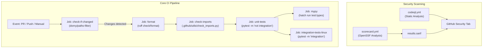
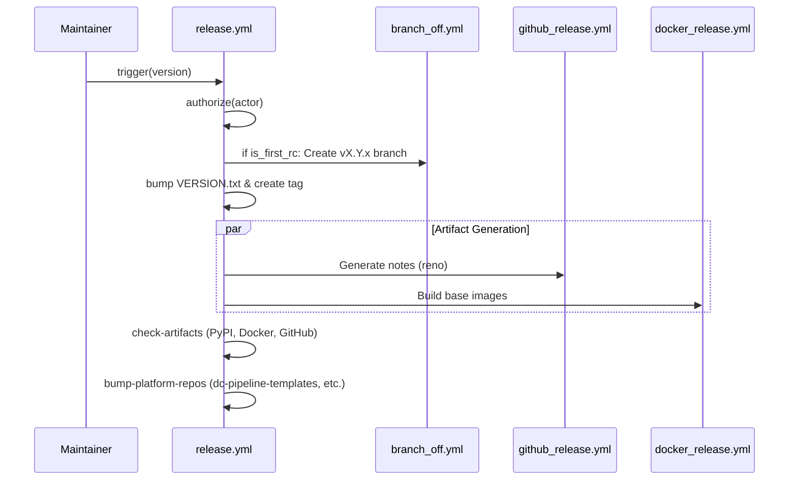

<!-- source: DeepWiki mcp.deepwiki.com · repo deepset-ai/haystack · page 2.3 CI/CD and Release Management · fetched 2026-10-27 -->

# CI/CD and Release Management

Relevant source files

The following files were used as context for generating this wiki page:

- [.github/dependabot.yml](.github/dependabot.yml)
- [.github/utils/create_unstable_docs_docusaurus.py](.github/utils/create_unstable_docs_docusaurus.py)
- [.github/utils/parse_validate_version.sh](.github/utils/parse_validate_version.sh)
- [.github/utils/prepare_release_notification.sh](.github/utils/prepare_release_notification.sh)
- [.github/utils/promote_unstable_docs_docusaurus.py](.github/utils/promote_unstable_docs_docusaurus.py)
- [.github/utils/wait_for_platform_pr.sh](.github/utils/wait_for_platform_pr.sh)
- [.github/utils/wait_for_workflows.sh](.github/utils/wait_for_workflows.sh)
- [.github/workflows/branch_off.yml](.github/workflows/branch_off.yml)
- [.github/workflows/check_api_ref.yml](.github/workflows/check_api_ref.yml)
- [.github/workflows/codeql.yml](.github/workflows/codeql.yml)
- [.github/workflows/docker_release.yml](.github/workflows/docker_release.yml)
- [.github/workflows/docs_search_sync.yml](.github/workflows/docs_search_sync.yml)
- [.github/workflows/github_release.yml](.github/workflows/github_release.yml)
- [.github/workflows/release.yml](.github/workflows/release.yml)
- [.github/workflows/scorecard.yml](.github/workflows/scorecard.yml)
- [.github/workflows/workflows_linting.yml](.github/workflows/workflows_linting.yml)
- [docker/Dockerfile.base](docker/Dockerfile.base)
- [docker/README.md](docker/README.md)
- [docker/docker-bake.hcl](docker/docker-bake.hcl)
- [docs-website/CONTRIBUTING.md](docs-website/CONTRIBUTING.md)
- [docs-website/README.md](docs-website/README.md)
- [docs-website/api/mcp.ts](docs-website/api/mcp.ts)
- [docs-website/api/well-known.ts](docs-website/api/well-known.ts)
- [docs-website/docs/overview/docs-mcp-server.mdx](docs-website/docs/overview/docs-mcp-server.mdx)
- [docs-website/docs/overview/faq.mdx](docs-website/docs/overview/faq.mdx)
- [docs-website/docs/pipeline-components/agents-1/agent-pack.mdx](docs-website/docs/pipeline-components/agents-1/agent-pack.mdx)
- [docs-website/docs/pipeline-components/agents-1/agent-pack/advanced-rag-agent.mdx](docs-website/docs/pipeline-components/agents-1/agent-pack/advanced-rag-agent.mdx)
- [docs-website/docs/pipeline-components/agents-1/agent-pack/deep-research-agent.mdx](docs-website/docs/pipeline-components/agents-1/agent-pack/deep-research-agent.mdx)
- [docs-website/docusaurus.config.js](docs-website/docusaurus.config.js)
- [docs-website/package.json](docs-website/package.json)
- [docs-website/reference/index.mdx](docs-website/reference/index.mdx)
- [docs-website/reference_versioned_docs/version-2.18/index.mdx](docs-website/reference_versioned_docs/version-2.18/index.mdx)
- [docs-website/reference_versioned_docs/version-2.19/index.mdx](docs-website/reference_versioned_docs/version-2.19/index.mdx)
- [docs-website/scripts/extract_sidebar.mjs](docs-website/scripts/extract_sidebar.mjs)
- [docs-website/src/components/YoutubeEmbed/index.tsx](docs-website/src/components/YoutubeEmbed/index.tsx)
- [docs-website/src/components/YoutubeEmbed/styles.module.css](docs-website/src/components/YoutubeEmbed/styles.module.css)
- [docs-website/src/remark/versionedReferenceLinks.js](docs-website/src/remark/versionedReferenceLinks.js)
- [docs-website/vercel.json](docs-website/vercel.json)
- [docs-website/versioned_docs/version-2.18/concepts/pipelines.mdx](docs-website/versioned_docs/version-2.18/concepts/pipelines.mdx)
- [docs-website/versioned_docs/version-2.19/concepts/pipelines.mdx](docs-website/versioned_docs/version-2.19/concepts/pipelines.mdx)
- [docs-website/versioned_docs/version-2.20/concepts/pipelines.mdx](docs-website/versioned_docs/version-2.20/concepts/pipelines.mdx)
- [docs-website/versioned_docs/version-2.20/overview/faq.mdx](docs-website/versioned_docs/version-2.20/overview/faq.mdx)
- [docs-website/versioned_docs/version-2.21/concepts/pipelines.mdx](docs-website/versioned_docs/version-2.21/concepts/pipelines.mdx)
- [docs-website/versioned_docs/version-2.22/concepts/pipelines.mdx](docs-website/versioned_docs/version-2.22/concepts/pipelines.mdx)
- [docs-website/versioned_docs/version-2.25/overview/faq.mdx](docs-website/versioned_docs/version-2.25/overview/faq.mdx)
- [docs-website/versioned_docs/version-2.26/overview/faq.mdx](docs-website/versioned_docs/version-2.26/overview/faq.mdx)
- [docs-website/versioned_docs/version-2.29/overview/docs-mcp-server.mdx](docs-website/versioned_docs/version-2.29/overview/docs-mcp-server.mdx)

This page documents the Continuous Integration (CI), Continuous Deployment (CD), and release management infrastructure for Haystack. It details the GitHub Actions workflows, security scanning, Docker image builds, and the automated release process for both the package and the documentation website.

## CI/CD Pipeline Architecture

Haystack uses GitHub Actions to automate code quality checks, testing, and deployment. The pipeline is designed to ensure stability across different operating systems and Python versions.

### Workflow Orchestration and Triggers

The primary entry point for code verification is the `tests.yml` workflow. It utilizes a multi-stage approach to optimize resource usage. Security scanning is handled by CodeQL and OpenSSF Scorecard.

**Security and CI Infrastructure**

Sources: [.github/workflows/codeql.yml:1-63](), [.github/workflows/scorecard.yml:1-67](), [.github/workflows/tests.yml:11-210]()

### Key Workflow Components

| Workflow File | Purpose | Key Tools/Commands |
|:---|:---|:---|
| `codeql.yml` | Semantic code analysis for Python | `github/codeql-action/analyze` |
| `scorecard.yml` | Supply-chain security posture | `ossf/scorecard-action` |
| `workflows_linting.yml` | Validates GitHub Actions syntax | `actionlint` |
| `docs_search_sync.yml` | Syncs website content to Deepset Cloud | `deepset-cloud-sdk` |

Sources: [.github/workflows/codeql.yml:45](), [.github/workflows/scorecard.yml:48](), [.github/workflows/workflows_linting.yml:25](), [.github/workflows/docs_search_sync.yml:54]()

## Release Management

Haystack follows semantic versioning and uses a structured release process involving release candidates, automated publication, and platform synchronization.

### The Release Lifecycle

The release process is triggered via `workflow_dispatch` in `release.yml`. It handles the transition from development to stable release across multiple repositories.

**Release Orchestration Flow**

Sources: [.github/workflows/release.yml:4-160](), [.github/workflows/branch_off.yml:41-60](), [.github/workflows/github_release.yml:1-107]()

### Versioning Logic
- **`VERSION.txt`**: The single source of truth for the project version. [.github/workflows/release.yml:95]()
- **Branching**: For a new minor version, a release branch `vX.Y.x` is created from `main`. [.github/workflows/branch_off.yml:52]()
- **RC Tags**: Release candidates (e.g., `v3.0.0-rc1`) are used for testing before stable publication. [.github/workflows/release.yml:7]()

## Docker Image Management

The repository provides a `Dockerfile.base` used to create the official `deepset/haystack` images.

### Image Build Process

The Docker build uses a multi-stage approach to minimize image size and ensure security:
1.  **Build Stage**: Clones the repository at the specific tag, creates a virtual environment, and installs Haystack using `uv` for performance. [docker/Dockerfile.base:7-29]()
2.  **Final Stage**: Copies only the virtual environment into the final image based on `python:3.12-slim`. [docker/Dockerfile.base:31-36]()

The `docker_release.yml` workflow utilizes `docker/bake-action` to build for multiple platforms (`linux/amd64`, `linux/arm64`). It performs a validation step by executing a Python command inside the built image to verify the `__version__` string matches `VERSION.txt`. [.github/workflows/docker_release.yml:61-88]()

Sources: [docker/Dockerfile.base:1-36](), [.github/workflows/docker_release.yml:61-88](), [docker/docker-bake.hcl:28-40]()

## Documentation Website Management

The Haystack documentation website is built with **Docusaurus** and hosted at `docs.haystack.deepset.ai`.

### Documentation Structure and Versioning
The website handles multiple versions of documentation simultaneously.
- **Stable Versions**: Only the 5 most recent stable versions are included in the build to optimize performance. [docs-website/docusaurus.config.js:12-17]()
- **Unstable Docs**: During a release cycle, "unstable" docs (e.g., `3.1-unstable`) are generated to allow previewing changes before they are finalized. [docs-website/docusaurus.config.js:82-86]()
- **Redirects**: Extensive redirect mapping is maintained to handle components that were renamed or moved in Haystack 3.0 (e.g., `OpenAIGenerator` to `OpenAIChatGenerator`). [docs-website/docusaurus.config.js:208-224]()

### Search Integration
A nightly workflow, `docs_search_sync.yml`, builds the Docusaurus site and uses the `deepset-cloud-sdk` to sync the processed documentation to a Deepset Cloud workspace. This powers the search functionality on the documentation site. [.github/workflows/docs_search_sync.yml:36-54]()

Sources: [docs-website/docusaurus.config.js:12-142](), [docs-website/package.json:5-18](), [.github/workflows/docs_search_sync.yml:1-61]()

## Release Notes (Reno)

Haystack uses `reno` to manage release notes, which are aggregated into a Markdown file for GitHub Releases.

### Automated Note Generation
The `github_release.yml` workflow performs the following:
1.  **Aggregation**: Runs `reno report` to collect notes for the current release. [.github/workflows/github_release.yml:62]()
2.  **Conversion**: Uses `pandoc` to convert the generated reStructuredText into GitHub Flavored Markdown. [.github/workflows/github_release.yml:65-67]()
3.  **Contributor Credits**: For minor releases, it uses the GitHub API to fetch all contributors who had commits between the previous version's `rc0` and the current release tag, appending them to the notes. [.github/workflows/github_release.yml:76-96]()

Sources: [.github/workflows/github_release.yml:57-107](), [CONTRIBUTING.md:25]()

---

