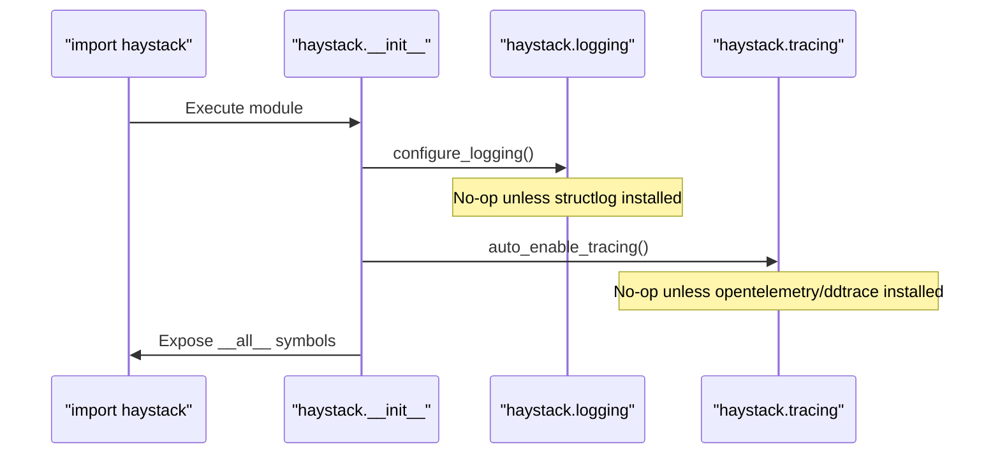
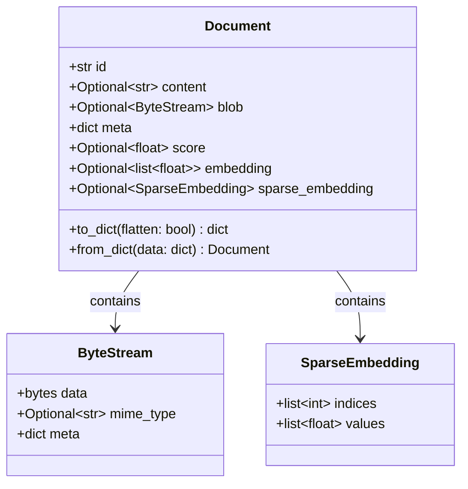
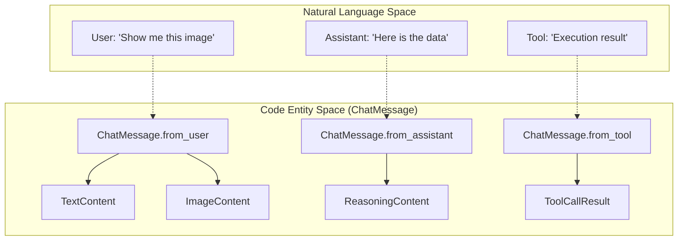
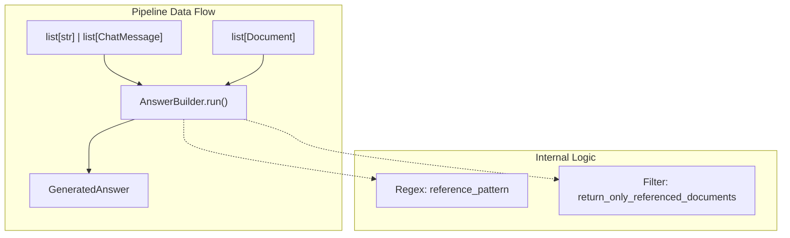

<!-- source: DeepWiki mcp.deepwiki.com · repo deepset-ai/haystack · page 3.3 Core Module and Data Structures · fetched 2026-10-27 -->

# Core Module and Data Structures

Relevant source files

The following files were used as context for generating this wiki page:

- [docs-website/docs/token-counters.mdx](docs-website/docs/token-counters.mdx)
- [docs-website/docs/token-counters/approximatetokencounter.mdx](docs-website/docs/token-counters/approximatetokencounter.mdx)
- [docs-website/docs/token-counters/openaitokencounter.mdx](docs-website/docs/token-counters/openaitokencounter.mdx)
- [docs-website/docs/token-counters/tiktokencounter.mdx](docs-website/docs/token-counters/tiktokencounter.mdx)
- [haystack/components/agents/tool_calling.py](haystack/components/agents/tool_calling.py)
- [haystack/components/builders/answer_builder.py](haystack/components/builders/answer_builder.py)
- [haystack/components/builders/chat_prompt_builder.py](haystack/components/builders/chat_prompt_builder.py)
- [haystack/components/builders/prompt_builder.py](haystack/components/builders/prompt_builder.py)
- [haystack/components/converters/output_adapter.py](haystack/components/converters/output_adapter.py)
- [haystack/components/routers/conditional_router.py](haystack/components/routers/conditional_router.py)
- [haystack/core/serialization_security.py](haystack/core/serialization_security.py)
- [haystack/core/type_utils.py](haystack/core/type_utils.py)
- [haystack/dataclasses/answer.py](haystack/dataclasses/answer.py)
- [haystack/dataclasses/byte_stream.py](haystack/dataclasses/byte_stream.py)
- [haystack/dataclasses/chat_message.py](haystack/dataclasses/chat_message.py)
- [haystack/dataclasses/document.py](haystack/dataclasses/document.py)
- [haystack/dataclasses/sparse_embedding.py](haystack/dataclasses/sparse_embedding.py)
- [haystack/hooks/from_function.py](haystack/hooks/from_function.py)
- [haystack/marshal/yaml.py](haystack/marshal/yaml.py)
- [haystack/telemetry/_telemetry.py](haystack/telemetry/_telemetry.py)
- [haystack/testing/callable_serialization/random_callable.py](haystack/testing/callable_serialization/random_callable.py)
- [haystack/token_counters/__init__.py](haystack/token_counters/__init__.py)
- [haystack/token_counters/approximate_counter.py](haystack/token_counters/approximate_counter.py)
- [haystack/token_counters/openai_counter.py](haystack/token_counters/openai_counter.py)
- [haystack/token_counters/tiktoken_counter.py](haystack/token_counters/tiktoken_counter.py)
- [haystack/token_counters/types/__init__.py](haystack/token_counters/types/__init__.py)
- [haystack/token_counters/types/protocol.py](haystack/token_counters/types/protocol.py)
- [haystack/token_counters/utils.py](haystack/token_counters/utils.py)
- [haystack/utils/base_serialization.py](haystack/utils/base_serialization.py)
- [haystack/utils/callable_serialization.py](haystack/utils/callable_serialization.py)
- [haystack/utils/jinja2_chat_extension.py](haystack/utils/jinja2_chat_extension.py)
- [haystack/utils/jinja2_extensions.py](haystack/utils/jinja2_extensions.py)
- [haystack/utils/type_serialization.py](haystack/utils/type_serialization.py)
- [pydoc/token_counters_api.yml](pydoc/token_counters_api.yml)
- [releasenotes/notes/add-dataframe-to-legacy-fields-0f2c9abc00c67aa5.yaml](releasenotes/notes/add-dataframe-to-legacy-fields-0f2c9abc00c67aa5.yaml)
- [releasenotes/notes/add-messages-jinja-tag-483cca5bda6884f2.yaml](releasenotes/notes/add-messages-jinja-tag-483cca5bda6884f2.yaml)
- [releasenotes/notes/add-openai-token-counter-2e372317ffb8351a.yaml](releasenotes/notes/add-openai-token-counter-2e372317ffb8351a.yaml)
- [releasenotes/notes/add-output-adapter-5fab4cfcb0218925.yaml](releasenotes/notes/add-output-adapter-5fab4cfcb0218925.yaml)
- [releasenotes/notes/add-output-passthrough-to-conditional-router-d6e53b417916362e.yaml](releasenotes/notes/add-output-passthrough-to-conditional-router-d6e53b417916362e.yaml)
- [releasenotes/notes/add-required-flag-for-prompt-builder-inputs-f5d3ffb3cb7df8d0.yaml](releasenotes/notes/add-required-flag-for-prompt-builder-inputs-f5d3ffb3cb7df8d0.yaml)
- [releasenotes/notes/add-token-counters-f2685e989bff106e.yaml](releasenotes/notes/add-token-counters-f2685e989bff106e.yaml)
- [releasenotes/notes/adjust-answer-builder-for-agent-f4428aea59e32809.yaml](releasenotes/notes/adjust-answer-builder-for-agent-f4428aea59e32809.yaml)
- [releasenotes/notes/agent-parallel-tool-calls-state-dependencies-7b3c1f9a4e2d6c80.yaml](releasenotes/notes/agent-parallel-tool-calls-state-dependencies-7b3c1f9a4e2d6c80.yaml)
- [releasenotes/notes/answer-builder-refactoring-dc02d2285aebea32.yaml](releasenotes/notes/answer-builder-refactoring-dc02d2285aebea32.yaml)
- [releasenotes/notes/answer-builder-zero-reference-out-of-range-64aab56f8b5f65c3.yaml](releasenotes/notes/answer-builder-zero-reference-out-of-range-64aab56f8b5f65c3.yaml)
- [releasenotes/notes/chat-prompt-builder-sanitization-d0905ac8a5a25aa0.yaml](releasenotes/notes/chat-prompt-builder-sanitization-d0905ac8a5a25aa0.yaml)
- [releasenotes/notes/chatmessage-from-dict-pydantic-dump-5b12e4b1d4985ec1.yaml](releasenotes/notes/chatmessage-from-dict-pydantic-dump-5b12e4b1d4985ec1.yaml)
- [releasenotes/notes/conditional-router-template-error-message-f633f9e786a8c7fc.yaml](releasenotes/notes/conditional-router-template-error-message-f633f9e786a8c7fc.yaml)
- [releasenotes/notes/deprecate-dataframe-ExtractedTableAnswer-3d85649a4a7e222f.yaml](releasenotes/notes/deprecate-dataframe-ExtractedTableAnswer-3d85649a4a7e222f.yaml)
- [releasenotes/notes/document-eq-and-flatten-collisions-cda17012ae9c6395.yaml](releasenotes/notes/document-eq-and-flatten-collisions-cda17012ae9c6395.yaml)
- [releasenotes/notes/document-from-dict-copy-input-9b7d2a8e6f4c1d03.yaml](releasenotes/notes/document-from-dict-copy-input-9b7d2a8e6f4c1d03.yaml)
- [releasenotes/notes/document-to-dict-field-precedence-578a5e20a185852e.yaml](releasenotes/notes/document-to-dict-field-precedence-578a5e20a185852e.yaml)
- [releasenotes/notes/enforce-python-types-serde-0c5cd0a716bab7d0.yaml](releasenotes/notes/enforce-python-types-serde-0c5cd0a716bab7d0.yaml)
- [releasenotes/notes/extend-promptbuilder-0322790d82248039.yaml](releasenotes/notes/extend-promptbuilder-0322790d82248039.yaml)
- [releasenotes/notes/feat-async-pipeline-338856a142e1318c.yaml](releasenotes/notes/feat-async-pipeline-338856a142e1318c.yaml)
- [releasenotes/notes/fix-answer-builder-doc-order-f63c572cd6560bf4.yaml](releasenotes/notes/fix-answer-builder-doc-order-f63c572cd6560bf4.yaml)
- [releasenotes/notes/fix-answer-builder-meta-mutation-8769660a55175afd.yaml](releasenotes/notes/fix-answer-builder-meta-mutation-8769660a55175afd.yaml)
- [releasenotes/notes/fix-answer-from-dict-input-mutation-ac713885d47e54d6.yaml](releasenotes/notes/fix-answer-from-dict-input-mutation-ac713885d47e54d6.yaml)
- [releasenotes/notes/fix-bytestream-str-8dd6d5e9a87f6aa4.yaml](releasenotes/notes/fix-bytestream-str-8dd6d5e9a87f6aa4.yaml)
- [releasenotes/notes/fix-callable-deserialization-5a3ef204a8d07616.yaml](releasenotes/notes/fix-callable-deserialization-5a3ef204a8d07616.yaml)
- [releasenotes/notes/fix-callable-parameter-list-type-serialization-0c6f96661cf773db.yaml](releasenotes/notes/fix-callable-parameter-list-type-serialization-0c6f96661cf773db.yaml)
- [releasenotes/notes/fix-dataclasses-deseria-0bb839b5edd3fca6.yaml](releasenotes/notes/fix-dataclasses-deseria-0bb839b5edd3fca6.yaml)
- [releasenotes/notes/fix-deserialize-async-tool-callable-42995d2052814e59.yaml](releasenotes/notes/fix-deserialize-async-tool-callable-42995d2052814e59.yaml)
- [releasenotes/notes/fix-deserialize-callable-allowlist-bypass-0d99a89c1a3b4a9f.yaml](releasenotes/notes/fix-deserialize-callable-allowlist-bypass-0d99a89c1a3b4a9f.yaml)
- [releasenotes/notes/fix-generated-answer-empty-all-messages-ffccf61b751bc344.yaml](releasenotes/notes/fix-generated-answer-empty-all-messages-ffccf61b751bc344.yaml)
- [releasenotes/notes/fix-jinja2-variable-extraction-57f34c6bd249e214.yaml](releasenotes/notes/fix-jinja2-variable-extraction-57f34c6bd249e214.yaml)
- [releasenotes/notes/fix-mixed-type-lists-schema-serialization-3f1c5a2b7d904e18.yaml](releasenotes/notes/fix-mixed-type-lists-schema-serialization-3f1c5a2b7d904e18.yaml)
- [releasenotes/notes/fix-openai-toolcall-empty-arguments-53c5621622bc1866.yaml](releasenotes/notes/fix-openai-toolcall-empty-arguments-53c5621622bc1866.yaml)
- [releasenotes/notes/fix-output-adapter-from_dict-custom-filters-none-70705cbb474fe982.yaml](releasenotes/notes/fix-output-adapter-from_dict-custom-filters-none-70705cbb474fe982.yaml)
- [releasenotes/notes/fix-sede-conditional-router-multiple-outputs-6fe2e58c4c25f80c.yaml](releasenotes/notes/fix-sede-conditional-router-multiple-outputs-6fe2e58c4c25f80c.yaml)
- [releasenotes/notes/fix-serialization-generated-answer-fa8f3692a184f8fd.yaml](releasenotes/notes/fix-serialization-generated-answer-fa8f3692a184f8fd.yaml)
- [releasenotes/notes/fix-serialize-type-nonetype-arg-444581c0b19217a7.yaml](releasenotes/notes/fix-serialize-type-nonetype-arg-444581c0b19217a7.yaml)
- [releasenotes/notes/fix-str-list-str-validation-0d1065def4f3a6e5.yaml](releasenotes/notes/fix-str-list-str-validation-0d1065def4f3a6e5.yaml)
- [releasenotes/notes/fix-variadic-tuple-type-serialization-5fea4406404a597f.yaml](releasenotes/notes/fix-variadic-tuple-type-serialization-5fea4406404a597f.yaml)
- [releasenotes/notes/improve-jinja2-chat-sec-27333c393c032b75.yaml](releasenotes/notes/improve-jinja2-chat-sec-27333c393c032b75.yaml)
- [releasenotes/notes/meta-in-bytestream-a29816c919c0be5a.yaml](releasenotes/notes/meta-in-bytestream-a29816c919c0be5a.yaml)
- [releasenotes/notes/multiple-outputs-conditional-router-c2f0caad3d3f8ce5.yaml](releasenotes/notes/multiple-outputs-conditional-router-c2f0caad3d3f8ce5.yaml)
- [releasenotes/notes/pipeline-deserialization-allowlist-d878a69ac69ee667.yaml](releasenotes/notes/pipeline-deserialization-allowlist-d878a69ac69ee667.yaml)
- [releasenotes/notes/remove-serialize-deserialize-class-instance-41e4cb639a3e415d.yaml](releasenotes/notes/remove-serialize-deserialize-class-instance-41e4cb639a3e415d.yaml)
- [releasenotes/notes/require-explicit-inputs-from-state-7a3c1f9e8b2d4c60.yaml](releasenotes/notes/require-explicit-inputs-from-state-7a3c1f9e8b2d4c60.yaml)
- [releasenotes/notes/resolve-postponed-tool-annotations-678fb1b0f6bbf752.yaml](releasenotes/notes/resolve-postponed-tool-annotations-678fb1b0f6bbf752.yaml)
- [releasenotes/notes/serialization-tuple-support-ffe176417e7099f5.yaml](releasenotes/notes/serialization-tuple-support-ffe176417e7099f5.yaml)
- [releasenotes/notes/sparse-emb-eq-773ef04ae3ed83ea.yaml](releasenotes/notes/sparse-emb-eq-773ef04ae3ed83ea.yaml)
- [releasenotes/notes/sparse-embedding-dataclass-d75ae1ee6d75e646.yaml](releasenotes/notes/sparse-embedding-dataclass-d75ae1ee6d75e646.yaml)
- [releasenotes/notes/sparse-embedding-fd55b670437492be.yaml](releasenotes/notes/sparse-embedding-fd55b670437492be.yaml)
- [releasenotes/notes/use-importlib-when-deserializing-callable-1f36f07c4518c2cf.yaml](releasenotes/notes/use-importlib-when-deserializing-callable-1f36f07c4518c2cf.yaml)
- [test/components/agents/test_tool_calling.py](test/components/agents/test_tool_calling.py)
- [test/components/builders/test_answer_builder.py](test/components/builders/test_answer_builder.py)
- [test/components/builders/test_chat_prompt_builder.py](test/components/builders/test_chat_prompt_builder.py)
- [test/components/builders/test_prompt_builder.py](test/components/builders/test_prompt_builder.py)
- [test/components/converters/test_output_adapter.py](test/components/converters/test_output_adapter.py)
- [test/components/routers/test_conditional_router.py](test/components/routers/test_conditional_router.py)
- [test/core/future_annotations_functions.py](test/core/future_annotations_functions.py)
- [test/core/test_serialization_security.py](test/core/test_serialization_security.py)
- [test/core/test_type_utils.py](test/core/test_type_utils.py)
- [test/dataclasses/test_answer.py](test/dataclasses/test_answer.py)
- [test/dataclasses/test_byte_stream.py](test/dataclasses/test_byte_stream.py)
- [test/dataclasses/test_chat_message.py](test/dataclasses/test_chat_message.py)
- [test/dataclasses/test_document.py](test/dataclasses/test_document.py)
- [test/dataclasses/test_sparse_embedding.py](test/dataclasses/test_sparse_embedding.py)
- [test/marshal/__init__.py](test/marshal/__init__.py)
- [test/marshal/test_yaml.py](test/marshal/test_yaml.py)
- [test/test_telemetry.py](test/test_telemetry.py)
- [test/token_counters/__init__.py](test/token_counters/__init__.py)
- [test/token_counters/test_approximate_counter.py](test/token_counters/test_approximate_counter.py)
- [test/token_counters/test_openai_counter.py](test/token_counters/test_openai_counter.py)
- [test/tools/test_parameters_schema_utils.py](test/tools/test_parameters_schema_utils.py)
- [test/utils/test_base_serialization.py](test/utils/test_base_serialization.py)
- [test/utils/test_callable_serialization.py](test/utils/test_callable_serialization.py)
- [test/utils/test_jinja2_chat_extension.py](test/utils/test_jinja2_chat_extension.py)
- [test/utils/test_jinja2_extensions.py](test/utils/test_jinja2_extensions.py)
- [test/utils/test_type_serialization.py](test/utils/test_type_serialization.py)

## Purpose and Scope

This page documents the core data structures and module initialization of Haystack. It covers the foundational dataclasses used throughout the framework, including `Document`, `Answer` types, and the multi-modal `ChatMessage` system. It also details the serialization utilities, type system, and specialized components like `ConditionalRouter` and `AnswerBuilder` that manipulate these structures.

**Sources:** [haystack/__init__.py:1-43]()

---

## Module Initialization and Exports

The `haystack` package initializes logging and tracing on import, then exposes a curated set of core abstractions. The module follows a non-lazy import strategy to avoid static type checking issues and maintain simplicity.

### Exported Symbols

The package exports the following categories of symbols:

| Category | Symbols | Purpose |
|----------|---------|---------|
| **Component System** | `component`, `SuperComponent`, `super_component` | Component decoration and advanced composition [haystack/__init__.py:12-16]() |
| **Pipeline System** | `Pipeline`, `AsyncPipeline` | Pipeline orchestration [haystack/__init__.py:14-14]() |
| **Error Types** | `ComponentError`, `DeserializationError` | Exception handling [haystack/__init__.py:13-13]() |
| **Data Structures** | `Document`, `Answer`, `ExtractedAnswer`, `GeneratedAnswer` | Core data types [haystack/__init__.py:17-17]() |
| **Serialization** | `default_to_dict`, `default_from_dict` | Component serialization utilities [haystack/__init__.py:15-15]() |

### Initialization Sequence

**Sources:** [haystack/__init__.py:10-42]()

---

## Document Dataclass

The `Document` dataclass is the base data unit in Haystack. It uses a metaclass `_RemoveLegacyFields` to strip 1.x fields (`content_type`, `id_hash_keys`, `dataframe`) before initialization to ensure compatibility [haystack/dataclasses/document.py:19-32]().

### Document Structure

| Field | Type | Description |
|-------|------|-------------|
| `id` | `str` | Unique identifier, auto-generated via SHA256 hash of content, blob, meta, and embeddings if not provided [haystack/dataclasses/document.py:103-116]() |
| `content` | `Optional[str]` | Textual content of the document [haystack/dataclasses/document.py:49-49]() |
| `blob` | `Optional[ByteStream]` | Binary data associated with the document [haystack/dataclasses/document.py:50-50]() |
| `meta` | `dict[str, Any]` | Custom metadata. `to_dict` can flatten this for backward compatibility [haystack/dataclasses/document.py:118-127]() |
| `score` | `Optional[float]` | Relevance score, usually assigned by retrievers [haystack/dataclasses/document.py:52-52]() |
| `embedding` | `Optional[list[float]]` | Dense vector representation [haystack/dataclasses/document.py:53-53]() |
| `sparse_embedding` | `Optional[SparseEmbedding]` | Sparse vector representation [haystack/dataclasses/document.py:54-54]() |

**Sources:** [haystack/dataclasses/document.py:31-173](), [haystack/dataclasses/byte_stream.py:1-20]()

---

## ChatMessage and Multi-modal Content

The `ChatMessage` dataclass represents messages in LLM conversations. It supports a `Sequence` of `ChatMessageContentT` parts, enabling multi-modal interactions [haystack/dataclasses/chat_message.py:204-213]().

### Content Types (ChatMessageContentT)

| Class | Purpose | Key Fields |
|-------|---------|------------|
| `TextContent` | Plain text | `text: str` [haystack/dataclasses/chat_message.py:51-58]() |
| `ImageContent` | Multi-modal images | `base64_image: str`, `mime_type: str` [haystack/dataclasses/image_content.py:59-71]() |
| `FileContent` | Multi-modal files | `base64_data: str`, `mime_type: str` [haystack/dataclasses/file_content.py:16-24]() |
| `ToolCall` | Model-generated tool request | `tool_name: str`, `arguments: dict`, `id: str` [haystack/dataclasses/chat_message.py:76-90]() |
| `ToolCallResult` | Result of a tool invocation | `result: str | list`, `origin: ToolCall`, `error: bool` [haystack/dataclasses/chat_message.py:118-130]() |
| `ReasoningContent` | Chain-of-thought/Reasoning | `reasoning_text: str` [haystack/dataclasses/chat_message.py:169-180]() |

### ChatRole Enumeration

The `ChatRole` enum defines the supported roles: `USER`, `SYSTEM`, `ASSISTANT`, and `TOOL` [haystack/dataclasses/chat_message.py:19-35]().

**Sources:** [haystack/dataclasses/chat_message.py:19-213](), [haystack/dataclasses/image_content.py:59-71](), [haystack/dataclasses/file_content.py:16-24]()

---

## Serialization and Type System

Haystack provides robust utilities for serializing both component configurations and runtime data.

### Runtime Value Serialization
`_serialize_value_with_schema` handles runtime values (like Agent state or pipeline outputs). It separates the schema from the data using a JSON Schema-aware format [haystack/utils/base_serialization.py:20-45]().

- **Mixed-type Arrays**: Uses the `prefixItems` keyword to record a schema per position [haystack/utils/base_serialization.py:80-82]().
- **Homogeneous Arrays**: Uses the standard `items` keyword [haystack/utils/base_serialization.py:77-79]().
- **Type Resolution**: `serialize_type` and `deserialize_type` handle complex Python types, including PEP 604 unions (`X | Y`), generics (`list[int]`), and special literals like `NoneType` or `...` [haystack/utils/type_serialization.py:68-124]().

### Component Serialization
`default_to_dict` and `default_from_dict` are the standard utilities for serializing Haystack components. They capture the full class path and the initialization parameters [haystack/core/serialization.py]().

**Sources:** [haystack/utils/base_serialization.py:20-115](), [haystack/utils/type_serialization.py:25-124]()

---

## Core Component Logic

### ConditionalRouter
The `ConditionalRouter` routes data based on Jinja2 expressions. It defines `Route` dictionaries containing a `condition`, `output`, `output_type`, and `output_name` [haystack/components/routers/conditional_router.py:31-36]().
- **Passthrough Routing**: If `output_passthrough` is `True`, the router skips Jinja2 rendering to preserve complex types (like Pydantic models) that would otherwise be converted to strings [haystack/components/routers/conditional_router.py:51-54]().

### AnswerBuilder
`AnswerBuilder` transforms Generator replies into `GeneratedAnswer` objects [haystack/components/builders/answer_builder.py:19-27]().
- **Regex Parsing**: Uses `pattern` to extract text and `reference_pattern` to identify document citations (e.g., `[1]`) [haystack/components/builders/answer_builder.py:85-99]().
- **Reference Management**: Can filter returned documents to only those referenced in the generated text [haystack/components/builders/answer_builder.py:106-110]().

**Sources:** [haystack/components/routers/conditional_router.py:31-183](), [haystack/components/builders/answer_builder.py:19-135]()

---

## In-Memory Filter Syntax

The `InMemoryDocumentStore` and related utilities use a specific filter syntax for querying documents based on metadata.

### Filter Logic
The comparison logic supports:
- **Comparison Operators**: `$eq`, `$ne`, `$in`, `$nin`, `$gt`, `$gte`, `$lt`, `$lte`.
- **Logical Operators**: `$and`, `$or`, `$not`.

### BM25 and Similarity
The `InMemoryDocumentStore` implements BM25 retrieval (`BM25Okapi`, `BM25L`, `BM25Plus`) and vector similarity functions (`dot_product`, `cosine`) [haystack/document_stores/in_memory/document_store.py:64-105]().

**Sources:** [haystack/document_stores/in_memory/document_store.py:59-174](), [haystack/utils/filters.py:1-50]()

---

