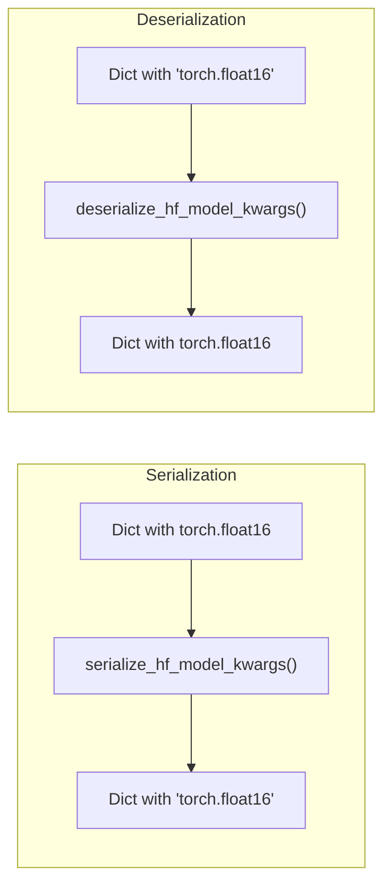
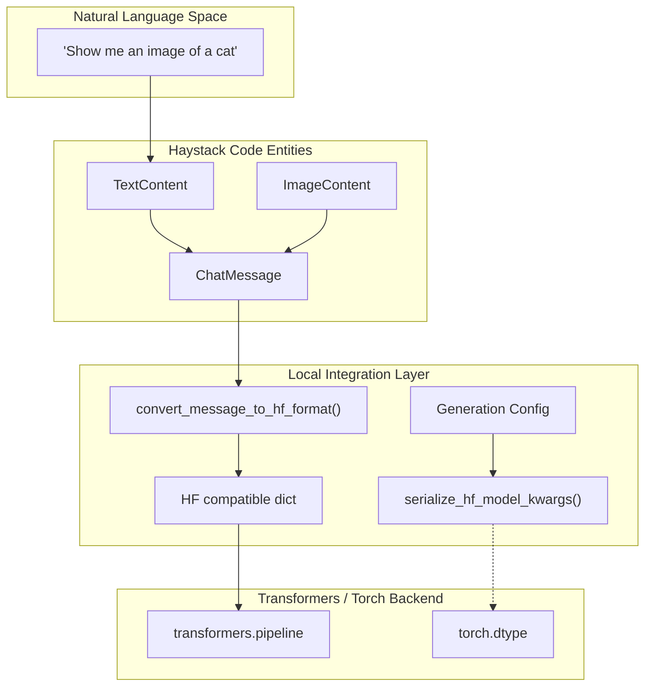

<!-- source: DeepWiki mcp.deepwiki.com · repo deepset-ai/haystack · page 4.3 Hugging Face Local Integration · fetched 2026-10-27 -->

# Hugging Face Local Integration

Relevant source files

The following files were used as context for generating this wiki page:

- [docs-website/reference/integrations-api/fastembed.md](docs-website/reference/integrations-api/fastembed.md)
- [docs-website/reference_versioned_docs/version-2.18/integrations-api/fastembed.md](docs-website/reference_versioned_docs/version-2.18/integrations-api/fastembed.md)
- [docs-website/reference_versioned_docs/version-2.19/integrations-api/fastembed.md](docs-website/reference_versioned_docs/version-2.19/integrations-api/fastembed.md)
- [docs-website/reference_versioned_docs/version-2.20/integrations-api/fastembed.md](docs-website/reference_versioned_docs/version-2.20/integrations-api/fastembed.md)
- [docs-website/reference_versioned_docs/version-2.21/integrations-api/fastembed.md](docs-website/reference_versioned_docs/version-2.21/integrations-api/fastembed.md)
- [docs-website/reference_versioned_docs/version-2.22/integrations-api/fastembed.md](docs-website/reference_versioned_docs/version-2.22/integrations-api/fastembed.md)
- [docs-website/reference_versioned_docs/version-2.23/integrations-api/fastembed.md](docs-website/reference_versioned_docs/version-2.23/integrations-api/fastembed.md)
- [docs-website/reference_versioned_docs/version-2.24/integrations-api/fastembed.md](docs-website/reference_versioned_docs/version-2.24/integrations-api/fastembed.md)
- [docs-website/reference_versioned_docs/version-2.25/integrations-api/fastembed.md](docs-website/reference_versioned_docs/version-2.25/integrations-api/fastembed.md)
- [docs-website/reference_versioned_docs/version-2.26/integrations-api/fastembed.md](docs-website/reference_versioned_docs/version-2.26/integrations-api/fastembed.md)
- [docs-website/reference_versioned_docs/version-2.27/integrations-api/fastembed.md](docs-website/reference_versioned_docs/version-2.27/integrations-api/fastembed.md)
- [haystack/utils/hf.py](haystack/utils/hf.py)

## Purpose and Scope

This document covers Haystack's integration with Hugging Face models that run locally using the `transformers` library. These components load models onto local hardware (CPU/GPU) and perform inference on-device, providing full control over model selection, hardware placement, and execution parameters.

For API-based Hugging Face integrations (Serverless API, TGI, TEI), see [4.2](). For general LLM integration patterns, see [4](). For chat message formatting and prompt building, see [4.4]().

---

## Architecture Overview

The local Hugging Face integration consists of several component categories, all built on the `transformers` library. With the v3.0 migration, many local generation components are now hosted in the `transformers-haystack` package, while core utilities and data structures remain in the main Haystack repository.

### System Architecture Diagram

```mermaid
graph TB
    subgraph "Generation Components (transformers-haystack)"
        HFLocalGen["HuggingFaceLocalGenerator<br/>(text generation)"]
        HFLocalChat["HuggingFaceLocalChatGenerator<br/>(chat generation)"]
    end
    
    subgraph "Ranking Components"
        TransformersSim["TransformersSimilarityRanker<br/>(cross-encoder)"]
        STSim["SentenceTransformersSimilarityRanker<br/>(cross-encoder)"]
        STDiv["SentenceTransformersDiversityRanker<br/>(bi-encoder)"]
    end
    
    subgraph "Reader Components"
        ExtReader["ExtractiveReader<br/>(question answering)"]
    end
    
    subgraph "Evaluation Components"
        SASEval["SASEvaluator<br/>(semantic similarity)"]
    end
    
    subgraph "Router Components"
        TransRouter["TransformersTextRouter<br/>(text classification)"]
        ZeroShotRouter["TransformersZeroShotTextRouter<br/>(zero-shot classification)"]
    end
    
    subgraph "Transformers Library"
        HFPipeline["transformers.Pipeline"]
        AutoModel["AutoModel classes"]
        Tokenizer["AutoTokenizer"]
    end
    
    subgraph "Sentence Transformers"
        STModel["SentenceTransformer"]
        CrossEncoder["CrossEncoder"]
    end
    
    HFLocalGen --> HFPipeline
    HFLocalChat --> HFPipeline
    TransRouter --> HFPipeline
    ZeroShotRouter --> HFPipeline
    
    TransformersSim --> AutoModel
    TransformersSim --> Tokenizer
    ExtReader --> AutoModel
    ExtReader --> Tokenizer
    
    STSim --> CrossEncoder
    STDiv --> STModel
    SASEval --> STModel
    SASEval --> CrossEncoder
    
    subgraph "Supporting Utilities (haystack.utils.hf)"
        StopWords["StopWordsCriteria"]
        MsgConvert["convert_message_to_hf_format"]
        DtypeMgmt["serialize_hf_model_kwargs<br/>deserialize_hf_model_kwargs"]
    end
    
    HFLocalChat --> MsgConvert
    HFLocalGen --> DtypeMgmt
```

**Sources:** [haystack/utils/hf.py:1-53]() | [haystack/utils/hf.py:54-118]()

---

## Data Transformation and Messaging

A critical part of the local integration is ensuring that Haystack's `ChatMessage` objects are correctly translated into the dictionary formats expected by the Hugging Face `transformers` library and its chat templates.

### Message Conversion Flow

The `convert_message_to_hf_format` function handles the mapping of Haystack's multimodal content to Hugging Face's OpenAI-compatible structure.

| Haystack Class | HF Field | Logic |
| :--- | :--- | :--- |
| `TextContent` | `text` | Mapped to `{"type": "text", "text": content.text}` [haystack/utils/hf.py:97-98]() |
| `ImageContent` | `image_url` | Converted to Base64 data URI [haystack/utils/hf.py:99-101]() |
| `ToolCall` | `tool_calls` | Mapped to `function` type with name and arguments [haystack/utils/hf.py:109-116]() |
| `ToolCallResult` | `content` | Result string mapped to content; includes `tool_call_id` [haystack/utils/hf.py:85-89]() |
| `ReasoningContent`| *Skipped* | Explicitly filtered out as HF Inference API does not support it in inputs [haystack/utils/hf.py:68-70]() |

**Sources:** [haystack/utils/hf.py:54-118]()

---

## Model Configuration and Serialization

Hugging Face models often require specific `torch.dtype` configurations (e.g., `torch.bfloat16`). Because Haystack components must be JSON serializable to work with Pipeline serialization, these objects must be converted to strings and back.

### Kwargs Serialization Process

The `serialize_hf_model_kwargs` and `deserialize_hf_model_kwargs` functions provide recursive in-place modification of dictionaries.

**Sources:** [haystack/utils/hf.py:17-32]() | [haystack/utils/hf.py:34-53]()

---

## Local Embedders (FastEmbed)

For high-performance local embedding without the full overhead of `transformers`, Haystack integrates with `fastembed`. These components are part of the `fastembed-haystack` integration.

### FastembedDocumentEmbedder
Computes embeddings for a list of `Document` objects and stores them in the `embedding` field [docs-website/reference/integrations-api/fastembed.md:13-15]().

**Key Features:**
- **Batching**: Configurable `batch_size` for efficient processing [docs-website/reference/integrations-api/fastembed.md:68]().
- **Parallelism**: Supports data-parallel encoding using multiple cores [docs-website/reference/integrations-api/fastembed.md:92-94]().
- **Meta Embedding**: Can concatenate specific metadata fields to the document content before embedding [docs-website/reference/integrations-api/fastembed.md:96-97]().

### FastembedSparseDocumentEmbedder
Computes sparse embeddings (e.g., using SPLADE models) and stores them in the `sparse_embedding` field of the `Document` [docs-website/reference/integrations-api/fastembed.md:144-146]().

**Sources:** [docs-website/reference/integrations-api/fastembed.md:9-100]() | [docs-website/reference/integrations-api/fastembed.md:142-200]()

---

## Code Entity Space Mapping

This diagram bridges the conceptual "Local Inference" to the specific classes and utility functions used in the codebase.

**Sources:** [haystack/utils/hf.py:54-118]() | [haystack/utils/hf.py:17-53]() | [haystack/dataclasses/chat_message.py:1-20]()

---

## v3.0 Migration Summary

In Haystack v3.0, the local Hugging Face integration has been modularized:
1.  **`HuggingFaceLocalChatGenerator`** and **`HuggingFaceLocalGenerator`** moved to the `transformers-haystack` package.
2.  **`SentenceTransformers`** components (Embedders, Rankers) moved to the `sentence-transformers-haystack` package.
3.  **Core Utilities** like `convert_message_to_hf_format` and `serialize_hf_model_kwargs` remain in `haystack.utils.hf` to support various integrations that rely on the Hugging Face ecosystem.

**Sources:** [haystack/utils/hf.py:1-118]() | [docs-website/reference/integrations-api/fastembed.md:20-23]()

---

