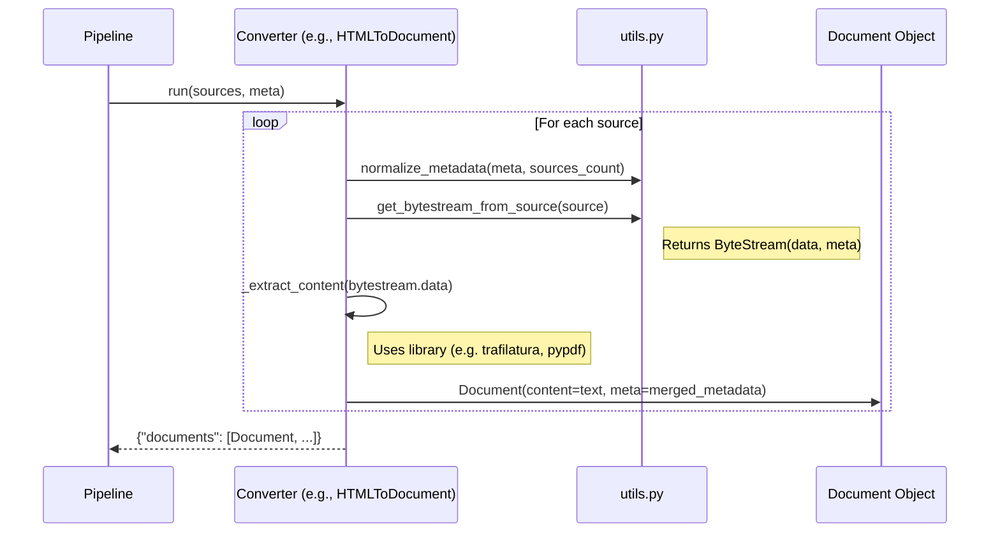

<!-- source: DeepWiki mcp.deepwiki.com · repo deepset-ai/haystack · page 5.2 Document Converters · fetched 2026-10-27 -->

# Document Converters

<details>
<summary>Relevant source files</summary>

The following files were used as context for generating this wiki page:

- [docs-website/docs/pipeline-components/converters/filetofilecontent.mdx](docs-website/docs/pipeline-components/converters/filetofilecontent.mdx)
- [docs-website/docs/pipeline-components/converters/markdowntodocument.mdx](docs-website/docs/pipeline-components/converters/markdowntodocument.mdx)
- [haystack/components/converters/__init__.py](haystack/components/converters/__init__.py)
- [haystack/components/converters/csv.py](haystack/components/converters/csv.py)
- [haystack/components/converters/docx.py](haystack/components/converters/docx.py)
- [haystack/components/converters/file_to_file_content.py](haystack/components/converters/file_to_file_content.py)
- [haystack/components/converters/html.py](haystack/components/converters/html.py)
- [haystack/components/converters/json.py](haystack/components/converters/json.py)
- [haystack/components/converters/markdown.py](haystack/components/converters/markdown.py)
- [haystack/components/converters/pdfminer.py](haystack/components/converters/pdfminer.py)
- [haystack/components/converters/pptx.py](haystack/components/converters/pptx.py)
- [haystack/components/converters/pypdf.py](haystack/components/converters/pypdf.py)
- [haystack/components/converters/txt.py](haystack/components/converters/txt.py)
- [haystack/components/converters/utils.py](haystack/components/converters/utils.py)
- [haystack/components/converters/xlsx.py](haystack/components/converters/xlsx.py)
- [haystack/components/fetchers/link_content.py](haystack/components/fetchers/link_content.py)
- [haystack/components/routers/file_type_router.py](haystack/components/routers/file_type_router.py)
- [haystack/testing/sample_components/__init__.py](haystack/testing/sample_components/__init__.py)
- [haystack/testing/sample_components/accumulate.py](haystack/testing/sample_components/accumulate.py)
- [haystack/testing/sample_components/future_annotations.py](haystack/testing/sample_components/future_annotations.py)
- [haystack/testing/sample_components/greet.py](haystack/testing/sample_components/greet.py)
- [haystack/testing/sample_components/hello.py](haystack/testing/sample_components/hello.py)
- [haystack/testing/sample_components/joiner.py](haystack/testing/sample_components/joiner.py)
- [haystack/testing/sample_components/subtract.py](haystack/testing/sample_components/subtract.py)
- [haystack/testing/sample_components/sum.py](haystack/testing/sample_components/sum.py)
- [haystack/testing/sample_components/text_splitter.py](haystack/testing/sample_components/text_splitter.py)
- [haystack/testing/sample_components/threshold.py](haystack/testing/sample_components/threshold.py)
- [pydoc/converters_api.yml](pydoc/converters_api.yml)
- [releasenotes/notes/add-bytestream-guess-mime-type-e973262fa75f2982.yaml](releasenotes/notes/add-bytestream-guess-mime-type-e973262fa75f2982.yaml)
- [releasenotes/notes/add-hyperlink-extraction-pptx-xlsx-a3b9f1c2d4e5f6a7.yaml](releasenotes/notes/add-hyperlink-extraction-pptx-xlsx-a3b9f1c2d4e5f6a7.yaml)
- [releasenotes/notes/add-missing-mime-type-assignment-to-the-link-content-fetcher-7581e2728e2130b8.yaml](releasenotes/notes/add-missing-mime-type-assignment-to-the-link-content-fetcher-7581e2728e2130b8.yaml)
- [releasenotes/notes/add-msg-mime-type-file-router-b33d8916caaf5976.yaml](releasenotes/notes/add-msg-mime-type-file-router-b33d8916caaf5976.yaml)
- [releasenotes/notes/add-store-full-path-param-to-converters-43b50812b1600eb2.yaml](releasenotes/notes/add-store-full-path-param-to-converters-43b50812b1600eb2.yaml)
- [releasenotes/notes/add-store-full-path-xlsx-convter-535bcb48433f7717.yaml](releasenotes/notes/add-store-full-path-xlsx-convter-535bcb48433f7717.yaml)
- [releasenotes/notes/adding-CID-detection-PDFMinerToDocument-0195a929d64cd502.yaml](releasenotes/notes/adding-CID-detection-PDFMinerToDocument-0195a929d64cd502.yaml)
- [releasenotes/notes/async-http2-link-fetcher-68c1c5d012a7550a.yaml](releasenotes/notes/async-http2-link-fetcher-68c1c5d012a7550a.yaml)
- [releasenotes/notes/csv-row-mode-20250908204536.yaml](releasenotes/notes/csv-row-mode-20250908204536.yaml)
- [releasenotes/notes/csv-to-document-row-mode-extra-fields-8783f95b2b564383.yaml](releasenotes/notes/csv-to-document-row-mode-extra-fields-8783f95b2b564383.yaml)
- [releasenotes/notes/docx-extract-page-breaks-09279c95f73a06f5.yaml](releasenotes/notes/docx-extract-page-breaks-09279c95f73a06f5.yaml)
- [releasenotes/notes/docx-skip-comment-blocks-d3a555d0324788c7.yaml](releasenotes/notes/docx-skip-comment-blocks-d3a555d0324788c7.yaml)
- [releasenotes/notes/docxmetadata-as-dict-20cf2ef0abf7af8a.yaml](releasenotes/notes/docxmetadata-as-dict-20cf2ef0abf7af8a.yaml)
- [releasenotes/notes/docxmetadata-json-serializable-e4205ce70d042aed.yaml](releasenotes/notes/docxmetadata-json-serializable-e4205ce70d042aed.yaml)
- [releasenotes/notes/docxtodocument-rename-3acf592c89aea430.yaml](releasenotes/notes/docxtodocument-rename-3acf592c89aea430.yaml)
- [releasenotes/notes/enhance-docx-table-extraction-3232d3059d220550.yaml](releasenotes/notes/enhance-docx-table-extraction-3232d3059d220550.yaml)
- [releasenotes/notes/enhanced-htmltodocument-content-extraction-229d63e7c7119807.yaml](releasenotes/notes/enhanced-htmltodocument-content-extraction-229d63e7c7119807.yaml)
- [releasenotes/notes/enhanced-mime-type-handling-182fb64a0f5fb852.yaml](releasenotes/notes/enhanced-mime-type-handling-182fb64a0f5fb852.yaml)
- [releasenotes/notes/feature-regex-mime-type-support-36381e74f593eb84.yaml](releasenotes/notes/feature-regex-mime-type-support-36381e74f593eb84.yaml)
- [releasenotes/notes/file-router-additional-mime-types-47fe57e6816b83da.yaml](releasenotes/notes/file-router-additional-mime-types-47fe57e6816b83da.yaml)
- [releasenotes/notes/filetofilecontent-692e8429e1c16f59.yaml](releasenotes/notes/filetofilecontent-692e8429e1c16f59.yaml)
- [releasenotes/notes/fix-bad-request-on-link-content-f021c7012d63a60e.yaml](releasenotes/notes/fix-bad-request-on-link-content-f021c7012d63a60e.yaml)
- [releasenotes/notes/fix-file-to-file-content-shared-extra-4d0f1d099ab3d226.yaml](releasenotes/notes/fix-file-to-file-content-shared-extra-4d0f1d099ab3d226.yaml)
- [releasenotes/notes/fix-file-type-router-literal-mime-matching-14f1cbe772005d1d.yaml](releasenotes/notes/fix-file-type-router-literal-mime-matching-14f1cbe772005d1d.yaml)
- [releasenotes/notes/fix-html-empty-bytestream-logs-75830aa240c6ea44.yaml](releasenotes/notes/fix-html-empty-bytestream-logs-75830aa240c6ea44.yaml)
- [releasenotes/notes/fix-json-converter-bytestream-keyerror-9c55c4ccd0ccca4c.yaml](releasenotes/notes/fix-json-converter-bytestream-keyerror-9c55c4ccd0ccca4c.yaml)
- [releasenotes/notes/fix-json-converter-content-key-malformed-8a7abe0d43e5355c.yaml](releasenotes/notes/fix-json-converter-content-key-malformed-8a7abe0d43e5355c.yaml)
- [releasenotes/notes/fix-json-converter-non-utf8-3a755df732a8cbd5.yaml](releasenotes/notes/fix-json-converter-non-utf8-3a755df732a8cbd5.yaml)
- [releasenotes/notes/fix-normalize-metadata-shared-dict-9deca24a27f92932.yaml](releasenotes/notes/fix-normalize-metadata-shared-dict-9deca24a27f92932.yaml)
- [releasenotes/notes/fixing-PDFMiner-for-passage-detection-62cf5c3e9758bcf9.yaml](releasenotes/notes/fixing-PDFMiner-for-passage-detection-62cf5c3e9758bcf9.yaml)
- [releasenotes/notes/htmlconverter-allow-extractor-customizability-730ae129db17327a.yaml](releasenotes/notes/htmlconverter-allow-extractor-customizability-730ae129db17327a.yaml)
- [releasenotes/notes/link-content-fetcher-request-headers-e3f7fbc7.yaml](releasenotes/notes/link-content-fetcher-request-headers-e3f7fbc7.yaml)
- [releasenotes/notes/markdown-frontmatter-metadata-52ad49f535c44311.yaml](releasenotes/notes/markdown-frontmatter-metadata-52ad49f535c44311.yaml)
- [releasenotes/notes/meta-in-filetyperouter-d3cf007f940ce324.yaml](releasenotes/notes/meta-in-filetyperouter-d3cf007f940ce324.yaml)
- [releasenotes/notes/pdfminer-docid-b9f1b2f1b936b228.yaml](releasenotes/notes/pdfminer-docid-b9f1b2f1b936b228.yaml)
- [releasenotes/notes/pypdf-docid-293dac08ea5f8491.yaml](releasenotes/notes/pypdf-docid-293dac08ea5f8491.yaml)
- [releasenotes/notes/pypdf-page-breaks-b6842d93f4c69185.yaml](releasenotes/notes/pypdf-page-breaks-b6842d93f4c69185.yaml)
- [releasenotes/notes/remove-azure-ocr-converter-6430c76625fc18ca.yaml](releasenotes/notes/remove-azure-ocr-converter-6430c76625fc18ca.yaml)
- [releasenotes/notes/resolve-future-annotations-00bcac141c66fa4e.yaml](releasenotes/notes/resolve-future-annotations-00bcac141c66fa4e.yaml)
- [releasenotes/notes/single-meta-in-htm2document-199ea44a4ae5c02b.yaml](releasenotes/notes/single-meta-in-htm2document-199ea44a4ae5c02b.yaml)
- [releasenotes/notes/single-metadata-txt-converter-a02bf90c60262701.yaml](releasenotes/notes/single-metadata-txt-converter-a02bf90c60262701.yaml)
- [releasenotes/notes/trafilatura-html-conversion-e9b9044d31fec794.yaml](releasenotes/notes/trafilatura-html-conversion-e9b9044d31fec794.yaml)
- [test/components/converters/test_csv_to_document.py](test/components/converters/test_csv_to_document.py)
- [test/components/converters/test_docx_file_to_document.py](test/components/converters/test_docx_file_to_document.py)
- [test/components/converters/test_file_to_file_content.py](test/components/converters/test_file_to_file_content.py)
- [test/components/converters/test_html_to_document.py](test/components/converters/test_html_to_document.py)
- [test/components/converters/test_json.py](test/components/converters/test_json.py)
- [test/components/converters/test_markdown_to_document.py](test/components/converters/test_markdown_to_document.py)
- [test/components/converters/test_pdfminer_to_document.py](test/components/converters/test_pdfminer_to_document.py)
- [test/components/converters/test_pptx_to_document.py](test/components/converters/test_pptx_to_document.py)
- [test/components/converters/test_pypdf_to_document.py](test/components/converters/test_pypdf_to_document.py)
- [test/components/converters/test_textfile_to_document.py](test/components/converters/test_textfile_to_document.py)
- [test/components/converters/test_utils.py](test/components/converters/test_utils.py)
- [test/components/converters/test_xlsx_to_document.py](test/components/converters/test_xlsx_to_document.py)
- [test/components/fetchers/test_link_content_fetcher.py](test/components/fetchers/test_link_content_fetcher.py)
- [test/components/routers/test_file_router.py](test/components/routers/test_file_router.py)
- [test/test_files/docx/sample_docx_2_page_breaks.docx](test/test_files/docx/sample_docx_2_page_breaks.docx)
- [test/test_files/docx/sample_docx_3.docx](test/test_files/docx/sample_docx_3.docx)
- [test/test_files/html/paul_graham_superlinear.html](test/test_files/html/paul_graham_superlinear.html)
- [test/test_files/pptx/sample_pptx_with_link.pptx](test/test_files/pptx/sample_pptx_with_link.pptx)
- [test/test_files/xlsx/spreadsheet_with_links.xlsx](test/test_files/xlsx/spreadsheet_with_links.xlsx)

</details>


## Purpose and Scope

Document Converters are components that transform files of various formats into standardized `Document` objects that can be processed by Haystack pipelines. This page covers the converter components, their common architecture, and format-specific implementations including PDF, HTML, DOCX, JSON, and CSV.

For information about storing and retrieving documents, see [Document Stores](5.1). For information about embedding and ranking documents, see [Embedders and Rankers](5.3).

## Overview

Document converters bridge the gap between raw file formats and Haystack's `Document` dataclass. Each converter handles format-specific extraction logic while adhering to a common interface pattern.

### Converter Architecture

```mermaid
graph TB
    subgraph "Input Sources"
        [FilePath] --> [GetBytestream]
        [ByteStreamObj] --> [GetBytestream]
    end
    
    subgraph "Shared Utilities"
        [GetBytestream] -- "get_bytestream_from_source()" --> [Converters]
        [NormalizeMeta] -- "normalize_metadata()" --> [Converters]
    end
    
    subgraph "Converter Components"
        [PyPDFToDocument]
        [HTMLToDocument]
        [DOCXToDocument]
        [JSONConverter]
        [CSVToDocument]
    end
    
    subgraph "Format-Specific Processing"
        [PyPDFToDocument] --> [pypdf.PdfReader]
        [HTMLToDocument] --> [trafilatura.extract]
        [DOCXToDocument] --> [python-docx]
        [JSONConverter] --> [jq.compile]
        [CSVToDocument] --> [csv.DictReader]
    end
    
    subgraph "Output"
        [Converters] --> [DocList]
    end
    
    [DocList] -- "List of Document objects" --> [NextComponent]
```
Sources: [haystack/components/converters/pypdf.py:51-73](), [haystack/components/converters/html.py:21-36](), [haystack/components/converters/docx.py:120-142](), [haystack/components/converters/json.py:13-30](), [haystack/components/converters/csv.py:15-35]()

## Common Interface Pattern

All document converters follow a consistent pattern as Haystack components:

| Aspect | Implementation |
|--------|---------------|
| Decorator | `@component` |
| Input Method | `run(sources, meta)` |
| Output Type | `dict` with `"documents"` key |
| Serialization | `to_dict()` and `from_dict()` class methods |
| Metadata Handling | Merge `ByteStream` meta with user-provided meta |
| Error Handling | Log warnings and skip problematic files |

### Data Flow and System Entities

The following diagram maps the logical data flow to specific classes and functions used during the conversion process.


Sources: [haystack/components/converters/utils.py:12-15](), [haystack/components/converters/html.py:84-147](), [haystack/components/converters/pypdf.py:178-220]()

### Common Parameters

**Sources Parameter**: Accepts file paths (strings or `Path` objects) or `ByteStream` objects. [haystack/components/converters/pypdf.py:178-180]()

**Meta Parameter**: Optional metadata attached to documents. It can be a single dictionary applied to all documents or a list of dictionaries matching the number of sources. [haystack/components/converters/utils.py:10-15]()

**store_full_path Parameter**: Controls whether the full absolute file path or just the filename is stored in the document's `file_path` metadata field. [haystack/components/converters/pypdf.py:112-115]()

Sources: [haystack/components/converters/utils.py:10-15](), [haystack/components/converters/pypdf.py:118-128](), [haystack/components/converters/html.py:105-134]()

## PyPDFToDocument

Converts PDF files to documents using the `pypdf` library. [haystack/components/converters/pypdf.py:51-55]()

### Class Definition
[haystack/components/converters/pypdf.py:51-129]()

```python
@component
class PyPDFToDocument:
    def __init__(
        self,
        *,
        extraction_mode: str | PyPDFExtractionMode = PyPDFExtractionMode.PLAIN,
        plain_mode_orientations: tuple = (0, 90, 180, 270),
        plain_mode_space_width: float = 200.0,
        layout_mode_space_vertically: bool = True,
        layout_mode_scale_weight: float = 1.25,
        layout_mode_strip_rotated: bool = True,
        layout_mode_font_height_weight: float = 1.0,
        store_full_path: bool = False,
    )
```

### Extraction Modes
- **PLAIN**: Basic text extraction. Configurable via `plain_mode_orientations` and `plain_mode_space_width`. [haystack/components/converters/pypdf.py:28-28]()
- **LAYOUT**: Experimental mode that adheres to the rendered layout of the PDF. Configurable via parameters like `layout_mode_scale_weight`. [haystack/components/converters/pypdf.py:29-29]()

### Page Separation
`PyPDFToDocument` inserts form feed characters (`\f`) between pages. This allows downstream splitters to identify page boundaries. [haystack/components/converters/pypdf.py:162-175]()

Sources: [haystack/components/converters/pypdf.py:23-48](), [haystack/components/converters/pypdf.py:162-175](), [test/components/converters/test_pypdf_to_document.py:145-151]()

## HTMLToDocument

Converts HTML files to Documents using the `trafilatura` library. [haystack/components/converters/html.py:21-36]()

### Configuration
- **extraction_kwargs**: Dictionary passed directly to `trafilatura.extract`. [haystack/components/converters/html.py:44-46]()
- **encoding**: Default encoding (defaults to `utf-8`) used when decoding `ByteStream` data. [haystack/components/converters/html.py:50-53]()

Sources: [haystack/components/converters/html.py:38-59](), [haystack/components/converters/html.py:110-128]()

## DOCXToDocument

Converts Microsoft Word (.docx) files to Documents using the `python-docx` library. [haystack/components/converters/docx.py:120-142]()

### Features
- **Table Formats**: Supports `MARKDOWN` or `CSV` formats for tabular data. [haystack/components/converters/docx.py:70-91]()
- **Link Handling**: Supports rendering links as Markdown `[text](address)`, plain text `text (address)`, or `none`. [haystack/components/converters/docx.py:94-116]()
- **Metadata**: Automatically extracts properties into a `DOCXMetadata` dataclass including author, category, created, and revision. [haystack/components/converters/docx.py:32-68]()

Sources: [haystack/components/converters/docx.py:144-196](), [test/components/converters/test_docx_file_to_document.py:128-147]()

## JSONConverter

Extracts data from JSON files into Documents using `jq` schemas. [haystack/components/converters/json.py:13-30]()

### Key Parameters
- **jq_schema**: A `jq` filter string to extract content or objects from the JSON. [haystack/components/converters/json.py:38-40]()
- **content_key**: If `jq_schema` returns objects, this key identifies the field to use as `Document.content`. [haystack/components/converters/json.py:41-42]()
- **extra_meta_fields**: A set of keys to extract from the JSON objects and include in `Document.meta`. [haystack/components/converters/json.py:43-44]()

Sources: [haystack/components/converters/json.py:34-56](), [test/components/converters/test_json.py:142-162]()

## Routing and Fetching

Before conversion, files often need to be retrieved or routed based on type.

### FileTypeRouter
Categorizes files or byte streams by their MIME types using regex patterns. [haystack/components/routers/file_type_router.py:24-58]()
- **MIME Matching**: Uses `mimetypes` and regex `fullmatch` to classify sources. [haystack/components/routers/file_type_router.py:28-35]()
- **Dynamic Outputs**: The component dynamically sets its output sockets based on the provided `mime_types` list. [haystack/components/routers/file_type_router.py:98-103]()

### LinkContentFetcher
Fetches content from URLs using `httpx`. [haystack/components/fetchers/link_content.py:77-113]()
- **Content Handlers**: Maps MIME types to specific handlers (e.g., `text/*` uses `_text_content_handler`). [haystack/components/fetchers/link_content.py:159-166]()
- **Features**: Supports HTTP/2, retries with exponential backoff, and user-agent rotation. [haystack/components/fetchers/link_content.py:117-146]()

Sources: [haystack/components/routers/file_type_router.py:61-103](), [haystack/components/fetchers/link_content.py:115-172](), [test/components/fetchers/test_link_content_fetcher.py:41-62]()

## Summary of Available Converters

| Class | Library | Input Formats |
|-------|---------|---------------|
| `PyPDFToDocument` | `pypdf` | PDF |
| `PDFMinerToDocument` | `pdfminer.six` | PDF |
| `HTMLToDocument` | `trafilatura` | HTML |
| `DOCXToDocument` | `python-docx` | DOCX |
| `TextFileToDocument` | Standard Lib | TXT |
| `MarkdownToDocument` | `markdown-it-py` | MD |
| `CSVToDocument` | Standard Lib | CSV |
| `JSONConverter` | `jq` | JSON |
| `PPTXToDocument` | `python-pptx` | PPTX |
| `XLSXToDocument` | `openpyxl` | XLSX |

Sources: [haystack/components/converters/__init__.py:10-25](), [haystack/components/converters/html.py:16-17](), [haystack/components/converters/pypdf.py:16-17]()

---

