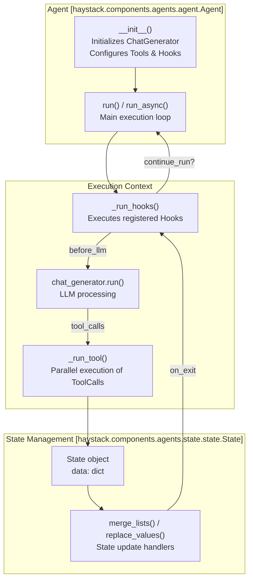

<!-- source: DeepWiki mcp.deepwiki.com · repo deepset-ai/haystack · page 6 Advanced Features · fetched 2026-10-27 -->

# Advanced Features

<details>
<summary>Relevant source files</summary>

The following files were used as context for generating this wiki page:

- [MIGRATION.md](MIGRATION.md)
- [docs-website/docs/pipeline-components/agents-1/state.mdx](docs-website/docs/pipeline-components/agents-1/state.mdx)
- [haystack/components/agents/agent.py](haystack/components/agents/agent.py)
- [haystack/components/agents/state/state.py](haystack/components/agents/state/state.py)
- [haystack/components/agents/state/state_utils.py](haystack/components/agents/state/state_utils.py)
- [haystack/components/agents/utils.py](haystack/components/agents/utils.py)
- [haystack/hooks/__init__.py](haystack/hooks/__init__.py)
- [haystack/hooks/invocation.py](haystack/hooks/invocation.py)
- [haystack/hooks/protocol.py](haystack/hooks/protocol.py)
- [haystack/hooks/utils.py](haystack/hooks/utils.py)
- [haystack/tools/__init__.py](haystack/tools/__init__.py)
- [haystack/tools/component_tool.py](haystack/tools/component_tool.py)
- [haystack/tools/from_function.py](haystack/tools/from_function.py)
- [haystack/tools/parameters_schema_utils.py](haystack/tools/parameters_schema_utils.py)
- [haystack/tools/serde_utils.py](haystack/tools/serde_utils.py)
- [haystack/tools/tool.py](haystack/tools/tool.py)
- [releasenotes/notes/add-after-tool-hook-d8d0779aaf65ce66.yaml](releasenotes/notes/add-after-tool-hook-d8d0779aaf65ce66.yaml)
- [releasenotes/notes/add-agent-context-tokens-831273f057452c71.yaml](releasenotes/notes/add-agent-context-tokens-831273f057452c71.yaml)
- [releasenotes/notes/add-agent-hooks-4584408a3a2a2ad4.yaml](releasenotes/notes/add-agent-hooks-4584408a3a2a2ad4.yaml)
- [releasenotes/notes/add-before-run-after-run-hook-points-79609e8eda11fb6e.yaml](releasenotes/notes/add-before-run-after-run-hook-points-79609e8eda11fb6e.yaml)
- [releasenotes/notes/fix-serialization-passthrough-9f1c2a4b7e6d3f08.yaml](releasenotes/notes/fix-serialization-passthrough-9f1c2a4b7e6d3f08.yaml)
- [releasenotes/notes/fix-state-validate-schema-5ae41ce9c82de61a.yaml](releasenotes/notes/fix-state-validate-schema-5ae41ce9c82de61a.yaml)
- [releasenotes/notes/fix-tool-schema-parameter-named-properties-9c8689341280f5b2.yaml](releasenotes/notes/fix-tool-schema-parameter-named-properties-9c8689341280f5b2.yaml)
- [releasenotes/notes/fix-tool-schema-title-name-keyed-and-data-keywords-3f5c1a27bd94e0b8.yaml](releasenotes/notes/fix-tool-schema-title-name-keyed-and-data-keywords-3f5c1a27bd94e0b8.yaml)
- [releasenotes/notes/rename-deserialize_tools_inplace-f10d72127be54bed.yaml](releasenotes/notes/rename-deserialize_tools_inplace-f10d72127be54bed.yaml)
- [releasenotes/notes/schema-validation-support-chatmessage-subclass-995fcdd860786cb3.yaml](releasenotes/notes/schema-validation-support-chatmessage-subclass-995fcdd860786cb3.yaml)
- [releasenotes/notes/sync-agent-step-count-after-before-run-hooks-39cb6a98cfa5f4f4.yaml](releasenotes/notes/sync-agent-step-count-after-before-run-hooks-39cb6a98cfa5f4f4.yaml)
- [test/components/agents/__init__.py](test/components/agents/__init__.py)
- [test/components/agents/test_agent.py](test/components/agents/test_agent.py)
- [test/components/agents/test_agent_hitl.py](test/components/agents/test_agent_hitl.py)
- [test/components/agents/test_agent_hooks.py](test/components/agents/test_agent_hooks.py)
- [test/components/agents/test_state_class.py](test/components/agents/test_state_class.py)
- [test/components/agents/test_utils.py](test/components/agents/test_utils.py)
- [test/hooks/test_invocation.py](test/hooks/test_invocation.py)
- [test/tools/test_component_tool.py](test/tools/test_component_tool.py)
- [test/tools/test_from_function.py](test/tools/test_from_function.py)
- [test/tools/test_serde_utils.py](test/tools/test_serde_utils.py)
- [test/tools/test_tool.py](test/tools/test_tool.py)

</details>


This page documents advanced capabilities in Haystack that enable sophisticated LLM workflows. The material covered includes:

- **Agent System**: Tool-using conversational agents with state management, execution control, and hooks.
- **Tool Invocation**: Integration of functions and components as tools, including parallel execution and state injection.
- **Human-in-the-Loop**: Integration of human approval and interaction into automated workflows via specialized hooks.
- **Evaluation Components**: Components for assessing answer quality and retrieval performance.
- **Migration Guide**: Information on breaking changes and externalized packages in the v3.0 release.

For core pipeline orchestration concepts, see [Pipeline System](#3.2). For LLM integrations, see [LLM Integration](#4).

---

## Agent System

### Overview

The `Agent` component implements a tool-using conversational loop where an LLM (`ChatGenerator`) decides which tools to invoke, executes them, and continues iterating until an exit condition is met. In Haystack v3.0, the `Agent` maintains conversation history and shared state across iterations, and it manages tool execution internally [haystack/components/agents/agent.py:104-112]().

**Key characteristics:**
- Uses any `ChatGenerator` that supports tool calling [haystack/components/agents/agent.py:182-192]().
- Executes tools with automatic parallelization via `tool_concurrency_limit` [haystack/components/agents/agent.py:214-214]().
- Maintains stateful execution with configurable schema via the `State` class [haystack/components/agents/agent.py:11-16]().
- Supports **Hooks** for observability and control at specific execution points (e.g., `before_llm`, `before_tool`, `on_exit`) [haystack/hooks/protocol.py:34-44]().

Sources: [haystack/components/agents/agent.py:104-230](), [haystack/hooks/protocol.py:34-44]()

### Architecture

The following diagram illustrates how the `Agent` orchestrates its internal logic and manages state.

**Agent Internal Logic and State Flow**

Sources: [haystack/components/agents/agent.py:182-230](), [haystack/components/agents/agent.py:454-609](), [haystack/components/agents/state/state.py:1-100]()

### State Management and Hooks

The `State` object maintains conversation history and shared data across agent iterations [haystack/components/agents/agent.py:11-16](). The agent populates run-metadata keys like `step_count`, `token_usage`, and `exit_reason` automatically [haystack/components/agents/agent.py:76-81]().

Hooks allow developers to inject logic into the agent's lifecycle. For example, a `before_llm` hook can trigger context compaction, or a `before_tool` hook can implement human-in-the-loop confirmation [haystack/components/agents/agent.py:83-96]().

For details, see [Agent System](#6.1).

Sources: [haystack/components/agents/agent.py:76-96](), [haystack/hooks/protocol.py:34-44]()

---

## Tool Invocation

### Overview

Tools are abstractions that allow LLMs to interact with external systems. Haystack provides several ways to define tools:

- **Function-based Tools**: Created using the `@tool` decorator or `create_tool_from_function` [haystack/tools/from_function.py:23-25]().
- **ComponentTool**: Wraps any Haystack `Component`, automatically generating LLM-compatible schemas from input sockets [haystack/tools/component_tool.py:35-51]().
- **PipelineTool**: Wraps an entire `Pipeline` as a single tool.

**Key Features:**
- **Schema Generation**: Automatic generation of JSON schemas for tool parameters [haystack/tools/component_tool.py:39-40]().
- **State Injection**: Tools can declare parameters of type `State` to receive the agent's shared state at runtime [haystack/tools/from_function.py:146-148]().
- **Output Handling**: Configurable `outputs_to_string` and `outputs_to_state` define how results are returned to the LLM or stored in state [haystack/tools/tool.py:45-93]().

### Tool Entities and Invocation
```mermaid
graph LR
    subgraph "Tool Entities [haystack.tools]"
        T["Tool [tool.py]"]
        CT["ComponentTool [component_tool.py]"]
        PT["PipelineTool [pipeline_tool.py]"]
        TS["Toolset [toolset.py]"]
    end

    subgraph "Agent Execution [haystack.components.agents.agent]"
        AgentRun["Agent.run()"]
        ToolCallLogic["_run_tool()"]
    end

    AgentRun --> ToolCallLogic
    ToolCallLogic -->|"invokes"| T
    T <|-- CT
    T <|-- PT
    TS -->|"manages"| T
```
Sources: [haystack/tools/tool.py:20-109](), [haystack/tools/component_tool.py:35-91](), [haystack/components/agents/agent.py:18-25]()

For details, see [Tool Invocation](#6.2).

---

## Human-in-the-Loop and Context Management

The `human_in_the_loop` module (integrated via `ConfirmationHook`) provides strategies for integrating human oversight into tool execution [test/components/agents/test_agent_hitl.py:14-21]().

**Core Components:**
- `ConfirmationStrategy`: Defines the logic for requiring approval (e.g., `BlockingConfirmationStrategy`) [test/components/agents/test_agent_hitl.py:51-54]().
- `ConfirmationPolicy`: Determines when to ask (e.g., `AlwaysAskPolicy`, `NeverAskPolicy`).
- `ConfirmationUI`: Interfaces like `SimpleConsoleUI` or `RichConsoleUI` for user interaction [test/components/agents/test_agent_hitl.py:20-22]().

**Context Management**:
Specialized hooks allow for **Compaction** (pruning conversation history to fit context windows) and **Offloading** (storing large tool results in a `ToolResultStore` rather than passing them directly to the LLM).

For details, see [Human-in-the-Loop and Context Management](#6.3).

Sources: [test/components/agents/test_agent_hitl.py:14-61]()

---

## Evaluation Components

Haystack includes components for assessing the performance of LLM pipelines and RAG systems.

**Metric-based Evaluators:**
- `AnswerExactMatch`: Checks if the generated answer matches the target exactly.
- `DocumentRecall` / `DocumentMRR` / `DocumentMAP`: Evaluates retrieval effectiveness.

**Model-based Evaluators:**
- `SASEvaluator`: Uses semantic similarity models to score answers.
- `LLMEvaluator`: Uses an LLM to score responses based on custom criteria.
- `FaithfulnessEvaluator`: Checks if an answer is grounded in the provided context.

For details, see [Evaluation Components](#6.4).

---

## Migration Guide (v2.x to v3.0)

Haystack v3.0 introduces several breaking changes to improve modularity and maintainability:

- **Externalized Packages**: Many components (Hugging Face, Transformers, SentenceTransformers, Audio) have moved to the `haystack-core-integrations` repository [MIGRATION.md:35-43]().
- **Serialization Changes**: `GeneratedAnswer` and `ExtractedAnswer` now use a flat dictionary format for `to_dict()` [MIGRATION.md:9-17]().
- **Agent Refactor**: The `ToolInvoker` component has been removed as a standalone component and its functionality integrated directly into the `Agent` [MIGRATION.md:77-80]().

For details, see [Migration Guide (v2.x to v3.0)](#6.5).

Sources: [MIGRATION.md:1-80]()

---

