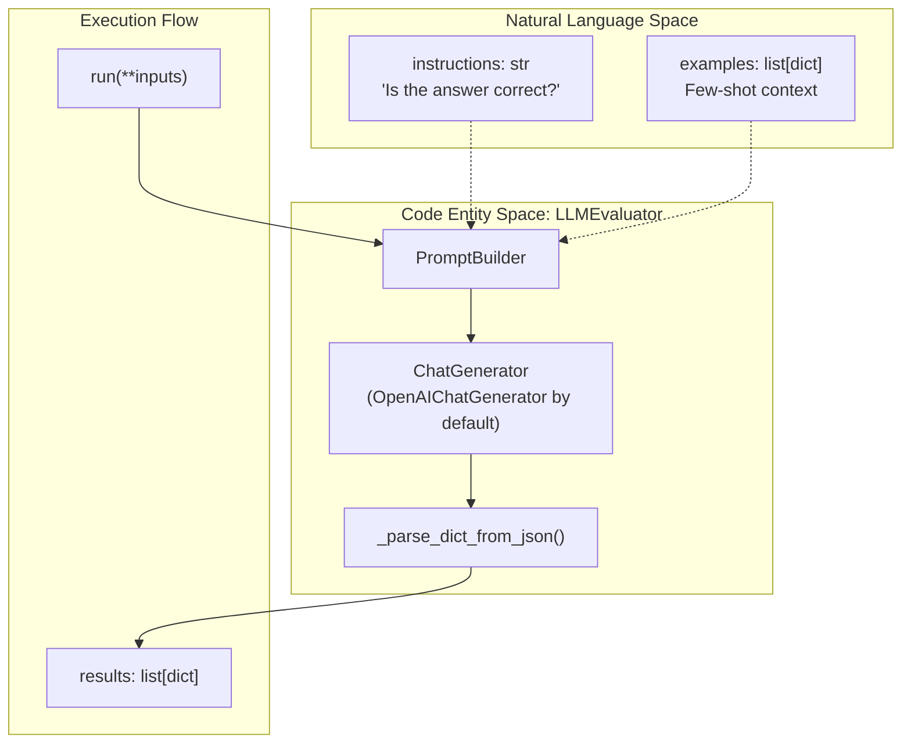
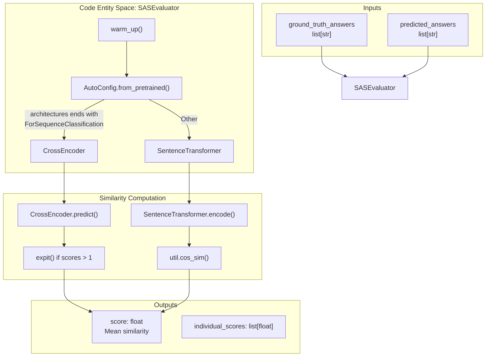

<!-- source: DeepWiki mcp.deepwiki.com · repo deepset-ai/haystack · page 6.4 Evaluation Components · fetched 2026-10-27 -->

# Evaluation Components

Relevant source files

The following files were used as context for generating this wiki page:

- [haystack/components/evaluators/__init__.py](haystack/components/evaluators/__init__.py)
- [haystack/components/evaluators/answer_exact_match.py](haystack/components/evaluators/answer_exact_match.py)
- [haystack/components/evaluators/context_relevance.py](haystack/components/evaluators/context_relevance.py)
- [haystack/components/evaluators/document_map.py](haystack/components/evaluators/document_map.py)
- [haystack/components/evaluators/document_mrr.py](haystack/components/evaluators/document_mrr.py)
- [haystack/components/evaluators/document_recall.py](haystack/components/evaluators/document_recall.py)
- [haystack/components/evaluators/faithfulness.py](haystack/components/evaluators/faithfulness.py)
- [haystack/components/evaluators/llm_evaluator.py](haystack/components/evaluators/llm_evaluator.py)
- [haystack/components/evaluators/sas_evaluator.py](haystack/components/evaluators/sas_evaluator.py)
- [haystack/evaluation/__init__.py](haystack/evaluation/__init__.py)
- [haystack/evaluation/eval_run_result.py](haystack/evaluation/eval_run_result.py)
- [haystack/utils/__init__.py](haystack/utils/__init__.py)
- [haystack/utils/deserialization.py](haystack/utils/deserialization.py)
- [releasenotes/notes/add-keep-columns-to-EvalRunResult-comparative-be3e15ce45de3e0b.yaml](releasenotes/notes/add-keep-columns-to-EvalRunResult-comparative-be3e15ce45de3e0b.yaml)
- [releasenotes/notes/add-llm-evaluator-row-statuses-78166807b18bc138.yaml](releasenotes/notes/add-llm-evaluator-row-statuses-78166807b18bc138.yaml)
- [releasenotes/notes/declare-evaluator-output-sockets-3a1f5c2e4b7d9018.yaml](releasenotes/notes/declare-evaluator-output-sockets-3a1f5c2e4b7d9018.yaml)
- [releasenotes/notes/deprecate-deserialize-doc-store-a275f9821ac58dc5.yaml](releasenotes/notes/deprecate-deserialize-doc-store-a275f9821ac58dc5.yaml)
- [releasenotes/notes/deserialisaation-in-place-d52a3bc54b9ea027.yaml](releasenotes/notes/deserialisaation-in-place-d52a3bc54b9ea027.yaml)
- [releasenotes/notes/document-map-evaluator-de896c94b54fe3fa.yaml](releasenotes/notes/document-map-evaluator-de896c94b54fe3fa.yaml)
- [releasenotes/notes/document-mrr-evaluator-fa7c266cc91201a7.yaml](releasenotes/notes/document-mrr-evaluator-fa7c266cc91201a7.yaml)
- [releasenotes/notes/document-recall-single-hit-missing-values-f78265c3caa11ded.yaml](releasenotes/notes/document-recall-single-hit-missing-values-f78265c3caa11ded.yaml)
- [releasenotes/notes/exact-match-evaluator-197bb87b65e19d0c.yaml](releasenotes/notes/exact-match-evaluator-197bb87b65e19d0c.yaml)
- [releasenotes/notes/faithfulness-evaluator-2e039a697c847d1c.yaml](releasenotes/notes/faithfulness-evaluator-2e039a697c847d1c.yaml)
- [releasenotes/notes/fix-issue-7758-d35b687ca226a707.yaml](releasenotes/notes/fix-issue-7758-d35b687ca226a707.yaml)
- [releasenotes/notes/fix-serialization-docrecallevaluator-91ad772ffed119ed.yaml](releasenotes/notes/fix-serialization-docrecallevaluator-91ad772ffed119ed.yaml)
- [releasenotes/notes/flexible-document-comparison-field-evaluators-c7d8e9f0a1b2c3d4.yaml](releasenotes/notes/flexible-document-comparison-field-evaluators-c7d8e9f0a1b2c3d4.yaml)
- [releasenotes/notes/implemeting-eval-results-API-25b2f8707495bea0.yaml](releasenotes/notes/implemeting-eval-results-API-25b2f8707495bea0.yaml)
- [releasenotes/notes/recall-evaluator-5595470406e93ad2.yaml](releasenotes/notes/recall-evaluator-5595470406e93ad2.yaml)
- [releasenotes/notes/remove-deserialize-doc-store-deprecated-2-23-0-1ab2c3d4.yaml](releasenotes/notes/remove-deserialize-doc-store-deprecated-2-23-0-1ab2c3d4.yaml)
- [releasenotes/notes/removing-deprecated-EvalRunResult-d28c2eb407da0051.yaml](releasenotes/notes/removing-deprecated-EvalRunResult-d28c2eb407da0051.yaml)
- [releasenotes/notes/rm-raise_on_invalid_filter_syntax-a1e88026e3f6c6b0.yaml](releasenotes/notes/rm-raise_on_invalid_filter_syntax-a1e88026e3f6c6b0.yaml)
- [releasenotes/notes/updated-doc-recall-eval-uniqueness-59b09082cf8e7593.yaml](releasenotes/notes/updated-doc-recall-eval-uniqueness-59b09082cf8e7593.yaml)
- [test/components/evaluators/__init__.py](test/components/evaluators/__init__.py)
- [test/components/evaluators/test_answer_exact_match.py](test/components/evaluators/test_answer_exact_match.py)
- [test/components/evaluators/test_context_relevance_evaluator.py](test/components/evaluators/test_context_relevance_evaluator.py)
- [test/components/evaluators/test_document_map.py](test/components/evaluators/test_document_map.py)
- [test/components/evaluators/test_document_mrr.py](test/components/evaluators/test_document_mrr.py)
- [test/components/evaluators/test_document_recall.py](test/components/evaluators/test_document_recall.py)
- [test/components/evaluators/test_faithfulness_evaluator.py](test/components/evaluators/test_faithfulness_evaluator.py)
- [test/components/evaluators/test_llm_evaluator.py](test/components/evaluators/test_llm_evaluator.py)
- [test/components/evaluators/test_sas_evaluator.py](test/components/evaluators/test_sas_evaluator.py)
- [test/evaluation/__init__.py](test/evaluation/__init__.py)
- [test/evaluation/test_eval_run_result.py](test/evaluation/test_eval_run_result.py)
- [test/utils/test_deserialization.py](test/utils/test_deserialization.py)

Evaluation components in Haystack enable automated assessment of answer quality, relevance, and correctness in RAG and question-answering pipelines. These components use pre-trained models from Hugging Face or Large Language Models (LLMs) to compute semantic similarity scores, extract answers, and assess faithfulness or context relevance.

## Overview

Haystack provides evaluation components that assess performance using both metric-based and LLM-based approaches. These components enable:

- **Semantic similarity evaluation** via `SASEvaluator` using cross-encoders or bi-encoders.
- **LLM-based evaluation** via `LLMEvaluator`, `FaithfulnessEvaluator`, and `ContextRelevanceEvaluator`.
- **Retrieval and QA metrics** such as `DocumentRecall`, `DocumentMRR`, `DocumentMAP`, and `AnswerExactMatch`.
- **Result aggregation** via `EvaluationRunResult` for comprehensive reporting.

Sources: [haystack/components/evaluators/sas_evaluator.py:20-53](), [haystack/components/evaluators/llm_evaluator.py:26-55](), [haystack/evaluation/eval_run_result.py:18-43]()

## LLM-Based Evaluators

LLM-based evaluators use a `ChatGenerator` to assess inputs based on natural language instructions and few-shot examples.

### LLMEvaluator Architecture

The `LLMEvaluator` is a generic component that can be configured for various custom metrics. It validates that inputs are lists and outputs are strings during initialization.

**LLMEvaluator Processing Flow**

The component constructs a prompt containing the instructions, examples, and the current inputs using an internal `PromptBuilder`. It requires the underlying `ChatGenerator` to be configured for JSON mode (e.g., `response_format={"type": "json_object"}`). During `run()`, it iterates through the input lists, generates evaluation responses, and parses them using `_parse_dict_from_json`.

Sources: [haystack/components/evaluators/llm_evaluator.py:57-113](), [haystack/components/evaluators/llm_evaluator.py:194-225](), [haystack/utils/misc.py:20-20]()

### Specialized LLM Evaluators

Haystack provides specialized evaluators that inherit from `LLMEvaluator` with pre-defined prompts and input schemas:

- **FaithfulnessEvaluator**: Assesses if the `predicted_answers` can be inferred from the provided `contexts`. It returns `statements`, `statement_scores`, and an aggregate `score`.
- **ContextRelevanceEvaluator**: Assesses how relevant the retrieved `contexts` are to the `questions`. It extracts `relevant_statements` and calculates a relevance score.

Sources: [haystack/components/evaluators/faithfulness.py:54-89](), [haystack/components/evaluators/context_relevance.py:45-104]()

## SASEvaluator

The `SASEvaluator` (Semantic Answer Similarity Evaluator) computes similarity between predicted answers and ground truth using pre-trained models from Hugging Face.

**SASEvaluator Processing Flow**

The evaluator automatically selects the appropriate similarity computation during `warm_up()`:
- **Cross-Encoder**: Predicts scores for sentence pairs. Scores are normalized using `expit` (sigmoid) if they exceed 1.
- **Bi-Encoder**: Encodes predictions and ground truths into embeddings, then computes pairwise cosine similarity.

Sources: [haystack/components/evaluators/sas_evaluator.py:107-126](), [haystack/components/evaluators/sas_evaluator.py:156-192](), [haystack/utils/misc.py:43-43]()

## Metric-Based Evaluators

These components compute standard Information Retrieval (IR) metrics by comparing `Document` objects or strings.

| Component | Input Types | Comparison Logic |
|-----------|-------------|------------------|
| `DocumentRecallEvaluator` | `list[list[Document]]` | Supports `RecallMode.SINGLE_HIT` and `MULTI_HIT`. Can compare via `content`, `id`, or `meta` fields. |
| `DocumentMRREvaluator` | `list[list[Document]]` | Calculates Mean Reciprocal Rank of the first relevant document. |
| `DocumentMAPEvaluator` | `list[list[Document]]` | Calculates Mean Average Precision across all relevant documents. |
| `AnswerExactMatchEvaluator` | `list[str]` | Performs case-insensitive exact string matching between predictions and ground truths. |

Sources: [haystack/components/evaluators/document_recall.py:41-92](), [haystack/components/evaluators/document_recall.py:158-184](), [haystack/components/evaluators/__init__.py:11-19]()

## EvalRunResult

The `EvaluationRunResult` class (formerly `EvalRunResult`) aggregates inputs and outputs from evaluation pipelines to facilitate reporting.

- **Initialization**: Validates that all input and result lists have matching lengths.
- **Detailed Report**: Combines inputs (e.g., questions, contexts) with `individual_scores` from evaluators into a single structure.
- **Aggregated Report**: Summarizes the final `score` for every metric included in the run.
- **Export Formats**: Supports exporting data to `json`, `csv`, or a pandas `DataFrame`.

Sources: [haystack/evaluation/eval_run_result.py:23-62](), [haystack/evaluation/eval_run_result.py:122-163](), [haystack/evaluation/eval_run_result.py:100-120]()

---

