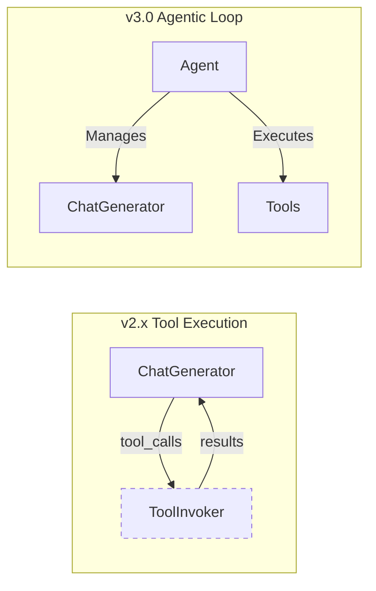
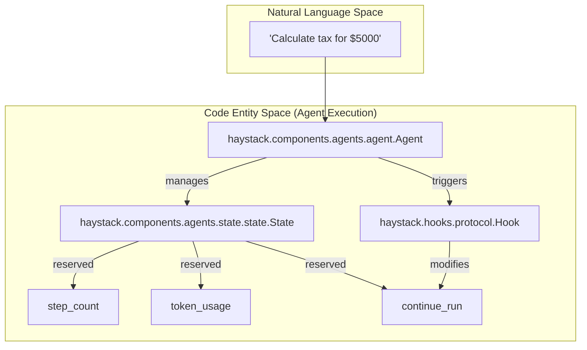

<!-- source: DeepWiki mcp.deepwiki.com · repo deepset-ai/haystack · page 6.5 Migration Guide (v2.x to v3.0) · fetched 2026-10-27 -->

# Migration Guide (v2.x to v3.0)

Relevant source files

The following files were used as context for generating this wiki page:

- [MIGRATION.md](MIGRATION.md)
- [docs-website/docs/concepts/components.mdx](docs-website/docs/concepts/components.mdx)
- [docs-website/docs/document-stores/oracledocumentstore.mdx](docs-website/docs/document-stores/oracledocumentstore.mdx)
- [docs-website/docs/document-stores/supabasedocumentstore.mdx](docs-website/docs/document-stores/supabasedocumentstore.mdx)
- [docs-website/docs/optimization/advanced-rag-techniques/hypothetical-document-embeddings-hyde.mdx](docs-website/docs/optimization/advanced-rag-techniques/hypothetical-document-embeddings-hyde.mdx)
- [docs-website/docs/overview/get-started.mdx](docs-website/docs/overview/get-started.mdx)
- [docs-website/docs/overview/migration.mdx](docs-website/docs/overview/migration.mdx)
- [docs-website/docs/pipeline-components/agents-1/state.mdx](docs-website/docs/pipeline-components/agents-1/state.mdx)
- [docs-website/docs/pipeline-components/retrievers/pgvectorembeddingretriever.mdx](docs-website/docs/pipeline-components/retrievers/pgvectorembeddingretriever.mdx)
- [docs-website/docs/pipeline-components/routers/metadatarouter.mdx](docs-website/docs/pipeline-components/routers/metadatarouter.mdx)
- [docs-website/docs/pipeline-components/writers/documentwriter.mdx](docs-website/docs/pipeline-components/writers/documentwriter.mdx)
- [docs-website/versioned_docs/version-2.22/overview/get-started.mdx](docs-website/versioned_docs/version-2.22/overview/get-started.mdx)
- [docs-website/versioned_docs/version-2.23/overview/get-started.mdx](docs-website/versioned_docs/version-2.23/overview/get-started.mdx)
- [docs-website/versioned_docs/version-3.0/overview/migrating-from-langgraphlangchain-to-haystack.mdx](docs-website/versioned_docs/version-3.0/overview/migrating-from-langgraphlangchain-to-haystack.mdx)
- [docs-website/versioned_docs/version-3.0/overview/migration.mdx](docs-website/versioned_docs/version-3.0/overview/migration.mdx)
- [haystack/components/agents/agent.py](haystack/components/agents/agent.py)
- [haystack/components/agents/state/state.py](haystack/components/agents/state/state.py)
- [haystack/components/agents/state/state_utils.py](haystack/components/agents/state/state_utils.py)
- [haystack/components/agents/utils.py](haystack/components/agents/utils.py)
- [haystack/hooks/__init__.py](haystack/hooks/__init__.py)
- [haystack/hooks/invocation.py](haystack/hooks/invocation.py)
- [haystack/hooks/protocol.py](haystack/hooks/protocol.py)
- [haystack/hooks/utils.py](haystack/hooks/utils.py)
- [releasenotes/config.yaml](releasenotes/config.yaml)
- [releasenotes/notes/add-after-tool-hook-d8d0779aaf65ce66.yaml](releasenotes/notes/add-after-tool-hook-d8d0779aaf65ce66.yaml)
- [releasenotes/notes/add-agent-context-tokens-831273f057452c71.yaml](releasenotes/notes/add-agent-context-tokens-831273f057452c71.yaml)
- [releasenotes/notes/add-agent-hooks-4584408a3a2a2ad4.yaml](releasenotes/notes/add-agent-hooks-4584408a3a2a2ad4.yaml)
- [releasenotes/notes/add-batch_size_faiss_init-5e97c1fb9409f873.yaml](releasenotes/notes/add-batch_size_faiss_init-5e97c1fb9409f873.yaml)
- [releasenotes/notes/add-before-run-after-run-hook-points-79609e8eda11fb6e.yaml](releasenotes/notes/add-before-run-after-run-hook-points-79609e8eda11fb6e.yaml)
- [releasenotes/notes/add-file-extension-classifier-preview-40f31c27bbd7cff9.yaml](releasenotes/notes/add-file-extension-classifier-preview-40f31c27bbd7cff9.yaml)
- [releasenotes/notes/add-v2-answer-class-31bc8d3116922594.yaml](releasenotes/notes/add-v2-answer-class-31bc8d3116922594.yaml)
- [releasenotes/notes/canals-0.4.0-b69b19069c4a9e0f.yaml](releasenotes/notes/canals-0.4.0-b69b19069c4a9e0f.yaml)
- [releasenotes/notes/document-writer-v2-bbe0a62b3066f9cf.yaml](releasenotes/notes/document-writer-v2-bbe0a62b3066f9cf.yaml)
- [releasenotes/notes/fix-serialization-passthrough-9f1c2a4b7e6d3f08.yaml](releasenotes/notes/fix-serialization-passthrough-9f1c2a4b7e6d3f08.yaml)
- [releasenotes/notes/fix-state-validate-schema-5ae41ce9c82de61a.yaml](releasenotes/notes/fix-state-validate-schema-5ae41ce9c82de61a.yaml)
- [releasenotes/notes/lazy-import-v2-82902270867d9899.yaml](releasenotes/notes/lazy-import-v2-82902270867d9899.yaml)
- [releasenotes/notes/run-async-azure-54450f0c2495f5c8.yaml](releasenotes/notes/run-async-azure-54450f0c2495f5c8.yaml)
- [releasenotes/notes/schema-validation-support-chatmessage-subclass-995fcdd860786cb3.yaml](releasenotes/notes/schema-validation-support-chatmessage-subclass-995fcdd860786cb3.yaml)
- [releasenotes/notes/speedup-import-b542f7a8323ef376.yaml](releasenotes/notes/speedup-import-b542f7a8323ef376.yaml)
- [releasenotes/notes/store-factory-91e7da46aeb7ff21.yaml](releasenotes/notes/store-factory-91e7da46aeb7ff21.yaml)
- [releasenotes/notes/stores-serialisation-a09398d158b01ae6.yaml](releasenotes/notes/stores-serialisation-a09398d158b01ae6.yaml)
- [releasenotes/notes/sync-agent-step-count-after-before-run-hooks-39cb6a98cfa5f4f4.yaml](releasenotes/notes/sync-agent-step-count-after-before-run-hooks-39cb6a98cfa5f4f4.yaml)
- [releasenotes/notes/textfile-to-document-v2-341987623765ec95.yaml](releasenotes/notes/textfile-to-document-v2-341987623765ec95.yaml)
- [test/components/agents/__init__.py](test/components/agents/__init__.py)
- [test/components/agents/test_agent.py](test/components/agents/test_agent.py)
- [test/components/agents/test_agent_hitl.py](test/components/agents/test_agent_hitl.py)
- [test/components/agents/test_agent_hooks.py](test/components/agents/test_agent_hooks.py)
- [test/components/agents/test_state_class.py](test/components/agents/test_state_class.py)
- [test/components/agents/test_utils.py](test/components/agents/test_utils.py)
- [test/hooks/test_invocation.py](test/hooks/test_invocation.py)

This guide documents the transition from Haystack v2.x to v3.0. While v3.0 is an evolution of the v2.x architecture rather than a complete rewrite, it introduces significant changes to package structure, serialization formats, and the agentic ecosystem to improve maintainability and performance.

## Serialization Format Changes

In v3.0, the serialization format for `GeneratedAnswer` and `ExtractedAnswer` has been flattened to align with other core dataclasses like `Document` and `ChatMessage` [MIGRATION.md:9-13]().

### Flattened Dictionary Structure
Previously, these classes wrapped their data in a `{"type": ..., "init_parameters": {...}}` envelope. The new format removes the `init_parameters` nesting, placing fields at the top level [MIGRATION.md:19-28]().

| Dataclass | v2.x Serialization | v3.0 Serialization |
| :--- | :--- | :--- |
| `GeneratedAnswer` | `{"init_parameters": {"data": ...}}` | `{"data": ...}` |
| `ExtractedAnswer` | `{"init_parameters": {"query": ...}}` | `{"query": ...}` |

**Backward Compatibility:** The `from_dict()` methods for these classes remain backward compatible, accepting both the old wrapped format and the new flat format [MIGRATION.md:15-17]().

Sources: [MIGRATION.md:9-33]()

## Component Relocation to External Packages

To lean out the core `haystack-ai` package and allow independent release cycles, several components have been moved to the `haystack-core-integrations` repository [MIGRATION.md:37-41]().

### Migration Mapping for External Packages

| Old Import (`haystack.components...`) | New Package | New Import (`haystack_integrations...`) |
| :--- | :--- | :--- |
| `generators.chat.HuggingFaceAPIChatGenerator` | `huggingface-api-haystack` | `components.generators.huggingface_api.HuggingFaceAPIChatGenerator` |
| `embedders.SentenceTransformersTextEmbedder` | `sentence-transformers-haystack` | `components.embedders.sentence_transformers.SentenceTransformersTextEmbedder` |
| `generators.chat.HuggingFaceLocalChatGenerator` | `transformers-haystack` | `components.generators.transformers.TransformersChatGenerator` |
| `audio.LocalWhisperTranscriber` | `whisper-haystack` | `components.audio.whisper.LocalWhisperTranscriber` |
| `tracing.datadog.DatadogTracer` | `datadog-haystack` | `tracing.datadog.DatadogTracer` |

Sources: [MIGRATION.md:49-77](), [docs-website/docs/overview/migration.mdx:114-126]()

## Removed and Renamed Components

### Legacy Generators
Non-chat generators like `OpenAIGenerator` and `AzureOpenAIGenerator` have been removed in favor of their chat counterparts [docs-website/docs/overview/migration.mdx:35-37]().

*   **Input Handling:** `ChatGenerators` now accept a plain `str` as input, which is automatically converted to a `ChatMessage` list [docs-website/docs/overview/migration.mdx:55-57]().
*   **Metadata:** The separate `meta` output socket is removed. Metadata is now accessed via `ChatMessage.meta` [docs-website/docs/overview/migration.mdx:64-65]().

### ToolInvoker Removal
The `ToolInvoker` component has been removed. Tool execution is now managed directly by the `Agent` component [docs-website/docs/overview/migration.mdx:67-69]().

Sources: [docs-website/docs/overview/migration.mdx:71-96]()

## The New Agent and State System

The `Agent` in v3.0 introduces a robust `State` management system and a hook-based lifecycle.

### State and Schema
`State` is a container for shared information during execution [haystack/components/agents/state/state.py:83-85](). It enforces a `schema` where each key has a `type` and a `handler` for merging updates [haystack/components/agents/state/state.py:89-94]().

*   **`merge_lists`**: Appends new items to existing lists (default for `list` types) [haystack/components/agents/state/state.py:98-99]().
*   **`replace_values`**: Overwrites existing values (default for other types) [haystack/components/agents/state/state.py:99-100]().

### Reserved State Keys
The Agent reserves specific keys in the `State` for internal orchestration and metadata [haystack/components/agents/agent.py:76-96]().

| Key Category | Symbol | Role |
| :--- | :--- | :--- |
| **Run Metadata** | `step_count` | Tracks iterations of the agent loop [haystack/components/agents/agent.py:77-77]() |
| **Run Metadata** | `token_usage` | Aggregated usage from LLM calls [haystack/components/agents/agent.py:78-78]() |
| **Internal Control** | `continue_run` | Boolean flag set by hooks to force another loop [haystack/components/agents/agent.py:92-92]() |
| **Internal Control** | `context_tokens` | Snapshot of context window size for compaction [haystack/components/agents/agent.py:95-95]() |

Sources: [haystack/components/agents/agent.py:74-96](), [haystack/components/agents/state/state.py:127-143](), [docs-website/docs/pipeline-components/agents-1/state.mdx:70-77]()

## Hook System Lifecycle

Haystack v3.0 introduces a formalized hook system for intercepting agent execution at specific points [haystack/hooks/protocol.py:41-43]().

| Hook Point | Description |
| :--- | :--- |
| `BEFORE_RUN` | Fired once at the start of `Agent.run()` [haystack/components/agents/agent.py:38-38]() |
| `BEFORE_LLM` | Fired before every call to the `ChatGenerator` [haystack/components/agents/agent.py:37-37]() |
| `BEFORE_TOOL` | Fired before executing a tool; used for Human-in-the-Loop [haystack/components/agents/agent.py:39-39]() |
| `AFTER_TOOL` | Fired after a tool returns a result [haystack/components/agents/agent.py:36-36]() |
| `ON_EXIT` | Fired when the agent attempts to stop [haystack/components/agents/agent.py:40-40]() |

Sources: [haystack/components/agents/agent.py:34-44](), [test/components/agents/test_agent_hooks.py:33-138]()

## Async and Pipeline Consolidation

`AsyncPipeline` has been merged into the standard `Pipeline` class [docs-website/docs/overview/migration.mdx:112-112](). 

*   **Unified API:** The standard `Pipeline` now supports both `run()` and `run_async()` methods.
*   **Component Protocol:** Components can implement `run()` for synchronous execution and `run_async()` for native asynchronous execution [haystack/components/generators/chat/openai.py:256-320]().

Sources: [docs-website/docs/overview/migration.mdx:112-112](), [haystack/components/agents/agent.py:63-63]()

---

