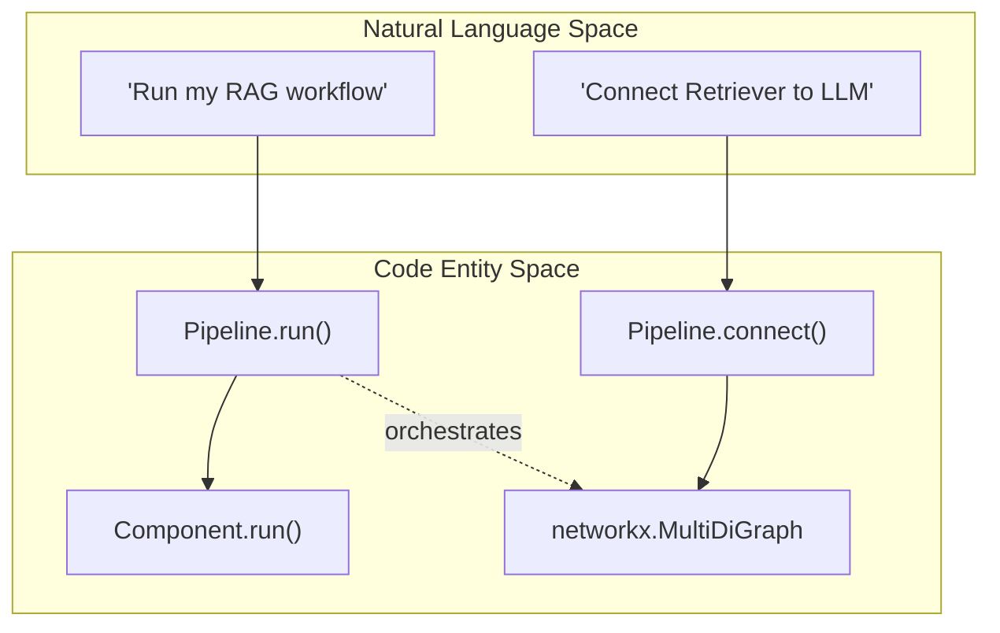
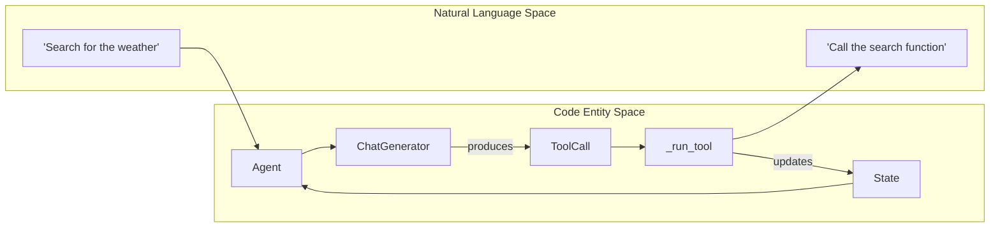

<!-- source: DeepWiki mcp.deepwiki.com · repo deepset-ai/haystack · page 7 Glossary · fetched 2026-10-27 -->

# Glossary

Relevant source files

The following files were used as context for generating this wiki page:

- [MIGRATION.md](MIGRATION.md)
- [docs-website/docs/pipeline-components/agents-1/state.mdx](docs-website/docs/pipeline-components/agents-1/state.mdx)
- [haystack/components/agents/agent.py](haystack/components/agents/agent.py)
- [haystack/components/agents/state/state.py](haystack/components/agents/state/state.py)
- [haystack/components/agents/state/state_utils.py](haystack/components/agents/state/state_utils.py)
- [haystack/components/agents/utils.py](haystack/components/agents/utils.py)
- [haystack/components/builders/chat_prompt_builder.py](haystack/components/builders/chat_prompt_builder.py)
- [haystack/components/builders/prompt_builder.py](haystack/components/builders/prompt_builder.py)
- [haystack/components/evaluators/context_relevance.py](haystack/components/evaluators/context_relevance.py)
- [haystack/components/evaluators/faithfulness.py](haystack/components/evaluators/faithfulness.py)
- [haystack/components/evaluators/llm_evaluator.py](haystack/components/evaluators/llm_evaluator.py)
- [haystack/components/routers/metadata_router.py](haystack/components/routers/metadata_router.py)
- [haystack/core/component/component.py](haystack/core/component/component.py)
- [haystack/core/component/sockets.py](haystack/core/component/sockets.py)
- [haystack/core/component/types.py](haystack/core/component/types.py)
- [haystack/core/errors.py](haystack/core/errors.py)
- [haystack/core/pipeline/base.py](haystack/core/pipeline/base.py)
- [haystack/core/pipeline/breakpoint.py](haystack/core/pipeline/breakpoint.py)
- [haystack/core/pipeline/component_checks.py](haystack/core/pipeline/component_checks.py)
- [haystack/core/pipeline/descriptions.py](haystack/core/pipeline/descriptions.py)
- [haystack/core/pipeline/pipeline.py](haystack/core/pipeline/pipeline.py)
- [haystack/core/pipeline/utils.py](haystack/core/pipeline/utils.py)
- [haystack/dataclasses/breakpoints.py](haystack/dataclasses/breakpoints.py)
- [haystack/dataclasses/chat_message.py](haystack/dataclasses/chat_message.py)
- [haystack/document_stores/in_memory/document_store.py](haystack/document_stores/in_memory/document_store.py)
- [haystack/hooks/__init__.py](haystack/hooks/__init__.py)
- [haystack/hooks/invocation.py](haystack/hooks/invocation.py)
- [haystack/hooks/protocol.py](haystack/hooks/protocol.py)
- [haystack/hooks/utils.py](haystack/hooks/utils.py)
- [haystack/testing/document_store.py](haystack/testing/document_store.py)
- [haystack/testing/document_store_async.py](haystack/testing/document_store_async.py)
- [haystack/tools/__init__.py](haystack/tools/__init__.py)
- [haystack/tools/component_tool.py](haystack/tools/component_tool.py)
- [haystack/tools/from_function.py](haystack/tools/from_function.py)
- [haystack/tools/parameters_schema_utils.py](haystack/tools/parameters_schema_utils.py)
- [haystack/tools/serde_utils.py](haystack/tools/serde_utils.py)
- [haystack/tools/tool.py](haystack/tools/tool.py)
- [haystack/utils/__init__.py](haystack/utils/__init__.py)
- [haystack/utils/deserialization.py](haystack/utils/deserialization.py)
- [haystack/utils/filters.py](haystack/utils/filters.py)
- [haystack/utils/jinja2_chat_extension.py](haystack/utils/jinja2_chat_extension.py)
- [haystack/utils/jinja2_extensions.py](haystack/utils/jinja2_extensions.py)
- [releasenotes/notes/add-after-tool-hook-d8d0779aaf65ce66.yaml](releasenotes/notes/add-after-tool-hook-d8d0779aaf65ce66.yaml)
- [releasenotes/notes/add-agent-context-tokens-831273f057452c71.yaml](releasenotes/notes/add-agent-context-tokens-831273f057452c71.yaml)
- [releasenotes/notes/add-agent-hooks-4584408a3a2a2ad4.yaml](releasenotes/notes/add-agent-hooks-4584408a3a2a2ad4.yaml)
- [releasenotes/notes/add-before-run-after-run-hook-points-79609e8eda11fb6e.yaml](releasenotes/notes/add-before-run-after-run-hook-points-79609e8eda11fb6e.yaml)
- [releasenotes/notes/add-getmetadata-async-methods-and-tests-3ff2601b692697cb.yaml](releasenotes/notes/add-getmetadata-async-methods-and-tests-3ff2601b692697cb.yaml)
- [releasenotes/notes/add-llm-evaluator-row-statuses-78166807b18bc138.yaml](releasenotes/notes/add-llm-evaluator-row-statuses-78166807b18bc138.yaml)
- [releasenotes/notes/add-messages-jinja-tag-483cca5bda6884f2.yaml](releasenotes/notes/add-messages-jinja-tag-483cca5bda6884f2.yaml)
- [releasenotes/notes/add-required-flag-for-prompt-builder-inputs-f5d3ffb3cb7df8d0.yaml](releasenotes/notes/add-required-flag-for-prompt-builder-inputs-f5d3ffb3cb7df8d0.yaml)
- [releasenotes/notes/allow-break-point-with-pipeline-snapshot-686cbbecc7ca0ae3.yaml](releasenotes/notes/allow-break-point-with-pipeline-snapshot-686cbbecc7ca0ae3.yaml)
- [releasenotes/notes/async-component-support-machinery-6ea4496241aeb3b2.yaml](releasenotes/notes/async-component-support-machinery-6ea4496241aeb3b2.yaml)
- [releasenotes/notes/cancel-in-flight-tasks-on-error-8b9623a305717328.yaml](releasenotes/notes/cancel-in-flight-tasks-on-error-8b9623a305717328.yaml)
- [releasenotes/notes/chat-prompt-builder-sanitization-d0905ac8a5a25aa0.yaml](releasenotes/notes/chat-prompt-builder-sanitization-d0905ac8a5a25aa0.yaml)
- [releasenotes/notes/chatmessage-from-dict-pydantic-dump-5b12e4b1d4985ec1.yaml](releasenotes/notes/chatmessage-from-dict-pydantic-dump-5b12e4b1d4985ec1.yaml)
- [releasenotes/notes/consistent-datetime-filter-comparisons-1384566f567b151f.yaml](releasenotes/notes/consistent-datetime-filter-comparisons-1384566f567b151f.yaml)
- [releasenotes/notes/declare-evaluator-output-sockets-3a1f5c2e4b7d9018.yaml](releasenotes/notes/declare-evaluator-output-sockets-3a1f5c2e4b7d9018.yaml)
- [releasenotes/notes/deprecate-deserialize-doc-store-a275f9821ac58dc5.yaml](releasenotes/notes/deprecate-deserialize-doc-store-a275f9821ac58dc5.yaml)
- [releasenotes/notes/deserialisaation-in-place-d52a3bc54b9ea027.yaml](releasenotes/notes/deserialisaation-in-place-d52a3bc54b9ea027.yaml)
- [releasenotes/notes/extend-promptbuilder-0322790d82248039.yaml](releasenotes/notes/extend-promptbuilder-0322790d82248039.yaml)
- [releasenotes/notes/fix-asyncpipeline-run-error-e82ede5c4f37f485.yaml](releasenotes/notes/fix-asyncpipeline-run-error-e82ede5c4f37f485.yaml)
- [releasenotes/notes/fix-count-unique-metadata-mixin-test-5415d442cdb70c15.yaml](releasenotes/notes/fix-count-unique-metadata-mixin-test-5415d442cdb70c15.yaml)
- [releasenotes/notes/fix-deepcopy-namedtuple-c7aa157bc9aef85b.yaml](releasenotes/notes/fix-deepcopy-namedtuple-c7aa157bc9aef85b.yaml)
- [releasenotes/notes/fix-jinja2-variable-extraction-57f34c6bd249e214.yaml](releasenotes/notes/fix-jinja2-variable-extraction-57f34c6bd249e214.yaml)
- [releasenotes/notes/fix-openai-toolcall-empty-arguments-53c5621622bc1866.yaml](releasenotes/notes/fix-openai-toolcall-empty-arguments-53c5621622bc1866.yaml)
- [releasenotes/notes/fix-pipeline-mandatory-inputs-b2f63cfbb3cb20ff.yaml](releasenotes/notes/fix-pipeline-mandatory-inputs-b2f63cfbb3cb20ff.yaml)
- [releasenotes/notes/fix-pipeline-snapshot-resume-in-loops-0ab593c343026abb.yaml](releasenotes/notes/fix-pipeline-snapshot-resume-in-loops-0ab593c343026abb.yaml)
- [releasenotes/notes/fix-serialization-passthrough-9f1c2a4b7e6d3f08.yaml](releasenotes/notes/fix-serialization-passthrough-9f1c2a4b7e6d3f08.yaml)
- [releasenotes/notes/fix-set-output-types-async-check-2e5d578a3ccdcc59.yaml](releasenotes/notes/fix-set-output-types-async-check-2e5d578a3ccdcc59.yaml)
- [releasenotes/notes/fix-state-validate-schema-5ae41ce9c82de61a.yaml](releasenotes/notes/fix-state-validate-schema-5ae41ce9c82de61a.yaml)
- [releasenotes/notes/fix-tool-schema-parameter-named-properties-9c8689341280f5b2.yaml](releasenotes/notes/fix-tool-schema-parameter-named-properties-9c8689341280f5b2.yaml)
- [releasenotes/notes/fix-tool-schema-title-name-keyed-and-data-keywords-3f5c1a27bd94e0b8.yaml](releasenotes/notes/fix-tool-schema-title-name-keyed-and-data-keywords-3f5c1a27bd94e0b8.yaml)
- [releasenotes/notes/fix-variadic-unsubscripted-indexerror-32788f5484bd3b5c.yaml](releasenotes/notes/fix-variadic-unsubscripted-indexerror-32788f5484bd3b5c.yaml)
- [releasenotes/notes/improve-jinja2-chat-sec-27333c393c032b75.yaml](releasenotes/notes/improve-jinja2-chat-sec-27333c393c032b75.yaml)
- [releasenotes/notes/in-memory-add-filters-to-unique-values-9caf93d474ac922d.yaml](releasenotes/notes/in-memory-add-filters-to-unique-values-9caf93d474ac922d.yaml)
- [releasenotes/notes/inmemory-unique-metadata-values-pagination-a3f6c9d21b7e4081.yaml](releasenotes/notes/inmemory-unique-metadata-values-pagination-a3f6c9d21b7e4081.yaml)
- [releasenotes/notes/pipeline-draw-deprecation-3ba4b047de73d031.yaml](releasenotes/notes/pipeline-draw-deprecation-3ba4b047de73d031.yaml)
- [releasenotes/notes/pipeline-io-connected-sockets-db862d045944f788.yaml](releasenotes/notes/pipeline-io-connected-sockets-db862d045944f788.yaml)
- [releasenotes/notes/remove-deprecated-param-from-pipeline-6b05ce1ff1f7fdec.yaml](releasenotes/notes/remove-deprecated-param-from-pipeline-6b05ce1ff1f7fdec.yaml)
- [releasenotes/notes/remove-deserialize-doc-store-deprecated-2-23-0-1ab2c3d4.yaml](releasenotes/notes/remove-deserialize-doc-store-deprecated-2-23-0-1ab2c3d4.yaml)
- [releasenotes/notes/rename-deserialize_tools_inplace-f10d72127be54bed.yaml](releasenotes/notes/rename-deserialize_tools_inplace-f10d72127be54bed.yaml)
- [releasenotes/notes/rm-raise_on_invalid_filter_syntax-a1e88026e3f6c6b0.yaml](releasenotes/notes/rm-raise_on_invalid_filter_syntax-a1e88026e3f6c6b0.yaml)
- [releasenotes/notes/schema-validation-support-chatmessage-subclass-995fcdd860786cb3.yaml](releasenotes/notes/schema-validation-support-chatmessage-subclass-995fcdd860786cb3.yaml)
- [releasenotes/notes/sync-agent-step-count-after-before-run-hooks-39cb6a98cfa5f4f4.yaml](releasenotes/notes/sync-agent-step-count-after-before-run-hooks-39cb6a98cfa5f4f4.yaml)
- [test/components/agents/__init__.py](test/components/agents/__init__.py)
- [test/components/agents/test_agent.py](test/components/agents/test_agent.py)
- [test/components/agents/test_agent_hitl.py](test/components/agents/test_agent_hitl.py)
- [test/components/agents/test_agent_hooks.py](test/components/agents/test_agent_hooks.py)
- [test/components/agents/test_state_class.py](test/components/agents/test_state_class.py)
- [test/components/agents/test_utils.py](test/components/agents/test_utils.py)
- [test/components/builders/test_chat_prompt_builder.py](test/components/builders/test_chat_prompt_builder.py)
- [test/components/builders/test_prompt_builder.py](test/components/builders/test_prompt_builder.py)
- [test/components/evaluators/test_context_relevance_evaluator.py](test/components/evaluators/test_context_relevance_evaluator.py)
- [test/components/evaluators/test_faithfulness_evaluator.py](test/components/evaluators/test_faithfulness_evaluator.py)
- [test/components/evaluators/test_llm_evaluator.py](test/components/evaluators/test_llm_evaluator.py)
- [test/components/retrievers/test_multi_query_embedding_retriever.py](test/components/retrievers/test_multi_query_embedding_retriever.py)
- [test/components/retrievers/test_multi_query_text_retriever.py](test/components/retrievers/test_multi_query_text_retriever.py)
- [test/components/retrievers/test_multi_retriever.py](test/components/retrievers/test_multi_retriever.py)
- [test/components/retrievers/test_text_embedding_retriever.py](test/components/retrievers/test_text_embedding_retriever.py)
- [test/components/routers/test_metadata_router.py](test/components/routers/test_metadata_router.py)
- [test/core/component/test_component.py](test/core/component/test_component.py)
- [test/core/component/test_sockets.py](test/core/component/test_sockets.py)
- [test/core/component/test_types.py](test/core/component/test_types.py)
- [test/core/pipeline/features/README.md](test/core/pipeline/features/README.md)
- [test/core/pipeline/features/conftest.py](test/core/pipeline/features/conftest.py)
- [test/core/pipeline/features/pipeline_run.feature](test/core/pipeline/features/pipeline_run.feature)
- [test/core/pipeline/features/test_run.py](test/core/pipeline/features/test_run.py)
- [test/core/pipeline/test_async_pipeline.py](test/core/pipeline/test_async_pipeline.py)
- [test/core/pipeline/test_breakpoint.py](test/core/pipeline/test_breakpoint.py)
- [test/core/pipeline/test_component_checks.py](test/core/pipeline/test_component_checks.py)
- [test/core/pipeline/test_pipeline.py](test/core/pipeline/test_pipeline.py)
- [test/core/pipeline/test_pipeline_base.py](test/core/pipeline/test_pipeline_base.py)
- [test/core/pipeline/test_utils.py](test/core/pipeline/test_utils.py)
- [test/dataclasses/test_chat_message.py](test/dataclasses/test_chat_message.py)
- [test/document_stores/test_in_memory.py](test/document_stores/test_in_memory.py)
- [test/hooks/test_invocation.py](test/hooks/test_invocation.py)
- [test/tools/test_component_tool.py](test/tools/test_component_tool.py)
- [test/tools/test_from_function.py](test/tools/test_from_function.py)
- [test/tools/test_parameters_schema_utils.py](test/tools/test_parameters_schema_utils.py)
- [test/tools/test_pipeline_tool.py](test/tools/test_pipeline_tool.py)
- [test/tools/test_serde_utils.py](test/tools/test_serde_utils.py)
- [test/tools/test_tool.py](test/tools/test_tool.py)
- [test/utils/test_deserialization.py](test/utils/test_deserialization.py)
- [test/utils/test_filters.py](test/utils/test_filters.py)
- [test/utils/test_jinja2_chat_extension.py](test/utils/test_jinja2_chat_extension.py)
- [test/utils/test_jinja2_extensions.py](test/utils/test_jinja2_extensions.py)

This glossary defines technical terms, domain-specific jargon, and core abstractions used throughout the Haystack codebase. It is intended to help onboarding engineers navigate the architectural patterns and data flows of the framework.

## Core Concepts

### Component
The fundamental building block of Haystack. A `Component` is a class decorated with `@component` that performs a specific task (e.g., retrieving documents, generating text). It must implement a `run` method and declare its input and output types.
*   **Implementation**: `haystack.core.component.component.Component` [haystack/core/component/component.py:137-185]()
*   **Contract**: Components must be JSON serializable and should perform heavy initialization (like loading models) in the `warm_up` method rather than `__init__`. [haystack/core/component/component.py:20-74]()

### Pipeline
The orchestration engine that connects multiple components into a directed graph. It manages the data flow, ensuring that the output of one component is correctly passed to the input of another.
*   **Implementation**: `haystack.core.pipeline.pipeline.Pipeline` [haystack/core/pipeline/pipeline.py:117-123]()
*   **Graph Logic**: Uses `networkx.MultiDiGraph` to manage the execution topology. [haystack/core/pipeline/base.py:111-112]()
*   **Execution**: Orchestrates runs by checking socket readiness and component priority. [haystack/core/pipeline/base.py:29-35]()

### Socket
Points of connection on a Component. `InputSocket` defines what a component expects to receive, and `OutputSocket` defines what it produces.
*   **Implementation**: `haystack.core.component.types.InputSocket` and `OutputSocket`. [haystack/core/component/types.py:14-14]()
*   **Variadic Sockets**: Sockets that can accept multiple connections, often used in joiners. [haystack/core/component/types.py:31-31]()

---

## Data Structures & Messaging

### ChatMessage
A standardized data structure representing a message in a conversation. It includes a `ChatRole` (User, System, Assistant, or Tool) and content parts.
*   **Implementation**: `haystack.dataclasses.chat_message.ChatMessage` [haystack/dataclasses/chat_message.py:252-258]()
*   **Content Types**: Can contain `TextContent`, `ImageContent`, `ToolCall`, `ToolCallResult`, `ReasoningContent`, or `FileContent`. [haystack/dataclasses/chat_message.py:204-204]()

### Document
The primary object for storing information and its metadata within Haystack. Documents are stored in `DocumentStores`.
*   **Implementation**: `haystack.dataclasses.document.Document` [haystack/document_stores/in_memory/document_store.py:20-20]()

### StreamingChunk
A small piece of a message sent by a Generator while it is still producing the full response. Used for real-time UI updates.
*   **Implementation**: `haystack.dataclasses.streaming_chunk.StreamingChunk` [haystack/dataclasses/streaming_chunk.py:11-20]()

---

## Agentic & Tool Terms

### Agent
A high-level component that uses a `ChatGenerator` and a set of `Tools` to resolve complex tasks iteratively. It manages its own internal loop and `State`.
*   **Implementation**: `haystack.components.agents.agent.Agent` [haystack/components/agents/agent.py:19-28]()
*   **State**: An object used by the Agent to store conversation history and intermediate results. [haystack/components/agents/state/state.py:10-16]()

### Tool
An abstraction that allows an LLM to interact with external functions or Haystack components.
*   **Tool**: Wraps a Python function with a JSON schema description. [haystack/tools/tool.py:53-56]()
*   **ComponentTool**: Wraps an entire Haystack Component as a tool. [haystack/tools/component_tool.py:1-40]()

### Tool Calling
The process where an LLM suggests calling a function (`ToolCall`) and the system executes it to produce a `ToolCallResult`.
*   **Logic**: Handled via internal utilities in the Agent. [haystack/components/agents/tool_calling.py:18-18]()

---

## Execution & Lifecycle

### Breakpoint
A mechanism to pause Pipeline or Agent execution at a specific component visit. This allows for human-in-the-loop interventions or debugging.
*   **Implementation**: `haystack.dataclasses.breakpoints.Breakpoint` [haystack/dataclasses/breakpoints.py:30-30]()
*   **Triggering**: Handled within the `Pipeline._run_component` method. [haystack/core/pipeline/pipeline.py:147-152]()

### Warm Up
The phase where components initialize heavy resources (like remote connections or local GPU models). The `Pipeline` calls `warm_up()` on all components before the first execution.
*   **Reference**: `haystack.core.component.component.Component.warm_up` [haystack/core/component/component.py:49-56]()

---

## System Mapping Diagrams

### From Natural Language to Pipeline Entities
This diagram maps conceptual user actions to the specific classes and methods that handle them within the Pipeline orchestration.

Title: Pipeline Execution Mapping

Sources: [haystack/core/pipeline/pipeline.py:117-123](), [haystack/core/pipeline/base.py:111-112](), [haystack/core/component/component.py:58-74]()

### Agent and Tool Interaction
This diagram maps the conceptual "Agent Loop" to the specific classes involved in tool execution and state management.

Title: Agent Tool Invocation Flow

Sources: [haystack/components/agents/agent.py:10-18](), [haystack/dataclasses/chat_message.py:76-85](), [haystack/components/agents/state/state.py:10-16]()

---

## Technical Jargon Summary

| Term | Definition | Code Pointer |
| :--- | :--- | :--- |
| **Serialization** | Converting a Pipeline/Component to a JSON-compatible dictionary. | `haystack.core.serialization` [haystack/core/pipeline/base.py:158-161]() |
| **BM25** | A ranking function used by retrievers to estimate relevance. | `InMemoryDocumentStore` [haystack/document_stores/in_memory/document_store.py:40-50]() |
| **Greedy Socket** | A variadic input socket that consumes all available inputs from the buffer immediately. | `is_any_greedy_socket_ready` [haystack/core/pipeline/base.py:34-35]() |
| **Metadata** | Arbitrary key-value pairs attached to Documents or Pipelines. | `PipelineBase.metadata` [haystack/core/pipeline/base.py:110-110]() |

Sources: [haystack/core/pipeline/base.py:158-161](), [haystack/document_stores/in_memory/document_store.py:40-50](), [haystack/core/pipeline/base.py:34-35]()