# Page: Haystack Overview

# Haystack Overview

<details>
<summary>Relevant source files</summary>

The following files were used as context for generating this wiki page:

- [.gitignore](.gitignore)
- [AGENTS.md](AGENTS.md)
- [CLAUDE.md](CLAUDE.md)
- [docs-website/docs/concepts/components.mdx](docs-website/docs/concepts/components.mdx)
- [docs-website/docs/document-stores/oracledocumentstore.mdx](docs-website/docs/document-stores/oracledocumentstore.mdx)
- [docs-website/docs/document-stores/supabasedocumentstore.mdx](docs-website/docs/document-stores/supabasedocumentstore.mdx)
- [docs-website/docs/optimization/advanced-rag-techniques/hypothetical-document-embeddings-hyde.mdx](docs-website/docs/optimization/advanced-rag-techniques/hypothetical-document-embeddings-hyde.mdx)
- [docs-website/docs/overview/get-started.mdx](docs-website/docs/overview/get-started.mdx)
- [docs-website/docs/overview/migration.mdx](docs-website/docs/overview/migration.mdx)
- [docs-website/docs/pipeline-components/retrievers.mdx](docs-website/docs/pipeline-components/retrievers.mdx)
- [docs-website/docs/pipeline-components/retrievers/pgvectorembeddingretriever.mdx](docs-website/docs/pipeline-components/retrievers/pgvectorembeddingretriever.mdx)
- [docs-website/docs/pipeline-components/retrievers/sqlalchemytableretriever.mdx](docs-website/docs/pipeline-components/retrievers/sqlalchemytableretriever.mdx)
- [docs-website/docs/pipeline-components/routers/metadatarouter.mdx](docs-website/docs/pipeline-components/routers/metadatarouter.mdx)
- [docs-website/docs/pipeline-components/writers/documentwriter.mdx](docs-website/docs/pipeline-components/writers/documentwriter.mdx)
- [docs-website/sidebars.js](docs-website/sidebars.js)
- [docs-website/versioned_docs/version-2.22/overview/get-started.mdx](docs-website/versioned_docs/version-2.22/overview/get-started.mdx)
- [docs-website/versioned_docs/version-2.23/overview/get-started.mdx](docs-website/versioned_docs/version-2.23/overview/get-started.mdx)
- [docs-website/versioned_docs/version-2.30/pipeline-components/retrievers.mdx](docs-website/versioned_docs/version-2.30/pipeline-components/retrievers.mdx)
- [docs-website/versioned_docs/version-2.30/pipeline-components/retrievers/sqlalchemytableretriever.mdx](docs-website/versioned_docs/version-2.30/pipeline-components/retrievers/sqlalchemytableretriever.mdx)
- [docs-website/versioned_docs/version-2.31/pipeline-components/retrievers.mdx](docs-website/versioned_docs/version-2.31/pipeline-components/retrievers.mdx)
- [docs-website/versioned_docs/version-2.31/pipeline-components/retrievers/sqlalchemytableretriever.mdx](docs-website/versioned_docs/version-2.31/pipeline-components/retrievers/sqlalchemytableretriever.mdx)
- [docs-website/versioned_docs/version-3.0/overview/migrating-from-langgraphlangchain-to-haystack.mdx](docs-website/versioned_docs/version-3.0/overview/migrating-from-langgraphlangchain-to-haystack.mdx)
- [docs-website/versioned_docs/version-3.0/overview/migration.mdx](docs-website/versioned_docs/version-3.0/overview/migration.mdx)
- [docs-website/versioned_docs/version-3.0/pipeline-components/retrievers.mdx](docs-website/versioned_docs/version-3.0/pipeline-components/retrievers.mdx)
- [docs-website/versioned_docs/version-3.0/pipeline-components/retrievers/sqlalchemytableretriever.mdx](docs-website/versioned_docs/version-3.0/pipeline-components/retrievers/sqlalchemytableretriever.mdx)
- [docs-website/versioned_sidebars/version-2.30-sidebars.json](docs-website/versioned_sidebars/version-2.30-sidebars.json)
- [docs-website/versioned_sidebars/version-2.31-sidebars.json](docs-website/versioned_sidebars/version-2.31-sidebars.json)
- [haystack/__init__.py](haystack/__init__.py)
- [releasenotes/notes/fix-abbreviation-files-missing-6e2b42b6b49c8b25.yaml](releasenotes/notes/fix-abbreviation-files-missing-6e2b42b6b49c8b25.yaml)

</details>


## Purpose and Scope

This document provides a high-level introduction to the Haystack repository, explaining its purpose as an end-to-end LLM framework, its architectural design, core concepts, and the significant shifts introduced in the v3.0 release. Haystack is designed for building production-ready applications, focusing on "context engineering" and explicit control over data flow.

For detailed information about specific subsystems, see:
- Component and Pipeline systems: [Core Architecture](#3)
- LLM integrations: [LLM Integration](#4)
- Document processing: [Document Processing](#5)
- Advanced features (Agents, Tools): [Advanced Features](#6)

---

## What is Haystack?

Haystack is an open-source AI orchestration framework for building LLM applications in Python. It provides a modular architecture where components—such as models, vector databases, and file converters—are connected into pipelines or agentic workflows. 

**Package Name**: `haystack-ai` (published on PyPI)  
**License**: Apache 2.0  
**Python Support**: >= 3.10  

**Sources**: [haystack/version.py:1-1](), [haystack/__init__.py:1-40](), [docs-website/docs/overview/get-started.mdx:22-23]()

---

## Key Capabilities

Haystack supports a wide range of AI/LLM workflows:

| Capability | Description |
|------------|-------------|
| **Retrieval-Augmented Generation (RAG)** | Scalable systems combining vector search with LLM generation [docs-website/docs/overview/get-started.mdx:15-86](). |
| **Agentic Workflows** | Autonomous agents with iterative reasoning and tool invocation [docs-website/docs/overview/migration.mdx:89-96](). |
| **Model Agnostic** | Integrations with OpenAI, Anthropic, and Hugging Face (via core or external packages) [docs-website/docs/overview/get-started.mdx:27-210](). |
| **Modular Document Processing** | Conversion and retrieval of documents across various storage backends [docs-website/docs/pipeline-components/retrievers.mdx:10-22](). |
| **Evaluation** | Components for evaluating model outputs and retrieval quality. |

---

## High-Level Architecture

The Haystack codebase is organized into layers that separate core logic from specific integrations and data structures.

### Architectural Layers and Code Entities

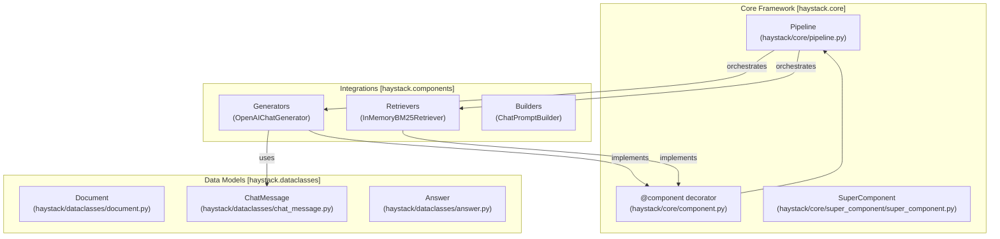

**Sources**: [haystack/__init__.py:10-20](), [docs-website/docs/overview/get-started.mdx:33-39]()

---

## v3.0 Major Release Changes

Haystack v3.0 represents a significant evolution of the framework, focusing on modularity and a streamlined core.

### 1. Integration Decoupling
Many components previously in the core `haystack-ai` package have moved to dedicated integration packages in the `haystack-core-integrations` repository. This allows for independent release cycles and a leaner core.
*   **Hugging Face**: `HuggingFaceAPIChatGenerator` moved to `huggingface-api-haystack` [docs-website/docs/overview/migration.mdx:122-125]().
*   **Transformers**: Local model support moved to `transformers-haystack` [docs-website/docs/overview/migration.mdx:128-129]().

### 2. Generator Consolidation
Legacy `Generators` (e.g., `OpenAIGenerator`) have been removed in favor of `ChatGenerators`. `OpenAIChatGenerator` and others now accept both `str` and `list[ChatMessage]` as input [docs-website/docs/overview/migration.mdx:36-60]().

### 3. Agent and Tool Invocation
The `ToolInvoker` component was removed. Tool execution logic is now natively owned by the `Agent` component, which manages the loop between the LLM and tool execution [docs-website/docs/overview/migration.mdx:67-96]().

### 4. Pipeline Convergence
`AsyncPipeline` has been merged into the standard `Pipeline` class to simplify the API [docs-website/docs/overview/migration.mdx:112-112]().

**Sources**: [docs-website/docs/overview/migration.mdx:1-130]()

---

## Core Concepts

### Components
Components are the building blocks of Haystack. Any class decorated with `@component` can be added to a pipeline. They must define a `run()` method.
*   **Warm Up**: Components can implement `warm_up()` to initialize heavy resources like models.
*   **Typing**: Inputs and outputs are strictly typed for validation.

**Sources**: [haystack/__init__.py:14-14](), [docs-website/sidebars.js:45-54]()

### Pipelines
Pipelines connect components into a directed graph. The framework handles execution order and data flow between sockets.
*   **Serialization**: Pipelines can be serialized to/from dictionaries for persistence [haystack/__init__.py:17-17]().
*   **Loops**: Support for iterative execution within the graph.

**Sources**: [haystack/__init__.py:16-16](), [docs-website/sidebars.js:57-71]()

### Data Models
Haystack uses standardized dataclasses to ensure interoperability.
*   `Document`: Holds text, metadata, and embeddings [haystack/__init__.py:31-31]().
*   `ChatMessage`: Represents messages in a conversation, including system, user, assistant, and tool roles [haystack/__init__.py:28-28]().

**Sources**: [haystack/__init__.py:27-40]()

---

## Code Entity Mapping

This diagram maps natural language concepts to their specific implementations in the Haystack codebase.

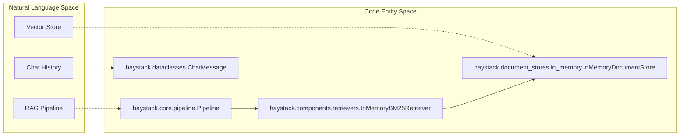

**Sources**: [haystack/__init__.py:16-19](), [docs-website/docs/overview/get-started.mdx:33-41]()

---

## Development Infrastructure

Haystack uses **Hatch** for environment and dependency management. Developers should use `hatch` commands rather than raw `pip` or `python` for project tasks.

*   **Testing**: Managed via `hatch run test:unit` and `hatch run test:integration` [AGENTS.md:35-41]().
*   **Linting**: Uses Ruff for formatting [AGENTS.md:50-51]().
*   **Release Notes**: Required for every user-facing PR using `hatch run release-note` [AGENTS.md:53-59]().

**Sources**: [AGENTS.md:1-60](), [.gitignore:46-58]()

---

# Page: Project Infrastructure

# Project Infrastructure

<details>
<summary>Relevant source files</summary>

The following files were used as context for generating this wiki page:

- [.github/dependabot.yml](.github/dependabot.yml)
- [.github/pull_request_template.md](.github/pull_request_template.md)
- [.github/workflows/codeql.yml](.github/workflows/codeql.yml)
- [.github/workflows/docker_release.yml](.github/workflows/docker_release.yml)
- [.github/workflows/docs-website-test-docs-snippets.yml](.github/workflows/docs-website-test-docs-snippets.yml)
- [.github/workflows/docstring_labeler.yml](.github/workflows/docstring_labeler.yml)
- [.github/workflows/docusaurus_sync.yml](.github/workflows/docusaurus_sync.yml)
- [.github/workflows/e2e.yml](.github/workflows/e2e.yml)
- [.github/workflows/github_release.yml](.github/workflows/github_release.yml)
- [.github/workflows/license_compliance.yml](.github/workflows/license_compliance.yml)
- [.github/workflows/nightly_testpypi_release.yml](.github/workflows/nightly_testpypi_release.yml)
- [.github/workflows/promote_unstable_docs.yml](.github/workflows/promote_unstable_docs.yml)
- [.github/workflows/push_release_notes_to_website.yml](.github/workflows/push_release_notes_to_website.yml)
- [.github/workflows/pypi_release.yml](.github/workflows/pypi_release.yml)
- [.github/workflows/release_notes.yml](.github/workflows/release_notes.yml)
- [.github/workflows/scorecard.yml](.github/workflows/scorecard.yml)
- [.github/workflows/slow.yml](.github/workflows/slow.yml)
- [.github/workflows/tests.yml](.github/workflows/tests.yml)
- [.github/workflows/workflows_linting.yml](.github/workflows/workflows_linting.yml)
- [.pre-commit-config.yaml](.pre-commit-config.yaml)
- [CONTRIBUTING.md](CONTRIBUTING.md)
- [README.md](README.md)
- [docker/Dockerfile.base](docker/Dockerfile.base)
- [docker/README.md](docker/README.md)
- [docker/docker-bake.hcl](docker/docker-bake.hcl)
- [docs-website/.gitignore](docs-website/.gitignore)
- [images/banner.png](images/banner.png)
- [pyproject.toml](pyproject.toml)
- [scripts/release_note_backticks.py](scripts/release_note_backticks.py)
- [test/conftest.py](test/conftest.py)
- [test/test_release_note_backticks.py](test/test_release_note_backticks.py)

</details>


## Purpose and Scope

This document provides an overview of the Haystack project's development infrastructure, including the build system, dependency management, testing framework, code quality tools, CI/CD pipelines, and release processes. It describes the tools and configurations that enable development, testing, and deployment of Haystack.

For detailed information on specific topics:
- Installation procedures and dependency management: see [Installation and Dependencies](#2.1)
- Testing practices and contribution workflow: see [Testing and Contribution Workflow](#2.2)
- CI/CD workflows and release automation: see [CI/CD and Release Management](#2.3)

---

## Build System and Package Management

Haystack uses **Hatch** as its primary project management tool, replacing traditional tools like setuptools and pip-tools. Hatch provides unified interfaces for environment management, building, publishing, and running development tasks.

### Project Configuration

The entire project is configured through [pyproject.toml:1-203](), which serves as the single source of truth for:

- **Build system configuration**: Uses `hatchling` as the build backend [pyproject.toml:1-3]().
- **Project metadata**: Package name (`haystack-ai`), versioning, dependencies, and supported Python versions (3.10 to 3.14) [pyproject.toml:5-43]().
- **Environment definitions**: Isolated environments for development (`default`) and testing (`test`) [pyproject.toml:65-152]().

### Version Management

Version information is maintained dynamically via Hatch, pointing to `VERSION.txt` [pyproject.toml:161-163](). This approach enables automated version bumping and ensures consistency across build artifacts.

**Build System Architecture**

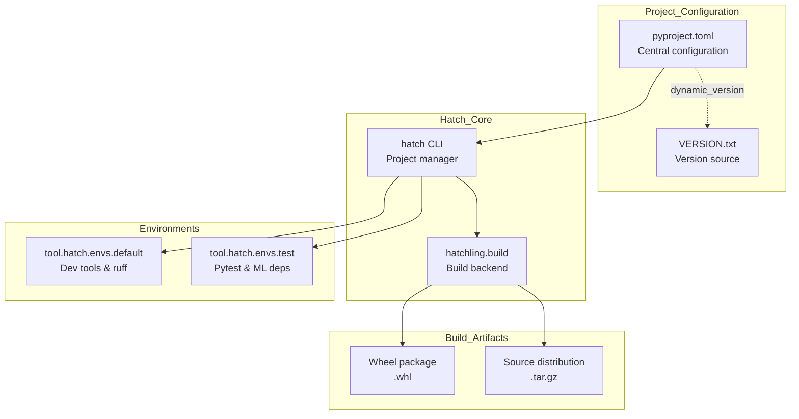

Sources: [pyproject.toml:1-173]()

---

## Environment Management

Hatch creates isolated virtual environments for different development activities. Each environment has specific dependencies and scripts tailored to its purpose.

### Environment Definitions

| Environment | Purpose | Key Dependencies | Scripts |
|-------------|---------|------------------|---------|
| `default` | General development, formatting | `pre-commit`, `ruff`, `reno`, `haystack-pydoc-tools` | `release-note`, `fmt`, `fmt-check`, `docs` |
| `test` | Unit and integration testing | `pytest`, `mypy`, `transformers`, `sentence-transformers` | `unit`, `integration`, `all`, `types`, `e2e` |

### Environment Configuration

The `default` environment uses `uv` as the installer for faster dependency resolution [pyproject.toml:65-66](). The `test` environment includes a comprehensive set of optional dependencies for testing various components, such as `pandas` for converters and `rich` for Human-in-the-loop features [pyproject.toml:92-119]().

### Hatch Scripts

Each environment defines scripts that wrap common commands for consistency across developer machines and CI [pyproject.toml:79-83](), [pyproject.toml:143-152]():

```bash
# Formatting and linting
hatch run fmt                  # ruff check --fix; ruff format
hatch run fmt-check           # ruff check && ruff format --check

# Testing
hatch run test:unit           # pytest -m "not integration"
hatch run test:integration    # pytest -m "integration"
hatch run test:types          # mypy --install-types
```

Sources: [pyproject.toml:65-152](), [CONTRIBUTING.md:21-25]()

---

## Dependency Management

Dependencies are organized to ensure minimal installations for users while providing comprehensive tooling for developers.

### Core Dependencies

The project's runtime dependencies [pyproject.toml:44-63]() include:
- **LLM Integration**: `openai>=2.6.0`
- **Validation & Logic**: `pydantic`, `jsonschema`, `Jinja2`, `MarkupSafe`
- **Graph & Utilities**: `networkx`, `numpy`, `tqdm`, `tenacity`, `lazy-imports`

### Development and Test Dependencies

The `test` environment [pyproject.toml:88-141]() pulls in heavy ML frameworks and processing libraries:
- **ML Frameworks**: `transformers`, `sentence-transformers`
- **Converters**: `pypdf`, `pdfminer.six`, `trafilatura`, `python-pptx`, `python-docx`
- **Testing Tools**: `pytest`, `pytest-cov`, `pytest-asyncio`, `mypy`

### Installation Methods

Users typically install the stable package via pip [README.md:38-44]():

```bash
pip install haystack-ai
```

Sources: [pyproject.toml:44-141](), [README.md:38-52]()

---

## Testing Framework

Haystack implements a multi-tiered testing strategy with clear definitions for test categories and automated execution in CI/CD pipelines.

### Test Categories and Markers

Tests are categorized using pytest markers to manage execution time and resource requirements [pyproject.toml:179-189]():

- **Unit Tests**: Fast, isolated tests that mock external services. Run via `hatch run test:unit` [pyproject.toml:144]().
- **Integration Tests**: Tests that interact with real external resources. Run via `hatch run test:integration` [pyproject.toml:145]().
- **Slow Integration Tests**: Tests requiring special setup or model inference on CPU, marked with `slow` [pyproject.toml:188-189]().

### Test Fixtures

Common testing utilities and mocks are centralized in `test/conftest.py`, including:
- `in_memory_doc_store`: Provides a fresh `InMemoryDocumentStore` [test/conftest.py:42-47]().
- `request_blocker`: Automatically blocks unexpected HTTP requests in non-integration tests [test/conftest.py:82-97]().
- `spying_tracer`: Enables inspection of spans for tracing tests [test/conftest.py:99-109]().

**Testing Infrastructure Architecture**

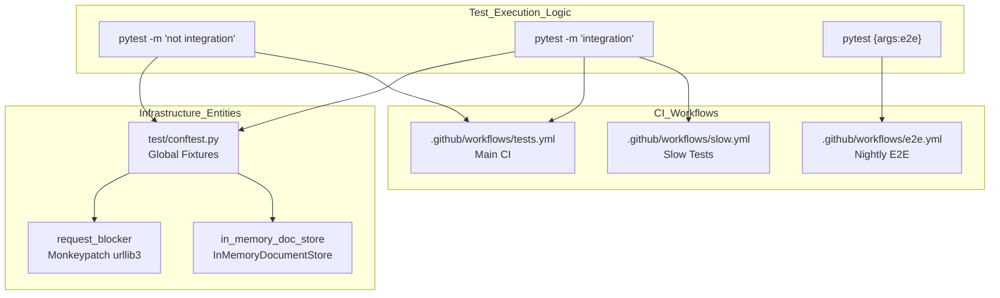

Sources: [pyproject.toml:143-152](), [test/conftest.py:1-147](), [.github/workflows/tests.yml:114-147]()

---

## Code Quality and CI/CD

The project enforces high code standards through automated linting, type checking, and license verification.

### Code Quality Tools
- **Ruff**: Handles both linting and formatting [pyproject.toml:81-82]().
- **Mypy**: Enforces static typing across the core and selected test directories [pyproject.toml:152]().
- **Hawkeye**: Checks for the presence of license headers in all files [.github/workflows/tests.yml:91-92]().

### CI/CD Pipeline
The primary CI workflow, `tests.yml`, orchestrates several stages:
1. **Check if changed**: Determines if relevant code files were modified [.github/workflows/tests.yml:39-65]().
2. **Format & Lint**: Runs `ruff` and license checks [.github/workflows/tests.yml:66-93]().
3. **Unit Tests**: Runs across Ubuntu, Windows, and macOS [.github/workflows/tests.yml:114-148]().
4. **Mypy**: Performs type checking on changed files [.github/workflows/tests.yml:175-212]().

### Release Automation
- **PyPI Release**: Triggered by version tags (e.g., `v3.x.x`), builds and publishes the package [.github/workflows/pypi_release.yml:1-39]().
- **Docker Release**: Builds and pushes base images to DockerHub on main branch updates or tags [.github/workflows/docker_release.yml:1-69]().
- **Release Notes**: Enforced via `reno`. PRs must include a release note unless maintenance-only [CONTRIBUTING.md:25]().

Sources: [.github/workflows/tests.yml:1-212](), [.github/workflows/pypi_release.yml:1-39](), [.github/workflows/docker_release.yml:1-89](), [CONTRIBUTING.md:20-28]()

---

# Page: Installation and Dependencies

# Installation and Dependencies

<details>
<summary>Relevant source files</summary>

The following files were used as context for generating this wiki page:

- [.github/pull_request_template.md](.github/pull_request_template.md)
- [.github/workflows/docs-website-test-docs-snippets.yml](.github/workflows/docs-website-test-docs-snippets.yml)
- [.github/workflows/docstring_labeler.yml](.github/workflows/docstring_labeler.yml)
- [.github/workflows/docusaurus_sync.yml](.github/workflows/docusaurus_sync.yml)
- [.github/workflows/e2e.yml](.github/workflows/e2e.yml)
- [.github/workflows/license_compliance.yml](.github/workflows/license_compliance.yml)
- [.github/workflows/nightly_testpypi_release.yml](.github/workflows/nightly_testpypi_release.yml)
- [.github/workflows/promote_unstable_docs.yml](.github/workflows/promote_unstable_docs.yml)
- [.github/workflows/push_release_notes_to_website.yml](.github/workflows/push_release_notes_to_website.yml)
- [.github/workflows/pypi_release.yml](.github/workflows/pypi_release.yml)
- [.github/workflows/release_notes.yml](.github/workflows/release_notes.yml)
- [.github/workflows/slow.yml](.github/workflows/slow.yml)
- [.github/workflows/tests.yml](.github/workflows/tests.yml)
- [.pre-commit-config.yaml](.pre-commit-config.yaml)
- [CONTRIBUTING.md](CONTRIBUTING.md)
- [README.md](README.md)
- [VERSION.txt](VERSION.txt)
- [docs-website/.gitignore](docs-website/.gitignore)
- [images/banner.png](images/banner.png)
- [pyproject.toml](pyproject.toml)
- [scripts/release_note_backticks.py](scripts/release_note_backticks.py)
- [test/conftest.py](test/conftest.py)
- [test/test_release_note_backticks.py](test/test_release_note_backticks.py)

</details>


This document covers the installation methods for Haystack, dependency management using Hatch, and the various development environments available. For information about the testing infrastructure and contribution workflow, see [Testing and Contribution Workflow](#2.2). For CI/CD pipeline details, see [CI/CD and Release Management](#2.3).

## Purpose and Scope

This page explains how to install Haystack for both end-users and contributors, describes the project's dependency management strategy using Hatch, and documents the different environments configured for development, testing, and documentation generation. It focuses on the technical implementation of the build system and environment orchestration.

---

## Installation Methods

### End-User Installation

Haystack is distributed via PyPI under the package name `haystack-ai`. The simplest installation method is:

```sh
pip install haystack-ai
```

To install the latest development version from the `main` branch:

```sh
pip install git+https://github.com/deepset-ai/haystack.git@main
```

The package supports Python versions 3.10 through 3.14, as specified in [pyproject.toml:11]() and [pyproject.toml:37-41](). Note that Python 3.9 support is no longer included in the supported classifiers.

**Sources:** [README.md:38-44](), [pyproject.toml:5-11](), [pyproject.toml:37-41]()

---

### Development Installation

Contributors must clone the repository and use Hatch for environment management:

```sh
git clone https://github.com/deepset-ai/haystack
cd haystack
hatch shell
```

The `hatch shell` command creates and activates a virtual environment with all necessary dependencies. Pre-commit hooks should be installed immediately after cloning:

```sh
pre-commit install
```

This installs Git hooks defined in [.pre-commit-config.yaml:1-49]() that automatically run code quality checks before each commit, including `ruff` formatting, linting, and `codespell` checks.

**Sources:** [CONTRIBUTING.md:21-22](), [README.md:38-52](), [.pre-commit-config.yaml:1-49]()

---

## Python Version Requirements

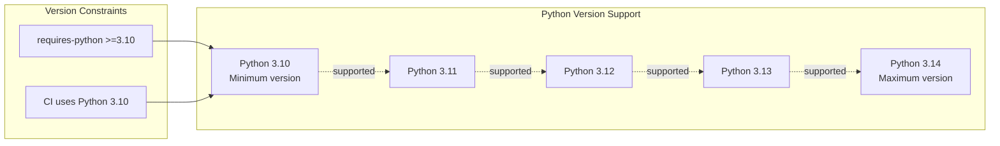

**Python Version Compatibility**

The project requires Python 3.10 or later, as declared in [pyproject.toml:11](). The CI/CD infrastructure standardizes on Python 3.10 to ensure compatibility with the minimum supported version.

**Sources:** [pyproject.toml:11](), [pyproject.toml:37-41](), [.github/workflows/tests.yml:32]()

---

## Dependency Management with Hatch

Haystack uses [Hatch](https://hatch.pypa.io/) as its project manager for environment management, dependency isolation, and build operations. Hatch version 1.16.5 is standardized across all CI workflows.

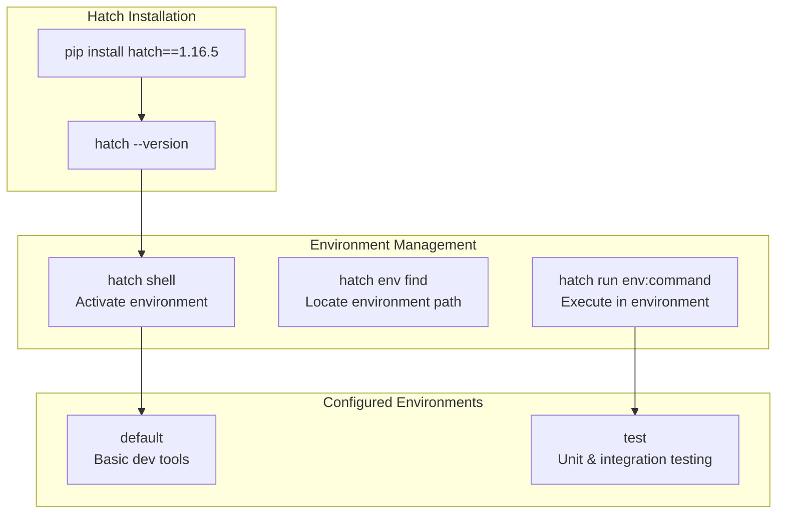

**Hatch Environment Architecture**

The [pyproject.toml]() file defines several distinct Hatch environments:

| Environment | Purpose | Installer | Key Dependencies |
|-------------|---------|-----------|------------------|
| `default` | Code formatting, linting, release notes | `uv` | pre-commit, ruff, reno, haystack-pydoc-tools |
| `test` | Unit and integration testing | Default (pip) | pytest, transformers, sentence-transformers, converters |

The `default` environment uses `uv` as the installer for faster dependency resolution, as configured in [pyproject.toml:66]().

**Sources:** [pyproject.toml:65-141](), [.github/workflows/tests.yml:33]()

---

### Environment Scripts

Each Hatch environment defines scripts for common development tasks:

**Default Environment Scripts** ([pyproject.toml:79-83]()):
- `release-note`: Create a new release note using `reno` [pyproject.toml:80]()
- `fmt`: Format and fix code using `ruff` [pyproject.toml:81]()
- `fmt-check`: Check code formatting without modifications [pyproject.toml:82]()
- `docs`: Generate API reference using `haystack-pydoc` [pyproject.toml:83]()

**Test Environment Scripts** ([pyproject.toml:143-152]()):
- `unit`: Run unit tests with coverage reporting [pyproject.toml:144]()
- `integration`: Run all integration tests [pyproject.toml:145]()
- `integration-only-fast`: Run fast integration tests (excludes `@pytest.mark.slow`) [pyproject.toml:146]()
- `integration-only-slow`: Run only slow integration tests [pyproject.toml:147]()
- `all`: Run all tests [pyproject.toml:148]()
- `e2e`: Run end-to-end tests [pyproject.toml:149]()
- `types`: Run `mypy` type checking on specific modules [pyproject.toml:152]()

**Usage examples:**
```sh
# Format code
hatch run fmt

# Run unit tests
hatch run test:unit

# Run mypy type checking
hatch run test:types
```

**Sources:** [pyproject.toml:79-152](), [CONTRIBUTING.md:22]()

---

## Core Dependencies

```mermaid
graph TB
    subgraph "Haystack Core Package"
        CoreLib["haystack-ai package"]
    end
    
    subgraph "Essential Runtime Dependencies"
        OpenAI["openai >=2.6.0<br/>LLM integration"]
        Jinja2["Jinja2<br/>Template rendering"]
        Pydantic["pydantic<br/>Data validation"]
        NetworkX["networkx<br/>Pipeline graphs"]
        Tenacity["tenacity !=8.4.0<br/>Retry logic"]
        TqdmLib["tqdm<br/>Progress bars"]
        LazyImports["lazy-imports<br/>Deferred loading"]
    end
    
    subgraph "Data Processing"
        MoreItertools["more-itertools<br/>DocumentSplitter"]
        NumpyLib["numpy<br/>Numerical operations"]
        Httpx["httpx<br/>HTTP client"]
    end
    
    subgraph "Validation & Tooling"
        JSONSchema["jsonschema<br/>JsonSchemaValidator, Tool"]
        DocstringParser["docstring-parser<br/>ComponentTool"]
        Filetype["filetype<br/>MIME type detection"]
    end
    
    subgraph "Supporting Libraries"
        PyYAML["pyyaml<br/>Configuration"]
        TypingExt["typing_extensions >=4.7<br/>Python 3.10+ typing support"]
        Dateutil["python-dateutil<br/>Date parsing"]
        Posthog["posthog !=3.12.0<br/>Telemetry"]
    end
    
    CoreLib --> OpenAI
    CoreLib --> Jinja2
    CoreLib --> Pydantic
    CoreLib --> NetworkX
    CoreLib --> Tenacity
    CoreLib --> TqdmLib
    CoreLib --> LazyImports
    CoreLib --> MoreItertools
    CoreLib --> NumpyLib
    CoreLib --> Httpx
    CoreLib --> JSONSchema
    CoreLib --> DocstringParser
    CoreLib --> Filetype
    CoreLib --> PyYAML
    CoreLib --> TypingExt
    CoreLib --> Dateutil
    CoreLib --> Posthog
```

**Runtime Dependency Breakdown**

The core dependencies declared in [pyproject.toml:44-63]() are focused on essential functionality:

**LLM & AI Integration:**
- `openai>=2.6.0`: Official OpenAI SDK for generators and embeddings [pyproject.toml:48]().
- `pydantic`: Data validation for component inputs/outputs [pyproject.toml:49]().

**Pipeline Infrastructure:**
- `networkx`: Powers the pipeline graph structure and execution planning [pyproject.toml:55]().
- `tenacity!=8.4.0`: Implements retry logic for external service calls [pyproject.toml:46]().
- `lazy-imports`: Enables deferred imports to reduce startup time [pyproject.toml:47]().

**Data Processing:**
- `Jinja2`: Template rendering engine for `PromptBuilder` [pyproject.toml:50]().
- `more-itertools`: Utilities for `DocumentSplitter` [pyproject.toml:54]().
- `numpy`: Numerical array operations for embeddings [pyproject.toml:58]().
- `httpx`: Modern HTTP client for API calls [pyproject.toml:57]().

**Validation & Tooling:**
- `jsonschema`: Validation for `JsonSchemaValidator` and `Tool` [pyproject.toml:60]().
- `docstring-parser`: Extracts metadata for `ComponentTool` [pyproject.toml:61]().
- `filetype`: MIME type detection for `ImageContent` [pyproject.toml:62]().

**Supporting Infrastructure:**
- `posthog!=3.12.0`: Telemetry collection [pyproject.toml:52]().
- `MarkupSafe`: Used in `templatize_part` [pyproject.toml:51]().

**Sources:** [pyproject.toml:44-63]()

---

## Development Dependencies

### Test Environment

The `test` environment provides dependencies for unit and integration testing:

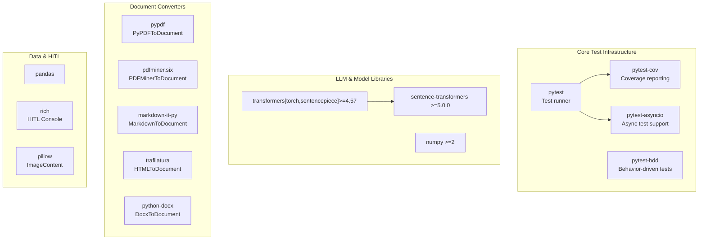

**Test Environment Dependencies** ([pyproject.toml:88-141]()):

- **AI & ML:** `transformers>=4.57`, `sentence-transformers>=5.0.0`, and `numpy>=2` [pyproject.toml:89-96]().
- **Converters:** Includes `pypdf`, `pdfminer.six`, `markdown-it-py`, `trafilatura` (HTML), `python-pptx`, `python-docx`, `jq` (JSON), and `openpyxl` (XLSX) [pyproject.toml:103-113]().
- **Data Processing:** `pandas` for AzureOCR, CSV, and XLSX converters [pyproject.toml:92-93](). `nltk` and `tiktoken` for document splitting [pyproject.toml:115-116]().
- **HITL & UI:** `rich` for console rendering for Human-in-the-Loop [pyproject.toml:119]().
- **Media:** `pillow` for `ImageContent` and `pypdfium2` for `PDFToImageContent` [pyproject.toml:98-99]().

**Sources:** [pyproject.toml:88-141]()

---

## CI/CD Environment Configuration

All GitHub Actions workflows use consistent environment variables:

| Variable | Value | Purpose |
|----------|-------|---------|
| `PYTHON_VERSION` | `"3.10"` | Standard Python version for CI testing [.github/workflows/tests.yml:32]() |
| `HATCH_VERSION` | `"1.16.5"` | Pinned Hatch version for environment management [.github/workflows/tests.yml:33]() |

**Workflow Execution Logic:**
Workflows like `tests.yml` use a `check-if-changed` job to skip tests if only documentation or non-code files are modified [.github/workflows/tests.yml:39-65](). 

**Integration Test Categories:**
- `test:integration-only-fast`: Excludes slow integration tests [.github/workflows/tests.yml:210]().
- `test:integration-only-slow`: Specifically targets components requiring heavy model downloads or long execution times, such as `SASEvaluator` or `OpenAIDALLE` [.github/workflows/slow.yml:58-66]().

**Sources:** [.github/workflows/tests.yml:32-65](), [.github/workflows/slow.yml:12-115]()

---

## Package Build and Distribution

Haystack uses `hatchling` as its build backend [pyproject.toml:1-3]().

**Build Configuration:**
- **Source distribution:** Includes `/haystack` and `VERSION.txt` [pyproject.toml:168-169]().
- **Version source:** Read from `VERSION.txt` using a pattern [pyproject.toml:161-163](). The current version is `3.1.0-rc0` [VERSION.txt:1]().

**Publishing:**
The release process is automated via [.github/workflows/pypi_release.yml](). It triggers on version tags (e.g., `v3.1.0`) and uses `hatch build` to generate artifacts before publishing to PyPI [.github/workflows/pypi_release.yml:34-38](). Version tags ending in `-rc0` are explicitly excluded from production releases [.github/workflows/pypi_release.yml:8]().

**Sources:** [pyproject.toml:1-3](), [pyproject.toml:161-173](), [VERSION.txt:1](), [.github/workflows/pypi_release.yml:1-38]()

---

# Page: Testing and Contribution Workflow

# Testing and Contribution Workflow

<details>
<summary>Relevant source files</summary>

The following files were used as context for generating this wiki page:

- [.clusterfuzzlite/Dockerfile](.clusterfuzzlite/Dockerfile)
- [.clusterfuzzlite/build.sh](.clusterfuzzlite/build.sh)
- [.clusterfuzzlite/project.yaml](.clusterfuzzlite/project.yaml)
- [.github/labeler.yml](.github/labeler.yml)
- [.github/pull_request_template.md](.github/pull_request_template.md)
- [.github/workflows/cflite_pr.yml](.github/workflows/cflite_pr.yml)
- [.github/workflows/docs-website-test-docs-snippets.yml](.github/workflows/docs-website-test-docs-snippets.yml)
- [.github/workflows/docstring_labeler.yml](.github/workflows/docstring_labeler.yml)
- [.github/workflows/docusaurus_sync.yml](.github/workflows/docusaurus_sync.yml)
- [.github/workflows/e2e.yml](.github/workflows/e2e.yml)
- [.github/workflows/labeler.yml](.github/workflows/labeler.yml)
- [.github/workflows/license_compliance.yml](.github/workflows/license_compliance.yml)
- [.github/workflows/nightly_testpypi_release.yml](.github/workflows/nightly_testpypi_release.yml)
- [.github/workflows/project.yml](.github/workflows/project.yml)
- [.github/workflows/promote_unstable_docs.yml](.github/workflows/promote_unstable_docs.yml)
- [.github/workflows/push_release_notes_to_website.yml](.github/workflows/push_release_notes_to_website.yml)
- [.github/workflows/pypi_release.yml](.github/workflows/pypi_release.yml)
- [.github/workflows/release_notes.yml](.github/workflows/release_notes.yml)
- [.github/workflows/slow.yml](.github/workflows/slow.yml)
- [.github/workflows/stale.yml](.github/workflows/stale.yml)
- [.github/workflows/tests.yml](.github/workflows/tests.yml)
- [.pre-commit-config.yaml](.pre-commit-config.yaml)
- [CONTRIBUTING.md](CONTRIBUTING.md)
- [README.md](README.md)
- [docs-website/.gitignore](docs-website/.gitignore)
- [docs-website/scripts/setup-dev.sh](docs-website/scripts/setup-dev.sh)
- [docs-website/scripts/test_python_snippets.py](docs-website/scripts/test_python_snippets.py)
- [docs-website/src/components/ClickableImage/index.tsx](docs-website/src/components/ClickableImage/index.tsx)
- [docs-website/src/components/ClickableImage/styles.module.css](docs-website/src/components/ClickableImage/styles.module.css)
- [docs-website/src/components/ProductOnly/index.tsx](docs-website/src/components/ProductOnly/index.tsx)
- [docs-website/src/pages/index.js](docs-website/src/pages/index.js)
- [images/banner.png](images/banner.png)
- [licenserc.toml](licenserc.toml)
- [pyproject.toml](pyproject.toml)
- [scripts/release_note_backticks.py](scripts/release_note_backticks.py)
- [test/conftest.py](test/conftest.py)
- [test/fuzz/README.md](test/fuzz/README.md)
- [test/fuzz/corpus/fuzz_document_from_dict/flattened_meta.json](test/fuzz/corpus/fuzz_document_from_dict/flattened_meta.json)
- [test/fuzz/corpus/fuzz_document_from_dict/minimal.json](test/fuzz/corpus/fuzz_document_from_dict/minimal.json)
- [test/fuzz/corpus/fuzz_document_from_dict/with_meta.json](test/fuzz/corpus/fuzz_document_from_dict/with_meta.json)
- [test/fuzz/corpus/fuzz_document_from_dict/with_score_embedding.json](test/fuzz/corpus/fuzz_document_from_dict/with_score_embedding.json)
- [test/test_release_note_backticks.py](test/test_release_note_backticks.py)

</details>


This document describes the testing infrastructure, contribution workflow, and code quality standards for the Haystack repository. It covers how to set up a development environment, run tests locally, write different types of tests, and submit contributions that meet project quality standards.

For information about CI/CD pipelines and release automation, see [CI/CD and Release Management](2.3). For general installation and dependency management, see [Installation and Dependencies](2.1).

---

## Purpose and Scope

This page explains:
- How to configure a local development environment using Hatch.
- The testing infrastructure built on `pytest` with custom fixtures and markers.
- How to run different test categories (unit, integration, e2e, slow).
- Code quality tools (Ruff, Mypy) and their configurations.
- The workflow for contributing code, including pre-commit hooks and release notes.
- Fuzz testing setup for robustness against malformed data.

---

## Development Environment Setup

### Installing Hatch

Haystack uses [Hatch](https://hatch.pypa.io/) as its primary project manager for virtual environments, building, and test execution [[pyproject.toml:1-3](). The Hatch version used in CI is `1.16.5` [[.github/workflows/tests.yml:33-33](), [.github/workflows/e2e.yml:19-19]()].

Verify installation:
```bash
hatch --version
```

**Sources:** [pyproject.toml:1-3](), [.github/workflows/tests.yml:33-33](), [.github/workflows/e2e.yml:19-19]()

### Cloning and Environment Setup

Fork the repository on GitHub, then clone your fork:

```bash
git clone https://github.com/YOUR-USERNAME/haystack
cd haystack
```

Install pre-commit hooks and create a branch:
```bash
pre-commit install
git checkout -b your-feature-branch
```

**Sources:** [CONTRIBUTING.md:21-21](), [CONTRIBUTING.md:49-50]()

### Pre-commit Hooks

Pre-commit hooks enforce code quality before commits. The configuration in [.pre-commit-config.yaml]() includes:
- **Standard hooks**: AST validation, JSON/YAML/TOML syntax checking, and trailing whitespace removal [[.pre-commit-config.yaml:4-17]()].
- **Ruff**: Runs `ruff-check` with `--fix` and `ruff-format` [[.pre-commit-config.yaml:19-24]()].
- **Codespell**: Checks for common misspellings using configurations in `pyproject.toml` [[.pre-commit-config.yaml:36-43](), [pyproject.toml:174-178]()].
- **Actionlint**: Validates GitHub Actions workflow syntax [[.pre-commit-config.yaml:44-49]()].

**Sources:** [.pre-commit-config.yaml:1-52](), [pyproject.toml:174-178](), [CONTRIBUTING.md:21-21]()

---

## Test Infrastructure

### Hatch Test Environments

Haystack defines several Hatch environments in [pyproject.toml]() to manage dependencies and test execution:

| Environment | Purpose | Key Dependencies |
|-------------|---------|------------------|
| `default` | Linting and release notes | `pre-commit`, `ruff`, `reno`, `haystack-pydoc-tools` [[pyproject.toml:65-77]()] |
| `test` | Main testing suite | `pytest`, `transformers`, `pandas`, `openai`, `mypy`, `numpy>=2` [[pyproject.toml:85-141]()] |

**Sources:** [pyproject.toml:65-141]()

### Hatch Scripts for Testing

Test execution is standardized through Hatch scripts [[pyproject.toml:143-152]()]:

```toml
[tool.hatch.envs.test.scripts]
unit = 'pytest --cov="haystack" -m "not integration" {args:test}'
integration = 'pytest --maxfail=5 -m "integration" {args:test}'
integration-only-fast = 'pytest --maxfail=5 -m "integration and not slow" {args:test}'
integration-only-slow = 'pytest --maxfail=5 -m "integration and slow" {args:test}'
all = 'pytest {args:test}'
e2e = 'pytest {args:e2e}'
types = "mypy --install-types --non-interactive --cache-dir=.mypy_cache/ {args:haystack test/core/ ...}"
```

**Sources:** [pyproject.toml:143-152]()

### Pytest Configuration and Fixtures

#### conftest.py Fixtures

The [test/conftest.py]() file provides shared fixtures used across the suite:

| Fixture | Description |
|---------|-------------|
| `in_memory_doc_store` | Provides a fresh `InMemoryDocumentStore` and shuts it down after use [[test/conftest.py:42-47]()]. |
| `waiting_component` | Returns a `Waiter` component class with `run` and `run_async` methods for testing concurrency [[test/conftest.py:49-63]()]. |
| `mock_tokenizer` | A mock object that tokenizes by splitting on spaces [[test/conftest.py:66-74]()]. |
| `request_blocker` | **Autouse fixture** that blocks HTTP requests in non-integration tests using monkeypatching [[test/conftest.py:82-97]()]. |
| `spying_tracer` | Enables and provides a `SpyingTracer` for verifying observability data [[test/conftest.py:99-109]()]. |
| `del_hf_env_vars` | Deletes Hugging Face tokens to prevent API failures in fork-based PRs [[test/conftest.py:134-147]()]. |

**Sources:** [test/conftest.py:42-147]()

#### Natural Language to Code Entity Space: Testing Fixtures

The following diagram maps common testing requirements to specific code entities defined in the testing infrastructure.

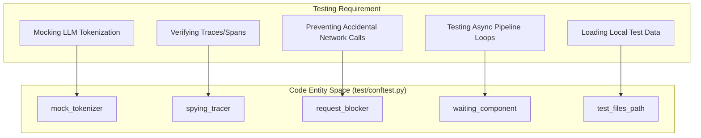

**Sources:** [test/conftest.py:49-63](), [test/conftest.py:66-74](), [test/conftest.py:77-80](), [test/conftest.py:82-97](), [test/conftest.py:99-109]()

---

## Running Tests Locally

### Unit and Integration Tests

- **Unit Tests**: Run with `hatch run test:unit`. These exclude any tests marked as `integration` [[pyproject.toml:144-144]()].
- **Integration Tests**: Run with `hatch run test:integration`. These include tests that interact with external services or complex local models [[pyproject.toml:145-145]()].
- **Type Checking**: Run with `hatch run test:types`. This executes `mypy` on the core library and selected test directories [[pyproject.toml:152-152]()].

**Sources:** [pyproject.toml:144-152](), [CONTRIBUTING.md:22-23]()

### Slow Integration Tests

Tests marked with `@pytest.mark.slow` are handled by a dedicated workflow. These typically involve heavy model inference or unstable external services [[pyproject.toml:186-189]()].

Run slow tests locally:
```bash
hatch run test:integration-only-slow
```

**Sources:** [pyproject.toml:147-147](), [.github/workflows/slow.yml:67-102]()

---

## Fuzz Testing

Haystack uses **ClusterFuzzLite** and **Atheris** for fuzz testing to identify edge-case crashes and security vulnerabilities [[.clusterfuzzlite/Dockerfile:5-9]()].

- **Docker Setup**: The build environment is based on `gcr.io/oss-fuzz-base/base-builder-python` [[.clusterfuzzlite/Dockerfile:9-9]()].
- **Corpus**: Initial seeds for fuzzing are stored in `test/fuzz/corpus/`, including JSON structures for `Document` serialization [[test/fuzz/corpus/fuzz_document_from_dict/minimal.json:1-1]()].
- **Build Script**: The `.clusterfuzzlite/build.sh` script (referenced in [[.clusterfuzzlite/Dockerfile:13-13]()]) compiles the targets.

**Sources:** [.clusterfuzzlite/Dockerfile:1-14](), [test/fuzz/README.md]()

---

## Code Quality Standards

### Ruff (Formatting and Linting)

Haystack uses Ruff for both linting and formatting. The configuration is managed in `pyproject.toml` [[pyproject.toml:291-376]()].
- **Line Length**: 120 characters [[pyproject.toml:292-292]()].
- **Lint Rules**: Includes `ASYNC`, `PERF`, `PYI`, `RUF`, and `PL` (Pylint) categories [[pyproject.toml:296-330]()].

**Commands**:
- `hatch run fmt`: Fixes lint errors and formats code [[pyproject.toml:81-81]()].
- `hatch run fmt-check`: Verifies compliance without modifying files [[pyproject.toml:82-82]()].

**Sources:** [pyproject.toml:81-82](), [pyproject.toml:291-376]()

### Mypy (Type Checking)

Mypy configuration enforces typing standards across the core library [[pyproject.toml:194-201]()].
- `check_untyped_defs = true` [[pyproject.toml:196-196]()]
- `disallow_incomplete_defs = true` [[pyproject.toml:197-197]()]

**Sources:** [pyproject.toml:194-201]()

---

## Contribution Workflow

### Pull Request Requirements

1. **Pick an Issue**: Look for `good first issue` or `contributions wanted` labels [[CONTRIBUTING.md:20-20]()].
2. **Release Notes**: Every PR (except documentation or CI-only changes) requires a release note created via `reno` [[CONTRIBUTING.md:25-25]()].
   - Command: `hatch run release-note your-change-name` [[pyproject.toml:80-80]()].
3. **Conventional Commits**: Use titles like `feat:`, `fix:`, or `docs:` [[CONTRIBUTING.md:26-26]()].
4. **CLA**: Sign the Contributor License Agreement when prompted [[CONTRIBUTING.md:27-27]()].

**Sources:** [CONTRIBUTING.md:20-27](), [pyproject.toml:80-80]()

### Release Note Validation

The `Check Release Notes` workflow ensures that YAML files in `releasenotes/notes/` follow formatting rules [[.github/workflows/release_notes.yml:1-22]()].
- **Check for missing notes**: Fails if code changes exist without a corresponding YAML in `releasenotes/notes/`, unless the `ignore-for-release-notes` label is present [[.github/workflows/release_notes.yml:45-53]()].
- **Formatting**: Reno requires reStructuredText. The CI checks for Markdown-style triple backticks or single backticks and fails if found [[.github/workflows/release_notes.yml:72-89]()].

**Sources:** [.github/workflows/release_notes.yml:45-89]()

---

## CI/CD Pipeline Architecture

The following diagram illustrates the flow from a code contribution (Pull Request) through the automated quality gates.

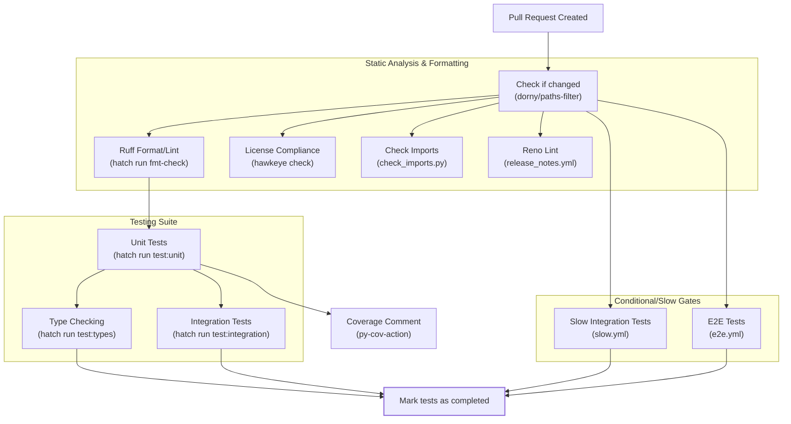

**Sources:** [.github/workflows/tests.yml:39-175](), [.github/workflows/slow.yml:39-110](), [.github/workflows/e2e.yml:25-44](), [.github/workflows/release_notes.yml:22-63]()

---

# Page: CI/CD and Release Management

# CI/CD and Release Management

<details>
<summary>Relevant source files</summary>

The following files were used as context for generating this wiki page:

- [.github/dependabot.yml](.github/dependabot.yml)
- [.github/utils/create_unstable_docs_docusaurus.py](.github/utils/create_unstable_docs_docusaurus.py)
- [.github/utils/parse_validate_version.sh](.github/utils/parse_validate_version.sh)
- [.github/utils/prepare_release_notification.sh](.github/utils/prepare_release_notification.sh)
- [.github/utils/promote_unstable_docs_docusaurus.py](.github/utils/promote_unstable_docs_docusaurus.py)
- [.github/utils/wait_for_platform_pr.sh](.github/utils/wait_for_platform_pr.sh)
- [.github/utils/wait_for_workflows.sh](.github/utils/wait_for_workflows.sh)
- [.github/workflows/branch_off.yml](.github/workflows/branch_off.yml)
- [.github/workflows/check_api_ref.yml](.github/workflows/check_api_ref.yml)
- [.github/workflows/codeql.yml](.github/workflows/codeql.yml)
- [.github/workflows/docker_release.yml](.github/workflows/docker_release.yml)
- [.github/workflows/docs_search_sync.yml](.github/workflows/docs_search_sync.yml)
- [.github/workflows/github_release.yml](.github/workflows/github_release.yml)
- [.github/workflows/release.yml](.github/workflows/release.yml)
- [.github/workflows/scorecard.yml](.github/workflows/scorecard.yml)
- [.github/workflows/workflows_linting.yml](.github/workflows/workflows_linting.yml)
- [docker/Dockerfile.base](docker/Dockerfile.base)
- [docker/README.md](docker/README.md)
- [docker/docker-bake.hcl](docker/docker-bake.hcl)
- [docs-website/CONTRIBUTING.md](docs-website/CONTRIBUTING.md)
- [docs-website/README.md](docs-website/README.md)
- [docs-website/api/mcp.ts](docs-website/api/mcp.ts)
- [docs-website/api/well-known.ts](docs-website/api/well-known.ts)
- [docs-website/docs/overview/docs-mcp-server.mdx](docs-website/docs/overview/docs-mcp-server.mdx)
- [docs-website/docs/overview/faq.mdx](docs-website/docs/overview/faq.mdx)
- [docs-website/docs/pipeline-components/agents-1/agent-pack.mdx](docs-website/docs/pipeline-components/agents-1/agent-pack.mdx)
- [docs-website/docs/pipeline-components/agents-1/agent-pack/advanced-rag-agent.mdx](docs-website/docs/pipeline-components/agents-1/agent-pack/advanced-rag-agent.mdx)
- [docs-website/docs/pipeline-components/agents-1/agent-pack/deep-research-agent.mdx](docs-website/docs/pipeline-components/agents-1/agent-pack/deep-research-agent.mdx)
- [docs-website/docusaurus.config.js](docs-website/docusaurus.config.js)
- [docs-website/package.json](docs-website/package.json)
- [docs-website/reference/index.mdx](docs-website/reference/index.mdx)
- [docs-website/reference_versioned_docs/version-2.18/index.mdx](docs-website/reference_versioned_docs/version-2.18/index.mdx)
- [docs-website/reference_versioned_docs/version-2.19/index.mdx](docs-website/reference_versioned_docs/version-2.19/index.mdx)
- [docs-website/scripts/extract_sidebar.mjs](docs-website/scripts/extract_sidebar.mjs)
- [docs-website/src/components/YoutubeEmbed/index.tsx](docs-website/src/components/YoutubeEmbed/index.tsx)
- [docs-website/src/components/YoutubeEmbed/styles.module.css](docs-website/src/components/YoutubeEmbed/styles.module.css)
- [docs-website/src/remark/versionedReferenceLinks.js](docs-website/src/remark/versionedReferenceLinks.js)
- [docs-website/vercel.json](docs-website/vercel.json)
- [docs-website/versioned_docs/version-2.18/concepts/pipelines.mdx](docs-website/versioned_docs/version-2.18/concepts/pipelines.mdx)
- [docs-website/versioned_docs/version-2.19/concepts/pipelines.mdx](docs-website/versioned_docs/version-2.19/concepts/pipelines.mdx)
- [docs-website/versioned_docs/version-2.20/concepts/pipelines.mdx](docs-website/versioned_docs/version-2.20/concepts/pipelines.mdx)
- [docs-website/versioned_docs/version-2.20/overview/faq.mdx](docs-website/versioned_docs/version-2.20/overview/faq.mdx)
- [docs-website/versioned_docs/version-2.21/concepts/pipelines.mdx](docs-website/versioned_docs/version-2.21/concepts/pipelines.mdx)
- [docs-website/versioned_docs/version-2.22/concepts/pipelines.mdx](docs-website/versioned_docs/version-2.22/concepts/pipelines.mdx)
- [docs-website/versioned_docs/version-2.25/overview/faq.mdx](docs-website/versioned_docs/version-2.25/overview/faq.mdx)
- [docs-website/versioned_docs/version-2.26/overview/faq.mdx](docs-website/versioned_docs/version-2.26/overview/faq.mdx)
- [docs-website/versioned_docs/version-2.29/overview/docs-mcp-server.mdx](docs-website/versioned_docs/version-2.29/overview/docs-mcp-server.mdx)

</details>


This page documents the Continuous Integration (CI), Continuous Deployment (CD), and release management infrastructure for Haystack. It details the GitHub Actions workflows, security scanning, Docker image builds, and the automated release process for both the package and the documentation website.

## CI/CD Pipeline Architecture

Haystack uses GitHub Actions to automate code quality checks, testing, and deployment. The pipeline is designed to ensure stability across different operating systems and Python versions.

### Workflow Orchestration and Triggers

The primary entry point for code verification is the `tests.yml` workflow. It utilizes a multi-stage approach to optimize resource usage. Security scanning is handled by CodeQL and OpenSSF Scorecard.

**Security and CI Infrastructure**

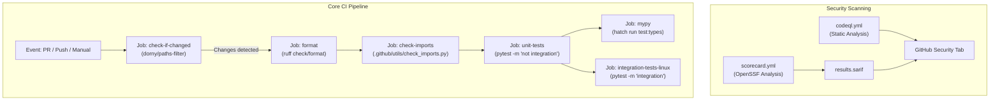

Sources: [.github/workflows/codeql.yml:1-63](), [.github/workflows/scorecard.yml:1-67](), [.github/workflows/tests.yml:11-210]()

### Key Workflow Components

| Workflow File | Purpose | Key Tools/Commands |
|:---|:---|:---|
| `codeql.yml` | Semantic code analysis for Python | `github/codeql-action/analyze` |
| `scorecard.yml` | Supply-chain security posture | `ossf/scorecard-action` |
| `workflows_linting.yml` | Validates GitHub Actions syntax | `actionlint` |
| `docs_search_sync.yml` | Syncs website content to Deepset Cloud | `deepset-cloud-sdk` |

Sources: [.github/workflows/codeql.yml:45](), [.github/workflows/scorecard.yml:48](), [.github/workflows/workflows_linting.yml:25](), [.github/workflows/docs_search_sync.yml:54]()

## Release Management

Haystack follows semantic versioning and uses a structured release process involving release candidates, automated publication, and platform synchronization.

### The Release Lifecycle

The release process is triggered via `workflow_dispatch` in `release.yml`. It handles the transition from development to stable release across multiple repositories.

**Release Orchestration Flow**

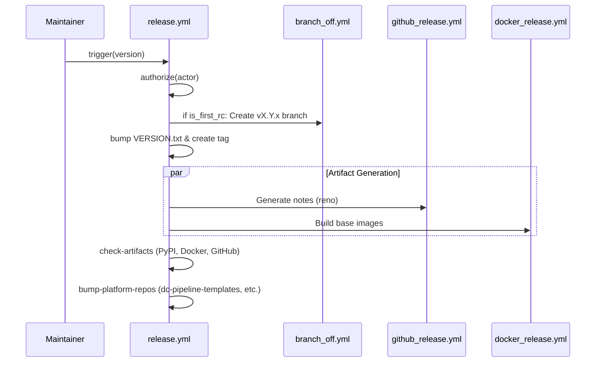

Sources: [.github/workflows/release.yml:4-160](), [.github/workflows/branch_off.yml:41-60](), [.github/workflows/github_release.yml:1-107]()

### Versioning Logic
- **`VERSION.txt`**: The single source of truth for the project version. [.github/workflows/release.yml:95]()
- **Branching**: For a new minor version, a release branch `vX.Y.x` is created from `main`. [.github/workflows/branch_off.yml:52]()
- **RC Tags**: Release candidates (e.g., `v3.0.0-rc1`) are used for testing before stable publication. [.github/workflows/release.yml:7]()

## Docker Image Management

The repository provides a `Dockerfile.base` used to create the official `deepset/haystack` images.

### Image Build Process

The Docker build uses a multi-stage approach to minimize image size and ensure security:
1.  **Build Stage**: Clones the repository at the specific tag, creates a virtual environment, and installs Haystack using `uv` for performance. [docker/Dockerfile.base:7-29]()
2.  **Final Stage**: Copies only the virtual environment into the final image based on `python:3.12-slim`. [docker/Dockerfile.base:31-36]()

The `docker_release.yml` workflow utilizes `docker/bake-action` to build for multiple platforms (`linux/amd64`, `linux/arm64`). It performs a validation step by executing a Python command inside the built image to verify the `__version__` string matches `VERSION.txt`. [.github/workflows/docker_release.yml:61-88]()

Sources: [docker/Dockerfile.base:1-36](), [.github/workflows/docker_release.yml:61-88](), [docker/docker-bake.hcl:28-40]()

## Documentation Website Management

The Haystack documentation website is built with **Docusaurus** and hosted at `docs.haystack.deepset.ai`.

### Documentation Structure and Versioning
The website handles multiple versions of documentation simultaneously.
- **Stable Versions**: Only the 5 most recent stable versions are included in the build to optimize performance. [docs-website/docusaurus.config.js:12-17]()
- **Unstable Docs**: During a release cycle, "unstable" docs (e.g., `3.1-unstable`) are generated to allow previewing changes before they are finalized. [docs-website/docusaurus.config.js:82-86]()
- **Redirects**: Extensive redirect mapping is maintained to handle components that were renamed or moved in Haystack 3.0 (e.g., `OpenAIGenerator` to `OpenAIChatGenerator`). [docs-website/docusaurus.config.js:208-224]()

### Search Integration
A nightly workflow, `docs_search_sync.yml`, builds the Docusaurus site and uses the `deepset-cloud-sdk` to sync the processed documentation to a Deepset Cloud workspace. This powers the search functionality on the documentation site. [.github/workflows/docs_search_sync.yml:36-54]()

Sources: [docs-website/docusaurus.config.js:12-142](), [docs-website/package.json:5-18](), [.github/workflows/docs_search_sync.yml:1-61]()

## Release Notes (Reno)

Haystack uses `reno` to manage release notes, which are aggregated into a Markdown file for GitHub Releases.

### Automated Note Generation
The `github_release.yml` workflow performs the following:
1.  **Aggregation**: Runs `reno report` to collect notes for the current release. [.github/workflows/github_release.yml:62]()
2.  **Conversion**: Uses `pandoc` to convert the generated reStructuredText into GitHub Flavored Markdown. [.github/workflows/github_release.yml:65-67]()
3.  **Contributor Credits**: For minor releases, it uses the GitHub API to fetch all contributors who had commits between the previous version's `rc0` and the current release tag, appending them to the notes. [.github/workflows/github_release.yml:76-96]()

Sources: [.github/workflows/github_release.yml:57-107](), [CONTRIBUTING.md:25]()

---

# Page: Core Architecture

# Core Architecture

<details>
<summary>Relevant source files</summary>

The following files were used as context for generating this wiki page:

- [haystack/core/component/component.py](haystack/core/component/component.py)
- [haystack/core/component/sockets.py](haystack/core/component/sockets.py)
- [haystack/core/component/types.py](haystack/core/component/types.py)
- [haystack/core/errors.py](haystack/core/errors.py)
- [haystack/core/pipeline/base.py](haystack/core/pipeline/base.py)
- [haystack/core/pipeline/breakpoint.py](haystack/core/pipeline/breakpoint.py)
- [haystack/core/pipeline/component_checks.py](haystack/core/pipeline/component_checks.py)
- [haystack/core/pipeline/descriptions.py](haystack/core/pipeline/descriptions.py)
- [haystack/core/pipeline/pipeline.py](haystack/core/pipeline/pipeline.py)
- [haystack/core/pipeline/utils.py](haystack/core/pipeline/utils.py)
- [haystack/dataclasses/breakpoints.py](haystack/dataclasses/breakpoints.py)
- [releasenotes/notes/allow-break-point-with-pipeline-snapshot-686cbbecc7ca0ae3.yaml](releasenotes/notes/allow-break-point-with-pipeline-snapshot-686cbbecc7ca0ae3.yaml)
- [releasenotes/notes/async-component-support-machinery-6ea4496241aeb3b2.yaml](releasenotes/notes/async-component-support-machinery-6ea4496241aeb3b2.yaml)
- [releasenotes/notes/cancel-in-flight-tasks-on-error-8b9623a305717328.yaml](releasenotes/notes/cancel-in-flight-tasks-on-error-8b9623a305717328.yaml)
- [releasenotes/notes/fix-asyncpipeline-run-error-e82ede5c4f37f485.yaml](releasenotes/notes/fix-asyncpipeline-run-error-e82ede5c4f37f485.yaml)
- [releasenotes/notes/fix-deepcopy-namedtuple-c7aa157bc9aef85b.yaml](releasenotes/notes/fix-deepcopy-namedtuple-c7aa157bc9aef85b.yaml)
- [releasenotes/notes/fix-pipeline-mandatory-inputs-b2f63cfbb3cb20ff.yaml](releasenotes/notes/fix-pipeline-mandatory-inputs-b2f63cfbb3cb20ff.yaml)
- [releasenotes/notes/fix-pipeline-snapshot-resume-in-loops-0ab593c343026abb.yaml](releasenotes/notes/fix-pipeline-snapshot-resume-in-loops-0ab593c343026abb.yaml)
- [releasenotes/notes/fix-set-output-types-async-check-2e5d578a3ccdcc59.yaml](releasenotes/notes/fix-set-output-types-async-check-2e5d578a3ccdcc59.yaml)
- [releasenotes/notes/fix-variadic-unsubscripted-indexerror-32788f5484bd3b5c.yaml](releasenotes/notes/fix-variadic-unsubscripted-indexerror-32788f5484bd3b5c.yaml)
- [releasenotes/notes/pipeline-draw-deprecation-3ba4b047de73d031.yaml](releasenotes/notes/pipeline-draw-deprecation-3ba4b047de73d031.yaml)
- [releasenotes/notes/pipeline-io-connected-sockets-db862d045944f788.yaml](releasenotes/notes/pipeline-io-connected-sockets-db862d045944f788.yaml)
- [releasenotes/notes/remove-deprecated-param-from-pipeline-6b05ce1ff1f7fdec.yaml](releasenotes/notes/remove-deprecated-param-from-pipeline-6b05ce1ff1f7fdec.yaml)
- [test/core/component/test_component.py](test/core/component/test_component.py)
- [test/core/component/test_sockets.py](test/core/component/test_sockets.py)
- [test/core/component/test_types.py](test/core/component/test_types.py)
- [test/core/pipeline/features/README.md](test/core/pipeline/features/README.md)
- [test/core/pipeline/features/conftest.py](test/core/pipeline/features/conftest.py)
- [test/core/pipeline/features/pipeline_run.feature](test/core/pipeline/features/pipeline_run.feature)
- [test/core/pipeline/features/test_run.py](test/core/pipeline/features/test_run.py)
- [test/core/pipeline/test_async_pipeline.py](test/core/pipeline/test_async_pipeline.py)
- [test/core/pipeline/test_breakpoint.py](test/core/pipeline/test_breakpoint.py)
- [test/core/pipeline/test_component_checks.py](test/core/pipeline/test_component_checks.py)
- [test/core/pipeline/test_pipeline.py](test/core/pipeline/test_pipeline.py)
- [test/core/pipeline/test_pipeline_base.py](test/core/pipeline/test_pipeline_base.py)
- [test/core/pipeline/test_utils.py](test/core/pipeline/test_utils.py)

</details>


## Purpose and Scope

This document describes the foundational architecture of Haystack, focusing on the core abstractions that enable building composable AI pipelines: **Components** and **Pipelines**. It explains how these systems work together to orchestrate component execution, manage data flow, and handle concurrency.

For detailed information about specific systems:
- Component implementation details: see [Component System](#3.1)
- Pipeline execution mechanics: see [Pipeline System](#3.2)
- Document and Answer data structures: see [Core Module and Data Structures](#3.3)
- Observability and Tracing: see [Observability and Tracing](#3.4)

---

## Architecture Overview

Haystack's core architecture consists of three primary layers that work together to execute AI workflows:

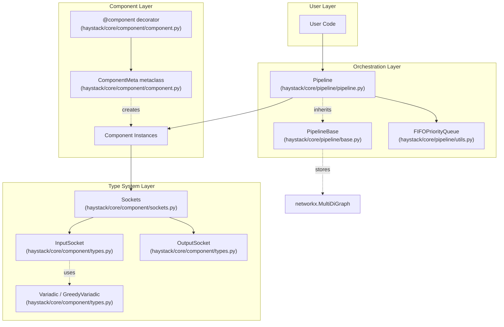

**Sources:** [haystack/core/pipeline/base.py:82-114](), [haystack/core/pipeline/pipeline.py:117-123](), [haystack/core/component/component.py:187-212](), [haystack/core/pipeline/base.py:111-111]()

The architecture enforces a clear separation of concerns:

| Layer | Responsibility | Key Classes |
|-------|---------------|-------------|
| **User Layer** | Define pipeline structure and component connections | User-defined components, Pipeline construction |
| **Orchestration Layer** | Execute components in correct order, manage data flow | `Pipeline`, `PipelineBase`, `FIFOPriorityQueue` |
| **Component Layer** | Define component contract, validate structure | `@component`, `ComponentMeta`, `Component` protocol |
| **Type System Layer** | Define input/output contracts, enable type checking | `InputSocket`, `OutputSocket`, `Sockets`, `Variadic` |

---

## Component Abstraction

Components are the fundamental building blocks in Haystack. The `@component` decorator transforms regular Python classes into pipeline-compatible components by enforcing a contract and adding metadata.

### Component Contract

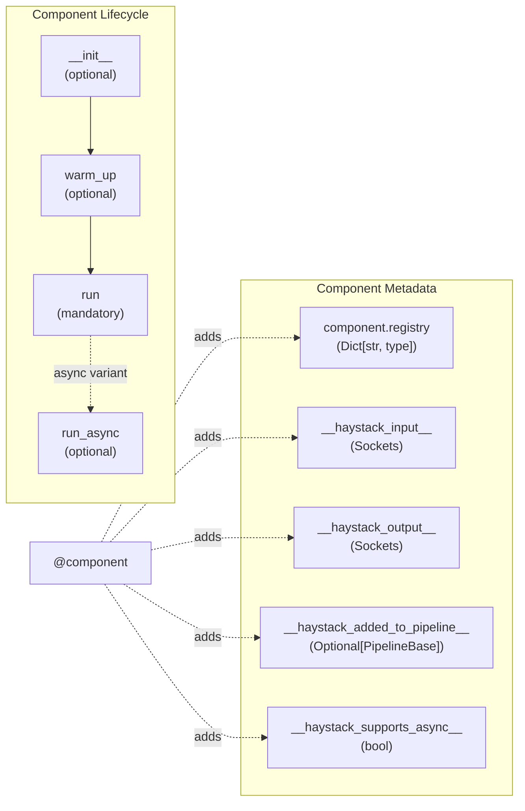

**Sources:** [haystack/core/component/component.py:20-74](), [haystack/core/component/component.py:279-316]()

The `ComponentMeta` metaclass is invoked when a component is instantiated and performs the following operations:

1. **Parse Input Sockets**: Extract parameters from the `run()` method signature [haystack/core/component/component.py:229-278]()
2. **Parse Output Sockets**: Extract types from `@component.output_types` decorator or `component.set_output_types()` [haystack/core/component/component.py:205-227]()
3. **Validate Async Support**: Ensure `run_async` is a coroutine if present [haystack/core/component/component.py:302-304]()
4. **Register Component**: Add to global registry for serialization [haystack/core/component/component.py:586-597]()

### Component Instance Attributes

Every component instance has these special attributes added by `ComponentMeta`:

| Attribute | Type | Purpose |
|-----------|------|---------|
| `__haystack_input__` | `Sockets` | Container of `InputSocket` objects defining inputs |
| `__haystack_output__` | `Sockets` | Container of `OutputSocket` objects defining outputs |
| `__haystack_added_to_pipeline__` | `Optional[PipelineBase]` | Reference to owning pipeline (prevents reuse) |
| `__haystack_supports_async__` | `bool` | Whether component implements `run_async` |
| `__component_name__` | `str` | Name assigned when added to pipeline |

**Sources:** [haystack/core/component/component.py:279-316](), [haystack/core/pipeline/base.py:357-376]()

---

## Pipeline Orchestration

Pipelines orchestrate component execution by building a directed graph of components and their connections, then executing them in the correct order based on data dependencies.

### Pipeline Graph Structure

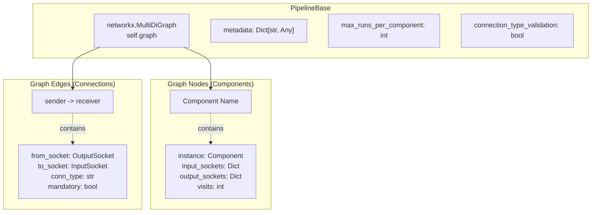

**Sources:** [haystack/core/pipeline/base.py:90-114](), [haystack/core/pipeline/base.py:368-376]()

### Adding Components and Connections

Components are added to the pipeline and stored in the graph:

```python
# From haystack/core/pipeline/base.py:322-376
def add_component(self, name: str, instance: Component) -> None:
    # Validation checks
    # - Name uniqueness
    # - Instance is a Component
    # - Not already added to another pipeline
    
    # Set pipeline reference
    setattr(instance, "__haystack_added_to_pipeline__", self)
    
    # Add to graph with metadata
    self.graph.add_node(
        name,
        instance=instance,
        input_sockets=instance.__haystack_input__._sockets_dict,
        output_sockets=instance.__haystack_output__._sockets_dict,
        visits=0,
    )
```

**Sources:** [haystack/core/pipeline/base.py:322-376]()

Connections are validated for type compatibility and stored as edges:

```python
# From haystack/core/pipeline/base.py:420-601
def connect(self, sender: str, receiver: str) -> "PipelineBase":
    # Parse connection strings (e.g., "comp1.output" -> ("comp1", "output"))
    # Find matching sockets by name and type
    # Validate variadic rules (only variadic sockets accept multiple senders)
    # Create edge in graph
    self.graph.add_edge(
        sender_component_name,
        receiver_component_name,
        key=f"{sender_socket.name}/{receiver_socket.name}",
        conn_type=_type_name(sender_socket.type),
        from_socket=sender_socket,
        to_socket=receiver_socket,
        mandatory=receiver_socket.is_mandatory,
    )
```

**Sources:** [haystack/core/pipeline/base.py:420-601]()

### Pipeline Variants

Haystack provides two primary pipeline execution paths within the `Pipeline` class:

| Method | Execution Model | Use Case |
|-------|----------------|----------|
| `run()` | Synchronous, sequential | Simple workflows, debugging [haystack/core/pipeline/pipeline.py:177]() |
| `run_async()` | Asynchronous, concurrent | High-throughput, I/O-bound tasks, concurrent execution [haystack/core/pipeline/pipeline.py:330]() |

Both use the same graph structure defined in `PipelineBase`, but differ in execution strategy.

**Sources:** [haystack/core/pipeline/pipeline.py:117-123](), [haystack/core/pipeline/base.py:82-87]()

---

## Socket-Based I/O System

Sockets define the input and output contracts for components, enabling type checking and automatic data routing during pipeline execution.

### Socket Types

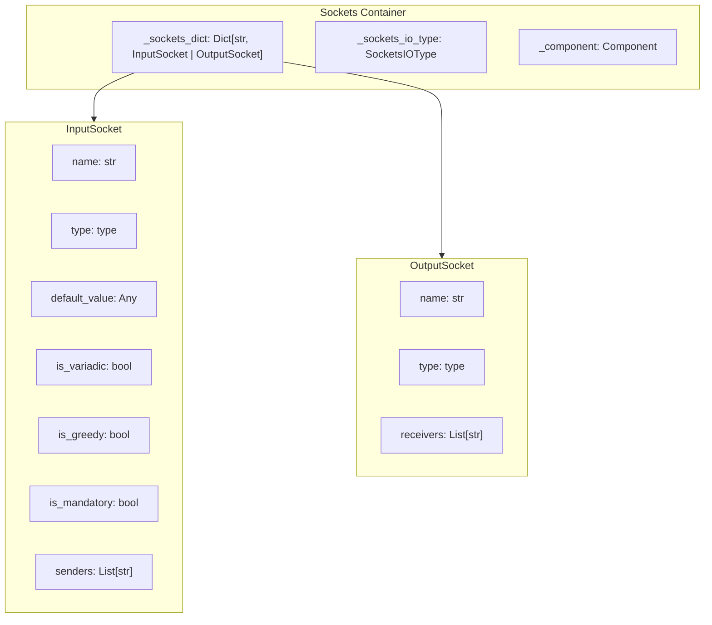

**Sources:** [haystack/core/component/types.py:36-123](), [haystack/core/component/sockets.py:15-146]()

### Variadic Inputs

Haystack supports two types of variadic inputs for components that accept multiple inputs:

| Type | Annotation | Behavior |
|------|-----------|----------|
| **Variadic** | `Variadic[T]` | Waits for all connected inputs before running [haystack/core/component/types.py:58-75]() |
| **GreedyVariadic** | `GreedyVariadic[T]` | Runs immediately upon receiving any input [haystack/core/component/types.py:78-96]() |

**Sources:** [haystack/core/component/types.py:58-96]()

---

## Execution Model

Pipeline execution is governed by a priority-based scheduling system that determines which components can run at any given time.

### Component Priorities

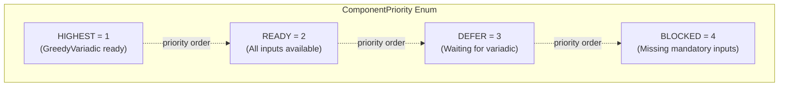

**Sources:** [haystack/core/pipeline/base.py:75-80]()

### Execution Flow (Synchronous Pipeline)

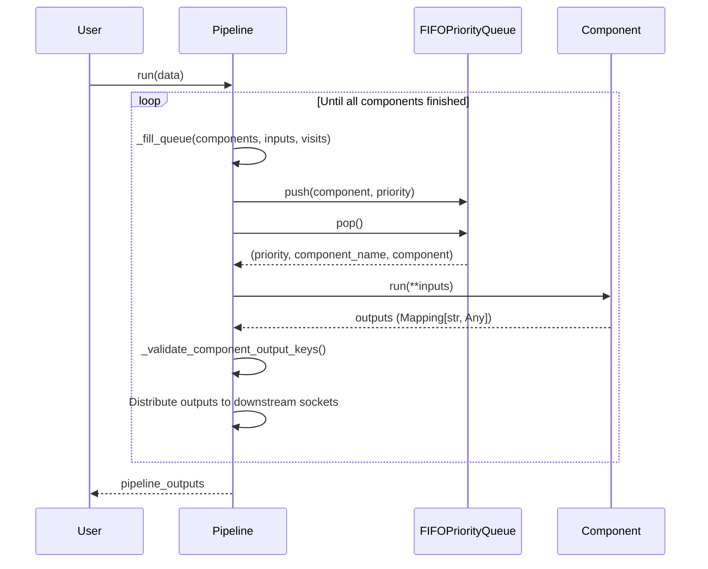

**Sources:** [haystack/core/pipeline/pipeline.py:177-220](), [haystack/core/pipeline/pipeline.py:126-175]()

### Async Execution Flow

The `run_async` method utilizes `asyncio` to execute independent components concurrently. It supports components that implement `run_async` directly, while offloading standard `run` methods to a thread pool executor to maintain non-blocking behavior.

**Sources:** [haystack/core/pipeline/pipeline.py:330-360](), [haystack/utils/async_utils.py:13-35]()

---

## Error Handling and Recovery

Haystack provides comprehensive error handling with pipeline snapshots for debugging and recovery.

### Runtime Error Handling

When a component fails during execution, the pipeline captures a snapshot of the state:

```python
# From haystack/core/pipeline/pipeline.py:165-171
try:
    component_output = instance.run(**inputs_copy)
except BreakpointException as error:
    raise error
except Exception as error:
    raise PipelineRuntimeError(
        f"Component {component_name} failed: {error}",
        # ... additional context
    ) from error
```

**Sources:** [haystack/core/pipeline/pipeline.py:165-171](), [haystack/core/errors.py:73-88]()

### Breakpoints and Snapshots

Pipelines can be configured with `Breakpoint` objects to pause execution. A `PipelineSnapshot` is generated, allowing the pipeline to be resumed from the exact state of the breakpoint.

**Sources:** [haystack/core/pipeline/breakpoint.py:55-98](), [haystack/dataclasses/breakpoints.py:65-95]()

---

## Serialization and Persistence

Pipelines and components can be serialized to dictionaries or YAML for persistence and reloading.

### Serialization API

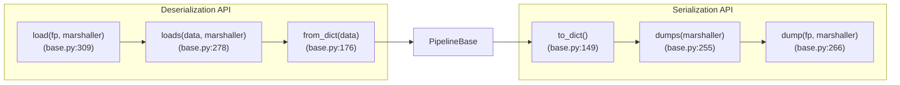

**Sources:** [haystack/core/pipeline/base.py:149-319]()

### Component Registry

All decorated components are registered in a global registry for deserialization:

```python
# From haystack/core/component/component.py:586-597
class_path = f"{new_cls.__module__}.{new_cls.__name__}"
self.registry[class_path] = new_cls
```

**Sources:** [haystack/core/component/component.py:586-597]()

---

# Page: Component System

# Component System

<details>
<summary>Relevant source files</summary>

The following files were used as context for generating this wiki page:

- [haystack/core/__init__.py](haystack/core/__init__.py)
- [haystack/core/component/component.py](haystack/core/component/component.py)
- [haystack/core/component/sockets.py](haystack/core/component/sockets.py)
- [haystack/core/component/types.py](haystack/core/component/types.py)
- [haystack/core/pipeline/descriptions.py](haystack/core/pipeline/descriptions.py)
- [haystack/core/super_component/__init__.py](haystack/core/super_component/__init__.py)
- [haystack/core/super_component/super_component.py](haystack/core/super_component/super_component.py)
- [haystack/core/super_component/utils.py](haystack/core/super_component/utils.py)
- [haystack/tools/pipeline_tool.py](haystack/tools/pipeline_tool.py)
- [releasenotes/notes/add-pipeline-viz-to-supercomponent-80165756cc777056.yaml](releasenotes/notes/add-pipeline-viz-to-supercomponent-80165756cc777056.yaml)
- [releasenotes/notes/allow-non-leaf-outputs-in-supercomponents-outputs-adf29d68636c23ba.yaml](releasenotes/notes/allow-non-leaf-outputs-in-supercomponents-outputs-adf29d68636c23ba.yaml)
- [releasenotes/notes/async-component-support-machinery-6ea4496241aeb3b2.yaml](releasenotes/notes/async-component-support-machinery-6ea4496241aeb3b2.yaml)
- [releasenotes/notes/fix-pipeline-mandatory-inputs-b2f63cfbb3cb20ff.yaml](releasenotes/notes/fix-pipeline-mandatory-inputs-b2f63cfbb3cb20ff.yaml)
- [releasenotes/notes/fix-set-output-types-async-check-2e5d578a3ccdcc59.yaml](releasenotes/notes/fix-set-output-types-async-check-2e5d578a3ccdcc59.yaml)
- [releasenotes/notes/fix-super-component-delegate-default-identity-937ee58b7e3fcb44.yaml](releasenotes/notes/fix-super-component-delegate-default-identity-937ee58b7e3fcb44.yaml)
- [releasenotes/notes/fix-type-discovery-super-component-7b80a5f5aae30e84.yaml](releasenotes/notes/fix-type-discovery-super-component-7b80a5f5aae30e84.yaml)
- [releasenotes/notes/fix-variadic-unsubscripted-indexerror-32788f5484bd3b5c.yaml](releasenotes/notes/fix-variadic-unsubscripted-indexerror-32788f5484bd3b5c.yaml)
- [releasenotes/notes/move-super-component-66cfeff486ecccb1.yaml](releasenotes/notes/move-super-component-66cfeff486ecccb1.yaml)
- [releasenotes/notes/pipeline-io-connected-sockets-db862d045944f788.yaml](releasenotes/notes/pipeline-io-connected-sockets-db862d045944f788.yaml)
- [releasenotes/notes/super-component-decorator-e699782b6500cd1c.yaml](releasenotes/notes/super-component-decorator-e699782b6500cd1c.yaml)
- [releasenotes/notes/supercomponent-class-async-serde-4bfc357570b252db.yaml](releasenotes/notes/supercomponent-class-async-serde-4bfc357570b252db.yaml)
- [test/core/component/test_component.py](test/core/component/test_component.py)
- [test/core/component/test_sockets.py](test/core/component/test_sockets.py)
- [test/core/super_component/test_super_component.py](test/core/super_component/test_super_component.py)
- [test/core/super_component/test_utils.py](test/core/super_component/test_utils.py)

</details>


The Component System is the foundational building block of the Haystack framework that enables the creation of reusable, composable units of functionality. It provides the `@component` decorator, input/output socket management, serialization mechanisms, and component lifecycle management. Components created with this system can be assembled into pipelines for LLM orchestration workflows.

For information about how components are orchestrated together, see [Pipeline System](#3.2). For details about the data structures that flow between components, see [Core Module and Data Structures](#3.3).

## Component Declaration

Components are created by decorating Python classes with the `@component` decorator. The decorator validates the class structure, creates input/output sockets, and registers the component for serialization.

Title: Component Declaration Flow
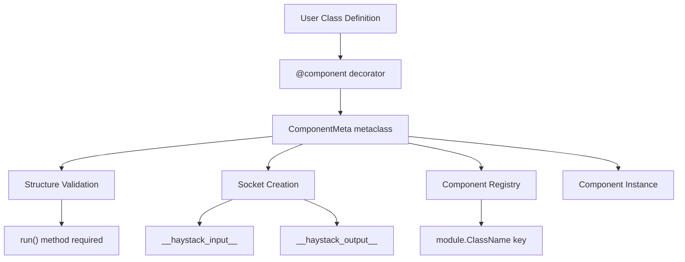

The `@component` decorator transforms regular Python classes into Haystack components through several steps:

1.  **Structure Validation**: Ensures the class has a required `run()` method [haystack/core/component/component.py:560-564]().
2.  **Metaclass Application**: Applies `ComponentMeta` to handle component creation [haystack/core/component/component.py:187-188]().
3.  **Socket Generation**: Creates input and output sockets based on method signatures [haystack/core/component/component.py:228-278]().
4.  **Registry Registration**: Stores the component class for later deserialization in `component.registry` [haystack/core/component/component.py:585-597]().

**Sources:** [haystack/core/component/component.py:187-316](), [haystack/core/component/component.py:558-606]()

### Required Methods

Every component must implement a `run()` method that defines the component's main functionality:

| Method | Required | Purpose |
| :--- | :--- | :--- |
| `run()` | Yes | Main execution logic, called by `Pipeline.run()` [haystack/core/component/component.py:58-74]() |
| `__init__()` | No | Initialization parameters (must be JSON-serializable) [haystack/core/component/component.py:20-41]() |
| `warm_up()` | No | Heavy initialization (models, backends, etc.) [haystack/core/component/component.py:49-54]() |
| `run_async()` | No | Asynchronous execution (must match `run()` signature) [haystack/core/component/component.py:219-227]() |

**Sources:** [haystack/core/component/component.py:20-74](), [test/core/component/test_component.py:16-35]()

## Component Lifecycle

Components follow a specific lifecycle managed by the Pipeline system:

Title: Component Lifecycle Sequence
```mermaid
sequenceDiagram
    participant Pipeline
    participant Component
    participant Sockets
    
    Pipeline->>Component: __init__(**kwargs)
    Component->>Component: Store init_parameters
    Pipeline->>Component: warm_up()
    Component->>Component: Initialize heavy resources
    
    loop Pipeline Execution
        Pipeline->>Sockets: Validate inputs
        Pipeline->>Component: run(data)
        Component->>Pipeline: Return outputs
    end
```

### Initialization Phase

During `__init__()`, components should:
*   Store initialization parameters in `self.init_parameters` for serialization [haystack/core/component/component.py:26-31]().
*   Perform lightweight setup only; `__init__` must be extremely lightweight [haystack/core/component/component.py:43-45]().
*   Accept only JSON-serializable parameters [haystack/core/component/component.py:33-35]().

### Warm-up Phase

The `warm_up()` method is called once before pipeline execution for:
*   Loading models or establishing connections [haystack/core/component/component.py:43-45]().
*   Heavy resource initialization [haystack/core/component/component.py:43-45]().
*   Avoiding repeated initialization; Pipeline does not track which components it called `warm_up()` on [haystack/core/component/component.py:53-54]().

**Sources:** [haystack/core/component/component.py:20-54]()

## Input/Output Socket System

The socket system defines component interfaces through type-safe input and output specifications.

Title: Socket System Architecture
```mermaid
graph LR
    subgraph "Component A"
        OutputSocketA["OutputSocket('result', str)"]
    end
    
    subgraph "Component B"
        InputSocketB["InputSocket('input', str)"]
        RunMethod["run(input: str)"]
    end
    
    subgraph "Socket Creation"
        ComponentMeta --> InspectSignature["inspect.signature(run)"]
        InspectSignature --> CreateInputSocket["InputSocket creation"]
        OutputTypesDecorator["@component.output_types"] --> CreateOutputSocket["OutputSocket creation"]
    end
    
    OutputSocketA --> InputSocketB
    CreateInputSocket --> InputSocketB
    CreateOutputSocket --> OutputSocketA
    InputSocketB --> RunMethod
```

### Input Socket Creation

Input sockets are automatically created by inspecting the `run()` method signature [haystack/core/component/component.py:234-245]():

*   **Automatic**: Parameters become `InputSocket` objects with their type annotations [haystack/core/component/component.py:234-245]().
*   **Manual**: Use `component.set_input_types()` or `component.set_input_type()` for `**kwargs` parameters [haystack/core/component/component.py:520-542]().
*   **Default Values**: Parameters with defaults become optional inputs [haystack/core/component/component.py:68-69]().
*   **Variadic Inputs**: Using `Variadic[T]` or `GreedyVariadic[T]` annotations marks sockets as capable of accepting multiple incoming connections [haystack/core/component/types.py:23-31](). `GreedyVariadic` inputs trigger component execution as soon as the first input arrives [haystack/core/component/types.py:28-30]().

### Output Socket Creation

Output sockets are defined using the `@component.output_types()` decorator or `component.set_output_types()` [haystack/core/component/component.py:544-556](). `run()` must return a single instance of the dataclass declared via these methods [haystack/core/component/component.py:71-72]().

**Sources:** [haystack/core/component/component.py:228-278](), [haystack/core/component/component.py:520-556](), [haystack/core/component/sockets.py:15-146](), [haystack/core/component/types.py:23-31]()

### Socket Management

The `Sockets` class manages collections of input or output sockets [haystack/core/component/sockets.py:15-17]():

| Socket Type | Purpose | Key Attributes |
| :--- | :--- | :--- |
| `InputSocket` | Defines component inputs | `name`, `type`, `default_value`, `is_mandatory` [haystack/core/component/types.py:37-56]() |
| `OutputSocket` | Defines component outputs | `name`, `type`, `receivers` [haystack/core/component/types.py:124-139]() |

**Sources:** [haystack/core/component/types.py:36-139](), [haystack/core/component/sockets.py:15-146]()

## SuperComponent Wrapper

`SuperComponent` (implemented via the `_SuperComponent` class) is a special wrapper that encapsulates an entire `Pipeline` and exposes it as a single `Component` [haystack/core/super_component/super_component.py:34-41]().

Title: SuperComponent Architecture
```mermaid
graph TD
    subgraph SuperComponent["SuperComponent (Wrapped Pipeline)"]
        SC_Input["SuperComponent Input Sockets"]
        SC_Output["SuperComponent Output Sockets"]
        WrappedPipeline["Internal Pipeline Instance"]
        
        SC_Input --> InputMapping["input_mapping"]
        InputMapping --> WrappedPipeline
        WrappedPipeline --> OutputMapping["output_mapping"]
        OutputMapping --> SC_Output
    end
```

*   **Input Mapping**: Maps SuperComponent input names to specific internal pipeline socket paths (e.g., `{"query": ["retriever.query", "prompt_builder.query"]}`) [haystack/core/super_component/super_component.py:50-53]().
*   **Output Mapping**: Maps internal pipeline output paths to SuperComponent output names [haystack/core/super_component/super_component.py:58-62]().
*   **Type Compatibility**: Automatically validates that mapped sockets have compatible types using the `_is_compatible` utility [haystack/core/super_component/utils.py:16-31]().
*   **Async Support**: Forwards `run_async` calls to the underlying pipeline's `run_async` method [haystack/core/super_component/super_component.py:147-164]().

**Sources:** [haystack/core/super_component/super_component.py:34-164](), [haystack/core/super_component/utils.py:16-192]()

## Advanced Features

### Asynchronous Component Support

Components can provide asynchronous execution through a `run_async()` method:

*   Must be a proper coroutine [haystack/core/component/component.py:221-222]().
*   Must have identical parameters and order to the `run()` method [haystack/core/component/component.py:223-224]().
*   Must have identical output types to the `run()` method [haystack/core/component/component.py:225-226]().
*   The `__haystack_supports_async__` attribute is set to `True` if a valid `run_async` is present [haystack/core/component/component.py:391-391]().

**Sources:** [haystack/core/component/component.py:219-227](), [test/core/component/test_component.py:37-60](), [releasenotes/notes/async-component-support-machinery-6ea4496241aeb3b2.yaml:4-7]()

### Component Pre-initialization Hooks

The system supports hooks that execute before component initialization [haystack/core/component/component.py:119-128](). This is managed via the `_COMPONENT_PRE_INIT_HOOK` `ContextVar` [haystack/core/component/component.py:115]().

Title: Pre-initialization Hook Sequence
```mermaid
sequenceDiagram
    participant Client
    participant Hook
    participant ComponentMeta
    participant Component
    
    Client->>Hook: _hook_component_init(callback)
    Client->>ComponentMeta: MyComponent(**kwargs)
    ComponentMeta->>Hook: Check for active hook
    Hook->>Hook: callback(cls, kwargs)
    Hook->>ComponentMeta: Modified kwargs
    ComponentMeta->>Component: __init__(**modified_kwargs)
```

**Sources:** [haystack/core/component/component.py:115-134](), [haystack/core/component/component.py:284-298]()

### Error Handling and Validation

The component system enforces its contract via `ComponentError`:

| Error Condition | Source Code Reference |
| :--- | :--- |
| Missing `run()` method | [haystack/core/component/component.py:560-564]() |
| `run_async` is not a coroutine | [haystack/core/component/component.py:341-345]() |
| Parameter mismatch between `run` and `run_async` | [haystack/core/component/component.py:347-386]() |
| Variadic input without type argument | [haystack/core/component/types.py:107-111]() |

**Sources:** [haystack/core/component/component.py:341-386](), [haystack/core/component/types.py:107-111](), [haystack/core/errors.py]()

---

# Page: Pipeline System

# Pipeline System

<details>
<summary>Relevant source files</summary>

The following files were used as context for generating this wiki page:

- [haystack/components/retrievers/multi_query_embedding_retriever.py](haystack/components/retrievers/multi_query_embedding_retriever.py)
- [haystack/components/retrievers/multi_query_text_retriever.py](haystack/components/retrievers/multi_query_text_retriever.py)
- [haystack/components/retrievers/multi_retriever.py](haystack/components/retrievers/multi_retriever.py)
- [haystack/components/retrievers/text_embedding_retriever.py](haystack/components/retrievers/text_embedding_retriever.py)
- [haystack/core/errors.py](haystack/core/errors.py)
- [haystack/core/pipeline/base.py](haystack/core/pipeline/base.py)
- [haystack/core/pipeline/breakpoint.py](haystack/core/pipeline/breakpoint.py)
- [haystack/core/pipeline/component_checks.py](haystack/core/pipeline/component_checks.py)
- [haystack/core/pipeline/draw.py](haystack/core/pipeline/draw.py)
- [haystack/core/pipeline/pipeline.py](haystack/core/pipeline/pipeline.py)
- [haystack/core/pipeline/utils.py](haystack/core/pipeline/utils.py)
- [haystack/core/serialization.py](haystack/core/serialization.py)
- [haystack/dataclasses/breakpoints.py](haystack/dataclasses/breakpoints.py)
- [haystack/utils/async_utils.py](haystack/utils/async_utils.py)
- [releasenotes/notes/add-run-async-to-retrievers-a265779e909abc2c.yaml](releasenotes/notes/add-run-async-to-retrievers-a265779e909abc2c.yaml)
- [releasenotes/notes/allow-break-point-with-pipeline-snapshot-686cbbecc7ca0ae3.yaml](releasenotes/notes/allow-break-point-with-pipeline-snapshot-686cbbecc7ca0ae3.yaml)
- [releasenotes/notes/cancel-in-flight-tasks-on-error-8b9623a305717328.yaml](releasenotes/notes/cancel-in-flight-tasks-on-error-8b9623a305717328.yaml)
- [releasenotes/notes/cancel-retriever-sibling-tasks-2d76cfc76a9b3ced.yaml](releasenotes/notes/cancel-retriever-sibling-tasks-2d76cfc76a9b3ced.yaml)
- [releasenotes/notes/consolidate-duplicated-class-import-logic-e60ccec6da98eee4.yaml](releasenotes/notes/consolidate-duplicated-class-import-logic-e60ccec6da98eee4.yaml)
- [releasenotes/notes/custom-mermaid-server-and-params-b88ca837375c3e0f.yaml](releasenotes/notes/custom-mermaid-server-and-params-b88ca837375c3e0f.yaml)
- [releasenotes/notes/default-serde-component-device-889de2e1f885240e.yaml](releasenotes/notes/default-serde-component-device-889de2e1f885240e.yaml)
- [releasenotes/notes/default-serde-document-store-f73db759638338f8.yaml](releasenotes/notes/default-serde-document-store-f73db759638338f8.yaml)
- [releasenotes/notes/default-serialization-b42d8fdfe37b9677.yaml](releasenotes/notes/default-serialization-b42d8fdfe37b9677.yaml)
- [releasenotes/notes/fix-asyncpipeline-run-error-e82ede5c4f37f485.yaml](releasenotes/notes/fix-asyncpipeline-run-error-e82ede5c4f37f485.yaml)
- [releasenotes/notes/fix-check-dict-nested-non-string-key-99cf9ac9341463c2.yaml](releasenotes/notes/fix-check-dict-nested-non-string-key-99cf9ac9341463c2.yaml)
- [releasenotes/notes/fix-deepcopy-namedtuple-c7aa157bc9aef85b.yaml](releasenotes/notes/fix-deepcopy-namedtuple-c7aa157bc9aef85b.yaml)
- [releasenotes/notes/fix-default-from-dict-input-mutation-e26045ee8d31e24d.yaml](releasenotes/notes/fix-default-from-dict-input-mutation-e26045ee8d31e24d.yaml)
- [releasenotes/notes/fix-multiretriever-params-c893b8d7e41afde4.yaml](releasenotes/notes/fix-multiretriever-params-c893b8d7e41afde4.yaml)
- [releasenotes/notes/fix-pipeline-snapshot-resume-in-loops-0ab593c343026abb.yaml](releasenotes/notes/fix-pipeline-snapshot-resume-in-loops-0ab593c343026abb.yaml)
- [releasenotes/notes/mermaid-timeout-d0bd83dfa90f8544.yaml](releasenotes/notes/mermaid-timeout-d0bd83dfa90f8544.yaml)
- [releasenotes/notes/pipeline-draw-deprecation-3ba4b047de73d031.yaml](releasenotes/notes/pipeline-draw-deprecation-3ba4b047de73d031.yaml)
- [releasenotes/notes/remove-deprecated-param-from-pipeline-6b05ce1ff1f7fdec.yaml](releasenotes/notes/remove-deprecated-param-from-pipeline-6b05ce1ff1f7fdec.yaml)
- [releasenotes/notes/validate-mermaid-response-b1d5c1059544cefd.yaml](releasenotes/notes/validate-mermaid-response-b1d5c1059544cefd.yaml)
- [test/components/retrievers/test_multi_query_embedding_retriever_async.py](test/components/retrievers/test_multi_query_embedding_retriever_async.py)
- [test/components/retrievers/test_multi_query_text_retriever_async.py](test/components/retrievers/test_multi_query_text_retriever_async.py)
- [test/components/retrievers/test_text_embedding_retriever_async.py](test/components/retrievers/test_text_embedding_retriever_async.py)
- [test/core/component/test_types.py](test/core/component/test_types.py)
- [test/core/pipeline/breakpoints/conftest.py](test/core/pipeline/breakpoints/conftest.py)
- [test/core/pipeline/breakpoints/test_pipeline_breakpoints_rag_hybrid.py](test/core/pipeline/breakpoints/test_pipeline_breakpoints_rag_hybrid.py)
- [test/core/pipeline/features/README.md](test/core/pipeline/features/README.md)
- [test/core/pipeline/features/conftest.py](test/core/pipeline/features/conftest.py)
- [test/core/pipeline/features/pipeline_run.feature](test/core/pipeline/features/pipeline_run.feature)
- [test/core/pipeline/features/test_run.py](test/core/pipeline/features/test_run.py)
- [test/core/pipeline/test_async_pipeline.py](test/core/pipeline/test_async_pipeline.py)
- [test/core/pipeline/test_breakpoint.py](test/core/pipeline/test_breakpoint.py)
- [test/core/pipeline/test_component_checks.py](test/core/pipeline/test_component_checks.py)
- [test/core/pipeline/test_draw.py](test/core/pipeline/test_draw.py)
- [test/core/pipeline/test_pipeline.py](test/core/pipeline/test_pipeline.py)
- [test/core/pipeline/test_pipeline_base.py](test/core/pipeline/test_pipeline_base.py)
- [test/core/pipeline/test_pipeline_crash_regular_pipeline_snapshot_is_raised.py](test/core/pipeline/test_pipeline_crash_regular_pipeline_snapshot_is_raised.py)
- [test/core/pipeline/test_utils.py](test/core/pipeline/test_utils.py)
- [test/core/test_serialization.py](test/core/test_serialization.py)
- [test/utils/test_async_utils.py](test/utils/test_async_utils.py)

</details>


## Purpose and Scope

This document describes the pipeline orchestration system in Haystack, which manages the execution of components in a directed graph. The Pipeline system is responsible for scheduling component execution, managing data flow between components, handling errors, and supporting debugging through breakpoints.

For information about creating and configuring individual components, see [Component System](3.1). For core data structures like `Document` and serialization utilities, see [Core Module and Data Structures](3.3).

---

## Pipeline Architecture Overview

The Pipeline system is built on three main classes that share common functionality through `PipelineBase`.

### Core Class Hierarchy

```mermaid
graph TB
    subgraph "Core Classes"
        PipelineBase["PipelineBase<br/>(haystack/core/pipeline/base.py)"]
        Pipeline["Pipeline<br/>(haystack/core/pipeline/pipeline.py)<br/>Synchronous execution"]
        AsyncPipeline["AsyncPipeline<br/>(haystack/core/pipeline/async_pipeline.py)<br/>Asynchronous execution"]
    end
    
    subgraph "Graph Storage"
        NetworkX["networkx.MultiDiGraph<br/>Stores components and connections"]
    end
    
    subgraph "Execution Infrastructure"
        FIFOPriorityQueue["FIFOPriorityQueue<br/>(haystack/core/pipeline/utils.py)<br/>Component scheduling"]
        ComponentPriority["ComponentPriority<br/>(haystack/core/pipeline/base.py)<br/>HIGHEST/READY/DEFER/BLOCKED"]
    end
    
    subgraph "Error Handling"
        PipelineRuntimeError["PipelineRuntimeError<br/>(haystack/core/errors.py)"]
        PipelineSnapshot["PipelineSnapshot<br/>(haystack/dataclasses/breakpoints.py)<br/>State capture"]
    end
    
    PipelineBase --> NetworkX
    Pipeline --> PipelineBase
    AsyncPipeline --> PipelineBase
    Pipeline --> FIFOPriorityQueue
    AsyncPipeline --> FIFOPriorityQueue
    Pipeline --> ComponentPriority
    AsyncPipeline --> ComponentPriority
    Pipeline --> PipelineRuntimeError
    AsyncPipeline --> PipelineRuntimeError
    PipelineRuntimeError --> PipelineSnapshot
```

**Sources:** [haystack/core/pipeline/base.py:83-114](), [haystack/core/pipeline/pipeline.py:117-123](), [haystack/core/pipeline/async_pipeline.py:28-34]()

---

## Core Classes

### PipelineBase

`PipelineBase` provides common functionality for both synchronous and asynchronous pipelines. It manages the component graph, connections, serialization, and validation using `networkx.MultiDiGraph` [haystack/core/pipeline/base.py:111-111]().

| Method | Purpose |
|--------|---------|
| `add_component(name, instance)` | Adds a component to the pipeline graph [haystack/core/pipeline/base.py:322-377]() |
| `remove_component(name)` | Removes a component and its connections [haystack/core/pipeline/base.py:378-418]() |
| `connect(sender, receiver)` | Creates edges between component sockets [haystack/core/pipeline/base.py:420-601]() |
| `get_component(name)` | Retrieves a component instance by name [haystack/core/pipeline/base.py:614-623]() |
| `to_dict()` / `from_dict()` | Serializes/deserializes pipeline structure [haystack/core/pipeline/base.py:149-241]() |
| `dumps()` / `loads()` | String-based serialization using marshallers [haystack/core/pipeline/base.py:243-280]() |
| `warm_up()` | Initializes all components that implement warm-up [haystack/core/pipeline/base.py:782-812]() |
| `inputs()` / `outputs()` | Returns pipeline input/output specifications [haystack/core/pipeline/base.py:634-679]() |

**Sources:** [haystack/core/pipeline/base.py:82-812]()

### Pipeline (Synchronous)

The `Pipeline` class executes components sequentially in a single thread. Components run one at a time in priority order determined by the scheduler [haystack/core/pipeline/pipeline.py:117-123]().

**Key Method:** `run(data, include_outputs_from=None, break_point=None, pipeline_snapshot=None)` [haystack/core/pipeline/pipeline.py:208-256]()

**Sources:** [haystack/core/pipeline/pipeline.py:117-449]()

### AsyncPipeline (Asynchronous)

The `AsyncPipeline` class enables concurrent component execution when the graph structure permits [haystack/core/pipeline/async_pipeline.py:28-34]().

**Key Methods:**
- `run_async(data, include_outputs_from=None, concurrency_limit=4)` - Full async execution [haystack/core/pipeline/async_pipeline.py:208-256]()
- `run_async_generator(data, include_outputs_from=None, concurrency_limit=4)` - Streaming results [haystack/core/pipeline/async_pipeline.py:106-180]()

**Sources:** [haystack/core/pipeline/async_pipeline.py:28-581]()

---

## Execution Model

### Component Priority System

The pipeline scheduler assigns priorities via the `ComponentPriority` enum to determine execution order [haystack/core/pipeline/base.py:75-80]():

| Priority | Level | Description |
|----------|-------|-------------|
| `HIGHEST` | 1 | Components that must run in isolation (e.g., greedy variadic) [haystack/core/pipeline/base.py:76-76]() |
| `READY` | 2 | All required inputs available; can run immediately [haystack/core/pipeline/base.py:77-77]() |
| `DEFER` | 3 | Waiting for non-greedy variadic inputs; can wait for more data [haystack/core/pipeline/base.py:78-78]() |
| `BLOCKED` | 4 | Missing required inputs; cannot run [haystack/core/pipeline/base.py:79-79]() |

**Sources:** [haystack/core/pipeline/base.py:75-80]()

### Scheduling Algorithm

The pipeline uses a `FIFOPriorityQueue` [haystack/core/pipeline/utils.py:72-170]() to schedule component execution.

```mermaid
sequenceDiagram
    participant Pipeline as haystack.core.pipeline.pipeline.Pipeline
    participant Queue as haystack.core.pipeline.utils.FIFOPriorityQueue
    participant Component as haystack.core.component.Component
    
    Pipeline->>Pipeline: _prepare_component_input_data(data)
    Pipeline->>Pipeline: _convert_to_internal_format(data)
    Pipeline->>Queue: _fill_queue()
    
    loop Until queue empty or all blocked
        Pipeline->>Queue: _get_next_runnable_component()
        Queue-->>Pipeline: (priority, component_name, component)
        
        alt Priority == HIGHEST
            Pipeline->>Pipeline: Wait for all other tasks (Async)
            Pipeline->>Pipeline: _run_component()
            Pipeline->>Pipeline: _write_component_outputs()
        else Priority == READY
            Pipeline->>Pipeline: _run_component()
            Pipeline->>Pipeline: _write_component_outputs()
            Pipeline->>Queue: _fill_queue() if stale
        else Priority == DEFER
            Pipeline->>Pipeline: _tiebreak_waiting_components()
            Pipeline->>Pipeline: _run_component()
        else Priority == BLOCKED
            Pipeline->>Pipeline: Check if pipeline is blocked
        end
    end
```

**Sources:** [haystack/core/pipeline/pipeline.py:208-449](), [haystack/core/pipeline/base.py:1036-1161]()

---

## Component Execution Flow

### Synchronous Pipeline Execution

The `Pipeline.run` method initializes the execution state, including `component_visits` and the `inputs_state` [haystack/core/pipeline/pipeline.py:208-230](). It then enters a loop calling `_get_next_runnable_component` until the graph is exhausted or blocked [haystack/core/pipeline/pipeline.py:270-344]().

**Sources:** [haystack/core/pipeline/pipeline.py:117-449]()

### AsyncPipeline Concurrent Execution

The `AsyncPipeline` uses `asyncio.Semaphore` to limit concurrent execution based on the `concurrency_limit` parameter [haystack/core/pipeline/async_pipeline.py:210-210](). Components that support async execution (marked with `__haystack_supports_async__`) are awaited directly [haystack/utils/async_utils.py:21-41](), while synchronous components are offloaded to `loop.run_in_executor` [haystack/utils/async_utils.py:21-41]().

**Sources:** [haystack/core/pipeline/async_pipeline.py:28-464](), [haystack/utils/async_utils.py:21-41]()

---

## Component State and Data Flow

### Input State Management

The pipeline maintains component inputs in an internal format: `dict[component_name][socket_name] = list[dict[str, Any]]` [haystack/core/pipeline/base.py:72-72]().

**Key Methods:**
- `_prepare_component_input_data(data)`: Normalizes user input format [haystack/core/pipeline/base.py:814-838]().
- `_convert_to_internal_format(data)`: Converts to internal tracking format [haystack/core/pipeline/base.py:840-862]().
- `_consume_component_inputs(component_name, component, inputs)`: Extracts inputs for a component [haystack/core/pipeline/base.py:1228-1317]().
- `_write_component_outputs(component_name, outputs, inputs, receivers)`: Distributes outputs to downstream components [haystack/core/pipeline/base.py:1319-1431]().

**Sources:** [haystack/core/pipeline/base.py:814-1431]()

### Component Visit Tracking

Each component maintains a visit count to detect infinite loops. This is checked against `_max_runs_per_component` [haystack/core/pipeline/base.py:112-112]().

**Sources:** [haystack/core/pipeline/base.py:1163-1188]()

---

## Error Handling

### PipelineRuntimeError

All component execution errors are wrapped in `PipelineRuntimeError` [haystack/core/errors.py:14-53]().

**Factory Methods:**
- `from_exception(component_name, component_type, error)`: Wraps component exceptions [haystack/core/errors.py:24-34]().
- `from_invalid_output(component_name, component_type, output)`: Handles invalid output types [haystack/core/errors.py:36-44]().

**Sources:** [haystack/core/errors.py:14-53]()

### Error Propagation and Snapshots

When a component fails, the pipeline creates a `PipelineSnapshot` [haystack/dataclasses/breakpoints.py:65-71](). This snapshot is attached to the `PipelineRuntimeError` [haystack/core/pipeline/pipeline.py:401-404]().

**Sources:** [haystack/core/pipeline/pipeline.py:384-424](), [haystack/core/pipeline/breakpoint.py:166-224]()

---

## Breakpoints and Debugging

### Breakpoint Types

Haystack supports two types of breakpoints defined in `haystack/dataclasses/breakpoints.py`:

1.  **Breakpoint**: Stops at a specific component based on name and visit count [haystack/dataclasses/breakpoints.py:21-25]().
2.  **AgentBreakpoint**: Stops within Agent component execution, often wrapping a `ToolBreakpoint` [haystack/dataclasses/breakpoints.py:53-57]().

**Sources:** [haystack/dataclasses/breakpoints.py:21-57]()

### PipelineSnapshot Structure

A `PipelineSnapshot` captures complete execution state:

```python
# Defined in haystack/dataclasses/breakpoints.py
@dataclass
class PipelineSnapshot:
    break_point: Union[Breakpoint, AgentBreakpoint]
    ordered_component_names: list[str]
    original_input_data: dict[str, Any]
    pipeline_state: PipelineState
    agent_snapshot: Optional[AgentSnapshot] = None
```

**Sources:** [haystack/dataclasses/breakpoints.py:65-71]()

### Resuming from Snapshot

To resume a pipeline from a snapshot, the `run` method accepts a `pipeline_snapshot` argument [haystack/core/pipeline/pipeline.py:208-256](). The pipeline validates the snapshot against the current graph using `_validate_pipeline_snapshot_against_pipeline` [haystack/core/pipeline/breakpoint.py:55-100]() before restoring state.

**Sources:** [haystack/core/pipeline/pipeline.py:208-256](), [haystack/core/pipeline/breakpoint.py:55-100]()

---

## Pipeline Construction

### Adding Components

Components are added using `add_component(name, instance)` [haystack/core/pipeline/base.py:322-377]().

**Validation Rules:**
- Component names must be unique [haystack/core/pipeline/base.py:344-345]().
- Names cannot contain "." [haystack/core/pipeline/base.py:341-342]().
- Name "_debug" is reserved [haystack/core/pipeline/base.py:347-348]().

**Sources:** [haystack/core/pipeline/base.py:322-377]()

### Connecting Components

Connections are created via `connect(sender, receiver)` [haystack/core/pipeline/base.py:420-601]().

**Connection Syntax:**
- Simple: `pipeline.connect("comp1", "comp2")` - Auto-match by type [haystack/core/pipeline/base.py:441-443]().
- Explicit: `pipeline.connect("comp1.output", "comp2.input")` - Specify sockets [haystack/core/pipeline/base.py:441-443]().

**Sources:** [haystack/core/pipeline/base.py:420-601]()

---

## Serialization

### Dictionary Format

Pipelines are serialized to a dictionary via `to_dict()` [haystack/core/pipeline/base.py:149-173]().

**Methods:**
- `to_dict()`: Serialize to dictionary [haystack/core/pipeline/base.py:149-173]().
- `from_dict(data, callbacks=None)`: Deserialize from dictionary [haystack/core/pipeline/base.py:176-241]().
- `dumps(marshaller=YamlMarshaller())`: Serialize to string [haystack/core/pipeline/base.py:243-255]().
- `loads(data, marshaller=YamlMarshaller())`: Deserialize from string [haystack/core/pipeline/base.py:257-280]().

**Sources:** [haystack/core/pipeline/base.py:149-320]()

### Deserialization Callbacks

`DeserializationCallbacks` [haystack/core/serialization.py:24-40]() allow customization of component instantiation, such as modifying `init_params` before a component is initialized [haystack/core/serialization.py:29-37]().

**Sources:** [haystack/core/serialization.py:24-40]()

---

# Page: Core Module and Data Structures

# Core Module and Data Structures

<details>
<summary>Relevant source files</summary>

The following files were used as context for generating this wiki page:

- [docs-website/docs/token-counters.mdx](docs-website/docs/token-counters.mdx)
- [docs-website/docs/token-counters/approximatetokencounter.mdx](docs-website/docs/token-counters/approximatetokencounter.mdx)
- [docs-website/docs/token-counters/openaitokencounter.mdx](docs-website/docs/token-counters/openaitokencounter.mdx)
- [docs-website/docs/token-counters/tiktokencounter.mdx](docs-website/docs/token-counters/tiktokencounter.mdx)
- [haystack/components/agents/tool_calling.py](haystack/components/agents/tool_calling.py)
- [haystack/components/builders/answer_builder.py](haystack/components/builders/answer_builder.py)
- [haystack/components/builders/chat_prompt_builder.py](haystack/components/builders/chat_prompt_builder.py)
- [haystack/components/builders/prompt_builder.py](haystack/components/builders/prompt_builder.py)
- [haystack/components/converters/output_adapter.py](haystack/components/converters/output_adapter.py)
- [haystack/components/routers/conditional_router.py](haystack/components/routers/conditional_router.py)
- [haystack/core/serialization_security.py](haystack/core/serialization_security.py)
- [haystack/core/type_utils.py](haystack/core/type_utils.py)
- [haystack/dataclasses/answer.py](haystack/dataclasses/answer.py)
- [haystack/dataclasses/byte_stream.py](haystack/dataclasses/byte_stream.py)
- [haystack/dataclasses/chat_message.py](haystack/dataclasses/chat_message.py)
- [haystack/dataclasses/document.py](haystack/dataclasses/document.py)
- [haystack/dataclasses/sparse_embedding.py](haystack/dataclasses/sparse_embedding.py)
- [haystack/hooks/from_function.py](haystack/hooks/from_function.py)
- [haystack/marshal/yaml.py](haystack/marshal/yaml.py)
- [haystack/telemetry/_telemetry.py](haystack/telemetry/_telemetry.py)
- [haystack/testing/callable_serialization/random_callable.py](haystack/testing/callable_serialization/random_callable.py)
- [haystack/token_counters/__init__.py](haystack/token_counters/__init__.py)
- [haystack/token_counters/approximate_counter.py](haystack/token_counters/approximate_counter.py)
- [haystack/token_counters/openai_counter.py](haystack/token_counters/openai_counter.py)
- [haystack/token_counters/tiktoken_counter.py](haystack/token_counters/tiktoken_counter.py)
- [haystack/token_counters/types/__init__.py](haystack/token_counters/types/__init__.py)
- [haystack/token_counters/types/protocol.py](haystack/token_counters/types/protocol.py)
- [haystack/token_counters/utils.py](haystack/token_counters/utils.py)
- [haystack/utils/base_serialization.py](haystack/utils/base_serialization.py)
- [haystack/utils/callable_serialization.py](haystack/utils/callable_serialization.py)
- [haystack/utils/jinja2_chat_extension.py](haystack/utils/jinja2_chat_extension.py)
- [haystack/utils/jinja2_extensions.py](haystack/utils/jinja2_extensions.py)
- [haystack/utils/type_serialization.py](haystack/utils/type_serialization.py)
- [pydoc/token_counters_api.yml](pydoc/token_counters_api.yml)
- [releasenotes/notes/add-dataframe-to-legacy-fields-0f2c9abc00c67aa5.yaml](releasenotes/notes/add-dataframe-to-legacy-fields-0f2c9abc00c67aa5.yaml)
- [releasenotes/notes/add-messages-jinja-tag-483cca5bda6884f2.yaml](releasenotes/notes/add-messages-jinja-tag-483cca5bda6884f2.yaml)
- [releasenotes/notes/add-openai-token-counter-2e372317ffb8351a.yaml](releasenotes/notes/add-openai-token-counter-2e372317ffb8351a.yaml)
- [releasenotes/notes/add-output-adapter-5fab4cfcb0218925.yaml](releasenotes/notes/add-output-adapter-5fab4cfcb0218925.yaml)
- [releasenotes/notes/add-output-passthrough-to-conditional-router-d6e53b417916362e.yaml](releasenotes/notes/add-output-passthrough-to-conditional-router-d6e53b417916362e.yaml)
- [releasenotes/notes/add-required-flag-for-prompt-builder-inputs-f5d3ffb3cb7df8d0.yaml](releasenotes/notes/add-required-flag-for-prompt-builder-inputs-f5d3ffb3cb7df8d0.yaml)
- [releasenotes/notes/add-token-counters-f2685e989bff106e.yaml](releasenotes/notes/add-token-counters-f2685e989bff106e.yaml)
- [releasenotes/notes/adjust-answer-builder-for-agent-f4428aea59e32809.yaml](releasenotes/notes/adjust-answer-builder-for-agent-f4428aea59e32809.yaml)
- [releasenotes/notes/agent-parallel-tool-calls-state-dependencies-7b3c1f9a4e2d6c80.yaml](releasenotes/notes/agent-parallel-tool-calls-state-dependencies-7b3c1f9a4e2d6c80.yaml)
- [releasenotes/notes/answer-builder-refactoring-dc02d2285aebea32.yaml](releasenotes/notes/answer-builder-refactoring-dc02d2285aebea32.yaml)
- [releasenotes/notes/answer-builder-zero-reference-out-of-range-64aab56f8b5f65c3.yaml](releasenotes/notes/answer-builder-zero-reference-out-of-range-64aab56f8b5f65c3.yaml)
- [releasenotes/notes/chat-prompt-builder-sanitization-d0905ac8a5a25aa0.yaml](releasenotes/notes/chat-prompt-builder-sanitization-d0905ac8a5a25aa0.yaml)
- [releasenotes/notes/chatmessage-from-dict-pydantic-dump-5b12e4b1d4985ec1.yaml](releasenotes/notes/chatmessage-from-dict-pydantic-dump-5b12e4b1d4985ec1.yaml)
- [releasenotes/notes/conditional-router-template-error-message-f633f9e786a8c7fc.yaml](releasenotes/notes/conditional-router-template-error-message-f633f9e786a8c7fc.yaml)
- [releasenotes/notes/deprecate-dataframe-ExtractedTableAnswer-3d85649a4a7e222f.yaml](releasenotes/notes/deprecate-dataframe-ExtractedTableAnswer-3d85649a4a7e222f.yaml)
- [releasenotes/notes/document-eq-and-flatten-collisions-cda17012ae9c6395.yaml](releasenotes/notes/document-eq-and-flatten-collisions-cda17012ae9c6395.yaml)
- [releasenotes/notes/document-from-dict-copy-input-9b7d2a8e6f4c1d03.yaml](releasenotes/notes/document-from-dict-copy-input-9b7d2a8e6f4c1d03.yaml)
- [releasenotes/notes/document-to-dict-field-precedence-578a5e20a185852e.yaml](releasenotes/notes/document-to-dict-field-precedence-578a5e20a185852e.yaml)
- [releasenotes/notes/enforce-python-types-serde-0c5cd0a716bab7d0.yaml](releasenotes/notes/enforce-python-types-serde-0c5cd0a716bab7d0.yaml)
- [releasenotes/notes/extend-promptbuilder-0322790d82248039.yaml](releasenotes/notes/extend-promptbuilder-0322790d82248039.yaml)
- [releasenotes/notes/feat-async-pipeline-338856a142e1318c.yaml](releasenotes/notes/feat-async-pipeline-338856a142e1318c.yaml)
- [releasenotes/notes/fix-answer-builder-doc-order-f63c572cd6560bf4.yaml](releasenotes/notes/fix-answer-builder-doc-order-f63c572cd6560bf4.yaml)
- [releasenotes/notes/fix-answer-builder-meta-mutation-8769660a55175afd.yaml](releasenotes/notes/fix-answer-builder-meta-mutation-8769660a55175afd.yaml)
- [releasenotes/notes/fix-answer-from-dict-input-mutation-ac713885d47e54d6.yaml](releasenotes/notes/fix-answer-from-dict-input-mutation-ac713885d47e54d6.yaml)
- [releasenotes/notes/fix-bytestream-str-8dd6d5e9a87f6aa4.yaml](releasenotes/notes/fix-bytestream-str-8dd6d5e9a87f6aa4.yaml)
- [releasenotes/notes/fix-callable-deserialization-5a3ef204a8d07616.yaml](releasenotes/notes/fix-callable-deserialization-5a3ef204a8d07616.yaml)
- [releasenotes/notes/fix-callable-parameter-list-type-serialization-0c6f96661cf773db.yaml](releasenotes/notes/fix-callable-parameter-list-type-serialization-0c6f96661cf773db.yaml)
- [releasenotes/notes/fix-dataclasses-deseria-0bb839b5edd3fca6.yaml](releasenotes/notes/fix-dataclasses-deseria-0bb839b5edd3fca6.yaml)
- [releasenotes/notes/fix-deserialize-async-tool-callable-42995d2052814e59.yaml](releasenotes/notes/fix-deserialize-async-tool-callable-42995d2052814e59.yaml)
- [releasenotes/notes/fix-deserialize-callable-allowlist-bypass-0d99a89c1a3b4a9f.yaml](releasenotes/notes/fix-deserialize-callable-allowlist-bypass-0d99a89c1a3b4a9f.yaml)
- [releasenotes/notes/fix-generated-answer-empty-all-messages-ffccf61b751bc344.yaml](releasenotes/notes/fix-generated-answer-empty-all-messages-ffccf61b751bc344.yaml)
- [releasenotes/notes/fix-jinja2-variable-extraction-57f34c6bd249e214.yaml](releasenotes/notes/fix-jinja2-variable-extraction-57f34c6bd249e214.yaml)
- [releasenotes/notes/fix-mixed-type-lists-schema-serialization-3f1c5a2b7d904e18.yaml](releasenotes/notes/fix-mixed-type-lists-schema-serialization-3f1c5a2b7d904e18.yaml)
- [releasenotes/notes/fix-openai-toolcall-empty-arguments-53c5621622bc1866.yaml](releasenotes/notes/fix-openai-toolcall-empty-arguments-53c5621622bc1866.yaml)
- [releasenotes/notes/fix-output-adapter-from_dict-custom-filters-none-70705cbb474fe982.yaml](releasenotes/notes/fix-output-adapter-from_dict-custom-filters-none-70705cbb474fe982.yaml)
- [releasenotes/notes/fix-sede-conditional-router-multiple-outputs-6fe2e58c4c25f80c.yaml](releasenotes/notes/fix-sede-conditional-router-multiple-outputs-6fe2e58c4c25f80c.yaml)
- [releasenotes/notes/fix-serialization-generated-answer-fa8f3692a184f8fd.yaml](releasenotes/notes/fix-serialization-generated-answer-fa8f3692a184f8fd.yaml)
- [releasenotes/notes/fix-serialize-type-nonetype-arg-444581c0b19217a7.yaml](releasenotes/notes/fix-serialize-type-nonetype-arg-444581c0b19217a7.yaml)
- [releasenotes/notes/fix-str-list-str-validation-0d1065def4f3a6e5.yaml](releasenotes/notes/fix-str-list-str-validation-0d1065def4f3a6e5.yaml)
- [releasenotes/notes/fix-variadic-tuple-type-serialization-5fea4406404a597f.yaml](releasenotes/notes/fix-variadic-tuple-type-serialization-5fea4406404a597f.yaml)
- [releasenotes/notes/improve-jinja2-chat-sec-27333c393c032b75.yaml](releasenotes/notes/improve-jinja2-chat-sec-27333c393c032b75.yaml)
- [releasenotes/notes/meta-in-bytestream-a29816c919c0be5a.yaml](releasenotes/notes/meta-in-bytestream-a29816c919c0be5a.yaml)
- [releasenotes/notes/multiple-outputs-conditional-router-c2f0caad3d3f8ce5.yaml](releasenotes/notes/multiple-outputs-conditional-router-c2f0caad3d3f8ce5.yaml)
- [releasenotes/notes/pipeline-deserialization-allowlist-d878a69ac69ee667.yaml](releasenotes/notes/pipeline-deserialization-allowlist-d878a69ac69ee667.yaml)
- [releasenotes/notes/remove-serialize-deserialize-class-instance-41e4cb639a3e415d.yaml](releasenotes/notes/remove-serialize-deserialize-class-instance-41e4cb639a3e415d.yaml)
- [releasenotes/notes/require-explicit-inputs-from-state-7a3c1f9e8b2d4c60.yaml](releasenotes/notes/require-explicit-inputs-from-state-7a3c1f9e8b2d4c60.yaml)
- [releasenotes/notes/resolve-postponed-tool-annotations-678fb1b0f6bbf752.yaml](releasenotes/notes/resolve-postponed-tool-annotations-678fb1b0f6bbf752.yaml)
- [releasenotes/notes/serialization-tuple-support-ffe176417e7099f5.yaml](releasenotes/notes/serialization-tuple-support-ffe176417e7099f5.yaml)
- [releasenotes/notes/sparse-emb-eq-773ef04ae3ed83ea.yaml](releasenotes/notes/sparse-emb-eq-773ef04ae3ed83ea.yaml)
- [releasenotes/notes/sparse-embedding-dataclass-d75ae1ee6d75e646.yaml](releasenotes/notes/sparse-embedding-dataclass-d75ae1ee6d75e646.yaml)
- [releasenotes/notes/sparse-embedding-fd55b670437492be.yaml](releasenotes/notes/sparse-embedding-fd55b670437492be.yaml)
- [releasenotes/notes/use-importlib-when-deserializing-callable-1f36f07c4518c2cf.yaml](releasenotes/notes/use-importlib-when-deserializing-callable-1f36f07c4518c2cf.yaml)
- [test/components/agents/test_tool_calling.py](test/components/agents/test_tool_calling.py)
- [test/components/builders/test_answer_builder.py](test/components/builders/test_answer_builder.py)
- [test/components/builders/test_chat_prompt_builder.py](test/components/builders/test_chat_prompt_builder.py)
- [test/components/builders/test_prompt_builder.py](test/components/builders/test_prompt_builder.py)
- [test/components/converters/test_output_adapter.py](test/components/converters/test_output_adapter.py)
- [test/components/routers/test_conditional_router.py](test/components/routers/test_conditional_router.py)
- [test/core/future_annotations_functions.py](test/core/future_annotations_functions.py)
- [test/core/test_serialization_security.py](test/core/test_serialization_security.py)
- [test/core/test_type_utils.py](test/core/test_type_utils.py)
- [test/dataclasses/test_answer.py](test/dataclasses/test_answer.py)
- [test/dataclasses/test_byte_stream.py](test/dataclasses/test_byte_stream.py)
- [test/dataclasses/test_chat_message.py](test/dataclasses/test_chat_message.py)
- [test/dataclasses/test_document.py](test/dataclasses/test_document.py)
- [test/dataclasses/test_sparse_embedding.py](test/dataclasses/test_sparse_embedding.py)
- [test/marshal/__init__.py](test/marshal/__init__.py)
- [test/marshal/test_yaml.py](test/marshal/test_yaml.py)
- [test/test_telemetry.py](test/test_telemetry.py)
- [test/token_counters/__init__.py](test/token_counters/__init__.py)
- [test/token_counters/test_approximate_counter.py](test/token_counters/test_approximate_counter.py)
- [test/token_counters/test_openai_counter.py](test/token_counters/test_openai_counter.py)
- [test/tools/test_parameters_schema_utils.py](test/tools/test_parameters_schema_utils.py)
- [test/utils/test_base_serialization.py](test/utils/test_base_serialization.py)
- [test/utils/test_callable_serialization.py](test/utils/test_callable_serialization.py)
- [test/utils/test_jinja2_chat_extension.py](test/utils/test_jinja2_chat_extension.py)
- [test/utils/test_jinja2_extensions.py](test/utils/test_jinja2_extensions.py)
- [test/utils/test_type_serialization.py](test/utils/test_type_serialization.py)

</details>


## Purpose and Scope

This page documents the core data structures and module initialization of Haystack. It covers the foundational dataclasses used throughout the framework, including `Document`, `Answer` types, and the multi-modal `ChatMessage` system. It also details the serialization utilities, type system, and specialized components like `ConditionalRouter` and `AnswerBuilder` that manipulate these structures.

**Sources:** [haystack/__init__.py:1-43]()

---

## Module Initialization and Exports

The `haystack` package initializes logging and tracing on import, then exposes a curated set of core abstractions. The module follows a non-lazy import strategy to avoid static type checking issues and maintain simplicity.

### Exported Symbols

The package exports the following categories of symbols:

| Category | Symbols | Purpose |
|----------|---------|---------|
| **Component System** | `component`, `SuperComponent`, `super_component` | Component decoration and advanced composition [haystack/__init__.py:12-16]() |
| **Pipeline System** | `Pipeline`, `AsyncPipeline` | Pipeline orchestration [haystack/__init__.py:14-14]() |
| **Error Types** | `ComponentError`, `DeserializationError` | Exception handling [haystack/__init__.py:13-13]() |
| **Data Structures** | `Document`, `Answer`, `ExtractedAnswer`, `GeneratedAnswer` | Core data types [haystack/__init__.py:17-17]() |
| **Serialization** | `default_to_dict`, `default_from_dict` | Component serialization utilities [haystack/__init__.py:15-15]() |

### Initialization Sequence

```mermaid
sequenceDiagram
    participant Import as "import haystack"
    participant Init as "haystack.__init__"
    participant Logging as "haystack.logging"
    participant Tracing as "haystack.tracing"
    
    Import->>Init: Execute module
    Init->>Logging: configure_logging()
    Note over Logging: No-op unless structlog installed
    Init->>Tracing: auto_enable_tracing()
    Note over Tracing: No-op unless opentelemetry/ddtrace installed
    Init->>Import: Expose __all__ symbols
```

**Sources:** [haystack/__init__.py:10-42]()

---

## Document Dataclass

The `Document` dataclass is the base data unit in Haystack. It uses a metaclass `_RemoveLegacyFields` to strip 1.x fields (`content_type`, `id_hash_keys`, `dataframe`) before initialization to ensure compatibility [haystack/dataclasses/document.py:19-32]().

### Document Structure

| Field | Type | Description |
|-------|------|-------------|
| `id` | `str` | Unique identifier, auto-generated via SHA256 hash of content, blob, meta, and embeddings if not provided [haystack/dataclasses/document.py:103-116]() |
| `content` | `Optional[str]` | Textual content of the document [haystack/dataclasses/document.py:49-49]() |
| `blob` | `Optional[ByteStream]` | Binary data associated with the document [haystack/dataclasses/document.py:50-50]() |
| `meta` | `dict[str, Any]` | Custom metadata. `to_dict` can flatten this for backward compatibility [haystack/dataclasses/document.py:118-127]() |
| `score` | `Optional[float]` | Relevance score, usually assigned by retrievers [haystack/dataclasses/document.py:52-52]() |
| `embedding` | `Optional[list[float]]` | Dense vector representation [haystack/dataclasses/document.py:53-53]() |
| `sparse_embedding` | `Optional[SparseEmbedding]` | Sparse vector representation [haystack/dataclasses/document.py:54-54]() |

```mermaid
classDiagram
    class Document {
        +str id
        +Optional~str~ content
        +Optional~ByteStream~ blob
        +dict meta
        +Optional~float~ score
        +Optional~list~float~~ embedding
        +Optional~SparseEmbedding~ sparse_embedding
        +to_dict(flatten: bool) dict
        +from_dict(data: dict) Document
    }
    
    class ByteStream {
        +bytes data
        +Optional~str~ mime_type
        +dict meta
    }
    
    class SparseEmbedding {
        +list~int~ indices
        +list~float~ values
    }
    
    Document --> ByteStream : contains
    Document --> SparseEmbedding : contains
```

**Sources:** [haystack/dataclasses/document.py:31-173](), [haystack/dataclasses/byte_stream.py:1-20]()

---

## ChatMessage and Multi-modal Content

The `ChatMessage` dataclass represents messages in LLM conversations. It supports a `Sequence` of `ChatMessageContentT` parts, enabling multi-modal interactions [haystack/dataclasses/chat_message.py:204-213]().

### Content Types (ChatMessageContentT)

| Class | Purpose | Key Fields |
|-------|---------|------------|
| `TextContent` | Plain text | `text: str` [haystack/dataclasses/chat_message.py:51-58]() |
| `ImageContent` | Multi-modal images | `base64_image: str`, `mime_type: str` [haystack/dataclasses/image_content.py:59-71]() |
| `FileContent` | Multi-modal files | `base64_data: str`, `mime_type: str` [haystack/dataclasses/file_content.py:16-24]() |
| `ToolCall` | Model-generated tool request | `tool_name: str`, `arguments: dict`, `id: str` [haystack/dataclasses/chat_message.py:76-90]() |
| `ToolCallResult` | Result of a tool invocation | `result: str | list`, `origin: ToolCall`, `error: bool` [haystack/dataclasses/chat_message.py:118-130]() |
| `ReasoningContent` | Chain-of-thought/Reasoning | `reasoning_text: str` [haystack/dataclasses/chat_message.py:169-180]() |

### ChatRole Enumeration

The `ChatRole` enum defines the supported roles: `USER`, `SYSTEM`, `ASSISTANT`, and `TOOL` [haystack/dataclasses/chat_message.py:19-35]().

```mermaid
graph TB
    subgraph "Natural Language Space"
        UserMsg["User: 'Show me this image'"]
        AssistantMsg["Assistant: 'Here is the data'"]
        ToolMsg["Tool: 'Execution result'"]
    end

    subgraph "Code Entity Space (ChatMessage)"
        ChatMessage_U["ChatMessage.from_user"]
        ChatMessage_A["ChatMessage.from_assistant"]
        ChatMessage_T["ChatMessage.from_tool"]
        
        TextPart["TextContent"]
        ImagePart["ImageContent"]
        ReasonPart["ReasoningContent"]
        ToolResult["ToolCallResult"]
    end

    UserMsg -.-> ChatMessage_U
    AssistantMsg -.-> ChatMessage_A
    ToolMsg -.-> ChatMessage_T
    
    ChatMessage_U --> TextPart
    ChatMessage_U --> ImagePart
    ChatMessage_A --> ReasonPart
    ChatMessage_T --> ToolResult
```

**Sources:** [haystack/dataclasses/chat_message.py:19-213](), [haystack/dataclasses/image_content.py:59-71](), [haystack/dataclasses/file_content.py:16-24]()

---

## Serialization and Type System

Haystack provides robust utilities for serializing both component configurations and runtime data.

### Runtime Value Serialization
`_serialize_value_with_schema` handles runtime values (like Agent state or pipeline outputs). It separates the schema from the data using a JSON Schema-aware format [haystack/utils/base_serialization.py:20-45]().

- **Mixed-type Arrays**: Uses the `prefixItems` keyword to record a schema per position [haystack/utils/base_serialization.py:80-82]().
- **Homogeneous Arrays**: Uses the standard `items` keyword [haystack/utils/base_serialization.py:77-79]().
- **Type Resolution**: `serialize_type` and `deserialize_type` handle complex Python types, including PEP 604 unions (`X | Y`), generics (`list[int]`), and special literals like `NoneType` or `...` [haystack/utils/type_serialization.py:68-124]().

### Component Serialization
`default_to_dict` and `default_from_dict` are the standard utilities for serializing Haystack components. They capture the full class path and the initialization parameters [haystack/core/serialization.py]().

**Sources:** [haystack/utils/base_serialization.py:20-115](), [haystack/utils/type_serialization.py:25-124]()

---

## Core Component Logic

### ConditionalRouter
The `ConditionalRouter` routes data based on Jinja2 expressions. It defines `Route` dictionaries containing a `condition`, `output`, `output_type`, and `output_name` [haystack/components/routers/conditional_router.py:31-36]().
- **Passthrough Routing**: If `output_passthrough` is `True`, the router skips Jinja2 rendering to preserve complex types (like Pydantic models) that would otherwise be converted to strings [haystack/components/routers/conditional_router.py:51-54]().

### AnswerBuilder
`AnswerBuilder` transforms Generator replies into `GeneratedAnswer` objects [haystack/components/builders/answer_builder.py:19-27]().
- **Regex Parsing**: Uses `pattern` to extract text and `reference_pattern` to identify document citations (e.g., `[1]`) [haystack/components/builders/answer_builder.py:85-99]().
- **Reference Management**: Can filter returned documents to only those referenced in the generated text [haystack/components/builders/answer_builder.py:106-110]().

```mermaid
graph TD
    subgraph "Pipeline Data Flow"
        Replies["list[str] | list[ChatMessage]"]
        Docs["list[Document]"]
        AB["AnswerBuilder.run()"]
        GenAnswer["GeneratedAnswer"]
    end

    Replies --> AB
    Docs --> AB
    AB --> GenAnswer
    
    subgraph "Internal Logic"
        Regex["Regex: reference_pattern"]
        Filter["Filter: return_only_referenced_documents"]
    end
    
    AB -.-> Regex
    AB -.-> Filter
```

**Sources:** [haystack/components/routers/conditional_router.py:31-183](), [haystack/components/builders/answer_builder.py:19-135]()

---

## In-Memory Filter Syntax

The `InMemoryDocumentStore` and related utilities use a specific filter syntax for querying documents based on metadata.

### Filter Logic
The comparison logic supports:
- **Comparison Operators**: `$eq`, `$ne`, `$in`, `$nin`, `$gt`, `$gte`, `$lt`, `$lte`.
- **Logical Operators**: `$and`, `$or`, `$not`.

### BM25 and Similarity
The `InMemoryDocumentStore` implements BM25 retrieval (`BM25Okapi`, `BM25L`, `BM25Plus`) and vector similarity functions (`dot_product`, `cosine`) [haystack/document_stores/in_memory/document_store.py:64-105]().

**Sources:** [haystack/document_stores/in_memory/document_store.py:59-174](), [haystack/utils/filters.py:1-50]()

---

# Page: Observability and Tracing

# Observability and Tracing

<details>
<summary>Relevant source files</summary>

The following files were used as context for generating this wiki page:

- [haystack/logging.py](haystack/logging.py)
- [haystack/tracing/__init__.py](haystack/tracing/__init__.py)
- [haystack/tracing/tracer.py](haystack/tracing/tracer.py)
- [haystack/tracing/utils.py](haystack/tracing/utils.py)
- [releasenotes/notes/fix-auto-tracing-51ed3a590000d6c8.yaml](releasenotes/notes/fix-auto-tracing-51ed3a590000d6c8.yaml)
- [releasenotes/notes/fix-logging-index-error-c58691db633542c5.yaml](releasenotes/notes/fix-logging-index-error-c58691db633542c5.yaml)
- [releasenotes/notes/fix-logs-containing-json-1393a00b4904f996.yaml](releasenotes/notes/fix-logs-containing-json-1393a00b4904f996.yaml)
- [releasenotes/notes/fix-pipeline-output-data-trace-tag-6f9e2c1a4b8d3e70.yaml](releasenotes/notes/fix-pipeline-output-data-trace-tag-6f9e2c1a4b8d3e70.yaml)
- [releasenotes/notes/logging-tty-detection-8136769cb4d1da67.yaml](releasenotes/notes/logging-tty-detection-8136769cb4d1da67.yaml)
- [releasenotes/notes/opentelemetry-tracer-33d44eb125a3145b.yaml](releasenotes/notes/opentelemetry-tracer-33d44eb125a3145b.yaml)
- [releasenotes/notes/remove-opentelemetry-tracer-9d3e1f7a4c6b8052.yaml](releasenotes/notes/remove-opentelemetry-tracer-9d3e1f7a4c6b8052.yaml)
- [releasenotes/notes/scope-logging-configuration-4a38bf0c8ea89fc9.yaml](releasenotes/notes/scope-logging-configuration-4a38bf0c8ea89fc9.yaml)
- [releasenotes/notes/structlog-contextvars-c13bb3c59a6a92c7.yaml](releasenotes/notes/structlog-contextvars-c13bb3c59a6a92c7.yaml)
- [test/core/pipeline/test_tracing.py](test/core/pipeline/test_tracing.py)
- [test/test_logging.py](test/test_logging.py)
- [test/tracing/test_tracer.py](test/tracing/test_tracer.py)
- [test/tracing/test_utils.py](test/tracing/test_utils.py)
- [test/tracing/utils.py](test/tracing/utils.py)

</details>


The observability subsystem in Haystack provides deep insights into the execution of Pipelines and Components. It consists of a multi-backend tracing infrastructure and a structured logging system. This allows developers to monitor performance, debug complex data flows, and correlate logs with distributed traces in production environments.

## Tracing Infrastructure

Haystack uses a provider-agnostic tracing architecture based on a proxy pattern. The global `tracer` instance is a `ProxyTracer` that delegates calls to an underlying implementation [haystack/tracing/tracer.py:106-123]().

### Core Abstractions

The system is built around two primary interfaces:
- **`Tracer`**: Responsible for starting new spans and accessing the current execution context [haystack/tracing/tracer.py:77-104]().
- **`Span`**: Represents a single unit of work. It supports setting tags and "content tags" (sensitive data like LLM prompts) [haystack/tracing/tracer.py:14-75]().

### Tracing Lifecycle

The following diagram illustrates how the `ProxyTracer` manages the lifecycle of a trace and interacts with specific backends.

**Trace Execution Flow**
```mermaid
sequenceDiagram
    participant User as "Pipeline.run()"
    participant PT as "ProxyTracer"
    participant AT as "ActualTracer (e.g. SpyingTracer)"
    participant S as "Span (e.g. SpyingSpan)"

    User->>PT: trace("haystack.pipeline.run", tags)
    PT->>AT: trace(operation_name, tags)
    AT->>S: create new span
    AT-->>PT: yield span
    PT-->>User: context manager active
    
    User->>S: set_tag("key", "value")
    Note over S: Calls coerce_tag_value internally
    
    User->>PT: exit context
    PT->>AT: close span
```
Sources: [haystack/tracing/tracer.py:120-131](), [test/tracing/utils.py:38-56](), [haystack/tracing/utils.py:15-40]()

### Configuration and Management

Tracing is enabled or disabled globally using the following functions:
- `enable_tracing(provided_tracer)`: Sets the `actual_tracer` within the proxy [haystack/tracing/tracer.py:165-167]().
- `disable_tracing()`: Reverts the system to a `NullTracer` [haystack/tracing/tracer.py:170-172]().
- `is_tracing_enabled()`: Checks if the current tracer is not a `NullTracer` [haystack/tracing/tracer.py:175-177]().

Sources: [haystack/tracing/tracer.py:133-177]()

## Pipeline Instrumentation

When a `Pipeline` runs, it automatically instruments the execution by creating nested spans. 

1. **Root Span**: Named `haystack.pipeline.run`. It captures pipeline metadata, input data, and final output data [test/core/pipeline/test_tracing.py:44-57]().
2. **Component Spans**: Named `haystack.component.run`. These are children of the pipeline span and capture:
    - `haystack.component.name`: The string identifier in the pipeline [test/core/pipeline/test_tracing.py:61]().
    - `haystack.component.type`: The class name [test/core/pipeline/test_tracing.py:62]().
    - `haystack.component.input`: The specific inputs passed to `run()` [test/core/pipeline/test_tracing.py:66]().
    - `haystack.component.output`: The results returned by the component [test/core/pipeline/test_tracing.py:68]().

### Content Tracing
By default, sensitive data (inputs/outputs) is not traced. To enable it, the environment variable `HAYSTACK_CONTENT_TRACING_ENABLED` must be set to `true` [haystack/tracing/tracer.py:11-118](). This controls the behavior of `Span.set_content_tag` [haystack/tracing/tracer.py:49-66]().

**Tracing Entity Map**
```mermaid
graph TD
    subgraph "Code Entity Space"
        P["Pipeline"]
        C["Component"]
        T["tracer: ProxyTracer"]
        NS["NullSpan"]
        SS["SpyingSpan"]
    end

    subgraph "Trace Space"
        R["haystack.pipeline.run"]
        Comp["haystack.component.run"]
    end

    P -- "calls tracer.trace()" --> R
    C -- "calls tracer.trace()" --> Comp
    R -- "parent of" --> Comp
    T -- "wraps" --> NS
    T -- "wraps" --> SS
```
Sources: [test/core/pipeline/test_tracing.py:38-92](), [haystack/tracing/tracer.py:106-123](), [haystack/tracing/tracer.py:133-156]()

## Structured Logging

Haystack features a structured logging system that supports both standard console output and JSON formatting.

### Configuration
Logging is configured via `haystack.logging.configure_logging()`. 

- **JSON Logging**: Enabled by setting `HAYSTACK_LOGGING_USE_JSON=true` [haystack/logging.py:19]().
- **Bypassing Structlog**: Setting `HAYSTACK_LOGGING_IGNORE_STRUCTLOG=true` prevents Haystack from configuring `structlog` [haystack/logging.py:20]().
- **Keyword Argument Patching**: Haystack patches the standard `logging` module to support keyword arguments as structured data via decorators like `patch_log_method_to_kwargs_only` [haystack/logging.py:151-169]().

### Trace-Log Correlation
Spans provide a method `get_correlation_data_for_logs()` which returns a dictionary with correlation data [haystack/tracing/tracer.py:68-74](). Implementation backends use this to inject IDs (like `trace_id` and `span_id`) into log records to allow jumping from a log entry to the corresponding trace [test/tracing/utils.py:28-29]().

Sources: [haystack/logging.py:1-201](), [test/test_logging.py:94-110]()

## Data Flow and Serialization

Because tracing backends often only support primitive types, Haystack includes a coercion layer in `haystack.tracing.utils.coerce_tag_value` [haystack/tracing/utils.py:15-40]().

1. **Primitives**: `bool`, `str`, `int`, `float` are passed through [haystack/tracing/utils.py:25-26]().
2. **Complex Objects**: The system attempts to call `_to_trace_dict()` or `to_dict()` on objects before serializing them to a JSON string [haystack/tracing/utils.py:63-67]().
3. **Large Objects**: The `_serializable_value` function can use placeholders for large objects like `ByteStream` or `ImageContent` to avoid bloating trace payloads [haystack/tracing/utils.py:42-56]().

Sources: [haystack/tracing/utils.py:1-70](), [test/tracing/test_utils.py:40-87]()

---

# Page: LLM Integration

# LLM Integration

<details>
<summary>Relevant source files</summary>

The following files were used as context for generating this wiki page:

- [docs-website/docs/pipeline-components/embedders.mdx](docs-website/docs/pipeline-components/embedders.mdx)
- [docs-website/docs/pipeline-components/embedders/edenaidocumentembedder.mdx](docs-website/docs/pipeline-components/embedders/edenaidocumentembedder.mdx)
- [docs-website/docs/pipeline-components/embedders/edenaitextembedder.mdx](docs-website/docs/pipeline-components/embedders/edenaitextembedder.mdx)
- [docs-website/docs/pipeline-components/embedders/mockdocumentembedder.mdx](docs-website/docs/pipeline-components/embedders/mockdocumentembedder.mdx)
- [docs-website/docs/pipeline-components/embedders/mocktextembedder.mdx](docs-website/docs/pipeline-components/embedders/mocktextembedder.mdx)
- [docs-website/docs/pipeline-components/generators.mdx](docs-website/docs/pipeline-components/generators.mdx)
- [docs-website/docs/pipeline-components/generators/edenaichatgenerator.mdx](docs-website/docs/pipeline-components/generators/edenaichatgenerator.mdx)
- [docs-website/docs/pipeline-components/generators/litellmchatgenerator.mdx](docs-website/docs/pipeline-components/generators/litellmchatgenerator.mdx)
- [docs-website/docs/pipeline-components/generators/mockchatgenerator.mdx](docs-website/docs/pipeline-components/generators/mockchatgenerator.mdx)
- [docs-website/docs/pipeline-components/generators/vllmchatgenerator.mdx](docs-website/docs/pipeline-components/generators/vllmchatgenerator.mdx)
- [docs-website/versioned_docs/version-3.0/pipeline-components/embedders.mdx](docs-website/versioned_docs/version-3.0/pipeline-components/embedders.mdx)
- [docs-website/versioned_docs/version-3.0/pipeline-components/embedders/edenaidocumentembedder.mdx](docs-website/versioned_docs/version-3.0/pipeline-components/embedders/edenaidocumentembedder.mdx)
- [docs-website/versioned_docs/version-3.0/pipeline-components/embedders/edenaitextembedder.mdx](docs-website/versioned_docs/version-3.0/pipeline-components/embedders/edenaitextembedder.mdx)
- [docs-website/versioned_docs/version-3.0/pipeline-components/generators.mdx](docs-website/versioned_docs/version-3.0/pipeline-components/generators.mdx)
- [docs-website/versioned_docs/version-3.0/pipeline-components/generators/edenaichatgenerator.mdx](docs-website/versioned_docs/version-3.0/pipeline-components/generators/edenaichatgenerator.mdx)
- [haystack/components/generators/chat/azure.py](haystack/components/generators/chat/azure.py)
- [haystack/components/generators/chat/azure_responses.py](haystack/components/generators/chat/azure_responses.py)
- [haystack/components/generators/chat/fallback.py](haystack/components/generators/chat/fallback.py)
- [haystack/components/generators/chat/llm.py](haystack/components/generators/chat/llm.py)
- [haystack/components/generators/chat/openai.py](haystack/components/generators/chat/openai.py)
- [haystack/components/generators/chat/openai_responses.py](haystack/components/generators/chat/openai_responses.py)
- [haystack/components/generators/utils.py](haystack/components/generators/utils.py)
- [haystack/dataclasses/__init__.py](haystack/dataclasses/__init__.py)
- [haystack/dataclasses/streaming_chunk.py](haystack/dataclasses/streaming_chunk.py)
- [releasenotes/notes/add-reasoning-mode-openai-responses-8f1c2a6b7d3e4f5a.yaml](releasenotes/notes/add-reasoning-mode-openai-responses-8f1c2a6b7d3e4f5a.yaml)
- [releasenotes/notes/add-run-async-for-CacheChecker-a42fa8062c33466b.yaml](releasenotes/notes/add-run-async-for-CacheChecker-a42fa8062c33466b.yaml)
- [releasenotes/notes/azureopenairesponseschatgenerator-list-models-91bfe7fd2fa13ff0.yaml](releasenotes/notes/azureopenairesponseschatgenerator-list-models-91bfe7fd2fa13ff0.yaml)
- [releasenotes/notes/expose-agent-run-metadata-8f2942aba14b4f0c.yaml](releasenotes/notes/expose-agent-run-metadata-8f2942aba14b4f0c.yaml)
- [releasenotes/notes/fix-llm-comp-dynamic-inputs-1edfd14d341b8a8b.yaml](releasenotes/notes/fix-llm-comp-dynamic-inputs-1edfd14d341b8a8b.yaml)
- [releasenotes/notes/fix-openai-responses-streaming-encrypted-content-dropped.yaml](releasenotes/notes/fix-openai-responses-streaming-encrypted-content-dropped.yaml)
- [releasenotes/notes/fix-openai-responses-tool-schema-mutation-e500ad2c85715f8c.yaml](releasenotes/notes/fix-openai-responses-tool-schema-mutation-e500ad2c85715f8c.yaml)
- [releasenotes/notes/fix_fallback_chat_generator_serialization-9498ee2bbe2971be.yaml](releasenotes/notes/fix_fallback_chat_generator_serialization-9498ee2bbe2971be.yaml)
- [releasenotes/notes/llm-require-user-prompt-variables-46c69997acf72e05.yaml](releasenotes/notes/llm-require-user-prompt-variables-46c69997acf72e05.yaml)
- [releasenotes/notes/revert-agent-messages-e44f5005e48d371e.yaml](releasenotes/notes/revert-agent-messages-e44f5005e48d371e.yaml)
- [releasenotes/notes/revert-optional-agent-messages-8bfcb31386c43fb4.yaml](releasenotes/notes/revert-optional-agent-messages-8bfcb31386c43fb4.yaml)
- [test/components/generators/chat/test_azure.py](test/components/generators/chat/test_azure.py)
- [test/components/generators/chat/test_azure_responses.py](test/components/generators/chat/test_azure_responses.py)
- [test/components/generators/chat/test_fallback.py](test/components/generators/chat/test_fallback.py)
- [test/components/generators/chat/test_llm.py](test/components/generators/chat/test_llm.py)
- [test/components/generators/chat/test_mock.py](test/components/generators/chat/test_mock.py)
- [test/components/generators/chat/test_openai.py](test/components/generators/chat/test_openai.py)
- [test/components/generators/chat/test_openai_async.py](test/components/generators/chat/test_openai_async.py)
- [test/components/generators/chat/test_openai_responses.py](test/components/generators/chat/test_openai_responses.py)
- [test/components/generators/chat/test_openai_responses_conversion.py](test/components/generators/chat/test_openai_responses_conversion.py)
- [test/components/generators/conftest.py](test/components/generators/conftest.py)
- [test/components/generators/test_openai_image_generator.py](test/components/generators/test_openai_image_generator.py)
- [test/components/generators/test_utils.py](test/components/generators/test_utils.py)
- [test/dataclasses/test_streaming_chunk.py](test/dataclasses/test_streaming_chunk.py)

</details>


This document covers Haystack's Large Language Model (LLM) integration system, which provides a unified framework for connecting to various LLM services. The system supports both text generation and chat completion workflows, with features including streaming responses, tool calling, structured outputs, and asynchronous execution.

Haystack provides components for multiple LLM providers:
- **OpenAI and Azure Integration** — Document `OpenAIChatGenerator`, `OpenAIGenerator`, `OpenAIResponsesChatGenerator`, and their Azure variants, including streaming, tool calling, structured outputs, and the Responses API. For details, see [OpenAI and Azure Integration](#4.1).
- **Hugging Face API Integration** — Explain `HuggingFaceAPIChatGenerator` (now in the `huggingface-api-haystack` package), API types (Serverless, TGI, TEI), embedders, and API configuration. For details, see [Hugging Face API Integration](#4.2).
- **Hugging Face Local Integration** — Document local model execution with `HuggingFaceLocalChatGenerator` (now in the `transformers-haystack` package), transformers pipeline, and related components like rankers and embedders. For details, see [Hugging Face Local Integration](#4.3).
- **Chat Messages and Prompt Building** — Explain the `ChatMessage` dataclass, content types (text, image, tool calls, reasoning), `ChatPromptBuilder`, `PromptBuilder`, and Jinja2 templating. For details, see [Chat Messages and Prompt Building](#4.4).

## Architecture Overview

Haystack's LLM integration follows a component-based architecture where provider-specific implementations conform to common interfaces and data structures. This design allows users to switch between different LLM providers without changing pipeline logic.

**Complete LLM Integration Architecture**
```mermaid
graph TB
    subgraph CoreFramework["Core Framework"]
        ComponentDecorator["@component decorator"]
        PipelineSystem["Pipeline / AsyncPipeline"]
    end
    
    subgraph DataStructures["Data Structures"]
        ChatMessage["ChatMessage"]
        StreamingChunk["StreamingChunk"]
        ToolCall["ToolCall"]
        ToolCallDelta["ToolCallDelta"]
        ReasoningContent["ReasoningContent"]
    end
    
    subgraph OpenAIComponents["OpenAI Components"]
        OpenAIChatGenerator["OpenAIChatGenerator"]
        OpenAIResponsesChatGenerator["OpenAIResponsesChatGenerator"]
        OpenAIClient["OpenAI client"]
        AsyncOpenAIClient["AsyncOpenAI client"]
    end
    
    subgraph AzureComponents["Azure OpenAI Components"]
        AzureOpenAIChatGenerator["AzureOpenAIChatGenerator"]
        AzureOpenAIResponsesChatGenerator["AzureOpenAIResponsesChatGenerator"]
        AzureClient["AzureOpenAI client"]
        AsyncAzureClient["AsyncAzureOpenAI client"]
    end
    
    subgraph APIs["External APIs"]
        OpenAIAPI["OpenAI Chat Completions API"]
        OpenAIResponsesAPI["OpenAI Responses API"]
        AzureAPI["Azure OpenAI API"]
    end
    
    ComponentDecorator -.decorates.-> OpenAIChatGenerator
    ComponentDecorator -.decorates.-> OpenAIResponsesChatGenerator
    ComponentDecorator -.decorates.-> AzureOpenAIChatGenerator
    
    OpenAIChatGenerator --> OpenAIClient
    OpenAIResponsesChatGenerator --> OpenAIClient
    OpenAIClient --> OpenAIAPI
    OpenAIClient --> OpenAIResponsesAPI
    
    AzureOpenAIChatGenerator --> AzureClient
    AzureClient --> AzureAPI
    
    OpenAIChatGenerator --> ChatMessage
    OpenAIResponsesChatGenerator --> ChatMessage
    AzureOpenAIChatGenerator --> ChatMessage
    
    OpenAIChatGenerator --> StreamingChunk
    OpenAIResponsesChatGenerator --> StreamingChunk
    StreamingChunk --> ToolCallDelta
    StreamingChunk --> ReasoningContent
    
    PipelineSystem --> OpenAIChatGenerator
    PipelineSystem --> OpenAIResponsesChatGenerator
```

Sources: [haystack/components/generators/chat/openai.py:58-98](), [haystack/components/generators/chat/openai_responses.py:47-75](), [haystack/components/generators/chat/azure.py:28-71](), [haystack/components/generators/utils.py:10-13]()

## Generator Component Types

Haystack provides specialized generator components tailored for specific interaction patterns and APIs:

**Generator Component Hierarchy**
```mermaid
graph TD
    subgraph ChatGenerators["Chat Generators (ChatMessage-based)"]
        OpenAIChatGenerator["OpenAIChatGenerator<br/>Standard Chat Completion API"]
        OpenAIResponsesChatGenerator["OpenAIResponsesChatGenerator<br/>Newer Responses API (o1/o3 support)"]
        AzureOpenAIChatGenerator["AzureOpenAIChatGenerator<br/>Azure-hosted OpenAI models"]
    end
    
    subgraph InputOutput["Input/Output Types"]
        ChatMessageInput["Input: list[ChatMessage]<br/>Output: list[ChatMessage]"]
    end
    
    OpenAIChatGenerator --> ChatMessageInput
    OpenAIResponsesChatGenerator --> ChatMessageInput
    AzureOpenAIChatGenerator --> ChatMessageInput
```

### Chat Generators
These components work with `ChatMessage` objects and support:
- **Multi-turn conversations**: Maintaining context across messages.
- **System prompts and roles**: Defining behavior via `ChatRole.SYSTEM` [haystack/dataclasses/chat_message.py:14]().
- **Tool calling**: Integration with `Tool` and `Toolset` [haystack/tools/toolset.py:52]().
- **Reasoning**: Support for reasoning tokens in models like OpenAI o1 via `ReasoningContent` [haystack/components/generators/chat/openai_responses.py:22]().
- **Structured outputs**: Support for Pydantic models via `text_format` or strict JSON schemas [haystack/components/generators/chat/openai_responses.py:146-158]().

Sources: [haystack/components/generators/chat/openai.py:58-98](), [haystack/components/generators/chat/openai_responses.py:47-75](), [haystack/components/generators/chat/azure.py:28-71]()

## Core Data Structures

The LLM integration system centers around several key data structures that standardize communication between components and providers.

**LLM Data Flow with OpenAI Responses API Example**
```mermaid
graph LR
    subgraph InputCreation["Input Creation"]
        ChatMessageFromUser["ChatMessage.from_user()"]
        ChatMessageFromSystem["ChatMessage.from_system()"]
    end
    
    subgraph ComponentExecution["Component Execution"]
        OpenAIResponsesChatGeneratorRun["OpenAIResponsesChatGenerator.run()"]
        ToResponsesFormat["_convert_chat_message_to_responses_api_format()"]
        ClientCreate["client.responses.create()"]
    end
    
    subgraph ResponseHandling["Response Handling"]
        ResponseChunk["ResponseStreamEvent (OpenAI SDK)"]
        ConvertChunk["_convert_response_chunk_to_streaming_chunk()"]
        StreamingChunk["StreamingChunk (Haystack)"]
        ConvertChunks["_convert_streaming_chunks_to_chat_message()"]
        FinalMessage["ChatMessage"]
    end
    
    ChatMessageFromUser --> OpenAIResponsesChatGeneratorRun
    ChatMessageFromSystem --> OpenAIResponsesChatGeneratorRun
    
    OpenAIResponsesChatGeneratorRun --> ToResponsesFormat
    ToResponsesFormat --> ClientCreate
    
    ClientCreate --> ResponseChunk
    
    ResponseChunk --> ConvertChunk
    ConvertChunk --> StreamingChunk
    StreamingChunk --> ConvertChunks
    ConvertChunks --> FinalMessage
```

### ChatMessage
The `ChatMessage` class represents conversational messages with support for different roles, rich content types (text, images, files), and tool calling metadata. For details, see [Chat Messages and Prompt Building](#4.4).

### StreamingChunk
The `StreamingChunk` class encapsulates streaming response data. It is the primary vehicle for real-time interaction [haystack/dataclasses/streaming_chunk.py:98-181]().

| Field | Type | Description |
|-------|------|-------------|
| `content` | `str` | Text content of the chunk. |
| `meta` | `dict[str, Any]` | Provider-specific metadata (usage, model, etc.). |
| `tool_calls` | `Optional[list[ToolCallDelta]]` | Tool call deltas for streaming tool invocation [haystack/dataclasses/streaming_chunk.py:112](). |
| `reasoning` | `Optional[ReasoningContent]` | Captured reasoning text for specialized models [haystack/dataclasses/streaming_chunk.py:113](). |

Sources: [haystack/dataclasses/streaming_chunk.py:98-181](), [haystack/components/generators/utils.py:52-116]()

## Execution Patterns

### Synchronous and Asynchronous Generation
All modern chat generators support both `run()` and `run_async()`. The async implementation uses separate async clients like `AsyncOpenAI` [haystack/components/generators/chat/openai.py:11]() or `AsyncAzureOpenAI` [haystack/components/generators/chat/azure.py:9]().

### Streaming Generation
Real-time response processing is achieved via the `streaming_callback`. The utility function `print_streaming_chunk` processes `StreamingChunk` objects to handle text, reasoning, and tool call display [haystack/components/generators/utils.py:52-116]().

**Streaming Processing Flow**
```mermaid
graph TD
    ComponentRun["component.run(messages, streaming_callback)"]
    SelectCallback["select_streaming_callback()"]
    ClientCreate["client.chat.completions.create(stream=True)"]
    
    subgraph StreamLoop["Stream Processing Loop"]
        IterateChunks["for chunk in stream"]
        ConvertChunk["_convert_to_streaming_chunk()"]
        InvokeCallback["_invoke_streaming_callback(callback, chunk)"]
    end
    
    ConvertAllChunks["_convert_streaming_chunks_to_chat_message(chunks)"]
    ReturnResponse["return {'replies': [chat_message]}"]
    
    ComponentRun --> SelectCallback
    SelectCallback --> ClientCreate
    ClientCreate --> IterateChunks
    IterateChunks --> ConvertChunk
    ConvertChunk --> InvokeCallback
    InvokeCallback --> IterateChunks
    IterateChunks --> ConvertAllChunks
    ConvertAllChunks --> ReturnResponse
```

Sources: [haystack/components/generators/chat/openai.py:121-134](), [haystack/components/generators/utils.py:117-160](), [haystack/dataclasses/streaming_chunk.py:223-239]()

## Tool Calling Support

Generators support tool calling capabilities by accepting a `tools` parameter during initialization or at runtime. Tools are automatically converted to the provider's specific format (e.g., JSON schema for OpenAI) [haystack/components/generators/chat/openai.py:207-220]().

### Key Tool Components
- **`Tool`**: A wrapper for functions that includes a name, description, and JSON schema for parameters [haystack/tools/toolset.py:176-181]().
- **`ComponentTool`**: Allows using a Haystack `@component` as a tool [haystack/test/components/generators/chat/test_openai.py:183-187]().
- **`Toolset`**: A collection of tools that can be managed and passed to generators together [haystack/tools/toolset.py:52]().

Sources: [haystack/components/generators/chat/openai.py:33-52](), [haystack/components/generators/chat/openai_responses.py:32-41](), [haystack/test/components/generators/chat/test_openai.py:175-189]()

---

# Page: OpenAI and Azure Integration

# OpenAI and Azure Integration

<details>
<summary>Relevant source files</summary>

The following files were used as context for generating this wiki page:

- [docs-website/docs/pipeline-components/connectors/jinareaderconnector.mdx](docs-website/docs/pipeline-components/connectors/jinareaderconnector.mdx)
- [docs-website/docs/pipeline-components/embedders/nvidiadocumentembedder.mdx](docs-website/docs/pipeline-components/embedders/nvidiadocumentembedder.mdx)
- [docs-website/docs/pipeline-components/embedders/nvidiatextembedder.mdx](docs-website/docs/pipeline-components/embedders/nvidiatextembedder.mdx)
- [docs-website/docs/pipeline-components/generators/amazonbedrockchatgenerator.mdx](docs-website/docs/pipeline-components/generators/amazonbedrockchatgenerator.mdx)
- [docs-website/docs/pipeline-components/generators/amazonbedrockgenerator.mdx](docs-website/docs/pipeline-components/generators/amazonbedrockgenerator.mdx)
- [docs-website/docs/pipeline-components/generators/anthropicchatgenerator.mdx](docs-website/docs/pipeline-components/generators/anthropicchatgenerator.mdx)
- [docs-website/docs/pipeline-components/generators/anthropicgenerator.mdx](docs-website/docs/pipeline-components/generators/anthropicgenerator.mdx)
- [docs-website/docs/pipeline-components/generators/anthropicvertexchatgenerator.mdx](docs-website/docs/pipeline-components/generators/anthropicvertexchatgenerator.mdx)
- [docs-website/docs/pipeline-components/generators/azureopenaichatgenerator.mdx](docs-website/docs/pipeline-components/generators/azureopenaichatgenerator.mdx)
- [docs-website/docs/pipeline-components/generators/azureopenairesponseschatgenerator.mdx](docs-website/docs/pipeline-components/generators/azureopenairesponseschatgenerator.mdx)
- [docs-website/docs/pipeline-components/generators/coherechatgenerator.mdx](docs-website/docs/pipeline-components/generators/coherechatgenerator.mdx)
- [docs-website/docs/pipeline-components/generators/coheregenerator.mdx](docs-website/docs/pipeline-components/generators/coheregenerator.mdx)
- [docs-website/docs/pipeline-components/generators/googlegenaichatgenerator.mdx](docs-website/docs/pipeline-components/generators/googlegenaichatgenerator.mdx)
- [docs-website/docs/pipeline-components/generators/huggingfaceapichatgenerator.mdx](docs-website/docs/pipeline-components/generators/huggingfaceapichatgenerator.mdx)
- [docs-website/docs/pipeline-components/generators/llamacppchatgenerator.mdx](docs-website/docs/pipeline-components/generators/llamacppchatgenerator.mdx)
- [docs-website/docs/pipeline-components/generators/llamacppgenerator.mdx](docs-website/docs/pipeline-components/generators/llamacppgenerator.mdx)
- [docs-website/docs/pipeline-components/generators/mistralchatgenerator.mdx](docs-website/docs/pipeline-components/generators/mistralchatgenerator.mdx)
- [docs-website/docs/pipeline-components/generators/nvidiachatgenerator.mdx](docs-website/docs/pipeline-components/generators/nvidiachatgenerator.mdx)
- [docs-website/docs/pipeline-components/generators/nvidiagenerator.mdx](docs-website/docs/pipeline-components/generators/nvidiagenerator.mdx)
- [docs-website/docs/pipeline-components/generators/ollamachatgenerator.mdx](docs-website/docs/pipeline-components/generators/ollamachatgenerator.mdx)
- [docs-website/docs/pipeline-components/generators/openaichatgenerator.mdx](docs-website/docs/pipeline-components/generators/openaichatgenerator.mdx)
- [docs-website/docs/pipeline-components/generators/openairesponseschatgenerator.mdx](docs-website/docs/pipeline-components/generators/openairesponseschatgenerator.mdx)
- [docs-website/docs/pipeline-components/generators/openrouterchatgenerator.mdx](docs-website/docs/pipeline-components/generators/openrouterchatgenerator.mdx)
- [docs-website/docs/pipeline-components/generators/sagemakergenerator.mdx](docs-website/docs/pipeline-components/generators/sagemakergenerator.mdx)
- [docs-website/docs/pipeline-components/generators/stackitchatgenerator.mdx](docs-website/docs/pipeline-components/generators/stackitchatgenerator.mdx)
- [docs-website/docs/pipeline-components/generators/watsonxchatgenerator.mdx](docs-website/docs/pipeline-components/generators/watsonxchatgenerator.mdx)
- [docs-website/docs/pipeline-components/rankers/nvidiaranker.mdx](docs-website/docs/pipeline-components/rankers/nvidiaranker.mdx)
- [docs-website/docs/pipeline-components/retrievers/elasticsearchhybridretriever.mdx](docs-website/docs/pipeline-components/retrievers/elasticsearchhybridretriever.mdx)
- [docs-website/docs/tools/ready-made-tools/githubfileeditortool.mdx](docs-website/docs/tools/ready-made-tools/githubfileeditortool.mdx)
- [docs-website/docs/tools/ready-made-tools/githubissuecommentertool.mdx](docs-website/docs/tools/ready-made-tools/githubissuecommentertool.mdx)
- [docs-website/docs/tools/ready-made-tools/githubissueviewertool.mdx](docs-website/docs/tools/ready-made-tools/githubissueviewertool.mdx)
- [docs-website/docs/tools/ready-made-tools/githubprcreatortool.mdx](docs-website/docs/tools/ready-made-tools/githubprcreatortool.mdx)
- [docs-website/docs/tools/ready-made-tools/githubrepoviewertool.mdx](docs-website/docs/tools/ready-made-tools/githubrepoviewertool.mdx)
- [docs-website/versioned_docs/version-3.0/pipeline-components/generators/openaichatgenerator.mdx](docs-website/versioned_docs/version-3.0/pipeline-components/generators/openaichatgenerator.mdx)
- [haystack/components/generators/__init__.py](haystack/components/generators/__init__.py)
- [haystack/components/generators/chat/__init__.py](haystack/components/generators/chat/__init__.py)
- [haystack/components/generators/chat/azure.py](haystack/components/generators/chat/azure.py)
- [haystack/components/generators/chat/azure_responses.py](haystack/components/generators/chat/azure_responses.py)
- [haystack/components/generators/chat/fallback.py](haystack/components/generators/chat/fallback.py)
- [haystack/components/generators/chat/llm.py](haystack/components/generators/chat/llm.py)
- [haystack/components/generators/chat/mock.py](haystack/components/generators/chat/mock.py)
- [haystack/components/generators/chat/openai.py](haystack/components/generators/chat/openai.py)
- [haystack/components/generators/chat/openai_responses.py](haystack/components/generators/chat/openai_responses.py)
- [haystack/components/generators/utils.py](haystack/components/generators/utils.py)
- [haystack/dataclasses/__init__.py](haystack/dataclasses/__init__.py)
- [haystack/dataclasses/streaming_chunk.py](haystack/dataclasses/streaming_chunk.py)
- [pydoc/generators_api.yml](pydoc/generators_api.yml)
- [releasenotes/notes/add-llm-chat-generator-component-e50c6f7659a31253.yaml](releasenotes/notes/add-llm-chat-generator-component-e50c6f7659a31253.yaml)
- [releasenotes/notes/add-mock-chat-generator-718176608c1cd73f.yaml](releasenotes/notes/add-mock-chat-generator-718176608c1cd73f.yaml)
- [releasenotes/notes/add-reasoning-mode-openai-responses-8f1c2a6b7d3e4f5a.yaml](releasenotes/notes/add-reasoning-mode-openai-responses-8f1c2a6b7d3e4f5a.yaml)
- [releasenotes/notes/add-run-async-for-CacheChecker-a42fa8062c33466b.yaml](releasenotes/notes/add-run-async-for-CacheChecker-a42fa8062c33466b.yaml)
- [releasenotes/notes/azureopenairesponseschatgenerator-list-models-91bfe7fd2fa13ff0.yaml](releasenotes/notes/azureopenairesponseschatgenerator-list-models-91bfe7fd2fa13ff0.yaml)
- [releasenotes/notes/expose-agent-run-metadata-8f2942aba14b4f0c.yaml](releasenotes/notes/expose-agent-run-metadata-8f2942aba14b4f0c.yaml)
- [releasenotes/notes/fix-llm-comp-dynamic-inputs-1edfd14d341b8a8b.yaml](releasenotes/notes/fix-llm-comp-dynamic-inputs-1edfd14d341b8a8b.yaml)
- [releasenotes/notes/fix-openai-responses-streaming-encrypted-content-dropped.yaml](releasenotes/notes/fix-openai-responses-streaming-encrypted-content-dropped.yaml)
- [releasenotes/notes/fix-openai-responses-tool-schema-mutation-e500ad2c85715f8c.yaml](releasenotes/notes/fix-openai-responses-tool-schema-mutation-e500ad2c85715f8c.yaml)
- [releasenotes/notes/fix_fallback_chat_generator_serialization-9498ee2bbe2971be.yaml](releasenotes/notes/fix_fallback_chat_generator_serialization-9498ee2bbe2971be.yaml)
- [releasenotes/notes/llm-require-user-prompt-variables-46c69997acf72e05.yaml](releasenotes/notes/llm-require-user-prompt-variables-46c69997acf72e05.yaml)
- [releasenotes/notes/revert-agent-messages-e44f5005e48d371e.yaml](releasenotes/notes/revert-agent-messages-e44f5005e48d371e.yaml)
- [releasenotes/notes/revert-optional-agent-messages-8bfcb31386c43fb4.yaml](releasenotes/notes/revert-optional-agent-messages-8bfcb31386c43fb4.yaml)
- [test/components/generators/chat/test_azure.py](test/components/generators/chat/test_azure.py)
- [test/components/generators/chat/test_azure_responses.py](test/components/generators/chat/test_azure_responses.py)
- [test/components/generators/chat/test_fallback.py](test/components/generators/chat/test_fallback.py)
- [test/components/generators/chat/test_llm.py](test/components/generators/chat/test_llm.py)
- [test/components/generators/chat/test_mock.py](test/components/generators/chat/test_mock.py)
- [test/components/generators/chat/test_openai.py](test/components/generators/chat/test_openai.py)
- [test/components/generators/chat/test_openai_async.py](test/components/generators/chat/test_openai_async.py)
- [test/components/generators/chat/test_openai_responses.py](test/components/generators/chat/test_openai_responses.py)
- [test/components/generators/chat/test_openai_responses_conversion.py](test/components/generators/chat/test_openai_responses_conversion.py)
- [test/components/generators/conftest.py](test/components/generators/conftest.py)
- [test/components/generators/test_openai_image_generator.py](test/components/generators/test_openai_image_generator.py)
- [test/components/generators/test_utils.py](test/components/generators/test_utils.py)
- [test/dataclasses/test_streaming_chunk.py](test/dataclasses/test_streaming_chunk.py)

</details>


This document covers Haystack's integration with OpenAI's API and Azure OpenAI Service. It describes the generator components that enable text generation using OpenAI's language models (GPT-4, GPT-5, o-series) both directly through OpenAI's API and through Azure's managed service, including the high-performance Responses API.

For information about Hugging Face integrations, see [4.2]() and [4.3](). For chat message formatting and prompt building, see [4.4]().

## Component Architecture

Haystack provides specialized generator components for OpenAI and Azure integration, organized by input/output format and provider:

| Component | Input | Output | Provider | File Path |
|-----------|-------|--------|----------|-----------|
| `OpenAIChatGenerator` | `list[ChatMessage]` | `list[ChatMessage]` | OpenAI | [haystack/components/generators/chat/openai.py:58]() |
| `OpenAIGenerator` | `str` | `list[str]` | OpenAI | [haystack/components/generators/openai.py:31]() |
| `OpenAIResponsesChatGenerator` | `list[ChatMessage]` | `list[ChatMessage]` | OpenAI | [haystack/components/generators/chat/openai_responses.py:47]() |
| `AzureOpenAIChatGenerator` | `list[ChatMessage]` | `list[ChatMessage]` | Azure OpenAI | [haystack/components/generators/chat/azure.py:28]() |
| `AzureOpenAIGenerator` | `str` | `list[str]` | Azure OpenAI | [haystack/components/generators/azure.py:27]() |
| `AzureOpenAIResponsesChatGenerator` | `list[ChatMessage]` | `list[ChatMessage]` | Azure OpenAI | [haystack/components/generators/chat/azure_responses.py:28]() |

**Component Inheritance Diagram**

```mermaid
graph TB
    Component["@component decorator<br/>Component System"]
    
    OpenAIChatGenerator["OpenAIChatGenerator<br/>haystack.components.generators.chat.openai"]
    OpenAIGenerator["OpenAIGenerator<br/>haystack.components.generators.openai"]
    OpenAIResponsesChatGenerator["OpenAIResponsesChatGenerator<br/>haystack.components.generators.chat.openai_responses"]
    
    AzureOpenAIChatGenerator["AzureOpenAIChatGenerator<br/>haystack.components.generators.chat.azure"]
    AzureOpenAIGenerator["AzureOpenAIGenerator<br/>haystack.components.generators.azure"]
    AzureOpenAIResponsesChatGenerator["AzureOpenAIResponsesChatGenerator<br/>haystack.components.generators.chat.azure_responses"]
    
    OpenAIClient["openai.OpenAI<br/>Official Python SDK"]
    AzureOpenAIClient["openai.lib.azure.AzureOpenAI<br/>Azure Client"]
    
    Component -.implements.-> OpenAIChatGenerator
    Component -.implements.-> OpenAIGenerator
    Component -.implements.-> OpenAIResponsesChatGenerator
    
    OpenAIChatGenerator <-.extends.- AzureOpenAIChatGenerator
    OpenAIGenerator <-.extends.- AzureOpenAIGenerator
    OpenAIResponsesChatGenerator <-.extends.- AzureOpenAIResponsesChatGenerator
    
    OpenAIChatGenerator --> OpenAIClient
    OpenAIResponsesChatGenerator --> OpenAIClient
    AzureOpenAIChatGenerator --> AzureOpenAIClient
```

Sources: [haystack/components/generators/chat/openai.py:58-98](), [haystack/components/generators/chat/azure.py:28-71](), [haystack/components/generators/chat/openai_responses.py:47-75](), [haystack/components/generators/chat/azure_responses.py:28-71]()

## OpenAIChatGenerator

`OpenAIChatGenerator` is the primary component for conversational AI using OpenAI models. It accepts `ChatMessage` objects and returns `ChatMessage` responses, supporting multi-turn conversations, tool calling, and streaming.

### Initialization

```python
from haystack.components.generators.chat import OpenAIChatGenerator
from haystack.utils import Secret

generator = OpenAIChatGenerator(
    api_key=Secret.from_env_var("OPENAI_API_KEY"),
    model="gpt-5-mini",
    generation_kwargs={
        "max_completion_tokens": 500,
        "temperature": 0.7
    }
)
```

**Key Parameters**

| Parameter | Type | Default | Description |
|-----------|------|---------|-------------|
| `api_key` | `Secret` | `Secret.from_env_var("OPENAI_API_KEY")` | OpenAI API authentication key [haystack/components/generators/chat/openai.py:123]() |
| `model` | `str` | `"gpt-5-mini"` | Model name (gpt-4, gpt-5 series) [haystack/components/generators/chat/openai.py:124]() |
| `streaming_callback` | `Optional[StreamingCallbackT]` | `None` | Callback for token-by-token streaming [haystack/components/generators/chat/openai.py:125]() |
| `generation_kwargs` | `Optional[dict[str, Any]]` | `None` | Parameters like `temperature`, `top_p`, `n`, `stop` [haystack/components/generators/chat/openai.py:128]() |
| `tools` | `Optional[ToolsType]` | `None` | Tools for function calling [haystack/components/generators/chat/openai.py:131]() |
| `tools_strict` | `bool` | `False` | Enable strict schema adherence for tools [haystack/components/generators/chat/openai.py:132]() |

Sources: [haystack/components/generators/chat/openai.py:121-183]()

### Execution Flow

The component initializes both synchronous and asynchronous OpenAI clients during `__init__` or `warm_up` using `init_http_client` [haystack/components/generators/chat/openai.py:192-203]().

**Run Method Execution Flow**

```mermaid
sequenceDiagram
    participant User
    participant Run["run()"]
    participant PrepareAPI["_prepare_api_call()"]
    participant OpenAIAPI["self.client.chat.completions"]
    participant HandleStream["_handle_stream_response()"]
    participant Convert["_convert_chat_completion_to_chat_message()"]
    
    User->>Run: run(messages, generation_kwargs)
    Run->>PrepareAPI: Format messages and tools
    PrepareAPI-->>Run: api_args dict
    
    alt Streaming
        Run->>OpenAIAPI: create(**api_args, stream=True)
        OpenAIAPI-->>Run: Stream[ChatCompletionChunk]
        Run->>HandleStream: Process stream chunks
        HandleStream-->>Run: list[ChatMessage]
    else Non-streaming
        Run->>OpenAIAPI: create(**api_args, stream=False)
        OpenAIAPI-->>Run: ChatCompletion
        Run->>Convert: Convert response
        Convert-->>Run: list[ChatMessage]
    end
    
    Run-->>User: {"replies": list[ChatMessage]}
```

Sources: [haystack/components/generators/chat/openai.py:268-339]()

### Structured Outputs and Tools

The component transforms Haystack `Tool` objects into OpenAI tool definitions [haystack/components/generators/chat/openai.py:420-457](). If `tools_strict` is enabled, it adds `strict: True` to the tool definition and ensures `additionalProperties: False` in the JSON schema using `_make_schema_strict` [haystack/components/generators/chat/openai.py:448-454]().

For structured outputs, if `response_format` is a Pydantic `BaseModel`, it uses `to_strict_json_schema` and calls the `.parse()` endpoint instead of `.create()` [haystack/components/generators/chat/openai.py:467-482]().

## OpenAIResponsesChatGenerator

The `OpenAIResponsesChatGenerator` uses the newer OpenAI Responses API, designed for high-performance and structured interactions. It supports advanced features like model reasoning tokens and explicit response formats.

### Key Features
- **Reasoning Support**: Explicitly handles `reasoning_content` in both streaming and non-streaming modes. In streaming, it captures `reasoning_text` from chunks [haystack/components/generators/chat/openai_responses.py:22-24]().
- **Streaming Logic**: Uses `self.client.responses.create(stream=True)` which returns `ResponseStreamEvent` structures [haystack/components/generators/chat/openai_responses.py:12]().
- **Output Types**: Returns `replies` as `ChatMessage` objects that can contain `ReasoningContent` [haystack/components/generators/chat/openai_responses.py:22]().

Sources: [haystack/components/generators/chat/openai_responses.py:47-75](), [haystack/components/generators/chat/openai_responses.py:134-165]()

## Azure OpenAI Variants

Azure variants like `AzureOpenAIChatGenerator` and `AzureOpenAIResponsesChatGenerator` inherit from their OpenAI counterparts but override initialization to use `AzureOpenAI` and `AsyncAzureOpenAI` clients [haystack/components/generators/chat/azure.py:9]().

### Azure Configuration

| Parameter | Purpose | Source |
|-----------|---------|--------|
| `azure_endpoint` | Resource URL | [haystack/components/generators/chat/azure.py:114]() |
| `azure_deployment` | Deployment name (usually model name) | [haystack/components/generators/chat/azure.py:116]() |
| `api_version` | API Version (e.g., 2024-12-01-preview) | [haystack/components/generators/chat/azure.py:115]() |
| `azure_ad_token` | Entra ID token for auth | [haystack/components/generators/chat/azure.py:118]() |
| `azure_ad_token_provider` | Callback for AD tokens | [haystack/components/generators/chat/azure.py:128]() |

Sources: [haystack/components/generators/chat/azure.py:112-130](), [haystack/components/generators/chat/azure_responses.py:73-90]()

## Streaming Implementation

Streaming is handled by a callback system. The `print_streaming_chunk` utility provides a standard way to display tokens, reasoning, and tool calls as they arrive [haystack/components/generators/utils.py:52]().

### Streaming Data Flow

```mermaid
graph TB
    API["OpenAI API Stream"]
    Convert["_convert_chat_completion_chunk_to_streaming_chunk()"]
    Chunk["StreamingChunk<br/>haystack.dataclasses.StreamingChunk"]
    Callback["streaming_callback"]
    Accumulator["_convert_streaming_chunks_to_chat_message()"]
    Final["ChatMessage"]

    API -->|Chunk Delta| Convert
    Convert --> Chunk
    Chunk --> Callback
    Chunk --> Accumulator
    Accumulator --> Final
```

Sources: [haystack/components/generators/chat/openai.py:484-508](), [haystack/components/generators/utils.py:117-159]()

### StreamingChunk Contents
A `StreamingChunk` can contain:
- `content`: Textual tokens [haystack/components/generators/utils.py:125]().
- `tool_calls`: `ToolCallDelta` objects for incremental tool call construction [haystack/components/generators/utils.py:130]().
- `reasoning`: `ReasoningContent` for models like o1/o3 [haystack/components/generators/utils.py:133]().
- `meta`: Metadata including `usage` and `finish_reason` [haystack/components/generators/utils.py:128]().

Sources: [haystack/components/generators/utils.py:97-114](), [haystack/components/generators/utils.py:117-160]()

## Error Handling and Metadata

### Finish Reasons
The components monitor the `finish_reason` returned by the API. If a completion is truncated due to `length` or `content_filter`, a warning is logged via `_check_finish_reason` [haystack/components/generators/chat/openai.py:511-524]().

### Usage Statistics
Usage metadata is serialized and returned in the `meta` field of the output. This includes `prompt_tokens`, `completion_tokens`, and specific details like `reasoning_tokens` or `cached_tokens` if provided by the OpenAI `CompletionUsage` object [haystack/components/generators/chat/openai.py:674-686]().

Sources: [haystack/components/generators/chat/openai.py:511-524](), [haystack/components/generators/chat/openai.py:674-686](), [test/components/generators/chat/test_openai.py:30]()

---

# Page: Hugging Face API Integration

# Hugging Face API Integration

<details>
<summary>Relevant source files</summary>

The following files were used as context for generating this wiki page:

- [docs-website/reference/integrations-api/fastembed.md](docs-website/reference/integrations-api/fastembed.md)
- [docs-website/reference_versioned_docs/version-2.18/integrations-api/fastembed.md](docs-website/reference_versioned_docs/version-2.18/integrations-api/fastembed.md)
- [docs-website/reference_versioned_docs/version-2.19/integrations-api/fastembed.md](docs-website/reference_versioned_docs/version-2.19/integrations-api/fastembed.md)
- [docs-website/reference_versioned_docs/version-2.20/integrations-api/fastembed.md](docs-website/reference_versioned_docs/version-2.20/integrations-api/fastembed.md)
- [docs-website/reference_versioned_docs/version-2.21/integrations-api/fastembed.md](docs-website/reference_versioned_docs/version-2.21/integrations-api/fastembed.md)
- [docs-website/reference_versioned_docs/version-2.22/integrations-api/fastembed.md](docs-website/reference_versioned_docs/version-2.22/integrations-api/fastembed.md)
- [docs-website/reference_versioned_docs/version-2.23/integrations-api/fastembed.md](docs-website/reference_versioned_docs/version-2.23/integrations-api/fastembed.md)
- [docs-website/reference_versioned_docs/version-2.24/integrations-api/fastembed.md](docs-website/reference_versioned_docs/version-2.24/integrations-api/fastembed.md)
- [docs-website/reference_versioned_docs/version-2.25/integrations-api/fastembed.md](docs-website/reference_versioned_docs/version-2.25/integrations-api/fastembed.md)
- [docs-website/reference_versioned_docs/version-2.26/integrations-api/fastembed.md](docs-website/reference_versioned_docs/version-2.26/integrations-api/fastembed.md)
- [docs-website/reference_versioned_docs/version-2.27/integrations-api/fastembed.md](docs-website/reference_versioned_docs/version-2.27/integrations-api/fastembed.md)
- [haystack/utils/hf.py](haystack/utils/hf.py)

</details>


This document covers Haystack's integration with Hugging Face API services for chat generation, text generation, and text embedding. As of Haystack v3.0, these components have been migrated to the external `huggingface-api-haystack` package to allow for independent versioning and faster updates.

For local model execution with Hugging Face using the `transformers` library, see [Hugging Face Local Integration](4.3). For general LLM integration patterns, see [Chat Messages and Prompt Building](4.4).

## Overview

Haystack's Hugging Face API integration provides access to models through multiple API deployment options, using `InferenceClient` and `AsyncInferenceClient` from the `huggingface_hub` library. All API-based components support both synchronous and asynchronous execution.

### API Components Architecture

```mermaid
graph TB
    subgraph "API Components (huggingface-api-haystack)"
        HFAPIChatGen["HuggingFaceAPIChatGenerator"]
        HFAPIGen["HuggingFaceAPIGenerator"]
        HFAPITextEmb["HuggingFaceAPITextEmbedder"]
        HFAPIDocEmb["HuggingFaceAPIDocumentEmbedder"]
    end
    
    subgraph "API Types"
        ServerlessAPI["SERVERLESS_INFERENCE_API"]
        InferenceEndpoints["INFERENCE_ENDPOINTS"]
        TGI["TEXT_GENERATION_INFERENCE"]
        TEI["TEXT_EMBEDDINGS_INFERENCE"]
    end
    
    subgraph "Hugging Face Hub Clients"
        InferenceClient["InferenceClient"]
        AsyncInferenceClient["AsyncInferenceClient"]
    end
    
    subgraph "Backend Services"
        HFHub["Hugging Face Hub<br/>(Serverless + Endpoints)"]
        SelfHostedTGI["Self-hosted TGI"]
        SelfHostedTEI["Self-hosted TEI"]
    end
    
    HFAPIChatGen --> InferenceClient
    HFAPIChatGen --> AsyncInferenceClient
    HFAPIGen --> InferenceClient
    HFAPITextEmb --> InferenceClient
    HFAPITextEmb --> AsyncInferenceClient
    HFAPIDocEmb --> InferenceClient
    HFAPIDocEmb --> AsyncInferenceClient
    
    InferenceClient --> ServerlessAPI
    InferenceClient --> InferenceEndpoints
    InferenceClient --> TGI
    InferenceClient --> TEI
    
    ServerlessAPI --> HFHub
    InferenceEndpoints --> HFHub
    TGI --> SelfHostedTGI
    TEI --> SelfHostedTEI
```

Sources: [haystack/utils/hf.py:54-118]()

## API Types and Configuration

The Hugging Face API integration supports multiple deployment types, each with specific configuration requirements.

### API Type Enumerations

| Enum Class | Values | Used By |
|------------|--------|---------|
| `HFGenerationAPIType` | `SERVERLESS_INFERENCE_API`, `INFERENCE_ENDPOINTS`, `TEXT_GENERATION_INFERENCE` | Chat/text generators |
| `HFEmbeddingAPIType` | `SERVERLESS_INFERENCE_API`, `INFERENCE_ENDPOINTS`, `TEXT_EMBEDDINGS_INFERENCE` | Embedders |

### Configuration and Validation

The integration performs specific validation based on the `api_type` selected during component initialization.

| API Type | Required Parameters | Token Required | Validation Logic |
|----------|-------------------|----------------|------------------|
| `SERVERLESS_INFERENCE_API` | `model` (model ID) | Yes | Validates model existence via HF Hub |
| `INFERENCE_ENDPOINTS` | `url` (endpoint URL) | Yes | URL format validation |
| `TEXT_GENERATION_INFERENCE` | `url` (service URL) | No | URL format validation |
| `TEXT_EMBEDDINGS_INFERENCE` | `url` (service URL) | No | URL format validation |

Sources: [haystack/utils/hf.py:17-33](), [haystack/utils/hf.py:34-53]()

## Chat Generation with HuggingFaceAPIChatGenerator

The `HuggingFaceAPIChatGenerator` component provides chat completion functionality using Hugging Face API services via the `chat_completion` endpoint.

### Component Features

| Feature | Support | Notes |
|---------|---------|-------|
| API Types | Serverless, Inference Endpoints, TGI | All three deployment options |
| Streaming | ✓ | Via `streaming_callback` parameter |
| Tool Calling | ✓ | Uses OpenAI-compatible tool format |
| Multimodal Input | ✓ | Text + images via `ImageContent` |
| Reasoning Extraction| ✓ | Extracts `ReasoningContent` from supporting models |

### Multimodal and Reasoning Data Flow

When converting Haystack `ChatMessage` objects to the Hugging Face format, the integration handles specific content types differently.

```mermaid
graph TD
    CM["ChatMessage"] --> Conv["convert_message_to_hf_format()"]
    Conv --> Filter["Filter out ReasoningContent"]
    Filter --> Check{"Contains Tool Results?"}
    
    Check -->|Yes| ToolMsg["Map result to content string"]
    Check -->|No| Multi["Map TextContent and ImageContent"]
    
    Multi --> Image["Map ImageContent to data URL base64"]
    Multi --> Text["Map TextContent to text type"]
    
    ToolMsg --> Final["HF API Message Object"]
    Image --> Final
    Text --> Final
```

**Reasoning Content Note**: `ReasoningContent` is skipped during conversion to the HF API format because the Hugging Face Inference API (following the OpenAI-compatible chat completion format) does not support reasoning in input messages. Reasoning is captured from model outputs for transparency but is not sent back to the API in multi-turn conversations [haystack/utils/hf.py:58-61]().

Sources: [haystack/utils/hf.py:54-75](), [haystack/utils/hf.py:85-91](), [haystack/utils/hf.py:94-108]()

## Text Embedding Integration

Haystack provides API-based embedders for both single strings and document collections.

### HuggingFaceAPITextEmbedder & HuggingFaceAPIDocumentEmbedder

These components use the `feature_extraction` endpoint of the Hugging Face Inference API.

#### Batch Processing and Metadata

For `HuggingFaceAPIDocumentEmbedder`, multiple documents are processed in batches to optimize network overhead. Users can also specify which metadata fields should be concatenated with the document content before embedding.

| Feature | Description |
|---------|-------------|
| `batch_size` | Number of documents to send in a single API request |
| `meta_fields_to_embed` | List of metadata keys to include in the embedding input |
| `embedding_separator` | String used to join metadata values and content |

### FastEmbed Integration

While primarily used locally, `FastEmbed` is a popular alternative for generating embeddings that can be used alongside Hugging Face models.

```mermaid
graph LR
    subgraph "FastembedDocumentEmbedder"
        FEDE_init["__init__(model, batch_size, ...)"]
        FEDE_run["run(documents)"]
    end
    
    FEDE_run --> Batch["Batch Documents"]
    Batch --> ONNX["ONNX Runtime Inference"]
    ONNX --> Update["Update Document.embedding"]
```

Sources: [docs-website/reference/integrations-api/fastembed.md:9-29](), [docs-website/reference/integrations-api/fastembed.md:123-141]()

## Serialization of HF Arguments

To support Haystack's pipeline serialization, specific Hugging Face and PyTorch types (like `torch.dtype`) must be converted to JSON-serializable formats.

### Kwargs Serialization Logic

| Function | Role | Action |
|----------|------|--------|
| `serialize_hf_model_kwargs` | Serialization | Converts `torch.dtype` to its string representation (e.g., `"torch.float16"`) [haystack/utils/hf.py:17-32](). |
| `deserialize_hf_model_kwargs` | Deserialization | Parses strings starting with `"torch."` and retrieves the attribute from the `torch` module [haystack/utils/hf.py:34-52](). |

Sources: [haystack/utils/hf.py:17-33](), [haystack/utils/hf.py:34-53]()

## Migration to v3.0

In Haystack v3.0, Hugging Face API components were moved from the core `haystack` package to the `huggingface-api-haystack` integration package.

### Package Mapping

| Old Core Class (v2.x) | New Integration Class (v3.0) | Package |
|-----------------------|------------------------------|---------|
| `HuggingFaceAPIChatGenerator` | `HuggingFaceAPIChatGenerator` | `huggingface-api-haystack` |
| `HuggingFaceAPITextEmbedder` | `HuggingFaceAPITextEmbedder` | `huggingface-api-haystack` |
| `HuggingFaceAPIDocumentEmbedder` | `HuggingFaceAPIDocumentEmbedder` | `huggingface-api-haystack` |

To use these components in v3.0, install the integration:
```bash
pip install huggingface-api-haystack
```

Sources: [haystack/utils/hf.py:1-14]()

---

# Page: Hugging Face Local Integration

# Hugging Face Local Integration

<details>
<summary>Relevant source files</summary>

The following files were used as context for generating this wiki page:

- [docs-website/reference/integrations-api/fastembed.md](docs-website/reference/integrations-api/fastembed.md)
- [docs-website/reference_versioned_docs/version-2.18/integrations-api/fastembed.md](docs-website/reference_versioned_docs/version-2.18/integrations-api/fastembed.md)
- [docs-website/reference_versioned_docs/version-2.19/integrations-api/fastembed.md](docs-website/reference_versioned_docs/version-2.19/integrations-api/fastembed.md)
- [docs-website/reference_versioned_docs/version-2.20/integrations-api/fastembed.md](docs-website/reference_versioned_docs/version-2.20/integrations-api/fastembed.md)
- [docs-website/reference_versioned_docs/version-2.21/integrations-api/fastembed.md](docs-website/reference_versioned_docs/version-2.21/integrations-api/fastembed.md)
- [docs-website/reference_versioned_docs/version-2.22/integrations-api/fastembed.md](docs-website/reference_versioned_docs/version-2.22/integrations-api/fastembed.md)
- [docs-website/reference_versioned_docs/version-2.23/integrations-api/fastembed.md](docs-website/reference_versioned_docs/version-2.23/integrations-api/fastembed.md)
- [docs-website/reference_versioned_docs/version-2.24/integrations-api/fastembed.md](docs-website/reference_versioned_docs/version-2.24/integrations-api/fastembed.md)
- [docs-website/reference_versioned_docs/version-2.25/integrations-api/fastembed.md](docs-website/reference_versioned_docs/version-2.25/integrations-api/fastembed.md)
- [docs-website/reference_versioned_docs/version-2.26/integrations-api/fastembed.md](docs-website/reference_versioned_docs/version-2.26/integrations-api/fastembed.md)
- [docs-website/reference_versioned_docs/version-2.27/integrations-api/fastembed.md](docs-website/reference_versioned_docs/version-2.27/integrations-api/fastembed.md)
- [haystack/utils/hf.py](haystack/utils/hf.py)

</details>


## Purpose and Scope

This document covers Haystack's integration with Hugging Face models that run locally using the `transformers` library. These components load models onto local hardware (CPU/GPU) and perform inference on-device, providing full control over model selection, hardware placement, and execution parameters.

For API-based Hugging Face integrations (Serverless API, TGI, TEI), see [4.2](). For general LLM integration patterns, see [4](). For chat message formatting and prompt building, see [4.4]().

---

## Architecture Overview

The local Hugging Face integration consists of several component categories, all built on the `transformers` library. With the v3.0 migration, many local generation components are now hosted in the `transformers-haystack` package, while core utilities and data structures remain in the main Haystack repository.

### System Architecture Diagram

```mermaid
graph TB
    subgraph "Generation Components (transformers-haystack)"
        HFLocalGen["HuggingFaceLocalGenerator<br/>(text generation)"]
        HFLocalChat["HuggingFaceLocalChatGenerator<br/>(chat generation)"]
    end
    
    subgraph "Ranking Components"
        TransformersSim["TransformersSimilarityRanker<br/>(cross-encoder)"]
        STSim["SentenceTransformersSimilarityRanker<br/>(cross-encoder)"]
        STDiv["SentenceTransformersDiversityRanker<br/>(bi-encoder)"]
    end
    
    subgraph "Reader Components"
        ExtReader["ExtractiveReader<br/>(question answering)"]
    end
    
    subgraph "Evaluation Components"
        SASEval["SASEvaluator<br/>(semantic similarity)"]
    end
    
    subgraph "Router Components"
        TransRouter["TransformersTextRouter<br/>(text classification)"]
        ZeroShotRouter["TransformersZeroShotTextRouter<br/>(zero-shot classification)"]
    end
    
    subgraph "Transformers Library"
        HFPipeline["transformers.Pipeline"]
        AutoModel["AutoModel classes"]
        Tokenizer["AutoTokenizer"]
    end
    
    subgraph "Sentence Transformers"
        STModel["SentenceTransformer"]
        CrossEncoder["CrossEncoder"]
    end
    
    HFLocalGen --> HFPipeline
    HFLocalChat --> HFPipeline
    TransRouter --> HFPipeline
    ZeroShotRouter --> HFPipeline
    
    TransformersSim --> AutoModel
    TransformersSim --> Tokenizer
    ExtReader --> AutoModel
    ExtReader --> Tokenizer
    
    STSim --> CrossEncoder
    STDiv --> STModel
    SASEval --> STModel
    SASEval --> CrossEncoder
    
    subgraph "Supporting Utilities (haystack.utils.hf)"
        StopWords["StopWordsCriteria"]
        MsgConvert["convert_message_to_hf_format"]
        DtypeMgmt["serialize_hf_model_kwargs<br/>deserialize_hf_model_kwargs"]
    end
    
    HFLocalChat --> MsgConvert
    HFLocalGen --> DtypeMgmt
```

**Sources:** [haystack/utils/hf.py:1-53]() | [haystack/utils/hf.py:54-118]()

---

## Data Transformation and Messaging

A critical part of the local integration is ensuring that Haystack's `ChatMessage` objects are correctly translated into the dictionary formats expected by the Hugging Face `transformers` library and its chat templates.

### Message Conversion Flow

The `convert_message_to_hf_format` function handles the mapping of Haystack's multimodal content to Hugging Face's OpenAI-compatible structure.

| Haystack Class | HF Field | Logic |
| :--- | :--- | :--- |
| `TextContent` | `text` | Mapped to `{"type": "text", "text": content.text}` [haystack/utils/hf.py:97-98]() |
| `ImageContent` | `image_url` | Converted to Base64 data URI [haystack/utils/hf.py:99-101]() |
| `ToolCall` | `tool_calls` | Mapped to `function` type with name and arguments [haystack/utils/hf.py:109-116]() |
| `ToolCallResult` | `content` | Result string mapped to content; includes `tool_call_id` [haystack/utils/hf.py:85-89]() |
| `ReasoningContent`| *Skipped* | Explicitly filtered out as HF Inference API does not support it in inputs [haystack/utils/hf.py:68-70]() |

**Sources:** [haystack/utils/hf.py:54-118]()

---

## Model Configuration and Serialization

Hugging Face models often require specific `torch.dtype` configurations (e.g., `torch.bfloat16`). Because Haystack components must be JSON serializable to work with Pipeline serialization, these objects must be converted to strings and back.

### Kwargs Serialization Process

The `serialize_hf_model_kwargs` and `deserialize_hf_model_kwargs` functions provide recursive in-place modification of dictionaries.

```mermaid
graph LR
    subgraph "Serialization"
        InputDict["Dict with torch.float16"]
        CallSer["serialize_hf_model_kwargs()"]
        OutputDict["Dict with 'torch.float16'"]
        InputDict --> CallSer --> OutputDict
    end

    subgraph "Deserialization"
        InputStr["Dict with 'torch.float16'"]
        CallDeser["deserialize_hf_model_kwargs()"]
        OutputObj["Dict with torch.float16"]
        InputStr --> CallDeser --> OutputObj
    end
```

**Sources:** [haystack/utils/hf.py:17-32]() | [haystack/utils/hf.py:34-53]()

---

## Local Embedders (FastEmbed)

For high-performance local embedding without the full overhead of `transformers`, Haystack integrates with `fastembed`. These components are part of the `fastembed-haystack` integration.

### FastembedDocumentEmbedder
Computes embeddings for a list of `Document` objects and stores them in the `embedding` field [docs-website/reference/integrations-api/fastembed.md:13-15]().

**Key Features:**
- **Batching**: Configurable `batch_size` for efficient processing [docs-website/reference/integrations-api/fastembed.md:68]().
- **Parallelism**: Supports data-parallel encoding using multiple cores [docs-website/reference/integrations-api/fastembed.md:92-94]().
- **Meta Embedding**: Can concatenate specific metadata fields to the document content before embedding [docs-website/reference/integrations-api/fastembed.md:96-97]().

### FastembedSparseDocumentEmbedder
Computes sparse embeddings (e.g., using SPLADE models) and stores them in the `sparse_embedding` field of the `Document` [docs-website/reference/integrations-api/fastembed.md:144-146]().

**Sources:** [docs-website/reference/integrations-api/fastembed.md:9-100]() | [docs-website/reference/integrations-api/fastembed.md:142-200]()

---

## Code Entity Space Mapping

This diagram bridges the conceptual "Local Inference" to the specific classes and utility functions used in the codebase.

```mermaid
graph TD
    subgraph "Natural Language Space"
        UserQuery["'Show me an image of a cat'"]
    end

    subgraph "Haystack Code Entities"
        CM["ChatMessage"]
        IC["ImageContent"]
        TC["TextContent"]
        
        UserQuery --> TC
        TC --> CM
        IC --> CM
    end

    subgraph "Local Integration Layer"
        HFUtil["convert_message_to_hf_format()"]
        SerUtil["serialize_hf_model_kwargs()"]
        
        CM --> HFUtil
        HFUtil --> HFDict["HF compatible dict"]
        
        Config["Generation Config"] --> SerUtil
    end

    subgraph "Transformers / Torch Backend"
        T_Pipe["transformers.pipeline"]
        T_Dtype["torch.dtype"]
        
        HFDict --> T_Pipe
        SerUtil -.-> T_Dtype
    end
```

**Sources:** [haystack/utils/hf.py:54-118]() | [haystack/utils/hf.py:17-53]() | [haystack/dataclasses/chat_message.py:1-20]()

---

## v3.0 Migration Summary

In Haystack v3.0, the local Hugging Face integration has been modularized:
1.  **`HuggingFaceLocalChatGenerator`** and **`HuggingFaceLocalGenerator`** moved to the `transformers-haystack` package.
2.  **`SentenceTransformers`** components (Embedders, Rankers) moved to the `sentence-transformers-haystack` package.
3.  **Core Utilities** like `convert_message_to_hf_format` and `serialize_hf_model_kwargs` remain in `haystack.utils.hf` to support various integrations that rely on the Hugging Face ecosystem.

**Sources:** [haystack/utils/hf.py:1-118]() | [docs-website/reference/integrations-api/fastembed.md:20-23]()

---

# Page: Chat Messages and Prompt Building

# Chat Messages and Prompt Building

<details>
<summary>Relevant source files</summary>

The following files were used as context for generating this wiki page:

- [docs-website/docs/concepts/data-classes.mdx](docs-website/docs/concepts/data-classes.mdx)
- [docs-website/docs/concepts/data-classes/chatmessage.mdx](docs-website/docs/concepts/data-classes/chatmessage.mdx)
- [docs-website/docs/concepts/data-classes/filecontent.mdx](docs-website/docs/concepts/data-classes/filecontent.mdx)
- [docs-website/docs/concepts/data-classes/imagecontent.mdx](docs-website/docs/concepts/data-classes/imagecontent.mdx)
- [docs-website/docs/concepts/device-management.mdx](docs-website/docs/concepts/device-management.mdx)
- [docs-website/docs/concepts/pipelines.mdx](docs-website/docs/concepts/pipelines.mdx)
- [docs-website/docs/concepts/pipelines/pipeline-loops.mdx](docs-website/docs/concepts/pipelines/pipeline-loops.mdx)
- [docs-website/docs/concepts/pipelines/smart-pipeline-connections.mdx](docs-website/docs/concepts/pipelines/smart-pipeline-connections.mdx)
- [docs-website/docs/development/enabling-gpu-acceleration.mdx](docs-website/docs/development/enabling-gpu-acceleration.mdx)
- [docs-website/docs/pipeline-components/builders/chatpromptbuilder.mdx](docs-website/docs/pipeline-components/builders/chatpromptbuilder.mdx)
- [docs-website/docs/pipeline-components/builders/promptbuilder.mdx](docs-website/docs/pipeline-components/builders/promptbuilder.mdx)
- [docs-website/docs/pipeline-components/extractors.mdx](docs-website/docs/pipeline-components/extractors.mdx)
- [docs-website/docs/pipeline-components/routers/documentlengthrouter.mdx](docs-website/docs/pipeline-components/routers/documentlengthrouter.mdx)
- [docs-website/reference_versioned_docs/version-2.24/haystack-api/data_classes_api.md](docs-website/reference_versioned_docs/version-2.24/haystack-api/data_classes_api.md)
- [docs-website/static/img/pipeline-illustration-auto-joiner.png](docs-website/static/img/pipeline-illustration-auto-joiner.png)
- [docs-website/versioned_docs/version-2.19/concepts/data-classes/chatmessage.mdx](docs-website/versioned_docs/version-2.19/concepts/data-classes/chatmessage.mdx)
- [docs-website/versioned_docs/version-2.20/concepts/data-classes.mdx](docs-website/versioned_docs/version-2.20/concepts/data-classes.mdx)
- [docs-website/versioned_docs/version-2.20/concepts/data-classes/chatmessage.mdx](docs-website/versioned_docs/version-2.20/concepts/data-classes/chatmessage.mdx)
- [docs-website/versioned_docs/version-2.21/pipeline-components/builders/chatpromptbuilder.mdx](docs-website/versioned_docs/version-2.21/pipeline-components/builders/chatpromptbuilder.mdx)
- [docs-website/versioned_docs/version-2.21/pipeline-components/builders/promptbuilder.mdx](docs-website/versioned_docs/version-2.21/pipeline-components/builders/promptbuilder.mdx)
- [docs-website/versioned_docs/version-2.23/pipeline-components/builders/chatpromptbuilder.mdx](docs-website/versioned_docs/version-2.23/pipeline-components/builders/chatpromptbuilder.mdx)
- [docs-website/versioned_docs/version-2.23/pipeline-components/generators/amazonbedrockchatgenerator.mdx](docs-website/versioned_docs/version-2.23/pipeline-components/generators/amazonbedrockchatgenerator.mdx)
- [docs-website/versioned_docs/version-2.24/concepts/data-classes/chatmessage.mdx](docs-website/versioned_docs/version-2.24/concepts/data-classes/chatmessage.mdx)
- [docs-website/versioned_docs/version-2.29/concepts/data-classes.mdx](docs-website/versioned_docs/version-2.29/concepts/data-classes.mdx)
- [docs-website/versioned_docs/version-2.29/concepts/data-classes/filecontent.mdx](docs-website/versioned_docs/version-2.29/concepts/data-classes/filecontent.mdx)
- [docs-website/versioned_docs/version-2.30/concepts/data-classes.mdx](docs-website/versioned_docs/version-2.30/concepts/data-classes.mdx)
- [docs-website/versioned_docs/version-2.30/concepts/data-classes/filecontent.mdx](docs-website/versioned_docs/version-2.30/concepts/data-classes/filecontent.mdx)
- [docs-website/versioned_docs/version-2.30/concepts/data-classes/imagecontent.mdx](docs-website/versioned_docs/version-2.30/concepts/data-classes/imagecontent.mdx)
- [docs-website/versioned_docs/version-2.30/pipeline-components/builders/chatpromptbuilder.mdx](docs-website/versioned_docs/version-2.30/pipeline-components/builders/chatpromptbuilder.mdx)
- [haystack/components/builders/chat_prompt_builder.py](haystack/components/builders/chat_prompt_builder.py)
- [haystack/components/builders/prompt_builder.py](haystack/components/builders/prompt_builder.py)
- [haystack/dataclasses/chat_message.py](haystack/dataclasses/chat_message.py)
- [haystack/utils/jinja2_chat_extension.py](haystack/utils/jinja2_chat_extension.py)
- [haystack/utils/jinja2_extensions.py](haystack/utils/jinja2_extensions.py)
- [releasenotes/notes/add-messages-jinja-tag-483cca5bda6884f2.yaml](releasenotes/notes/add-messages-jinja-tag-483cca5bda6884f2.yaml)
- [releasenotes/notes/add-required-flag-for-prompt-builder-inputs-f5d3ffb3cb7df8d0.yaml](releasenotes/notes/add-required-flag-for-prompt-builder-inputs-f5d3ffb3cb7df8d0.yaml)
- [releasenotes/notes/chat-prompt-builder-sanitization-d0905ac8a5a25aa0.yaml](releasenotes/notes/chat-prompt-builder-sanitization-d0905ac8a5a25aa0.yaml)
- [releasenotes/notes/chatmessage-from-dict-pydantic-dump-5b12e4b1d4985ec1.yaml](releasenotes/notes/chatmessage-from-dict-pydantic-dump-5b12e4b1d4985ec1.yaml)
- [releasenotes/notes/extend-promptbuilder-0322790d82248039.yaml](releasenotes/notes/extend-promptbuilder-0322790d82248039.yaml)
- [releasenotes/notes/feat-expand-auto-variadic-support-b5c0ec52ec7b497f.yaml](releasenotes/notes/feat-expand-auto-variadic-support-b5c0ec52ec7b497f.yaml)
- [releasenotes/notes/fix-jinja2-variable-extraction-57f34c6bd249e214.yaml](releasenotes/notes/fix-jinja2-variable-extraction-57f34c6bd249e214.yaml)
- [releasenotes/notes/fix-openai-toolcall-empty-arguments-53c5621622bc1866.yaml](releasenotes/notes/fix-openai-toolcall-empty-arguments-53c5621622bc1866.yaml)
- [releasenotes/notes/improve-jinja2-chat-sec-27333c393c032b75.yaml](releasenotes/notes/improve-jinja2-chat-sec-27333c393c032b75.yaml)
- [test/components/builders/test_chat_prompt_builder.py](test/components/builders/test_chat_prompt_builder.py)
- [test/components/builders/test_prompt_builder.py](test/components/builders/test_prompt_builder.py)
- [test/dataclasses/test_chat_message.py](test/dataclasses/test_chat_message.py)
- [test/tools/test_parameters_schema_utils.py](test/tools/test_parameters_schema_utils.py)
- [test/utils/test_jinja2_chat_extension.py](test/utils/test_jinja2_chat_extension.py)
- [test/utils/test_jinja2_extensions.py](test/utils/test_jinja2_extensions.py)

</details>


This document describes the `ChatMessage` dataclass and the `ChatPromptBuilder` component, which together provide a standardized way to represent conversational messages and construct prompts for chat-based LLM interactions in Haystack.

The `ChatMessage` dataclass supports multi-modal content (text, images, tool calls, reasoning, and files) and provides serialization methods for various formats. The `ChatPromptBuilder` component uses Jinja2 templating to dynamically generate prompts from static or runtime-provided templates.

---

## ChatMessage Data Structure

The `ChatMessage` dataclass represents a single message in a chat conversation. Each message has a role (user, system, assistant, or tool) and contains one or more content parts.

### Architecture Overview

```mermaid
graph TB
    subgraph "ChatMessage Structure [haystack/dataclasses/chat_message.py]"
        ChatMessage["ChatMessage"]
        Role["_role: ChatRole"]
        Content["_content: Sequence[ChatMessageContentT]"]
        Name["_name: Optional[str]"]
        Meta["_meta: dict[str, Any]"]
        
        ChatMessage --> Role
        ChatMessage --> Content
        ChatMessage --> Name
        ChatMessage --> Meta
    end
    
    subgraph "ChatRole Enum [haystack/dataclasses/chat_message.py]"
        USER["USER: 'user'"]
        SYSTEM["SYSTEM: 'system'"]
        ASSISTANT["ASSISTANT: 'assistant'"]
        TOOL["TOOL: 'tool'"]
    end
    
    subgraph "Content Types (ChatMessageContentT) [haystack/dataclasses/chat_message.py]"
        TextContent["TextContent<br/>text: str"]
        ImageContent["ImageContent<br/>base64_image: str<br/>mime_type: str"]
        ToolCall["ToolCall<br/>tool_name: str<br/>arguments: dict<br/>id: str"]
        ToolCallResult["ToolCallResult<br/>result: str | list<br/>origin: ToolCall<br/>error: bool"]
        ReasoningContent["ReasoningContent<br/>reasoning_text: str<br/>extra: dict"]
        FileContent["FileContent<br/>base64_data: str<br/>mime_type: str"]
    end
    
    Role -.enum.-> USER
    Role -.enum.-> SYSTEM
    Role -.enum.-> ASSISTANT
    Role -.enum.-> TOOL
    
    Content -.contains.-> TextContent
    Content -.contains.-> ImageContent
    Content -.contains.-> ToolCall
    Content -.contains.-> ToolCallResult
    Content -.contains.-> ReasoningContent
    Content -.contains.-> FileContent
```

**Sources**: [haystack/dataclasses/chat_message.py:19-213](), [haystack/dataclasses/chat_message.py:247-316]()

### Factory Methods

The `ChatMessage` class uses factory methods instead of direct initialization to enforce role-specific content constraints and simplify creation:

| Factory Method | Role | Allowed Content | Example Use Case |
|----------------|------|-----------------|------------------|
| `from_user()` | USER | TextContent, ImageContent, FileContent | User queries, multi-modal input |
| `from_system()` | SYSTEM | TextContent only | System instructions, context |
| `from_assistant()` | ASSISTANT | TextContent, ToolCall, ReasoningContent | LLM responses, tool requests |
| `from_tool()` | TOOL | ToolCallResult only | Tool execution results |

**Sources**: [haystack/dataclasses/chat_message.py:409-516]()

### Content Properties

The `ChatMessage` class provides convenience properties to access specific types of content parts from the internal `_content` sequence:

```mermaid
graph LR
    ChatMessage["ChatMessage._content [haystack/dataclasses/chat_message.py]"]
    
    subgraph "Accessor Properties"
        text["text<br/>(first text)"]
        texts["texts<br/>(all texts)"]
        image["image<br/>(first image)"]
        images["images<br/>(all images)"]
        tool_call["tool_call<br/>(first)"]
        tool_calls["tool_calls<br/>(all)"]
        tool_call_result["tool_call_result<br/>(first)"]
        tool_call_results["tool_call_results<br/>(all)"]
        reasoning["reasoning<br/>(first)"]
        reasonings["reasonings<br/>(all)"]
    end
    
    ChatMessage --> text
    ChatMessage --> texts
    ChatMessage --> image
    ChatMessage --> images
    ChatMessage --> tool_call
    ChatMessage --> tool_calls
    ChatMessage --> tool_call_result
    ChatMessage --> tool_call_results
    ChatMessage --> reasoning
    ChatMessage --> reasonings
```

**Sources**: [haystack/dataclasses/chat_message.py:318-396]()

---

## Content Part Types

### TextContent
The standard textual part of a message.
**Sources**: [haystack/dataclasses/chat_message.py:51-71]()

### ImageContent
Represents images as base64-encoded strings with MIME type information. It includes a `validation` flag (default `True`) to verify base64 integrity and MIME types.
**Sources**: [haystack/dataclasses/image_content.py:59-245]()

### FileContent
Represents binary files as base64-encoded data. Similar to `ImageContent`, it supports validation and provider-specific metadata.
**Sources**: [haystack/dataclasses/file_content.py:18-120]()

### ToolCall and ToolCallResult
Used for tool orchestration. `ToolCall` contains the `tool_name` and `arguments` requested by the LLM [haystack/dataclasses/chat_message.py:76-110](). `ToolCallResult` stores the output, linked back to the `origin` call [haystack/dataclasses/chat_message.py:118-164]().

### ReasoningContent
Captures the internal chain-of-thought produced by models like OpenAI's `o1` or DeepSeek-R1.
**Sources**: [haystack/dataclasses/chat_message.py:169-199]()

---

## ChatPromptBuilder Component

`ChatPromptBuilder` is a core component used to render chat prompts using Jinja2 syntax. It supports building prompts from a list of `ChatMessage` objects or a raw string using custom tags.

### Component Logic and Data Flow

```mermaid
graph TB
    subgraph "Natural Language Space"
        UserTemplate["'Translate {{text}} to {{lang}}'"]
    end

    subgraph "Code Entity Space"
        Builder["ChatPromptBuilder [haystack/components/builders/chat_prompt_builder.py]"]
        Env["SandboxedEnvironment [jinja2.sandbox]"]
        Extension["ChatMessageExtension [haystack/utils/jinja2_chat_extension.py]"]
        
        Builder --"uses"--> Env
        Env --"loads"--> Extension
    end

    UserTemplate --"rendered by"--> Builder
    Builder --"outputs"--> Result["list[ChatMessage]"]
```

**Sources**: [haystack/components/builders/chat_prompt_builder.py:33-137](), [haystack/utils/jinja2_chat_extension.py:66-112]()

### Template Formats

#### 1. List-Based Template
Templates can be provided as a list of `ChatMessage` objects. Variables within the `text` field of these messages are automatically inferred as component inputs.

```python
template = [ChatMessage.from_user("Hello {{ name }}!")]
builder = ChatPromptBuilder(template=template)
# Component will have an input socket named 'name'
```
**Sources**: [haystack/components/builders/chat_prompt_builder.py:47-53](), [haystack/components/builders/chat_prompt_builder.py:189-207]()

#### 2. String-Based Template (`` tag)
For complex multi-modal prompts, a string template with custom tags is used. This allows mixing text and structured content like images via the `templatize_part` filter.

```jinja2

Describe this: {{ image | templatize_part }}

```
**Sources**: [haystack/utils/jinja2_chat_extension.py:66-112](), [haystack/components/builders/chat_prompt_builder.py:114-136]()

#### 3. The `` Tag
String templates support the `` tag to interleave runtime `ChatMessage` objects (or lists) with literal message blocks.

```jinja2
You are a helpful assistant.

{{ query }}
```
**Sources**: [haystack/utils/jinja2_chat_extension.py:89-102](), [haystack/utils/jinja2_chat_extension.py:140-167]()

### Variable Handling and Security
`ChatPromptBuilder` automatically sanitizes template variables to prevent sentinel tag injection via the `_finalize` callback. This ensures user-provided strings containing tags like `<haystack_content_part>` are escaped and not interpreted as structured content [haystack/utils/jinja2_chat_extension.py:46-60]().

Input variables can be:
- **Inferred**: Automatically detected from the template [haystack/components/builders/chat_prompt_builder.py:178-187]().
- **Required**: Enforced via `required_variables` parameter (defaults to `"*"`, meaning all inferred variables) [haystack/components/builders/chat_prompt_builder.py:153-158]().
- **Dynamic**: Provided via `template_variables` dict at runtime [haystack/components/builders/chat_prompt_builder.py:228-232]().

---

## PromptBuilder Component

While `ChatPromptBuilder` outputs a list of `ChatMessage` objects, the standard `PromptBuilder` outputs a single rendered string. It is primarily used with non-chat Generators (e.g., `OpenAIGenerator`).

### PromptBuilder Implementation

```mermaid
graph TB
    subgraph "PromptBuilder Logic [haystack/components/builders/prompt_builder.py]"
        InputVars["Input Sockets<br/>(Inferred from {{var}})"]
        TemplateStr["_template_string: str"]
        JinjaEnv["SandboxedEnvironment"]
        TimeExt["Jinja2TimeExtension"]
        
        InputVars --> JinjaEnv
        TemplateStr --> JinjaEnv
        JinjaEnv --> TimeExt
        TimeExt --> Output["prompt: str"]
    end
```

**Sources**: [haystack/components/builders/prompt_builder.py:17-140](), [haystack/utils/jinja2_extensions.py:16-95]()

### Jinja2TimeExtension
Both builders support the `` tag provided by `Jinja2TimeExtension`. This allows inserting dynamic timestamps into prompts with support for offsets (e.g., ``).
**Sources**: [haystack/utils/jinja2_extensions.py:16-95](), [test/utils/test_jinja2_extensions.py:41-46]()

---

## Serialization and OpenAI Format

Haystack provides built-in utilities to convert `ChatMessage` objects to the dictionary format expected by the OpenAI API.

| Method | Role | Logic |
|--------|------|-------|
| `to_openai_dict_format()` | All | Converts content parts to OpenAI `content` (string or list), `tool_calls`, or `tool_call_id`. |
| `from_openai_dict_format()` | All | Parses OpenAI response dicts into Haystack `ChatMessage` objects, handling `refusal` and `tool_calls`. |

**Sources**: [haystack/dataclasses/chat_message.py:581-748]()

---

# Page: Document Processing

# Document Processing

<details>
<summary>Relevant source files</summary>

The following files were used as context for generating this wiki page:

- [docs-website/docs/pipeline-components/converters/markdowntodocument.mdx](docs-website/docs/pipeline-components/converters/markdowntodocument.mdx)
- [haystack/components/converters/html.py](haystack/components/converters/html.py)
- [haystack/components/converters/markdown.py](haystack/components/converters/markdown.py)
- [haystack/components/converters/pypdf.py](haystack/components/converters/pypdf.py)
- [haystack/components/converters/txt.py](haystack/components/converters/txt.py)
- [haystack/components/converters/xlsx.py](haystack/components/converters/xlsx.py)
- [haystack/components/routers/metadata_router.py](haystack/components/routers/metadata_router.py)
- [haystack/document_stores/in_memory/document_store.py](haystack/document_stores/in_memory/document_store.py)
- [haystack/testing/document_store.py](haystack/testing/document_store.py)
- [haystack/testing/document_store_async.py](haystack/testing/document_store_async.py)
- [haystack/utils/filters.py](haystack/utils/filters.py)
- [releasenotes/notes/add-getmetadata-async-methods-and-tests-3ff2601b692697cb.yaml](releasenotes/notes/add-getmetadata-async-methods-and-tests-3ff2601b692697cb.yaml)
- [releasenotes/notes/add-hyperlink-extraction-pptx-xlsx-a3b9f1c2d4e5f6a7.yaml](releasenotes/notes/add-hyperlink-extraction-pptx-xlsx-a3b9f1c2d4e5f6a7.yaml)
- [releasenotes/notes/add-store-full-path-xlsx-convter-535bcb48433f7717.yaml](releasenotes/notes/add-store-full-path-xlsx-convter-535bcb48433f7717.yaml)
- [releasenotes/notes/consistent-datetime-filter-comparisons-1384566f567b151f.yaml](releasenotes/notes/consistent-datetime-filter-comparisons-1384566f567b151f.yaml)
- [releasenotes/notes/enhanced-htmltodocument-content-extraction-229d63e7c7119807.yaml](releasenotes/notes/enhanced-htmltodocument-content-extraction-229d63e7c7119807.yaml)
- [releasenotes/notes/fix-count-unique-metadata-mixin-test-5415d442cdb70c15.yaml](releasenotes/notes/fix-count-unique-metadata-mixin-test-5415d442cdb70c15.yaml)
- [releasenotes/notes/fix-html-empty-bytestream-logs-75830aa240c6ea44.yaml](releasenotes/notes/fix-html-empty-bytestream-logs-75830aa240c6ea44.yaml)
- [releasenotes/notes/htmlconverter-allow-extractor-customizability-730ae129db17327a.yaml](releasenotes/notes/htmlconverter-allow-extractor-customizability-730ae129db17327a.yaml)
- [releasenotes/notes/in-memory-add-filters-to-unique-values-9caf93d474ac922d.yaml](releasenotes/notes/in-memory-add-filters-to-unique-values-9caf93d474ac922d.yaml)
- [releasenotes/notes/inmemory-unique-metadata-values-pagination-a3f6c9d21b7e4081.yaml](releasenotes/notes/inmemory-unique-metadata-values-pagination-a3f6c9d21b7e4081.yaml)
- [releasenotes/notes/markdown-frontmatter-metadata-52ad49f535c44311.yaml](releasenotes/notes/markdown-frontmatter-metadata-52ad49f535c44311.yaml)
- [releasenotes/notes/pypdf-docid-293dac08ea5f8491.yaml](releasenotes/notes/pypdf-docid-293dac08ea5f8491.yaml)
- [releasenotes/notes/single-meta-in-htm2document-199ea44a4ae5c02b.yaml](releasenotes/notes/single-meta-in-htm2document-199ea44a4ae5c02b.yaml)
- [releasenotes/notes/trafilatura-html-conversion-e9b9044d31fec794.yaml](releasenotes/notes/trafilatura-html-conversion-e9b9044d31fec794.yaml)
- [test/components/converters/test_html_to_document.py](test/components/converters/test_html_to_document.py)
- [test/components/converters/test_markdown_to_document.py](test/components/converters/test_markdown_to_document.py)
- [test/components/converters/test_pypdf_to_document.py](test/components/converters/test_pypdf_to_document.py)
- [test/components/converters/test_textfile_to_document.py](test/components/converters/test_textfile_to_document.py)
- [test/components/converters/test_xlsx_to_document.py](test/components/converters/test_xlsx_to_document.py)
- [test/components/retrievers/test_multi_query_embedding_retriever.py](test/components/retrievers/test_multi_query_embedding_retriever.py)
- [test/components/retrievers/test_multi_query_text_retriever.py](test/components/retrievers/test_multi_query_text_retriever.py)
- [test/components/retrievers/test_multi_retriever.py](test/components/retrievers/test_multi_retriever.py)
- [test/components/retrievers/test_text_embedding_retriever.py](test/components/retrievers/test_text_embedding_retriever.py)
- [test/components/routers/test_metadata_router.py](test/components/routers/test_metadata_router.py)
- [test/document_stores/test_in_memory.py](test/document_stores/test_in_memory.py)
- [test/test_files/html/paul_graham_superlinear.html](test/test_files/html/paul_graham_superlinear.html)
- [test/test_files/pptx/sample_pptx_with_link.pptx](test/test_files/pptx/sample_pptx_with_link.pptx)
- [test/test_files/xlsx/spreadsheet_with_links.xlsx](test/test_files/xlsx/spreadsheet_with_links.xlsx)
- [test/tools/test_pipeline_tool.py](test/tools/test_pipeline_tool.py)
- [test/utils/test_filters.py](test/utils/test_filters.py)

</details>


Document Processing in Haystack refers to the systems and components responsible for converting various file formats (PDF, HTML, text, Markdown, etc.) into structured `Document` objects. These objects serve as the standard data carrier for storage, retrieval, and generation within Haystack pipelines.

For details on storage, see [Document Stores](#5.1). For file conversion details, see [Document Converters](#5.2). For vectorization and ranking, see [Embedders and Rankers](#5.3). For cleaning and retrieval strategies, see [Document Preprocessing and Retrieval](#5.4).

## Overview of Document Processing in Haystack

The document processing workflow typically begins with raw data (files or byte streams) and ends with indexed `Document` objects in a `DocumentStore`.

### Document Processing Flow

```mermaid
graph TD
    subgraph "Source Materials"
        WebPages["Web Pages"]
        TextFiles["Text Files"]
        PDFFiles["PDF Files"] 
        HTMLFiles["HTML Files"]
        MarkdownFiles["Markdown Files"]
        OfficeDocs["Office Documents"]
    end

    subgraph "Document Converters"
        TextConverter["TextFileToDocument"]
        PyPDFConverter["PyPDFToDocument"]
        HTMLConverter["HTMLToDocument"]
        MarkdownConverter["MarkdownToDocument"]
        TikaConverter["TikaDocumentConverter"]
        AzureConverter["AzureOCRDocumentConverter"]
    end

    subgraph "Document Objects"
        Documents["Document Objects"]
    end

    subgraph "Downstream Processing"
        Preprocessor["DocumentSplitter / Cleaner"]
        Embedder["DocumentEmbedder"]
        Writer["DocumentWriter"]
        DocStore["InMemoryDocumentStore / OpenSearch"]
    end

    WebPages --> HTMLConverter
    TextFiles --> TextConverter
    PDFFiles --> PyPDFConverter
    HTMLFiles --> HTMLConverter
    MarkdownFiles --> MarkdownConverter
    OfficeDocs --> TikaConverter
    PDFFiles --> AzureConverter

    TextConverter --> Documents
    PyPDFConverter --> Documents
    HTMLConverter --> Documents
    MarkdownConverter --> Documents
    TikaConverter --> Documents
    AzureConverter --> Documents

    Documents --> Preprocessor
    Preprocessor --> Embedder
    Embedder --> Writer
    Writer --> DocStore
```

Sources: [haystack/components/converters/pypdf.py:51-53](), [haystack/components/converters/html.py:21-23](), [haystack/components/converters/txt.py:16-18](), [haystack/components/converters/markdown.py:17-19]()

## Core Data Structures

The processing pipeline relies on two primary data structures defined in the core library: `Document` and `ByteStream`.

### Document Entity Mapping

The following diagram bridges the conceptual "Document" with the internal code representation used across the processing lifecycle.

```mermaid
classDiagram
    class ByteStream {
        +bytes data
        +dict meta
        +str mime_type
        +from_file_path(filepath)
        +to_string(encoding)
    }

    class Document {
        +str id
        +str content
        +ByteStream blob
        +dict meta
        +list~float~ embedding
        +SparseEmbedding sparse_embedding
        +float score
        +to_dict()
        +from_dict()
    }

    class DocumentStore {
        <<interface>>
        +write_documents(documents)
        +filter_documents(filters)
        +delete_documents(document_ids)
    }

    ByteStream --o Document : "optional blob"
    Document --o DocumentStore : "stored in"
```

Sources: [haystack/dataclasses/document.py:47-70](), [haystack/dataclasses/byte_stream.py:15-26](), [haystack/document_stores/types.py:11-12]()

| Class | Purpose | Key File |
| :--- | :--- | :--- |
| `ByteStream` | Holds raw binary data and its MIME type before or during conversion. | [haystack/dataclasses/byte_stream.py:15]() |
| `Document` | The central dataclass containing text, metadata, and optional embeddings. | [haystack/dataclasses/document.py:47]() |
| `InMemoryDocumentStore` | A synchronous, ephemeral storage for testing and small-scale prototypes. | [haystack/document_stores/in_memory/document_store.py:60]() |

## Document Converters

Converters transform raw data into `Document` objects. Most converters implement a `run` method that accepts a list of `sources` (paths or `ByteStream`) and returns a dictionary containing a list of `Document` objects.

- **PyPDFToDocument**: Uses the `pypdf` library to extract text. It supports `PLAIN` and `LAYOUT` modes [haystack/components/converters/pypdf.py:23-51]().
- **HTMLToDocument**: Uses `trafilatura` to extract main content from HTML files, allowing customization via `extraction_kwargs` [haystack/components/converters/html.py:16-46]().
- **MarkdownToDocument**: Converts Markdown files to Documents, preserving structure where applicable [haystack/components/converters/markdown.py:17-21]().
- **XLSXToDocument**: Extracts text and optionally hyperlinks from Excel spreadsheets [haystack/components/converters/xlsx.py:21-25]().

For a full list of supported formats and usage, see [Document Converters](#5.2).

## Storage and Retrieval

Once documents are converted and optionally preprocessed (cleaned or split), they are written to a `DocumentStore`.

### InMemoryDocumentStore
The `InMemoryDocumentStore` is a reference implementation that stores documents in process-global or instance-local dictionaries [haystack/document_stores/in_memory/document_store.py:52-60](). It supports:
- **BM25 Retrieval**: Keyword search using algorithms like `BM25L`, `BM25Okapi`, or `BM25Plus` [haystack/document_stores/in_memory/document_store.py:68]().
- **Embedding Retrieval**: Vector similarity search using `dot_product` or `cosine` similarity [haystack/document_stores/in_memory/document_store.py:70]().
- **Metadata Filtering**: Advanced filtering via `document_matches_filter`, supporting logical operators (AND, OR, NOT) and strict datetime comparisons [haystack/utils/filters.py:15-57](), [haystack/document_stores/in_memory/document_store.py:99-102]().

For details on production-grade stores like OpenSearch, see [Document Stores](#5.1).

## Routing and Utilities

Haystack provides utilities to manage complex document flows:
- **MetadataRouter**: Routes `Document` or `ByteStream` objects to different pipeline branches based on metadata rules [haystack/components/routers/metadata_router.py:14-32]().
- **normalize_metadata**: A utility used by converters to ensure metadata is correctly distributed across multiple sources [haystack/components/converters/html.py:113]().
- **document_matches_filter**: The core logic for evaluating Haystack filter syntax against document attributes [haystack/utils/filters.py:15-32]().

Sources: [haystack/components/routers/metadata_router.py:14-32](), [haystack/utils/filters.py:15-57](), [haystack/document_stores/in_memory/document_store.py:60-138]()

---

# Page: Document Stores

# Document Stores

<details>
<summary>Relevant source files</summary>

The following files were used as context for generating this wiki page:

- [docs-website/reference/integrations-api/elasticsearch.md](docs-website/reference/integrations-api/elasticsearch.md)
- [docs-website/reference/integrations-api/opensearch.md](docs-website/reference/integrations-api/opensearch.md)
- [docs-website/reference_versioned_docs/version-2.18/integrations-api/elasticsearch.md](docs-website/reference_versioned_docs/version-2.18/integrations-api/elasticsearch.md)
- [docs-website/reference_versioned_docs/version-2.18/integrations-api/opensearch.md](docs-website/reference_versioned_docs/version-2.18/integrations-api/opensearch.md)
- [docs-website/reference_versioned_docs/version-2.19/integrations-api/elasticsearch.md](docs-website/reference_versioned_docs/version-2.19/integrations-api/elasticsearch.md)
- [docs-website/reference_versioned_docs/version-2.19/integrations-api/opensearch.md](docs-website/reference_versioned_docs/version-2.19/integrations-api/opensearch.md)
- [docs-website/reference_versioned_docs/version-2.20/integrations-api/elasticsearch.md](docs-website/reference_versioned_docs/version-2.20/integrations-api/elasticsearch.md)
- [docs-website/reference_versioned_docs/version-2.20/integrations-api/opensearch.md](docs-website/reference_versioned_docs/version-2.20/integrations-api/opensearch.md)
- [docs-website/reference_versioned_docs/version-2.21/integrations-api/elasticsearch.md](docs-website/reference_versioned_docs/version-2.21/integrations-api/elasticsearch.md)
- [docs-website/reference_versioned_docs/version-2.21/integrations-api/opensearch.md](docs-website/reference_versioned_docs/version-2.21/integrations-api/opensearch.md)
- [docs-website/reference_versioned_docs/version-2.22/integrations-api/elasticsearch.md](docs-website/reference_versioned_docs/version-2.22/integrations-api/elasticsearch.md)
- [docs-website/reference_versioned_docs/version-2.22/integrations-api/opensearch.md](docs-website/reference_versioned_docs/version-2.22/integrations-api/opensearch.md)
- [docs-website/reference_versioned_docs/version-2.23/integrations-api/elasticsearch.md](docs-website/reference_versioned_docs/version-2.23/integrations-api/elasticsearch.md)
- [docs-website/reference_versioned_docs/version-2.23/integrations-api/opensearch.md](docs-website/reference_versioned_docs/version-2.23/integrations-api/opensearch.md)
- [docs-website/reference_versioned_docs/version-2.24/integrations-api/elasticsearch.md](docs-website/reference_versioned_docs/version-2.24/integrations-api/elasticsearch.md)
- [docs-website/reference_versioned_docs/version-2.24/integrations-api/opensearch.md](docs-website/reference_versioned_docs/version-2.24/integrations-api/opensearch.md)
- [docs-website/reference_versioned_docs/version-2.25/integrations-api/elasticsearch.md](docs-website/reference_versioned_docs/version-2.25/integrations-api/elasticsearch.md)
- [docs-website/reference_versioned_docs/version-2.25/integrations-api/opensearch.md](docs-website/reference_versioned_docs/version-2.25/integrations-api/opensearch.md)
- [docs-website/reference_versioned_docs/version-2.26/integrations-api/elasticsearch.md](docs-website/reference_versioned_docs/version-2.26/integrations-api/elasticsearch.md)
- [docs-website/reference_versioned_docs/version-2.26/integrations-api/opensearch.md](docs-website/reference_versioned_docs/version-2.26/integrations-api/opensearch.md)
- [docs-website/reference_versioned_docs/version-2.27/integrations-api/elasticsearch.md](docs-website/reference_versioned_docs/version-2.27/integrations-api/elasticsearch.md)
- [docs-website/reference_versioned_docs/version-2.27/integrations-api/opensearch.md](docs-website/reference_versioned_docs/version-2.27/integrations-api/opensearch.md)
- [haystack/components/caching/cache_checker.py](haystack/components/caching/cache_checker.py)
- [haystack/components/retrievers/auto_merging_retriever.py](haystack/components/retrievers/auto_merging_retriever.py)
- [haystack/components/retrievers/filter_retriever.py](haystack/components/retrievers/filter_retriever.py)
- [haystack/components/retrievers/sentence_window_retriever.py](haystack/components/retrievers/sentence_window_retriever.py)
- [haystack/components/routers/metadata_router.py](haystack/components/routers/metadata_router.py)
- [haystack/components/writers/document_writer.py](haystack/components/writers/document_writer.py)
- [haystack/document_stores/__init__.py](haystack/document_stores/__init__.py)
- [haystack/document_stores/in_memory/document_store.py](haystack/document_stores/in_memory/document_store.py)
- [haystack/testing/document_store.py](haystack/testing/document_store.py)
- [haystack/testing/document_store_async.py](haystack/testing/document_store_async.py)
- [haystack/utils/filters.py](haystack/utils/filters.py)
- [releasenotes/notes/add-getmetadata-async-methods-and-tests-3ff2601b692697cb.yaml](releasenotes/notes/add-getmetadata-async-methods-and-tests-3ff2601b692697cb.yaml)
- [releasenotes/notes/closing-methods-for-ds-holding-comps-e2dcfc4e5afddd0f.yaml](releasenotes/notes/closing-methods-for-ds-holding-comps-e2dcfc4e5afddd0f.yaml)
- [releasenotes/notes/consistent-datetime-filter-comparisons-1384566f567b151f.yaml](releasenotes/notes/consistent-datetime-filter-comparisons-1384566f567b151f.yaml)
- [releasenotes/notes/fix-count-unique-metadata-mixin-test-5415d442cdb70c15.yaml](releasenotes/notes/fix-count-unique-metadata-mixin-test-5415d442cdb70c15.yaml)
- [releasenotes/notes/fix-sentence-window-runtime-window-size-zero-774d768cefcde325.yaml](releasenotes/notes/fix-sentence-window-runtime-window-size-zero-774d768cefcde325.yaml)
- [releasenotes/notes/in-memory-add-filters-to-unique-values-9caf93d474ac922d.yaml](releasenotes/notes/in-memory-add-filters-to-unique-values-9caf93d474ac922d.yaml)
- [releasenotes/notes/inmemory-unique-metadata-values-pagination-a3f6c9d21b7e4081.yaml](releasenotes/notes/inmemory-unique-metadata-values-pagination-a3f6c9d21b7e4081.yaml)
- [test/components/caching/test_cache_checker.py](test/components/caching/test_cache_checker.py)
- [test/components/caching/test_cache_checker_async.py](test/components/caching/test_cache_checker_async.py)
- [test/components/retrievers/test_auto_merging_retriever.py](test/components/retrievers/test_auto_merging_retriever.py)
- [test/components/retrievers/test_auto_merging_retriever_async.py](test/components/retrievers/test_auto_merging_retriever_async.py)
- [test/components/retrievers/test_filter_retriever.py](test/components/retrievers/test_filter_retriever.py)
- [test/components/retrievers/test_filter_retriever_async.py](test/components/retrievers/test_filter_retriever_async.py)
- [test/components/retrievers/test_multi_query_embedding_retriever.py](test/components/retrievers/test_multi_query_embedding_retriever.py)
- [test/components/retrievers/test_multi_query_text_retriever.py](test/components/retrievers/test_multi_query_text_retriever.py)
- [test/components/retrievers/test_multi_retriever.py](test/components/retrievers/test_multi_retriever.py)
- [test/components/retrievers/test_sentence_window_retriever.py](test/components/retrievers/test_sentence_window_retriever.py)
- [test/components/retrievers/test_sentence_window_retriever_async.py](test/components/retrievers/test_sentence_window_retriever_async.py)
- [test/components/retrievers/test_text_embedding_retriever.py](test/components/retrievers/test_text_embedding_retriever.py)
- [test/components/routers/test_metadata_router.py](test/components/routers/test_metadata_router.py)
- [test/components/writers/test_document_writer.py](test/components/writers/test_document_writer.py)
- [test/document_stores/test_in_memory.py](test/document_stores/test_in_memory.py)
- [test/tools/test_pipeline_tool.py](test/tools/test_pipeline_tool.py)
- [test/utils/test_filters.py](test/utils/test_filters.py)

</details>


Document stores provide the persistence and retrieval layer for documents in the Haystack framework. They serve as the storage backend for the document processing pipeline, handling document ingestion, storage, filtering, and retrieval operations. Document stores integrate with retrievers, embedders, and other pipeline components to enable search and question-answering workflows.

For information about document conversion and ingestion, see [Document Converters](#5.2). For retrieval and ranking components that operate on document stores, see [Embedders and Rankers](#5.3).

## Document Store Architecture

The document store system provides a standardized interface for different storage backends, with the in-memory implementation serving as the reference implementation.

### Natural Language to Code Entity Space: Retrieval & Writing
This diagram maps the high-level concepts of document management to the specific classes and methods responsible for execution.

```mermaid
graph TB
    subgraph "Natural Language Space"
        Ingest["Ingest Documents"]
        Find["Find Documents (Filters/Similarity)"]
        Manage["Manage Collection (Count/Delete)"]
    end

    subgraph "Code Entity Space"
        DW["DocumentWriter"]
        IMDS["InMemoryDocumentStore"]
        DMF["document_matches_filter"]
        DP["DuplicatePolicy"]
    end

    Ingest --> DW
    DW -- "calls" --> IMDS
    DW -- "uses" --> DP
    Find --> IMDS
    IMDS -- "evaluates via" --> DMF
    Manage --> IMDS

    style Ingest stroke-dasharray: 5 5
    style Find stroke-dasharray: 5 5
    style Manage stroke-dasharray: 5 5
```
Sources: [haystack/document_stores/in_memory/document_store.py:60-77](), [haystack/components/writers/document_writer.py:12-28](), [haystack/utils/filters.py:15-27]()

### Interface and Implementation Flow
The document store system provides a standardized interface for different storage backends:

```mermaid
graph TB
    subgraph "Document Store Interface"
        DS_Protocol["DocumentStore Protocol"]
        DS_Methods["count_documents()<br/>filter_documents()<br/>write_documents()<br/>delete_documents()"]
    end
    
    subgraph "InMemoryDocumentStore Implementation" 
        IMDS_Class["InMemoryDocumentStore"]
        IMDS_Storage["_STORAGES: dict[str, dict[str, Document]]"]
        IMDS_BM25["_BM25_STATS_STORAGES<br/>_AVERAGE_DOC_LEN_STORAGES<br/>_FREQ_VOCAB_FOR_IDF_STORAGES"]
        IMDS_Methods["bm25_retrieval()<br/>embedding_retrieval()<br/>filter_documents()"]
    end
    
    subgraph "Document Operations"
        Doc_Write["write_documents()"]
        Doc_Filter["document_matches_filter()"]
        Doc_BM25["BM25 Algorithms<br/>BM25Okapi, BM25L, BM25Plus"]
        Doc_Embed["Embedding Similarity<br/>dot_product, cosine"]
    end
    
    subgraph "Integration Components"
        BM25_Retriever["InMemoryBM25Retriever"]
        Embed_Retriever["InMemoryEmbeddingRetriever"]
        Doc_Writer["DocumentWriter"]
        Cache_Checker["CacheChecker"]
    end
    
    DS_Protocol --> IMDS_Class
    DS_Methods --> IMDS_Methods
    IMDS_Class --> IMDS_Storage
    IMDS_Class --> IMDS_BM25
    IMDS_Methods --> Doc_Write
    IMDS_Methods --> Doc_Filter
    IMDS_Methods --> Doc_BM25
    IMDS_Methods --> Doc_Embed
    
    IMDS_Class --> BM25_Retriever
    IMDS_Class --> Embed_Retriever
    IMDS_Class --> Doc_Writer
    IMDS_Class --> Cache_Checker
```

Sources: [haystack/document_stores/in_memory/document_store.py:59-767](), [haystack/document_stores/types.py:11-22](), [haystack/components/writers/document_writer.py:12-28](), [haystack/components/caching/cache_checker.py:12-38]()

## InMemoryDocumentStore Implementation

The `InMemoryDocumentStore` class provides an ephemeral, in-memory storage backend that maintains documents in Python dictionaries with global storage indexed by store instances.

```mermaid
graph LR
    subgraph "Global Storage Dictionaries"
        STORAGES["_STORAGES<br/>dict[str, dict[str, Document]]"]
        BM25_STATS["_BM25_STATS_STORAGES<br/>dict[str, dict[str, BM25DocumentStats]]"]
        AVG_LEN["_AVERAGE_DOC_LEN_STORAGES<br/>dict[str, float]"]
        VOCAB_FREQ["_FREQ_VOCAB_FOR_IDF_STORAGES<br/>dict[str, Counter]"]
    end
    
    subgraph "InMemoryDocumentStore Instance"
        IMDS_Instance["InMemoryDocumentStore(index='uuid')"]
        Index_Key["self.index"]
        BM25_Config["bm25_algorithm: BM25L|BM25Okapi|BM25Plus<br/>bm25_parameters: dict<br/>bm25_tokenization_regex: str"]
        Embed_Config["embedding_similarity_function<br/>dot_product|cosine"]
    end
    
    subgraph "Document Operations"
        Write_Docs["write_documents(documents, policy)"]
        Delete_Docs["delete_documents(doc_ids)"]
        Filter_Docs["filter_documents(filters)"]
        BM25_Ret["bm25_retrieval(query, filters, top_k)"]
        Embed_Ret["embedding_retrieval(query_embedding, filters, top_k)"]
    end
    
    IMDS_Instance --> Index_Key
    Index_Key --> STORAGES
    Index_Key --> BM25_STATS
    Index_Key --> AVG_LEN
    Index_Key --> VOCAB_FREQ
    
    IMDS_Instance --> Write_Docs
    IMDS_Instance --> Delete_Docs
    IMDS_Instance --> Filter_Docs
    IMDS_Instance --> BM25_Ret
    IMDS_Instance --> Embed_Ret
    
    BM25_Config --> BM25_Ret
    Embed_Config --> Embed_Ret
```

Sources: [haystack/document_stores/in_memory/document_store.py:53-56](), [haystack/document_stores/in_memory/document_store.py:64-124]()

The implementation uses global dictionaries `_STORAGES`, `_BM25_STATS_STORAGES`, `_AVERAGE_DOC_LEN_STORAGES`, and `_FREQ_VOCAB_FOR_IDF_STORAGES` to enable document sharing across multiple store instances with the same index [haystack/document_stores/in_memory/document_store.py:53-56](). Each store instance is identified by an `index` parameter, defaulting to a random UUID [haystack/document_stores/in_memory/document_store.py:89-111]().

| Configuration Parameter | Default Value | Purpose |
|------------------------|---------------|---------|
| `bm25_tokenization_regex` | `r"(?u)\b\w+\b"` | Regex pattern for BM25 tokenization [haystack/document_stores/in_memory/document_store.py:67]() |
| `bm25_algorithm` | `"BM25L"` | BM25 variant (BM25Okapi, BM25L, BM25Plus) [haystack/document_stores/in_memory/document_store.py:68]() |
| `bm25_parameters` | `{}` | Algorithm-specific parameters [haystack/document_stores/in_memory/document_store.py:69]() |
| `embedding_similarity_function` | `"dot_product"` | Similarity function (dot_product, cosine) [haystack/document_stores/in_memory/document_store.py:70]() |
| `return_embedding` | `True` | Whether to return embeddings in results [haystack/document_stores/in_memory/document_store.py:74]() |
| `shared` | `True` | Whether storage is process-global or instance-local [haystack/document_stores/in_memory/document_store.py:72]() |

Sources: [haystack/document_stores/in_memory/document_store.py:65-103]()

## Document Store Integration: OpenSearch and Elasticsearch

Haystack provides specialized integrations for industrial-grade search engines like OpenSearch and Elasticsearch. These integrations support keyword-based retrieval (BM25) and allow for complex custom queries and dynamic filtering.

### Custom Queries and Placeholders
Retrievers for these stores (e.g., `OpenSearchBM25Retriever`) support a `custom_query` parameter [docs-website/reference/integrations-api/opensearch.md:65-67](). This allows users to define native DSL queries using placeholders:
- `$query`: The mandatory placeholder for the user's input string [docs-website/reference/integrations-api/opensearch.md:74]().
- `$filters`: The optional placeholder for Haystack's dynamic filter dictionary [docs-website/reference/integrations-api/opensearch.md:77]().

### Filter Policies
Dynamic filters can be managed using `FilterPolicy`:
- `replace`: Runtime filters replace initialization filters [docs-website/reference/integrations-api/opensearch.md:60]().
- `merge`: Runtime filters are combined with initialization filters [docs-website/reference/integrations-api/opensearch.md:63]().

Sources: [docs-website/reference/integrations-api/opensearch.md:28-63](), [docs-website/reference/integrations-api/opensearch.md:169-182]()

## DocumentWriter Component

The `DocumentWriter` is the primary component for ingesting documents into any `DocumentStore` within a pipeline [haystack/components/writers/document_writer.py:12-28]().

### Core Functionality
- **Policy Enforcement**: It applies a `DuplicatePolicy` (NONE, SKIP, OVERWRITE, FAIL) when a document with an existing ID is encountered [haystack/components/writers/document_writer.py:37-41]().
- **Async Support**: It provides a `run_async` method that utilizes the underlying document store's `write_documents_async` if available [haystack/components/writers/document_writer.py:101-127]().

Sources: [haystack/components/writers/document_writer.py:30-43](), [haystack/components/writers/document_writer.py:80-98]()

## Document Storage and Retrieval Operations

### Document Writing and Duplicate Policies
The `write_documents` method handles document ingestion with configurable policies defined in `DuplicatePolicy` [haystack/document_stores/types.py:12]():

| DuplicatePolicy | Behavior |
|----------------|----------|
| `FAIL` | Raises `DuplicateDocumentError` on duplicate IDs [haystack/document_stores/in_memory/document_store.py:456]() |
| `SKIP` | Skips documents with existing IDs [haystack/document_stores/in_memory/document_store.py:461]() |
| `OVERWRITE` | Replaces existing documents with same ID [haystack/document_stores/in_memory/document_store.py:465]() |
| `NONE` | Default policy, behavior depends on store implementation [haystack/document_stores/types.py:12]() |

Sources: [haystack/document_stores/in_memory/document_store.py:443-484](), [haystack/document_stores/types.py:12]()

### Document Filtering and Dynamic Filters
The filtering system supports complex nested conditions. The `InMemoryDocumentStore` utilizes `document_matches_filter` to evaluate whether a `Document` meets the criteria [haystack/document_stores/in_memory/document_store.py:418-441]().

Key features of the filtering utility:
- **Logical Operators**: Supports `AND`, `OR`, and `NOT` [haystack/utils/filters.py:57]().
- **Comparison Operators**: Includes `==`, `!=`, `>`, `>=`, `<`, `<=`, `in`, `nin` [haystack/utils/filters.py:157-300]().
- **DateTime Comparison**: Handles ISO 8601 strings and `datetime` objects. The `strict_datetime_comparison` flag determines if timezone-naive and timezone-aware datetimes are allowed to match [haystack/utils/filters.py:24-27]().

Sources: [haystack/utils/filters.py:15-57](), [haystack/utils/filters.py:60-154]()

## BM25 Retrieval System

The `InMemoryDocumentStore` implements three BM25 variants with configurable parameters and scoring mechanisms [haystack/document_stores/in_memory/document_store.py:170]().

### BM25 Algorithm Variants

| Algorithm | Method | Key Parameters |
|-----------|--------|----------------|
| **BM25Okapi** | `_score_bm25okapi` | `k1`, `b`, `epsilon` [haystack/document_stores/in_memory/document_store.py:192-237]() |
| **BM25L** | `_score_bm25l` | `k1`, `b`, `delta` [haystack/document_stores/in_memory/document_store.py:239-295]() |
| **BM25Plus** | `_score_bm25plus` | `k1`, `b`, `delta` [haystack/document_stores/in_memory/document_store.py:297-345]() |

### Scoring and Scaling
Raw BM25 scores are scaled to a range between 0 and 1 using the `expit` function if `scale_score` is enabled [haystack/document_stores/in_memory/document_store.py:551-552](). The `BM25_SCALING_FACTOR` (default 8) controls the sensitivity of the scaling [haystack/document_stores/in_memory/document_store.py:35]().

Sources: [haystack/document_stores/in_memory/document_store.py:170-345](), [haystack/document_stores/in_memory/document_store.py:551-552]()

## Embedding-based Retrieval

The document store supports vector similarity search using `embedding_retrieval` [haystack/document_stores/in_memory/document_store.py:566]().

### Similarity Computation
It supports two main similarity functions [haystack/document_stores/in_memory/document_store.py:70]():
1. **Dot Product**: Calculated as `np.dot(query_embedding, document_embeddings)` [haystack/document_stores/in_memory/document_store.py:650]().
2. **Cosine Similarity**: Calculated by normalizing vectors and then performing a dot product [haystack/document_stores/in_memory/document_store.py:643-647]().

Sources: [haystack/document_stores/in_memory/document_store.py:566-678]()

## Contextual Retrieval: SentenceWindowRetriever

The `SentenceWindowRetriever` enhances retrieved documents by fetching adjacent chunks to provide more context [haystack/components/retrievers/sentence_window_retriever.py:14-37]().

- **Requirements**: Documents must have `source_id` (to group chunks) and `split_id` (to determine order) in metadata [haystack/components/retrievers/sentence_window_retriever.py:22-24]().
- **Windowing**: The `window_size` parameter determines how many documents before and after are retrieved [haystack/components/retrievers/sentence_window_retriever.py:97-98]().
- **Merging**: It provides `merge_documents_text` to concatenate overlapping or adjacent document content into a single string [haystack/components/retrievers/sentence_window_retriever.py:120-131]().

Sources: [haystack/components/retrievers/sentence_window_retriever.py:14-131]()

## Async Operations

Haystack document stores provide async variants of main operations. `InMemoryDocumentStore` uses a `ThreadPoolExecutor` to handle these calls asynchronously [haystack/document_stores/in_memory/document_store.py:131-136]().

| Sync Method | Async Method | Implementation |
|------------|--------------|----------------|
| `count_documents()` | `count_documents_async()` | `run_in_executor` [haystack/document_stores/in_memory/document_store.py:680-689]() |
| `filter_documents()` | `filter_documents_async()` | `run_in_executor` [haystack/document_stores/in_memory/document_store.py:691-703]() |
| `write_documents()` | `write_documents_async()` | `run_in_executor` [haystack/document_stores/in_memory/document_store.py:705-722]() |
| `delete_documents()` | `delete_documents_async()` | `run_in_executor` [haystack/document_stores/in_memory/document_store.py:724-736]() |

Sources: [haystack/document_stores/in_memory/document_store.py:680-766](), [haystack/testing/document_store_async.py:16-42]()

## Testing Infrastructure

The testing framework provides standardized base classes to ensure consistent behavior across different document store implementations [haystack/testing/document_store.py:44-173]().

### Key Test Classes
- `DocumentStoreBaseTests`: Aggregates standard tests for count, write, delete, and filter [test/document_stores/test_in_memory.py:46]().
- `FilterableDocsFixtureMixin`: Provides a standard set of documents with complex metadata for testing filtering logic [haystack/testing/document_store.py:13]().
- `AsyncDocumentStore`: A protocol defining the expected async interface for testing [haystack/testing/document_store_async.py:16-42]().

Sources: [haystack/testing/document_store.py:44-173](), [haystack/testing/document_store_async.py:16-42](), [test/document_stores/test_in_memory.py:45-64]()

---

# Page: Document Converters

# Document Converters

<details>
<summary>Relevant source files</summary>

The following files were used as context for generating this wiki page:

- [docs-website/docs/pipeline-components/converters/filetofilecontent.mdx](docs-website/docs/pipeline-components/converters/filetofilecontent.mdx)
- [docs-website/docs/pipeline-components/converters/markdowntodocument.mdx](docs-website/docs/pipeline-components/converters/markdowntodocument.mdx)
- [haystack/components/converters/__init__.py](haystack/components/converters/__init__.py)
- [haystack/components/converters/csv.py](haystack/components/converters/csv.py)
- [haystack/components/converters/docx.py](haystack/components/converters/docx.py)
- [haystack/components/converters/file_to_file_content.py](haystack/components/converters/file_to_file_content.py)
- [haystack/components/converters/html.py](haystack/components/converters/html.py)
- [haystack/components/converters/json.py](haystack/components/converters/json.py)
- [haystack/components/converters/markdown.py](haystack/components/converters/markdown.py)
- [haystack/components/converters/pdfminer.py](haystack/components/converters/pdfminer.py)
- [haystack/components/converters/pptx.py](haystack/components/converters/pptx.py)
- [haystack/components/converters/pypdf.py](haystack/components/converters/pypdf.py)
- [haystack/components/converters/txt.py](haystack/components/converters/txt.py)
- [haystack/components/converters/utils.py](haystack/components/converters/utils.py)
- [haystack/components/converters/xlsx.py](haystack/components/converters/xlsx.py)
- [haystack/components/fetchers/link_content.py](haystack/components/fetchers/link_content.py)
- [haystack/components/routers/file_type_router.py](haystack/components/routers/file_type_router.py)
- [haystack/testing/sample_components/__init__.py](haystack/testing/sample_components/__init__.py)
- [haystack/testing/sample_components/accumulate.py](haystack/testing/sample_components/accumulate.py)
- [haystack/testing/sample_components/future_annotations.py](haystack/testing/sample_components/future_annotations.py)
- [haystack/testing/sample_components/greet.py](haystack/testing/sample_components/greet.py)
- [haystack/testing/sample_components/hello.py](haystack/testing/sample_components/hello.py)
- [haystack/testing/sample_components/joiner.py](haystack/testing/sample_components/joiner.py)
- [haystack/testing/sample_components/subtract.py](haystack/testing/sample_components/subtract.py)
- [haystack/testing/sample_components/sum.py](haystack/testing/sample_components/sum.py)
- [haystack/testing/sample_components/text_splitter.py](haystack/testing/sample_components/text_splitter.py)
- [haystack/testing/sample_components/threshold.py](haystack/testing/sample_components/threshold.py)
- [pydoc/converters_api.yml](pydoc/converters_api.yml)
- [releasenotes/notes/add-bytestream-guess-mime-type-e973262fa75f2982.yaml](releasenotes/notes/add-bytestream-guess-mime-type-e973262fa75f2982.yaml)
- [releasenotes/notes/add-hyperlink-extraction-pptx-xlsx-a3b9f1c2d4e5f6a7.yaml](releasenotes/notes/add-hyperlink-extraction-pptx-xlsx-a3b9f1c2d4e5f6a7.yaml)
- [releasenotes/notes/add-missing-mime-type-assignment-to-the-link-content-fetcher-7581e2728e2130b8.yaml](releasenotes/notes/add-missing-mime-type-assignment-to-the-link-content-fetcher-7581e2728e2130b8.yaml)
- [releasenotes/notes/add-msg-mime-type-file-router-b33d8916caaf5976.yaml](releasenotes/notes/add-msg-mime-type-file-router-b33d8916caaf5976.yaml)
- [releasenotes/notes/add-store-full-path-param-to-converters-43b50812b1600eb2.yaml](releasenotes/notes/add-store-full-path-param-to-converters-43b50812b1600eb2.yaml)
- [releasenotes/notes/add-store-full-path-xlsx-convter-535bcb48433f7717.yaml](releasenotes/notes/add-store-full-path-xlsx-convter-535bcb48433f7717.yaml)
- [releasenotes/notes/adding-CID-detection-PDFMinerToDocument-0195a929d64cd502.yaml](releasenotes/notes/adding-CID-detection-PDFMinerToDocument-0195a929d64cd502.yaml)
- [releasenotes/notes/async-http2-link-fetcher-68c1c5d012a7550a.yaml](releasenotes/notes/async-http2-link-fetcher-68c1c5d012a7550a.yaml)
- [releasenotes/notes/csv-row-mode-20250908204536.yaml](releasenotes/notes/csv-row-mode-20250908204536.yaml)
- [releasenotes/notes/csv-to-document-row-mode-extra-fields-8783f95b2b564383.yaml](releasenotes/notes/csv-to-document-row-mode-extra-fields-8783f95b2b564383.yaml)
- [releasenotes/notes/docx-extract-page-breaks-09279c95f73a06f5.yaml](releasenotes/notes/docx-extract-page-breaks-09279c95f73a06f5.yaml)
- [releasenotes/notes/docx-skip-comment-blocks-d3a555d0324788c7.yaml](releasenotes/notes/docx-skip-comment-blocks-d3a555d0324788c7.yaml)
- [releasenotes/notes/docxmetadata-as-dict-20cf2ef0abf7af8a.yaml](releasenotes/notes/docxmetadata-as-dict-20cf2ef0abf7af8a.yaml)
- [releasenotes/notes/docxmetadata-json-serializable-e4205ce70d042aed.yaml](releasenotes/notes/docxmetadata-json-serializable-e4205ce70d042aed.yaml)
- [releasenotes/notes/docxtodocument-rename-3acf592c89aea430.yaml](releasenotes/notes/docxtodocument-rename-3acf592c89aea430.yaml)
- [releasenotes/notes/enhance-docx-table-extraction-3232d3059d220550.yaml](releasenotes/notes/enhance-docx-table-extraction-3232d3059d220550.yaml)
- [releasenotes/notes/enhanced-htmltodocument-content-extraction-229d63e7c7119807.yaml](releasenotes/notes/enhanced-htmltodocument-content-extraction-229d63e7c7119807.yaml)
- [releasenotes/notes/enhanced-mime-type-handling-182fb64a0f5fb852.yaml](releasenotes/notes/enhanced-mime-type-handling-182fb64a0f5fb852.yaml)
- [releasenotes/notes/feature-regex-mime-type-support-36381e74f593eb84.yaml](releasenotes/notes/feature-regex-mime-type-support-36381e74f593eb84.yaml)
- [releasenotes/notes/file-router-additional-mime-types-47fe57e6816b83da.yaml](releasenotes/notes/file-router-additional-mime-types-47fe57e6816b83da.yaml)
- [releasenotes/notes/filetofilecontent-692e8429e1c16f59.yaml](releasenotes/notes/filetofilecontent-692e8429e1c16f59.yaml)
- [releasenotes/notes/fix-bad-request-on-link-content-f021c7012d63a60e.yaml](releasenotes/notes/fix-bad-request-on-link-content-f021c7012d63a60e.yaml)
- [releasenotes/notes/fix-file-to-file-content-shared-extra-4d0f1d099ab3d226.yaml](releasenotes/notes/fix-file-to-file-content-shared-extra-4d0f1d099ab3d226.yaml)
- [releasenotes/notes/fix-file-type-router-literal-mime-matching-14f1cbe772005d1d.yaml](releasenotes/notes/fix-file-type-router-literal-mime-matching-14f1cbe772005d1d.yaml)
- [releasenotes/notes/fix-html-empty-bytestream-logs-75830aa240c6ea44.yaml](releasenotes/notes/fix-html-empty-bytestream-logs-75830aa240c6ea44.yaml)
- [releasenotes/notes/fix-json-converter-bytestream-keyerror-9c55c4ccd0ccca4c.yaml](releasenotes/notes/fix-json-converter-bytestream-keyerror-9c55c4ccd0ccca4c.yaml)
- [releasenotes/notes/fix-json-converter-content-key-malformed-8a7abe0d43e5355c.yaml](releasenotes/notes/fix-json-converter-content-key-malformed-8a7abe0d43e5355c.yaml)
- [releasenotes/notes/fix-json-converter-non-utf8-3a755df732a8cbd5.yaml](releasenotes/notes/fix-json-converter-non-utf8-3a755df732a8cbd5.yaml)
- [releasenotes/notes/fix-normalize-metadata-shared-dict-9deca24a27f92932.yaml](releasenotes/notes/fix-normalize-metadata-shared-dict-9deca24a27f92932.yaml)
- [releasenotes/notes/fixing-PDFMiner-for-passage-detection-62cf5c3e9758bcf9.yaml](releasenotes/notes/fixing-PDFMiner-for-passage-detection-62cf5c3e9758bcf9.yaml)
- [releasenotes/notes/htmlconverter-allow-extractor-customizability-730ae129db17327a.yaml](releasenotes/notes/htmlconverter-allow-extractor-customizability-730ae129db17327a.yaml)
- [releasenotes/notes/link-content-fetcher-request-headers-e3f7fbc7.yaml](releasenotes/notes/link-content-fetcher-request-headers-e3f7fbc7.yaml)
- [releasenotes/notes/markdown-frontmatter-metadata-52ad49f535c44311.yaml](releasenotes/notes/markdown-frontmatter-metadata-52ad49f535c44311.yaml)
- [releasenotes/notes/meta-in-filetyperouter-d3cf007f940ce324.yaml](releasenotes/notes/meta-in-filetyperouter-d3cf007f940ce324.yaml)
- [releasenotes/notes/pdfminer-docid-b9f1b2f1b936b228.yaml](releasenotes/notes/pdfminer-docid-b9f1b2f1b936b228.yaml)
- [releasenotes/notes/pypdf-docid-293dac08ea5f8491.yaml](releasenotes/notes/pypdf-docid-293dac08ea5f8491.yaml)
- [releasenotes/notes/pypdf-page-breaks-b6842d93f4c69185.yaml](releasenotes/notes/pypdf-page-breaks-b6842d93f4c69185.yaml)
- [releasenotes/notes/remove-azure-ocr-converter-6430c76625fc18ca.yaml](releasenotes/notes/remove-azure-ocr-converter-6430c76625fc18ca.yaml)
- [releasenotes/notes/resolve-future-annotations-00bcac141c66fa4e.yaml](releasenotes/notes/resolve-future-annotations-00bcac141c66fa4e.yaml)
- [releasenotes/notes/single-meta-in-htm2document-199ea44a4ae5c02b.yaml](releasenotes/notes/single-meta-in-htm2document-199ea44a4ae5c02b.yaml)
- [releasenotes/notes/single-metadata-txt-converter-a02bf90c60262701.yaml](releasenotes/notes/single-metadata-txt-converter-a02bf90c60262701.yaml)
- [releasenotes/notes/trafilatura-html-conversion-e9b9044d31fec794.yaml](releasenotes/notes/trafilatura-html-conversion-e9b9044d31fec794.yaml)
- [test/components/converters/test_csv_to_document.py](test/components/converters/test_csv_to_document.py)
- [test/components/converters/test_docx_file_to_document.py](test/components/converters/test_docx_file_to_document.py)
- [test/components/converters/test_file_to_file_content.py](test/components/converters/test_file_to_file_content.py)
- [test/components/converters/test_html_to_document.py](test/components/converters/test_html_to_document.py)
- [test/components/converters/test_json.py](test/components/converters/test_json.py)
- [test/components/converters/test_markdown_to_document.py](test/components/converters/test_markdown_to_document.py)
- [test/components/converters/test_pdfminer_to_document.py](test/components/converters/test_pdfminer_to_document.py)
- [test/components/converters/test_pptx_to_document.py](test/components/converters/test_pptx_to_document.py)
- [test/components/converters/test_pypdf_to_document.py](test/components/converters/test_pypdf_to_document.py)
- [test/components/converters/test_textfile_to_document.py](test/components/converters/test_textfile_to_document.py)
- [test/components/converters/test_utils.py](test/components/converters/test_utils.py)
- [test/components/converters/test_xlsx_to_document.py](test/components/converters/test_xlsx_to_document.py)
- [test/components/fetchers/test_link_content_fetcher.py](test/components/fetchers/test_link_content_fetcher.py)
- [test/components/routers/test_file_router.py](test/components/routers/test_file_router.py)
- [test/test_files/docx/sample_docx_2_page_breaks.docx](test/test_files/docx/sample_docx_2_page_breaks.docx)
- [test/test_files/docx/sample_docx_3.docx](test/test_files/docx/sample_docx_3.docx)
- [test/test_files/html/paul_graham_superlinear.html](test/test_files/html/paul_graham_superlinear.html)
- [test/test_files/pptx/sample_pptx_with_link.pptx](test/test_files/pptx/sample_pptx_with_link.pptx)
- [test/test_files/xlsx/spreadsheet_with_links.xlsx](test/test_files/xlsx/spreadsheet_with_links.xlsx)

</details>


## Purpose and Scope

Document Converters are components that transform files of various formats into standardized `Document` objects that can be processed by Haystack pipelines. This page covers the converter components, their common architecture, and format-specific implementations including PDF, HTML, DOCX, JSON, and CSV.

For information about storing and retrieving documents, see [Document Stores](5.1). For information about embedding and ranking documents, see [Embedders and Rankers](5.3).

## Overview

Document converters bridge the gap between raw file formats and Haystack's `Document` dataclass. Each converter handles format-specific extraction logic while adhering to a common interface pattern.

### Converter Architecture

```mermaid
graph TB
    subgraph "Input Sources"
        [FilePath] --> [GetBytestream]
        [ByteStreamObj] --> [GetBytestream]
    end
    
    subgraph "Shared Utilities"
        [GetBytestream] -- "get_bytestream_from_source()" --> [Converters]
        [NormalizeMeta] -- "normalize_metadata()" --> [Converters]
    end
    
    subgraph "Converter Components"
        [PyPDFToDocument]
        [HTMLToDocument]
        [DOCXToDocument]
        [JSONConverter]
        [CSVToDocument]
    end
    
    subgraph "Format-Specific Processing"
        [PyPDFToDocument] --> [pypdf.PdfReader]
        [HTMLToDocument] --> [trafilatura.extract]
        [DOCXToDocument] --> [python-docx]
        [JSONConverter] --> [jq.compile]
        [CSVToDocument] --> [csv.DictReader]
    end
    
    subgraph "Output"
        [Converters] --> [DocList]
    end
    
    [DocList] -- "List of Document objects" --> [NextComponent]
```
Sources: [haystack/components/converters/pypdf.py:51-73](), [haystack/components/converters/html.py:21-36](), [haystack/components/converters/docx.py:120-142](), [haystack/components/converters/json.py:13-30](), [haystack/components/converters/csv.py:15-35]()

## Common Interface Pattern

All document converters follow a consistent pattern as Haystack components:

| Aspect | Implementation |
|--------|---------------|
| Decorator | `@component` |
| Input Method | `run(sources, meta)` |
| Output Type | `dict` with `"documents"` key |
| Serialization | `to_dict()` and `from_dict()` class methods |
| Metadata Handling | Merge `ByteStream` meta with user-provided meta |
| Error Handling | Log warnings and skip problematic files |

### Data Flow and System Entities

The following diagram maps the logical data flow to specific classes and functions used during the conversion process.

```mermaid
sequenceDiagram
    participant P as Pipeline
    participant C as Converter (e.g., HTMLToDocument)
    participant U as utils.py
    participant D as Document Object

    P->>C: run(sources, meta)
    loop For each source
        C->>U: normalize_metadata(meta, sources_count)
        C->>U: get_bytestream_from_source(source)
        Note right of U: Returns ByteStream(data, meta)
        C->>C: _extract_content(bytestream.data)
        Note right of C: Uses library (e.g. trafilatura, pypdf)
        C->>D: Document(content=text, meta=merged_metadata)
    end
    C-->>P: {"documents": [Document, ...]}
```
Sources: [haystack/components/converters/utils.py:12-15](), [haystack/components/converters/html.py:84-147](), [haystack/components/converters/pypdf.py:178-220]()

### Common Parameters

**Sources Parameter**: Accepts file paths (strings or `Path` objects) or `ByteStream` objects. [haystack/components/converters/pypdf.py:178-180]()

**Meta Parameter**: Optional metadata attached to documents. It can be a single dictionary applied to all documents or a list of dictionaries matching the number of sources. [haystack/components/converters/utils.py:10-15]()

**store_full_path Parameter**: Controls whether the full absolute file path or just the filename is stored in the document's `file_path` metadata field. [haystack/components/converters/pypdf.py:112-115]()

Sources: [haystack/components/converters/utils.py:10-15](), [haystack/components/converters/pypdf.py:118-128](), [haystack/components/converters/html.py:105-134]()

## PyPDFToDocument

Converts PDF files to documents using the `pypdf` library. [haystack/components/converters/pypdf.py:51-55]()

### Class Definition
[haystack/components/converters/pypdf.py:51-129]()

```python
@component
class PyPDFToDocument:
    def __init__(
        self,
        *,
        extraction_mode: str | PyPDFExtractionMode = PyPDFExtractionMode.PLAIN,
        plain_mode_orientations: tuple = (0, 90, 180, 270),
        plain_mode_space_width: float = 200.0,
        layout_mode_space_vertically: bool = True,
        layout_mode_scale_weight: float = 1.25,
        layout_mode_strip_rotated: bool = True,
        layout_mode_font_height_weight: float = 1.0,
        store_full_path: bool = False,
    )
```

### Extraction Modes
- **PLAIN**: Basic text extraction. Configurable via `plain_mode_orientations` and `plain_mode_space_width`. [haystack/components/converters/pypdf.py:28-28]()
- **LAYOUT**: Experimental mode that adheres to the rendered layout of the PDF. Configurable via parameters like `layout_mode_scale_weight`. [haystack/components/converters/pypdf.py:29-29]()

### Page Separation
`PyPDFToDocument` inserts form feed characters (`\f`) between pages. This allows downstream splitters to identify page boundaries. [haystack/components/converters/pypdf.py:162-175]()

Sources: [haystack/components/converters/pypdf.py:23-48](), [haystack/components/converters/pypdf.py:162-175](), [test/components/converters/test_pypdf_to_document.py:145-151]()

## HTMLToDocument

Converts HTML files to Documents using the `trafilatura` library. [haystack/components/converters/html.py:21-36]()

### Configuration
- **extraction_kwargs**: Dictionary passed directly to `trafilatura.extract`. [haystack/components/converters/html.py:44-46]()
- **encoding**: Default encoding (defaults to `utf-8`) used when decoding `ByteStream` data. [haystack/components/converters/html.py:50-53]()

Sources: [haystack/components/converters/html.py:38-59](), [haystack/components/converters/html.py:110-128]()

## DOCXToDocument

Converts Microsoft Word (.docx) files to Documents using the `python-docx` library. [haystack/components/converters/docx.py:120-142]()

### Features
- **Table Formats**: Supports `MARKDOWN` or `CSV` formats for tabular data. [haystack/components/converters/docx.py:70-91]()
- **Link Handling**: Supports rendering links as Markdown `[text](address)`, plain text `text (address)`, or `none`. [haystack/components/converters/docx.py:94-116]()
- **Metadata**: Automatically extracts properties into a `DOCXMetadata` dataclass including author, category, created, and revision. [haystack/components/converters/docx.py:32-68]()

Sources: [haystack/components/converters/docx.py:144-196](), [test/components/converters/test_docx_file_to_document.py:128-147]()

## JSONConverter

Extracts data from JSON files into Documents using `jq` schemas. [haystack/components/converters/json.py:13-30]()

### Key Parameters
- **jq_schema**: A `jq` filter string to extract content or objects from the JSON. [haystack/components/converters/json.py:38-40]()
- **content_key**: If `jq_schema` returns objects, this key identifies the field to use as `Document.content`. [haystack/components/converters/json.py:41-42]()
- **extra_meta_fields**: A set of keys to extract from the JSON objects and include in `Document.meta`. [haystack/components/converters/json.py:43-44]()

Sources: [haystack/components/converters/json.py:34-56](), [test/components/converters/test_json.py:142-162]()

## Routing and Fetching

Before conversion, files often need to be retrieved or routed based on type.

### FileTypeRouter
Categorizes files or byte streams by their MIME types using regex patterns. [haystack/components/routers/file_type_router.py:24-58]()
- **MIME Matching**: Uses `mimetypes` and regex `fullmatch` to classify sources. [haystack/components/routers/file_type_router.py:28-35]()
- **Dynamic Outputs**: The component dynamically sets its output sockets based on the provided `mime_types` list. [haystack/components/routers/file_type_router.py:98-103]()

### LinkContentFetcher
Fetches content from URLs using `httpx`. [haystack/components/fetchers/link_content.py:77-113]()
- **Content Handlers**: Maps MIME types to specific handlers (e.g., `text/*` uses `_text_content_handler`). [haystack/components/fetchers/link_content.py:159-166]()
- **Features**: Supports HTTP/2, retries with exponential backoff, and user-agent rotation. [haystack/components/fetchers/link_content.py:117-146]()

Sources: [haystack/components/routers/file_type_router.py:61-103](), [haystack/components/fetchers/link_content.py:115-172](), [test/components/fetchers/test_link_content_fetcher.py:41-62]()

## Summary of Available Converters

| Class | Library | Input Formats |
|-------|---------|---------------|
| `PyPDFToDocument` | `pypdf` | PDF |
| `PDFMinerToDocument` | `pdfminer.six` | PDF |
| `HTMLToDocument` | `trafilatura` | HTML |
| `DOCXToDocument` | `python-docx` | DOCX |
| `TextFileToDocument` | Standard Lib | TXT |
| `MarkdownToDocument` | `markdown-it-py` | MD |
| `CSVToDocument` | Standard Lib | CSV |
| `JSONConverter` | `jq` | JSON |
| `PPTXToDocument` | `python-pptx` | PPTX |
| `XLSXToDocument` | `openpyxl` | XLSX |

Sources: [haystack/components/converters/__init__.py:10-25](), [haystack/components/converters/html.py:16-17](), [haystack/components/converters/pypdf.py:16-17]()

---

# Page: Embedders and Rankers

# Embedders and Rankers

<details>
<summary>Relevant source files</summary>

The following files were used as context for generating this wiki page:

- [haystack/components/embedders/azure_document_embedder.py](haystack/components/embedders/azure_document_embedder.py)
- [haystack/components/embedders/azure_text_embedder.py](haystack/components/embedders/azure_text_embedder.py)
- [haystack/components/embedders/openai_document_embedder.py](haystack/components/embedders/openai_document_embedder.py)
- [haystack/components/embedders/openai_text_embedder.py](haystack/components/embedders/openai_text_embedder.py)
- [haystack/components/embedders/types/__init__.py](haystack/components/embedders/types/__init__.py)
- [haystack/components/embedders/types/protocol.py](haystack/components/embedders/types/protocol.py)
- [haystack/components/preprocessors/embedding_based_document_splitter.py](haystack/components/preprocessors/embedding_based_document_splitter.py)
- [haystack/components/rankers/__init__.py](haystack/components/rankers/__init__.py)
- [haystack/components/rankers/lost_in_the_middle.py](haystack/components/rankers/lost_in_the_middle.py)
- [haystack/components/rankers/meta_field.py](haystack/components/rankers/meta_field.py)
- [haystack/components/rankers/meta_field_grouping_ranker.py](haystack/components/rankers/meta_field_grouping_ranker.py)
- [haystack/components/samplers/top_p.py](haystack/components/samplers/top_p.py)
- [haystack/testing/factory.py](haystack/testing/factory.py)
- [pydoc/rankers_api.yml](pydoc/rankers_api.yml)
- [releasenotes/notes/add-diversity-ranker-6ecee21134eda673.yaml](releasenotes/notes/add-diversity-ranker-6ecee21134eda673.yaml)
- [releasenotes/notes/add-llm-ranker-d68d1cd607ed7b39.yaml](releasenotes/notes/add-llm-ranker-d68d1cd607ed7b39.yaml)
- [releasenotes/notes/add-lost-in-the-middle-ranker-976f2e9bf83c3c68.yaml](releasenotes/notes/add-lost-in-the-middle-ranker-976f2e9bf83c3c68.yaml)
- [releasenotes/notes/add-min-top-k-top-p-sampler-dc65f97d420e70b0.yaml](releasenotes/notes/add-min-top-k-top-p-sampler-dc65f97d420e70b0.yaml)
- [releasenotes/notes/adding-EmbeddingBasedDocumentSplitter-b41baca209a91996.yaml](releasenotes/notes/adding-EmbeddingBasedDocumentSplitter-b41baca209a91996.yaml)
- [releasenotes/notes/adding-TextEmbedder-Protocol-948b31b005d798b9.yaml](releasenotes/notes/adding-TextEmbedder-Protocol-948b31b005d798b9.yaml)
- [releasenotes/notes/document-validate-fields-in-post-init-6b2e9f4a1c8d375e.yaml](releasenotes/notes/document-validate-fields-in-post-init-6b2e9f4a1c8d375e.yaml)
- [releasenotes/notes/fix-embedding-splitter-missing-split-idx-start-8727a44789f5256a.yaml](releasenotes/notes/fix-embedding-splitter-missing-split-idx-start-8727a44789f5256a.yaml)
- [releasenotes/notes/fix-metafieldgroupingranker-bc33f5c886067e00.yaml](releasenotes/notes/fix-metafieldgroupingranker-bc33f5c886067e00.yaml)
- [releasenotes/notes/fix-metafieldgroupingranker-non-numeric-sort-a3595a30603c12ba.yaml](releasenotes/notes/fix-metafieldgroupingranker-non-numeric-sort-a3595a30603c12ba.yaml)
- [releasenotes/notes/fix-metafieldranker-weight-in-run-66ce13191e596214.yaml](releasenotes/notes/fix-metafieldranker-weight-in-run-66ce13191e596214.yaml)
- [releasenotes/notes/fix-top-p-sampler-int-scores-and-zero-override-dd3b0e65d9c0603f.yaml](releasenotes/notes/fix-top-p-sampler-int-scores-and-zero-override-dd3b0e65d9c0603f.yaml)
- [releasenotes/notes/meta-field-grouping-ranker-mixed-type-sort-161c30a3ec07c5ac.yaml](releasenotes/notes/meta-field-grouping-ranker-mixed-type-sort-161c30a3ec07c5ac.yaml)
- [releasenotes/notes/metafield-ranker-runtime-top-k-zero-905467e2c1a7e891.yaml](releasenotes/notes/metafield-ranker-runtime-top-k-zero-905467e2c1a7e891.yaml)
- [releasenotes/notes/metafieldranker-meta-value-type-365ff1bdb412257b.yaml](releasenotes/notes/metafieldranker-meta-value-type-365ff1bdb412257b.yaml)
- [releasenotes/notes/metaranker-missing-meta-options-1a969008d632a523.yaml](releasenotes/notes/metaranker-missing-meta-options-1a969008d632a523.yaml)
- [releasenotes/notes/multi-query-de-dup-by-id-9e8c431c2a06efac.yaml](releasenotes/notes/multi-query-de-dup-by-id-9e8c431c2a06efac.yaml)
- [releasenotes/notes/run-async-embeddingbaseddocumentsplitter-d72bdd099d310e70.yaml](releasenotes/notes/run-async-embeddingbaseddocumentsplitter-d72bdd099d310e70.yaml)
- [releasenotes/notes/updated-ranking-mode-in-meta-field-ranker-d1f1304cc422b202.yaml](releasenotes/notes/updated-ranking-mode-in-meta-field-ranker-d1f1304cc422b202.yaml)
- [test/components/embedders/test_azure_document_embedder.py](test/components/embedders/test_azure_document_embedder.py)
- [test/components/embedders/test_azure_text_embedder.py](test/components/embedders/test_azure_text_embedder.py)
- [test/components/embedders/test_openai_document_embedder.py](test/components/embedders/test_openai_document_embedder.py)
- [test/components/embedders/test_openai_text_embedder.py](test/components/embedders/test_openai_text_embedder.py)
- [test/components/preprocessors/test_embedding_based_document_splitter.py](test/components/preprocessors/test_embedding_based_document_splitter.py)
- [test/components/rankers/test_lost_in_the_middle.py](test/components/rankers/test_lost_in_the_middle.py)
- [test/components/rankers/test_meta_field_grouping_ranker.py](test/components/rankers/test_meta_field_grouping_ranker.py)
- [test/components/rankers/test_metafield.py](test/components/rankers/test_metafield.py)
- [test/components/samplers/test_top_p.py](test/components/samplers/test_top_p.py)
- [test/testing/test_factory.py](test/testing/test_factory.py)

</details>


This page documents the embedding and ranking components in Haystack. Embedders transform text, documents, and images into numerical vectors (embeddings) for semantic search, while Rankers reorder retrieved documents based on similarity or diversity to improve the quality of final results.

## Overview

Haystack provides a variety of embedders for different providers and local models, alongside specialized rankers for multi-stage retrieval pipelines.

1.  **Text Embedders**: Transform single strings (queries) into vectors.
2.  **Document Embedders**: Process lists of `Document` objects, storing vectors in the `embedding` field.
3.  **Sparse Embedders**: Generate sparse vectors (e.g., for SPLADE) for keyword-aware semantic search.
4.  **Rankers**: Reorder documents using Cross-Encoders (Similarity), metadata, or algorithms that optimize context for LLMs.

**Data Flow: From Natural Language to Vector Space**
```mermaid
flowchart TD
    subgraph "Natural Language Space"
        UserQuery["User Query (str)"]
        RawDocs["Documents (List[Document])"]
    end

    subgraph "Code Entity Space: Embedders"
        TextEmbedder["OpenAITextEmbedder<br/>AzureOpenAITextEmbedder"]
        DocEmbedder["OpenAIDocumentEmbedder<br/>AzureOpenAIDocumentEmbedder"]
    end

    subgraph "Vector Space (DocumentStore)"
        QueryVec["Query Embedding (List[float])"]
        DocVecs["Document Embeddings (List[float])"]
    end

    UserQuery --> TextEmbedder
    TextEmbedder -->|"run(text)"| QueryVec
    RawDocs --> DocEmbedder
    DocEmbedder -->|"run(documents)"| DocVecs
    
    QueryVec --> Retriever["Embedding Retriever"]
    DocVecs --> Retriever
    Retriever --> FinalDocs["Ranked Documents"]
```

Sources:
- [haystack/components/embedders/openai_text_embedder.py:17-37]()
- [haystack/components/embedders/openai_document_embedder.py:22-40]()

---

## OpenAI and Azure Embedders

Haystack supports OpenAI's embedding models (e.g., `text-embedding-3-small`, `text-embedding-ada-002`) via both the standard OpenAI API and Azure OpenAI Service.

### Implementation Details
The `OpenAIDocumentEmbedder` and `OpenAITextEmbedder` use the `openai` Python client. They support features like:
- **Dimensions**: Customizing vector size for models that support Matryoshka Representation Learning [haystack/components/embedders/openai_text_embedder.py:43]().
- **Batching**: Document embedders use `more_itertools.batched` to send documents in chunks defined by `batch_size` [haystack/components/embedders/openai_document_embedder.py:88-89]().
- **Metadata Embedding**: Document embedders can concatenate metadata fields to the text content before embedding using `meta_fields_to_embed` and `embedding_separator` [haystack/components/embedders/openai_document_embedder.py:92-95]().

### Azure Variants
`AzureOpenAIDocumentEmbedder` and `AzureOpenAITextEmbedder` inherit from their OpenAI counterparts but initialize the `AzureOpenAI` client [haystack/components/embedders/azure_document_embedder.py:19-152](). They require an `azure_endpoint` and support authentication via `api_key` or `azure_ad_token` [haystack/components/embedders/azure_document_embedder.py:123-127]().

| Component | Input Type | Output Type |
| :--- | :--- | :--- |
| `OpenAITextEmbedder` | `text: str` | `embedding: List[float]` |
| `OpenAIDocumentEmbedder` | `documents: List[Document]` | `documents: List[Document]` (with embeddings) |

Sources:
- [haystack/components/embedders/openai_text_embedder.py:17-116]()
- [haystack/components/embedders/openai_document_embedder.py:22-141]()
- [haystack/components/embedders/azure_text_embedder.py:17-147]()
- [haystack/components/embedders/azure_document_embedder.py:19-152]()

---

## Specialized Document Processing

### Embedding-Based Splitting
The `EmbeddingBasedDocumentSplitter` splits documents based on cosine distances between sequential sentence groups. It uses a `DocumentEmbedder` to calculate semantic similarities and identifies break points where the distance exceeds a specified `percentile` [haystack/components/preprocessors/embedding_based_document_splitter.py:24-60]().

**Splitting Logic**
1. Splits text into sentences using `SentenceSplitter` [haystack/components/preprocessors/embedding_based_document_splitter.py:126-132]().
2. Groups sentences (default `sentences_per_group=3`) [haystack/components/preprocessors/embedding_based_document_splitter.py:75]().
3. Embeds groups and calculates cosine distances.
4. Creates new documents at semantic shifts [haystack/components/preprocessors/embedding_based_document_splitter.py:28-32]().

Sources:
- [haystack/components/preprocessors/embedding_based_document_splitter.py:24-120]()

---

## Rankers

Rankers are used after retrieval to refine the order of documents. They are critical in RAG (Retrieval-Augmented Generation) pipelines to ensure the most relevant context is provided to the LLM.

### Meta Field Ranker
The `MetaFieldRanker` reorders documents based on a specific metadata field (e.g., "rating" or "date") [haystack/components/rankers/meta_field.py:19-42]().
- **Ranking Modes**: Supports `reciprocal_rank_fusion` (default) and `linear_score` [haystack/components/rankers/meta_field.py:49]().
- **Sorting**: Configurable `sort_order` ("ascending" or "descending") and handling of missing metadata via `missing_meta` ("drop", "top", "bottom") [haystack/components/rankers/meta_field.py:50-51]().
- **Type Parsing**: Can parse strings into `float`, `int`, or `date` before sorting via `meta_value_type` [haystack/components/rankers/meta_field.py:82-91]().

### Meta Field Grouping Ranker
The `MetaFieldGroupingRanker` reorders documents by grouping them based on primary (`group_by`) and optional secondary (`subgroup_by`) metadata keys [haystack/components/rankers/meta_field_grouping_ranker.py:14-23](). It can further sort documents within these groups using `sort_docs_by` [haystack/components/rankers/meta_field_grouping_ranker.py:67-69]().

### Lost In The Middle Ranker
The `LostInTheMiddleRanker` reorders documents so that the most relevant ones are at the beginning and end of the list, while less relevant ones are in the middle [haystack/components/rankers/lost_in_the_middle.py:11-20](). This addresses the "lost in the middle" phenomenon where LLMs struggle to utilize context placed in the center of a long prompt.

**Ranking Logic Diagram**
```mermaid
flowchart TD
    subgraph "Ranker Inputs"
        DocsIn["List[Document] (Unordered/Retrieved)"]
    end

    subgraph "Ranker Entities"
        MFR["MetaFieldRanker"]
        MFGR["MetaFieldGroupingRanker"]
        LITM["LostInTheMiddleRanker"]
    end

    subgraph "Ranking Logic"
        MFR -->|"Sort by meta_field"| ScoreCalc["Score Combination (RRF/Linear)"]
        MFGR -->|"Group by key"| Grouping["Subgrouping & Intra-group Sort"]
        LITM -->|"Reorder"| PositionShift["Most relevant to extremes"]
    end

    DocsIn --> MFR
    DocsIn --> MFGR
    DocsIn --> LITM
```

| Ranker Class | Primary Purpose | Key Parameter |
| :--- | :--- | :--- |
| `MetaFieldRanker` | Metadata-based Ordering | `meta_field`, `weight` |
| `MetaFieldGroupingRanker` | Structural Reordering | `group_by`, `subgroup_by` |
| `LostInTheMiddleRanker` | Context Optimization | `word_count_threshold` |

Sources:
- [haystack/components/rankers/meta_field.py:19-108]()
- [haystack/components/rankers/meta_field_grouping_ranker.py:14-75]()
- [haystack/components/rankers/lost_in_the_middle.py:11-30]()
- [haystack/components/samplers/top_p.py:11-25]()

---

# Page: Document Preprocessing and Retrieval

# Document Preprocessing and Retrieval

<details>
<summary>Relevant source files</summary>

The following files were used as context for generating this wiki page:

- [e2e/pipelines/test_evaluation_pipeline.py](e2e/pipelines/test_evaluation_pipeline.py)
- [e2e/pipelines/test_pdf_content_extraction_pipeline.py](e2e/pipelines/test_pdf_content_extraction_pipeline.py)
- [haystack/components/converters/multi_file_converter.py](haystack/components/converters/multi_file_converter.py)
- [haystack/components/joiners/__init__.py](haystack/components/joiners/__init__.py)
- [haystack/components/joiners/answer_joiner.py](haystack/components/joiners/answer_joiner.py)
- [haystack/components/joiners/document_joiner.py](haystack/components/joiners/document_joiner.py)
- [haystack/components/joiners/list_joiner.py](haystack/components/joiners/list_joiner.py)
- [haystack/components/preprocessors/__init__.py](haystack/components/preprocessors/__init__.py)
- [haystack/components/preprocessors/csv_document_splitter.py](haystack/components/preprocessors/csv_document_splitter.py)
- [haystack/components/preprocessors/document_cleaner.py](haystack/components/preprocessors/document_cleaner.py)
- [haystack/components/preprocessors/document_preprocessor.py](haystack/components/preprocessors/document_preprocessor.py)
- [haystack/components/preprocessors/document_splitter.py](haystack/components/preprocessors/document_splitter.py)
- [haystack/components/preprocessors/hierarchical_document_splitter.py](haystack/components/preprocessors/hierarchical_document_splitter.py)
- [haystack/components/preprocessors/markdown_header_splitter.py](haystack/components/preprocessors/markdown_header_splitter.py)
- [haystack/components/preprocessors/python_code_splitter.py](haystack/components/preprocessors/python_code_splitter.py)
- [haystack/components/preprocessors/recursive_splitter.py](haystack/components/preprocessors/recursive_splitter.py)
- [haystack/components/preprocessors/text_cleaner.py](haystack/components/preprocessors/text_cleaner.py)
- [haystack/components/retrievers/in_memory/bm25_retriever.py](haystack/components/retrievers/in_memory/bm25_retriever.py)
- [haystack/components/retrievers/in_memory/embedding_retriever.py](haystack/components/retrievers/in_memory/embedding_retriever.py)
- [haystack/components/routers/__init__.py](haystack/components/routers/__init__.py)
- [haystack/py.typed](haystack/py.typed)
- [pydoc/routers_api.yml](pydoc/routers_api.yml)
- [releasenotes/notes/add-keep-id-to-document-cleaner-2a9854b5f195bb78.yaml](releasenotes/notes/add-keep-id-to-document-cleaner-2a9854b5f195bb78.yaml)
- [releasenotes/notes/add-list-joiner-4f0ea84e195fa461.yaml](releasenotes/notes/add-list-joiner-4f0ea84e195fa461.yaml)
- [releasenotes/notes/add-python-code-splitter-b6fab0603ba596a5.yaml](releasenotes/notes/add-python-code-splitter-b6fab0603ba596a5.yaml)
- [releasenotes/notes/add-split-by-row-csv-splitter-e810b96b0db287b3.yaml](releasenotes/notes/add-split-by-row-csv-splitter-e810b96b0db287b3.yaml)
- [releasenotes/notes/add-string-joiner-a7754e6bff9332ea.yaml](releasenotes/notes/add-string-joiner-a7754e6bff9332ea.yaml)
- [releasenotes/notes/add-unicode-normalization-and-ascii-mode-to-document-cleaner-ba536b46e499663c.yaml](releasenotes/notes/add-unicode-normalization-and-ascii-mode-to-document-cleaner-ba536b46e499663c.yaml)
- [releasenotes/notes/csv-document-splitter-426dcc0392c08f62.yaml](releasenotes/notes/csv-document-splitter-426dcc0392c08f62.yaml)
- [releasenotes/notes/doc-splitter-skip-empty-docs-a031fa7c5ddf8c93.yaml](releasenotes/notes/doc-splitter-skip-empty-docs-a031fa7c5ddf8c93.yaml)
- [releasenotes/notes/document-cleaner-expansion-d7f301767ecd40a5.yaml](releasenotes/notes/document-cleaner-expansion-d7f301767ecd40a5.yaml)
- [releasenotes/notes/document-joiner-zero-sum-weights-263b18a84420f1cb.yaml](releasenotes/notes/document-joiner-zero-sum-weights-263b18a84420f1cb.yaml)
- [releasenotes/notes/feat-documentsplitter-add-split-by-function-77501f439b63bb49.yaml](releasenotes/notes/feat-documentsplitter-add-split-by-function-77501f439b63bb49.yaml)
- [releasenotes/notes/feat-split-by-line-splitter-aa804cb2346c6ed9.yaml](releasenotes/notes/feat-split-by-line-splitter-aa804cb2346c6ed9.yaml)
- [releasenotes/notes/filter-policy-merge-in-memory-retrievers-f49dfcb2a1332e8b.yaml](releasenotes/notes/filter-policy-merge-in-memory-retrievers-f49dfcb2a1332e8b.yaml)
- [releasenotes/notes/fix-answerjoiner-sort-by-score-none-30d33e2bc93fd668.yaml](releasenotes/notes/fix-answerjoiner-sort-by-score-none-30d33e2bc93fd668.yaml)
- [releasenotes/notes/fix-dbsf-joiner-none-score-715d7d8c5f06c222.yaml](releasenotes/notes/fix-dbsf-joiner-none-score-715d7d8c5f06c222.yaml)
- [releasenotes/notes/fix-document-cleaner-3-page-wipe-1c2d3e4f5a6b7089.yaml](releasenotes/notes/fix-document-cleaner-3-page-wipe-1c2d3e4f5a6b7089.yaml)
- [releasenotes/notes/fix-document-cleaner-4e18a63fd7dc2bd9.yaml](releasenotes/notes/fix-document-cleaner-4e18a63fd7dc2bd9.yaml)
- [releasenotes/notes/fix-document-cleaner-log-format-672f771360990180.yaml](releasenotes/notes/fix-document-cleaner-log-format-672f771360990180.yaml)
- [releasenotes/notes/fix-document-cleaner-page-tag-15c66d6433b82b0a.yaml](releasenotes/notes/fix-document-cleaner-page-tag-15c66d6433b82b0a.yaml)
- [releasenotes/notes/fix-document-joiner-division-by-zero-b24f95d37b007264.yaml](releasenotes/notes/fix-document-joiner-division-by-zero-b24f95d37b007264.yaml)
- [releasenotes/notes/fix-document-joiner-zero-score-dedup-e79458b9865b0867.yaml](releasenotes/notes/fix-document-joiner-zero-score-dedup-e79458b9865b0867.yaml)
- [releasenotes/notes/fix-document-splitter-overlap-validation-92ea8234c2c322cc.yaml](releasenotes/notes/fix-document-splitter-overlap-validation-92ea8234c2c322cc.yaml)
- [releasenotes/notes/fix-filetype-router-inconsistencies-b22a3af00059f953.yaml](releasenotes/notes/fix-filetype-router-inconsistencies-b22a3af00059f953.yaml)
- [releasenotes/notes/fix-hierarchical-splitter-input-mutation-0a10d4b60f5cac79.yaml](releasenotes/notes/fix-hierarchical-splitter-input-mutation-0a10d4b60f5cac79.yaml)
- [releasenotes/notes/fix-markdown-splitter-content-loss-3e4f5a6b7c8d9012.yaml](releasenotes/notes/fix-markdown-splitter-content-loss-3e4f5a6b7c8d9012.yaml)
- [releasenotes/notes/fix-markdown-splitter-trailing-header-9c1a2b3d4e5f6a7b.yaml](releasenotes/notes/fix-markdown-splitter-trailing-header-9c1a2b3d4e5f6a7b.yaml)
- [releasenotes/notes/fix-missing-parent-header-error-MarkdownHeaderSplitter-b5db96e19011b6b9.yaml](releasenotes/notes/fix-missing-parent-header-error-MarkdownHeaderSplitter-b5db96e19011b6b9.yaml)
- [releasenotes/notes/fix-recursive-splitter-fallback-overlap-8171ab24e89e6bb4.yaml](releasenotes/notes/fix-recursive-splitter-fallback-overlap-8171ab24e89e6bb4.yaml)
- [releasenotes/notes/fix-recursive-splitter-split-idx-start-word-overlap-8c46249a7c69284f.yaml](releasenotes/notes/fix-recursive-splitter-split-idx-start-word-overlap-8c46249a7c69284f.yaml)
- [releasenotes/notes/fix-recursive-splitter-trailing-whitespace-chunk-d04e66f19a7a49d6.yaml](releasenotes/notes/fix-recursive-splitter-trailing-whitespace-chunk-d04e66f19a7a49d6.yaml)
- [releasenotes/notes/fix-recursive-splitter-unique-ids-5ae9901b81131302.yaml](releasenotes/notes/fix-recursive-splitter-unique-ids-5ae9901b81131302.yaml)
- [releasenotes/notes/fix-recursive-splitter-word-token-overlap-metadata-9f3c1a7be0d24856.yaml](releasenotes/notes/fix-recursive-splitter-word-token-overlap-metadata-9f3c1a7be0d24856.yaml)
- [releasenotes/notes/fixing-bug-recursive-splitter-88d5714529f84e4e.yaml](releasenotes/notes/fixing-bug-recursive-splitter-88d5714529f84e4e.yaml)
- [releasenotes/notes/hierarchical-splitter-validation-68ae54e878c47abf.yaml](releasenotes/notes/hierarchical-splitter-validation-68ae54e878c47abf.yaml)
- [releasenotes/notes/introduce-answer-joiner-component-885dd7846776f5cb.yaml](releasenotes/notes/introduce-answer-joiner-component-885dd7846776f5cb.yaml)
- [releasenotes/notes/joiners-top-k-validation-feb0e2c38da8703e.yaml](releasenotes/notes/joiners-top-k-validation-feb0e2c38da8703e.yaml)
- [releasenotes/notes/markdown-header-splitter-improvements-79c3c6660c62754f.yaml](releasenotes/notes/markdown-header-splitter-improvements-79c3c6660c62754f.yaml)
- [releasenotes/notes/move-over-supercomponents-24907133d0d90ed6.yaml](releasenotes/notes/move-over-supercomponents-24907133d0d90ed6.yaml)
- [releasenotes/notes/py-typed-724eea7222640e6d.yaml](releasenotes/notes/py-typed-724eea7222640e6d.yaml)
- [releasenotes/notes/python-code-splitter-secondary-split-context-8449dc47dcce0928.yaml](releasenotes/notes/python-code-splitter-secondary-split-context-8449dc47dcce0928.yaml)
- [releasenotes/notes/recursive-splitter-source-id-4efff9b9344f57e4.yaml](releasenotes/notes/recursive-splitter-source-id-4efff9b9344f57e4.yaml)
- [releasenotes/notes/recursive-splitter-token-df56428887ac45bd.yaml](releasenotes/notes/recursive-splitter-token-df56428887ac45bd.yaml)
- [releasenotes/notes/refactor-documentjoiner-992e662bee8ca219.yaml](releasenotes/notes/refactor-documentjoiner-992e662bee8ca219.yaml)
- [releasenotes/notes/remove-langdetect-components-b18af414c497a70c.yaml](releasenotes/notes/remove-langdetect-components-b18af414c497a70c.yaml)
- [releasenotes/notes/split-by-function-62ce32fac70d8f8c.yaml](releasenotes/notes/split-by-function-62ce32fac70d8f8c.yaml)
- [releasenotes/notes/splitters-deepcopy-nested-meta-38d0c72160c7b445.yaml](releasenotes/notes/splitters-deepcopy-nested-meta-38d0c72160c7b445.yaml)
- [releasenotes/notes/text-cleaner-eee0eecbdec21427.yaml](releasenotes/notes/text-cleaner-eee0eecbdec21427.yaml)
- [releasenotes/notes/update-list-joiner-0a068cfb058f3c35.yaml](releasenotes/notes/update-list-joiner-0a068cfb058f3c35.yaml)
- [releasenotes/notes/updated-documentsplitter-762c4409cbc296e6.yaml](releasenotes/notes/updated-documentsplitter-762c4409cbc296e6.yaml)
- [test/components/converters/test_multi_file_converter.py](test/components/converters/test_multi_file_converter.py)
- [test/components/joiners/test_answer_joiner.py](test/components/joiners/test_answer_joiner.py)
- [test/components/joiners/test_document_joiner.py](test/components/joiners/test_document_joiner.py)
- [test/components/joiners/test_list_joiner.py](test/components/joiners/test_list_joiner.py)
- [test/components/joiners/test_string_joiner.py](test/components/joiners/test_string_joiner.py)
- [test/components/preprocessors/test_csv_document_splitter.py](test/components/preprocessors/test_csv_document_splitter.py)
- [test/components/preprocessors/test_document_cleaner.py](test/components/preprocessors/test_document_cleaner.py)
- [test/components/preprocessors/test_document_preprocessor.py](test/components/preprocessors/test_document_preprocessor.py)
- [test/components/preprocessors/test_document_splitter.py](test/components/preprocessors/test_document_splitter.py)
- [test/components/preprocessors/test_hierarchical_doc_splitter.py](test/components/preprocessors/test_hierarchical_doc_splitter.py)
- [test/components/preprocessors/test_markdown_header_splitter.py](test/components/preprocessors/test_markdown_header_splitter.py)
- [test/components/preprocessors/test_python_code_splitter.py](test/components/preprocessors/test_python_code_splitter.py)
- [test/components/preprocessors/test_recursive_splitter.py](test/components/preprocessors/test_recursive_splitter.py)
- [test/components/preprocessors/test_text_cleaner.py](test/components/preprocessors/test_text_cleaner.py)
- [test/components/retrievers/test_in_memory_bm25_retriever.py](test/components/retrievers/test_in_memory_bm25_retriever.py)
- [test/components/retrievers/test_in_memory_embedding_retriever.py](test/components/retrievers/test_in_memory_embedding_retriever.py)
- [test/test_files/json/json_conversion_testfile.json](test/test_files/json/json_conversion_testfile.json)
- [test/test_files/txt/doc_4](test/test_files/txt/doc_4)

</details>


This page documents the components responsible for preparing `Document` objects for indexing and the sophisticated retrieval strategies used to fetch them from `DocumentStore` instances. These components form the bridge between raw data ingestion and the generation phase of a RAG (Retrieval-Augmented Generation) pipeline.

## Document Preprocessors

Preprocessors transform raw `Document` content into a format optimized for vectorization and LLM context windows. This includes cleaning noise and splitting large texts into manageable chunks.

### Document Cleaning
The `DocumentCleaner` class handles standard text normalization tasks. It processes documents sequentially, applying transformations in a fixed order to ensure consistency.

| Feature | Description | Implementation |
| :--- | :--- | :--- |
| **Normalization** | Supports NFC, NFKC, NFD, NFKD forms | `_normalize_unicode` [haystack/components/preprocessors/document_cleaner.py:162-170]() |
| **ASCII Conversion** | Removes accents and non-ASCII characters | `_ascii_only` [haystack/components/preprocessors/document_cleaner.py:133]() |
| **Whitespace** | Removes extra spaces or leading/trailing chars | `_remove_extra_whitespaces` [haystack/components/preprocessors/document_cleaner.py:134-135]() |
| **Regex Support** | Pattern-based removal or replacement | `_replace_regexes` [haystack/components/preprocessors/document_cleaner.py:142-143]() |
| **Header/Footer** | Removes repeated substrings across pages | `_remove_repeated_substrings` [haystack/components/preprocessors/document_cleaner.py:144-145]() |

**Sources:** [haystack/components/preprocessors/document_cleaner.py:19-160]()

### Document Splitting
`DocumentSplitter` is the primary component for chunking. It supports various granularities (`word`, `sentence`, `page`, `passage`, `period`, `line`) and maintains metadata like `split_id` and `split_idx_start` to allow for reconstruction [haystack/components/preprocessors/document_splitter.py:72-78]().

*   **Sentence Splitting**: Uses NLTK via `SentenceSplitter` [haystack/components/preprocessors/sentence_tokenizer.py:12-13]().
*   **Overlap Management**: Chunks can overlap by a specified `split_overlap` to preserve semantic context at boundaries [haystack/components/preprocessors/document_splitter.py:100]().
*   **Thresholding**: Small terminal chunks can be merged into the previous chunk if they fall below `split_threshold` [haystack/components/preprocessors/document_splitter.py:101]().

**Specialized Splitters:**
*   **RecursiveDocumentSplitter**: Recursively applies a list of separators (default: `["\n\n", "sentence", "\n", " "]`) until chunks fit the `split_length`. Supports `word`, `char`, or `token` (via `tiktoken`) units [haystack/components/preprocessors/recursive_splitter.py:19-110]().
*   **MarkdownHeaderSplitter**: Splits at ATX-style Markdown headers (#), preserving hierarchy in `parent_headers` metadata. It can optionally perform a `secondary_split` using a standard `DocumentSplitter` [haystack/components/preprocessors/markdown_header_splitter.py:16-111]().
*   **CSVDocumentSplitter**: Splits CSV files by row groups [haystack/components/preprocessors/__init__.py:12]().
*   **HierarchicalDocumentSplitter**: Creates a tree structure of parent and child documents [haystack/components/preprocessors/__init__.py:17]().
*   **EmbeddingBasedDocumentSplitter**: Uses embeddings to determine optimal split points based on semantic shifts [haystack/components/preprocessors/__init__.py:16]().

**Sources:** [haystack/components/preprocessors/document_splitter.py:23-116](), [haystack/components/preprocessors/recursive_splitter.py:19-110](), [haystack/components/preprocessors/markdown_header_splitter.py:16-111](), [haystack/components/preprocessors/__init__.py:10-22]()

## Retrieval Strategies

Retrievers fetch relevant `Document` objects from a `DocumentStore`. While basic retrievers (BM25, Embedding) are common, Haystack provides specialized implementations for different data stores.

### InMemory Retrievers
*   **InMemoryEmbeddingRetriever**: Performs vector similarity search using a `query_embedding` against the `InMemoryDocumentStore`. It supports `FilterPolicy` (REPLACE or MERGE) to handle runtime filters [haystack/components/retrievers/in_memory/embedding_retriever.py:13-96]().
*   **InMemoryBM25Retriever**: Performs keyword-based search using the BM25 algorithm [haystack/components/retrievers/in_memory/bm25_retriever.py:1]().

**Data Flow: Retrieval to Context Expansion**
```mermaid
graph TD
    subgraph "Natural Language Space"
    Query["User Query"]
    end

    subgraph "Code Entity Space"
    Retriever["InMemoryEmbeddingRetriever"]
    DocStore["InMemoryDocumentStore"]
    TextEmbedder["OpenAITextEmbedder"]
    
    Query --> TextEmbedder
    TextEmbedder -- "query_embedding" --> Retriever
    Retriever -- "embedding_retrieval()" --> DocStore
    DocStore -- "list[Document]" --> Retriever
    Retriever -- "documents" --> FinalOutput["Retrieved Documents"]
    end
```
**Sources:** [haystack/components/retrievers/in_memory/embedding_retriever.py:13-180](), [haystack/components/retrievers/in_memory/bm25_retriever.py:1]()

## Document Joining

When multiple retrieval paths are used (e.g., Hybrid Search), results must be merged and deduplicated.

### DocumentJoiner
The `DocumentJoiner` merges multiple lists of `Document` objects. It supports several `JoinMode` algorithms:
*   **CONCATENATE**: Keeps the highest-scored document in case of duplicates [haystack/components/joiners/document_joiner.py:51]().
*   **MERGE**: Calculates a weighted sum of scores for duplicates [haystack/components/joiners/document_joiner.py:52]().
*   **RECIPROCAL_RANK_FUSION (RRF)**: Merges and assigns scores based on reciprocal rank across different retrievers [haystack/components/joiners/document_joiner.py:53]().
*   **DISTRIBUTION_BASED_RANK_FUSION**: Normalizes scores based on the distribution within each retriever's result set [haystack/components/joiners/document_joiner.py:54]().

**Joiner Configuration Logic**
```mermaid
graph TD
    subgraph "Input"
    Docs["Variadic[list[Document]]"]
    end

    subgraph "DocumentJoiner Logic"
    Mode{"JoinMode?"}
    Concat["_concatenate()"]
    Merge["_merge()"]
    RRF["_rrf()"]
    DBRF["_distribution_based_rank_fusion()"]
    
    Mode -- "concatenate" --> Concat
    Mode -- "merge" --> Merge
    Mode -- "reciprocal_rank_fusion" --> RRF
    Mode -- "distribution_based_rank_fusion" --> DBRF
    end

    subgraph "Post-Processing"
    Sort["Sort by Score (optional)"]
    TopK["Apply top_k"]
    end

    Docs --> Mode
    Concat --> Sort
    Merge --> Sort
    RRF --> Sort
    DBRF --> Sort
    Sort --> TopK
    TopK --> Out["list[Document]"]
```
**Sources:** [haystack/components/joiners/document_joiner.py:19-161](), [haystack/components/joiners/document_joiner.py:163-178]()

## Summary Table of Components

| Component | Role | Key Function/Class |
| :--- | :--- | :--- |
| **Cleaning** | Text noise removal | `DocumentCleaner` [haystack/components/preprocessors/document_cleaner.py:19]() |
| **Splitting** | Chunking large texts | `DocumentSplitter` [haystack/components/preprocessors/document_splitter.py:23]() |
| **Recursive Splitting** | Multi-separator chunking | `RecursiveDocumentSplitter` [haystack/components/preprocessors/recursive_splitter.py:19]() |
| **MD Splitting** | Structure-aware splitting | `MarkdownHeaderSplitter` [haystack/components/preprocessors/markdown_header_splitter.py:16]() |
| **Joining** | Merging retrieval results | `DocumentJoiner` [haystack/components/joiners/document_joiner.py:46]() |
| **Embedding Retrieval** | Vector-based search | `InMemoryEmbeddingRetriever` [haystack/components/retrievers/in_memory/embedding_retriever.py:13]() |

**Sources:** [haystack/components/preprocessors/__init__.py:10-22](), [haystack/components/joiners/document_joiner.py:45-55]()

---

# Page: Advanced Features

# Advanced Features

<details>
<summary>Relevant source files</summary>

The following files were used as context for generating this wiki page:

- [MIGRATION.md](MIGRATION.md)
- [docs-website/docs/pipeline-components/agents-1/state.mdx](docs-website/docs/pipeline-components/agents-1/state.mdx)
- [haystack/components/agents/agent.py](haystack/components/agents/agent.py)
- [haystack/components/agents/state/state.py](haystack/components/agents/state/state.py)
- [haystack/components/agents/state/state_utils.py](haystack/components/agents/state/state_utils.py)
- [haystack/components/agents/utils.py](haystack/components/agents/utils.py)
- [haystack/hooks/__init__.py](haystack/hooks/__init__.py)
- [haystack/hooks/invocation.py](haystack/hooks/invocation.py)
- [haystack/hooks/protocol.py](haystack/hooks/protocol.py)
- [haystack/hooks/utils.py](haystack/hooks/utils.py)
- [haystack/tools/__init__.py](haystack/tools/__init__.py)
- [haystack/tools/component_tool.py](haystack/tools/component_tool.py)
- [haystack/tools/from_function.py](haystack/tools/from_function.py)
- [haystack/tools/parameters_schema_utils.py](haystack/tools/parameters_schema_utils.py)
- [haystack/tools/serde_utils.py](haystack/tools/serde_utils.py)
- [haystack/tools/tool.py](haystack/tools/tool.py)
- [releasenotes/notes/add-after-tool-hook-d8d0779aaf65ce66.yaml](releasenotes/notes/add-after-tool-hook-d8d0779aaf65ce66.yaml)
- [releasenotes/notes/add-agent-context-tokens-831273f057452c71.yaml](releasenotes/notes/add-agent-context-tokens-831273f057452c71.yaml)
- [releasenotes/notes/add-agent-hooks-4584408a3a2a2ad4.yaml](releasenotes/notes/add-agent-hooks-4584408a3a2a2ad4.yaml)
- [releasenotes/notes/add-before-run-after-run-hook-points-79609e8eda11fb6e.yaml](releasenotes/notes/add-before-run-after-run-hook-points-79609e8eda11fb6e.yaml)
- [releasenotes/notes/fix-serialization-passthrough-9f1c2a4b7e6d3f08.yaml](releasenotes/notes/fix-serialization-passthrough-9f1c2a4b7e6d3f08.yaml)
- [releasenotes/notes/fix-state-validate-schema-5ae41ce9c82de61a.yaml](releasenotes/notes/fix-state-validate-schema-5ae41ce9c82de61a.yaml)
- [releasenotes/notes/fix-tool-schema-parameter-named-properties-9c8689341280f5b2.yaml](releasenotes/notes/fix-tool-schema-parameter-named-properties-9c8689341280f5b2.yaml)
- [releasenotes/notes/fix-tool-schema-title-name-keyed-and-data-keywords-3f5c1a27bd94e0b8.yaml](releasenotes/notes/fix-tool-schema-title-name-keyed-and-data-keywords-3f5c1a27bd94e0b8.yaml)
- [releasenotes/notes/rename-deserialize_tools_inplace-f10d72127be54bed.yaml](releasenotes/notes/rename-deserialize_tools_inplace-f10d72127be54bed.yaml)
- [releasenotes/notes/schema-validation-support-chatmessage-subclass-995fcdd860786cb3.yaml](releasenotes/notes/schema-validation-support-chatmessage-subclass-995fcdd860786cb3.yaml)
- [releasenotes/notes/sync-agent-step-count-after-before-run-hooks-39cb6a98cfa5f4f4.yaml](releasenotes/notes/sync-agent-step-count-after-before-run-hooks-39cb6a98cfa5f4f4.yaml)
- [test/components/agents/__init__.py](test/components/agents/__init__.py)
- [test/components/agents/test_agent.py](test/components/agents/test_agent.py)
- [test/components/agents/test_agent_hitl.py](test/components/agents/test_agent_hitl.py)
- [test/components/agents/test_agent_hooks.py](test/components/agents/test_agent_hooks.py)
- [test/components/agents/test_state_class.py](test/components/agents/test_state_class.py)
- [test/components/agents/test_utils.py](test/components/agents/test_utils.py)
- [test/hooks/test_invocation.py](test/hooks/test_invocation.py)
- [test/tools/test_component_tool.py](test/tools/test_component_tool.py)
- [test/tools/test_from_function.py](test/tools/test_from_function.py)
- [test/tools/test_serde_utils.py](test/tools/test_serde_utils.py)
- [test/tools/test_tool.py](test/tools/test_tool.py)

</details>


This page documents advanced capabilities in Haystack that enable sophisticated LLM workflows. The material covered includes:

- **Agent System**: Tool-using conversational agents with state management, execution control, and hooks.
- **Tool Invocation**: Integration of functions and components as tools, including parallel execution and state injection.
- **Human-in-the-Loop**: Integration of human approval and interaction into automated workflows via specialized hooks.
- **Evaluation Components**: Components for assessing answer quality and retrieval performance.
- **Migration Guide**: Information on breaking changes and externalized packages in the v3.0 release.

For core pipeline orchestration concepts, see [Pipeline System](#3.2). For LLM integrations, see [LLM Integration](#4).

---

## Agent System

### Overview

The `Agent` component implements a tool-using conversational loop where an LLM (`ChatGenerator`) decides which tools to invoke, executes them, and continues iterating until an exit condition is met. In Haystack v3.0, the `Agent` maintains conversation history and shared state across iterations, and it manages tool execution internally [haystack/components/agents/agent.py:104-112]().

**Key characteristics:**
- Uses any `ChatGenerator` that supports tool calling [haystack/components/agents/agent.py:182-192]().
- Executes tools with automatic parallelization via `tool_concurrency_limit` [haystack/components/agents/agent.py:214-214]().
- Maintains stateful execution with configurable schema via the `State` class [haystack/components/agents/agent.py:11-16]().
- Supports **Hooks** for observability and control at specific execution points (e.g., `before_llm`, `before_tool`, `on_exit`) [haystack/hooks/protocol.py:34-44]().

Sources: [haystack/components/agents/agent.py:104-230](), [haystack/hooks/protocol.py:34-44]()

### Architecture

The following diagram illustrates how the `Agent` orchestrates its internal logic and manages state.

**Agent Internal Logic and State Flow**
```mermaid
graph TB
    subgraph "Agent [haystack.components.agents.agent.Agent]"
        AgentInit["__init__()<br/>Initializes ChatGenerator<br/>Configures Tools & Hooks"]
        AgentRun["run() / run_async()<br/>Main execution loop"]
    end
    
    subgraph "Execution Context"
        RunHooks["_run_hooks()<br/>Executes registered Hooks"]
        LLMCall["chat_generator.run()<br/>LLM processing"]
        ToolExec["_run_tool()<br/>Parallel execution of ToolCalls"]
    end
    
    subgraph "State Management [haystack.components.agents.state.state.State]"
        StateObj["State object<br/>data: dict"]
        MergeLogic["merge_lists() / replace_values()<br/>State update handlers"]
    end
    
    AgentInit --> AgentRun
    AgentRun --> RunHooks
    RunHooks -->|"before_llm"| LLMCall
    LLMCall -->|"tool_calls"| ToolExec
    ToolExec --> StateObj
    StateObj --> MergeLogic
    MergeLogic -->|"on_exit"| RunHooks
    RunHooks -->|"continue_run?"| AgentRun
```
Sources: [haystack/components/agents/agent.py:182-230](), [haystack/components/agents/agent.py:454-609](), [haystack/components/agents/state/state.py:1-100]()

### State Management and Hooks

The `State` object maintains conversation history and shared data across agent iterations [haystack/components/agents/agent.py:11-16](). The agent populates run-metadata keys like `step_count`, `token_usage`, and `exit_reason` automatically [haystack/components/agents/agent.py:76-81]().

Hooks allow developers to inject logic into the agent's lifecycle. For example, a `before_llm` hook can trigger context compaction, or a `before_tool` hook can implement human-in-the-loop confirmation [haystack/components/agents/agent.py:83-96]().

For details, see [Agent System](#6.1).

Sources: [haystack/components/agents/agent.py:76-96](), [haystack/hooks/protocol.py:34-44]()

---

## Tool Invocation

### Overview

Tools are abstractions that allow LLMs to interact with external systems. Haystack provides several ways to define tools:

- **Function-based Tools**: Created using the `@tool` decorator or `create_tool_from_function` [haystack/tools/from_function.py:23-25]().
- **ComponentTool**: Wraps any Haystack `Component`, automatically generating LLM-compatible schemas from input sockets [haystack/tools/component_tool.py:35-51]().
- **PipelineTool**: Wraps an entire `Pipeline` as a single tool.

**Key Features:**
- **Schema Generation**: Automatic generation of JSON schemas for tool parameters [haystack/tools/component_tool.py:39-40]().
- **State Injection**: Tools can declare parameters of type `State` to receive the agent's shared state at runtime [haystack/tools/from_function.py:146-148]().
- **Output Handling**: Configurable `outputs_to_string` and `outputs_to_state` define how results are returned to the LLM or stored in state [haystack/tools/tool.py:45-93]().

### Tool Entities and Invocation
```mermaid
graph LR
    subgraph "Tool Entities [haystack.tools]"
        T["Tool [tool.py]"]
        CT["ComponentTool [component_tool.py]"]
        PT["PipelineTool [pipeline_tool.py]"]
        TS["Toolset [toolset.py]"]
    end

    subgraph "Agent Execution [haystack.components.agents.agent]"
        AgentRun["Agent.run()"]
        ToolCallLogic["_run_tool()"]
    end

    AgentRun --> ToolCallLogic
    ToolCallLogic -->|"invokes"| T
    T <|-- CT
    T <|-- PT
    TS -->|"manages"| T
```
Sources: [haystack/tools/tool.py:20-109](), [haystack/tools/component_tool.py:35-91](), [haystack/components/agents/agent.py:18-25]()

For details, see [Tool Invocation](#6.2).

---

## Human-in-the-Loop and Context Management

The `human_in_the_loop` module (integrated via `ConfirmationHook`) provides strategies for integrating human oversight into tool execution [test/components/agents/test_agent_hitl.py:14-21]().

**Core Components:**
- `ConfirmationStrategy`: Defines the logic for requiring approval (e.g., `BlockingConfirmationStrategy`) [test/components/agents/test_agent_hitl.py:51-54]().
- `ConfirmationPolicy`: Determines when to ask (e.g., `AlwaysAskPolicy`, `NeverAskPolicy`).
- `ConfirmationUI`: Interfaces like `SimpleConsoleUI` or `RichConsoleUI` for user interaction [test/components/agents/test_agent_hitl.py:20-22]().

**Context Management**:
Specialized hooks allow for **Compaction** (pruning conversation history to fit context windows) and **Offloading** (storing large tool results in a `ToolResultStore` rather than passing them directly to the LLM).

For details, see [Human-in-the-Loop and Context Management](#6.3).

Sources: [test/components/agents/test_agent_hitl.py:14-61]()

---

## Evaluation Components

Haystack includes components for assessing the performance of LLM pipelines and RAG systems.

**Metric-based Evaluators:**
- `AnswerExactMatch`: Checks if the generated answer matches the target exactly.
- `DocumentRecall` / `DocumentMRR` / `DocumentMAP`: Evaluates retrieval effectiveness.

**Model-based Evaluators:**
- `SASEvaluator`: Uses semantic similarity models to score answers.
- `LLMEvaluator`: Uses an LLM to score responses based on custom criteria.
- `FaithfulnessEvaluator`: Checks if an answer is grounded in the provided context.

For details, see [Evaluation Components](#6.4).

---

## Migration Guide (v2.x to v3.0)

Haystack v3.0 introduces several breaking changes to improve modularity and maintainability:

- **Externalized Packages**: Many components (Hugging Face, Transformers, SentenceTransformers, Audio) have moved to the `haystack-core-integrations` repository [MIGRATION.md:35-43]().
- **Serialization Changes**: `GeneratedAnswer` and `ExtractedAnswer` now use a flat dictionary format for `to_dict()` [MIGRATION.md:9-17]().
- **Agent Refactor**: The `ToolInvoker` component has been removed as a standalone component and its functionality integrated directly into the `Agent` [MIGRATION.md:77-80]().

For details, see [Migration Guide (v2.x to v3.0)](#6.5).

Sources: [MIGRATION.md:1-80]()

---

# Page: Agent System

# Agent System

<details>
<summary>Relevant source files</summary>

The following files were used as context for generating this wiki page:

- [MIGRATION.md](MIGRATION.md)
- [docs-website/docs/concepts/agents.mdx](docs-website/docs/concepts/agents.mdx)
- [docs-website/docs/concepts/agents/multi-agent-systems.mdx](docs-website/docs/concepts/agents/multi-agent-systems.mdx)
- [docs-website/docs/concepts/concepts-overview.mdx](docs-website/docs/concepts/concepts-overview.mdx)
- [docs-website/docs/overview/migrating-from-langgraphlangchain-to-haystack.mdx](docs-website/docs/overview/migrating-from-langgraphlangchain-to-haystack.mdx)
- [docs-website/docs/pipeline-components/agents-1/agent.mdx](docs-website/docs/pipeline-components/agents-1/agent.mdx)
- [docs-website/docs/pipeline-components/agents-1/state.mdx](docs-website/docs/pipeline-components/agents-1/state.mdx)
- [docs-website/docs/tools/agenttool.mdx](docs-website/docs/tools/agenttool.mdx)
- [docs-website/docs/tools/componenttool.mdx](docs-website/docs/tools/componenttool.mdx)
- [docs-website/docs/tools/pipelinetool.mdx](docs-website/docs/tools/pipelinetool.mdx)
- [docs-website/docs/tools/tool.mdx](docs-website/docs/tools/tool.mdx)
- [docs-website/docs/tools/toolset.mdx](docs-website/docs/tools/toolset.mdx)
- [docs-website/versioned_docs/version-2.28/concepts/agents.mdx](docs-website/versioned_docs/version-2.28/concepts/agents.mdx)
- [docs-website/versioned_docs/version-2.28/concepts/agents/multi-agent-systems.mdx](docs-website/versioned_docs/version-2.28/concepts/agents/multi-agent-systems.mdx)
- [docs-website/versioned_docs/version-2.28/development/hayhooks.mdx](docs-website/versioned_docs/version-2.28/development/hayhooks.mdx)
- [docs-website/versioned_docs/version-2.28/pipeline-components/agents-1/agent.mdx](docs-website/versioned_docs/version-2.28/pipeline-components/agents-1/agent.mdx)
- [docs-website/versioned_docs/version-2.28/tools/componenttool.mdx](docs-website/versioned_docs/version-2.28/tools/componenttool.mdx)
- [docs-website/versioned_docs/version-2.28/tools/pipelinetool.mdx](docs-website/versioned_docs/version-2.28/tools/pipelinetool.mdx)
- [docs-website/versioned_sidebars/version-2.28-sidebars.json](docs-website/versioned_sidebars/version-2.28-sidebars.json)
- [haystack/components/agents/agent.py](haystack/components/agents/agent.py)
- [haystack/components/agents/state/state.py](haystack/components/agents/state/state.py)
- [haystack/components/agents/state/state_utils.py](haystack/components/agents/state/state_utils.py)
- [haystack/components/agents/utils.py](haystack/components/agents/utils.py)
- [haystack/hooks/__init__.py](haystack/hooks/__init__.py)
- [haystack/hooks/invocation.py](haystack/hooks/invocation.py)
- [haystack/hooks/protocol.py](haystack/hooks/protocol.py)
- [haystack/hooks/utils.py](haystack/hooks/utils.py)
- [releasenotes/notes/add-after-tool-hook-d8d0779aaf65ce66.yaml](releasenotes/notes/add-after-tool-hook-d8d0779aaf65ce66.yaml)
- [releasenotes/notes/add-agent-context-tokens-831273f057452c71.yaml](releasenotes/notes/add-agent-context-tokens-831273f057452c71.yaml)
- [releasenotes/notes/add-agent-hooks-4584408a3a2a2ad4.yaml](releasenotes/notes/add-agent-hooks-4584408a3a2a2ad4.yaml)
- [releasenotes/notes/add-before-run-after-run-hook-points-79609e8eda11fb6e.yaml](releasenotes/notes/add-before-run-after-run-hook-points-79609e8eda11fb6e.yaml)
- [releasenotes/notes/fix-serialization-passthrough-9f1c2a4b7e6d3f08.yaml](releasenotes/notes/fix-serialization-passthrough-9f1c2a4b7e6d3f08.yaml)
- [releasenotes/notes/fix-state-validate-schema-5ae41ce9c82de61a.yaml](releasenotes/notes/fix-state-validate-schema-5ae41ce9c82de61a.yaml)
- [releasenotes/notes/schema-validation-support-chatmessage-subclass-995fcdd860786cb3.yaml](releasenotes/notes/schema-validation-support-chatmessage-subclass-995fcdd860786cb3.yaml)
- [releasenotes/notes/sync-agent-step-count-after-before-run-hooks-39cb6a98cfa5f4f4.yaml](releasenotes/notes/sync-agent-step-count-after-before-run-hooks-39cb6a98cfa5f4f4.yaml)
- [test/components/agents/__init__.py](test/components/agents/__init__.py)
- [test/components/agents/test_agent.py](test/components/agents/test_agent.py)
- [test/components/agents/test_agent_hitl.py](test/components/agents/test_agent_hitl.py)
- [test/components/agents/test_agent_hooks.py](test/components/agents/test_agent_hooks.py)
- [test/components/agents/test_state_class.py](test/components/agents/test_state_class.py)
- [test/components/agents/test_utils.py](test/components/agents/test_utils.py)
- [test/hooks/test_invocation.py](test/hooks/test_invocation.py)

</details>


The Agent System provides autonomous, tool-using LLM orchestration capabilities within Haystack. It enables Large Language Models to iteratively execute tools, maintain state across interactions, and make decisions about when to stop processing based on configurable exit conditions.

## Core Architecture

The Agent System consists of several key components that work together to provide autonomous LLM behavior:

```mermaid
graph TB
    subgraph "Agent System Core"
        Agent["Agent [haystack.components.agents.agent.Agent]"]
        State["State [haystack.components.agents.state.state.State]"]
    end
    
    subgraph "LLM Integration"
        ChatGenerator["ChatGenerator [haystack.components.generators.chat.types.ChatGenerator]"]
        Messages["ChatMessage [haystack.dataclasses.ChatMessage]"]
        PromptBuilder["ChatPromptBuilder [haystack.components.builders.ChatPromptBuilder]"]
    end
    
    subgraph "Tool Execution"
        ToolFunc["_run_tool / _run_tool_async [haystack.components.agents.tool_calling]"]
        Tools["Tool [haystack.tools.Tool]"]
    end
    
    Agent --> ChatGenerator
    Agent --> ToolFunc
    Agent --> State
    Agent --> PromptBuilder
    
    ChatGenerator --> Messages
    ToolFunc --> Tools
    ToolFunc --> State
```

**Agent System Architecture**

The `Agent` class is the central orchestrator [haystack/components/agents/agent.py:198](). Unlike Haystack v2.x, the v3.0 `Agent` directly manages tool execution via internal utilities like `_run_tool` [haystack/components/agents/agent.py:18]() and `_run_tool_async` [haystack/components/agents/agent.py:18](), removing the need for a separate `ToolInvoker` component. The `State` object [haystack/components/agents/state/state.py:83]() provides a schema-validated container for data shared between the Agent and its Tools.

Sources: [haystack/components/agents/agent.py:198-217](), [haystack/components/agents/state/state.py:83-114](), [haystack/components/agents/tool_calling.py:18]()

## State Management

`State` is a specialized container that ensures data consistency using a schema [haystack/components/agents/state/state.py:116-131](). It automatically includes a `messages` field of type `list[ChatMessage]` [haystack/components/agents/state/state.py:129-130]().

### Schema and Handlers
Each field in the `State` is governed by a handler that determines how new values are merged with existing ones:
*   **List types**: Default to `merge_lists` [haystack/components/agents/state/state_utils.py:15](), which concatenates the new values.
*   **Other types**: Default to `replace_values` [haystack/components/agents/state/state_utils.py:15](), which overwrites the existing value.

The Agent also populates **Run Metadata** automatically, which are reserved keys in the state:
*   `step_count`: Number of iterations [haystack/components/agents/agent.py:77]().
*   `token_usage`: Aggregated usage across LLM calls [haystack/components/agents/agent.py:78]().
*   `tool_call_counts`: Map of tool names to invocation counts [haystack/components/agents/agent.py:79]().
*   `exit_reason`: Why the agent stopped (e.g., `"text"`, `"max_agent_steps"`) [haystack/components/agents/agent.py:80]().

Sources: [haystack/components/agents/state/state.py:57-82](), [haystack/components/agents/state/state.py:133-143](), [haystack/components/agents/agent.py:76-81]()

## Agent Execution Lifecycle

The agent execution loop manages the transition between the LLM generating tool calls and the execution of those tools.

```mermaid
sequenceDiagram
    participant Agent as Agent.run()
    participant Hooks as Hooks (before_llm/before_tool)
    participant ChatGen as ChatGenerator
    participant ToolExec as _run_tool
    participant State as State

    Agent->>Agent: _validate_prompt_message_blocks
    loop Until Exit Condition or max_agent_steps
        Agent->>Hooks: _run_hooks(BEFORE_LLM)
        Agent->>ChatGen: run(messages, tools)
        ChatGen-->>Agent: ChatMessage (tool_calls)
        
        alt Has Tool Calls
            Agent->>Hooks: _run_hooks(BEFORE_TOOL)
            Agent->>ToolExec: invoke(tool_call)
            ToolExec->>State: write outputs_to_state
            ToolExec-->>Agent: Tool Result Message
            Agent->>Hooks: _run_hooks(AFTER_TOOL)
        else No Tool Calls
            Agent->>Agent: Check Exit Conditions
        end
    end
    Agent->>Hooks: _run_hooks(AFTER_RUN)
    Agent-->>Agent: Return Result Dict
```

**Agent Execution Flow**

The loop is implemented in `Agent.run()` [haystack/components/agents/agent.py:465]() and `Agent.run_async()` [haystack/components/agents/agent.py:601](). It uses `_check_exit_conditions()` [haystack/components/agents/agent.py:756]() to determine if the iteration should stop based on the presence of text or specific tool completions.

Sources: [haystack/components/agents/agent.py:465-599](), [haystack/components/agents/agent.py:601-754](), [haystack/components/agents/agent.py:756-784]()

## Hooks and Human-in-the-Loop

Agents support a robust hook system for intercepting execution at specific points: `before_run`, `before_llm`, `before_tool`, `after_tool`, `on_exit`, and `after_run` [haystack/hooks/protocol.py:41]().

A primary use case is **Human-in-the-Loop (HITL)**, where a `ConfirmationHook` is registered at the `before_tool` point [test/components/agents/test_agent_hitl.py:64]().

### Confirmation Strategies
*   **`BlockingConfirmationStrategy`**: Pauses execution to wait for user input via a `ConfirmationUI` [test/components/agents/test_agent_hitl.py:51]().
*   **Policies**: `AlwaysAskPolicy` or `NeverAskPolicy` determine when the UI is triggered [test/components/agents/test_agent_hitl.py:15-19]().

Sources: [haystack/hooks/protocol.py:34-44](), [test/components/agents/test_agent_hitl.py:51-64]()

## Breakpoints and Snapshots

The Agent System integrates with Haystack's pipeline-level breakpoints. This allows an Agent to pause (e.g., for complex human review or external approval) and resume.

```mermaid
graph TD
    subgraph "Natural Language Space"
        UserQuery["'Calculate the tax for this invoice'"]
    end

    subgraph "Code Entity Space"
        AgentRun["Agent.run() [haystack/components/agents/agent.py]"]
        BP_Exc["BreakpointException [haystack/core/errors.py]"]
        Snap["PipelineSnapshot [haystack/core/pipeline/pipeline.py]"]
        StateObj["State._data [haystack/components/agents/state/state.py]"]
    end

    UserQuery --> AgentRun
    AgentRun -- "Breakpoint Triggered" --> BP_Exc
    BP_Exc --> Snap
    Snap -- "Contains" --> StateObj
    StateObj -- "Persist" --> DB[("State Store")]
```

Sources: [haystack/components/agents/agent.py:343-389](), [haystack/components/agents/state/state.py:175-194]()

## Configuration Parameters

| Parameter | Type | Description |
| :--- | :--- | :--- |
| `chat_generator` | `ChatGenerator` | The LLM component used for decision making [haystack/components/agents/agent.py:202](). |
| `tools` | `ToolsType` | List of `Tool` objects, `Toolset`, or `MCPToolset` [haystack/components/agents/agent.py:203](). |
| `system_prompt` | `str` | Template for the system message [haystack/components/agents/agent.py:204](). |
| `exit_conditions` | `list[str]` | Conditions to stop the loop (default `["text"]`) [haystack/components/agents/agent.py:208](). |
| `max_agent_steps` | `int` | Safety limit to prevent infinite loops (default 100) [haystack/components/agents/agent.py:211](). |
| `hooks` | `dict[HookPoint, list[Hook]]` | Hooks to run at specific lifecycle points [haystack/components/agents/agent.py:215](). |

Sources: [haystack/components/agents/agent.py:198-217]()

---

# Page: Tool Invocation

# Tool Invocation

<details>
<summary>Relevant source files</summary>

The following files were used as context for generating this wiki page:

- [docs-website/docs/concepts/agents.mdx](docs-website/docs/concepts/agents.mdx)
- [docs-website/docs/concepts/agents/multi-agent-systems.mdx](docs-website/docs/concepts/agents/multi-agent-systems.mdx)
- [docs-website/docs/concepts/concepts-overview.mdx](docs-website/docs/concepts/concepts-overview.mdx)
- [docs-website/docs/overview/migrating-from-langgraphlangchain-to-haystack.mdx](docs-website/docs/overview/migrating-from-langgraphlangchain-to-haystack.mdx)
- [docs-website/docs/pipeline-components/agents-1/agent.mdx](docs-website/docs/pipeline-components/agents-1/agent.mdx)
- [docs-website/docs/tools/agenttool.mdx](docs-website/docs/tools/agenttool.mdx)
- [docs-website/docs/tools/componenttool.mdx](docs-website/docs/tools/componenttool.mdx)
- [docs-website/docs/tools/pipelinetool.mdx](docs-website/docs/tools/pipelinetool.mdx)
- [docs-website/docs/tools/searchabletoolset.mdx](docs-website/docs/tools/searchabletoolset.mdx)
- [docs-website/docs/tools/tool.mdx](docs-website/docs/tools/tool.mdx)
- [docs-website/docs/tools/toolset.mdx](docs-website/docs/tools/toolset.mdx)
- [docs-website/versioned_docs/version-2.28/concepts/agents.mdx](docs-website/versioned_docs/version-2.28/concepts/agents.mdx)
- [docs-website/versioned_docs/version-2.28/concepts/agents/multi-agent-systems.mdx](docs-website/versioned_docs/version-2.28/concepts/agents/multi-agent-systems.mdx)
- [docs-website/versioned_docs/version-2.28/development/hayhooks.mdx](docs-website/versioned_docs/version-2.28/development/hayhooks.mdx)
- [docs-website/versioned_docs/version-2.28/pipeline-components/agents-1/agent.mdx](docs-website/versioned_docs/version-2.28/pipeline-components/agents-1/agent.mdx)
- [docs-website/versioned_docs/version-2.28/tools/componenttool.mdx](docs-website/versioned_docs/version-2.28/tools/componenttool.mdx)
- [docs-website/versioned_docs/version-2.28/tools/pipelinetool.mdx](docs-website/versioned_docs/version-2.28/tools/pipelinetool.mdx)
- [docs-website/versioned_docs/version-2.28/tools/searchabletoolset.mdx](docs-website/versioned_docs/version-2.28/tools/searchabletoolset.mdx)
- [docs-website/versioned_docs/version-2.28/tools/toolset.mdx](docs-website/versioned_docs/version-2.28/tools/toolset.mdx)
- [docs-website/versioned_sidebars/version-2.28-sidebars.json](docs-website/versioned_sidebars/version-2.28-sidebars.json)
- [haystack/tools/__init__.py](haystack/tools/__init__.py)
- [haystack/tools/component_tool.py](haystack/tools/component_tool.py)
- [haystack/tools/from_function.py](haystack/tools/from_function.py)
- [haystack/tools/parameters_schema_utils.py](haystack/tools/parameters_schema_utils.py)
- [haystack/tools/searchable_toolset.py](haystack/tools/searchable_toolset.py)
- [haystack/tools/serde_utils.py](haystack/tools/serde_utils.py)
- [haystack/tools/tool.py](haystack/tools/tool.py)
- [haystack/tools/toolset.py](haystack/tools/toolset.py)
- [haystack/tools/utils.py](haystack/tools/utils.py)
- [releasenotes/notes/configurable-search-tool-13ff552d660ed1b9.yaml](releasenotes/notes/configurable-search-tool-13ff552d660ed1b9.yaml)
- [releasenotes/notes/fix-tool-schema-parameter-named-properties-9c8689341280f5b2.yaml](releasenotes/notes/fix-tool-schema-parameter-named-properties-9c8689341280f5b2.yaml)
- [releasenotes/notes/fix-tool-schema-title-name-keyed-and-data-keywords-3f5c1a27bd94e0b8.yaml](releasenotes/notes/fix-tool-schema-title-name-keyed-and-data-keywords-3f5c1a27bd94e0b8.yaml)
- [releasenotes/notes/fix-toolset-warm-up-3e985e6a5e95a55d.yaml](releasenotes/notes/fix-toolset-warm-up-3e985e6a5e95a55d.yaml)
- [releasenotes/notes/fix-toolset-wrapper-negative-index-e96e9d5e25c3e743.yaml](releasenotes/notes/fix-toolset-wrapper-negative-index-e96e9d5e25c3e743.yaml)
- [releasenotes/notes/rename-deserialize_tools_inplace-f10d72127be54bed.yaml](releasenotes/notes/rename-deserialize_tools_inplace-f10d72127be54bed.yaml)
- [releasenotes/notes/searchable-toolset-fixes-c1aa8c0f0d242b20.yaml](releasenotes/notes/searchable-toolset-fixes-c1aa8c0f0d242b20.yaml)
- [releasenotes/notes/tools-warm-up-support-e16cc043fed3653f.yaml](releasenotes/notes/tools-warm-up-support-e16cc043fed3653f.yaml)
- [releasenotes/notes/toolset-name-selection-e94fbf226507ec54.yaml](releasenotes/notes/toolset-name-selection-e94fbf226507ec54.yaml)
- [releasenotes/notes/toolset-warm-up-idempotency-91f3c9dc54788d32.yaml](releasenotes/notes/toolset-warm-up-idempotency-91f3c9dc54788d32.yaml)
- [test/tools/test_component_tool.py](test/tools/test_component_tool.py)
- [test/tools/test_from_function.py](test/tools/test_from_function.py)
- [test/tools/test_searchable_toolset.py](test/tools/test_searchable_toolset.py)
- [test/tools/test_serde_utils.py](test/tools/test_serde_utils.py)
- [test/tools/test_tool.py](test/tools/test_tool.py)
- [test/tools/test_tools_utils.py](test/tools/test_tools_utils.py)
- [test/tools/test_toolset.py](test/tools/test_toolset.py)
- [test/tools/test_toolset_wrapper.py](test/tools/test_toolset_wrapper.py)

</details>


This page documents the Tool Invocation system in Haystack, which allows Large Language Models (LLMs) to interact with external logic. While Haystack v3.0 has integrated the tool invocation logic directly into the `Agent` component for streamlined execution, the underlying abstractions—`Tool`, `ComponentTool`, `PipelineTool`, `AgentTool`, and `Toolset`—remain the core entities for defining and managing these capabilities.

## Purpose and Scope

The Tool Invocation system provides a unified way to execute logic requested by LLMs. When an LLM generates a tool call, the system identifies the corresponding tool, prepares its arguments (merging LLM outputs with system state), executes the logic (supporting both sync and async execution), and formats the results back into `ChatMessage` objects for the LLM to process.

## Architecture Overview

The tool system acts as a bridge between the "Natural Language Space" (where LLMs operate) and the "Code Entity Space" (where Python functions and Haystack components reside).

### Bridging Natural Language to Code

```mermaid
graph TD
    subgraph "Natural Language Space (LLM)"
        LLM["ChatGenerator<br/>(OpenAI, Azure, etc.)"]
        TC["ToolCall<br/>(name='web_search', arguments={'query': '...'})"]
    end

    subgraph "Agent Orchestration [haystack/components/agents/agent.py]"
        AG["Agent.run() / Agent.run_async()"]
        STATE["State Object<br/>[haystack/components/agents/state/state.py]"]
    end

    subgraph "Code Entity Space (Execution)"
        T["Tool (Data Class)<br/>[haystack/tools/tool.py]"]
        CT["ComponentTool<br/>[haystack/tools/component_tool.py]"]
        FUNC["Python Function /<br/>Haystack Component"]
    end

    LLM -->|outputs| TC
    TC -->|processed by| AG
    AG <-->|inject/extract| STATE
    AG -->|resolves| T
    T -->|wraps| CT
    CT -->|invokes| FUNC
```
**Sources:** [haystack/tools/tool.py:19-101](), [haystack/tools/component_tool.py:35-91](), [docs-website/docs/pipeline-components/agents-1/agent.mdx:8-46]()

## Tool Abstractions

### The Tool Class
The `Tool` class is the base dataclass representing an executable unit. It requires a `name`, `description`, and a JSON `parameters` schema. It supports both synchronous `function` and `async_function` definitions. [haystack/tools/tool.py:19-110]()

*   **Warm up:** Tools can implement `warm_up()` for resource-intensive operations like loading models or establishing connections. [haystack/tools/tool.py:27-30]()
*   **Invocation:** The `invoke` and `invoke_async` methods handle the actual execution, including schema validation and error wrapping. [haystack/tools/tool.py:142-160]()

### Specialized Tool Types

| Class | Description | Source |
| :--- | :--- | :--- |
| `ComponentTool` | Wraps a Haystack `Component`. Automatically generates schema from input sockets. | [haystack/tools/component_tool.py:35-91]() |
| `PipelineTool` | Wraps a Haystack `Pipeline`, allowing an LLM to trigger a full workflow. | [haystack/tools/__init__.py:31]() |
| `AgentTool` | A specialization of `ComponentTool` tailored for Agents, enabling multi-agent hierarchies. | [haystack/tools/component_tool.py:37-38](), [docs-website/docs/tools/componenttool.mdx:37-38]() |
| `SkillToolset` | Groups multiple tools into a reusable "Skill". | [haystack/tools/__init__.py:29]() |

### ComponentTool Features
`ComponentTool` is highly automated:
- **Schema Generation:** It derives the JSON schema from the component's `run` method signature and type hints. [haystack/tools/component_tool.py:43-52]()
- **Type Support:** Handles basic types, dataclasses, and lists of dataclasses (e.g., `list[Document]`). [haystack/tools/component_tool.py:46-50]()
- **Async Support:** If the wrapped component has a `run_async` method, it is automatically wired to `Tool.async_function`. [docs-website/docs/tools/componenttool.mdx:35-36]()

**Sources:** [haystack/tools/tool.py:19-110](), [haystack/tools/component_tool.py:35-91](), [haystack/tools/from_function.py:18-132]()

## Toolsets and Dynamic Discovery

For applications with many tools, Haystack provides grouping mechanisms:

1.  **Toolset:** A basic collection of tools. [haystack/tools/toolset.py:14-16]()
2.  **SearchableToolset:** Designed for "Many-Tools" scenarios. It allows the Agent to dynamically retrieve only relevant tool definitions based on the query, preventing prompt token overflow. [haystack/tools/searchable_toolset.py:18-25]()

**Sources:** [haystack/tools/toolset.py:14-16](), [haystack/tools/searchable_toolset.py:18-25]()

## Execution Model

The `Agent` component orchestrates tool execution. It supports parallel execution and state management.

### Parallel Execution sequence

```mermaid
sequenceDiagram
    participant A as Agent
    participant LLM as ChatGenerator
    participant S as State
    participant T as Tool

    A->>LLM: Generate ToolCalls
    LLM-->>A: [ToolCall_1, ToolCall_2]
    
    par Tool Execution
        A->>S: Get inputs (inputs_from_state)
        A->>T: invoke(ToolCall_1)
        T-->>A: Result_1
    and
        A->>S: Get inputs (inputs_from_state)
        A->>T: invoke(ToolCall_2)
        T-->>A: Result_2
    end

    A->>S: Write outputs (outputs_to_state)
    A->>A: Check Exit Conditions
```
**Sources:** [docs-website/docs/pipeline-components/agents-1/agent.mdx:26-46](), [haystack/tools/tool.py:75-93]()

### State Injection and Extraction
Tools can interact with the `State` object via two configurations:
*   **`inputs_from_state`**: Maps `State` keys to tool parameters. The Agent injects these values at runtime. [haystack/tools/tool.py:75-78]()
*   **`outputs_to_state`**: Defines how tool results map back to `State` keys, including optional handler functions for transformation. [haystack/tools/tool.py:79-93]()

### Output Formatting (`outputs_to_string`)
This configuration controls how tool results are presented to the LLM. It supports extracting specific keys (`source`), custom formatting (`handler`), and `raw_result` mode for returning non-text content like `ImageContent`. [haystack/tools/tool.py:45-74]()

## Error Handling

Tool execution within the Agent handles several failure modes:
1.  **Validation Errors:** Parameters provided by the LLM do not match the tool's JSON schema. [haystack/tools/tool.py:132-135]()
2.  **Invocation Errors:** The tool's function raises an exception. If `raise_on_tool_invocation_failure` is `False` (default), the error is passed back to the LLM as a message so it can attempt recovery. [docs-website/docs/pipeline-components/agents-1/agent.mdx:98-98](), [haystack/tools/errors.py:15-16]()
3.  **Schema Generation Errors:** Occurs if a function signature cannot be converted to a valid JSON schema (e.g., missing type hints). [haystack/tools/from_function.py:130-131]()

**Sources:** [haystack/tools/tool.py:132-135](), [haystack/tools/errors.py:15-16](), [docs-website/docs/pipeline-components/agents-1/agent.mdx:98-98]()

## Serialization

Tools and Toolsets are fully serializable, allowing them to be part of Pipeline YAML definitions.
- `Tool.to_dict()` and `Tool.from_dict()` handle the serialization of the function path and metadata. [haystack/tools/tool.py:162-180]()
- `ComponentTool` serializes the underlying component using Haystack's standard `component_to_dict` utility. [haystack/tools/component_tool.py:173-180]()

**Sources:** [haystack/tools/tool.py:162-180](), [haystack/tools/component_tool.py:173-180](), [haystack/tools/serde_utils.py:33]()

---

# Page: Human-in-the-Loop and Context Management

# Human-in-the-Loop and Context Management

<details>
<summary>Relevant source files</summary>

The following files were used as context for generating this wiki page:

- [MIGRATION.md](MIGRATION.md)
- [docs-website/docs/pipeline-components/agents-1/compaction.mdx](docs-website/docs/pipeline-components/agents-1/compaction.mdx)
- [docs-website/docs/pipeline-components/agents-1/compaction/compaction-hook.mdx](docs-website/docs/pipeline-components/agents-1/compaction/compaction-hook.mdx)
- [docs-website/docs/pipeline-components/agents-1/compaction/sliding-window-compactor.mdx](docs-website/docs/pipeline-components/agents-1/compaction/sliding-window-compactor.mdx)
- [docs-website/docs/pipeline-components/agents-1/compaction/tool-result-pruning-compactor.mdx](docs-website/docs/pipeline-components/agents-1/compaction/tool-result-pruning-compactor.mdx)
- [docs-website/docs/pipeline-components/agents-1/hooks.mdx](docs-website/docs/pipeline-components/agents-1/hooks.mdx)
- [docs-website/docs/pipeline-components/agents-1/state.mdx](docs-website/docs/pipeline-components/agents-1/state.mdx)
- [haystack/components/agents/agent.py](haystack/components/agents/agent.py)
- [haystack/components/agents/state/state.py](haystack/components/agents/state/state.py)
- [haystack/components/agents/state/state_utils.py](haystack/components/agents/state/state_utils.py)
- [haystack/components/agents/utils.py](haystack/components/agents/utils.py)
- [haystack/hooks/__init__.py](haystack/hooks/__init__.py)
- [haystack/hooks/compaction/__init__.py](haystack/hooks/compaction/__init__.py)
- [haystack/hooks/compaction/hooks.py](haystack/hooks/compaction/hooks.py)
- [haystack/hooks/compaction/sliding_window.py](haystack/hooks/compaction/sliding_window.py)
- [haystack/hooks/compaction/tool_result_pruning.py](haystack/hooks/compaction/tool_result_pruning.py)
- [haystack/hooks/compaction/types/protocol.py](haystack/hooks/compaction/types/protocol.py)
- [haystack/hooks/compaction/utils.py](haystack/hooks/compaction/utils.py)
- [haystack/hooks/invocation.py](haystack/hooks/invocation.py)
- [haystack/hooks/protocol.py](haystack/hooks/protocol.py)
- [haystack/hooks/utils.py](haystack/hooks/utils.py)
- [pydoc/hooks_api.yml](pydoc/hooks_api.yml)
- [releasenotes/notes/add-after-tool-hook-d8d0779aaf65ce66.yaml](releasenotes/notes/add-after-tool-hook-d8d0779aaf65ce66.yaml)
- [releasenotes/notes/add-agent-context-compaction-3258c08dec9d2b34.yaml](releasenotes/notes/add-agent-context-compaction-3258c08dec9d2b34.yaml)
- [releasenotes/notes/add-agent-context-tokens-831273f057452c71.yaml](releasenotes/notes/add-agent-context-tokens-831273f057452c71.yaml)
- [releasenotes/notes/add-agent-hooks-4584408a3a2a2ad4.yaml](releasenotes/notes/add-agent-hooks-4584408a3a2a2ad4.yaml)
- [releasenotes/notes/add-before-run-after-run-hook-points-79609e8eda11fb6e.yaml](releasenotes/notes/add-before-run-after-run-hook-points-79609e8eda11fb6e.yaml)
- [releasenotes/notes/add-tool-result-pruning-compactor-f827857c67a6bbc6.yaml](releasenotes/notes/add-tool-result-pruning-compactor-f827857c67a6bbc6.yaml)
- [releasenotes/notes/fix-serialization-passthrough-9f1c2a4b7e6d3f08.yaml](releasenotes/notes/fix-serialization-passthrough-9f1c2a4b7e6d3f08.yaml)
- [releasenotes/notes/fix-state-validate-schema-5ae41ce9c82de61a.yaml](releasenotes/notes/fix-state-validate-schema-5ae41ce9c82de61a.yaml)
- [releasenotes/notes/schema-validation-support-chatmessage-subclass-995fcdd860786cb3.yaml](releasenotes/notes/schema-validation-support-chatmessage-subclass-995fcdd860786cb3.yaml)
- [releasenotes/notes/sync-agent-step-count-after-before-run-hooks-39cb6a98cfa5f4f4.yaml](releasenotes/notes/sync-agent-step-count-after-before-run-hooks-39cb6a98cfa5f4f4.yaml)
- [test/components/agents/__init__.py](test/components/agents/__init__.py)
- [test/components/agents/test_agent.py](test/components/agents/test_agent.py)
- [test/components/agents/test_agent_hitl.py](test/components/agents/test_agent_hitl.py)
- [test/components/agents/test_agent_hooks.py](test/components/agents/test_agent_hooks.py)
- [test/components/agents/test_state_class.py](test/components/agents/test_state_class.py)
- [test/components/agents/test_utils.py](test/components/agents/test_utils.py)
- [test/hooks/compaction/test_hooks.py](test/hooks/compaction/test_hooks.py)
- [test/hooks/compaction/test_tool_result_pruning.py](test/hooks/compaction/test_tool_result_pruning.py)
- [test/hooks/compaction/test_utils.py](test/hooks/compaction/test_utils.py)
- [test/hooks/test_invocation.py](test/hooks/test_invocation.py)

</details>


The `human_in_the_loop` module and context management hooks provide a framework for integrating human intervention and managing the LLM's context window within the Agent system. These features allow developers to define policies for manual tool approval, truncate long conversations, and offload large tool results to external storage.

## Human-in-the-Loop (HITL)

The HITL system operates by intercepting `ToolCall` objects generated by a `ChatGenerator` before they are executed. This is implemented via the `ConfirmationHook`, which is registered under the `before_tool` hook point of an `Agent` [haystack/hooks/human_in_the_loop/hooks.py:20-22]().

### Core HITL Components

| Class | Role |
| :--- | :--- |
| `ConfirmationHook` | An Agent hook that manages the lifecycle of tool confirmation [haystack/hooks/human_in_the_loop/hooks.py:23-25](). |
| `ConfirmationStrategy` | Protocol defining how to interact with the user (e.g., `BlockingConfirmationStrategy`) [haystack/hooks/human_in_the_loop/strategies.py:33-35](). |
| `ConfirmationPolicy` | Protocol defining *when* to ask for confirmation (e.g., `AlwaysAskPolicy`, `NeverAskPolicy`) [haystack/hooks/human_in_the_loop/policies.py:18-20](). |
| `ConfirmationUI` | Protocol for the interface used to communicate with the human (e.g., `RichConsoleUI`, `SimpleConsoleUI`) [haystack/hooks/human_in_the_loop/user_interfaces.py:20-22](). |

### HITL Data Flow

The following diagram illustrates how the `Agent` uses the HITL module to manage tool execution decisions.

**Agent Tool Approval Data Flow**
```mermaid
graph TD
    subgraph "Natural Language Space"
        UserPrompt["User Prompt"]
        LLMResponse["LLM Response (Tool Call)"]
    end

    subgraph "Code Entity Space (haystack.components.agents)"
        Agent["Agent.run()"]
        State["State Object"]
    end

    subgraph "Human-in-the-Loop Module"
        CHook["ConfirmationHook"]
        Policy["ConfirmationPolicy"]
        Strategy["ConfirmationStrategy"]
        UI["ConfirmationUI"]
    end

    UserPrompt --> Agent
    Agent -- "before_tool hook" --> CHook
    CHook -- "Check Policy" --> Policy
    Policy -- "If True" --> Strategy
    Strategy -- "Get User Input" --> UI
    UI -- "Decision" --> CHook
    CHook -- "Mutate messages" --> State
```
Sources: [haystack/components/agents/agent.py:110-142](), [haystack/hooks/human_in_the_loop/hooks.py:23-60]()

---

## Context Management and Compaction

As conversations grow, they may exceed the LLM's context window. Haystack provides a `CompactionHook` that runs at the `before_llm` hook point to estimate token usage and trigger a `Compactor` to shorten the history [haystack/hooks/compaction/hooks.py:23-57]().

### Compaction Strategies

1.  **SlidingWindowCompactor**: Retains the leading system messages (instructions), the latest user message (task anchor), and a window of complete Agent steps (assistant message + tool results) [haystack/hooks/compaction/sliding_window.py:93-115]().
2.  **ToolResultPruningCompactor**: Specifically targets `ChatMessage` objects containing tool results, pruning them based on age or size while keeping the assistant's tool calls intact [haystack/hooks/compaction/tool_result_pruning.py:20-30]().

### Compaction Mechanism
The `CompactionHook` uses a `TokenCounter` (defaulting to `ApproximateTokenCounter`) to measure the conversation [haystack/hooks/compaction/hooks.py:68-84](). It triggers when the estimated token count reaches a `compact_at` fraction of the `context_window` and aims to reduce it to `compact_to` [haystack/hooks/compaction/hooks.py:61-67]().

Sources: [haystack/hooks/compaction/hooks.py:23-98](), [haystack/hooks/compaction/sliding_window.py:93-132]()

---

## Tool Result Offloading

Large tool outputs (e.g., long document retrievals) can quickly exhaust context. Offloading moves these results to a `ToolResultStore` and replaces the message content with a reference [haystack/hooks/tool_result_offloading/hooks.py:22-35]().

### Offloading Policies
The `OffloadingHook` (registered at `after_tool`) uses policies to decide what to offload:
*   **AlwaysOffload**: Offloads every tool result [haystack/hooks/tool_result_offloading/policies.py:20-22]().
*   **OffloadOverChars**: Offloads results exceeding a specific character length [haystack/hooks/tool_result_offloading/policies.py:33-35]().
*   **NeverOffload**: Disables offloading [haystack/hooks/tool_result_offloading/policies.py:53-55]().

### Storage Backends
*   **FileSystemToolResultStore**: Stores offloaded content as files on disk [haystack/hooks/tool_result_offloading/stores.py:22-30]().

Sources: [haystack/hooks/tool_result_offloading/hooks.py:22-50](), [haystack/hooks/tool_result_offloading/policies.py:18-60]()

---

## Implementation Detail: Agent State Interaction

The `Agent` maintains a `State` object which is the primary interface for hooks. The `State` manages a `messages` list and reserved keys like `context_tokens` and `tool_call_counts` [haystack/components/agents/agent.py:76-96]().

**Code Entity Relationship: Agent and Hooks**
```mermaid
classDiagram
    class Agent {
        +hooks: dict[HookPoint, list[Hook]]
        +run(messages)
        -state: State
    }
    class State {
        +data: dict
        +set(key, value)
        +get(key)
    }
    class Hook {
        <<protocol>>
        +run(state: State)
        +allowed_hook_points: tuple
    }
    class ConfirmationHook {
        +run(state: State)
    }
    class CompactionHook {
        +run(state: State)
    }

    Agent *-- State
    Agent o-- Hook : executes
    Hook <|.. ConfirmationHook
    Hook <|.. CompactionHook
```
Sources: [haystack/components/agents/agent.py:10-28](), [haystack/components/agents/state/state.py:83-114](), [haystack/hooks/protocol.py:34-44]()

### Hook Points in the Agent Loop
1.  `before_run`: Runs once at the start [haystack/hooks/protocol.py:38]().
2.  `before_llm`: Runs before each LLM call (e.g., `CompactionHook`) [haystack/hooks/protocol.py:37]().
3.  `before_tool`: Runs after tool calls are generated but before execution (e.g., `ConfirmationHook`) [haystack/hooks/protocol.py:39]().
4.  `after_tool`: Runs after tools execute (e.g., `OffloadingHook`) [haystack/hooks/protocol.py:36]().
5.  `on_exit`: Runs when the agent is about to stop [haystack/hooks/protocol.py:40]().
6.  `after_run`: Runs once at the very end [haystack/hooks/protocol.py:35]().

Sources: [haystack/components/agents/agent.py:110-142](), [haystack/hooks/protocol.py:34-44]()

---

# Page: Evaluation Components

# Evaluation Components

<details>
<summary>Relevant source files</summary>

The following files were used as context for generating this wiki page:

- [haystack/components/evaluators/__init__.py](haystack/components/evaluators/__init__.py)
- [haystack/components/evaluators/answer_exact_match.py](haystack/components/evaluators/answer_exact_match.py)
- [haystack/components/evaluators/context_relevance.py](haystack/components/evaluators/context_relevance.py)
- [haystack/components/evaluators/document_map.py](haystack/components/evaluators/document_map.py)
- [haystack/components/evaluators/document_mrr.py](haystack/components/evaluators/document_mrr.py)
- [haystack/components/evaluators/document_recall.py](haystack/components/evaluators/document_recall.py)
- [haystack/components/evaluators/faithfulness.py](haystack/components/evaluators/faithfulness.py)
- [haystack/components/evaluators/llm_evaluator.py](haystack/components/evaluators/llm_evaluator.py)
- [haystack/components/evaluators/sas_evaluator.py](haystack/components/evaluators/sas_evaluator.py)
- [haystack/evaluation/__init__.py](haystack/evaluation/__init__.py)
- [haystack/evaluation/eval_run_result.py](haystack/evaluation/eval_run_result.py)
- [haystack/utils/__init__.py](haystack/utils/__init__.py)
- [haystack/utils/deserialization.py](haystack/utils/deserialization.py)
- [releasenotes/notes/add-keep-columns-to-EvalRunResult-comparative-be3e15ce45de3e0b.yaml](releasenotes/notes/add-keep-columns-to-EvalRunResult-comparative-be3e15ce45de3e0b.yaml)
- [releasenotes/notes/add-llm-evaluator-row-statuses-78166807b18bc138.yaml](releasenotes/notes/add-llm-evaluator-row-statuses-78166807b18bc138.yaml)
- [releasenotes/notes/declare-evaluator-output-sockets-3a1f5c2e4b7d9018.yaml](releasenotes/notes/declare-evaluator-output-sockets-3a1f5c2e4b7d9018.yaml)
- [releasenotes/notes/deprecate-deserialize-doc-store-a275f9821ac58dc5.yaml](releasenotes/notes/deprecate-deserialize-doc-store-a275f9821ac58dc5.yaml)
- [releasenotes/notes/deserialisaation-in-place-d52a3bc54b9ea027.yaml](releasenotes/notes/deserialisaation-in-place-d52a3bc54b9ea027.yaml)
- [releasenotes/notes/document-map-evaluator-de896c94b54fe3fa.yaml](releasenotes/notes/document-map-evaluator-de896c94b54fe3fa.yaml)
- [releasenotes/notes/document-mrr-evaluator-fa7c266cc91201a7.yaml](releasenotes/notes/document-mrr-evaluator-fa7c266cc91201a7.yaml)
- [releasenotes/notes/document-recall-single-hit-missing-values-f78265c3caa11ded.yaml](releasenotes/notes/document-recall-single-hit-missing-values-f78265c3caa11ded.yaml)
- [releasenotes/notes/exact-match-evaluator-197bb87b65e19d0c.yaml](releasenotes/notes/exact-match-evaluator-197bb87b65e19d0c.yaml)
- [releasenotes/notes/faithfulness-evaluator-2e039a697c847d1c.yaml](releasenotes/notes/faithfulness-evaluator-2e039a697c847d1c.yaml)
- [releasenotes/notes/fix-issue-7758-d35b687ca226a707.yaml](releasenotes/notes/fix-issue-7758-d35b687ca226a707.yaml)
- [releasenotes/notes/fix-serialization-docrecallevaluator-91ad772ffed119ed.yaml](releasenotes/notes/fix-serialization-docrecallevaluator-91ad772ffed119ed.yaml)
- [releasenotes/notes/flexible-document-comparison-field-evaluators-c7d8e9f0a1b2c3d4.yaml](releasenotes/notes/flexible-document-comparison-field-evaluators-c7d8e9f0a1b2c3d4.yaml)
- [releasenotes/notes/implemeting-eval-results-API-25b2f8707495bea0.yaml](releasenotes/notes/implemeting-eval-results-API-25b2f8707495bea0.yaml)
- [releasenotes/notes/recall-evaluator-5595470406e93ad2.yaml](releasenotes/notes/recall-evaluator-5595470406e93ad2.yaml)
- [releasenotes/notes/remove-deserialize-doc-store-deprecated-2-23-0-1ab2c3d4.yaml](releasenotes/notes/remove-deserialize-doc-store-deprecated-2-23-0-1ab2c3d4.yaml)
- [releasenotes/notes/removing-deprecated-EvalRunResult-d28c2eb407da0051.yaml](releasenotes/notes/removing-deprecated-EvalRunResult-d28c2eb407da0051.yaml)
- [releasenotes/notes/rm-raise_on_invalid_filter_syntax-a1e88026e3f6c6b0.yaml](releasenotes/notes/rm-raise_on_invalid_filter_syntax-a1e88026e3f6c6b0.yaml)
- [releasenotes/notes/updated-doc-recall-eval-uniqueness-59b09082cf8e7593.yaml](releasenotes/notes/updated-doc-recall-eval-uniqueness-59b09082cf8e7593.yaml)
- [test/components/evaluators/__init__.py](test/components/evaluators/__init__.py)
- [test/components/evaluators/test_answer_exact_match.py](test/components/evaluators/test_answer_exact_match.py)
- [test/components/evaluators/test_context_relevance_evaluator.py](test/components/evaluators/test_context_relevance_evaluator.py)
- [test/components/evaluators/test_document_map.py](test/components/evaluators/test_document_map.py)
- [test/components/evaluators/test_document_mrr.py](test/components/evaluators/test_document_mrr.py)
- [test/components/evaluators/test_document_recall.py](test/components/evaluators/test_document_recall.py)
- [test/components/evaluators/test_faithfulness_evaluator.py](test/components/evaluators/test_faithfulness_evaluator.py)
- [test/components/evaluators/test_llm_evaluator.py](test/components/evaluators/test_llm_evaluator.py)
- [test/components/evaluators/test_sas_evaluator.py](test/components/evaluators/test_sas_evaluator.py)
- [test/evaluation/__init__.py](test/evaluation/__init__.py)
- [test/evaluation/test_eval_run_result.py](test/evaluation/test_eval_run_result.py)
- [test/utils/test_deserialization.py](test/utils/test_deserialization.py)

</details>


Evaluation components in Haystack enable automated assessment of answer quality, relevance, and correctness in RAG and question-answering pipelines. These components use pre-trained models from Hugging Face or Large Language Models (LLMs) to compute semantic similarity scores, extract answers, and assess faithfulness or context relevance.

## Overview

Haystack provides evaluation components that assess performance using both metric-based and LLM-based approaches. These components enable:

- **Semantic similarity evaluation** via `SASEvaluator` using cross-encoders or bi-encoders.
- **LLM-based evaluation** via `LLMEvaluator`, `FaithfulnessEvaluator`, and `ContextRelevanceEvaluator`.
- **Retrieval and QA metrics** such as `DocumentRecall`, `DocumentMRR`, `DocumentMAP`, and `AnswerExactMatch`.
- **Result aggregation** via `EvaluationRunResult` for comprehensive reporting.

Sources: [haystack/components/evaluators/sas_evaluator.py:20-53](), [haystack/components/evaluators/llm_evaluator.py:26-55](), [haystack/evaluation/eval_run_result.py:18-43]()

## LLM-Based Evaluators

LLM-based evaluators use a `ChatGenerator` to assess inputs based on natural language instructions and few-shot examples.

### LLMEvaluator Architecture

The `LLMEvaluator` is a generic component that can be configured for various custom metrics. It validates that inputs are lists and outputs are strings during initialization.

```mermaid
graph TB
    subgraph "Natural Language Space"
        Instructions["instructions: str<br/>'Is the answer correct?'"]
        Examples["examples: list[dict]<br/>Few-shot context"]
    end
    
    subgraph "Code Entity Space: LLMEvaluator"
        PB["PromptBuilder"]
        CG["ChatGenerator<br/>(OpenAIChatGenerator by default)"]
        Parser["_parse_dict_from_json()"]
        
        PB --> CG
        CG --> Parser
    end
    
    subgraph "Execution Flow"
        Input["run(**inputs)"]
        Output["results: list[dict]"]
        
        Input --> PB
        Parser --> Output
    end
    
    Instructions -.-> PB
    Examples -.-> PB
```

**LLMEvaluator Processing Flow**

The component constructs a prompt containing the instructions, examples, and the current inputs using an internal `PromptBuilder`. It requires the underlying `ChatGenerator` to be configured for JSON mode (e.g., `response_format={"type": "json_object"}`). During `run()`, it iterates through the input lists, generates evaluation responses, and parses them using `_parse_dict_from_json`.

Sources: [haystack/components/evaluators/llm_evaluator.py:57-113](), [haystack/components/evaluators/llm_evaluator.py:194-225](), [haystack/utils/misc.py:20-20]()

### Specialized LLM Evaluators

Haystack provides specialized evaluators that inherit from `LLMEvaluator` with pre-defined prompts and input schemas:

- **FaithfulnessEvaluator**: Assesses if the `predicted_answers` can be inferred from the provided `contexts`. It returns `statements`, `statement_scores`, and an aggregate `score`.
- **ContextRelevanceEvaluator**: Assesses how relevant the retrieved `contexts` are to the `questions`. It extracts `relevant_statements` and calculates a relevance score.

Sources: [haystack/components/evaluators/faithfulness.py:54-89](), [haystack/components/evaluators/context_relevance.py:45-104]()

## SASEvaluator

The `SASEvaluator` (Semantic Answer Similarity Evaluator) computes similarity between predicted answers and ground truth using pre-trained models from Hugging Face.

```mermaid
graph TB
    subgraph "Inputs"
        GroundTruth["ground_truth_answers<br/>list[str]"]
        Predictions["predicted_answers<br/>list[str]"]
    end
    
    subgraph "Code Entity Space: SASEvaluator"
        WarmUp["warm_up()"]
        Config["AutoConfig.from_pretrained()"]
        BiEncoder["SentenceTransformer"]
        CrossEncoder["CrossEncoder"]
        
        WarmUp --> Config
        Config -->|"architectures ends with<br/>ForSequenceClassification"| CrossEncoder
        Config -->|"Other"| BiEncoder
    end
    
    subgraph "Similarity Computation"
        CrossPredict["CrossEncoder.predict()"]
        Normalize["expit() if scores > 1"]
        BiEmbed["SentenceTransformer.encode()"]
        CosineSim["util.cos_sim()"]
    end
    
    subgraph "Outputs"
        Score["score: float<br/>Mean similarity"]
        IndScores["individual_scores: list[float]"]
    end
    
    GroundTruth --> SASEvaluator
    Predictions --> SASEvaluator
    CrossEncoder --> CrossPredict
    CrossPredict --> Normalize
    BiEncoder --> BiEmbed
    BiEmbed --> CosineSim
    Normalize --> Score
    CosineSim --> Score
```

**SASEvaluator Processing Flow**

The evaluator automatically selects the appropriate similarity computation during `warm_up()`:
- **Cross-Encoder**: Predicts scores for sentence pairs. Scores are normalized using `expit` (sigmoid) if they exceed 1.
- **Bi-Encoder**: Encodes predictions and ground truths into embeddings, then computes pairwise cosine similarity.

Sources: [haystack/components/evaluators/sas_evaluator.py:107-126](), [haystack/components/evaluators/sas_evaluator.py:156-192](), [haystack/utils/misc.py:43-43]()

## Metric-Based Evaluators

These components compute standard Information Retrieval (IR) metrics by comparing `Document` objects or strings.

| Component | Input Types | Comparison Logic |
|-----------|-------------|------------------|
| `DocumentRecallEvaluator` | `list[list[Document]]` | Supports `RecallMode.SINGLE_HIT` and `MULTI_HIT`. Can compare via `content`, `id`, or `meta` fields. |
| `DocumentMRREvaluator` | `list[list[Document]]` | Calculates Mean Reciprocal Rank of the first relevant document. |
| `DocumentMAPEvaluator` | `list[list[Document]]` | Calculates Mean Average Precision across all relevant documents. |
| `AnswerExactMatchEvaluator` | `list[str]` | Performs case-insensitive exact string matching between predictions and ground truths. |

Sources: [haystack/components/evaluators/document_recall.py:41-92](), [haystack/components/evaluators/document_recall.py:158-184](), [haystack/components/evaluators/__init__.py:11-19]()

## EvalRunResult

The `EvaluationRunResult` class (formerly `EvalRunResult`) aggregates inputs and outputs from evaluation pipelines to facilitate reporting.

- **Initialization**: Validates that all input and result lists have matching lengths.
- **Detailed Report**: Combines inputs (e.g., questions, contexts) with `individual_scores` from evaluators into a single structure.
- **Aggregated Report**: Summarizes the final `score` for every metric included in the run.
- **Export Formats**: Supports exporting data to `json`, `csv`, or a pandas `DataFrame`.

Sources: [haystack/evaluation/eval_run_result.py:23-62](), [haystack/evaluation/eval_run_result.py:122-163](), [haystack/evaluation/eval_run_result.py:100-120]()

---

# Page: Migration Guide (v2.x to v3.0)

# Migration Guide (v2.x to v3.0)

<details>
<summary>Relevant source files</summary>

The following files were used as context for generating this wiki page:

- [MIGRATION.md](MIGRATION.md)
- [docs-website/docs/concepts/components.mdx](docs-website/docs/concepts/components.mdx)
- [docs-website/docs/document-stores/oracledocumentstore.mdx](docs-website/docs/document-stores/oracledocumentstore.mdx)
- [docs-website/docs/document-stores/supabasedocumentstore.mdx](docs-website/docs/document-stores/supabasedocumentstore.mdx)
- [docs-website/docs/optimization/advanced-rag-techniques/hypothetical-document-embeddings-hyde.mdx](docs-website/docs/optimization/advanced-rag-techniques/hypothetical-document-embeddings-hyde.mdx)
- [docs-website/docs/overview/get-started.mdx](docs-website/docs/overview/get-started.mdx)
- [docs-website/docs/overview/migration.mdx](docs-website/docs/overview/migration.mdx)
- [docs-website/docs/pipeline-components/agents-1/state.mdx](docs-website/docs/pipeline-components/agents-1/state.mdx)
- [docs-website/docs/pipeline-components/retrievers/pgvectorembeddingretriever.mdx](docs-website/docs/pipeline-components/retrievers/pgvectorembeddingretriever.mdx)
- [docs-website/docs/pipeline-components/routers/metadatarouter.mdx](docs-website/docs/pipeline-components/routers/metadatarouter.mdx)
- [docs-website/docs/pipeline-components/writers/documentwriter.mdx](docs-website/docs/pipeline-components/writers/documentwriter.mdx)
- [docs-website/versioned_docs/version-2.22/overview/get-started.mdx](docs-website/versioned_docs/version-2.22/overview/get-started.mdx)
- [docs-website/versioned_docs/version-2.23/overview/get-started.mdx](docs-website/versioned_docs/version-2.23/overview/get-started.mdx)
- [docs-website/versioned_docs/version-3.0/overview/migrating-from-langgraphlangchain-to-haystack.mdx](docs-website/versioned_docs/version-3.0/overview/migrating-from-langgraphlangchain-to-haystack.mdx)
- [docs-website/versioned_docs/version-3.0/overview/migration.mdx](docs-website/versioned_docs/version-3.0/overview/migration.mdx)
- [haystack/components/agents/agent.py](haystack/components/agents/agent.py)
- [haystack/components/agents/state/state.py](haystack/components/agents/state/state.py)
- [haystack/components/agents/state/state_utils.py](haystack/components/agents/state/state_utils.py)
- [haystack/components/agents/utils.py](haystack/components/agents/utils.py)
- [haystack/hooks/__init__.py](haystack/hooks/__init__.py)
- [haystack/hooks/invocation.py](haystack/hooks/invocation.py)
- [haystack/hooks/protocol.py](haystack/hooks/protocol.py)
- [haystack/hooks/utils.py](haystack/hooks/utils.py)
- [releasenotes/config.yaml](releasenotes/config.yaml)
- [releasenotes/notes/add-after-tool-hook-d8d0779aaf65ce66.yaml](releasenotes/notes/add-after-tool-hook-d8d0779aaf65ce66.yaml)
- [releasenotes/notes/add-agent-context-tokens-831273f057452c71.yaml](releasenotes/notes/add-agent-context-tokens-831273f057452c71.yaml)
- [releasenotes/notes/add-agent-hooks-4584408a3a2a2ad4.yaml](releasenotes/notes/add-agent-hooks-4584408a3a2a2ad4.yaml)
- [releasenotes/notes/add-batch_size_faiss_init-5e97c1fb9409f873.yaml](releasenotes/notes/add-batch_size_faiss_init-5e97c1fb9409f873.yaml)
- [releasenotes/notes/add-before-run-after-run-hook-points-79609e8eda11fb6e.yaml](releasenotes/notes/add-before-run-after-run-hook-points-79609e8eda11fb6e.yaml)
- [releasenotes/notes/add-file-extension-classifier-preview-40f31c27bbd7cff9.yaml](releasenotes/notes/add-file-extension-classifier-preview-40f31c27bbd7cff9.yaml)
- [releasenotes/notes/add-v2-answer-class-31bc8d3116922594.yaml](releasenotes/notes/add-v2-answer-class-31bc8d3116922594.yaml)
- [releasenotes/notes/canals-0.4.0-b69b19069c4a9e0f.yaml](releasenotes/notes/canals-0.4.0-b69b19069c4a9e0f.yaml)
- [releasenotes/notes/document-writer-v2-bbe0a62b3066f9cf.yaml](releasenotes/notes/document-writer-v2-bbe0a62b3066f9cf.yaml)
- [releasenotes/notes/fix-serialization-passthrough-9f1c2a4b7e6d3f08.yaml](releasenotes/notes/fix-serialization-passthrough-9f1c2a4b7e6d3f08.yaml)
- [releasenotes/notes/fix-state-validate-schema-5ae41ce9c82de61a.yaml](releasenotes/notes/fix-state-validate-schema-5ae41ce9c82de61a.yaml)
- [releasenotes/notes/lazy-import-v2-82902270867d9899.yaml](releasenotes/notes/lazy-import-v2-82902270867d9899.yaml)
- [releasenotes/notes/run-async-azure-54450f0c2495f5c8.yaml](releasenotes/notes/run-async-azure-54450f0c2495f5c8.yaml)
- [releasenotes/notes/schema-validation-support-chatmessage-subclass-995fcdd860786cb3.yaml](releasenotes/notes/schema-validation-support-chatmessage-subclass-995fcdd860786cb3.yaml)
- [releasenotes/notes/speedup-import-b542f7a8323ef376.yaml](releasenotes/notes/speedup-import-b542f7a8323ef376.yaml)
- [releasenotes/notes/store-factory-91e7da46aeb7ff21.yaml](releasenotes/notes/store-factory-91e7da46aeb7ff21.yaml)
- [releasenotes/notes/stores-serialisation-a09398d158b01ae6.yaml](releasenotes/notes/stores-serialisation-a09398d158b01ae6.yaml)
- [releasenotes/notes/sync-agent-step-count-after-before-run-hooks-39cb6a98cfa5f4f4.yaml](releasenotes/notes/sync-agent-step-count-after-before-run-hooks-39cb6a98cfa5f4f4.yaml)
- [releasenotes/notes/textfile-to-document-v2-341987623765ec95.yaml](releasenotes/notes/textfile-to-document-v2-341987623765ec95.yaml)
- [test/components/agents/__init__.py](test/components/agents/__init__.py)
- [test/components/agents/test_agent.py](test/components/agents/test_agent.py)
- [test/components/agents/test_agent_hitl.py](test/components/agents/test_agent_hitl.py)
- [test/components/agents/test_agent_hooks.py](test/components/agents/test_agent_hooks.py)
- [test/components/agents/test_state_class.py](test/components/agents/test_state_class.py)
- [test/components/agents/test_utils.py](test/components/agents/test_utils.py)
- [test/hooks/test_invocation.py](test/hooks/test_invocation.py)

</details>


This guide documents the transition from Haystack v2.x to v3.0. While v3.0 is an evolution of the v2.x architecture rather than a complete rewrite, it introduces significant changes to package structure, serialization formats, and the agentic ecosystem to improve maintainability and performance.

## Serialization Format Changes

In v3.0, the serialization format for `GeneratedAnswer` and `ExtractedAnswer` has been flattened to align with other core dataclasses like `Document` and `ChatMessage` [MIGRATION.md:9-13]().

### Flattened Dictionary Structure
Previously, these classes wrapped their data in a `{"type": ..., "init_parameters": {...}}` envelope. The new format removes the `init_parameters` nesting, placing fields at the top level [MIGRATION.md:19-28]().

| Dataclass | v2.x Serialization | v3.0 Serialization |
| :--- | :--- | :--- |
| `GeneratedAnswer` | `{"init_parameters": {"data": ...}}` | `{"data": ...}` |
| `ExtractedAnswer` | `{"init_parameters": {"query": ...}}` | `{"query": ...}` |

**Backward Compatibility:** The `from_dict()` methods for these classes remain backward compatible, accepting both the old wrapped format and the new flat format [MIGRATION.md:15-17]().

Sources: [MIGRATION.md:9-33]()

## Component Relocation to External Packages

To lean out the core `haystack-ai` package and allow independent release cycles, several components have been moved to the `haystack-core-integrations` repository [MIGRATION.md:37-41]().

### Migration Mapping for External Packages

| Old Import (`haystack.components...`) | New Package | New Import (`haystack_integrations...`) |
| :--- | :--- | :--- |
| `generators.chat.HuggingFaceAPIChatGenerator` | `huggingface-api-haystack` | `components.generators.huggingface_api.HuggingFaceAPIChatGenerator` |
| `embedders.SentenceTransformersTextEmbedder` | `sentence-transformers-haystack` | `components.embedders.sentence_transformers.SentenceTransformersTextEmbedder` |
| `generators.chat.HuggingFaceLocalChatGenerator` | `transformers-haystack` | `components.generators.transformers.TransformersChatGenerator` |
| `audio.LocalWhisperTranscriber` | `whisper-haystack` | `components.audio.whisper.LocalWhisperTranscriber` |
| `tracing.datadog.DatadogTracer` | `datadog-haystack` | `tracing.datadog.DatadogTracer` |

Sources: [MIGRATION.md:49-77](), [docs-website/docs/overview/migration.mdx:114-126]()

## Removed and Renamed Components

### Legacy Generators
Non-chat generators like `OpenAIGenerator` and `AzureOpenAIGenerator` have been removed in favor of their chat counterparts [docs-website/docs/overview/migration.mdx:35-37]().

*   **Input Handling:** `ChatGenerators` now accept a plain `str` as input, which is automatically converted to a `ChatMessage` list [docs-website/docs/overview/migration.mdx:55-57]().
*   **Metadata:** The separate `meta` output socket is removed. Metadata is now accessed via `ChatMessage.meta` [docs-website/docs/overview/migration.mdx:64-65]().

### ToolInvoker Removal
The `ToolInvoker` component has been removed. Tool execution is now managed directly by the `Agent` component [docs-website/docs/overview/migration.mdx:67-69]().

```mermaid
graph LR
    subgraph "v2.x Tool Execution"
        V2_Gen["ChatGenerator"] -->|"tool_calls"| V2_Invoker["ToolInvoker"]
        V2_Invoker -->|"results"| V2_Gen
    end

    subgraph "v3.0 Agentic Loop"
        V3_Agent["Agent"]
        V3_Agent -- "Manages" --> V3_Gen["ChatGenerator"]
        V3_Agent -- "Executes" --> V3_Tools["Tools"]
    end

    style V2_Invoker stroke-dasharray: 5 5
```
Sources: [docs-website/docs/overview/migration.mdx:71-96]()

## The New Agent and State System

The `Agent` in v3.0 introduces a robust `State` management system and a hook-based lifecycle.

### State and Schema
`State` is a container for shared information during execution [haystack/components/agents/state/state.py:83-85](). It enforces a `schema` where each key has a `type` and a `handler` for merging updates [haystack/components/agents/state/state.py:89-94]().

*   **`merge_lists`**: Appends new items to existing lists (default for `list` types) [haystack/components/agents/state/state.py:98-99]().
*   **`replace_values`**: Overwrites existing values (default for other types) [haystack/components/agents/state/state.py:99-100]().

### Reserved State Keys
The Agent reserves specific keys in the `State` for internal orchestration and metadata [haystack/components/agents/agent.py:76-96]().

| Key Category | Symbol | Role |
| :--- | :--- | :--- |
| **Run Metadata** | `step_count` | Tracks iterations of the agent loop [haystack/components/agents/agent.py:77-77]() |
| **Run Metadata** | `token_usage` | Aggregated usage from LLM calls [haystack/components/agents/agent.py:78-78]() |
| **Internal Control** | `continue_run` | Boolean flag set by hooks to force another loop [haystack/components/agents/agent.py:92-92]() |
| **Internal Control** | `context_tokens` | Snapshot of context window size for compaction [haystack/components/agents/agent.py:95-95]() |

```mermaid
graph TD
    subgraph "Natural Language Space"
        UserQuery["'Calculate tax for $5000'"]
    end

    subgraph "Code Entity Space (Agent Execution)"
        direction TB
        AgentObj["haystack.components.agents.agent.Agent"]
        StateObj["haystack.components.agents.state.state.State"]
        HookSys["haystack.hooks.protocol.Hook"]
        
        AgentObj -->|"manages"| StateObj
        AgentObj -->|"triggers"| HookSys
        
        StateObj -->|"reserved"| SC["step_count"]
        StateObj -->|"reserved"| TU["token_usage"]
        StateObj -->|"reserved"| CR["continue_run"]
        
        HookSys -->|"modifies"| CR
    end

    UserQuery --> AgentObj
```
Sources: [haystack/components/agents/agent.py:74-96](), [haystack/components/agents/state/state.py:127-143](), [docs-website/docs/pipeline-components/agents-1/state.mdx:70-77]()

## Hook System Lifecycle

Haystack v3.0 introduces a formalized hook system for intercepting agent execution at specific points [haystack/hooks/protocol.py:41-43]().

| Hook Point | Description |
| :--- | :--- |
| `BEFORE_RUN` | Fired once at the start of `Agent.run()` [haystack/components/agents/agent.py:38-38]() |
| `BEFORE_LLM` | Fired before every call to the `ChatGenerator` [haystack/components/agents/agent.py:37-37]() |
| `BEFORE_TOOL` | Fired before executing a tool; used for Human-in-the-Loop [haystack/components/agents/agent.py:39-39]() |
| `AFTER_TOOL` | Fired after a tool returns a result [haystack/components/agents/agent.py:36-36]() |
| `ON_EXIT` | Fired when the agent attempts to stop [haystack/components/agents/agent.py:40-40]() |

Sources: [haystack/components/agents/agent.py:34-44](), [test/components/agents/test_agent_hooks.py:33-138]()

## Async and Pipeline Consolidation

`AsyncPipeline` has been merged into the standard `Pipeline` class [docs-website/docs/overview/migration.mdx:112-112](). 

*   **Unified API:** The standard `Pipeline` now supports both `run()` and `run_async()` methods.
*   **Component Protocol:** Components can implement `run()` for synchronous execution and `run_async()` for native asynchronous execution [haystack/components/generators/chat/openai.py:256-320]().

Sources: [docs-website/docs/overview/migration.mdx:112-112](), [haystack/components/agents/agent.py:63-63]()

---

# Page: Glossary

# Glossary

<details>
<summary>Relevant source files</summary>

The following files were used as context for generating this wiki page:

- [MIGRATION.md](MIGRATION.md)
- [docs-website/docs/pipeline-components/agents-1/state.mdx](docs-website/docs/pipeline-components/agents-1/state.mdx)
- [haystack/components/agents/agent.py](haystack/components/agents/agent.py)
- [haystack/components/agents/state/state.py](haystack/components/agents/state/state.py)
- [haystack/components/agents/state/state_utils.py](haystack/components/agents/state/state_utils.py)
- [haystack/components/agents/utils.py](haystack/components/agents/utils.py)
- [haystack/components/builders/chat_prompt_builder.py](haystack/components/builders/chat_prompt_builder.py)
- [haystack/components/builders/prompt_builder.py](haystack/components/builders/prompt_builder.py)
- [haystack/components/evaluators/context_relevance.py](haystack/components/evaluators/context_relevance.py)
- [haystack/components/evaluators/faithfulness.py](haystack/components/evaluators/faithfulness.py)
- [haystack/components/evaluators/llm_evaluator.py](haystack/components/evaluators/llm_evaluator.py)
- [haystack/components/routers/metadata_router.py](haystack/components/routers/metadata_router.py)
- [haystack/core/component/component.py](haystack/core/component/component.py)
- [haystack/core/component/sockets.py](haystack/core/component/sockets.py)
- [haystack/core/component/types.py](haystack/core/component/types.py)
- [haystack/core/errors.py](haystack/core/errors.py)
- [haystack/core/pipeline/base.py](haystack/core/pipeline/base.py)
- [haystack/core/pipeline/breakpoint.py](haystack/core/pipeline/breakpoint.py)
- [haystack/core/pipeline/component_checks.py](haystack/core/pipeline/component_checks.py)
- [haystack/core/pipeline/descriptions.py](haystack/core/pipeline/descriptions.py)
- [haystack/core/pipeline/pipeline.py](haystack/core/pipeline/pipeline.py)
- [haystack/core/pipeline/utils.py](haystack/core/pipeline/utils.py)
- [haystack/dataclasses/breakpoints.py](haystack/dataclasses/breakpoints.py)
- [haystack/dataclasses/chat_message.py](haystack/dataclasses/chat_message.py)
- [haystack/document_stores/in_memory/document_store.py](haystack/document_stores/in_memory/document_store.py)
- [haystack/hooks/__init__.py](haystack/hooks/__init__.py)
- [haystack/hooks/invocation.py](haystack/hooks/invocation.py)
- [haystack/hooks/protocol.py](haystack/hooks/protocol.py)
- [haystack/hooks/utils.py](haystack/hooks/utils.py)
- [haystack/testing/document_store.py](haystack/testing/document_store.py)
- [haystack/testing/document_store_async.py](haystack/testing/document_store_async.py)
- [haystack/tools/__init__.py](haystack/tools/__init__.py)
- [haystack/tools/component_tool.py](haystack/tools/component_tool.py)
- [haystack/tools/from_function.py](haystack/tools/from_function.py)
- [haystack/tools/parameters_schema_utils.py](haystack/tools/parameters_schema_utils.py)
- [haystack/tools/serde_utils.py](haystack/tools/serde_utils.py)
- [haystack/tools/tool.py](haystack/tools/tool.py)
- [haystack/utils/__init__.py](haystack/utils/__init__.py)
- [haystack/utils/deserialization.py](haystack/utils/deserialization.py)
- [haystack/utils/filters.py](haystack/utils/filters.py)
- [haystack/utils/jinja2_chat_extension.py](haystack/utils/jinja2_chat_extension.py)
- [haystack/utils/jinja2_extensions.py](haystack/utils/jinja2_extensions.py)
- [releasenotes/notes/add-after-tool-hook-d8d0779aaf65ce66.yaml](releasenotes/notes/add-after-tool-hook-d8d0779aaf65ce66.yaml)
- [releasenotes/notes/add-agent-context-tokens-831273f057452c71.yaml](releasenotes/notes/add-agent-context-tokens-831273f057452c71.yaml)
- [releasenotes/notes/add-agent-hooks-4584408a3a2a2ad4.yaml](releasenotes/notes/add-agent-hooks-4584408a3a2a2ad4.yaml)
- [releasenotes/notes/add-before-run-after-run-hook-points-79609e8eda11fb6e.yaml](releasenotes/notes/add-before-run-after-run-hook-points-79609e8eda11fb6e.yaml)
- [releasenotes/notes/add-getmetadata-async-methods-and-tests-3ff2601b692697cb.yaml](releasenotes/notes/add-getmetadata-async-methods-and-tests-3ff2601b692697cb.yaml)
- [releasenotes/notes/add-llm-evaluator-row-statuses-78166807b18bc138.yaml](releasenotes/notes/add-llm-evaluator-row-statuses-78166807b18bc138.yaml)
- [releasenotes/notes/add-messages-jinja-tag-483cca5bda6884f2.yaml](releasenotes/notes/add-messages-jinja-tag-483cca5bda6884f2.yaml)
- [releasenotes/notes/add-required-flag-for-prompt-builder-inputs-f5d3ffb3cb7df8d0.yaml](releasenotes/notes/add-required-flag-for-prompt-builder-inputs-f5d3ffb3cb7df8d0.yaml)
- [releasenotes/notes/allow-break-point-with-pipeline-snapshot-686cbbecc7ca0ae3.yaml](releasenotes/notes/allow-break-point-with-pipeline-snapshot-686cbbecc7ca0ae3.yaml)
- [releasenotes/notes/async-component-support-machinery-6ea4496241aeb3b2.yaml](releasenotes/notes/async-component-support-machinery-6ea4496241aeb3b2.yaml)
- [releasenotes/notes/cancel-in-flight-tasks-on-error-8b9623a305717328.yaml](releasenotes/notes/cancel-in-flight-tasks-on-error-8b9623a305717328.yaml)
- [releasenotes/notes/chat-prompt-builder-sanitization-d0905ac8a5a25aa0.yaml](releasenotes/notes/chat-prompt-builder-sanitization-d0905ac8a5a25aa0.yaml)
- [releasenotes/notes/chatmessage-from-dict-pydantic-dump-5b12e4b1d4985ec1.yaml](releasenotes/notes/chatmessage-from-dict-pydantic-dump-5b12e4b1d4985ec1.yaml)
- [releasenotes/notes/consistent-datetime-filter-comparisons-1384566f567b151f.yaml](releasenotes/notes/consistent-datetime-filter-comparisons-1384566f567b151f.yaml)
- [releasenotes/notes/declare-evaluator-output-sockets-3a1f5c2e4b7d9018.yaml](releasenotes/notes/declare-evaluator-output-sockets-3a1f5c2e4b7d9018.yaml)
- [releasenotes/notes/deprecate-deserialize-doc-store-a275f9821ac58dc5.yaml](releasenotes/notes/deprecate-deserialize-doc-store-a275f9821ac58dc5.yaml)
- [releasenotes/notes/deserialisaation-in-place-d52a3bc54b9ea027.yaml](releasenotes/notes/deserialisaation-in-place-d52a3bc54b9ea027.yaml)
- [releasenotes/notes/extend-promptbuilder-0322790d82248039.yaml](releasenotes/notes/extend-promptbuilder-0322790d82248039.yaml)
- [releasenotes/notes/fix-asyncpipeline-run-error-e82ede5c4f37f485.yaml](releasenotes/notes/fix-asyncpipeline-run-error-e82ede5c4f37f485.yaml)
- [releasenotes/notes/fix-count-unique-metadata-mixin-test-5415d442cdb70c15.yaml](releasenotes/notes/fix-count-unique-metadata-mixin-test-5415d442cdb70c15.yaml)
- [releasenotes/notes/fix-deepcopy-namedtuple-c7aa157bc9aef85b.yaml](releasenotes/notes/fix-deepcopy-namedtuple-c7aa157bc9aef85b.yaml)
- [releasenotes/notes/fix-jinja2-variable-extraction-57f34c6bd249e214.yaml](releasenotes/notes/fix-jinja2-variable-extraction-57f34c6bd249e214.yaml)
- [releasenotes/notes/fix-openai-toolcall-empty-arguments-53c5621622bc1866.yaml](releasenotes/notes/fix-openai-toolcall-empty-arguments-53c5621622bc1866.yaml)
- [releasenotes/notes/fix-pipeline-mandatory-inputs-b2f63cfbb3cb20ff.yaml](releasenotes/notes/fix-pipeline-mandatory-inputs-b2f63cfbb3cb20ff.yaml)
- [releasenotes/notes/fix-pipeline-snapshot-resume-in-loops-0ab593c343026abb.yaml](releasenotes/notes/fix-pipeline-snapshot-resume-in-loops-0ab593c343026abb.yaml)
- [releasenotes/notes/fix-serialization-passthrough-9f1c2a4b7e6d3f08.yaml](releasenotes/notes/fix-serialization-passthrough-9f1c2a4b7e6d3f08.yaml)
- [releasenotes/notes/fix-set-output-types-async-check-2e5d578a3ccdcc59.yaml](releasenotes/notes/fix-set-output-types-async-check-2e5d578a3ccdcc59.yaml)
- [releasenotes/notes/fix-state-validate-schema-5ae41ce9c82de61a.yaml](releasenotes/notes/fix-state-validate-schema-5ae41ce9c82de61a.yaml)
- [releasenotes/notes/fix-tool-schema-parameter-named-properties-9c8689341280f5b2.yaml](releasenotes/notes/fix-tool-schema-parameter-named-properties-9c8689341280f5b2.yaml)
- [releasenotes/notes/fix-tool-schema-title-name-keyed-and-data-keywords-3f5c1a27bd94e0b8.yaml](releasenotes/notes/fix-tool-schema-title-name-keyed-and-data-keywords-3f5c1a27bd94e0b8.yaml)
- [releasenotes/notes/fix-variadic-unsubscripted-indexerror-32788f5484bd3b5c.yaml](releasenotes/notes/fix-variadic-unsubscripted-indexerror-32788f5484bd3b5c.yaml)
- [releasenotes/notes/improve-jinja2-chat-sec-27333c393c032b75.yaml](releasenotes/notes/improve-jinja2-chat-sec-27333c393c032b75.yaml)
- [releasenotes/notes/in-memory-add-filters-to-unique-values-9caf93d474ac922d.yaml](releasenotes/notes/in-memory-add-filters-to-unique-values-9caf93d474ac922d.yaml)
- [releasenotes/notes/inmemory-unique-metadata-values-pagination-a3f6c9d21b7e4081.yaml](releasenotes/notes/inmemory-unique-metadata-values-pagination-a3f6c9d21b7e4081.yaml)
- [releasenotes/notes/pipeline-draw-deprecation-3ba4b047de73d031.yaml](releasenotes/notes/pipeline-draw-deprecation-3ba4b047de73d031.yaml)
- [releasenotes/notes/pipeline-io-connected-sockets-db862d045944f788.yaml](releasenotes/notes/pipeline-io-connected-sockets-db862d045944f788.yaml)
- [releasenotes/notes/remove-deprecated-param-from-pipeline-6b05ce1ff1f7fdec.yaml](releasenotes/notes/remove-deprecated-param-from-pipeline-6b05ce1ff1f7fdec.yaml)
- [releasenotes/notes/remove-deserialize-doc-store-deprecated-2-23-0-1ab2c3d4.yaml](releasenotes/notes/remove-deserialize-doc-store-deprecated-2-23-0-1ab2c3d4.yaml)
- [releasenotes/notes/rename-deserialize_tools_inplace-f10d72127be54bed.yaml](releasenotes/notes/rename-deserialize_tools_inplace-f10d72127be54bed.yaml)
- [releasenotes/notes/rm-raise_on_invalid_filter_syntax-a1e88026e3f6c6b0.yaml](releasenotes/notes/rm-raise_on_invalid_filter_syntax-a1e88026e3f6c6b0.yaml)
- [releasenotes/notes/schema-validation-support-chatmessage-subclass-995fcdd860786cb3.yaml](releasenotes/notes/schema-validation-support-chatmessage-subclass-995fcdd860786cb3.yaml)
- [releasenotes/notes/sync-agent-step-count-after-before-run-hooks-39cb6a98cfa5f4f4.yaml](releasenotes/notes/sync-agent-step-count-after-before-run-hooks-39cb6a98cfa5f4f4.yaml)
- [test/components/agents/__init__.py](test/components/agents/__init__.py)
- [test/components/agents/test_agent.py](test/components/agents/test_agent.py)
- [test/components/agents/test_agent_hitl.py](test/components/agents/test_agent_hitl.py)
- [test/components/agents/test_agent_hooks.py](test/components/agents/test_agent_hooks.py)
- [test/components/agents/test_state_class.py](test/components/agents/test_state_class.py)
- [test/components/agents/test_utils.py](test/components/agents/test_utils.py)
- [test/components/builders/test_chat_prompt_builder.py](test/components/builders/test_chat_prompt_builder.py)
- [test/components/builders/test_prompt_builder.py](test/components/builders/test_prompt_builder.py)
- [test/components/evaluators/test_context_relevance_evaluator.py](test/components/evaluators/test_context_relevance_evaluator.py)
- [test/components/evaluators/test_faithfulness_evaluator.py](test/components/evaluators/test_faithfulness_evaluator.py)
- [test/components/evaluators/test_llm_evaluator.py](test/components/evaluators/test_llm_evaluator.py)
- [test/components/retrievers/test_multi_query_embedding_retriever.py](test/components/retrievers/test_multi_query_embedding_retriever.py)
- [test/components/retrievers/test_multi_query_text_retriever.py](test/components/retrievers/test_multi_query_text_retriever.py)
- [test/components/retrievers/test_multi_retriever.py](test/components/retrievers/test_multi_retriever.py)
- [test/components/retrievers/test_text_embedding_retriever.py](test/components/retrievers/test_text_embedding_retriever.py)
- [test/components/routers/test_metadata_router.py](test/components/routers/test_metadata_router.py)
- [test/core/component/test_component.py](test/core/component/test_component.py)
- [test/core/component/test_sockets.py](test/core/component/test_sockets.py)
- [test/core/component/test_types.py](test/core/component/test_types.py)
- [test/core/pipeline/features/README.md](test/core/pipeline/features/README.md)
- [test/core/pipeline/features/conftest.py](test/core/pipeline/features/conftest.py)
- [test/core/pipeline/features/pipeline_run.feature](test/core/pipeline/features/pipeline_run.feature)
- [test/core/pipeline/features/test_run.py](test/core/pipeline/features/test_run.py)
- [test/core/pipeline/test_async_pipeline.py](test/core/pipeline/test_async_pipeline.py)
- [test/core/pipeline/test_breakpoint.py](test/core/pipeline/test_breakpoint.py)
- [test/core/pipeline/test_component_checks.py](test/core/pipeline/test_component_checks.py)
- [test/core/pipeline/test_pipeline.py](test/core/pipeline/test_pipeline.py)
- [test/core/pipeline/test_pipeline_base.py](test/core/pipeline/test_pipeline_base.py)
- [test/core/pipeline/test_utils.py](test/core/pipeline/test_utils.py)
- [test/dataclasses/test_chat_message.py](test/dataclasses/test_chat_message.py)
- [test/document_stores/test_in_memory.py](test/document_stores/test_in_memory.py)
- [test/hooks/test_invocation.py](test/hooks/test_invocation.py)
- [test/tools/test_component_tool.py](test/tools/test_component_tool.py)
- [test/tools/test_from_function.py](test/tools/test_from_function.py)
- [test/tools/test_parameters_schema_utils.py](test/tools/test_parameters_schema_utils.py)
- [test/tools/test_pipeline_tool.py](test/tools/test_pipeline_tool.py)
- [test/tools/test_serde_utils.py](test/tools/test_serde_utils.py)
- [test/tools/test_tool.py](test/tools/test_tool.py)
- [test/utils/test_deserialization.py](test/utils/test_deserialization.py)
- [test/utils/test_filters.py](test/utils/test_filters.py)
- [test/utils/test_jinja2_chat_extension.py](test/utils/test_jinja2_chat_extension.py)
- [test/utils/test_jinja2_extensions.py](test/utils/test_jinja2_extensions.py)

</details>


This glossary defines technical terms, domain-specific jargon, and core abstractions used throughout the Haystack codebase. It is intended to help onboarding engineers navigate the architectural patterns and data flows of the framework.

## Core Concepts

### Component
The fundamental building block of Haystack. A `Component` is a class decorated with `@component` that performs a specific task (e.g., retrieving documents, generating text). It must implement a `run` method and declare its input and output types.
*   **Implementation**: `haystack.core.component.component.Component` [haystack/core/component/component.py:137-185]()
*   **Contract**: Components must be JSON serializable and should perform heavy initialization (like loading models) in the `warm_up` method rather than `__init__`. [haystack/core/component/component.py:20-74]()

### Pipeline
The orchestration engine that connects multiple components into a directed graph. It manages the data flow, ensuring that the output of one component is correctly passed to the input of another.
*   **Implementation**: `haystack.core.pipeline.pipeline.Pipeline` [haystack/core/pipeline/pipeline.py:117-123]()
*   **Graph Logic**: Uses `networkx.MultiDiGraph` to manage the execution topology. [haystack/core/pipeline/base.py:111-112]()
*   **Execution**: Orchestrates runs by checking socket readiness and component priority. [haystack/core/pipeline/base.py:29-35]()

### Socket
Points of connection on a Component. `InputSocket` defines what a component expects to receive, and `OutputSocket` defines what it produces.
*   **Implementation**: `haystack.core.component.types.InputSocket` and `OutputSocket`. [haystack/core/component/types.py:14-14]()
*   **Variadic Sockets**: Sockets that can accept multiple connections, often used in joiners. [haystack/core/component/types.py:31-31]()

---

## Data Structures & Messaging

### ChatMessage
A standardized data structure representing a message in a conversation. It includes a `ChatRole` (User, System, Assistant, or Tool) and content parts.
*   **Implementation**: `haystack.dataclasses.chat_message.ChatMessage` [haystack/dataclasses/chat_message.py:252-258]()
*   **Content Types**: Can contain `TextContent`, `ImageContent`, `ToolCall`, `ToolCallResult`, `ReasoningContent`, or `FileContent`. [haystack/dataclasses/chat_message.py:204-204]()

### Document
The primary object for storing information and its metadata within Haystack. Documents are stored in `DocumentStores`.
*   **Implementation**: `haystack.dataclasses.document.Document` [haystack/document_stores/in_memory/document_store.py:20-20]()

### StreamingChunk
A small piece of a message sent by a Generator while it is still producing the full response. Used for real-time UI updates.
*   **Implementation**: `haystack.dataclasses.streaming_chunk.StreamingChunk` [haystack/dataclasses/streaming_chunk.py:11-20]()

---

## Agentic & Tool Terms

### Agent
A high-level component that uses a `ChatGenerator` and a set of `Tools` to resolve complex tasks iteratively. It manages its own internal loop and `State`.
*   **Implementation**: `haystack.components.agents.agent.Agent` [haystack/components/agents/agent.py:19-28]()
*   **State**: An object used by the Agent to store conversation history and intermediate results. [haystack/components/agents/state/state.py:10-16]()

### Tool
An abstraction that allows an LLM to interact with external functions or Haystack components.
*   **Tool**: Wraps a Python function with a JSON schema description. [haystack/tools/tool.py:53-56]()
*   **ComponentTool**: Wraps an entire Haystack Component as a tool. [haystack/tools/component_tool.py:1-40]()

### Tool Calling
The process where an LLM suggests calling a function (`ToolCall`) and the system executes it to produce a `ToolCallResult`.
*   **Logic**: Handled via internal utilities in the Agent. [haystack/components/agents/tool_calling.py:18-18]()

---

## Execution & Lifecycle

### Breakpoint
A mechanism to pause Pipeline or Agent execution at a specific component visit. This allows for human-in-the-loop interventions or debugging.
*   **Implementation**: `haystack.dataclasses.breakpoints.Breakpoint` [haystack/dataclasses/breakpoints.py:30-30]()
*   **Triggering**: Handled within the `Pipeline._run_component` method. [haystack/core/pipeline/pipeline.py:147-152]()

### Warm Up
The phase where components initialize heavy resources (like remote connections or local GPU models). The `Pipeline` calls `warm_up()` on all components before the first execution.
*   **Reference**: `haystack.core.component.component.Component.warm_up` [haystack/core/component/component.py:49-56]()

---

## System Mapping Diagrams

### From Natural Language to Pipeline Entities
This diagram maps conceptual user actions to the specific classes and methods that handle them within the Pipeline orchestration.

Title: Pipeline Execution Mapping
```mermaid
graph TD
    subgraph "Natural Language Space"
        UserRequest["'Run my RAG workflow'"]
        Connect["'Connect Retriever to LLM'"]
    end

    subgraph "Code Entity Space"
        PipelineRun["Pipeline.run()"]
        PipelineConnect["Pipeline.connect()"]
        CompRun["Component.run()"]
        Graph["networkx.MultiDiGraph"]
    end

    UserRequest --> PipelineRun
    Connect --> PipelineConnect
    PipelineRun --> CompRun
    PipelineConnect --> Graph
    PipelineRun -.->|"orchestrates"| Graph
```
Sources: [haystack/core/pipeline/pipeline.py:117-123](), [haystack/core/pipeline/base.py:111-112](), [haystack/core/component/component.py:58-74]()

### Agent and Tool Interaction
This diagram maps the conceptual "Agent Loop" to the specific classes involved in tool execution and state management.

Title: Agent Tool Invocation Flow
```mermaid
graph LR
    subgraph "Natural Language Space"
        AgentGoal["'Search for the weather'"]
        ToolAction["'Call the search function'"]
    end

    subgraph "Code Entity Space"
        AgentClass["Agent"]
        ChatGen["ChatGenerator"]
        RunTool["_run_tool"]
        TCall["ToolCall"]
        StateObj["State"]
    end

    AgentGoal --> AgentClass
    AgentClass --> ChatGen
    ChatGen -->|"produces"| TCall
    TCall --> RunTool
    RunTool --> ToolAction
    RunTool -->|"updates"| StateObj
    StateObj --> AgentClass
```
Sources: [haystack/components/agents/agent.py:10-18](), [haystack/dataclasses/chat_message.py:76-85](), [haystack/components/agents/state/state.py:10-16]()

---

## Technical Jargon Summary

| Term | Definition | Code Pointer |
| :--- | :--- | :--- |
| **Serialization** | Converting a Pipeline/Component to a JSON-compatible dictionary. | `haystack.core.serialization` [haystack/core/pipeline/base.py:158-161]() |
| **BM25** | A ranking function used by retrievers to estimate relevance. | `InMemoryDocumentStore` [haystack/document_stores/in_memory/document_store.py:40-50]() |
| **Greedy Socket** | A variadic input socket that consumes all available inputs from the buffer immediately. | `is_any_greedy_socket_ready` [haystack/core/pipeline/base.py:34-35]() |
| **Metadata** | Arbitrary key-value pairs attached to Documents or Pipelines. | `PipelineBase.metadata` [haystack/core/pipeline/base.py:110-110]() |

Sources: [haystack/core/pipeline/base.py:158-161](), [haystack/document_stores/in_memory/document_store.py:40-50](), [haystack/core/pipeline/base.py:34-35]()