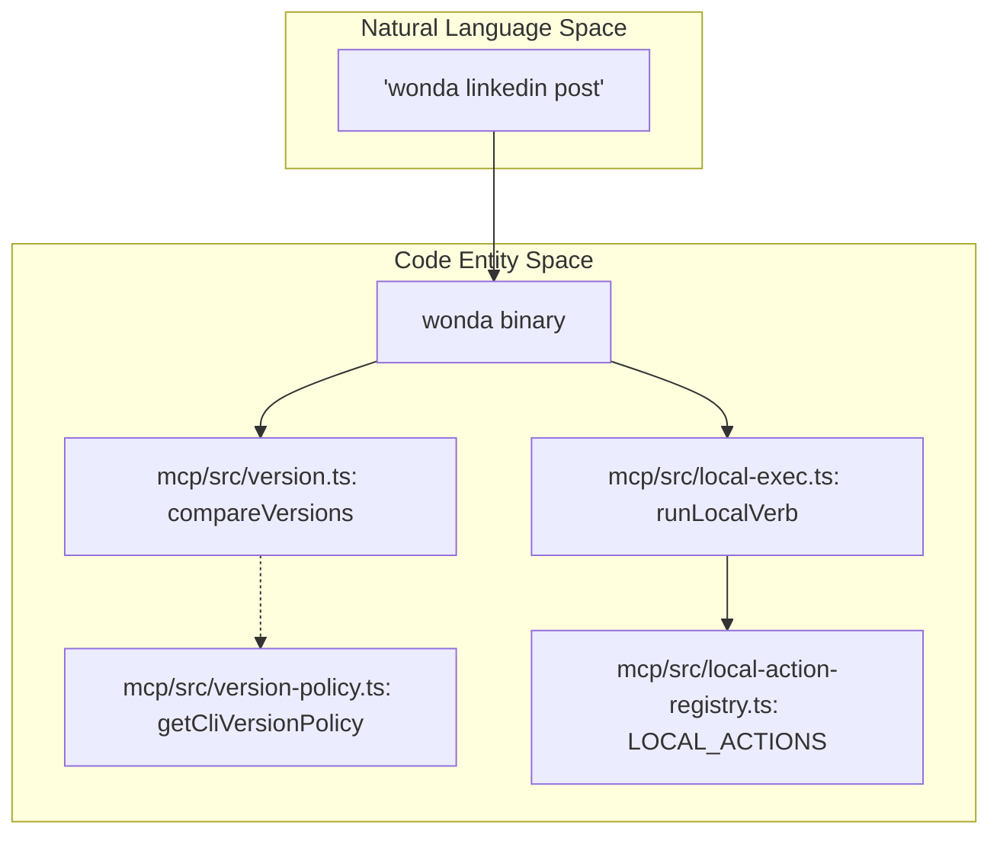
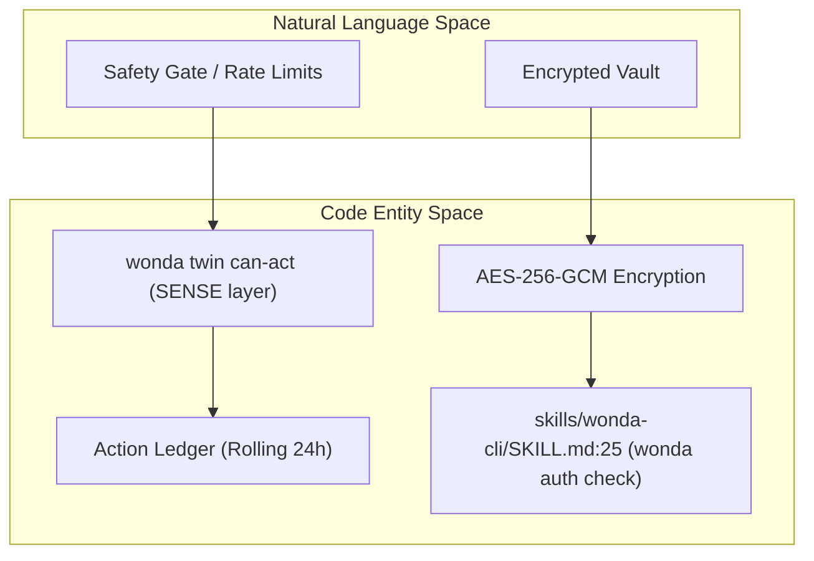

<!-- source: DeepWiki mcp.deepwiki.com · repo degausai/wonda · page 2 wonda CLI Reference · fetched 2026-10-27 -->

# wonda CLI Reference

Relevant source files

The following files were used as context for generating this wiki page:

- [README.md](README.md)
- [assets/terminal.gif](assets/terminal.gif)
- [assets/terminal.png](assets/terminal.png)
- [skills/wonda-cli/SKILL.md](skills/wonda-cli/SKILL.md)

The `wonda` CLI is a unified binary designed to handle the entire lifecycle of AI content operations: from generating raw assets (images, video, music) to complex multi-track editing, social platform research, and autonomous publishing. It is designed to be "agent-native," providing a predictable interface for AI assistants like Claude Code, Cursor, and Gemini to execute complex workflows.

## Command Structure & Execution Engines

The CLI operates across two primary execution environments, controlled via the `--engine` and `--via` flags. This allows users to choose between local privacy/control and cloud-scale automation.

### Execution Environments
*   **Local Engine**: Commands run on the user's machine using local resources or a local relay. For social actions, this typically uses the **Wonda Automation Browser (WAB)**, a hardened Playwright fork, to execute actions via the user's local IP [skills/wonda-cli/SKILL.md:37-54]().
*   **Cloud Engine**: Commands are dispatched to **Cloud Twins**, which are managed, persistent browser instances running in Wonda's infrastructure. These are ideal for scheduled tasks and long-running autonomous loops [skills/wonda-cli/SKILL.md:116-120]().

### Command Groups
| Group | Primary Function | Key Commands |
| :--- | :--- | :--- |
| **Generation** | AI Inference | `generate image`, `generate video`, `audio speech` |
| **Editing** | Media Post-Production | `edit video`, `compose`, `transitions`, `clipping` |
| **Social** | Platform Operations | `linkedin`, `twitter`, `reddit`, `instagram` |
| **System** | Auth & Config | `auth login`, `use --org`, `skill install` |

**Sources:** [README.md:93-176](), [skills/wonda-cli/SKILL.md:6-25]()

---

## System Architecture: Code to Entity Mapping

The following diagrams illustrate how CLI commands and system states map to specific code entities and data structures within the repository.

### CLI Command Dispatch & Versioning
This diagram shows how a command invocation (e.g., `wonda linkedin post`) is processed, checked for updates, and dispatched to the local execution engine.

**Sources:** [mcp/src/version.ts](), [mcp/src/version-policy.ts](), [mcp/src/local-exec.ts](), [mcp/src/local-action-registry.ts]()

### Credential & Rate Limit Safety Gate
This diagram maps the logical concept of "Safety Gates" to the specific classes and files that enforce rate limits and encrypted storage.

**Sources:** [skills/wonda-cli/SKILL.md:24-35](), [README.md:159-160]()

---

## Major Functional Areas

### Media Generation & Editing
Wonda provides a "model waterfall" approach to generation, allowing agents to pick specific models or use defaults for image, video, and audio creation. The editing suite is designed for "local-first" operations, leveraging `ffmpeg` and `hyperframes` for high-performance video manipulation like animated captions and scene splitting.
*   **For details, see [Media Generation & Editing Commands](#2.1)**

### Social Platform Automation
The CLI offers a unified interface for LinkedIn, X (Twitter), Reddit, and Instagram. It supports "Read" operations (often via cookie-based transport) and "Write" operations (via WAB/Twin transport).
*   **For details, see [Social Platform Commands](#2.2)**

### Credentials, Rate Limits & Safety Gate
Security is handled via an AES-256-GCM encrypted vault. Every profile is subject to a "Safety Gate" that monitors rolling 24-hour rate limit buckets for actions like outreach, posting, and commenting to prevent account flagging.
*   **For details, see [Credentials, Rate Limits & Safety Gate](#2.3)**

---

## Global Options

| Option | Description |
| :--- | :--- |
| `--engine <auto\|my_machine\|cloud>` | Forces execution on the local relay or cloud twin [skills/wonda-cli/SKILL.md:55-58](). |
| `--org <slug>` | Switches context to a specific Organization wallet [skills/wonda-cli/SKILL.md:66-67](). |
| `--project <name>` | Tags the spend of a command to a specific project for monitoring [skills/wonda-cli/SKILL.md:87](). |
| `--via <cookies\|wab>` | Selects the transport mechanism for social platform actions [mcp/src/local-action-registry.ts:25](). |

**Sources:** [skills/wonda-cli/SKILL.md:55-87](), [mcp/src/local-action-registry.ts]()

---

