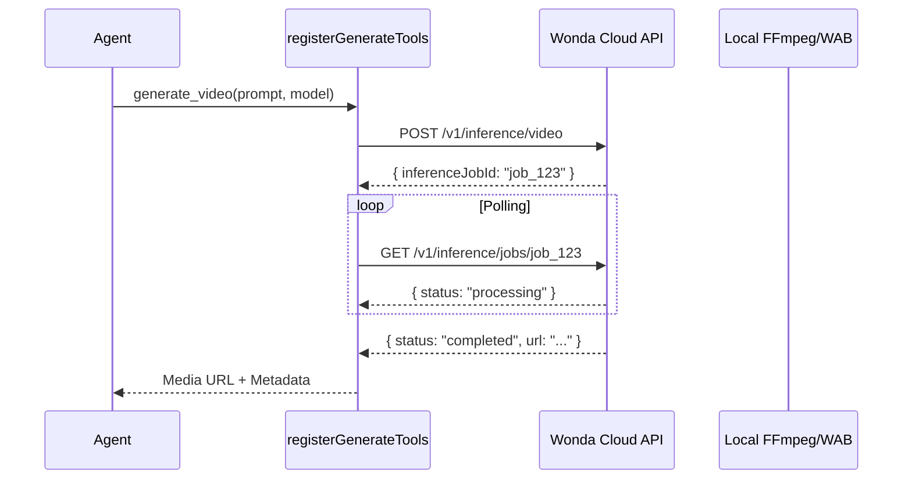

<!-- source: DeepWiki mcp.deepwiki.com · repo degausai/wonda · page 2.1 Media Generation & Editing Commands · fetched 2026-10-27 -->

# Media Generation & Editing Commands

<details>
<summary>Relevant source files</summary>

The following files were used as context for generating this wiki page:

- [README.md](README.md)
- [assets/terminal.gif](assets/terminal.gif)
- [assets/terminal.png](assets/terminal.png)
- [skills/wonda-cli/SKILL.md](skills/wonda-cli/SKILL.md)

</details>


This section details the media capabilities of the Wonda CLI, focusing on the end-to-end lifecycle from AI-driven generation to programmatic video editing and scene analysis. Wonda adopts a "local-first" philosophy where heavy inference occurs in the cloud, while precise timeline manipulation and composition are handled locally via `ffmpeg` and the `hyperframes` engine.

## Generation Tools & Job Polling

Wonda provides a unified interface for generating multimodal content including images, video, music, and speech. These operations follow an asynchronous **Inference Job Polling** pattern to handle long-running GPU tasks.

### Data Flow: Generation Lifecycle
1.  **Request**: The CLI or MCP server sends a prompt and parameters to the `GENERATION_ENDPOINTS` [mcp/src/tools/generate.ts:24-34]().
2.  **Job ID**: The server returns an `inferenceJobId`.
3.  **Polling**: The client enters a polling loop, querying the job status until it reaches a terminal state (`completed` or `failed`).
4.  **Artifact Retrieval**: Upon completion, the final media URL and metadata are returned to the user or agent.

### Supported Generation Types
| Command | Implementation | Key Parameters |
| :--- | :--- | :--- |
| `generate image` | `generate_image` | `prompt`, `model`, `aspect_ratio` |
| `generate video` | `generate_video` | `prompt`, `referenceMediaId`, `duration` |
| `generate music` | `generate_music` | `prompt`, `duration_seconds` |
| `audio speech` | `speech` | `text`, `voice_id`, `model` |
| `audio dialogue` | `dialogue` | `script` (multi-speaker support) |

**Sources:**
- [mcp/src/tools/generate.ts:1-200]()
- [skills/wonda-cli/SKILL.md:95-106]()

---

## Video Editing & Composition

Wonda's editing suite is designed for "agentic editing," where natural language instructions are translated into precise `ffmpeg` operations. The `wonda edit video` and `wonda compose` commands serve as the primary entry points.

### The Model Waterfall
For high-level operations like background removal or upscaling, Wonda utilizes a **Model Waterfall** approach, routing tasks to specialized AI models:
- **Background Removal**: `birefnet-bg-removal` (images) or `bria-video-background-removal` (video).
- **Enhancement**: `topaz-video-upscale` for resolution increases up to 4x.
- **Synchronization**: `sync-lipsync-v2-pro` for matching character lip movements to audio tracks.

### Local Execution Engine
For timeline edits, Wonda uses a local execution engine that wraps `ffmpeg`.

```mermaid
graph TD
    subgraph "Natural Language Space"
        A["Agent Instruction: 'Trim the first 5s and add captions'"]
    end

    subgraph "Code Entity Space"
        B["wonda-mcp: runLocalVerb"]
        C["wonda-cli: edit video --operation trim"]
        D["FFmpeg Process"]
        E["hyperframes Engine"]
    end

    A --> B
    B --> C
    C --> E
    E --> D
    D --> F["Final .mp4 Artifact"]
end
```

**Sources:**
- [README.md:107-136]()
- [mcp/src/local-exec.ts:10-45]()
- [skills/wonda-cli/SKILL.md:111-136]()

---

## Video Analysis & Clipping

The `analyze video` command is a critical bridge between raw video data and LLM understanding. It decomposes video files into a structured format that agents can process.

### Analysis Pipeline
1.  **Frame Extraction**: Extracts a composite frame grid (e.g., 2x2 or 3x3) representing key moments in the video.
2.  **Transcription**: Extracts the audio track and runs speech-to-text.
3.  **Metadata Extraction**: Gathers resolution, FPS, and duration.
4.  **Context Injection**: The resulting text and image grid are fed back to the LLM, allowing it to "see" the video content for subsequent editing decisions.

### Clipping & Scene Detection
The `wonda clipping` and `splitScenes` operations use visual change detection to identify logical breaks in content.
- `wonda edit video --operation splitScenes`: Automatically detects transitions.
- `wonda edit video --operation skipSilence`: Removes non-vocal gaps in the audio track to tighten pacing.

**Sources:**
- [README.md:137-142]()
- [mcp/src/tools/generate.ts:150-180]()

---

## Technical Implementation: Media Dispatcher

The `registerGenerateTools` function in the MCP server maps natural language tools to API calls and local binary executions.



### Key Functions
- `runLocalVerb` [mcp/src/local-exec.ts:12](): Handles local command dispatching with version gating.
- `generateInputSchema` [mcp/src/tools/generate.ts:40](): Defines the Zod validation for all generation requests.
- `extractUpdateNotices` [mcp/src/local-exec.ts:88](): Parses `stderr` from local media commands to check for CLI updates.

**Sources:**
- [mcp/src/tools/generate.ts:10-60]()
- [mcp/src/local-exec.ts:1-100]()
- [README.md:93-136]()

---

