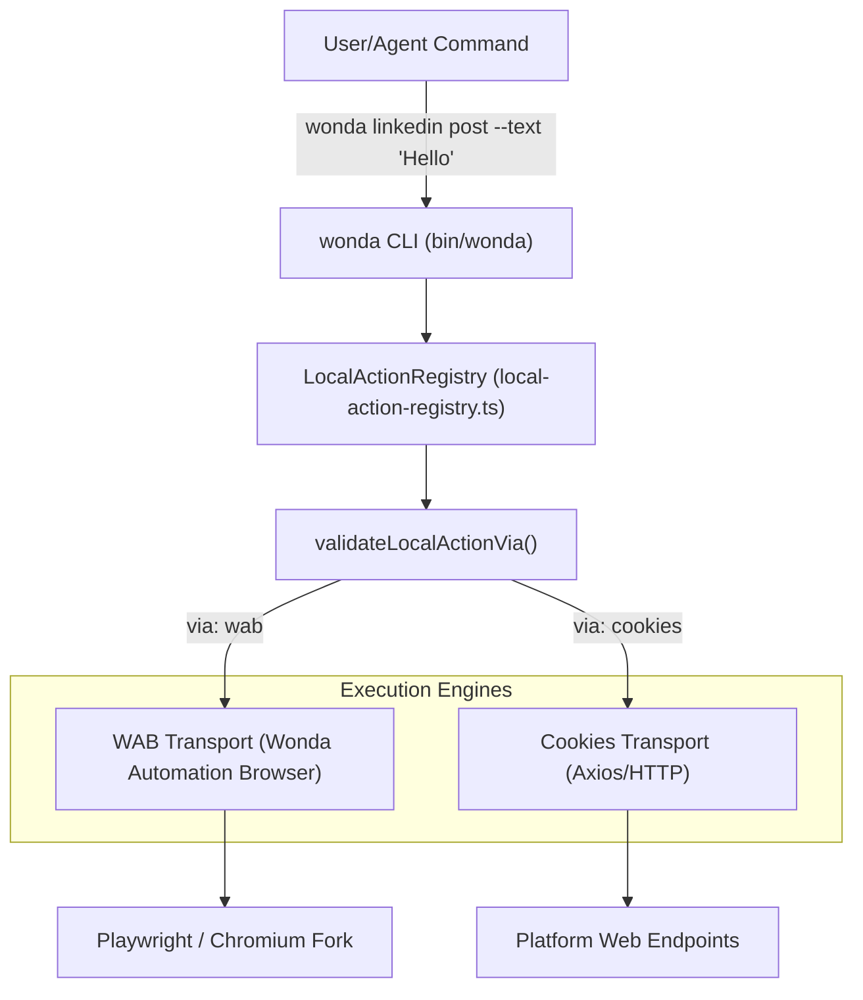
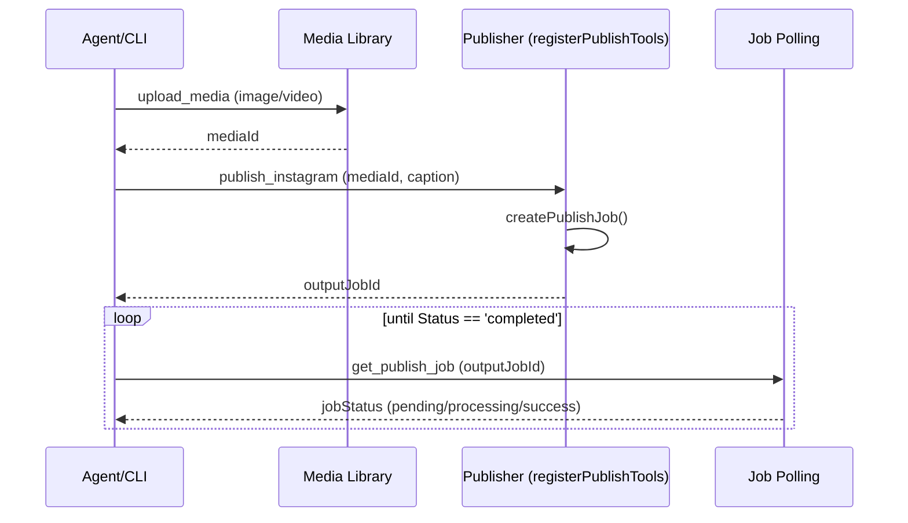

<!-- source: DeepWiki mcp.deepwiki.com · repo degausai/wonda · page 2.2 Social Platform Commands · fetched 2026-10-27 -->

# Social Platform Commands

<details>
<summary>Relevant source files</summary>

The following files were used as context for generating this wiki page:

- [README.md](README.md)
- [assets/terminal.gif](assets/terminal.gif)
- [assets/terminal.png](assets/terminal.png)
- [skills/wonda-cli/SKILL.md](skills/wonda-cli/SKILL.md)

</details>


Wonda provides a unified CLI interface for interacting with major social platforms including LinkedIn, X (Twitter), Reddit, and Instagram. The system abstracts the complexity of different platform APIs and automation requirements through a multi-transport architecture.

## Overview and Transport Engines

Operations are split between **Read** (research/data extraction) and **Write** (publishing/engagement) capabilities. The behavior and environment of these commands are controlled by two primary flags:

*   `--via <cookies|wab>`: Determines the transport layer. `cookies` uses standard HTTP requests with stored session cookies, while `wab` (Wonda Automation Browser) uses a hardened Playwright-based browser to perform actions [mcp/src/local-action-registry.ts:10-14]().
*   `--engine <my_machine|cloud>`: Determines the execution environment. `my_machine` runs the command locally via the CLI or Local Relay, while `cloud` offloads the task to a Wonda Cloud Twin [skills/wonda-cli/SKILL.md:55-58]().

### Data Flow: Natural Language to Platform Action

The following diagram illustrates how a user request (or agent command) transitions from a high-level intent to a specific code execution path.

**Diagram: Command Dispatch Pipeline**

**Sources:** [mcp/src/local-action-registry.ts:10-40](), [skills/wonda-cli/SKILL.md:8-20]()

---

## LinkedIn Commands

LinkedIn support covers profile research, company analysis, messaging, and feed engagement.

### Core Commands
| Command | Description | Transport Default |
| :--- | :--- | :--- |
| `linkedin profile` | View profile by vanity name/URL | `cookies` |
| `linkedin search` | Search people, companies, or posts | `cookies` |
| `linkedin post` | Create a new post | `wab` |
| `linkedin like` | React to a specific post | `wab` |
| `linkedin send-message` | Send a message in a thread | `wab` |

### Implementation Details
LinkedIn actions are defined in the `LOCAL_ACTIONS` registry. For example, the `linkedin-profile` action is restricted to `cookies` transport to ensure high-speed data retrieval without browser overhead [mcp/src/local-action-registry.ts:162-168](). Conversely, writing operations like `linkedin-post` default to `wab` to bypass advanced bot detection [mcp/src/local-action-registry.ts:182-190]().

**Sources:** [README.md:153-174](), [mcp/src/local-action-registry.ts:150-200]()

---

## X (Twitter) & Reddit Commands

Research and automation for X and Reddit focus on content discovery and community engagement.

### X (Twitter)
*   `x search`: Search for tweets or users.
*   `x profile`: Fetch user metadata and recent tweets.
*   `x post`: Publish a tweet (supports `--via wab`).

### Reddit
*   `reddit search`: Search subreddits or posts.
*   `reddit info`: Get details on a specific subreddit.
*   `reddit submit`: Create a post. Note: Reddit submissions require specific validation for `subreddit` and `title` fields [mcp/src/local-action-registry.ts:240-250]().

**Sources:** [README.md:176-192](), [mcp/src/local-action-registry.ts:220-260]()

---

## Instagram & TikTok Publishing

Unlike the research-heavy LinkedIn/X commands, Instagram and TikTok commands are primarily focused on media publishing via the Wonda API.

### Publishing Pipeline
Publishing involves an asynchronous job pattern where media is first uploaded to the Wonda library and then dispatched to the platform.

**Diagram: Media Publishing Logic**

**Sources:** [README.md:143-151](), [skills/wonda-cli/SKILL.md:140-155]()

---

## Execution Control: Via vs. Engine

The system uses a logic gate to determine if a command can run locally or must be sent to the cloud.

### Engine Policy
1.  **`my_machine`**: Forces execution on the local host. If the Wonda Automation Browser is not installed, it will prompt for `wonda wab install` [skills/wonda-cli/SKILL.md:55-58]().
2.  **`cloud`**: Dispatches the command to a **Cloud Twin**. This is required for scheduled tasks or when the local machine is offline [skills/wonda-cli/SKILL.md:116-120]().
3.  **`auto`**: The default behavior. It attempts to use the Local Relay if online, falling back to the Cloud Twin otherwise [skills/wonda-cli/SKILL.md:55-58]().

### Transport Resolution
The function `resolveLocalActionVia` in `local-action-registry.ts` determines the transport based on the action's capabilities and user flags.

```typescript
// Conceptual logic from mcp/src/local-action-registry.ts
function resolveLocalActionVia(action, requestedVia) {
  if (action.via === 'cookies' && requestedVia === 'wab') {
    // Downgrade or error based on capability
  }
  return action.via;
}
```
**Sources:** [mcp/src/local-action-registry.ts:468-490](), [skills/wonda-cli/SKILL.md:55-58]()

## Summary of Social Actions

| Platform | Read (Cookies) | Write (WAB) | Research | Engagement |
| :--- | :---: | :---: | :---: | :---: |
| LinkedIn | Yes | Yes | Profiles/Search | Post/Like/DM |
| X | Yes | Yes | Tweets/Users | Post |
| Reddit | Yes | Yes | Subreddits | Submit |
| Instagram | No | Yes | N/A | Publish |

**Sources:** [README.md:93-200](), [mcp/src/local-action-registry.ts:150-300]()

---

