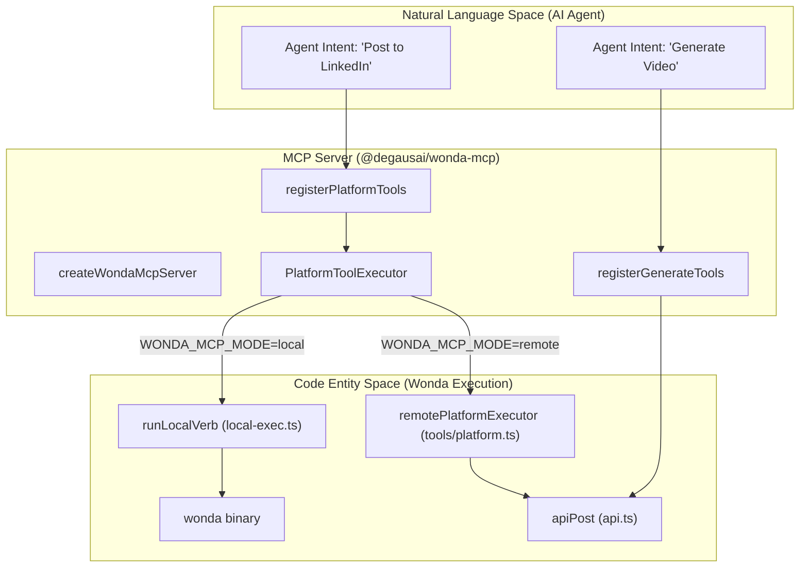
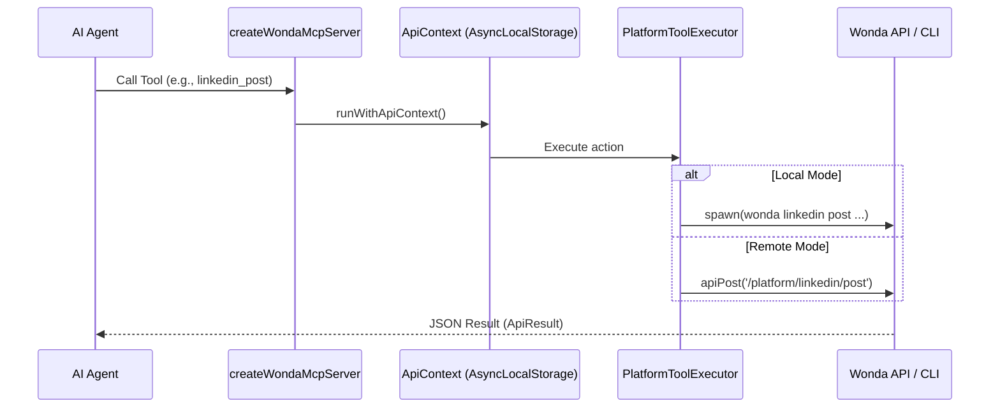

<!-- source: DeepWiki mcp.deepwiki.com · repo degausai/wonda · page 3 MCP Server Architecture · fetched 2026-10-27 -->

# MCP Server Architecture

Relevant source files

The following files were used as context for generating this wiki page:

- [mcp/README.md](mcp/README.md)
- [mcp/package.json](mcp/package.json)
- [mcp/src/index.ts](mcp/src/index.ts)
- [mcp/src/server.ts](mcp/src/server.ts)

The `@degausai/wonda-mcp` package provides a Model Context Protocol (MCP) server that bridges AI agents (such as Claude Desktop, Cursor, or Hermes) to the Wonda ecosystem [mcp/package.json:2-4](). It allows agents to perform high-fidelity social media actions, manage media generation pipelines, and control both local and cloud-based browser twins through a unified tool interface [mcp/README.md:3-4]().

### Operational Modes

The server operates in two distinct modes, controlled by the `WONDA_MCP_MODE` environment variable [mcp/src/index.ts:8-9](). The mode significantly alters the server's instructions to the LLM and the execution path for platform tools.

| Mode | Execution Path | Key Characteristics |
| :--- | :--- | :--- |
| **Local** | Local `wonda` binary [mcp/src/index.ts:15-27]() | Executes via the Wonda Automation Browser (WAB) on the host machine. Uses local cookie stores in `~/.wonda/` [mcp/README.md:9-11](). |
| **Remote** | Wonda Cloud API [mcp/src/server.ts:35-38]() | Routes actions to the Wonda backend, which dispatches them to either a provisioned Cloud Twin or a local relay if online [mcp/src/server.ts:37-44](). |

For details on how these modes are initialized, see [Server Initialization & Execution Modes](#3.1).

### System Topology

The following diagram illustrates how the MCP server translates natural language intent from an AI Agent into concrete system calls within the Wonda "Code Entity Space".

**Bridge: AI Agent to Wonda Code Entities**

**Sources:** [mcp/src/index.ts:8-29](), [mcp/src/server.ts:52-70](), [mcp/src/tools/platform.ts:3-10]()

### Tool Registration Lifecycle

The server follows a modular registration pattern. The `createWondaMcpServer` factory function [mcp/src/server.ts:52-54]() initializes an `McpServer` instance and populates it by calling various registration functions:

*   **Platform Tools:** Registers over 50+ actions for LinkedIn, X, Reddit, and Instagram [mcp/src/server.ts:9]().
*   **Media & Generation:** Handles `generate_image`, `generate_video`, and media library management [mcp/src/server.ts:59-68]().
*   **Cloud Twins:** Manages the lifecycle of hosted browser environments via `registerTwinTools` [mcp/src/server.ts:13]().
*   **Automation Browser:** Direct control tools for the WAB (e.g., `wab_show`, `wab_open`) [mcp/src/server.ts:14]().

### Execution Logic

The server acts as a thin dispatch layer. For platform actions (like `linkedin_post`), it uses a `PlatformToolExecutor` interface [mcp/src/server.ts:3](). In local mode, this executor maps directly to `runLocalVerb`, which spawns the `wonda` CLI binary [mcp/src/index.ts:17-26](). In remote mode, it uses the `ApiContext` to send signed HTTPS requests to the Wonda backend [mcp/src/api.ts:1-10]().

**Bridge: Request Flow & Context**

**Sources:** [mcp/src/index.ts:14-29](), [mcp/src/api.ts:12-25](), [mcp/src/server.ts:35-46]()

### Subsystems

Detailed documentation for the MCP server's internal components is split into the following child pages:

*   **[Server Initialization & Execution Modes](#3.1)**: Detailed breakdown of `index.ts` and `server.ts`, including how `LOCAL_INSTRUCTIONS` and `REMOTE_INSTRUCTIONS` guide the LLM's behavior.
*   **[API Client & Context Management](#3.2)**: Deep dive into `api.ts`, focusing on `AsyncLocalStorage` for credential handling and the `ApiResult` union type.
*   **[MCP Resources & Content Skills](#3.3)**: Overview of the `wonda://` URI scheme and how the server exposes dynamic content skills as both resources and tools.

**Sources:** [mcp/src/server.ts:1-75](), [mcp/src/api.ts:1-50](), [mcp/src/resources/index.ts:1-10]()

---

