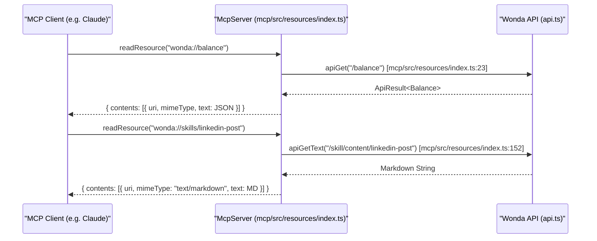
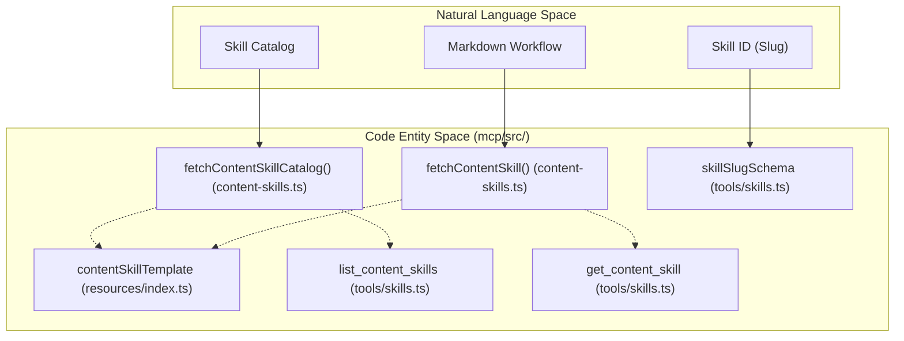

<!-- source: DeepWiki mcp.deepwiki.com · repo degausai/wonda · page 3.3 MCP Resources & Content Skills · fetched 2026-10-27 -->

# MCP Resources & Content Skills

Relevant source files

The following files were used as context for generating this wiki page:

- [mcp/src/content-skills.ts](mcp/src/content-skills.ts)
- [mcp/src/resources/index.ts](mcp/src/resources/index.ts)
- [mcp/src/tools/skills.ts](mcp/src/tools/skills.ts)

The Wonda MCP server exposes a rich set of read-only state and workflow definitions through the **Model Context Protocol (MCP) Resource** system. This system allows AI agents to browse account-level information—such as credit balances, provisioned twins, and platform capabilities—using a standardized URI scheme.

A core component of this system is the **Content Skill** catalog. Skills are Markdown-based workflow definitions that guide agents in content creation and social outreach. By exposing these as both resources and tools, Wonda ensures that agents can discover, inspect, and follow complex multi-step processes defined by either the platform or the user.

## Resource System Overview

The `wonda://` URI scheme provides a structured way for agents to access dynamic platform data. Resources are registered in `mcp/src/resources/index.ts` using the `server.registerResource` method [mcp/src/resources/index.ts:13-172]().

### Registered Resources

| URI | Title | Data Source | MIME Type |
|:---|:---|:---|:---|
| `wonda://balance` | Credit Balance | `GET /balance` | `application/json` |
| `wonda://capabilities` | API Capabilities | `GET /capabilities` | `application/json` |
| `wonda://twins` | Cloud Twins | `GET /twin/sessions` | `application/json` |
| `wonda://skills` | Content Skills | `GET /skill/content` | `application/json` |
| `wonda://skills/{slug}` | Content Skill | `GET /skill/content/{slug}` | `text/markdown` |

### Data Flow: Resource Resolution
The following diagram illustrates how a resource request is routed from the MCP Client through the server to the Wonda API.

**Resource Resolution Sequence**

**Sources:** [mcp/src/resources/index.ts:13-172](), [mcp/src/api.ts:1-72]()

---

## Content Skills Catalog

Content Skills are the "brain" of the agent's workflow. They represent a catalog of effective skills, where canonical Wonda defaults are overlaid with user-specific forks or custom-built skills [mcp/src/resources/index.ts:91-94]().

### Data Structures
The `ContentSkillSummary` defines the metadata for discovery, while the skill itself is a Markdown document retrieved via its `slug` [mcp/src/content-skills.ts:3-18]().

*   **Slug Validation**: Slugs must match the pattern `^[a-z0-9-]+$` and have a maximum length of 80 characters [mcp/src/content-skills.ts:24-25]().
*   **Source Gating**: Skills are marked as `source: "default"` or `source: "user"`. If a user has forked a default skill, `hasDefaultUpdate` indicates if the upstream canonical skill has changed [mcp/src/content-skills.ts:7-9]().

### The Dual Exposure Pattern
Wonda employs a "Dual Exposure" pattern where the Skill Catalog is available as both a **Resource** (for context browsing) and a **Tool** (for active discovery during task execution).

| Entity | Type | Purpose |
|:---|:---|:---|
| `wonda://skills` | Resource | Browsing the full catalog list [mcp/src/resources/index.ts:87-110](). |
| `wonda://skills/{slug}` | Resource Template | Direct URI access to a specific workflow [mcp/src/resources/index.ts:112-171](). |
| `list_content_skills` | Tool | Agent discovery of available workflows [mcp/src/tools/skills.ts:22-43](). |
| `get_content_skill` | Tool | Programmatic retrieval of a workflow by an agent [mcp/src/tools/skills.ts:45-70](). |

**Sources:** [mcp/src/content-skills.ts:1-34](), [mcp/src/tools/skills.ts:1-72]()

---

## Implementation Details

### Resource Templates & Completion
The `wonda://skills/{slug}` resource uses a `ResourceTemplate` to support dynamic lookup. It includes a `complete` handler that allows MCP clients to provide auto-completion for skill slugs by fetching the catalog and filtering by the user's input [mcp/src/resources/index.ts:112-126]().

### Tool Implementation
The tools `list_content_skills` and `get_content_skill` are registered in `mcp/src/tools/skills.ts`. They use `zod` for input validation, specifically enforcing the `skillSlugSchema` [mcp/src/tools/skills.ts:12-19]().

*   **list_content_skills**: Calls `fetchContentSkillCatalog()` and returns a JSON string of the catalog [mcp/src/tools/skills.ts:32-41]().
*   **get_content_skill**: Calls `fetchContentSkill(slug)` and returns the raw Markdown content [mcp/src/tools/skills.ts:59-68]().

### Code Entity Mapping
This diagram bridges the Natural Language concepts to the specific TypeScript functions and schemas used in the codebase.

**MCP Content Skills Entity Map**

**Sources:** [mcp/src/resources/index.ts:112-171](), [mcp/src/tools/skills.ts:12-70](), [mcp/src/content-skills.ts:27-33]()

## Key Functions Summary

| Function | File | Description |
|:---|:---|:---|
| `registerResources` | [mcp/src/resources/index.ts:13]() | Binds URI paths to API fetchers for balance, capabilities, and twins. |
| `registerSkillTools` | [mcp/src/tools/skills.ts:21]() | Registers the tools agents use to discover and read skills. |
| `fetchContentSkillCatalog` | [mcp/src/content-skills.ts:27]() | Executes `apiGet("/skill/content")` to retrieve the skill list. |
| `fetchContentSkill` | [mcp/src/content-skills.ts:31]() | Executes `apiGetText("/skill/content/{slug}")` to retrieve Markdown content. |

**Sources:** [mcp/src/resources/index.ts:13-172](), [mcp/src/tools/skills.ts:1-72](), [mcp/src/content-skills.ts:1-34]()

---

