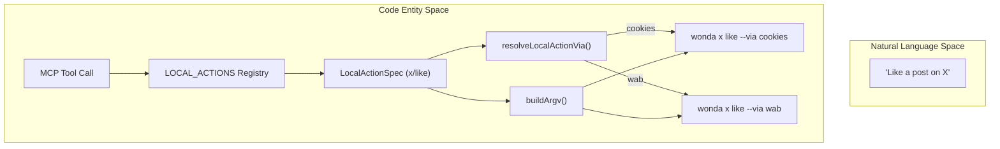
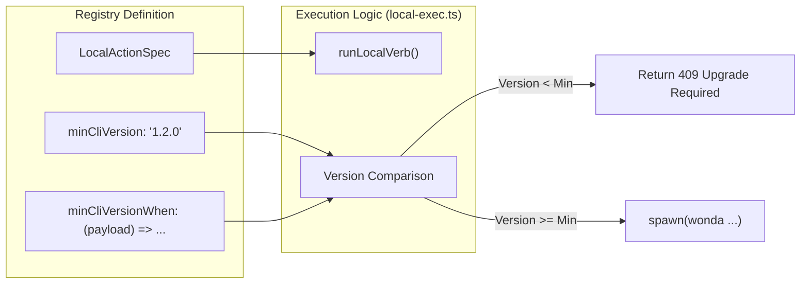

<!-- source: DeepWiki mcp.deepwiki.com · repo degausai/wonda · page 4.1 LOCAL_ACTIONS Registry · fetched 2026-10-27 -->

# LOCAL_ACTIONS Registry

Relevant source files

The following files were used as context for generating this wiki page:

- [mcp/src/local-action-registry.ts](mcp/src/local-action-registry.ts)

The `LOCAL_ACTIONS` registry, defined in [mcp/src/local-action-registry.ts](), is the central source of truth for all social platform operations that can be executed directly by the `wonda` CLI. It defines the mapping between MCP tools and CLI commands, specifying transport mechanisms, argument construction logic, and platform-specific validation rules.

## Core Data Structures

### LocalActionSpec
The `LocalActionSpec` type defines the interface for every action registered in the system. It governs how the MCP server validates incoming tool calls and how it translates them into shell commands for the local binary.

| Property | Type | Description |
| :--- | :--- | :--- |
| `platform` | `LocalActionPlatform` | The target social network (e.g., `linkedin`, `x`, `reddit`). |
| `kind` | `LocalActionKind` | Either `read` (data fetching) or `write` (publishing/interaction). |
| `via` | `LocalActionVia` | The default transport: `cookies` (HTTP/JSON) or `wab` (Automation Browser). |
| `supportedVia` | `LocalActionVia[]` | List of all transports the CLI implementation supports for this action. |
| `payloadFields` | `PayloadFieldSpec[]` | Metadata used to generate Zod schemas and validate tool inputs. |
| `buildArgv` | `Function` | The pipeline that transforms a JSON payload into a CLI argument array. |
| `minCliVersion` | `string` | The minimum version of the `wonda` binary required for this action. |

Sources: [mcp/src/local-action-registry.ts:5-57]()

### PayloadFieldSpec
This structure allows for declarative definition of tool parameters, which are then used to build the MCP tool definitions dynamically.

*   **Supported Kinds**: `string`, `value`, `boolean`, `stringArray`, `positiveInteger` [mcp/src/local-action-registry.ts:65-65]().
*   **Description**: The `description` field is used as the agent-facing hint in the Zod schema [mcp/src/local-action-registry.ts:70-74]().

## Transport Logic: Cookies vs. WAB

The registry distinguishes between two primary execution transports:
1.  **Cookies**: Uses authenticated HTTP requests via the persona's stored session cookies.
2.  **WAB (Wonda Automation Browser)**: Uses a hardened Chromium instance to perform actions as a human user would, bypassing advanced bot detection.

### Transport Resolution and Validation
The registry provides utility functions to ensure the requested transport is valid for a given action and persona.

*   **`validateLocalActionVia`**: Checks if a requested transport (e.g., via the `--via` flag) is supported by the action's `supportedVia` list [mcp/src/local-action-registry.ts:1145-1157]().
*   **`resolveLocalActionVia`**: Determines the final transport. If `viaOverride` is true and the payload specifies a transport, it uses that; otherwise, it defaults to the spec's `via` [mcp/src/local-action-registry.ts:1162-1172]().

### Entity Mapping: Transport Flow
This diagram shows how the `LocalActionSpec` determines the execution path.

Sources: [mcp/src/local-action-registry.ts:17-21](), [mcp/src/local-action-registry.ts:1162-1172]()

## Argument Construction Pipeline (`buildArgv`)

The `buildArgv` function is the core transformation logic. It follows a consistent pattern across most actions:

1.  **Persona/Account**: Adds `--persona <name>` and optionally `--account <id>` [mcp/src/local-action-registry.ts:1196-1200]().
2.  **Transport**: Appends the `--via` flag based on the resolved transport [mcp/src/local-action-registry.ts:1203-1205]().
3.  **Flags & Positional**: Maps payload keys to CLI flags (e.g., `target` becomes a positional, `count` becomes `--count`) [mcp/src/local-action-registry.ts:1210-1230]().

### Specialized Validation and Overrides
Certain actions require logic that exceeds standard field types. These are handled via `FIELD_OVERRIDES` and custom `validatePayload` functions.

*   **LinkedIn Enrichment**: `linkedin/enrich` supports both `target` (single) and `targets` (array), but requires exactly one to be present. It also supports `preservePartialStdout` to keep data from mid-batch rate limits [mcp/src/local-action-registry.ts:159-183]().
*   **Sales Navigator**: Specific actions like `linkedin/sales-nav-search-people` have strict `maxCount` limits (e.g., 1000) and specific `minCliVersion` gates [mcp/src/local-action-registry.ts:470-498]().
*   **Reddit Submission**: `reddit/submit` requires a complex XOR check between `text`, `url`, and `mediaId` to ensure only one content type is posted [mcp/src/local-action-registry.ts:1097-1111]().

Sources: [mcp/src/local-action-registry.ts:111-183](), [mcp/src/local-action-registry.ts:1097-1111]()

## Version Gating

To prevent the MCP server from attempting to execute commands that the locally installed `wonda` binary does not yet support, the registry employs version gating.

*   **`minCliVersion`**: The absolute floor for the action [mcp/src/local-action-registry.ts:41-41]().
*   **`minCliVersionWhen`**: A predicate that applies a version floor only if certain payload conditions are met (e.g., a new flag added to an old command) [mcp/src/local-action-registry.ts:42-44]().
*   **`minCliVersionBase`**: The version floor for the command when the `minCliVersionWhen` predicate is *false* [mcp/src/local-action-registry.ts:50-50]().

### Implementation Mapping: Version Logic
This diagram associates versioning concepts with their implementation in the registry.

Sources: [mcp/src/local-action-registry.ts:37-50](), [mcp/src/local-exec.ts:45-60]()

## Resource Management

### Requested Slots
The `requestedSlots` record defines the rate-limiting resources an action consumes. This is passed to the backend/ledger to track usage against persona limits [mcp/src/local-action-registry.ts:9-9](). Common slots include:
*   `post`: 1
*   `comment`: 1
*   `visit`: 1 (often used for enrichment or profile reads)
*   `search`: 1

### Timeouts
Default timeouts are defined to prevent hanging processes:
*   **Standard**: 120,000ms (2 minutes) [mcp/src/local-action-registry.ts:82-82]().
*   **Max**: 180,000ms (3 minutes) [mcp/src/local-action-registry.ts:83-83]().
*   **LinkedIn Posts/Comments**: 840,000ms (14 minutes) to allow for sequential navigation and stability passes [mcp/src/local-action-registry.ts:87-87]().

Sources: [mcp/src/local-action-registry.ts:82-87]()

---

