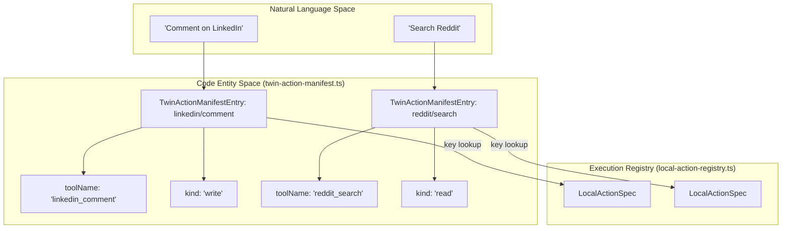
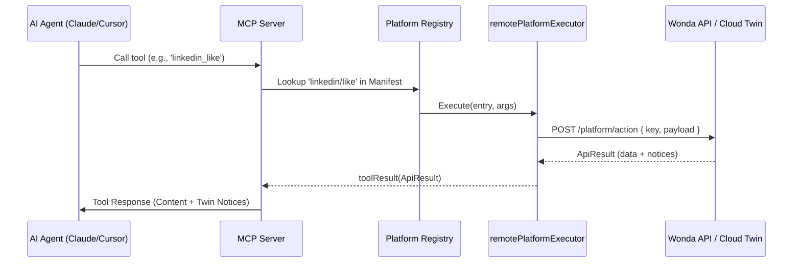

<!-- source: DeepWiki mcp.deepwiki.com · repo degausai/wonda · page 4.2 Twin Action Manifest & Platform Tool Registration · fetched 2026-10-27 -->

# Twin Action Manifest & Platform Tool Registration

Relevant source files

The following files were used as context for generating this wiki page:

- [mcp/src/tools/platform.ts](mcp/src/tools/platform.ts)
- [mcp/src/tools/twin-action-manifest.ts](mcp/src/tools/twin-action-manifest.ts)
- [mcp/src/version.ts](mcp/src/version.ts)

This page documents the systems responsible for defining social platform actions and registering them as MCP tools. The core of this system is a static manifest that maps social media verbs to tool definitions, and a registration pipeline that dynamically generates Zod schemas based on the execution environment (Local vs. Remote).

## Twin Action Manifest

The `TWIN_ACTION_MANIFEST` is the source of truth for all social platform actions supported by Wonda. It defines the metadata required to expose these actions to AI agents via the Model Context Protocol (MCP).

### TwinActionManifestEntry Structure
Each entry in the manifest follows the `TwinActionManifestEntry` type definition [mcp/src/tools/twin-action-manifest.ts:1-11]():

*   **`key`**: A unique identifier for the action, typically formatted as `platform/action` (e.g., `linkedin/comment`) [mcp/src/tools/twin-action-manifest.ts:15]().
*   **`platform`**: The target social network (`linkedin`, `reddit`, `x`, or `instagram`) [mcp/src/tools/twin-action-manifest.ts:3]().
*   **`kind`**: Categorizes the action as `read` (data retrieval) or `write` (state-changing) [mcp/src/tools/twin-action-manifest.ts:5]().
*   **`requestedSlots`**: A record of specific action types and their counts, used for rate limiting and budget tracking (e.g., `{ like: 1 }`) [mcp/src/tools/twin-action-manifest.ts:19-21]().
*   **`variableSlots`**: A boolean indicating if the number of actions performed by the tool can vary based on input (e.g., `linkedin/engage-commenters`) [mcp/src/tools/twin-action-manifest.ts:205]().
*   **`toolName`**: The snake_case name exposed to the MCP client (e.g., `instagram_feed_engage`) [mcp/src/tools/twin-action-manifest.ts:43]().
*   **`localOnly`**: If true, the action is only registered when the MCP server is running in local mode [mcp/src/tools/twin-action-manifest.ts:10]().

### Manifest-to-Code Mapping

The following diagram illustrates how manifest entries bridge natural language concepts to internal code entities.

**Manifest Entity Mapping**

**Sources:** [mcp/src/tools/twin-action-manifest.ts:1-24](), [mcp/src/tools/platform.ts:77]()

---

## Platform Tool Registration

The `registerPlatformTools` function iterates through the `TWIN_ACTION_MANIFEST` and binds each entry to the MCP server.

### Registration Logic
1.  **Environment Detection**: The system checks if it is in local mode using `checkIsLocalMode()` [mcp/src/tools/platform.ts:67]().
2.  **Filtering**: If an entry is marked `localOnly` and the server is in remote mode, it is skipped to avoid 4xx errors from the cloud registry [mcp/src/tools/platform.ts:71]().
3.  **Schema Generation**: The `buildActionInputSchema` function creates a Zod schema for the tool. It attempts to look up a corresponding `LocalActionSpec` in `LOCAL_ACTIONS` to provide detailed field validation [mcp/src/tools/platform.ts:107-114]().
4.  **Description Binding**: Descriptions are dynamically generated based on whether the tool will run locally (via WAB or cookies) or remotely (via Cloud Twin) [mcp/src/tools/platform.ts:83-85]().

### Input Schema Construction
The tool input schema is composed of four primary fields [mcp/src/tools/platform.ts:35-51]():
*   **`persona`**: Identifies the cloud twin or local WAB profile.
*   **`account`**: Selects the local cookie store.
*   **`via`**: Overrides the transport mechanism (`cookies` vs `wab`).
*   **`payload`**: The action-specific data.

If a `LocalActionSpec` exists for the action, `actionInputSchema` generates a strict Zod object for the `payload` field, mapping `payloadFields` from the registry to Zod types [mcp/src/tools/platform.ts:128-135]().

**Sources:** [mcp/src/tools/platform.ts:63-97](), [mcp/src/tools/platform.ts:107-114](), [mcp/src/tools/platform.ts:128-174]()

---

## Execution Flow

When a tool is invoked by an AI agent, the request is routed through a `PlatformToolExecutor`. By default, this is the `remotePlatformExecutor`.

### Remote Platform Executor
The `remotePlatformExecutor` dispatches the action to the Wonda API [mcp/src/tools/platform.ts:233-247]():
1.  Constructs a `PlatformActionRequest` containing the action key, persona, and payload.
2.  Sends a `POST` request to `/platform/action`.
3.  Handles the response via `toolResult`.

### Tool Result & Notice Handling
The `toolResult` function processes the `ApiResult` from the executor [mcp/src/tools/platform.ts:249-269]():
*   **Partial Results**: If the API returns a `partialResult`, the tool reports the successful parts while surfacing the errors [mcp/src/tools/platform.ts:260-264]().
*   **Twin Notices**: The system uses `splitTwinNotices` to extract non-fatal warnings or instructions (e.g., "Account needs re-authentication") from the response data. These are presented to the agent separately from the main result [mcp/src/tools/platform.ts:252-254]().

**Tool Dispatch Sequence**

**Sources:** [mcp/src/tools/platform.ts:89-95](), [mcp/src/tools/platform.ts:233-247](), [mcp/src/tools/platform.ts:249-269]()

## Version Gating and User Agents
The registration process and subsequent execution are sensitive to the binary version.
*   **User-Agent**: The `buildUserAgent` function includes both the MCP package version and the local `wonda` binary version (if in local mode) to ensure the backend can apply version-specific logic [mcp/src/version.ts:43-49]().
*   **Binary Refresh**: If an action fails due to a version mismatch, the system can call `refreshBinaryVersion()` to re-probe the local CLI version without requiring an MCP server restart [mcp/src/version.ts:63-66]().

**Sources:** [mcp/src/version.ts:43-49](), [mcp/src/version.ts:63-90]()

---

