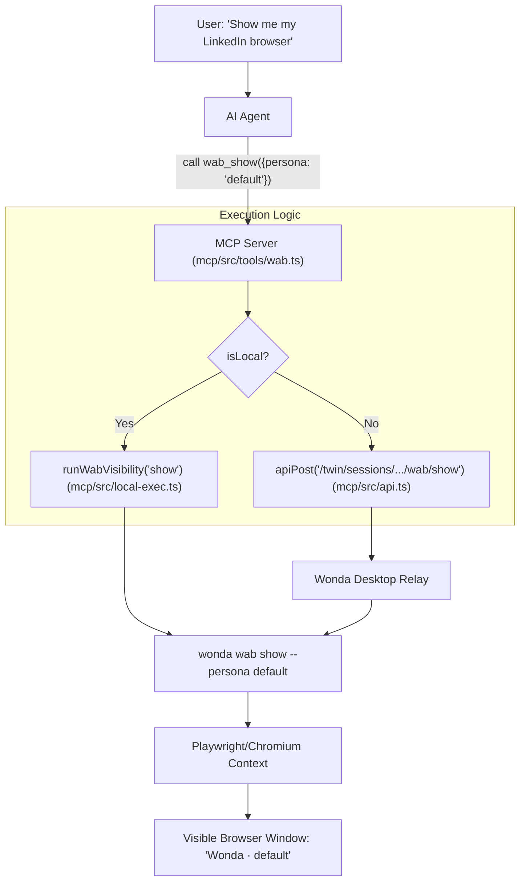
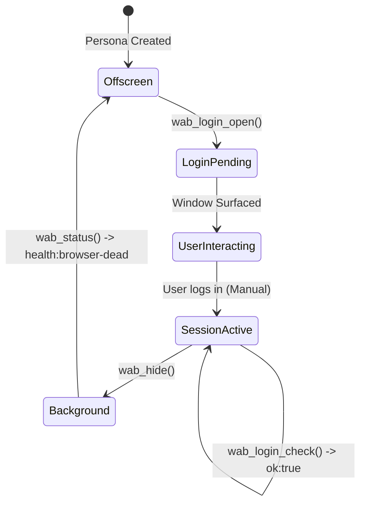

<!-- source: DeepWiki mcp.deepwiki.com · repo degausai/wonda · page 5.1 WAB MCP Tools & Browser Control · fetched 2026-10-27 -->

# WAB MCP Tools & Browser Control

Relevant source files

The following files were used as context for generating this wiki page:

- [mcp/src/local-exec.ts](mcp/src/local-exec.ts)
- [mcp/src/tools/wab.ts](mcp/src/tools/wab.ts)

The Wonda Automation Browser (WAB) is a hardened, agent-native Chromium fork designed to bypass anti-bot mechanisms while providing a seamless interface for AI agents to control web sessions. The WAB MCP tools bridge the gap between high-level agent intent and low-level browser automation, allowing agents to manage personas, handle authentication lifecycles, and perform visual inspections without requiring generic "computer-use" capabilities.

## Architecture & Execution Paths

WAB tools are registered via `registerWabTools` in `mcp/src/tools/wab.ts` [mcp/src/tools/wab.ts:33-33](). These tools support two distinct execution modes determined by `checkIsLocalMode()` [mcp/src/tools/wab.ts:34-34]():

1.  **Local Mode**: The MCP server shells out directly to the `wonda` binary installed on the host machine using `execFile` [mcp/src/local-exec.ts:1-1]().
2.  **Remote Mode**: The MCP server (running in the cloud) forwards commands to a user's paired relay via the `/twin/sessions/{persona}/wab/{command}` endpoint [mcp/src/tools/wab.ts:28-32]().

### Browser Control Flow

The following diagram illustrates how an agent's request to `wab_show` traverses the system to reach the physical browser.

**Diagram: Natural Language to WAB Execution**

Sources: [mcp/src/tools/wab.ts:50-64](), [mcp/src/local-exec.ts:1-169]()

## MCP Tool Registry

The following tools are registered to manage the WAB lifecycle:

| Tool Name | Purpose | Key Parameters | Implementation |
| :--- | :--- | :--- | :--- |
| `wab_status` | Reports browser PID, activity, and health. | `persona` | `runWabStatus` [mcp/src/tools/wab.ts:37-47]() |
| `wab_show` | Surfaces the offscreen browser window to the user. | `persona` | `runWabVisibility("show")` [mcp/src/tools/wab.ts:50-64]() |
| `wab_hide` | Sends the window back to background execution. | `persona` | `runWabVisibility("hide")` [mcp/src/tools/wab.ts:67-81]() |
| `wab_open` | Navigates to a specific platform or URL. | `target`, `persona` | `runWabOpen` [mcp/src/tools/wab.ts:84-106]() |
| `wab_screenshot` | Captures PNG of current page (agent vision). | `persona` | `runWabScreenshot` [mcp/src/tools/wab.ts:109-168]() |
| `wab_login_open` | Initiates manual login flow for a user. | `platform`, `persona` | `runWabLoginOpen` [mcp/src/tools/wab.ts:171-185]() |
| `wab_login_check` | Validates if a login session is now active. | `platform`, `persona` | `runWabLoginCheck` [mcp/src/tools/wab.ts:187-201]() |

Sources: [mcp/src/tools/wab.ts:33-201]()

## The Authentication Lifecycle

Wonda enforces a "Human-in-the-Loop" (HITL) pattern for authentication. Agents are explicitly instructed never to handle credentials directly. Instead, they manage the browser visibility while the user performs the login.

### Login Flow (Manual to Automated)

1.  **`wab_login_open`**: The agent triggers this tool, which opens the WAB window directly to the platform's login page (e.g., `linkedin.com/login`) [mcp/src/tools/wab.ts:175-175]().
2.  **Manual Login**: The user interacts with the surfaced window, completing 2FA or SSO.
3.  **`wab_login_check`**: The agent polls this tool. The underlying `wonda wab check` command returns a structured JSON verdict. Even if the command exits with a non-zero code (indicating "not logged in"), the MCP server parses the stdout to provide the agent with the current state [mcp/src/local-exec.ts:46-49]().
4.  **Cookie Sync**: Once `wab_login_check` returns `ok: true`, cookies are persisted to the persona profile in `~/.wonda/wab/personas/` and automatically synced to the cloud for use by Cloud Twins.
5.  **`wab_hide`**: The agent hides the window once the session is established to resume background automation.

**Diagram: WAB Authentication State Machine**

Sources: [mcp/src/tools/wab.ts:171-201](), [mcp/src/local-exec.ts:46-49]()

## Browser Health & Persona Management

The `wab_status` tool provides critical telemetry for agent recovery logic. Personas are reported with specific health states:

*   **ok**: The browser is running and responding to commands.
*   **browser-dead**: The WAB daemon (Node.js process) is running, but the Chromium context has crashed or been closed [mcp/src/tools/wab.ts:41-41](). The agent must call `wab_show` or `wab_open` to restart the context.
*   **unresponsive**: The browser process is hanging.

### Persona Resolution
When a tool is called without a specific `persona`, the system resolves the "default" account. This logic is handled in `resolvePersona` within `mcp/src/local-exec.ts`, which looks up the active profile in the local Wonda configuration [mcp/src/local-exec.ts:152-152]().

## Version Gating & Safety
WAB tools are subject to version floor checks. If a tool requires a feature not present in the installed `wonda` binary (e.g., the `screenshot` command), `runLocalVerb` intercepts the call and returns a `409 Conflict` error with specific update instructions [mcp/src/local-exec.ts:108-147](). This prevents agents from attempting to execute unknown commands that would lead to non-deterministic failures.

Sources: [mcp/src/local-exec.ts:108-147](), [mcp/src/tools/wab.ts:126-140]()

---

