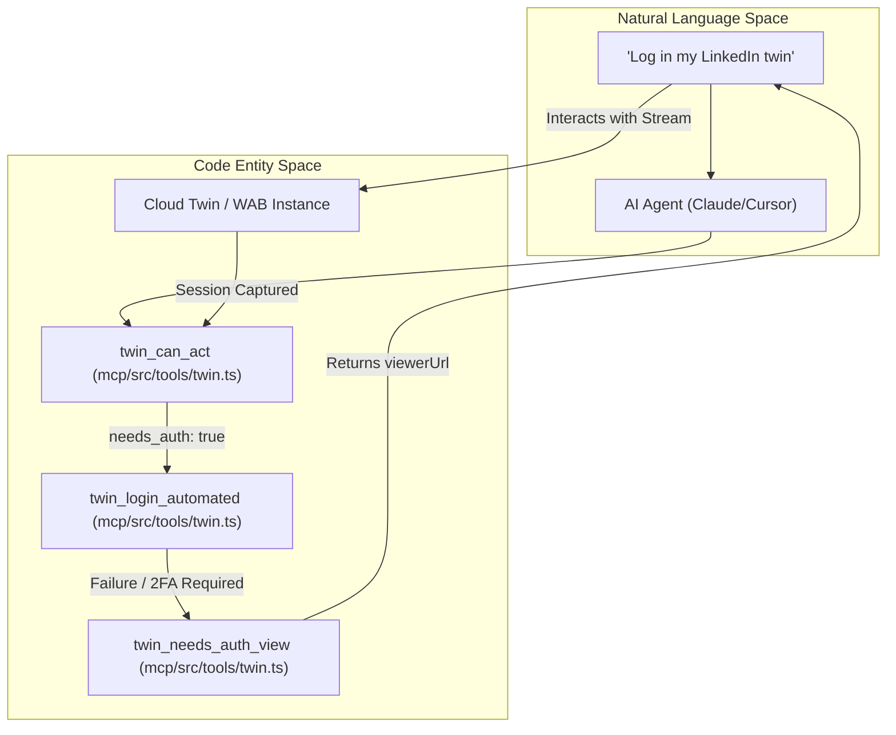
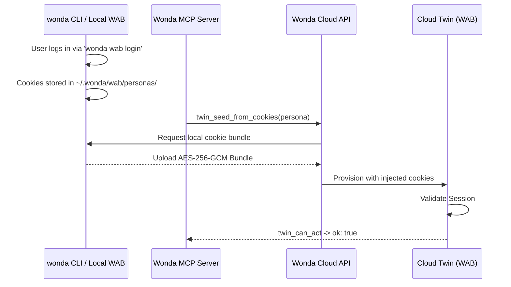

<!-- source: DeepWiki mcp.deepwiki.com · repo degausai/wonda · page 6.2 Twin Authentication & Human-in-the-Loop Flows · fetched 2026-10-27 -->

# Twin Authentication & Human-in-the-Loop Flows

Relevant source files

The following files were used as context for generating this wiki page:

- [mcp/README.md](mcp/README.md)
- [mcp/src/tools/twin.ts](mcp/src/tools/twin.ts)

This page details the mechanisms used to authenticate Cloud Twins and manage human-in-the-loop (HITL) escalations when automated processes encounter authentication gates (2FA, captchas, or expired sessions). Wonda employs a hybrid strategy that transitions between fully automated logins, cookie migration, and interactive streamed browser sessions.

## Authentication Lifecycle & State Management

The authentication state of a twin is tracked via the `needs_auth` flag and the `twin_can_act` tool. When a twin encounters a login wall or a security challenge, it enters a state requiring human intervention.

### Key Data Entities
| Entity | Description | Source |
| :--- | :--- | :--- |
| `needs_auth` | A boolean flag on the Twin session indicating if the account is logged out or challenged. | [mcp/src/tools/twin.ts:223-228]() |
| `viewerUrl` | A temporary URL providing a low-latency stream of the remote Wonda Automation Browser (WAB). | [mcp/src/tools/twin.ts:317-320]() |
| `wsUrl` | A WebSocket endpoint for relaying input events (mouse/keyboard) to the remote twin. | [mcp/src/tools/twin.ts:317-320]() |

### The `twin_can_act` Check
Before executing platform actions, agents use `twin_can_act` to verify the session health. If this returns `ok: false` with a `needs_auth: true` flag, the agent must escalate to a login flow.
- **Source:** [mcp/src/tools/twin.ts:220-233]()

## Automated to Human Escalation Pattern

Wonda follows a waterfall approach for twin authentication, starting with automated attempts and falling back to a "3-A" (Fully Attended) flow.

### Flow Diagram: Authentication Escalation

**Sources:** [mcp/src/tools/twin.ts:220-330](), [mcp/README.md:100-108]()

## Core Authentication Tools

### 1. `twin_login_automated`
Attempts to log in using stored credentials (if available in the encrypted vault) or by refreshing existing session tokens.
- **Implementation:** Calls `POST /twin/sessions/:persona/login-automated`.
- **Source:** [mcp/src/tools/twin.ts:245-257]()

### 2. `twin_signup` (Fully-Attended)
Used for creating new accounts or complex registrations. It initializes a twin environment specifically for a guided setup process.
- **Input Schema:** Requires `persona`, `platform`, and `region`.
- **Source:** [mcp/src/tools/twin.ts:259-277]()

### 3. `twin_seed_from_cookies`
Migrates a local session to the cloud. This is the preferred way to "warm up" a twin by taking a session already established in the local WAB and uploading the encrypted cookie jar to the cloud environment.
- **Implementation:** Calls `POST /twin/sessions/:persona/seed-from-cookies`.
- **Source:** [mcp/src/tools/twin.ts:235-243]()

## Human-in-the-Loop: `twin_needs_auth_view`

When automation fails, the `twin_needs_auth_view` tool provides a bridge for the user to solve challenges manually.

### Streamed Sessions
The tool generates a transient `viewerUrl`. This URL points to a Wonda-hosted web client that streams the WAB frame via WebRTC or high-frequency JPEG encoding, allowing the user to:
1. Complete Multi-Factor Authentication (MFA).
2. Solve Captchas.
3. Verify identity via email codes.

### Code Implementation
The tool accepts an optional `url` parameter to direct the twin to a specific login or verification page before opening the view.
- **Source:** [mcp/src/tools/twin.ts:317-330]()

## Local Session Migration
The transition from local development to cloud execution relies on the coherence between the local `~/.wonda/wab/personas/` directory and the cloud twin's environment.

| Feature | Local WAB | Cloud Twin |
| :--- | :--- | :--- |
| **Auth Method** | `wab_login_open` [mcp/src/tools/wab.ts:80-92]() | `twin_needs_auth_view` [mcp/src/tools/twin.ts:317-330]() |
| **Storage** | Local JSON files [mcp/README.md:87-90]() | Encrypted Cloud Vault |
| **Migration** | N/A | `twin_seed_from_cookies` [mcp/src/tools/twin.ts:235-243]() |

### Data Flow: Local to Cloud Sync

**Sources:** [mcp/README.md:100-108](), [mcp/src/tools/twin.ts:235-243]()

## Error Handling & Recovery
If a twin's `needs_auth` flag is set, most `WRITE` operations will be blocked by the SENSE layer (Safety Gate) to prevent account flagging. The agent is instructed via the `TwinNotice` structure to prompt the user for a "manual auth session."
- **Source:** [mcp/src/tools/platform.ts:130-145]() (Logic for Twin Notices/Partial Results).

---

