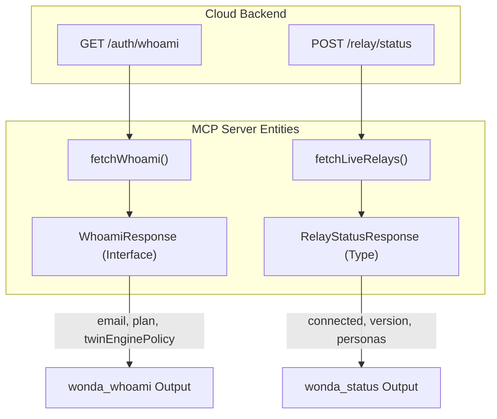
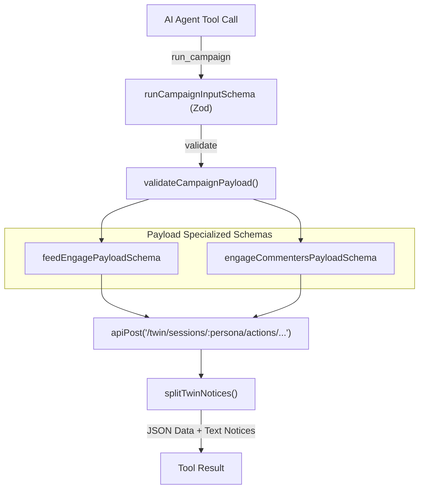

<!-- source: DeepWiki mcp.deepwiki.com · repo degausai/wonda · page 8 Account Management & Campaigns · fetched 2026-10-27 -->

# Account Management & Campaigns

Relevant source files

The following files were used as context for generating this wiki page:

- [mcp/src/notices.ts](mcp/src/notices.ts)
- [mcp/src/tools/campaign.ts](mcp/src/tools/campaign.ts)
- [mcp/src/tools/status.ts](mcp/src/tools/status.ts)
- [mcp/src/tools/whoami.ts](mcp/src/tools/whoami.ts)

This section covers the tools and systems responsible for identity verification, system status monitoring, and the execution of autonomous campaign loops. Wonda provides a unified interface for managing both local and cloud-based personas, ensuring that AI agents can verify their operating environment and execute long-running tasks safely.

## Status & Identity

The status and identity system allows an agent to determine "who" it is acting as and the health of the underlying execution environment. Wonda distinguishes between **Local Mode** (running directly on the user's machine) and **Remote Mode** (running as a cloud connector) [mcp/src/tools/whoami.ts:51-51]().

### Identity Resolution
The `wonda_whoami` tool provides the authoritative identity for the current session. It resolves the account email, subscription plan, and the `twinEnginePolicy` (which dictates whether actions run on the user's machine or in the cloud) [mcp/src/tools/whoami.ts:8-16](). It also exposes `localPersonas`, which lists the specific browser profiles (e.g., LinkedIn, X) currently logged in on the user's Mac [mcp/src/tools/whoami.ts:32-36]().

### System Health & Updates
The `wonda_status` tool merges local binary information with data from the **Relay** (the Wonda Mac app). In remote mode, the tool focuses on the `localRelay` status—whether the user's Mac app is online and what version it is reporting [mcp/src/tools/status.ts:44-48](). The system automatically compares the current `binaryVersion` against the `latest` version from the server to flag if an `updateAvailable` is true [mcp/src/tools/status.ts:71-74]().

For details, see [Status & Identity Tools](#8.1).

### Identity Mapping
The following diagram illustrates how identity data is retrieved from the backend and mapped to the `WhoamiResponse` structure used by agents.

**Identity Data Flow**

Sources: [mcp/src/tools/whoami.ts:8-37](), [mcp/src/tools/status.ts:16-40]()

---

## Autonomous Campaigns & Loops

Campaign tools allow agents to initiate autonomous, bounded work loops that run independently of the agent's active session. These are governed by the `run_campaign` and `schedule_loop` tools [mcp/src/tools/campaign.ts:150-180]().

### Campaign Actions
Wonda supports specialized autonomous verbs:
*   **`feed-engage`**: Scans a platform feed (LinkedIn, X, etc.) based on authors or keywords and performs reactions or replies [mcp/src/tools/campaign.ts:34-82]().
*   **`engage-commenters`**: Targets a specific post and interacts with the users who have commented on it (e.g., liking their comments or sending connection requests) [mcp/src/tools/campaign.ts:92-107]().

### Validation Pipeline
Before a campaign is dispatched to the backend, it undergoes a strict validation pipeline using `runCampaignInputSchema` and `validateCampaignPayload` [mcp/src/tools/campaign.ts:117-129](). This includes platform-specific logic, such as enforcing that Instagram campaigns use `authors` rather than `keywords` [mcp/src/tools/campaign.ts:216-222]().

### Twin Notices
Successful campaign actions may return "Twin Notices"—soft, out-of-band hints (e.g., "Relay update available"). The `splitTwinNotices` utility strips these from the JSON payload and appends them as plain text lines so the agent can surface them to the user without breaking programmatic parsing of the result [mcp/src/notices.ts:1-32]().

For details, see [Campaign & Autonomous Loop Tools](#8.2).

### Campaign Execution Architecture
This diagram bridges the natural language "Campaign" concept to the internal Zod schemas and API endpoints.

**Campaign Dispatch Pipeline**

Sources: [mcp/src/tools/campaign.ts:117-167](), [mcp/src/notices.ts:11-32]()

---

## Tool Summary Table

| Tool Name | Primary Function | Key Input Entities | Source |
| :--- | :--- | :--- | :--- |
| `wonda_whoami` | Identity & Policy Check | `WhoamiResponse` | [mcp/src/tools/whoami.ts:47]() |
| `wonda_status` | Relay & Binary Health | `RelayStatusResponse` | [mcp/src/tools/status.ts:44]() |
| `run_campaign` | Execute One-off Loop | `runCampaignInputSchema` | [mcp/src/tools/campaign.ts:151]() |
| `schedule_loop` | Recurring Cron Loop | `scheduleLoopInputSchema` | [mcp/src/tools/campaign.ts:171]() |

Sources: [mcp/src/tools/whoami.ts:45-76](), [mcp/src/tools/status.ts:42-106](), [mcp/src/tools/campaign.ts:149-181]()

---

