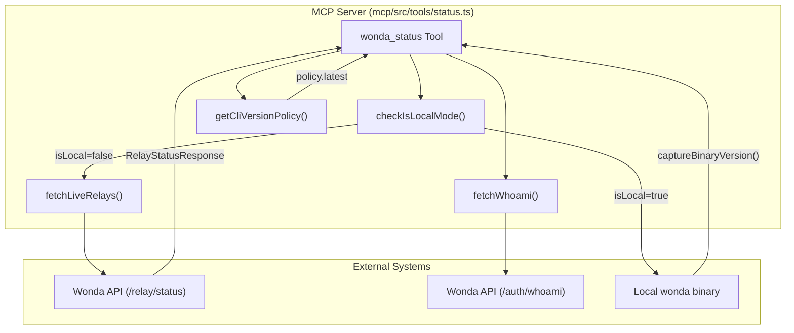
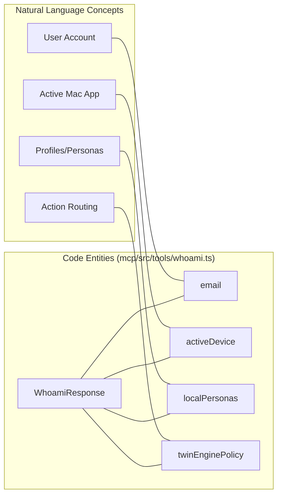

<!-- source: DeepWiki mcp.deepwiki.com · repo degausai/wonda · page 8.1 Status & Identity Tools · fetched 2026-10-27 -->

# Status & Identity Tools

Relevant source files

The following files were used as context for generating this wiki page:

- [mcp/src/notices.ts](mcp/src/notices.ts)
- [mcp/src/tools/campaign.ts](mcp/src/tools/campaign.ts)
- [mcp/src/tools/status.ts](mcp/src/tools/status.ts)
- [mcp/src/tools/whoami.ts](mcp/src/tools/whoami.ts)

The Status and Identity tools provide the MCP server with the ability to inspect the Wonda environment, verify user credentials, and determine the health and versioning of the local or remote execution engines. These tools are critical for agents to understand their execution context—specifically whether they are operating in a "Local" mode (direct binary execution) or "Remote" mode (via a cloud connector/relay).

## Wonda Status (`wonda_status`)

The `wonda_status` tool provides a comprehensive snapshot of the Wonda installation. It merges local environment data with relay-reported data from the Wonda backend to give the agent a clear picture of whether the system is ready for action.

### Implementation Details
The tool is registered in `registerStatusTools` [mcp/src/tools/status.ts:42-106](). It performs a multi-step check:
1.  **Execution Mode Detection**: Calls `checkIsLocalMode()` to determine if the MCP server is running on the user's machine [mcp/src/tools/status.ts:53]().
2.  **Identity Fetching**: Simultaneously calls `fetchWhoami()` to identify the acting account [mcp/src/tools/status.ts:59]().
3.  **Relay Polling**: If in remote mode, it calls `fetchLiveRelays()` to query `/relay/status` for connected Wonda Mac apps [mcp/src/tools/status.ts:34-40]().
4.  **Version Merging**: It resolves the `binaryVersion` by either capturing the local binary version via `captureBinaryVersion()` or using the version reported by the active relay [mcp/src/tools/status.ts:64-66]().

### Version & Update Logic
The system compares the active `binaryVersion` against the `latest` version returned by `getCliVersionPolicy()` [mcp/src/tools/status.ts:67-74](). It also detects the `channel` (e.g., brew, npm) to provide specific `updateInstructions` [mcp/src/tools/status.ts:75-78]().

### Data Flow: Status Resolution
The following diagram illustrates how `wonda_status` aggregates data from local and remote sources.

**Wonda Status Data Aggregation**

**Sources:** [mcp/src/tools/status.ts:34-106](), [mcp/src/version.ts:8-12](), [mcp/src/version-policy.ts:5-5]()

---

## Wonda Whoami (`wonda_whoami`)

The `wonda_whoami` tool reports the account identity (email, plan) and the routing policy for platform actions. This is essential for agents to verify they are acting on behalf of the correct user before performing write operations.

### Key Data Structures
The tool returns a `WhoamiResponse` object [mcp/src/tools/whoami.ts:12-37]():
*   **`email` / `accountId`**: The authenticated user's identity.
*   **`twinEnginePolicy`**: Defines where actions run (`auto`, `my_machine`, or `cloud`).
*   **`activeDevice`**: Details about the paired Mac/PC, including `online` status and `selfUpdateError`.
*   **`localPersonas`**: A detailed list of personas existing on the user's machine, including which platforms (LinkedIn, X, etc.) each persona is logged into [mcp/src/tools/whoami.ts:36-36]().

### Identity & Mode Context
The tool appends a `mode` field ("local" or "remote") to the response to inform the agent if the MCP server itself is running locally [mcp/src/tools/whoami.ts:69-70]().

**Identity Mapping: Natural Language to Code**

**Sources:** [mcp/src/tools/whoami.ts:12-76]()

---

## Notice Handling & Response Pattern

Many tools, including status and campaign tools, utilize a "Notice" pattern. These are soft, out-of-band hints (e.g., "Relay update available") that ride along with successful API responses.

### splitTwinNotices
The `splitTwinNotices` function [mcp/src/notices.ts:11-32]() is used to extract these messages from the API payload. It:
1.  Identifies a `notices` array in the JSON response [mcp/src/notices.ts:18-21]().
2.  Extracts the `message` string from each notice object [mcp/src/notices.ts:22-30]().
3.  Returns the cleaned `data` (without the notices) and a list of `noticeLines` to be appended to the tool's output [mcp/src/notices.ts:31]().

This ensures that agents can display critical system warnings to the user without the notices interfering with the structured JSON data the agent might be parsing.

**Sources:** [mcp/src/notices.ts:1-33]()

---

## Tool Summary Table

| Tool Name | Title | Primary Function | Key Output Fields |
| :--- | :--- | :--- | :--- |
| `wonda_status` | Wonda Status | Check installation health and updates. | `binaryVersion`, `updateAvailable`, `localRelay` |
| `wonda_whoami` | Wonda Whoami | Verify account and persona availability. | `email`, `plan`, `twinEnginePolicy`, `localPersonas` |

**Sources:** [mcp/src/tools/status.ts:43-51](), [mcp/src/tools/whoami.ts:46-54]()

---

