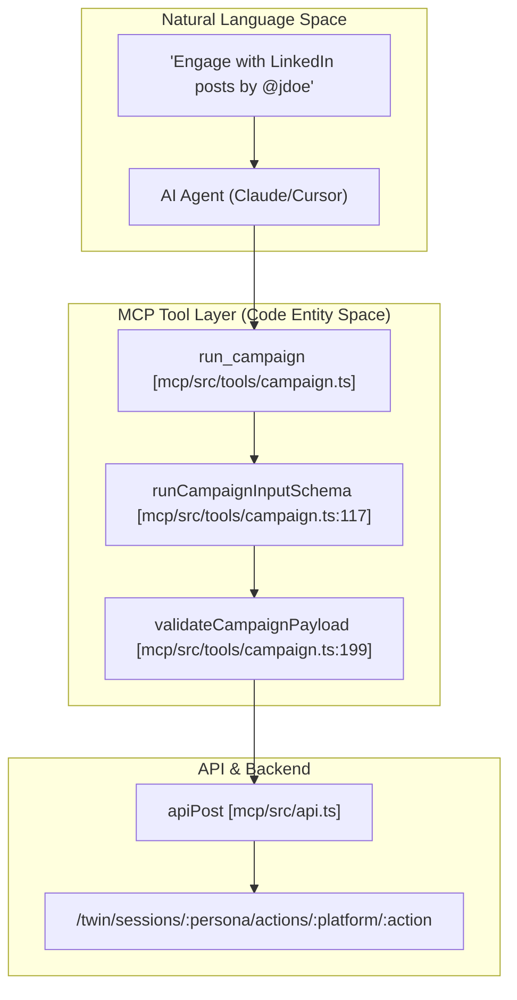
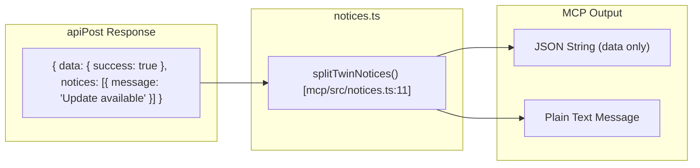

<!-- source: DeepWiki mcp.deepwiki.com · repo degausai/wonda · page 8.2 Campaign & Autonomous Loop Tools · fetched 2026-10-27 -->

# Campaign & Autonomous Loop Tools

Relevant source files

The following files were used as context for generating this wiki page:

- [mcp/src/notices.ts](mcp/src/notices.ts)
- [mcp/src/tools/campaign.ts](mcp/src/tools/campaign.ts)
- [mcp/src/tools/status.ts](mcp/src/tools/status.ts)
- [mcp/src/tools/whoami.ts](mcp/src/tools/whoami.ts)

Campaign and autonomous loop tools provide the interface for executing bounded, self-pacing social engagement workflows and setting up recurring schedules for Cloud Twins. Unlike single-action platform tools, these tools initiate high-level "verbs" that run autonomously under server-side safety caps and rate limits.

## Overview of Autonomous Tools

Wonda distinguishes between immediate actions and autonomous campaigns. Autonomous tools allow an agent to approve a complex workflow once (e.g., "engage with the feed for 2 minutes"), which the system then executes independently.

The two primary tools registered in this category are:
1.  `run_campaign`: Executes a single, time-bounded autonomous session [mcp/src/tools/campaign.ts:151-158]().
2.  `schedule_loop`: Creates a recurring cron-based schedule for autonomous tasks [mcp/src/tools/campaign.ts:171-178]().

### Data Flow: Natural Language to Campaign Execution

The following diagram illustrates how an agent's natural language request is validated against Zod schemas and dispatched to the Cloud Twin API.

**Campaign Dispatch Flow**

**Sources:** [mcp/src/tools/campaign.ts:117-129](), [mcp/src/tools/campaign.ts:151-168](), [mcp/src/api.ts:1-10]()

---

## Campaign Action Verbs

The `run_campaign` tool supports specific "verbs" that encapsulate complex logic. Each verb has a strict payload schema and platform-specific validation rules.

### feed-engage
This verb instructs the twin to scan a platform feed (optionally filtered by authors or keywords) and perform interactions like liking or replying.

*   **Default Duration:** 120,000ms (2 minutes) [mcp/src/tools/campaign.ts:9]().
*   **Max Duration:** 180,000ms [mcp/src/tools/campaign.ts:8]().
*   **Validation Rules:**
    *   **Instagram:** Requires `authors`. Unlike other platforms, keyword-based feed engagement is not supported on Instagram [mcp/src/tools/campaign.ts:223-229]().
    *   **Reddit:** Requires `subreddits` [mcp/src/tools/campaign.ts:215-221]().
    *   **LinkedIn/X:** Can use `authors` or `keywords` [mcp/src/tools/campaign.ts:231-237]().

### engage-commenters
This verb targets a specific post and interacts with the users who have commented on it.

*   **Actions:** Supports `like`, `reply`, and `connect` [mcp/src/tools/campaign.ts:21]().
*   **Default Duration:** 180,000ms (3 minutes) [mcp/src/tools/campaign.ts:10]().
*   **Requirement:** If the `reply` action is included, `replyText` must be provided [mcp/src/tools/campaign.ts:109-115]().

**Sources:** [mcp/src/tools/campaign.ts:8-10](), [mcp/src/tools/campaign.ts:34-82](), [mcp/src/tools/campaign.ts:92-115](), [mcp/src/tools/campaign.ts:215-237]()

---

## Scheduling & Loops

The `schedule_loop` tool enables recurring execution of autonomous tasks using standard cron syntax.

### scheduleLoopInputSchema
The schema for scheduling includes parameters for both deterministic commands and agentic workflows:

| Field | Type | Description |
| :--- | :--- | :--- |
| `persona` | `string` | The Cloud Twin identity to use [mcp/src/tools/campaign.ts:132](). |
| `cron` | `string` | Standard cron expression for frequency [mcp/src/tools/campaign.ts:134](). |
| `taskKind` | `enum` | `saved_sync`, `engage`, or `agent` [mcp/src/tools/campaign.ts:135](). |
| `jitterWindowSeconds` | `number` | Max random delay (up to 86,400s) to avoid bot-like patterns [mcp/src/tools/campaign.ts:144](). |
| `mode` | `enum` | `deterministic` (fixed command) or `agent` (AI-driven) [mcp/src/tools/campaign.ts:140](). |

**Sources:** [mcp/src/tools/campaign.ts:131-147]()

---

## Response Handling & Notice Stripping

Campaign tools utilize a specific response pattern to handle "Twin Notices"—out-of-band metadata provided by the server (e.g., update alerts or rate limit warnings) that should be surfaced to the user but removed from the raw JSON data passed to the agent's logic.

### The Notice Stripping Pattern
The `toolResult` function (called by `run_campaign` and `schedule_loop`) uses `splitTwinNotices` to clean the response [mcp/src/tools/campaign.ts:166, 179]().

1.  **Input:** A JSON object containing a `notices` array [mcp/src/notices.ts:9]().
2.  **Process:** `splitTwinNotices` extracts the `message` field from each notice object [mcp/src/notices.ts:22-30]().
3.  **Output:** A clean data object and a list of plain-text strings to be appended to the tool's output [mcp/src/notices.ts:31]().

**Notice Processing Logic**

**Sources:** [mcp/src/notices.ts:1-32](), [mcp/src/tools/campaign.ts:162-167]()

---

## Technical Validation Implementation

The `runCampaignInputSchema` utilizes a `superRefine` block to enforce complex cross-field dependencies that cannot be captured by standard Zod types.

*   **Implementation:** The `validateCampaignPayload` function is called during the parsing phase [mcp/src/tools/campaign.ts:127-129]().
*   **Logic:** It checks the `platform` and `action` fields to determine which specific sub-schema (`feedEngagePayloadSchema` or `engageCommentersPayloadSchema`) to apply to the generic `payload` record [mcp/src/tools/campaign.ts:199-213]().
*   **Platform Restrictions:** Specific logic branches ensure that platforms like Instagram do not receive invalid configurations (e.g., keyword searches on the main feed) before the request ever leaves the MCP server [mcp/src/tools/campaign.ts:223-229]().

**Sources:** [mcp/src/tools/campaign.ts:117-129](), [mcp/src/tools/campaign.ts:183-197](), [mcp/src/tools/campaign.ts:199-237]()

---

