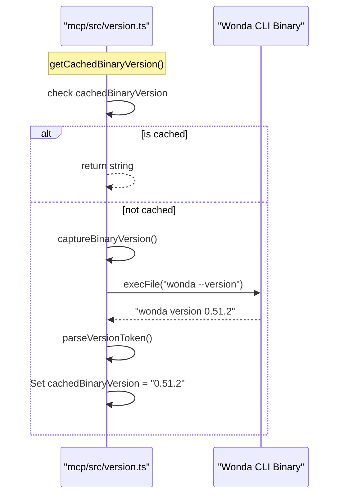
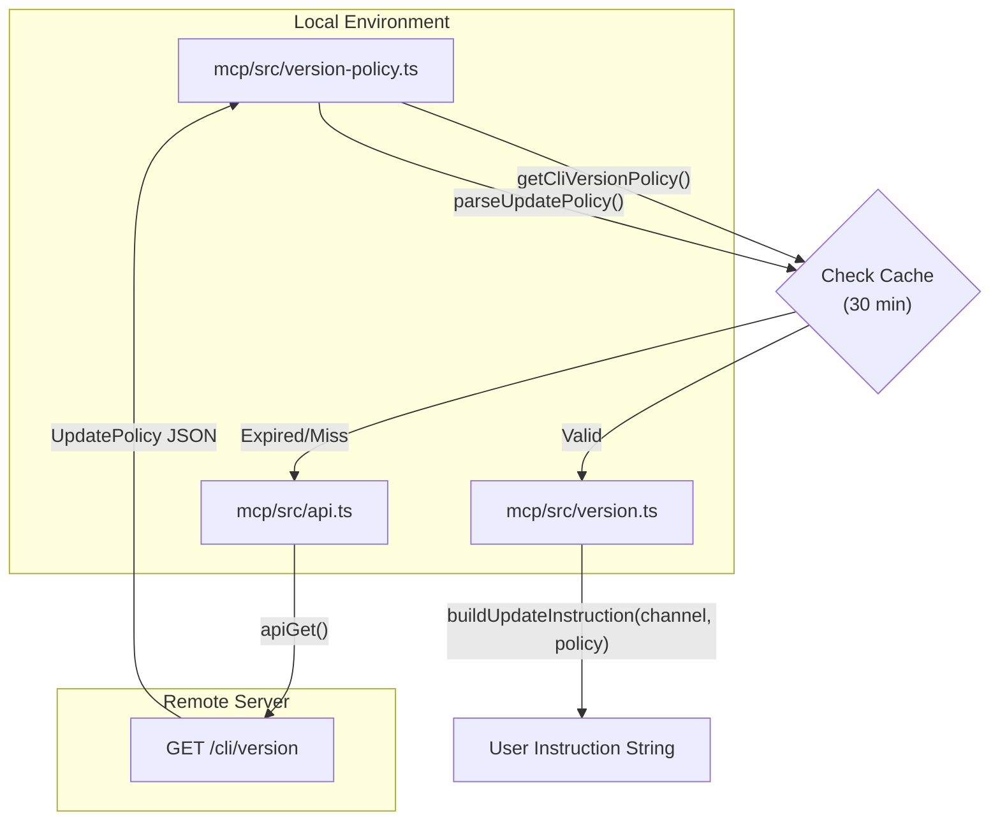

<!-- source: DeepWiki mcp.deepwiki.com · repo degausai/wonda · page 9.1 Version Detection & Update Policy · fetched 2026-10-27 -->

# Version Detection & Update Policy

Relevant source files

The following files were used as context for generating this wiki page:

- [mcp/src/tools/twin-action-manifest.ts](mcp/src/tools/twin-action-manifest.ts)
- [mcp/src/version-policy.ts](mcp/src/version-policy.ts)
- [mcp/src/version.ts](mcp/src/version.ts)

The versioning system in Wonda ensures compatibility between the MCP server (TypeScript) and the Wonda CLI binary (Go), while providing a seamless update experience across diverse distribution channels. It handles binary probing, install channel detection, and enforces server-side version policies to maintain system stability.

## Version Detection & User-Agent

The system differentiates between the version of the MCP package itself (`PKG_VERSION`) and the version of the underlying CLI binary. This is critical because the MCP server often acts as a wrapper that executes the CLI to perform local actions.

### Key Functions
- `captureBinaryVersion`: Executes `wonda --version` once per process and caches the result. It uses a 10-second timeout and ignores non-numeric "dev" build strings [mcp/src/version.ts:73-90]().
- `refreshBinaryVersion`: Clears the cache and re-probes the binary. This is used during per-action version gates to allow users to upgrade the binary mid-session without restarting the MCP host [mcp/src/version.ts:63-66]().
- `buildUserAgent`: Constructs a header string including both the MCP package version and the binary version (e.g., `Wonda-MCP/1.2.3 wonda-bin/0.45.0`) when running in local mode [mcp/src/version.ts:43-49]().

### Version Probing Flow

Title: Binary Version Discovery & Caching

**Sources:** [mcp/src/version.ts:54-90](), [mcp/src/version.ts:183-186]()

---

## Install Channel Detection

Wonda identifies how the CLI was installed to provide correct update instructions. This detection relies on environment variables and file system path heuristics.

### Supported Channels
The system recognizes six primary installation channels [mcp/src/version.ts:10-17]():
- `brew`: Homebrew (macOS/Linux)
- `npm`: Node Package Manager
- `curl`: Direct bash script installation (default for Unix-like systems)
- `pkg`: macOS Installer package
- `windows`: Windows MSI/Executable
- `mcpb`: Bundled extension (e.g., Claude Desktop extension)

### Detection Logic
The `detectInstallChannel` function follows a specific precedence order [mcp/src/version.ts:108-131]():
1. **Binary Path Heuristics**: If `WONDA_BIN` is set, it checks if the path contains `Cellar` (Homebrew), `node_modules` (NPM), or if it resides within the MCP package itself (MCPB).
2. **Environment Override**: Checks `WONDA_INSTALL_CHANNEL`.
3. **Platform Default**: Defaults to `windows` on Win32 systems, otherwise `curl`.

**Sources:** [mcp/src/version.ts:10-30](), [mcp/src/version.ts:108-131]()

---

## Update Policy & Remote Sync

Version enforcement is driven by the Wonda API. The MCP server periodically checks the remote policy to determine if the current CLI version is deprecated or if a newer version is recommended.

### Policy Shape
The `UpdatePolicy` object contains the following metadata [mcp/src/version.ts:21-26]():
- `latest`: The most recent stable version.
- `minSupported`: The minimum version required to function.
- `updateCommand`: A generic update string.
- `updateCommands`: A map of channel-specific instructions (e.g., a URL for `windows`, a command for `brew`).

### Implementation Details
- **Cache**: Policies are cached for 30 minutes (`CLI_VERSION_POLICY_TTL_MS`) to minimize API overhead [mcp/src/version-policy.ts:4-15]().
- **Endpoint**: Policies are fetched from `GET /cli/version` [mcp/src/version-policy.ts:34]().
- **Instruction Building**: `buildUpdateInstruction` transforms the policy and detected channel into a user-friendly string, such as "Run: brew upgrade degausai/wonda/wonda" or "Download: [URL]" [mcp/src/version.ts:133-156]().

### Version Policy Data Flow

Title: Version Policy Fetching & Enforcement

**Sources:** [mcp/src/version-policy.ts:16-57](), [mcp/src/version.ts:133-156]()

---

## Version Comparison Logic

The system uses a custom `compareVersions` function to handle semantic versioning logic without external dependencies.

- **Normalization**: It strips leading `v` characters and splits strings by dots [mcp/src/version.ts:188-197]().
- **Segment Handling**: It converts segments to integers. Non-numeric segments (like "beta" or "dev") are treated as `0` [mcp/src/version.ts:193-196]().
- **Comparison**: It iterates through segments, returning a negative number if the first version is older, zero if equal, and positive if newer [mcp/src/version.ts:97-106]().

| Version A | Version B | Result | Logic |
| :--- | :--- | :--- | :--- |
| `0.51.0` | `0.51.2` | `< 0` | 0 == 0, 51 == 51, 0 < 2 |
| `v1.2.0` | `1.2` | `0` | Leading 'v' ignored, missing segment treated as 0 |
| `0.52.0` | `0.51.9` | `> 0` | 52 > 51 |

**Sources:** [mcp/src/version.ts:97-106](), [mcp/src/version.ts:188-197]()

---

