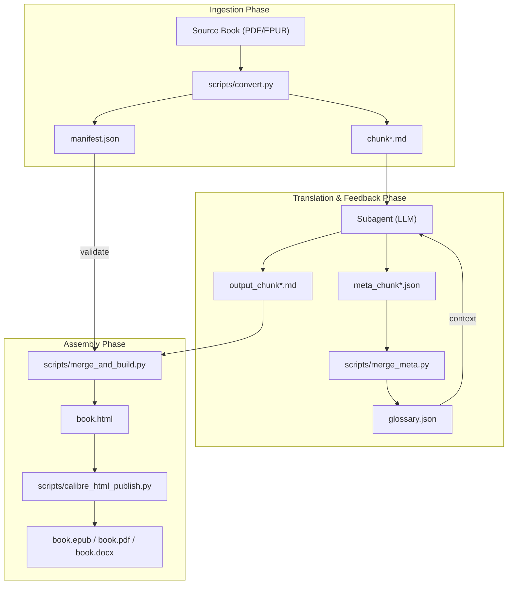
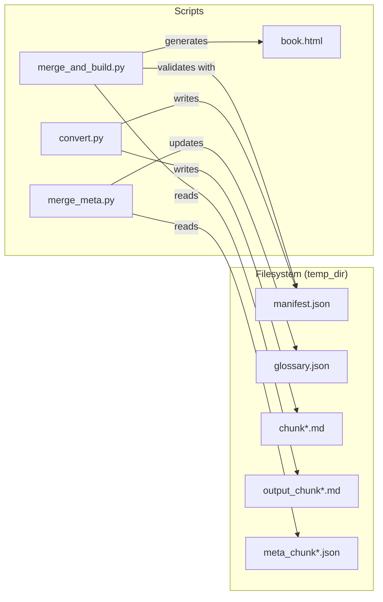

<!-- source: DeepWiki mcp.deepwiki.com · repo deusyu/translate-book · page 2 Scripts Reference · fetched 2026-10-27 -->

# Scripts Reference

Relevant source files

The following files were used as context for generating this wiki page:

- [AGENTS.md](AGENTS.md)
- [CLAUDE.md](CLAUDE.md)
- [LICENSE](LICENSE)
- [scripts/merge_and_build.py](scripts/merge_and_build.py)

The `scripts/` directory contains the core Python logic for the translation pipeline. These scripts handle the transformation of source documents into Markdown chunks, manage term consistency via a shared glossary, and assemble the final translated book into multiple formats.

### Pipeline Script Overview

The pipeline is designed as a fan-out/fan-in architecture. Files are first ingested and split into small, manageable units (chunks), processed in parallel by subagents (orchestrated by the skill layer), and finally merged back into a cohesive document.

#### Ingestion and Processing Flow
The following diagram illustrates how data flows through the primary scripts and the entities they manipulate.

**Data Flow and Entity Association**

**Sources:** [CLAUDE.md:9-17](), [AGENTS.md:9-17]()

---

### Core Scripts

#### [2.1 convert.py — Ingestion and Chunking](#)
This script serves as the entry point for new books. It uses Calibre's `ebook-convert` to normalize various input formats into an `HTMLZ` archive, which is then processed into Markdown using Pandoc. It is responsible for splitting the text into ~6000-character chunks to fit LLM context windows and generating the initial `manifest.json`.
*   **Key Functions:** `main`, `convert_to_markdown`, `split_markdown`.
*   **Outputs:** `chunk*.md`, `manifest.json`, `config.txt`.

For details, see [convert.py — Ingestion and Chunking](#2.1).
**Sources:** [scripts/convert.py:1-15]()

#### [2.2 glossary.py — Term Consistency Management](#)
Manages the translation glossary to ensure names, technical terms, and stylistic choices remain consistent across parallel subagent tasks. It supports CJK (Chinese, Japanese, Korean) detection and provides subcommands for counting term frequencies and injecting relevant terms into chunk-specific prompts.
*   **Key Entities:** `GlossaryV2` schema, `count-frequencies` subcommand.

For details, see [glossary.py — Term Consistency Management](#2.2).
**Sources:** [scripts/glossary.py:1-20]()

#### [2.3 merge_meta.py — Subagent Feedback Loop](#)
Handles the "fan-in" of metadata. As subagents translate chunks, they produce `meta_chunk*.json` files containing newly discovered terms or aliases. `merge_meta.py` reconciles these observations into the main `glossary.json`, handling alias chains and confidence escalation.
*   **Key Commands:** `prepare-merge`, `apply-merge`, `status`.

For details, see [merge_meta.py — Subagent Feedback Loop](#2.3).
**Sources:** [scripts/merge_meta.py:1-25]()

#### [2.4 merge_and_build.py — Final Assembly](#)
Combines translated Markdown chunks back into a single document. It performs critical integrity checks, specifically ensuring that image tags (``) and Markdown image references (``) are preserved and not corrupted during translation.
*   **Key Classes:** `_ImgTagCollector` [scripts/merge_and_build.py:36-49](), `_MD_IMG_RE` [scripts/merge_and_build.py:32-32]().
*   **Key Logic:** `_validate_chunk_images` [scripts/merge_and_build.py:83-141]().

For details, see [merge_and_build.py — Final Assembly](#2.4).
**Sources:** [scripts/merge_and_build.py:1-22]()

#### [2.5 calibre_html_publish.py — Format Export](#)
A specialized wrapper for Calibre that converts the final assembled HTML into distribution formats like EPUB, PDF, and DOCX. It manages language-specific font selection and ensures EPUB 3 compliance.
*   **Key Function:** `run_ebook_convert`.

For details, see [calibre_html_publish.py — Format Export](#2.5).
**Sources:** [scripts/calibre_html_publish.py:1-15]()

---

### Data Integrity and Templates

#### [2.6 manifest.py and meta.py — Data Integrity Schemas](#)
These modules define the schemas and validation logic used by other scripts. `manifest.py` tracks the SHA-256 hashes of source chunks to detect staleness, while `meta.py` defines the structure for subagent observations.
*   **Key Functions:** `validate_for_merge` [scripts/manifest.py:136-155](), `load_meta` [scripts/meta.py:73-86]().

For details, see [manifest.py and meta.py — Data Integrity Schemas](#2.6).
**Sources:** [scripts/manifest.py:1-15](), [scripts/meta.py:1-20]()

#### [2.7 HTML Templates](#)
Defines the visual structure of the output. `template.html` is used for web-optimized viewing with a sidebar TOC, while `template_ebook.html` is optimized for Calibre's conversion engine.
*   **Placeholders:** `$body$`, `$title$`, `$lang$`, `$body_font$`.

For details, see [HTML Templates](#2.7).
**Sources:** [scripts/merge_and_build.py:440-460]()

### Script Interaction Map

This diagram shows how scripts interact with the filesystem and each other during a typical run.

**Entity Interaction Map**

**Sources:** [CLAUDE.md:31-40](), [scripts/merge_and_build.py:21-21]()

---

