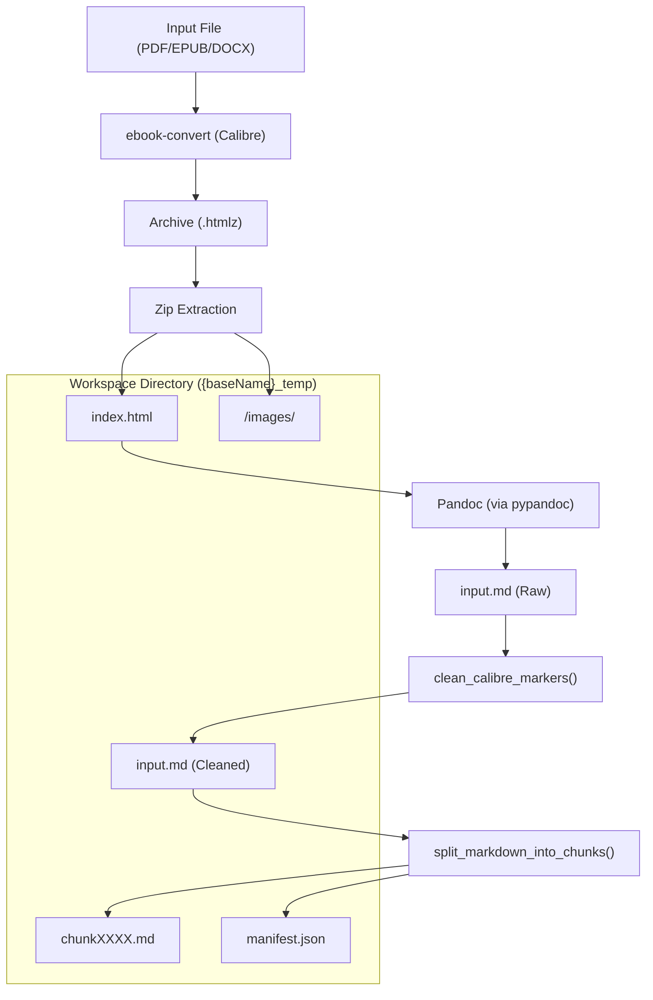
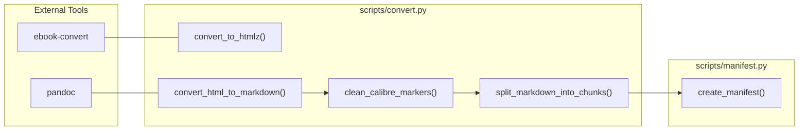

<!-- source: DeepWiki mcp.deepwiki.com · repo deusyu/translate-book · page 2.1 convert.py — Ingestion and Chunking · fetched 2026-10-27 -->

# convert.py — Ingestion and Chunking

<details>
<summary>Relevant source files</summary>

The following files were used as context for generating this wiki page:

- [scripts/convert.py](scripts/convert.py)
- [scripts/manifest.py](scripts/manifest.py)
- [tests/test_convert.py](tests/test_convert.py)

</details>


The `scripts/convert.py` script serves as the entry point for the translation pipeline. It is responsible for transforming raw e-book formats (PDF, DOCX, EPUB) into a normalized, cleaned Markdown format, and then partitioning that content into manageable chunks for LLM processing.

### Overview of Operations

The script performs a sequential transformation of the input file through several intermediate states:
1.  **Format Normalization**: Uses Calibre's `ebook-convert` to create an `HTMLZ` archive `[scripts/convert.py:42-61]()`.
2.  **Asset Extraction**: Unpacks the `HTMLZ` to retrieve the primary HTML content and associated images `[scripts/convert.py:115-148]()`.
3.  **Markdown Conversion**: Utilizes `pypandoc` to convert HTML to Markdown with specific flags to disable line wrapping `[scripts/convert.py:178-212]()`.
4.  **Content Cleaning**: Strips Calibre-specific CSS markers and employs a Longest Non-Decreasing Subsequence (LNDS) algorithm to identify and remove page numbers `[scripts/convert.py:196-196]()`.
5.  **Chunking**: Splits the Markdown into segments of approximately 6000 characters, ensuring splits occur at logical paragraph boundaries `[scripts/convert.py:343-401]()`.
6.  **Manifest Generation**: Creates a `manifest.json` to track chunk order and source integrity via SHA-256 hashes `[scripts/manifest.py:20-56]()`.

### System Architecture and Data Flow

The following diagram illustrates the flow from a source document to the chunked workspace.

**Data Transformation Pipeline**

Sources: `[scripts/convert.py:42-61]()`, `[scripts/convert.py:115-148]()`, `[scripts/convert.py:178-212]()`, `[scripts/convert.py:343-401]()`, `[scripts/manifest.py:20-56]()`.

### Key Functions and Logic

#### Calibre and Pandoc Integration
The script first locates the `ebook-convert` binary using `find_calibre_convert()` `[scripts/convert.py:21-40]()`. It converts the input to `HTMLZ`, which is a ZIP container containing a single HTML file and a folder of images. This format is preferred because it flattens complex e-book structures into a linear stream.

#### Automated Content Cleaning
The `clean_calibre_markers` function is critical for reducing token noise. It performs:
-   **Regex Stripping**: Removes Calibre's internal CSS class markers (e.g., `{.calibre5}`) and internal anchors `[scripts/convert.py:255-263]()`.
-   **Page Number Removal**: Identifies standalone digits that form a monotonic sequence throughout the document. This prevents page numbers from being translated as part of the narrative text `[scripts/convert.py:270-285]()`.

#### Chunking Strategy
Content is split by `split_markdown_into_chunks()` using a target size (default 6000 characters). 
-   It identifies split points by looking for double newlines `\n\n` `[scripts/convert.py:355-356]()`.
-   It uses `bisect_left` to find the optimal split point nearest to the character limit `[scripts/convert.py:378-382]()`.
-   Each chunk is saved as `chunkXXXX.md` where `XXXX` is a four-digit zero-padded index `[scripts/convert.py:392-393]()`.

### Code Entity Mapping

The following diagram maps the high-level ingestion steps to the specific Python functions and external tools responsible for them.

**Code Entity Space Mapping**

Sources: `[scripts/convert.py:42-61]()`, `[scripts/convert.py:178-212]()`, `[scripts/convert.py:252-290]()`, `[scripts/convert.py:343-401]()`, `[scripts/manifest.py:20-56]()`.

### Output Artifacts

| Artifact | Path | Description |
| :--- | :--- | :--- |
| **Workspace** | `{baseName}_temp/` | The root directory for all translation tasks. |
| **Manifest** | `manifest.json` | JSON file containing chunk metadata and SHA-256 hashes `[scripts/manifest.py:45-49]()`. |
| **Config** | `config.txt` | Stores the target language (`--olang`) for downstream scripts `[scripts/convert.py:481-483]()`. |
| **Chunks** | `chunk0001.md` ... | Individual Markdown files containing the source text segments. |
| **Images** | `images/` | Directory containing all extracted media from the source. |

### Command Line Interface

The script is typically invoked with the input file and the target language:

```bash
python scripts/convert.py path/to/book.epub --olang "Traditional Chinese"
```

-   `--olang`: Sets the target language, written to `config.txt` `[scripts/convert.py:481-483]()`.
-   `--strip-page-numbers`: Enables the LNDS-based page number removal `[scripts/convert.py:456-456]()`.

Sources: `[scripts/convert.py:446-465]()`.

---

