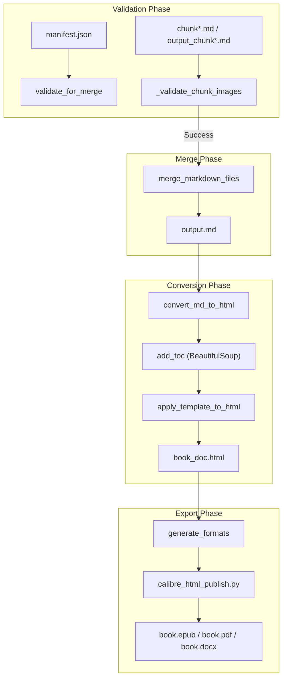
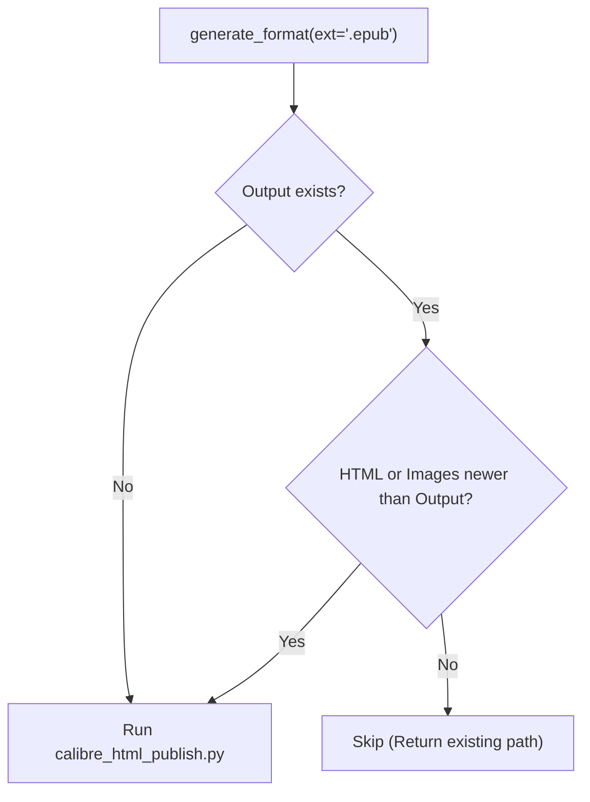

<!-- source: DeepWiki mcp.deepwiki.com · repo deusyu/translate-book · page 2.4 merge_and_build.py — Final Assembly · fetched 2026-10-27 -->

# merge_and_build.py — Final Assembly

Relevant source files

The following files were used as context for generating this wiki page:

- [LICENSE](LICENSE)
- [scripts/merge_and_build.py](scripts/merge_and_build.py)
- [tests/test_calibre_html_publish.py](tests/test_calibre_html_publish.py)
- [tests/test_merge_and_build.py](tests/test_merge_and_build.py)

The `scripts/merge_and_build.py` script serves as the final integration point of the translation pipeline. It is responsible for validating the integrity of translated chunks, merging them into a single document, applying language-specific typography, generating a Table of Contents (TOC), and orchestrating the conversion to final distribution formats (EPUB, PDF, DOCX) [scripts/merge_and_build.py:1-7]().

## Overview of Assembly Pipeline

The script performs a "fan-in" operation, taking the individual `output_chunk*.md` files and producing a cohesive book.

### Final Assembly Logic Flow

**Sources:** [scripts/merge_and_build.py:21-21](), [scripts/merge_and_build.py:83-83](), [scripts/merge_and_build.py:246-246](), [scripts/merge_and_build.py:465-465]()

## Image Integrity and Validation

One of the most critical roles of `merge_and_build.py` is ensuring that the LLM subagents did not corrupt image references or HTML attributes during translation.

### Image Structure Checking
The script uses two primary mechanisms to verify images:
1.  **`_MD_IMG_RE`**: A regex designed to find Markdown image syntax while ignoring escaped exclamation marks [scripts/merge_and_build.py:32-32]().
2.  **`_ImgTagCollector`**: A class inheriting from `html.parser.HTMLParser`. It is used instead of regex for `` tags because it correctly handles `>` characters inside quoted attribute values (like alt text), which often trip up simple regex [scripts/merge_and_build.py:36-47]().

### Attribute Validation (`_validate_chunk_images`)
This function compares every `output_chunk*.md` against its source `chunk*.md` [scripts/merge_and_build.py:83-94](). It calculates a **delta** of malformed attributes:
*   It identifies attribute names that do not match `_VALID_ATTR_NAME_RE` [scripts/merge_and_build.py:33-33]().
*   It only flags errors if the malformed attribute exists in the output but **not** the source. This prevents false positives on technical books that contain intentionally broken HTML examples in code blocks [scripts/merge_and_build.py:108-114]().

**Sources:** [scripts/merge_and_build.py:32-81](), [scripts/merge_and_build.py:83-141]()

## Typography and Language Configuration

The `LANG_CONFIG` dictionary defines typographical rules for different target languages. This ensures that the final output uses correct quotes, spacing, and HTML language attributes [scripts/merge_and_build.py:204-244]().

| Language Code | `lang_attr` | `quotes` | `space_between_cjk_and_latin` |
| :--- | :--- | :--- | :--- |
| `zh-CN` | `zh-CN` | `“”` | `True` |
| `ja` | `ja` | `「」` | `True` |
| `en` | `en` | `“”` | `False` |

The `apply_lang_typography` function uses these configurations to perform regex-based cleanup on the merged Markdown text before it is converted to HTML [scripts/merge_and_build.py:324-345]().

**Sources:** [scripts/merge_and_build.py:204-244](), [scripts/merge_and_build.py:324-345]()

## TOC Generation and Template Application

If `BeautifulSoup` is available, the script automatically generates a Table of Contents [scripts/merge_and_build.py:172-177]().

1.  **`add_toc`**: Scans the generated HTML for `<h1>` through `<h3>` tags. It assigns unique IDs to headers that lack them and builds a nested list of links [scripts/merge_and_build.py:410-444]().
2.  **`apply_template_to_html`**: Reads `scripts/template.html` (or `template_ebook.html`) and performs variable substitution for `${title}`, `${lang}`, `${body}`, and `${toc}` [scripts/merge_and_build.py:447-462]().

**Sources:** [scripts/merge_and_build.py:172-177](), [scripts/merge_and_build.py:410-462]()

## Format Generation and Staleness Checks

To save time during iterative runs, `generate_format` implements a staleness check. It will only invoke `calibre_html_publish.py` if the source HTML or any image assets in the `images/` directory are newer than the existing output file [scripts/merge_and_build.py:535-555]().

### Format Generation Logic

**Sources:** [scripts/merge_and_build.py:535-555](), [tests/test_merge_and_build.py:27-42]()

## Key Functions Reference

| Function | Responsibility |
| :--- | :--- |
| `merge_markdown_files` | Concatenates `output_chunk*.md` files in order [scripts/merge_and_build.py:246-271](). |
| `convert_md_to_html` | Invokes Pandoc to transform Markdown into a raw HTML fragment [scripts/merge_and_build.py:348-379](). |
| `_validate_chunk_images` | Cross-references source and translated chunks to ensure image paths and HTML tags are intact [scripts/merge_and_build.py:83-141](). |
| `extract_cover_from_epub` | Extracts the cover image from a source EPUB to reuse in the translated version [scripts/merge_and_build.py:588-654](). |
| `cleanup_intermediate_files` | Deletes temporary chunks and HTML fragments after a successful build [scripts/merge_and_build.py:682-698](). |

**Sources:** [scripts/merge_and_build.py:83-141](), [scripts/merge_and_build.py:246-271](), [scripts/merge_and_build.py:348-379](), [scripts/merge_and_build.py:588-654](), [scripts/merge_and_build.py:682-698]()

---

