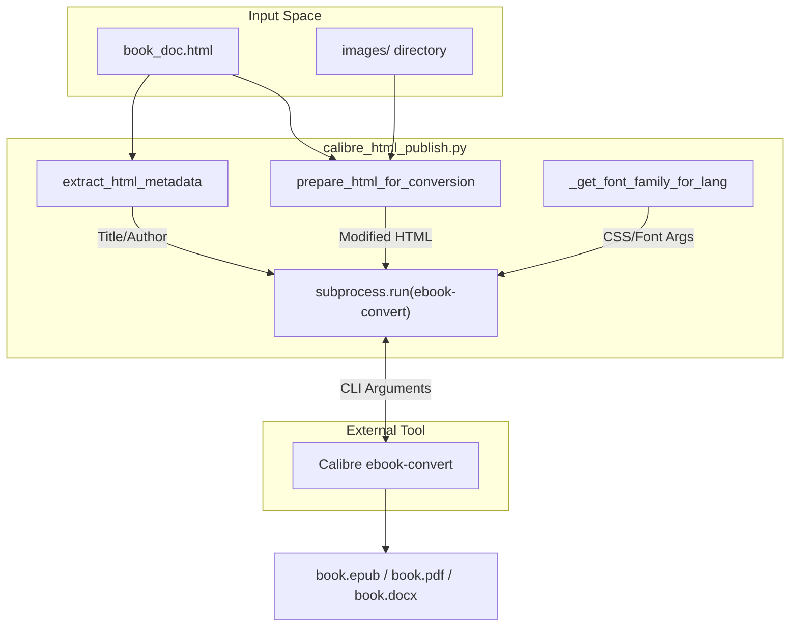
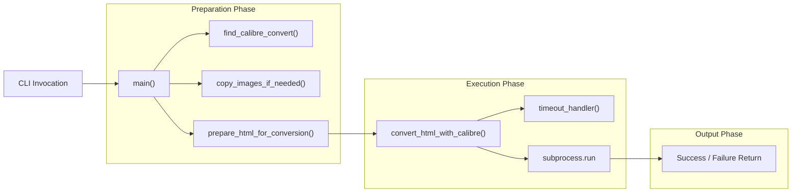

<!-- source: DeepWiki mcp.deepwiki.com · repo deusyu/translate-book · page 2.5 calibre_html_publish.py — Format Export · fetched 2026-10-27 -->

# calibre_html_publish.py — Format Export

Relevant source files

The following files were used as context for generating this wiki page:

- [scripts/calibre_html_publish.py](scripts/calibre_html_publish.py)
- [tests/test_calibre_html_publish.py](tests/test_calibre_html_publish.py)
- [tests/test_merge_and_build.py](tests/test_merge_and_build.py)

`scripts/calibre_html_publish.py` serves as the final stage of the pipeline, responsible for converting the assembled HTML document into distribution-ready formats including EPUB, DOCX, and PDF. It acts as a sophisticated wrapper around Calibre's `ebook-convert` utility, handling metadata extraction, language-specific typography, and signal-based process management.

## Overview and Purpose

The script ensures that the translated content is presented with correct typography and metadata across different e-book formats. It specifically addresses the challenges of CJK (Chinese, Japanese, Korean) font rendering in PDF and EPUB formats and enforces modern standards like EPUB 3.

### Key Responsibilities
*   **Metadata Extraction**: Parses the source HTML to find `<title>`, `<h1>`, and `<meta name="author">` tags to populate e-book metadata [scripts/calibre_html_publish.py:42-71]().
*   **Typography Management**: Injects CSS and command-line arguments to ensure appropriate font families are used based on the target language [scripts/calibre_html_publish.py:73-96]().
*   **Asset Assembly**: Automatically discovers and copies image directories (e.g., `images/`, `media/`) to a temporary workspace to ensure `ebook-convert` can resolve relative paths [scripts/calibre_html_publish.py:164-202]().
*   **Process Safety**: Implements a signal-based timeout handler to prevent hanging on complex documents [scripts/calibre_html_publish.py:18-20]().

---

## Technical Implementation

### Data Flow and Process Architecture

The following diagram illustrates how `calibre_html_publish.py` transforms a raw HTML file into a final e-book format by interacting with the filesystem and the Calibre binary.

**Figure 1: Format Export Data Flow**

Sources: [scripts/calibre_html_publish.py:42-43](), [scripts/calibre_html_publish.py:99-100](), [scripts/calibre_html_publish.py:204-206]()

### Metadata and Font Selection

The script uses `extract_html_metadata` to scan the input HTML. If a `<title>` tag is missing, it falls back to the first `<h1>` found, and finally to the filename [scripts/calibre_html_publish.py:48-58]().

For typography, the script maps language codes to specific font stacks:
| Language | CSS Font Family (`_get_font_family_for_lang`) | PDF Font (`_get_pdf_font_for_lang`) |
| :--- | :--- | :--- |
| `zh` (Chinese) | "FangSong", "SimSun", serif | FangSong |
| `ja` (Japanese) | "Hiragino Mincho ProN", "Yu Mincho", serif | Hiragino Mincho ProN |
| `ko` (Korean) | "Nanum Myeongjo", "Batang", serif | Nanum Myeongjo |
| Default | Georgia, "Times New Roman", serif | Georgia |

Sources: [scripts/calibre_html_publish.py:73-96]()

---

## Code Entity Mapping

This diagram bridges the CLI commands and logical steps to the specific Python functions within `calibre_html_publish.py`.

**Figure 2: Logic to Code Entity Mapping**

Sources: [scripts/calibre_html_publish.py:18-20](), [scripts/calibre_html_publish.py:22-23](), [scripts/calibre_html_publish.py:99-100](), [scripts/calibre_html_publish.py:204-206]()

---

## Output Contract and Constraints

### Output Formats
The script strictly adheres to the following output contract defined in the pipeline:
*   **EPUB**: Enforced as EPUB 3 via the `--epub-version 3` flag [scripts/calibre_html_publish.py:265-266]().
*   **DOCX**: Generated using standard Calibre defaults.
*   **PDF**: Includes specialized font embedding via `--pdf-standard-font` and `--embed-all-fonts` to ensure CJK characters render correctly [scripts/calibre_html_publish.py:280-285]().

### Timeout Handling
Because `ebook-convert` can occasionally hang on extremely large documents or malformed HTML, the script wraps the call in a `signal.alarm`. The default timeout is provided by the caller (usually `merge_and_build.py`) [scripts/calibre_html_publish.py:237-243]().

### Integration with merge_and_build.py
`merge_and_build.py` uses `generate_format` to call this script. It includes a staleness check: if the output file (e.g., `book.epub`) is newer than both the source HTML and the images directory, the conversion is skipped to save time [tests/test_merge_and_build.py:27-42]().

Sources: [scripts/calibre_html_publish.py:204-210](), [tests/test_merge_and_build.py:27-42]()

---

