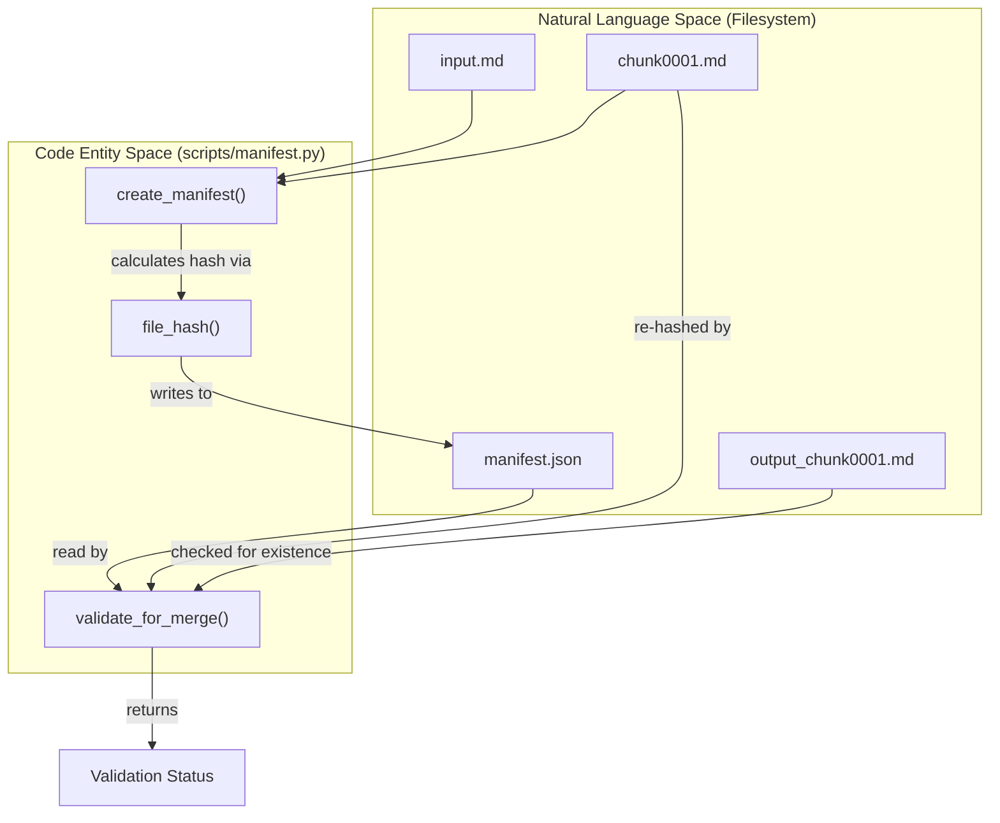
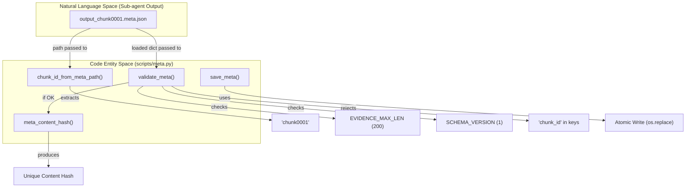

<!-- source: DeepWiki mcp.deepwiki.com · repo deusyu/translate-book · page 2.6 manifest.py and meta.py — Data Integrity Schemas · fetched 2026-10-27 -->

# manifest.py and meta.py — Data Integrity Schemas

Relevant source files

The following files were used as context for generating this wiki page:

- [scripts/manifest.py](scripts/manifest.py)
- [scripts/meta.py](scripts/meta.py)
- [tests/test_meta.py](tests/test_meta.py)

This section documents the two primary schema-enforcement scripts used to ensure data integrity across the translation pipeline. `manifest.py` manages the lifecycle and integrity of text chunks, while `meta.py` defines the structured feedback loop used by sub-agents to update the global glossary.

## manifest.py — Chunk Tracking and Validation

The `scripts/manifest.py` script is responsible for maintaining the `manifest.json` file within the `{baseDir}`. This file acts as the "source of truth" for the state of the translation project, tracking the relationship between source chunks and their translated counterparts.

### Key Functions

*   **`create_manifest(temp_dir, chunk_files, source_md_path)`**: Executed during the ingestion phase. It calculates the SHA-256 hash of the original `input.md` and every individual source chunk `chunkNNNN.md` [scripts/manifest.py:20-56]().
*   **`validate_for_merge(temp_dir)`**: Used by the final assembly script to verify that the project is ready for merging. It checks for [scripts/manifest.py:68-140]():
    *   **Existence**: All expected `output_chunkNNNN.md` files must exist.
    *   **Integrity**: The current hash of source chunks must match the hash recorded in the manifest. If they differ, the output is considered stale.
    *   **Completeness**: Outputs must not be empty and are flagged with warnings if they are suspiciously small (less than 10% of source size).
*   **`file_hash(filepath)`**: A utility function that computes a SHA-256 hash in 8KB blocks to maintain a low memory footprint [scripts/manifest.py:11-17]().

### Data Flow: Manifest Creation and Validation

The following diagram illustrates how `manifest.py` entities interact with the filesystem to ensure integrity.

**Chunk Integrity Verification Flow**

Sources: [scripts/manifest.py:11-17](), [scripts/manifest.py:20-56](), [scripts/manifest.py:68-140]()

---

## meta.py — Sub-agent Observation Schema

`scripts/meta.py` defines the **v1 meta schema**. During translation, sub-agents do not just output translated text; they also emit an `output_chunk<NNNN>.meta.json` file containing observations about new entities, suggested aliases, and term conflicts [scripts/meta.py:5-29]().

### The v1 Schema
The schema is strictly enforced to ensure that the `merge_meta.py` script can safely parse and apply updates to the global glossary.

| Field | Type | Description |
| :--- | :--- | :--- |
| `schema_version` | Integer | Must be `1` [scripts/meta.py:38](). |
| `new_entities` | Array | Objects with `source`, `target_proposal`, `category`, and `evidence` [scripts/meta.py:139-156](). |
| `alias_hypotheses` | Array | Objects linking a `variant` to a `may_be_alias_of_source` [scripts/meta.py:157-171](). |
| `attribute_hypotheses` | Array | Gender or category updates with `confidence` (low/medium/high) [scripts/meta.py:172-186](). |
| `used_term_sources` | Array | List of source strings for terms actually used in the chunk [scripts/meta.py:20](). |
| `conflicts` | Array | Reports where an injected glossary term was incorrect [scripts/meta.py:21-23](). |

### Security and Hallucination Prevention
A critical design constraint in `meta.py` is the **prohibition of `chunk_id` in the JSON payload**. 
*   **Implementation**: `chunk_id_from_meta_path` derives the identity solely from the filename [scripts/meta.py:55-69]().
*   **Reasoning**: If the agent were allowed to specify `chunk_id` inside the file, it might hallucinate the ID of a different chunk, leading to data corruption during the merge process. The `validate_meta` function explicitly raises a `ValueError` if `chunk_id` is found in the keys [scripts/meta.py:129-133]().

### Content Hashing
The function `meta_content_hash(data)` generates a SHA-256 hash of the **canonical JSON** (sorted keys, no whitespace) [scripts/meta.py:71-78](). This hash is used by the orchestration layer to track which meta-observations have already been merged into the glossary, ensuring idempotency [tests/test_meta.py:121-131]().

### Validation Logic
The `validate_meta` function performs deep inspection:
*   **Evidence Limits**: The `evidence` field in any observation is capped at 200 characters to prevent agents from dumping entire paragraphs into the glossary [scripts/meta.py:39](), [scripts/meta.py:87-91]().
*   **Type Safety**: Ensures all required fields are strings and arrays are correctly formed [scripts/meta.py:94-110]().
*   **Atomic Writes**: `save_meta` uses a temporary file and `os.replace` to ensure that a crash during disk I/O does not result in a corrupted `.json` file [tests/test_meta.py:148-167]().

**Meta Data Validation and Identification**

Sources: [scripts/meta.py:38-40](), [scripts/meta.py:55-69](), [scripts/meta.py:75-78](), [scripts/meta.py:111-137](), [tests/test_meta.py:148-167]()

---

