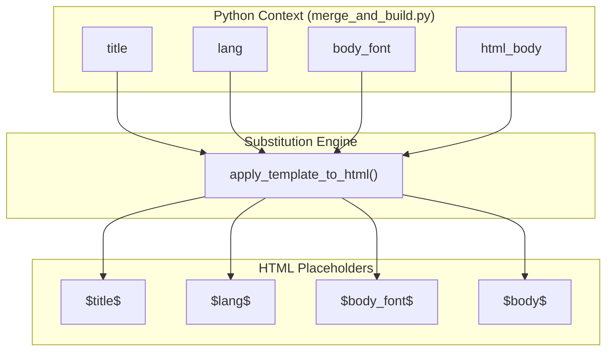
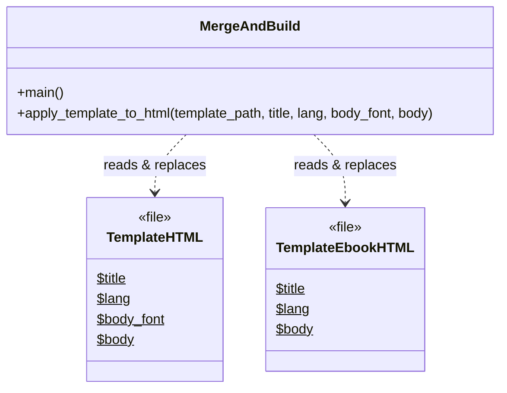

<!-- source: DeepWiki mcp.deepwiki.com · repo deusyu/translate-book · page 2.7 HTML Templates · fetched 2026-10-27 -->

# HTML Templates

<details>
<summary>Relevant source files</summary>

The following files were used as context for generating this wiki page:

- [LICENSE](LICENSE)
- [scripts/merge_and_build.py](scripts/merge_and_build.py)
- [scripts/template.html](scripts/template.html)
- [scripts/template_ebook.html](scripts/template_ebook.html)

</details>


This section documents the HTML templates used for final book assembly and the mechanism for variable substitution. The pipeline utilizes two distinct templates to optimize for different consumption environments: web browsers and ebook readers.

## Overview of Templates

The `translate-book` pipeline uses templates to wrap the merged Markdown content (converted to HTML) into a complete, styled document. 

| Template | File Path | Primary Use Case | Key Features |
| :--- | :--- | :--- | :--- |
| **Web Template** | `scripts/template.html` | Browser viewing, static hosting | Floating TOC sidebar, interactive JS, dynamic font selection. |
| **Ebook Template** | `scripts/template_ebook.html` | Calibre input for EPUB/PDF/DOCX | Simplified CSS, system font stacks, print-friendly media queries. |

### Data Flow and Substitution

The function `apply_template_to_html` in `scripts/merge_and_build.py` handles the injection of content into these templates using a simple string replacement strategy [scripts/merge_and_build.py:348-363]().

### Template Substitution Logic
The diagram below illustrates how the Python assembly script maps internal variables to the placeholder tokens in the HTML files.

"Template Variable Mapping"

Sources: [scripts/merge_and_build.py:348-363](), [scripts/template.html:2-20](), [scripts/template.html:305]()

---

## Web Template (`scripts/template.html`)

The web template is designed for high readability and navigation in a desktop or mobile browser.

### CSS Variables and Typography
The template uses the `$body_font$` placeholder within the CSS block to allow language-specific typography (e.g., serif fonts for Chinese vs. sans-serif for English) [scripts/template.html:20](). It defines a maximum width of `700px` for optimal line length and uses `text-align: justify` for a "book-like" feel [scripts/template.html:24-28]().

### Floating Table of Contents (TOC)
A sophisticated sidebar navigation system is implemented via CSS and vanilla JavaScript:
*   **`.toc-sidebar`**: A fixed-position panel hidden off-screen (`left: -320px`) [scripts/template.html:56-69]().
*   **`.toc-toggle`**: A floating button that triggers the sidebar [scripts/template.html:32-48]().
*   **`.toc-content`**: The target injection point for the TOC generated by `BeautifulSoup` in the assembly script [scripts/template.html:85-87]().

### Interactive Logic
The template includes a script block that manages the TOC state and provides a "smooth scroll" experience [scripts/template.html:283-303]().

Sources: [scripts/template.html:1-306]()

---

## Ebook Template (`scripts/template_ebook.html`)

This template serves as the intermediate format for Calibre's `ebook-convert` tool. It prioritizes compatibility over interactivity.

### Key Differences from Web Template
1.  **Font Stacks**: Instead of dynamic placeholders, it uses a robust system font stack to ensure compatibility with e-readers (Kindle, Kobo) [scripts/template_ebook.html:20]().
2.  **Simplified Layout**: Removes the floating TOC and sidebar logic, as e-readers provide their own native navigation menus [scripts/template_ebook.html:1-280]().
3.  **Page Separators**: Includes specific styling for `.page-separator` elements used to visually divide merged chunks [scripts/template_ebook.html:198-212]().
4.  **Print Optimization**: Includes `@media print` rules to ensure that if the HTML is converted to PDF, margins and colors are adjusted for paper [scripts/template_ebook.html:282-290]().

Sources: [scripts/template_ebook.html:1-295]()

---

## Implementation Detail: `apply_template_to_html`

The substitution is performed by a dedicated function in the assembly script. It does not use a complex engine like Jinja2 to minimize dependencies.

### Code Entity Interaction
The following diagram shows the relationship between the `merge_and_build.py` script and the template files.

"Assembly Entity Relationship"


### Substitution Implementation
The function reads the template file as a string and performs sequential `.replace()` operations [scripts/merge_and_build.py:348-363]().

```python
def apply_template_to_html(template_path, title, lang, body_font, body):
    template = Path(template_path).read_text(encoding='utf-8')
    html = template.replace('$title$', title)
    html = html.replace('$lang$', lang)
    html = html.replace('$body_font$', body_font)
    html = html.replace('$body$', body)
    return html
```
[scripts/merge_and_build.py:359-363]()

### Integration in Pipeline
During the execution of `merge_and_build.py`, the script:
1.  Determines the correct font via `LANG_CONFIG` [scripts/merge_and_build.py:228-245]().
2.  Converts the merged Markdown to HTML [scripts/merge_and_build.py:383-400]().
3.  Calls `apply_template_to_html` twice:
    *   Once with `scripts/template.html` for the `output.html` file [scripts/merge_and_build.py:441-447]().
    *   Once with `scripts/template_ebook.html` for the `output_ebook.html` file [scripts/merge_and_build.py:449-454]().

Sources: [scripts/merge_and_build.py:228-454]()

---

