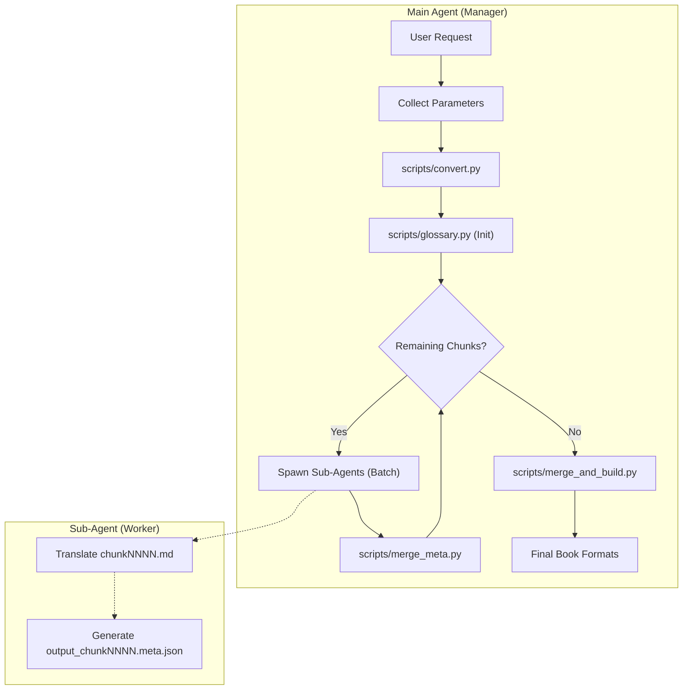
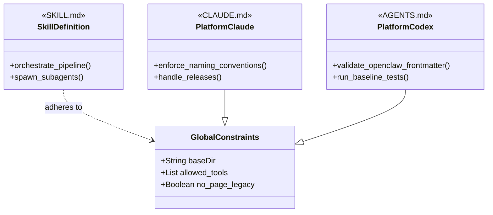

<!-- source: DeepWiki mcp.deepwiki.com · repo deusyu/translate-book · page 3 Orchestration and Skill Definition · fetched 2026-10-27 -->

# Orchestration and Skill Definition

Relevant source files

The following files were used as context for generating this wiki page:

- [AGENTS.md](AGENTS.md)
- [CLAUDE.md](CLAUDE.md)
- [SKILL.md](SKILL.md)

This section covers the orchestration layer of the `translate-book` pipeline. The system uses a "Skill" definition to coordinate various Python scripts and sub-agents, transforming a high-level user request (e.g., "Translate this PDF") into a series of discrete, parallelizable tasks.

The orchestration is primarily defined in `SKILL.md`, which acts as the source of truth for the main agent's behavior. This logic is supported by developer-facing constraint files (`CLAUDE.md` and `AGENTS.md`) that ensure compatibility across different AI agent platforms like Claude Code, OpenClaw, and Codex.

### Pipeline Orchestration Overview

The main agent follows a structured workflow to move a book through the translation lifecycle. It acts as a "manager" that invokes specialized scripts for heavy lifting and spawns sub-agents for the actual translation work.

Title: Orchestration Flow

Sources: [SKILL.md:8-124](), [CLAUDE.md:9-17]()

---

## SKILL.md — Orchestration Logic

`SKILL.md` is the primary orchestration document. it defines the state machine that the AI agent follows to ensure consistency and reliability across long-running translation tasks.

### Key Orchestration Features
*   **Parameter Collection**: Captures `file_path`, `target_lang`, and `concurrency` (default 8) [SKILL.md:14-22]().
*   **Batch Processing**: To respect rate limits and manage context, chunks are processed in parallel batches [SKILL.md:93-95]().
*   **Context Injection**: Before each sub-agent is spawned, the manager calls `scripts/glossary.py print-terms-for-chunk` to inject a relevant term table into the sub-agent's prompt [SKILL.md:111-118]().
*   **Feedback Loop**: After each batch, the manager uses `scripts/merge_meta.py` to integrate new entity discoveries and alias hypotheses from the sub-agents back into the global `glossary.json` [SKILL.md:123-152]().

For details, see [SKILL.md — Orchestration Logic](#3.1).

Sources: [SKILL.md:1-152]()

---

## CLAUDE.md and AGENTS.md — Developer Constraints

These files serve as "system prompts" for developers and the AI agent itself to maintain codebase health and cross-platform compatibility. They define the "Code Entity Space" constraints that prevent architectural drift.

### Platform Compatibility
The project maintains compatibility with Claude Code, OpenClaw, and Codex. This is achieved through:
*   **Path Abstraction**: Using `{baseDir}` instead of hardcoded local paths [CLAUDE.md:36](), [AGENTS.md:47]().
*   **Tool Whitelisting**: Defining a platform-neutral `allowed-tools` list including `Read`, `Write`, `Bash`, and `Agent` [SKILL.md:4](), [CLAUDE.md:45]().
*   **Standardized Naming**: Enforcing `chunk*.md` naming and prohibiting the legacy `page*` format [CLAUDE.md:33-43](), [AGENTS.md:45-55]().

### Development Rules
*   **No MTime Rebuilds**: The system uses simple existence checks for incremental builds. If templates or metadata change, manual cleanup of the temp directory is required [CLAUDE.md:46](), [AGENTS.md:58]().
*   **Frontmatter Constraints**: `SKILL.md` frontmatter must remain single-line per field to satisfy the OpenClaw parser [CLAUDE.md:35](), [AGENTS.md:46]().

Title: Agent Constraint Mapping

Sources: [CLAUDE.md:1-47](), [AGENTS.md:1-59]()

For details, see [CLAUDE.md and AGENTS.md — Developer Constraints](#3.2).

---

