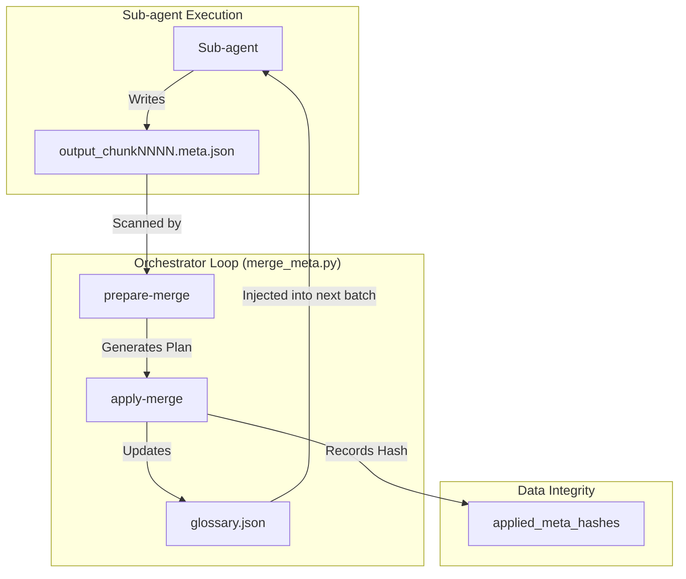

<!-- source: DeepWiki mcp.deepwiki.com · repo deusyu/translate-book · page 3.1 SKILL.md — Orchestration Logic · fetched 2026-10-27 -->

# SKILL.md — Orchestration Logic

<details>
<summary>Relevant source files</summary>

The following files were used as context for generating this wiki page:

- [README.md](README.md)
- [SKILL.md](SKILL.md)

</details>


The `SKILL.md` file defines the core orchestration logic for the `translate-book` skill. It serves as the operational blueprint for the Claude Code / OpenClaw agent, detailing how to manage the multi-step pipeline from initial file ingestion to final multi-format document assembly.

## Overview and Parameter Collection

The orchestration begins by resolving user-provided parameters to establish the translation context. The skill is designed to be resumable and parallelizable, utilizing a `{filename}_temp/` directory as a workspace for all intermediate artifacts.

### Key Parameters
- `file_path`: The source document (PDF, DOCX, or EPUB). [SKILL.md:17-17]()
- `target_lang`: The ISO language code (default: `zh`). [SKILL.md:18-18]()
- `concurrency`: Number of parallel sub-agents (default: `8`). [SKILL.md:19-19]()
- `custom_instructions`: User-defined stylistic or terminological constraints. [SKILL.md:20-20]()

### Workspace Initialization
The skill invokes `scripts/convert.py` to transform the input file into Markdown chunks. This script populates the temp directory with `chunkNNNN.md` files, a `manifest.json` for integrity tracking, and a `config.txt` containing pipeline metadata. [SKILL.md:28-36]()

Sources: [SKILL.md:14-37](), [README.md:122-128]()

## Batch Translation Loop and Context Injection

The skill uses a fan-out pattern where each chunk is translated by an independent sub-agent with a fresh context window. This architecture prevents the "context drift" and output truncation common in single-session long-form translations. [README.md:33-33]()

### The Translation Cycle
1. **Discovery**: The orchestrator uses `Glob` to identify pending chunks (source exists but `output_chunk*.md` does not). [SKILL.md:40-47]()
2. **Term Table Assembly**: For each chunk, the orchestrator calls `scripts/glossary.py print-terms-for-chunk` to retrieve relevant terms. [SKILL.md:111-115]()
3. **Sub-agent Spawning**: Sub-agents are launched in batches of size `concurrency`. [SKILL.md:93-95]()
4. **Execution**: Each sub-agent reads a source chunk, applies translation rules, and writes both the translated Markdown and a `.meta.json` feedback file. [SKILL.md:119-123]()

### Prompt Construction
Sub-agents are constrained by a specific prompt that includes the `{TERM_TABLE}` (if terms are found) and HTML safety rules. Rule #11 specifically mandates that HTML tags and attributes (like `id` or `href`) must remain in English/source form to ensure document integrity after merging. [SKILL.md:117-117](), [SKILL.md:213-213]()

### Natural Language to Code Entity Mapping: Translation Orchestration

| Natural Language Concept | Code Entity / Tool | Role |
| :--- | :--- | :--- |
| Chunk Tracking | `manifest.json` | SHA-256 validation of source chunks |
| Sub-agent Launcher | `Agent` / `sessions_spawn` | Creates isolated context for translation |
| Term Injection | `glossary.py print-terms-for-chunk` | Filters glossary for chunk-specific relevance |
| Progress Check | `Glob` | Determines missing `output_chunk*.md` files |

Sources: [SKILL.md:38-123](), [README.md:33-38](), [README.md:160-169]()

## Feedback Loop: Meta Merging

After each batch of translations, the orchestrator performs a feedback loop to update the global glossary with findings from the sub-agents. This ensures that names or terms discovered in `chunk0001` are available to sub-agents working on `chunk0010`.

### The Prepare-Apply Cycle
1. **Prepare**: The orchestrator runs `python3 scripts/merge_meta.py prepare-merge` to scan all new `.meta.json` files. This identifies new entities, alias hypotheses, and potential conflicts. [SKILL.md:154-156]()
2. **Apply**: It then runs `python3 scripts/merge_meta.py apply-merge`. This is an atomic operation that updates `glossary.json` and marks the processed meta files as "applied" using their content hashes to ensure idempotency. [SKILL.md:158-160]()

### Meta Data Flow Diagram
"This diagram illustrates how sub-agent observations flow back into the global glossary."



Sources: [SKILL.md:125-160](), [README.md:130-154]()

## Final Assembly and Verification

Once all chunks have corresponding output files, the skill transitions to the final assembly phase.

### Completeness Verification
The orchestrator performs a final check to ensure every source chunk in the `manifest.json` has a valid, non-empty `output_chunk*.md` counterpart. [SKILL.md:49-49]()

### Invoking Merge and Build
The skill executes the final build command:
```bash
python3 {baseDir}/scripts/merge_and_build.py --temp-dir "<temp_dir>" --title "<title>"
```
[SKILL.md:167-169]()

This script performs several critical tasks:
- **Image Integrity**: Validates that all images referenced in the source chunks are present in the output. [README.md:173-173]()
- **Multi-format Generation**: Uses Pandoc and Calibre to produce `book.html`, `book.docx`, `book.epub`, and `book.pdf`. [README.md:176-180]()
- **Typography**: Applies language-specific configurations (e.g., `zh` vs `en` typography) via `LANG_CONFIG`. [README.md:174-174]()

### Orchestration Entity Relationship

```mermaid
graph LR
    "SKILL.md" -- "orchestrates" --> "convert.py"
    "SKILL.md" -- "orchestrates" --> "glossary.py"
    "SKILL.md" -- "manages" --> "Sub-agents"
    "Sub-agents" -- "produce" --> "output_chunk*.meta.json"
    "SKILL.md" -- "orchestrates" --> "merge_meta.py"
    "merge_meta.py" -- "updates" --> "glossary.json"
    "SKILL.md" -- "finalizes via" --> "merge_and_build.py"
    "merge_and_build.py" -- "calls" --> "calibre_html_publish.py"
```

Sources: [SKILL.md:162-170](), [README.md:170-185]()

---

