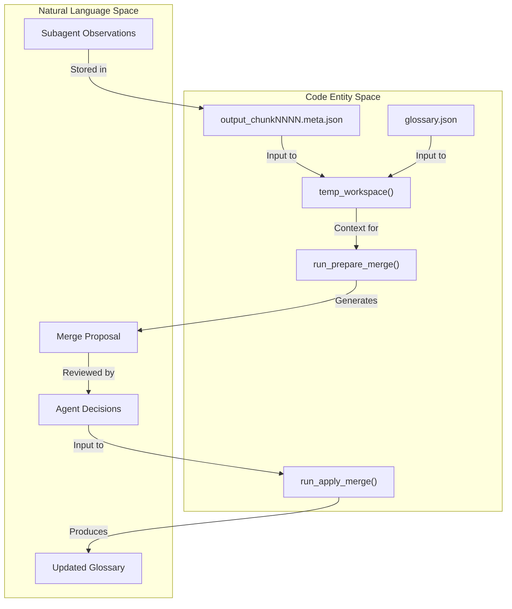
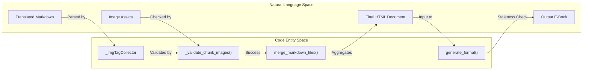

<!-- source: DeepWiki mcp.deepwiki.com · repo deusyu/translate-book · page 4.1 Unit Tests · fetched 2026-10-27 -->

# Unit Tests

<details>
<summary>Relevant source files</summary>

The following files were used as context for generating this wiki page:

- [scripts/merge_meta.py](scripts/merge_meta.py)
- [scripts/meta.py](scripts/meta.py)
- [tests/test_calibre_html_publish.py](tests/test_calibre_html_publish.py)
- [tests/test_convert.py](tests/test_convert.py)
- [tests/test_glossary.py](tests/test_glossary.py)
- [tests/test_merge_and_build.py](tests/test_merge_and_build.py)
- [tests/test_merge_meta.py](tests/test_merge_meta.py)
- [tests/test_meta.py](tests/test_meta.py)

</details>


The `translate-book` test suite provides a comprehensive set of unit tests located in the `tests/` directory. These tests validate the core logic of the translation pipeline, including document conversion, glossary management, metadata merging, and final assembly. The suite utilizes the standard Python `unittest` framework and relies heavily on temporary directories and mocking to isolate logic from external dependencies like Calibre or Pandoc.

## Execution

The entire unit test suite can be executed from the project root using the standard discovery mechanism:

```bash
python -m unittest discover tests
```

## Test Module Overview

| Test Module | Target Script | Primary Validation Scope |
| :--- | :--- | :--- |
| `test_convert.py` | `convert.py` | Markdown cleaning, page number stripping, Calibre marker removal. |
| `test_glossary.py` | `glossary.py` | Term frequency counting, schema validation, CJK detection. |
| `test_merge_meta.py` | `merge_meta.py` | Proposal classification (auto-apply vs. decision), conflict detection. |
| `test_merge_and_build.py`| `merge_and_build.py` | Image integrity, TOC generation, staleness checks for rebuilds. |
| `test_calibre_html_publish.py`| `calibre_html_publish.py`| Calibre CLI command construction, metadata extraction from HTML. |
| `test_meta.py` | `meta.py` | Meta JSON schema strictness, SHA-256 content hashing. |

Sources: [tests/test_merge_meta.py:17-20](), [tests/test_convert.py:12-12](), [tests/test_glossary.py:16-16]()

---

## Metadata Merging Logic (`test_merge_meta.py`)

The most complex test module, `test_merge_meta.py`, validates the classification engine used to update the global glossary from subagent observations. It ensures that the "feedback loop" remains atomic and idempotent.

### Key Patterns
- **`temp_workspace`**: A context manager that sets up a temporary directory containing a `glossary.json` and multiple `output_chunk*.meta.json` files [tests/test_merge_meta.py:60-72]().
- **In-Process Execution**: Commands like `prepare-merge` and `apply-merge` are run in-process with `sys.stdout` and `sys.stdin` mocked to capture JSON output and provide input [tests/test_merge_meta.py:75-99]().

### Validation Flow: Merge Classification
The tests verify how `merge_meta.py` categorizes findings:
1.  **Auto-Apply**: Identical proposals across chunks for a new entity are grouped and marked for automatic inclusion [tests/test_merge_meta.py:130-144]().
2.  **Decisions Needed**: Conflicting target translations or categories for the same source term are routed to the `decisions_needed` array for the main agent to resolve [tests/test_merge_meta.py:145-179]().
3.  **Idempotency**: Using `applied_meta_hashes` in the glossary to ensure the same chunk meta is never applied twice [tests/test_merge_meta.py:171-173]().

### Diagram: Merge Logic Flow
Title: Metadata Merge Validation Flow

Sources: [tests/test_merge_meta.py:60-107](), [scripts/merge_meta.py:143-177]()

---

## Glossary and Frequency Counting (`test_test_glossary.py`)

This module focuses on the accuracy of term detection within the source text.

### Implementation Details
- **CJK Support**: Validates that CJK (Chinese, Japanese, Korean) source terms are counted correctly despite lack of word boundaries [tests/test_glossary.py:120-132]().
- **Regex Safety**: Ensures that terms containing special characters (e.g., `C++`, `.NET`) are escaped before being used in search patterns [tests/test_glossary.py:94-109]().
- **Alias Aggregation**: Verifies that frequencies for a term include counts for all its defined aliases [tests/test_glossary.py:161-174]().
- **Exclusion Logic**: Confirms that the counter ignores `output_chunk*.md` files to avoid counting terms in the translated text [tests/test_glossary.py:133-147]().

Sources: [tests/test_glossary.py:67-174]()

---

## Ingestion and Cleaning (`test_convert.py`)

`test_convert.py` validates the `clean_calibre_markers` function, which is critical for removing noise introduced by the `ebook-convert` process before the text is sent to LLMs.

### Key Validations
- **Calibre Artifacts**: Removal of CSS class markers like `{.calibre3}` and internal link anchors like `(#calibre_link-12)` [tests/test_convert.py:16-42]().
- **Page Number Stripping**: Detection and removal of monotonic sequences of digits (page numbers) while preserving standalone years like `1984` [tests/test_convert.py:108-181]().
- **Fenced Noise**: Dropping lines containing only digits if they are immediately adjacent to Calibre-specific HTML-to-Markdown artifacts like `:::` or `broken.ct}` [tests/test_convert.py:75-107]().

Sources: [tests/test_convert.py:15-181]()

---

## Final Assembly and Integrity (`test_merge_and_build.py`)

This module ensures that the final book generation is robust against malformed input from subagents.

### Image Integrity
The class `ImageValidationTests` uses `_ImgTagCollector` and `_validate_chunk_images` to ensure that:
1.  All `` tags in translated chunks correspond to existing files in the `images/` directory [tests/test_merge_and_build.py:167-180]().
2.  Subagents haven't corrupted image attributes or introduced invalid HTML that would break the Pandoc conversion [tests/test_merge_and_build.py:167-170]().

### Staleness and Rebuilds
The `GenerateFormatTests` class validates the incremental build logic:
- **MTIME Comparison**: Rebuilds are triggered only if the source `book_doc.html` or image assets have a newer `mtime` than the target output (e.g., `book.epub`) [tests/test_merge_and_build.py:27-58]().

### Diagram: Assembly Validation
Title: Assembly and Integrity Validation

Sources: [tests/test_merge_and_build.py:20-75](), [tests/test_merge_and_build.py:167-180]()

---

## Metadata and Schema Validation (`test_meta.py`)

`test_meta.py` enforces the strictness of the v1 meta schema defined in `meta.py`.

- **Payload Restrictions**: Specifically validates that `chunk_id` is **prohibited** within the JSON payload to prevent hallucination; the filename remains the authoritative source of identity [tests/test_meta.py:99-111]().
- **Field Constraints**: Validates length limits on `evidence` fields and allowed values for `confidence` levels [tests/test_meta.py:68-87]().
- **Atomic Writes**: Uses mocks to simulate disk failures (e.g., "disk full") to ensure that `save_meta` does not leave corrupted partial files [tests/test_meta.py:147-168]().

Sources: [tests/test_meta.py:61-118](), [scripts/meta.py:26-29](), [scripts/meta.py:129-133]()

---

