# Page: Overview

# Overview

<details>
<summary>Relevant source files</summary>

The following files were used as context for generating this wiki page:

- [AGENTS.md](AGENTS.md)
- [CLAUDE.md](CLAUDE.md)
- [README.md](README.md)
- [README.zh-CN.md](README.zh-CN.md)

</details>


`translate-book` is a technical framework and Claude Code Skill designed to translate long-form documents (PDF, DOCX, EPUB) into any target language using a parallelized multi-agent architecture. By breaking books into manageable chunks and employing independent subagents, the system bypasses the context window limitations and output truncation issues common in single-session LLM translations [README.md:5-7](), [README.md:33-33]().

The project emphasizes data integrity through manifest-driven validation, term consistency via a global glossary system, and professional-grade output formatting using Calibre and Pandoc [README.md:37-42]().

## System Philosophy

The pipeline is built on three core technical pillars:
1.  **Isolated Contexts**: Each chunk is processed by a fresh subagent to maintain high translation quality and prevent "hallucination drift" from previous chapters [README.md:33-33]().
2.  **Deterministic Bookkeeping**: While the translation is generative, the management of files, hashes, and state is handled by deterministic Python scripts [README.zh-CN:222-222]().
3.  **Conservative Merging**: The system uses a "merge-meta" feedback loop to reconcile entity names and genders across chunks without silently overwriting human-verified data [README.zh-CN:223-223]().

## End-to-End Pipeline

The following diagram illustrates the transformation from a source document to the final multi-format outputs, mapped to the specific Python entities responsible for each stage.

### High-Level Data Flow
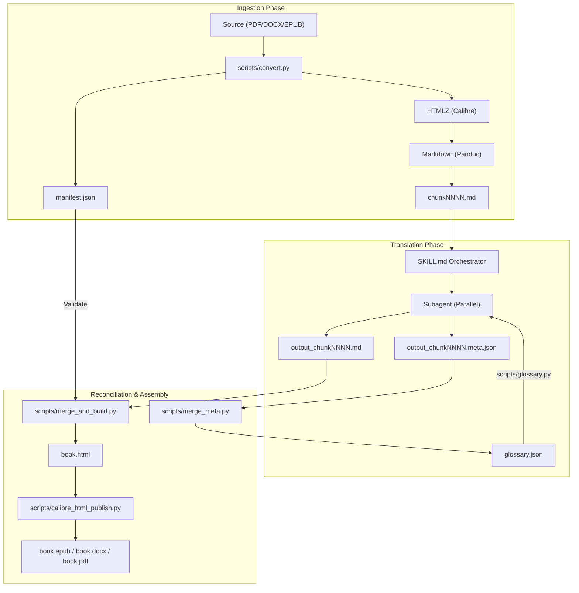
Sources: [README.md:13-31](), [README.md:122-181](), [CLAUDE.md:9-17]()

## Code Entity Space Mapping

To navigate the codebase, it is essential to understand how the high-level "Pipeline Phases" map to specific Python modules and orchestration files.

### Orchestration and Logic Mapping
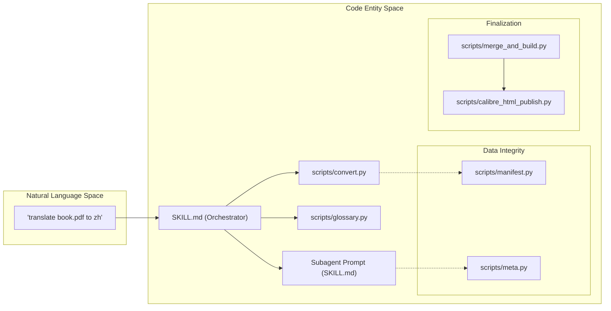
Sources: [SKILL.md:1-100](), [CLAUDE.md:7-18](), [AGENTS.md:7-17]()

## Key Components

### 1. Ingestion and Chunking
The pipeline begins with `scripts/convert.py`, which utilizes Calibre's `ebook-convert` to normalize various input formats into a temporary HTMLZ structure. This is then converted to Markdown and split into chunks of approximately 6000 characters [README.md:122-128](). For details, see [Getting Started](#1.1).

### 2. The Glossary System
To ensure "Manhattan" isn't translated as three different things across 50 chunks, `scripts/glossary.py` manages a `glossary.json` file. It samples the book to seed terms and then injects a context-aware term table into every subagent's prompt [README.md:130-140]().

### 3. Parallel Translation
The `SKILL.md` file defines the orchestration logic for launching up to 8 concurrent subagents. Each subagent is responsible for a single chunk, producing both the translated Markdown and a `.meta.json` file containing observed entities [README.md:160-168](). For details, see [Pipeline Architecture](#1.2).

### 4. Validation and Assembly
Before the final build, `scripts/manifest.py` verifies SHA-256 hashes to ensure no source chunks have changed since translation began [README.md:176-179](). Finally, `scripts/merge_and_build.py` and `scripts/calibre_html_publish.py` assemble the chunks into a unified document and export it to professional formats [README.md:170-181]().

## Wiki Navigation

*   **[Getting Started](#1.1)**: Installation of Calibre, Pandoc, and Python dependencies. How to run your first translation.
*   **[Pipeline Architecture](#1.2)**: A deep dive into the five phases of the translation lifecycle and the `{baseDir}` workspace.
*   **[Scripts Reference](#2)**: Detailed documentation for every Python script in the `scripts/` directory.
*   **[Orchestration and Skill Definition](#3)**: Understanding `SKILL.md` and the developer constraints in `CLAUDE.md`.
*   **[Testing](#4)**: How to use the baseline system (`tests/baselines/`) to verify pipeline changes.

Sources: [README.md:44-52](), [README.md:185-201](), [CLAUDE.md:31-47]()

---

# Page: Getting Started

# Getting Started

<details>
<summary>Relevant source files</summary>

The following files were used as context for generating this wiki page:

- [.gitignore](.gitignore)
- [README.md](README.md)
- [README.zh-CN.md](README.zh-CN.md)
- [SKILL.md](SKILL.md)

</details>


This page provides a technical guide for setting up the `translate-book` environment and executing the first translation pipeline. It covers the installation of external binary dependencies, Python environment configuration, and the orchestration of the Claude Code skill.

## Purpose and Scope

The `translate-book` pipeline is a multi-stage workflow designed to convert, chunk, and translate books (PDF/DOCX/EPUB) using parallel LLM sub-agents. The system relies on a combination of established document processing tools (Calibre, Pandoc) and custom Python orchestration logic defined in `SKILL.md` [[SKILL.md:1-10]]().

## Prerequisites

The system requires three primary external dependencies and a specific Python environment to function.

### 1. External Binaries
| Dependency | Purpose | Requirement |
| :--- | :--- | :--- |
| **Claude Code CLI** | Main orchestration engine | Installed and authenticated [[README.md:46-46]]() |
| **Calibre** | Format conversion (PDF/DOCX/EPUB → HTMLZ) | `ebook-convert` must be in PATH [[README.md:47-47]]() |
| **Pandoc** | Markdown/HTML transformation | `pandoc` binary available [[README.md:48-48]]() |

### 2. Python Environment
The pipeline is tested on **Python 3.11** [[.github/workflows/ci.yml:16-16]](). 
*   **Required**: `pypandoc` (Python wrapper for Pandoc) [[README.md:50-50]]()
*   **Optional**: `beautifulsoup4` (Enhanced TOC generation and HTML parsing) [[README.md:51-51]]()

**Sources:** [[README.md:44-52]](), [[.github/workflows/ci.yml:16-16]]()

---

## Installation

### Skill Deployment
The skill can be installed via `npx` (recommended), `clawhub`, or direct git clone into the Claude Code skills directory [[README.md:55-73]]().

```bash
# Recommended: Install via npx
npx skills add deusyu/translate-book -a claude-code -g
```

### Path Abstraction: `{baseDir}`
The codebase uses a `{baseDir}` abstraction in `SKILL.md` and `AGENTS.md` to reference the skill's root directory regardless of where it is installed on the local filesystem [[SKILL.md:29-29]](), [[AGENTS.md:5-5]](). This ensures that the orchestration layer can reliably locate the `scripts/` directory for tool execution.

**Sources:** [[README.md:55-73]](), [[SKILL.md:29-29]]()

---

## Running Your First Translation

### Skill Invocation Syntax
The skill is invoked within the Claude Code environment using either natural language or a direct slash command [[README.md:78-88]]().

**Natural Language:**
> "translate /path/to/book.pdf to Chinese"

**Slash Command:**
> `/translate-book translate /path/to/book.pdf to Japanese`

### Parameters
The orchestration logic in `SKILL.md` extracts the following parameters from the user prompt:
*   `file_path`: The absolute path to the source document [[SKILL.md:17-17]]().
*   `target_lang`: The ISO language code (default: `zh`) [[SKILL.md:18-18]]().
*   `concurrency`: Number of parallel sub-agents (default: `8`) [[SKILL.md:19-19]]().
*   `custom_instructions`: User-defined style or terminology constraints [[SKILL.md:20-20]]().

**Sources:** [[README.md:78-88]](), [[SKILL.md:14-22]]()

---

## Data Flow and Workspace

When a translation starts, the system creates a workspace directory named `{filename}_temp/` in the current working directory [[README.md:94-94]](). This directory serves as the stateful scratchpad for the entire pipeline.

### System Entity Mapping: Ingestion to Workspace
The following diagram bridges the natural language request to the code entities and filesystem artifacts created during the "Preprocess" phase.

**Diagram: Ingestion Data Flow**
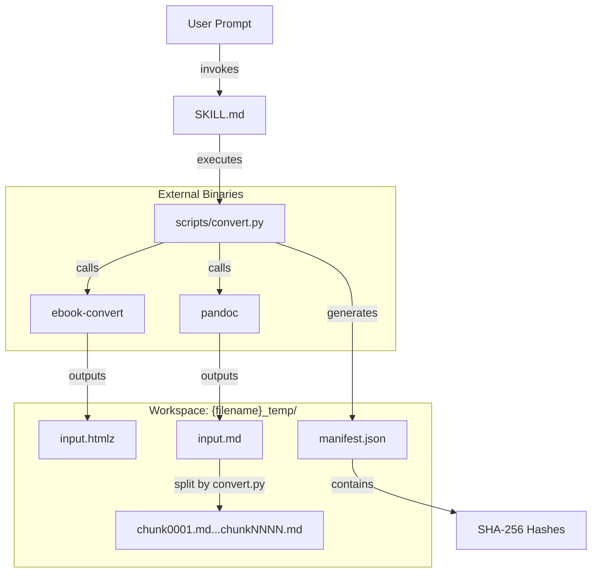
**Sources:** [[README.md:13-31]](), [[SKILL.md:24-37]](), [[scripts/convert.py:1-20]]()

---

## Execution Lifecycle

The pipeline follows a strict execution order managed by the main agent.

### 1. Preprocessing
The `scripts/convert.py` script is called to ingest the file. It uses Calibre to normalize the input to HTMLZ, then Pandoc to convert it to Markdown, and finally splits the text into ~6000 character chunks [[README.md:122-128]]().

### 2. Glossary Initialization
The skill samples the book (first, last, and middle chunks) to extract key terms [[SKILL.md:59-60]](). It creates a `glossary.json` file which is then used to enforce terminology consistency across the parallel sub-agents [[README.md:130-158]]().

### 3. Parallel Translation
The main agent spawns sub-agents in batches. Each sub-agent is responsible for a single chunk.

**Diagram: Sub-agent Invocation Logic**
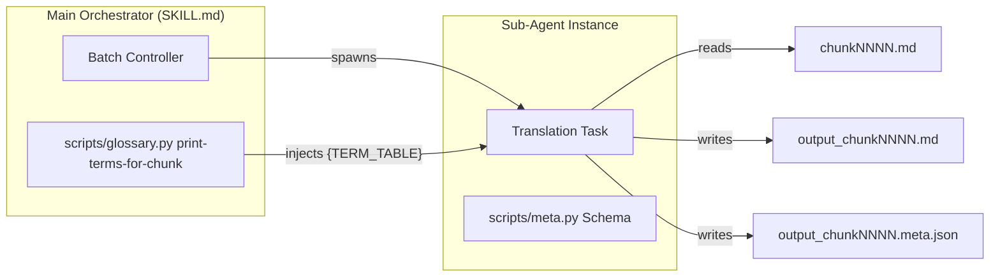

### 4. Final Assembly
Once all chunks are translated and validated against `manifest.json`, the `scripts/merge_and_build.py` script aggregates the results into the final formats: `book.html`, `book.docx`, `book.epub`, and `book.pdf` [[README.md:170-181]]().

**Sources:** [[README.md:120-181]](), [[SKILL.md:38-124]]()

---

# Page: Pipeline Architecture

# Pipeline Architecture

<details>
<summary>Relevant source files</summary>

The following files were used as context for generating this wiki page:

- [AGENTS.md](AGENTS.md)
- [CLAUDE.md](CLAUDE.md)
- [README.md](README.md)
- [SKILL.md](SKILL.md)

</details>


The `translate-book` pipeline is a five-phase workflow designed to translate large-scale documents while maintaining term consistency and structural integrity. It employs a fan-out/fan-in architecture where a single book is decomposed into manageable units, processed by isolated subagents, and reassembled with a feedback loop that updates a global glossary.

## Pipeline Overview

The orchestration logic resides in `SKILL.md`, which coordinates the execution of specialized Python scripts. All intermediate artifacts are stored in a workspace directory named `{book_name}_temp/` [README.md:94-94]().

### Data Flow Diagram

The following diagram maps the high-level stages to the specific scripts and files involved in the process.

**Pipeline Flow: Source to Multi-Format Output**
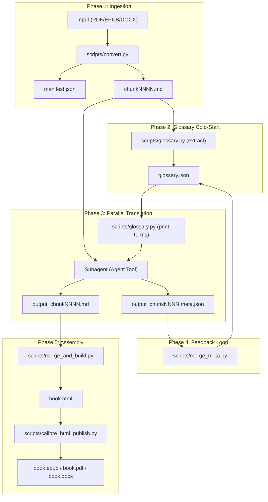
**Sources:** [README.md:13-31](), [SKILL.md:12-175](), [CLAUDE.md:9-17]()

---

## 1. Ingestion and Chunking

The pipeline begins by normalizing diverse input formats into a consistent Markdown structure. 

- **Normalization**: `scripts/convert.py` uses Calibre's `ebook-convert` to transform the input into an `HTMLZ` archive, which is then processed via Pandoc into Markdown [README.md:125-128]().
- **Chunking**: The Markdown is split into chunks of approximately 6000 characters, named `chunkNNNN.md` [README.md:128-128]().
- **Integrity**: A `manifest.json` is generated using `scripts/manifest.py` to store SHA-256 hashes of every source chunk. This ensures that the final assembly only includes translations derived from the current version of the source [README.md:128-128](), [CLAUDE.md:11-11]().

**Sources:** [scripts/convert.py](), [scripts/manifest.py](), [SKILL.md:24-37]()

---

## 2. Glossary Cold-Start

To prevent "term drift" (where the same entity is translated differently across chunks), the system initializes a `glossary.json` file.

1. **Sampling**: The orchestrator reads the first, last, and three middle chunks [SKILL.md:59-59]().
2. **Extraction**: A subagent identifies proper nouns (people, places, technical terms) and proposes canonical translations [SKILL.md:60-60]().
3. **Frequency Analysis**: `scripts/glossary.py count-frequencies` scans all chunks to populate the `frequency` field in `glossary.json` [SKILL.md:79-85](). This allows the system to prioritize high-impact terms during injection.

**Sources:** [README.md:130-154](), [SKILL.md:51-88]()

---

## 3. Parallel Translation with Subagents

The "Fan-Out" phase launches up to 8 concurrent subagents [README.md:37-37](). Each subagent is a fresh instance with an isolated context window to prevent output truncation and context pollution [README.md:33-33]().

### Term Injection Mechanism
Before a subagent is spawned for `chunkNNNN.md`, the orchestrator runs:
`python3 scripts/glossary.py print-terms-for-chunk <temp_dir> chunkNNNN.md` [SKILL.md:113-114]().

This generates a Markdown table of relevant terms based on:
- **Direct Presence**: Terms found in the current chunk.
- **Global Importance**: The Top-N most frequent terms in the entire book [README.md:138-138]().

**Subagent Entity Mapping**
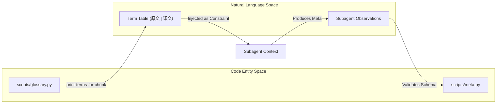
**Sources:** [SKILL.md:89-118](), [scripts/glossary.py](), [scripts/meta.py]()

---

## 4. Merge-Meta Feedback Loop

As subagents complete their tasks, they produce `output_chunkNNNN.meta.json` files containing observations about new entities, gender attributes, or translation conflicts [SKILL.md:125-148]().

The `scripts/merge_meta.py` tool performs the "Fan-In" of this metadata:
- **`prepare-merge`**: Classifies new observations into alias chains or new terms.
- **`apply-merge`**: Updates `glossary.json` atomically.
- **Idempotency**: The script tracks `applied_meta_hashes` to ensure no meta file is processed twice [README.md:150-150]().

**Sources:** [README.md:150-152](), [SKILL.md:123-152](), [scripts/merge_meta.py]()

---

## 5. Final Assembly

The final phase reassembles the translated chunks into the requested output formats.

1. **Validation**: `scripts/merge_and_build.py` verifies the `manifest.json` hashes and ensures a 1:1 match between source chunks and output chunks [README.md:27-27]().
2. **Merging**: Chunks are concatenated into a single `output.md` [README.md:98-98]().
3. **HTML Generation**: Pandoc converts the Markdown into a web-optimized HTML file using `scripts/template.html`, which includes a floating Table of Contents [README.md:99-99]().
4. **Format Export**: `scripts/calibre_html_publish.py` wraps Calibre to produce `book.epub`, `book.pdf`, and `book.docx` [README.md:100-102]().

**Final Assembly Logic**
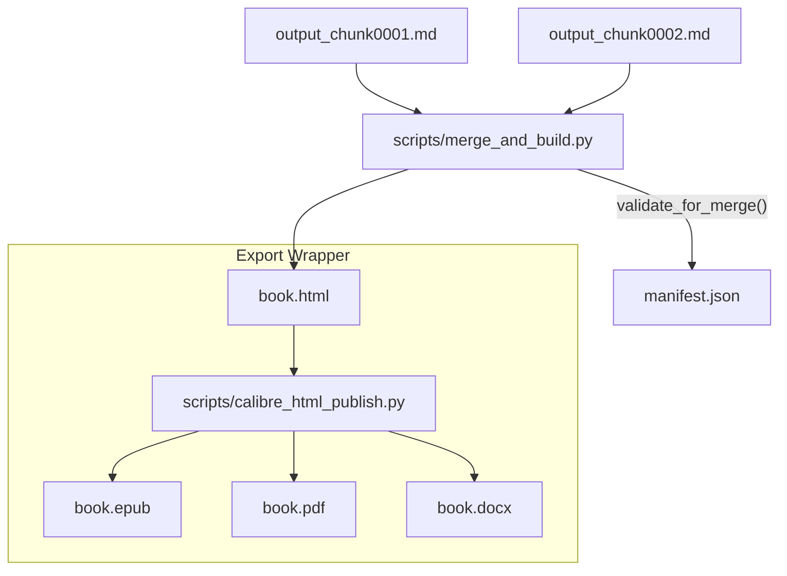
**Sources:** [README.md:170-175](), [SKILL.md:167-175](), [scripts/merge_and_build.py](), [scripts/calibre_html_publish.py]()

---

# Page: Scripts Reference

# Scripts Reference

<details>
<summary>Relevant source files</summary>

The following files were used as context for generating this wiki page:

- [AGENTS.md](AGENTS.md)
- [CLAUDE.md](CLAUDE.md)
- [LICENSE](LICENSE)
- [scripts/merge_and_build.py](scripts/merge_and_build.py)

</details>


The `scripts/` directory contains the core Python logic for the translation pipeline. These scripts handle the transformation of source documents into Markdown chunks, manage term consistency via a shared glossary, and assemble the final translated book into multiple formats.

### Pipeline Script Overview

The pipeline is designed as a fan-out/fan-in architecture. Files are first ingested and split into small, manageable units (chunks), processed in parallel by subagents (orchestrated by the skill layer), and finally merged back into a cohesive document.

#### Ingestion and Processing Flow
The following diagram illustrates how data flows through the primary scripts and the entities they manipulate.

**Data Flow and Entity Association**
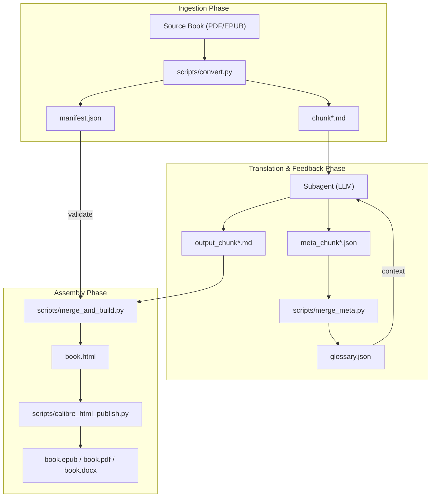
**Sources:** [CLAUDE.md:9-17](), [AGENTS.md:9-17]()

---

### Core Scripts

#### [2.1 convert.py — Ingestion and Chunking](#)
This script serves as the entry point for new books. It uses Calibre's `ebook-convert` to normalize various input formats into an `HTMLZ` archive, which is then processed into Markdown using Pandoc. It is responsible for splitting the text into ~6000-character chunks to fit LLM context windows and generating the initial `manifest.json`.
*   **Key Functions:** `main`, `convert_to_markdown`, `split_markdown`.
*   **Outputs:** `chunk*.md`, `manifest.json`, `config.txt`.

For details, see [convert.py — Ingestion and Chunking](#2.1).
**Sources:** [scripts/convert.py:1-15]()

#### [2.2 glossary.py — Term Consistency Management](#)
Manages the translation glossary to ensure names, technical terms, and stylistic choices remain consistent across parallel subagent tasks. It supports CJK (Chinese, Japanese, Korean) detection and provides subcommands for counting term frequencies and injecting relevant terms into chunk-specific prompts.
*   **Key Entities:** `GlossaryV2` schema, `count-frequencies` subcommand.

For details, see [glossary.py — Term Consistency Management](#2.2).
**Sources:** [scripts/glossary.py:1-20]()

#### [2.3 merge_meta.py — Subagent Feedback Loop](#)
Handles the "fan-in" of metadata. As subagents translate chunks, they produce `meta_chunk*.json` files containing newly discovered terms or aliases. `merge_meta.py` reconciles these observations into the main `glossary.json`, handling alias chains and confidence escalation.
*   **Key Commands:** `prepare-merge`, `apply-merge`, `status`.

For details, see [merge_meta.py — Subagent Feedback Loop](#2.3).
**Sources:** [scripts/merge_meta.py:1-25]()

#### [2.4 merge_and_build.py — Final Assembly](#)
Combines translated Markdown chunks back into a single document. It performs critical integrity checks, specifically ensuring that image tags (``) and Markdown image references (``) are preserved and not corrupted during translation.
*   **Key Classes:** `_ImgTagCollector` [scripts/merge_and_build.py:36-49](), `_MD_IMG_RE` [scripts/merge_and_build.py:32-32]().
*   **Key Logic:** `_validate_chunk_images` [scripts/merge_and_build.py:83-141]().

For details, see [merge_and_build.py — Final Assembly](#2.4).
**Sources:** [scripts/merge_and_build.py:1-22]()

#### [2.5 calibre_html_publish.py — Format Export](#)
A specialized wrapper for Calibre that converts the final assembled HTML into distribution formats like EPUB, PDF, and DOCX. It manages language-specific font selection and ensures EPUB 3 compliance.
*   **Key Function:** `run_ebook_convert`.

For details, see [calibre_html_publish.py — Format Export](#2.5).
**Sources:** [scripts/calibre_html_publish.py:1-15]()

---

### Data Integrity and Templates

#### [2.6 manifest.py and meta.py — Data Integrity Schemas](#)
These modules define the schemas and validation logic used by other scripts. `manifest.py` tracks the SHA-256 hashes of source chunks to detect staleness, while `meta.py` defines the structure for subagent observations.
*   **Key Functions:** `validate_for_merge` [scripts/manifest.py:136-155](), `load_meta` [scripts/meta.py:73-86]().

For details, see [manifest.py and meta.py — Data Integrity Schemas](#2.6).
**Sources:** [scripts/manifest.py:1-15](), [scripts/meta.py:1-20]()

#### [2.7 HTML Templates](#)
Defines the visual structure of the output. `template.html` is used for web-optimized viewing with a sidebar TOC, while `template_ebook.html` is optimized for Calibre's conversion engine.
*   **Placeholders:** `$body$`, `$title$`, `$lang$`, `$body_font$`.

For details, see [HTML Templates](#2.7).
**Sources:** [scripts/merge_and_build.py:440-460]()

### Script Interaction Map

This diagram shows how scripts interact with the filesystem and each other during a typical run.

**Entity Interaction Map**
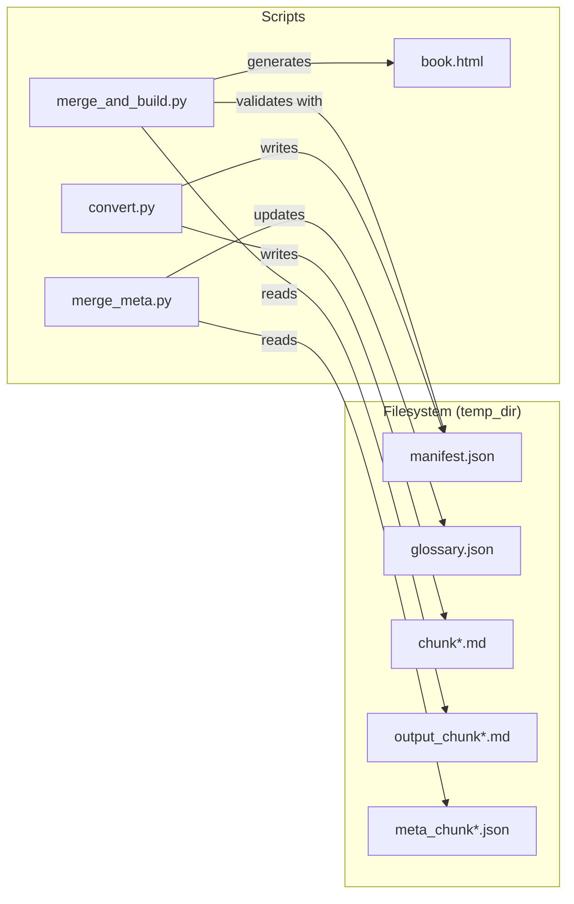
**Sources:** [CLAUDE.md:31-40](), [scripts/merge_and_build.py:21-21]()

---

# Page: convert.py — Ingestion and Chunking

# convert.py — Ingestion and Chunking

<details>
<summary>Relevant source files</summary>

The following files were used as context for generating this wiki page:

- [scripts/convert.py](scripts/convert.py)
- [scripts/manifest.py](scripts/manifest.py)
- [tests/test_convert.py](tests/test_convert.py)

</details>


The `scripts/convert.py` script serves as the entry point for the translation pipeline. It is responsible for transforming raw e-book formats (PDF, DOCX, EPUB) into a normalized, cleaned Markdown format, and then partitioning that content into manageable chunks for LLM processing.

### Overview of Operations

The script performs a sequential transformation of the input file through several intermediate states:
1.  **Format Normalization**: Uses Calibre's `ebook-convert` to create an `HTMLZ` archive `[scripts/convert.py:42-61]()`.
2.  **Asset Extraction**: Unpacks the `HTMLZ` to retrieve the primary HTML content and associated images `[scripts/convert.py:115-148]()`.
3.  **Markdown Conversion**: Utilizes `pypandoc` to convert HTML to Markdown with specific flags to disable line wrapping `[scripts/convert.py:178-212]()`.
4.  **Content Cleaning**: Strips Calibre-specific CSS markers and employs a Longest Non-Decreasing Subsequence (LNDS) algorithm to identify and remove page numbers `[scripts/convert.py:196-196]()`.
5.  **Chunking**: Splits the Markdown into segments of approximately 6000 characters, ensuring splits occur at logical paragraph boundaries `[scripts/convert.py:343-401]()`.
6.  **Manifest Generation**: Creates a `manifest.json` to track chunk order and source integrity via SHA-256 hashes `[scripts/manifest.py:20-56]()`.

### System Architecture and Data Flow

The following diagram illustrates the flow from a source document to the chunked workspace.

**Data Transformation Pipeline**
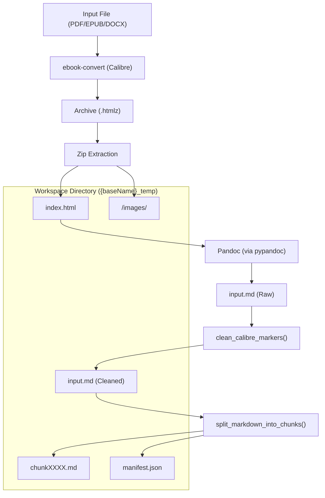
Sources: `[scripts/convert.py:42-61]()`, `[scripts/convert.py:115-148]()`, `[scripts/convert.py:178-212]()`, `[scripts/convert.py:343-401]()`, `[scripts/manifest.py:20-56]()`.

### Key Functions and Logic

#### Calibre and Pandoc Integration
The script first locates the `ebook-convert` binary using `find_calibre_convert()` `[scripts/convert.py:21-40]()`. It converts the input to `HTMLZ`, which is a ZIP container containing a single HTML file and a folder of images. This format is preferred because it flattens complex e-book structures into a linear stream.

#### Automated Content Cleaning
The `clean_calibre_markers` function is critical for reducing token noise. It performs:
-   **Regex Stripping**: Removes Calibre's internal CSS class markers (e.g., `{.calibre5}`) and internal anchors `[scripts/convert.py:255-263]()`.
-   **Page Number Removal**: Identifies standalone digits that form a monotonic sequence throughout the document. This prevents page numbers from being translated as part of the narrative text `[scripts/convert.py:270-285]()`.

#### Chunking Strategy
Content is split by `split_markdown_into_chunks()` using a target size (default 6000 characters). 
-   It identifies split points by looking for double newlines `\n\n` `[scripts/convert.py:355-356]()`.
-   It uses `bisect_left` to find the optimal split point nearest to the character limit `[scripts/convert.py:378-382]()`.
-   Each chunk is saved as `chunkXXXX.md` where `XXXX` is a four-digit zero-padded index `[scripts/convert.py:392-393]()`.

### Code Entity Mapping

The following diagram maps the high-level ingestion steps to the specific Python functions and external tools responsible for them.

**Code Entity Space Mapping**
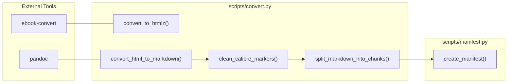
Sources: `[scripts/convert.py:42-61]()`, `[scripts/convert.py:178-212]()`, `[scripts/convert.py:252-290]()`, `[scripts/convert.py:343-401]()`, `[scripts/manifest.py:20-56]()`.

### Output Artifacts

| Artifact | Path | Description |
| :--- | :--- | :--- |
| **Workspace** | `{baseName}_temp/` | The root directory for all translation tasks. |
| **Manifest** | `manifest.json` | JSON file containing chunk metadata and SHA-256 hashes `[scripts/manifest.py:45-49]()`. |
| **Config** | `config.txt` | Stores the target language (`--olang`) for downstream scripts `[scripts/convert.py:481-483]()`. |
| **Chunks** | `chunk0001.md` ... | Individual Markdown files containing the source text segments. |
| **Images** | `images/` | Directory containing all extracted media from the source. |

### Command Line Interface

The script is typically invoked with the input file and the target language:

```bash
python scripts/convert.py path/to/book.epub --olang "Traditional Chinese"
```

-   `--olang`: Sets the target language, written to `config.txt` `[scripts/convert.py:481-483]()`.
-   `--strip-page-numbers`: Enables the LNDS-based page number removal `[scripts/convert.py:456-456]()`.

Sources: `[scripts/convert.py:446-465]()`.

---

# Page: glossary.py — Term Consistency Management

# glossary.py — Term Consistency Management

<details>
<summary>Relevant source files</summary>

The following files were used as context for generating this wiki page:

- [SKILL.md](SKILL.md)
- [scripts/glossary.py](scripts/glossary.py)
- [tests/test_glossary.py](tests/test_glossary.py)

</details>


The `scripts/glossary.py` module is responsible for maintaining terminological consistency across the parallel translation pipeline. Since each chunk is translated by an independent sub-agent with a fresh context [SKILL.md:91-92](), the glossary serves as the shared state that ensures proper nouns (names, places, technical terms) are rendered identically throughout the book [scripts/glossary.py:5-10]().

## Glossary Schema (v2)

The system uses a structured JSON format (v2) stored at `<temp_dir>/glossary.json` [scripts/glossary.py:26](). It supports advanced metadata like alias chains, gender tracking for grammar consistency, and frequency-based injection priorities [scripts/glossary.py:12-24]().

### Core Schema Fields
| Field | Type | Description |
| :--- | :--- | :--- |
| `id` | string | Unique identifier for the term (defaults to `source`) [scripts/glossary.py:85](). |
| `source` | string | The term as it appears in the source text [scripts/glossary.py:100](). |
| `target` | string | The canonical translation in the target language [scripts/glossary.py:100](). |
| `aliases` | list[str] | Alternative forms of the source term (e.g., nicknames, abbreviations) [scripts/glossary.py:131](). |
| `gender` | string | `male`, `female`, `nonbinary`, or `unknown` [scripts/glossary.py:43](). |
| `confidence` | string | `low`, `medium`, or `high` [scripts/glossary.py:44](). |
| `frequency` | integer | Global count of occurrences across all source chunks [scripts/glossary.py:117-122](). |
| `evidence_refs` | list[str] | Quotes or references justifying the translation [scripts/glossary.py:175](). |

### Invariants and Validation
The script enforces strict invariants to prevent translation ambiguity:
1.  **Surface Form Uniqueness**: No string (source or alias) can be associated with more than one term ID [scripts/glossary.py:196-215]().
2.  **No Redundancy**: An alias cannot be identical to the primary source string [scripts/glossary.py:148-152]().
3.  **Atomic Updates**: All writes to `glossary.json` use a temporary file and rename pattern to prevent corruption during manual edits or crashes [scripts/glossary.py:291-297]().

**Sources:** [scripts/glossary.py:12-24](), [scripts/glossary.py:39-45](), [scripts/glossary.py:82-195]()

---

## Data Flow: From Discovery to Injection

The glossary lifecycle begins with a "cold-start" sampling of the book and ends with per-chunk table injection.

### Glossary Lifecycle Diagram
This diagram illustrates how `glossary.py` entities interact with the `SKILL.md` workflow.

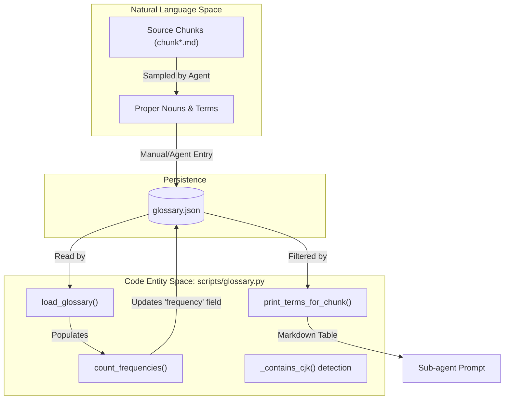

**Sources:** [SKILL.md:51-86](), [scripts/glossary.py:241-289](), [scripts/glossary.py:440-514]()

---

## Key Subcommands

### `count-frequencies`
This command scans every `chunk*.md` (ignoring `output_` files) and updates the `frequency` field for every term in the glossary [scripts/glossary.py:440-445]().

*   **Regex Generation**: For each term, it builds a regex matching the `source` and all `aliases` [scripts/glossary.py:456-464]().
*   **CJK Detection**: It uses `_contains_cjk()` to determine if word boundaries (`\b`) should be applied. Non-CJK terms use word boundaries to avoid false positives (e.g., "cat" matching "category"), while CJK terms do not [scripts/glossary.py:57-63](), [scripts/glossary.py:466-474]().
*   **Safety**: Single-character CJK terms are ignored for frequency counting to prevent massive false-positive counts for common characters [scripts/glossary.py:476-483]().

### `print-terms-for-chunk`
Generates a Markdown table for a specific chunk's translation prompt [scripts/glossary.py:514-517]().

1.  **Local Matches**: Includes terms where the `source` or any `alias` appears in the specific chunk [scripts/glossary.py:541-546]().
2.  **Top-N Global Matches**: Includes the most frequent terms across the entire book, even if they don't appear in the current chunk, up to the `high_frequency_top_n` limit (default: 20) [scripts/glossary.py:534-539]().
3.  **Output**: A 3-column table: `原文 | 别名 | 译文` [SKILL.md:117]().

**Sources:** [scripts/glossary.py:440-512](), [scripts/glossary.py:514-573](), [SKILL.md:111-118]()

---

## Term Table Injection Logic

Before spawning a sub-agent, the orchestrator calls `print-terms-for-chunk`. The resulting table is injected into the translation prompt to guide the LLM.

### Logic Flow: Entity Association
This diagram bridges the CLI output to the internal data structures.

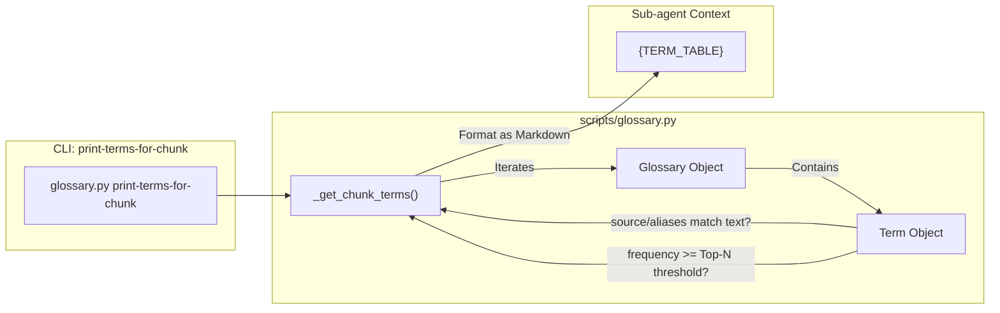

**Sources:** [scripts/glossary.py:514-550](), [SKILL.md:117-118]()

## Manual Editing and Robustness
*   **Hand-Editable**: The `glossary.json` is designed for human intervention. Users can refine `target` translations or add `aliases` between pipeline runs [SKILL.md:87-88]().
*   **Schema Upgrades**: The script automatically upgrades v1 glossaries (simple source/target pairs) to the v2 schema on load [scripts/glossary.py:241-248]().
*   **Validation**: The `_validate_term_strict` function ensures that manual edits do not introduce invalid types or missing required fields [scripts/glossary.py:94-194]().

**Sources:** [scripts/glossary.py:26-27](), [scripts/glossary.py:94-194](), [scripts/glossary.py:241-255]()

---

# Page: merge_meta.py — Subagent Feedback Loop

# merge_meta.py — Subagent Feedback Loop

<details>
<summary>Relevant source files</summary>

The following files were used as context for generating this wiki page:

- [SKILL.md](SKILL.md)
- [scripts/merge_meta.py](scripts/merge_meta.py)
- [tests/test_merge_meta.py](tests/test_merge_meta.py)

</details>


The `scripts/merge_meta.py` utility is the core of the translation pipeline's feedback loop. It bridges the gap between the independent, fresh-context subagents and the global, canonical `glossary.json`. Since each subagent translates only a single chunk (approx. 6000 characters), they often encounter new entities or nuances that were not in the initial glossary. `merge_meta.py` provides the mechanism to ingest these discoveries, resolve conflicts, and escalate confidence levels through a structured prepare-and-apply cycle.

## Overview and CLI Subcommands

The script operates via three primary subcommands, designed to be called by the orchestrator (e.g., `SKILL.md`) after a batch of translations completes [scripts/merge_meta.py:5-26]().

| Subcommand | Role | Execution Context |
| :--- | :--- | :--- |
| `prepare-merge` | Scans `*.meta.json` files, compares them against the current glossary, and generates a JSON proposal of "auto-applies" and "decisions needed". | Main Agent / Orchestrator |
| `apply-merge` | Consumes a decisions JSON (with user/agent choices) and updates `glossary.json` atomically. | Main Agent / Orchestrator |
| `status` | Provides a read-only snapshot of the merge state, including consumed hashes and quarantined files. | Verification / Reporting |

### The Meta File Contract
Subagents are required to emit an `output_chunk<NNNN>.meta.json` file for every chunk, even if no new information is found [SKILL.md:123-124](). This file contains:
*   `new_entities`: Proposed additions to the glossary [SKILL.md:130-132]().
*   `alias_hypotheses`: Suggestions that a term might be a variant of an existing one [SKILL.md:134-137]().
*   `attribute_hypotheses`: Metadata updates like gender or category [SKILL.md:138-141]().
*   `conflicts`: Observations where the injected glossary term felt incorrect in context [SKILL.md:143-147]().

Sources: [scripts/merge_meta.py:5-26](), [SKILL.md:123-152]()

## Data Flow: The Prepare-Merge Engine

The `prepare-merge` command performs a classification of every observation found in unmerged meta files. It uses `applied_meta_hashes` stored in the glossary to ensure idempotency—only new or changed meta files are processed [scripts/merge_meta.py:171-173]().

### Classification Logic
1.  **Grouping**: Identical proposals for the same source string across different chunks are grouped to reduce noise [scripts/merge_meta.py:179-188]().
2.  **Surface Indexing**: The script builds a map of every source and alias currently in the glossary to detect collisions [scripts/merge_meta.py:118-125]().
3.  **Conflict Detection**:
    *   **New Entity vs. Existing**: If a proposed new entity's source already exists as an alias elsewhere, it is routed to `decisions_needed` as `new_entity_existing_alias` [scripts/merge_meta.py:255-265]().
    *   **Conflicting Proposals**: If two chunks propose the same source but with different target translations, they are grouped into a `conflicting_new_entity_proposals` decision [scripts/merge_meta.py:236-248]().

### Confidence Escalation
The script implements a "Confidence Escalation" logic. A term's `confidence` is not static; it is promoted based on the number of unique chunks that have provided evidence for it [scripts/merge_meta.py:76-81]().
*   **1 Chunk**: `low`
*   **2 Chunks**: `medium`
*   **3+ Chunks**: `high`

Confidence can only be promoted, never downgraded [scripts/merge_meta.py:87-91]().

### Diagram: Prepare-Merge Logic
This diagram shows how `cmd_prepare_merge` transforms raw meta files into a structured proposal.

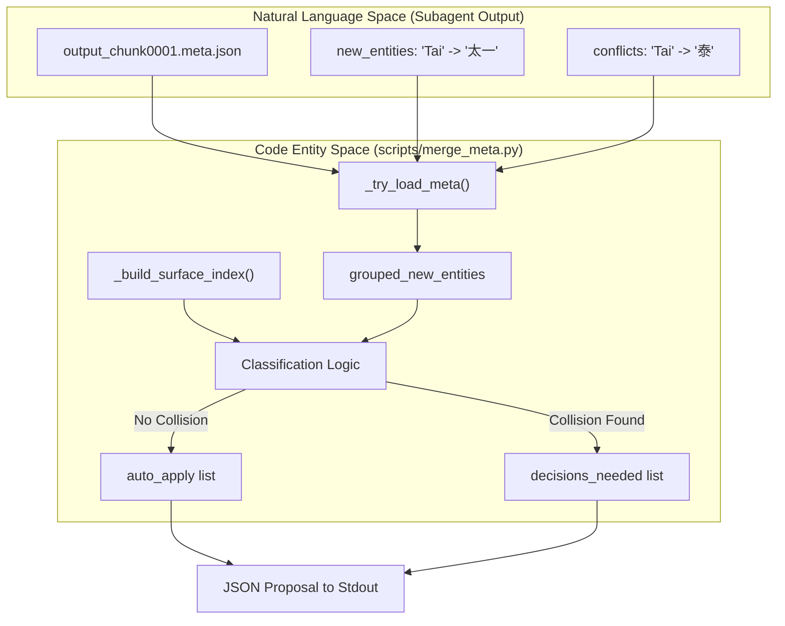
Sources: [scripts/merge_meta.py:118-200](), [scripts/merge_meta.py:76-109](), [scripts/merge_meta.py:143-200]()

## Atomic Apply Sequence

The `apply-merge` command follows a strict 4-phase sequence to ensure the glossary remains consistent even if the process is interrupted. It reads the decisions from `stdin` [scripts/merge_meta.py:534-540]().

### 1. Auto-Apply Phase
Terms in the `auto_apply` list are added to the glossary. If the term already exists (e.g., added by a previous decision in the same batch), the script merely appends the new `evidence_refs` and promotes confidence [scripts/merge_meta.py:551-569]().

### 2. Decision Resolution Phase
The script iterates through `decisions` provided by the orchestrator. Each decision must have a `choice` that matches the `VALID_CHOICES_BY_KIND` [scripts/merge_meta.py:44-51]().
*   **`alias`**: If `yes_alias`, the source is added to the target term's `aliases` array [scripts/merge_meta.py:581-590]().
*   **`conflict`**: If `accept_proposed`, the glossary's `target` field is overwritten [scripts/merge_meta.py:614-617]().

### 3. Metadata Updates
Attribute hypotheses (like gender) are applied. For example, if a subagent identifies a character's gender with "high" confidence, the `gender` field in the glossary is updated [scripts/merge_meta.py:656-665]().

### 4. Hash Committal
Finally, the content hashes of all processed meta files are written into `applied_meta_hashes` [scripts/merge_meta.py:688-693](). This ensures that even if `apply-merge` is called again, it will not re-process the same data. The glossary is then saved using `glossary_mod.save_glossary` for an atomic write [scripts/merge_meta.py:695]().

### Diagram: Apply-Merge State Transition
This diagram maps the `cmd_apply_merge` function to the data structures it modifies.

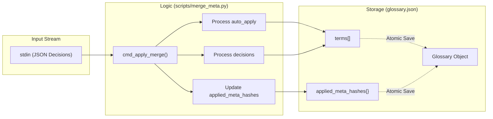
Sources: [scripts/merge_meta.py:534-697](), [scripts/merge_meta.py:44-51]()

## Error Handling and Idempotency

### Quarantine of Malformed Files
`merge_meta.py` adheres to a "non-blocking" promise. If a subagent produces a malformed JSON or a file that fails schema validation (handled via `meta_mod.load_meta`), the script captures the error, warns to `stderr`, and "quarantines" the file by skipping it [scripts/merge_meta.py:64-74](). This prevents a single failed subagent from halting the entire pipeline.

### Applied Meta Hashes
Idempotency is achieved through the `applied_meta_hashes` dictionary in the glossary.
*   **Key**: `chunk_id` (e.g., `chunk0001`)
*   **Value**: SHA-256 hash of the meta file content [scripts/merge_meta.py:171-172]().

If the hash on disk matches the hash in the glossary, `prepare-merge` ignores the file [scripts/merge_meta.py:172-173]().

### Summary Table: Conflict Kinds
| Kind | Trigger | Resolution Options |
| :--- | :--- | :--- |
| `alias` | Subagent suggests A is an alias of B. | `yes_alias`, `no_separate_entity`, `skip` |
| `conflict` | Subagent sees injected target T1 but suggests T2. | `keep_current`, `accept_proposed`, `record_in_notes` |
| `conflicting_new_entity_proposals` | Two chunks suggest the same source but different targets. | `use_variant_N`, `skip` |
| `new_entity_existing_alias` | Proposed new entity source is already an alias for another term. | `use_variant_N` (merge into existing), `skip` |

Sources: [scripts/merge_meta.py:44-51](), [scripts/merge_meta.py:163-176](), [scripts/merge_meta.py:205-300]()

---

# Page: merge_and_build.py — Final Assembly

# merge_and_build.py — Final Assembly

<details>
<summary>Relevant source files</summary>

The following files were used as context for generating this wiki page:

- [LICENSE](LICENSE)
- [scripts/merge_and_build.py](scripts/merge_and_build.py)
- [tests/test_calibre_html_publish.py](tests/test_calibre_html_publish.py)
- [tests/test_merge_and_build.py](tests/test_merge_and_build.py)

</details>


The `scripts/merge_and_build.py` script serves as the final integration point of the translation pipeline. It is responsible for validating the integrity of translated chunks, merging them into a single document, applying language-specific typography, generating a Table of Contents (TOC), and orchestrating the conversion to final distribution formats (EPUB, PDF, DOCX) [scripts/merge_and_build.py:1-7]().

## Overview of Assembly Pipeline

The script performs a "fan-in" operation, taking the individual `output_chunk*.md` files and producing a cohesive book.

### Final Assembly Logic Flow
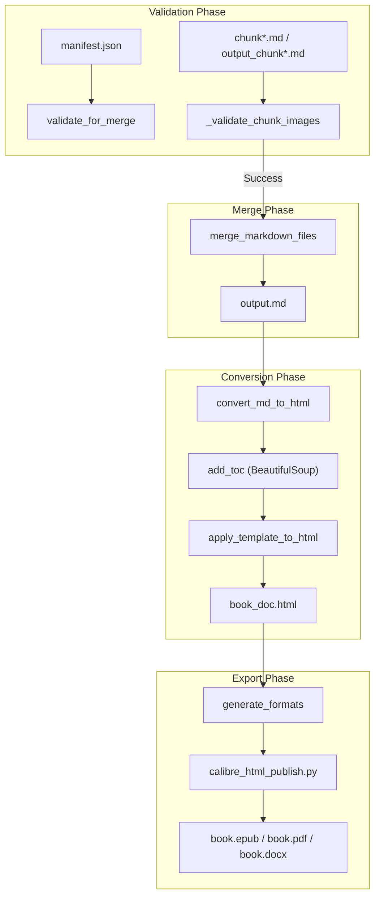
**Sources:** [scripts/merge_and_build.py:21-21](), [scripts/merge_and_build.py:83-83](), [scripts/merge_and_build.py:246-246](), [scripts/merge_and_build.py:465-465]()

## Image Integrity and Validation

One of the most critical roles of `merge_and_build.py` is ensuring that the LLM subagents did not corrupt image references or HTML attributes during translation.

### Image Structure Checking
The script uses two primary mechanisms to verify images:
1.  **`_MD_IMG_RE`**: A regex designed to find Markdown image syntax while ignoring escaped exclamation marks [scripts/merge_and_build.py:32-32]().
2.  **`_ImgTagCollector`**: A class inheriting from `html.parser.HTMLParser`. It is used instead of regex for `` tags because it correctly handles `>` characters inside quoted attribute values (like alt text), which often trip up simple regex [scripts/merge_and_build.py:36-47]().

### Attribute Validation (`_validate_chunk_images`)
This function compares every `output_chunk*.md` against its source `chunk*.md` [scripts/merge_and_build.py:83-94](). It calculates a **delta** of malformed attributes:
*   It identifies attribute names that do not match `_VALID_ATTR_NAME_RE` [scripts/merge_and_build.py:33-33]().
*   It only flags errors if the malformed attribute exists in the output but **not** the source. This prevents false positives on technical books that contain intentionally broken HTML examples in code blocks [scripts/merge_and_build.py:108-114]().

**Sources:** [scripts/merge_and_build.py:32-81](), [scripts/merge_and_build.py:83-141]()

## Typography and Language Configuration

The `LANG_CONFIG` dictionary defines typographical rules for different target languages. This ensures that the final output uses correct quotes, spacing, and HTML language attributes [scripts/merge_and_build.py:204-244]().

| Language Code | `lang_attr` | `quotes` | `space_between_cjk_and_latin` |
| :--- | :--- | :--- | :--- |
| `zh-CN` | `zh-CN` | `“”` | `True` |
| `ja` | `ja` | `「」` | `True` |
| `en` | `en` | `“”` | `False` |

The `apply_lang_typography` function uses these configurations to perform regex-based cleanup on the merged Markdown text before it is converted to HTML [scripts/merge_and_build.py:324-345]().

**Sources:** [scripts/merge_and_build.py:204-244](), [scripts/merge_and_build.py:324-345]()

## TOC Generation and Template Application

If `BeautifulSoup` is available, the script automatically generates a Table of Contents [scripts/merge_and_build.py:172-177]().

1.  **`add_toc`**: Scans the generated HTML for `<h1>` through `<h3>` tags. It assigns unique IDs to headers that lack them and builds a nested list of links [scripts/merge_and_build.py:410-444]().
2.  **`apply_template_to_html`**: Reads `scripts/template.html` (or `template_ebook.html`) and performs variable substitution for `${title}`, `${lang}`, `${body}`, and `${toc}` [scripts/merge_and_build.py:447-462]().

**Sources:** [scripts/merge_and_build.py:172-177](), [scripts/merge_and_build.py:410-462]()

## Format Generation and Staleness Checks

To save time during iterative runs, `generate_format` implements a staleness check. It will only invoke `calibre_html_publish.py` if the source HTML or any image assets in the `images/` directory are newer than the existing output file [scripts/merge_and_build.py:535-555]().

### Format Generation Logic
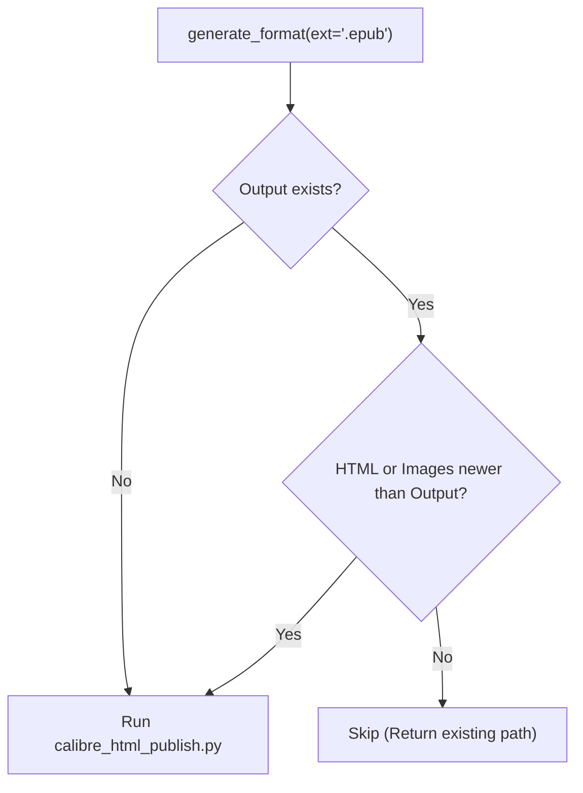
**Sources:** [scripts/merge_and_build.py:535-555](), [tests/test_merge_and_build.py:27-42]()

## Key Functions Reference

| Function | Responsibility |
| :--- | :--- |
| `merge_markdown_files` | Concatenates `output_chunk*.md` files in order [scripts/merge_and_build.py:246-271](). |
| `convert_md_to_html` | Invokes Pandoc to transform Markdown into a raw HTML fragment [scripts/merge_and_build.py:348-379](). |
| `_validate_chunk_images` | Cross-references source and translated chunks to ensure image paths and HTML tags are intact [scripts/merge_and_build.py:83-141](). |
| `extract_cover_from_epub` | Extracts the cover image from a source EPUB to reuse in the translated version [scripts/merge_and_build.py:588-654](). |
| `cleanup_intermediate_files` | Deletes temporary chunks and HTML fragments after a successful build [scripts/merge_and_build.py:682-698](). |

**Sources:** [scripts/merge_and_build.py:83-141](), [scripts/merge_and_build.py:246-271](), [scripts/merge_and_build.py:348-379](), [scripts/merge_and_build.py:588-654](), [scripts/merge_and_build.py:682-698]()

---

# Page: calibre_html_publish.py — Format Export

# calibre_html_publish.py — Format Export

<details>
<summary>Relevant source files</summary>

The following files were used as context for generating this wiki page:

- [scripts/calibre_html_publish.py](scripts/calibre_html_publish.py)
- [tests/test_calibre_html_publish.py](tests/test_calibre_html_publish.py)
- [tests/test_merge_and_build.py](tests/test_merge_and_build.py)

</details>


`scripts/calibre_html_publish.py` serves as the final stage of the pipeline, responsible for converting the assembled HTML document into distribution-ready formats including EPUB, DOCX, and PDF. It acts as a sophisticated wrapper around Calibre's `ebook-convert` utility, handling metadata extraction, language-specific typography, and signal-based process management.

## Overview and Purpose

The script ensures that the translated content is presented with correct typography and metadata across different e-book formats. It specifically addresses the challenges of CJK (Chinese, Japanese, Korean) font rendering in PDF and EPUB formats and enforces modern standards like EPUB 3.

### Key Responsibilities
*   **Metadata Extraction**: Parses the source HTML to find `<title>`, `<h1>`, and `<meta name="author">` tags to populate e-book metadata [scripts/calibre_html_publish.py:42-71]().
*   **Typography Management**: Injects CSS and command-line arguments to ensure appropriate font families are used based on the target language [scripts/calibre_html_publish.py:73-96]().
*   **Asset Assembly**: Automatically discovers and copies image directories (e.g., `images/`, `media/`) to a temporary workspace to ensure `ebook-convert` can resolve relative paths [scripts/calibre_html_publish.py:164-202]().
*   **Process Safety**: Implements a signal-based timeout handler to prevent hanging on complex documents [scripts/calibre_html_publish.py:18-20]().

---

## Technical Implementation

### Data Flow and Process Architecture

The following diagram illustrates how `calibre_html_publish.py` transforms a raw HTML file into a final e-book format by interacting with the filesystem and the Calibre binary.

**Figure 1: Format Export Data Flow**
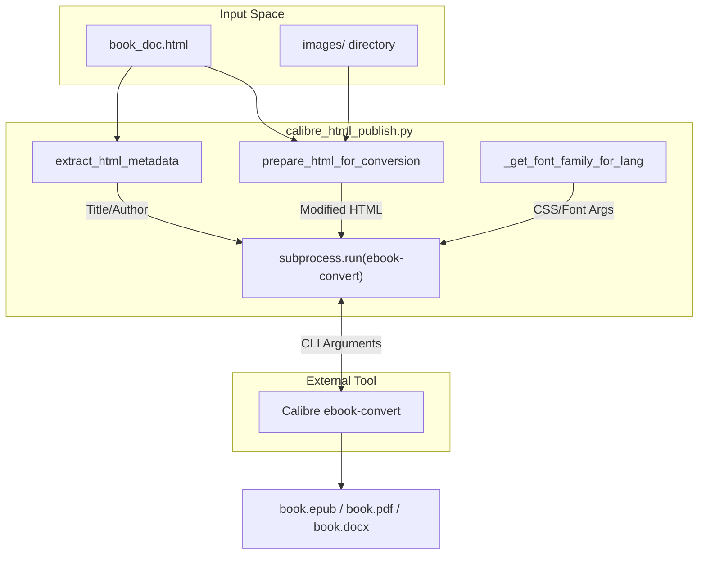
Sources: [scripts/calibre_html_publish.py:42-43](), [scripts/calibre_html_publish.py:99-100](), [scripts/calibre_html_publish.py:204-206]()

### Metadata and Font Selection

The script uses `extract_html_metadata` to scan the input HTML. If a `<title>` tag is missing, it falls back to the first `<h1>` found, and finally to the filename [scripts/calibre_html_publish.py:48-58]().

For typography, the script maps language codes to specific font stacks:
| Language | CSS Font Family (`_get_font_family_for_lang`) | PDF Font (`_get_pdf_font_for_lang`) |
| :--- | :--- | :--- |
| `zh` (Chinese) | "FangSong", "SimSun", serif | FangSong |
| `ja` (Japanese) | "Hiragino Mincho ProN", "Yu Mincho", serif | Hiragino Mincho ProN |
| `ko` (Korean) | "Nanum Myeongjo", "Batang", serif | Nanum Myeongjo |
| Default | Georgia, "Times New Roman", serif | Georgia |

Sources: [scripts/calibre_html_publish.py:73-96]()

---

## Code Entity Mapping

This diagram bridges the CLI commands and logical steps to the specific Python functions within `calibre_html_publish.py`.

**Figure 2: Logic to Code Entity Mapping**
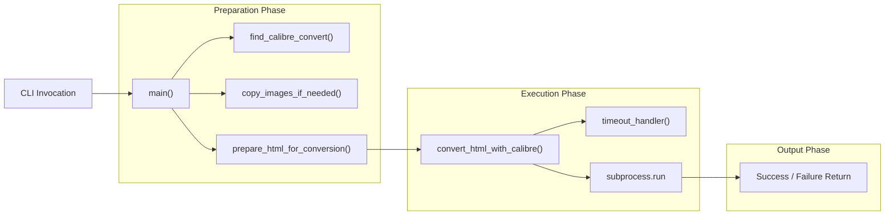
Sources: [scripts/calibre_html_publish.py:18-20](), [scripts/calibre_html_publish.py:22-23](), [scripts/calibre_html_publish.py:99-100](), [scripts/calibre_html_publish.py:204-206]()

---

## Output Contract and Constraints

### Output Formats
The script strictly adheres to the following output contract defined in the pipeline:
*   **EPUB**: Enforced as EPUB 3 via the `--epub-version 3` flag [scripts/calibre_html_publish.py:265-266]().
*   **DOCX**: Generated using standard Calibre defaults.
*   **PDF**: Includes specialized font embedding via `--pdf-standard-font` and `--embed-all-fonts` to ensure CJK characters render correctly [scripts/calibre_html_publish.py:280-285]().

### Timeout Handling
Because `ebook-convert` can occasionally hang on extremely large documents or malformed HTML, the script wraps the call in a `signal.alarm`. The default timeout is provided by the caller (usually `merge_and_build.py`) [scripts/calibre_html_publish.py:237-243]().

### Integration with merge_and_build.py
`merge_and_build.py` uses `generate_format` to call this script. It includes a staleness check: if the output file (e.g., `book.epub`) is newer than both the source HTML and the images directory, the conversion is skipped to save time [tests/test_merge_and_build.py:27-42]().

Sources: [scripts/calibre_html_publish.py:204-210](), [tests/test_merge_and_build.py:27-42]()

---

# Page: manifest.py and meta.py — Data Integrity Schemas

# manifest.py and meta.py — Data Integrity Schemas

<details>
<summary>Relevant source files</summary>

The following files were used as context for generating this wiki page:

- [scripts/manifest.py](scripts/manifest.py)
- [scripts/meta.py](scripts/meta.py)
- [tests/test_meta.py](tests/test_meta.py)

</details>


This section documents the two primary schema-enforcement scripts used to ensure data integrity across the translation pipeline. `manifest.py` manages the lifecycle and integrity of text chunks, while `meta.py` defines the structured feedback loop used by sub-agents to update the global glossary.

## manifest.py — Chunk Tracking and Validation

The `scripts/manifest.py` script is responsible for maintaining the `manifest.json` file within the `{baseDir}`. This file acts as the "source of truth" for the state of the translation project, tracking the relationship between source chunks and their translated counterparts.

### Key Functions

*   **`create_manifest(temp_dir, chunk_files, source_md_path)`**: Executed during the ingestion phase. It calculates the SHA-256 hash of the original `input.md` and every individual source chunk `chunkNNNN.md` [scripts/manifest.py:20-56]().
*   **`validate_for_merge(temp_dir)`**: Used by the final assembly script to verify that the project is ready for merging. It checks for [scripts/manifest.py:68-140]():
    *   **Existence**: All expected `output_chunkNNNN.md` files must exist.
    *   **Integrity**: The current hash of source chunks must match the hash recorded in the manifest. If they differ, the output is considered stale.
    *   **Completeness**: Outputs must not be empty and are flagged with warnings if they are suspiciously small (less than 10% of source size).
*   **`file_hash(filepath)`**: A utility function that computes a SHA-256 hash in 8KB blocks to maintain a low memory footprint [scripts/manifest.py:11-17]().

### Data Flow: Manifest Creation and Validation

The following diagram illustrates how `manifest.py` entities interact with the filesystem to ensure integrity.

**Chunk Integrity Verification Flow**
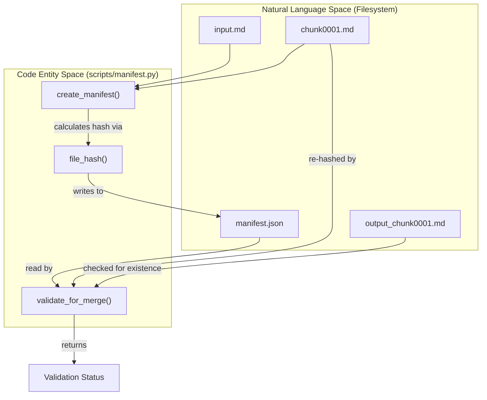
Sources: [scripts/manifest.py:11-17](), [scripts/manifest.py:20-56](), [scripts/manifest.py:68-140]()

---

## meta.py — Sub-agent Observation Schema

`scripts/meta.py` defines the **v1 meta schema**. During translation, sub-agents do not just output translated text; they also emit an `output_chunk<NNNN>.meta.json` file containing observations about new entities, suggested aliases, and term conflicts [scripts/meta.py:5-29]().

### The v1 Schema
The schema is strictly enforced to ensure that the `merge_meta.py` script can safely parse and apply updates to the global glossary.

| Field | Type | Description |
| :--- | :--- | :--- |
| `schema_version` | Integer | Must be `1` [scripts/meta.py:38](). |
| `new_entities` | Array | Objects with `source`, `target_proposal`, `category`, and `evidence` [scripts/meta.py:139-156](). |
| `alias_hypotheses` | Array | Objects linking a `variant` to a `may_be_alias_of_source` [scripts/meta.py:157-171](). |
| `attribute_hypotheses` | Array | Gender or category updates with `confidence` (low/medium/high) [scripts/meta.py:172-186](). |
| `used_term_sources` | Array | List of source strings for terms actually used in the chunk [scripts/meta.py:20](). |
| `conflicts` | Array | Reports where an injected glossary term was incorrect [scripts/meta.py:21-23](). |

### Security and Hallucination Prevention
A critical design constraint in `meta.py` is the **prohibition of `chunk_id` in the JSON payload**. 
*   **Implementation**: `chunk_id_from_meta_path` derives the identity solely from the filename [scripts/meta.py:55-69]().
*   **Reasoning**: If the agent were allowed to specify `chunk_id` inside the file, it might hallucinate the ID of a different chunk, leading to data corruption during the merge process. The `validate_meta` function explicitly raises a `ValueError` if `chunk_id` is found in the keys [scripts/meta.py:129-133]().

### Content Hashing
The function `meta_content_hash(data)` generates a SHA-256 hash of the **canonical JSON** (sorted keys, no whitespace) [scripts/meta.py:71-78](). This hash is used by the orchestration layer to track which meta-observations have already been merged into the glossary, ensuring idempotency [tests/test_meta.py:121-131]().

### Validation Logic
The `validate_meta` function performs deep inspection:
*   **Evidence Limits**: The `evidence` field in any observation is capped at 200 characters to prevent agents from dumping entire paragraphs into the glossary [scripts/meta.py:39](), [scripts/meta.py:87-91]().
*   **Type Safety**: Ensures all required fields are strings and arrays are correctly formed [scripts/meta.py:94-110]().
*   **Atomic Writes**: `save_meta` uses a temporary file and `os.replace` to ensure that a crash during disk I/O does not result in a corrupted `.json` file [tests/test_meta.py:148-167]().

**Meta Data Validation and Identification**
```mermaid
graph TD
    subgraph "Natural Language Space (Sub-agent Output)"
        M["output_chunk0001.meta.json"]
    end

    subgraph "Code Entity Space (scripts/meta.py)"
        V["validate_meta()"]
        CID["chunk_id_from_meta_path()"]
        CH["meta_content_hash()"]
        S["save_meta()"]
    end

    M -- "path passed to" --> CID
    CID -- "extracts" --> ID["'chunk0001'"]
    
    M -- "loaded dict passed to" --> V
    V -- "checks" --> EV["EVIDENCE_MAX_LEN (200)"]
    V -- "checks" --> SV["SCHEMA_VERSION (1)"]
    V -- "rejects" --> CK["'chunk_id' in keys"]

    V -- "if OK" --> CH
    CH -- "produces" --> HASH["Unique Content Hash"]
    
    S -- "uses" --> AT["Atomic Write (os.replace)"]
```
Sources: [scripts/meta.py:38-40](), [scripts/meta.py:55-69](), [scripts/meta.py:75-78](), [scripts/meta.py:111-137](), [tests/test_meta.py:148-167]()

---

# Page: HTML Templates

# HTML Templates

<details>
<summary>Relevant source files</summary>

The following files were used as context for generating this wiki page:

- [LICENSE](LICENSE)
- [scripts/merge_and_build.py](scripts/merge_and_build.py)
- [scripts/template.html](scripts/template.html)
- [scripts/template_ebook.html](scripts/template_ebook.html)

</details>


This section documents the HTML templates used for final book assembly and the mechanism for variable substitution. The pipeline utilizes two distinct templates to optimize for different consumption environments: web browsers and ebook readers.

## Overview of Templates

The `translate-book` pipeline uses templates to wrap the merged Markdown content (converted to HTML) into a complete, styled document. 

| Template | File Path | Primary Use Case | Key Features |
| :--- | :--- | :--- | :--- |
| **Web Template** | `scripts/template.html` | Browser viewing, static hosting | Floating TOC sidebar, interactive JS, dynamic font selection. |
| **Ebook Template** | `scripts/template_ebook.html` | Calibre input for EPUB/PDF/DOCX | Simplified CSS, system font stacks, print-friendly media queries. |

### Data Flow and Substitution

The function `apply_template_to_html` in `scripts/merge_and_build.py` handles the injection of content into these templates using a simple string replacement strategy [scripts/merge_and_build.py:348-363]().

### Template Substitution Logic
The diagram below illustrates how the Python assembly script maps internal variables to the placeholder tokens in the HTML files.

"Template Variable Mapping"
```mermaid
graph TD
    subgraph "Python Context (merge_and_build.py)"
        V1["title"]
        V2["lang"]
        V3["body_font"]
        V4["html_body"]
    end

    subgraph "Substitution Engine"
        F["apply_template_to_html()"]
    end

    subgraph "HTML Placeholders"
        P1["$title$"]
        P2["$lang$"]
        P3["$body_font$"]
        P4["$body$"]
    end

    V1 --> F
    V2 --> F
    V3 --> F
    V4 --> F
    
    F --> P1
    F --> P2
    F --> P3
    F --> P4
```
Sources: [scripts/merge_and_build.py:348-363](), [scripts/template.html:2-20](), [scripts/template.html:305]()

---

## Web Template (`scripts/template.html`)

The web template is designed for high readability and navigation in a desktop or mobile browser.

### CSS Variables and Typography
The template uses the `$body_font$` placeholder within the CSS block to allow language-specific typography (e.g., serif fonts for Chinese vs. sans-serif for English) [scripts/template.html:20](). It defines a maximum width of `700px` for optimal line length and uses `text-align: justify` for a "book-like" feel [scripts/template.html:24-28]().

### Floating Table of Contents (TOC)
A sophisticated sidebar navigation system is implemented via CSS and vanilla JavaScript:
*   **`.toc-sidebar`**: A fixed-position panel hidden off-screen (`left: -320px`) [scripts/template.html:56-69]().
*   **`.toc-toggle`**: A floating button that triggers the sidebar [scripts/template.html:32-48]().
*   **`.toc-content`**: The target injection point for the TOC generated by `BeautifulSoup` in the assembly script [scripts/template.html:85-87]().

### Interactive Logic
The template includes a script block that manages the TOC state and provides a "smooth scroll" experience [scripts/template.html:283-303]().

Sources: [scripts/template.html:1-306]()

---

## Ebook Template (`scripts/template_ebook.html`)

This template serves as the intermediate format for Calibre's `ebook-convert` tool. It prioritizes compatibility over interactivity.

### Key Differences from Web Template
1.  **Font Stacks**: Instead of dynamic placeholders, it uses a robust system font stack to ensure compatibility with e-readers (Kindle, Kobo) [scripts/template_ebook.html:20]().
2.  **Simplified Layout**: Removes the floating TOC and sidebar logic, as e-readers provide their own native navigation menus [scripts/template_ebook.html:1-280]().
3.  **Page Separators**: Includes specific styling for `.page-separator` elements used to visually divide merged chunks [scripts/template_ebook.html:198-212]().
4.  **Print Optimization**: Includes `@media print` rules to ensure that if the HTML is converted to PDF, margins and colors are adjusted for paper [scripts/template_ebook.html:282-290]().

Sources: [scripts/template_ebook.html:1-295]()

---

## Implementation Detail: `apply_template_to_html`

The substitution is performed by a dedicated function in the assembly script. It does not use a complex engine like Jinja2 to minimize dependencies.

### Code Entity Interaction
The following diagram shows the relationship between the `merge_and_build.py` script and the template files.

"Assembly Entity Relationship"
```mermaid
classDiagram
    class MergeAndBuild {
        +main()
        +apply_template_to_html(template_path, title, lang, body_font, body)
    }
    class TemplateHTML {
        <<file>>
        $title$
        $lang$
        $body_font$
        $body$
    }
    class TemplateEbookHTML {
        <<file>>
        $title$
        $lang$
        $body$
    }
    
    MergeAndBuild ..> TemplateHTML : reads & replaces
    MergeAndBuild ..> TemplateEbookHTML : reads & replaces
```

### Substitution Implementation
The function reads the template file as a string and performs sequential `.replace()` operations [scripts/merge_and_build.py:348-363]().

```python
def apply_template_to_html(template_path, title, lang, body_font, body):
    template = Path(template_path).read_text(encoding='utf-8')
    html = template.replace('$title$', title)
    html = html.replace('$lang$', lang)
    html = html.replace('$body_font$', body_font)
    html = html.replace('$body$', body)
    return html
```
[scripts/merge_and_build.py:359-363]()

### Integration in Pipeline
During the execution of `merge_and_build.py`, the script:
1.  Determines the correct font via `LANG_CONFIG` [scripts/merge_and_build.py:228-245]().
2.  Converts the merged Markdown to HTML [scripts/merge_and_build.py:383-400]().
3.  Calls `apply_template_to_html` twice:
    *   Once with `scripts/template.html` for the `output.html` file [scripts/merge_and_build.py:441-447]().
    *   Once with `scripts/template_ebook.html` for the `output_ebook.html` file [scripts/merge_and_build.py:449-454]().

Sources: [scripts/merge_and_build.py:228-454]()

---

# Page: Orchestration and Skill Definition

# Orchestration and Skill Definition

<details>
<summary>Relevant source files</summary>

The following files were used as context for generating this wiki page:

- [AGENTS.md](AGENTS.md)
- [CLAUDE.md](CLAUDE.md)
- [SKILL.md](SKILL.md)

</details>


This section covers the orchestration layer of the `translate-book` pipeline. The system uses a "Skill" definition to coordinate various Python scripts and sub-agents, transforming a high-level user request (e.g., "Translate this PDF") into a series of discrete, parallelizable tasks.

The orchestration is primarily defined in `SKILL.md`, which acts as the source of truth for the main agent's behavior. This logic is supported by developer-facing constraint files (`CLAUDE.md` and `AGENTS.md`) that ensure compatibility across different AI agent platforms like Claude Code, OpenClaw, and Codex.

### Pipeline Orchestration Overview

The main agent follows a structured workflow to move a book through the translation lifecycle. It acts as a "manager" that invokes specialized scripts for heavy lifting and spawns sub-agents for the actual translation work.

Title: Orchestration Flow
```mermaid
graph TD
    subgraph "Main Agent (Manager)"
        START["User Request"] --> PARAMS["Collect Parameters"]
        PARAMS --> CONV["scripts/convert.py"]
        CONV --> GLOS["scripts/glossary.py (Init)"]
        GLOS --> BATCH_LOOP{"Remaining Chunks?"}
        BATCH_LOOP -- "Yes" --> SPAWN["Spawn Sub-Agents (Batch)"]
        SPAWN --> MERGE["scripts/merge_meta.py"]
        MERGE --> BATCH_LOOP
        BATCH_LOOP -- "No" --> BUILD["scripts/merge_and_build.py"]
        BUILD --> END["Final Book Formats"]
    end

    subgraph "Sub-Agent (Worker)"
        SPAWN -.-> TRANS["Translate chunkNNNN.md"]
        TRANS -.-> OBS["Generate output_chunkNNNN.meta.json"]
    end
```
Sources: [SKILL.md:8-124](), [CLAUDE.md:9-17]()

---

## SKILL.md — Orchestration Logic

`SKILL.md` is the primary orchestration document. it defines the state machine that the AI agent follows to ensure consistency and reliability across long-running translation tasks.

### Key Orchestration Features
*   **Parameter Collection**: Captures `file_path`, `target_lang`, and `concurrency` (default 8) [SKILL.md:14-22]().
*   **Batch Processing**: To respect rate limits and manage context, chunks are processed in parallel batches [SKILL.md:93-95]().
*   **Context Injection**: Before each sub-agent is spawned, the manager calls `scripts/glossary.py print-terms-for-chunk` to inject a relevant term table into the sub-agent's prompt [SKILL.md:111-118]().
*   **Feedback Loop**: After each batch, the manager uses `scripts/merge_meta.py` to integrate new entity discoveries and alias hypotheses from the sub-agents back into the global `glossary.json` [SKILL.md:123-152]().

For details, see [SKILL.md — Orchestration Logic](#3.1).

Sources: [SKILL.md:1-152]()

---

## CLAUDE.md and AGENTS.md — Developer Constraints

These files serve as "system prompts" for developers and the AI agent itself to maintain codebase health and cross-platform compatibility. They define the "Code Entity Space" constraints that prevent architectural drift.

### Platform Compatibility
The project maintains compatibility with Claude Code, OpenClaw, and Codex. This is achieved through:
*   **Path Abstraction**: Using `{baseDir}` instead of hardcoded local paths [CLAUDE.md:36](), [AGENTS.md:47]().
*   **Tool Whitelisting**: Defining a platform-neutral `allowed-tools` list including `Read`, `Write`, `Bash`, and `Agent` [SKILL.md:4](), [CLAUDE.md:45]().
*   **Standardized Naming**: Enforcing `chunk*.md` naming and prohibiting the legacy `page*` format [CLAUDE.md:33-43](), [AGENTS.md:45-55]().

### Development Rules
*   **No MTime Rebuilds**: The system uses simple existence checks for incremental builds. If templates or metadata change, manual cleanup of the temp directory is required [CLAUDE.md:46](), [AGENTS.md:58]().
*   **Frontmatter Constraints**: `SKILL.md` frontmatter must remain single-line per field to satisfy the OpenClaw parser [CLAUDE.md:35](), [AGENTS.md:46]().

Title: Agent Constraint Mapping
```mermaid
classDiagram
    class GlobalConstraints {
        +String baseDir
        +List allowed_tools
        +Boolean no_page_legacy
    }
    class SkillDefinition {
        <<SKILL.md>>
        +orchestrate_pipeline()
        +spawn_subagents()
    }
    class PlatformClaude {
        <<CLAUDE.md>>
        +enforce_naming_conventions()
        +handle_releases()
    }
    class PlatformCodex {
        <<AGENTS.md>>
        +validate_openclaw_frontmatter()
        +run_baseline_tests()
    }

    SkillDefinition ..> GlobalConstraints : adheres to
    PlatformClaude --|> GlobalConstraints
    PlatformCodex --|> GlobalConstraints
```
Sources: [CLAUDE.md:1-47](), [AGENTS.md:1-59]()

For details, see [CLAUDE.md and AGENTS.md — Developer Constraints](#3.2).

---

# Page: SKILL.md — Orchestration Logic

# SKILL.md — Orchestration Logic

<details>
<summary>Relevant source files</summary>

The following files were used as context for generating this wiki page:

- [README.md](README.md)
- [SKILL.md](SKILL.md)

</details>


The `SKILL.md` file defines the core orchestration logic for the `translate-book` skill. It serves as the operational blueprint for the Claude Code / OpenClaw agent, detailing how to manage the multi-step pipeline from initial file ingestion to final multi-format document assembly.

## Overview and Parameter Collection

The orchestration begins by resolving user-provided parameters to establish the translation context. The skill is designed to be resumable and parallelizable, utilizing a `{filename}_temp/` directory as a workspace for all intermediate artifacts.

### Key Parameters
- `file_path`: The source document (PDF, DOCX, or EPUB). [SKILL.md:17-17]()
- `target_lang`: The ISO language code (default: `zh`). [SKILL.md:18-18]()
- `concurrency`: Number of parallel sub-agents (default: `8`). [SKILL.md:19-19]()
- `custom_instructions`: User-defined stylistic or terminological constraints. [SKILL.md:20-20]()

### Workspace Initialization
The skill invokes `scripts/convert.py` to transform the input file into Markdown chunks. This script populates the temp directory with `chunkNNNN.md` files, a `manifest.json` for integrity tracking, and a `config.txt` containing pipeline metadata. [SKILL.md:28-36]()

Sources: [SKILL.md:14-37](), [README.md:122-128]()

## Batch Translation Loop and Context Injection

The skill uses a fan-out pattern where each chunk is translated by an independent sub-agent with a fresh context window. This architecture prevents the "context drift" and output truncation common in single-session long-form translations. [README.md:33-33]()

### The Translation Cycle
1. **Discovery**: The orchestrator uses `Glob` to identify pending chunks (source exists but `output_chunk*.md` does not). [SKILL.md:40-47]()
2. **Term Table Assembly**: For each chunk, the orchestrator calls `scripts/glossary.py print-terms-for-chunk` to retrieve relevant terms. [SKILL.md:111-115]()
3. **Sub-agent Spawning**: Sub-agents are launched in batches of size `concurrency`. [SKILL.md:93-95]()
4. **Execution**: Each sub-agent reads a source chunk, applies translation rules, and writes both the translated Markdown and a `.meta.json` feedback file. [SKILL.md:119-123]()

### Prompt Construction
Sub-agents are constrained by a specific prompt that includes the `{TERM_TABLE}` (if terms are found) and HTML safety rules. Rule #11 specifically mandates that HTML tags and attributes (like `id` or `href`) must remain in English/source form to ensure document integrity after merging. [SKILL.md:117-117](), [SKILL.md:213-213]()

### Natural Language to Code Entity Mapping: Translation Orchestration

| Natural Language Concept | Code Entity / Tool | Role |
| :--- | :--- | :--- |
| Chunk Tracking | `manifest.json` | SHA-256 validation of source chunks |
| Sub-agent Launcher | `Agent` / `sessions_spawn` | Creates isolated context for translation |
| Term Injection | `glossary.py print-terms-for-chunk` | Filters glossary for chunk-specific relevance |
| Progress Check | `Glob` | Determines missing `output_chunk*.md` files |

Sources: [SKILL.md:38-123](), [README.md:33-38](), [README.md:160-169]()

## Feedback Loop: Meta Merging

After each batch of translations, the orchestrator performs a feedback loop to update the global glossary with findings from the sub-agents. This ensures that names or terms discovered in `chunk0001` are available to sub-agents working on `chunk0010`.

### The Prepare-Apply Cycle
1. **Prepare**: The orchestrator runs `python3 scripts/merge_meta.py prepare-merge` to scan all new `.meta.json` files. This identifies new entities, alias hypotheses, and potential conflicts. [SKILL.md:154-156]()
2. **Apply**: It then runs `python3 scripts/merge_meta.py apply-merge`. This is an atomic operation that updates `glossary.json` and marks the processed meta files as "applied" using their content hashes to ensure idempotency. [SKILL.md:158-160]()

### Meta Data Flow Diagram
"This diagram illustrates how sub-agent observations flow back into the global glossary."

```mermaid
graph TD
    subgraph "Sub-agent Execution"
        SA["Sub-agent"] -- "Writes" --> OM["output_chunkNNNN.meta.json"]
    end

    subgraph "Orchestrator Loop (merge_meta.py)"
        OM -- "Scanned by" --> PM["prepare-merge"]
        PM -- "Generates Plan" --> AM["apply-merge"]
        AM -- "Updates" --> G["glossary.json"]
        G -- "Injected into next batch" --> SA
    end

    subgraph "Data Integrity"
        AM -- "Records Hash" --> AMH["applied_meta_hashes"]
    end
```

Sources: [SKILL.md:125-160](), [README.md:130-154]()

## Final Assembly and Verification

Once all chunks have corresponding output files, the skill transitions to the final assembly phase.

### Completeness Verification
The orchestrator performs a final check to ensure every source chunk in the `manifest.json` has a valid, non-empty `output_chunk*.md` counterpart. [SKILL.md:49-49]()

### Invoking Merge and Build
The skill executes the final build command:
```bash
python3 {baseDir}/scripts/merge_and_build.py --temp-dir "<temp_dir>" --title "<title>"
```
[SKILL.md:167-169]()

This script performs several critical tasks:
- **Image Integrity**: Validates that all images referenced in the source chunks are present in the output. [README.md:173-173]()
- **Multi-format Generation**: Uses Pandoc and Calibre to produce `book.html`, `book.docx`, `book.epub`, and `book.pdf`. [README.md:176-180]()
- **Typography**: Applies language-specific configurations (e.g., `zh` vs `en` typography) via `LANG_CONFIG`. [README.md:174-174]()

### Orchestration Entity Relationship

```mermaid
graph LR
    "SKILL.md" -- "orchestrates" --> "convert.py"
    "SKILL.md" -- "orchestrates" --> "glossary.py"
    "SKILL.md" -- "manages" --> "Sub-agents"
    "Sub-agents" -- "produce" --> "output_chunk*.meta.json"
    "SKILL.md" -- "orchestrates" --> "merge_meta.py"
    "merge_meta.py" -- "updates" --> "glossary.json"
    "SKILL.md" -- "finalizes via" --> "merge_and_build.py"
    "merge_and_build.py" -- "calls" --> "calibre_html_publish.py"
```

Sources: [SKILL.md:162-170](), [README.md:170-185]()

---

# Page: CLAUDE.md and AGENTS.md — Developer Constraints

# CLAUDE.md and AGENTS.md — Developer Constraints

<details>
<summary>Relevant source files</summary>

The following files were used as context for generating this wiki page:

- [AGENTS.md](AGENTS.md)
- [CLAUDE.md](CLAUDE.md)

</details>


This page documents the developer-facing constraint files `CLAUDE.md` and `AGENTS.md`. These files serve as the "instruction manual" for AI agents (such as Claude Code, Codex, or OpenClaw) that interact with the `translate-book` repository. They define strict naming conventions, platform-neutral abstractions, and architectural "do nots" to ensure the pipeline remains portable and robust across different agentic environments.

### The Constraint Architecture

The project utilizes two primary constraint files to guide development and maintenance. While they share significant overlap, they target different entry points:
- **CLAUDE.md**: Optimized for Claude Code and general GitHub-based development.
- **AGENTS.md**: Optimized for Codex and OpenClaw environments, with a focus on baseline testing.

#### Natural Language to Code Entity Mapping

The following diagram illustrates how the natural language constraints defined in these markdown files map to specific code entities and file system structures.

**Diagram: Constraint Mapping to Code Entities**
```mermaid
graph TD
    subgraph "Natural Language Space (CLAUDE.md / AGENTS.md)"
        C1["'Only chunk*.md naming'"]
        C2["'Canonical output filenames'"]
        C3["'Platform-neutral instructions'"]
        C4["'No mtime-based rebuilds'"]
        C5["'{baseDir} abstraction'"]
    end

    subgraph "Code Entity Space"
        E1["scripts/convert.py"]
        E2["scripts/merge_and_build.py"]
        E3["SKILL.md"]
        E4["scripts/calibre_html_publish.py"]
    end

    C1 -.-> E1
    C2 -.-> E4
    C3 -.-> E3
    C4 -.-> E2
    C5 -.-> E3

    style C1 stroke-dasharray: 5 5
    style C2 stroke-dasharray: 5 5
    style C3 stroke-dasharray: 5 5
    style C4 stroke-dasharray: 5 5
    style C5 stroke-dasharray: 5 5
```
**Sources:** [CLAUDE.md:31-47](), [AGENTS.md:43-59]()

---

### Platform Neutrality and the `{baseDir}` Abstraction

A core requirement for `translate-book` is that the `SKILL.md` orchestration logic must function across Claude Code, OpenClaw, and Codex without modification.

1.  **Path Abstraction**: Developers must never hardcode absolute paths or home-relative paths like `~/.claude/skills/`. Instead, the `{baseDir}` placeholder is used. This allows the host environment to inject the correct local repository path at runtime [CLAUDE.md:36-37](), [CLAUDE.md:44-44]().
2.  **Tool Whitelisting**: The `allowed-tools` list in the skill definition must remain cross-platform. Platform-specific tools (e.g., `sessions_spawn`) must not be the sole option for a task [CLAUDE.md:45-45](), [AGENTS.md:57-57]().
3.  **Frontmatter Constraints**: The `SKILL.md` frontmatter must maintain a single-line-per-field format to accommodate the strict requirements of the OpenClaw parser [CLAUDE.md:35-35](), [AGENTS.md:46-46]().

**Diagram: Skill Invocation Data Flow**
```mermaid
graph LR
    subgraph "Agent Environment"
        A["Claude Code / OpenClaw"]
    end

    subgraph "Orchestration Layer"
        S["SKILL.md"]
    end

    subgraph "Execution Layer"
        P1["python3 {baseDir}/scripts/convert.py"]
        P2["python3 {baseDir}/scripts/merge_and_build.py"]
    end

    A -->|"Parses Single-line Frontmatter"| S
    S -->|"Injects {baseDir}"| P1
    S -->|"Injects {baseDir}"| P2
```
**Sources:** [CLAUDE.md:35-37](), [AGENTS.md:46-48]()

---

### Canonical Naming and File Handling

The repository enforces strict naming conventions to prevent pipeline fragmentation and ensure the `merge_and_build.py` script can locate artifacts reliably.

#### Deprecation of `page*`
The codebase has intentionally removed support for `page*.md` naming. All ingestion must produce `chunk*.md` files [CLAUDE.md:33-33](), [AGENTS.md:45-45](). This change was made to decouple the translation units from physical page boundaries, which often vary between source formats (EPUB vs. PDF).

#### Output Contract
The `scripts/calibre_html_publish.py` wrapper and the final assembly logic in `scripts/merge_and_build.py` are bound to a specific set of output filenames. These are considered a "contract" for the skill [CLAUDE.md:34-34]():
- `book.html` (Primary web output)
- `book_doc.html` (Intermediate for DOCX)
- `book.docx`
- `book.epub`
- `book.pdf`

Developers are prohibited from adding mtime-based (modification time) incremental rebuild logic. The current skip logic is an existence check only: if the file exists, the script skips generation [CLAUDE.md:46-46](). Users must manually clean up the directory if they change templates or metadata.

**Sources:** [CLAUDE.md:33-34](), [CLAUDE.md:46-46](), [AGENTS.md:45-45](), [AGENTS.md:58-58]()

---

### Testing and Release Constraints

The constraint files define how changes must be validated before a release.

| Constraint Category | Requirement | Source |
| :--- | :--- | :--- |
| **Testing** | Must verify `output_chunk*.md` existence and manifest validation. | [CLAUDE.md:29-29]() |
| **Baselines** | Inputs located in `tests/baselines/`; artifacts in `tests/.artifacts/`. | [AGENTS.md:49-49]() |
| **Localization** | `README.md` and `README.zh-CN.md` must be kept in sync. | [CLAUDE.md:38-38]() |
| **Release Sequence** | 1. Git Push, 2. Git Tag (vX.Y.Z), 3. ClawHub Publish. | [CLAUDE.md:39-39]() |

#### Release Atomic Sequence
The release process defined in `.claude/commands/release.md` is codified in the constraints to prevent version drift between GitHub and ClawHub. The git tag is specifically cited as the "only version anchor in the repo" [CLAUDE.md:39-39](), [AGENTS.md:51-51]().

**Sources:** [CLAUDE.md:21-30](), [CLAUDE.md:39-39](), [AGENTS.md:31-41](), [AGENTS.md:51-51]()

---

# Page: Testing

# Testing

<details>
<summary>Relevant source files</summary>

The following files were used as context for generating this wiki page:

- [.github/workflows/ci.yml](.github/workflows/ci.yml)
- [tests/baselines/README.md](tests/baselines/README.md)

</details>


The `translate-book` test suite is designed to ensure the integrity of the translation pipeline, from initial ingestion to final format export. It combines traditional unit testing of individual Python scripts with a multi-tiered baseline system that validates end-to-end integration and regression stability.

### Test Suite Structure

The testing infrastructure is located primarily in the `tests/` directory. It is divided into two main categories:

1.  **Unit Tests**: Located directly in `tests/`, these scripts target specific logic within the `scripts/` directory, such as manifest validation, glossary frequency counting, and meta-data merging.
2.  **Baseline and Integration Tests**: Located in `tests/baselines/`, these represent full-book scenarios used to verify the pipeline's behavior across multiple chunks and complex entity relationships.

For a detailed breakdown of individual test files, see [Unit Tests](#4.1).

### Execution and CI

Tests are executed using the standard Python `unittest` discovery module. The project's Continuous Integration (CI) environment is configured to run these checks on every push to `main` and for all pull requests.

*   **Manual Execution**: `python -m unittest discover -s tests -p 'test_*.py' -v` [.github/workflows/ci.yml:32-32]()
*   **Syntax Validation**: The CI also performs a `compileall` check to ensure all Python sources in `scripts/` and `tests/` are syntactically valid [.github/workflows/ci.yml:29-29]().
*   **Environment**: CI runs on `ubuntu-latest` using Python 3.11 [.github/workflows/ci.yml:15-26]().

### The Three-Tier Baseline System

To handle the complexity of LLM-driven translations and multi-stage processing, the project uses three specific baselines. These are checked-in input files (EPUB, PDF, or DOCX) used to exercise the pipeline [tests/baselines/README.md:3-7]().

| Tier | Baseline | Purpose | Chunks |
| :--- | :--- | :--- | :--- |
| **Smoke** | `sleepy-hollow` | Default CI / Quick iteration; covers basic flow without inline images. | ~21 |
| **Gold** | `standard-alice` | Release-gate; provides heavy coverage for inline image paths and complex formatting. | ~38 |
| **Alias-stress** | `diligent-dick` | Opt-in; validates `merge_meta` and `glossary` logic under contested-variant scenarios. | ~57 |

**Sources:** [tests/baselines/README.md:14-20]()

### Outcome Assertions

Because the pipeline involves non-deterministic LLM outputs, the `SOURCE.md` file for each baseline categorizes expected outcomes into three tiers to distinguish between hard regressions and acceptable "drift":

*   **Measured**: Direct observations from the `tests/.artifacts/` directory. These are strict pass/fail assertions [tests/baselines/README.md:26-26]().
*   **Expected target (unverified)**: Structurally deterministic goals that have not yet been recorded in a run. These are promoted to "Measured" once validated [tests/baselines/README.md:27-27]().
*   **Drift indicator**: LLM-dependent content (like specific phrasing) used for spot-checking but never causing a test failure [tests/baselines/README.md:28-28]().

For more information on managing these baselines and interpreting results, see [Baseline and Integration Tests](#4.2).

### Testing Architecture Overview

The following diagram illustrates how the test suite interacts with the core system components.

**Test Suite Interaction Map**
```mermaid
graph TD
    subgraph "Testing Space"
        UT["unittest discover"]
        BL["tests/baselines/"]
        ART["tests/.artifacts/"]
    end

    subgraph "Code Entity Space (scripts/)"
        CV["convert.py"]
        MM["merge_meta.py"]
        MB["merge_and_build.py"]
        GL["glossary.py"]
        MF["manifest.py"]
    end

    UT -->|"Validates logic in"| CV
    UT -->|"Validates logic in"| MM
    UT -->|"Validates logic in"| MF
    
    BL -->|"Inputs for"| CV
    CV -->|"Produces artifacts in"| ART
    ART -->|"Verified by"| MB
    MM -->|"Updates artifacts in"| ART
    GL -->|"Analyzes artifacts in"| ART
```
**Sources:** [tests/baselines/README.md:3-10](), [.github/workflows/ci.yml:29-32](), [tests/baselines/README.md:26-28]()

### Relationship between Baselines and Code Entities

This diagram shows how specific baseline tiers are mapped to the validation of particular code entities and logic chains.

**Baseline to Logic Mapping**
```mermaid
graph LR
    subgraph "Baselines (tests/baselines/)"
        SH["sleepy-hollow (Smoke)"]
        SA["standard-alice (Gold)"]
        DD["diligent-dick (Alias-stress)"]
    end

    subgraph "System Logic"
        P_CORE["Core Pipeline Flow"]
        P_IMG["Image Integrity Logic"]
        P_GLOS["Glossary & Alias Resolution"]
    end

    subgraph "Code Entities"
        MB_IMG["merge_and_build.py:_ImgTagCollector"]
        MM_CONF["merge_meta.py:confidence_promotion"]
        CV_CHUNK["convert.py:chunking_logic"]
    end

    SH --> P_CORE
    P_CORE --> CV_CHUNK

    SA --> P_IMG
    P_IMG --> MB_IMG

    DD --> P_GLOS
    P_GLOS --> MM_CONF
```
**Sources:** [tests/baselines/README.md:14-20](), [tests/baselines/README.md:34-34]()

---
**Child Pages:**
*   [Unit Tests](#4.1)
*   [Baseline and Integration Tests](#4.2)

---

# Page: Unit Tests

# Unit Tests

<details>
<summary>Relevant source files</summary>

The following files were used as context for generating this wiki page:

- [scripts/merge_meta.py](scripts/merge_meta.py)
- [scripts/meta.py](scripts/meta.py)
- [tests/test_calibre_html_publish.py](tests/test_calibre_html_publish.py)
- [tests/test_convert.py](tests/test_convert.py)
- [tests/test_glossary.py](tests/test_glossary.py)
- [tests/test_merge_and_build.py](tests/test_merge_and_build.py)
- [tests/test_merge_meta.py](tests/test_merge_meta.py)
- [tests/test_meta.py](tests/test_meta.py)

</details>


The `translate-book` test suite provides a comprehensive set of unit tests located in the `tests/` directory. These tests validate the core logic of the translation pipeline, including document conversion, glossary management, metadata merging, and final assembly. The suite utilizes the standard Python `unittest` framework and relies heavily on temporary directories and mocking to isolate logic from external dependencies like Calibre or Pandoc.

## Execution

The entire unit test suite can be executed from the project root using the standard discovery mechanism:

```bash
python -m unittest discover tests
```

## Test Module Overview

| Test Module | Target Script | Primary Validation Scope |
| :--- | :--- | :--- |
| `test_convert.py` | `convert.py` | Markdown cleaning, page number stripping, Calibre marker removal. |
| `test_glossary.py` | `glossary.py` | Term frequency counting, schema validation, CJK detection. |
| `test_merge_meta.py` | `merge_meta.py` | Proposal classification (auto-apply vs. decision), conflict detection. |
| `test_merge_and_build.py`| `merge_and_build.py` | Image integrity, TOC generation, staleness checks for rebuilds. |
| `test_calibre_html_publish.py`| `calibre_html_publish.py`| Calibre CLI command construction, metadata extraction from HTML. |
| `test_meta.py` | `meta.py` | Meta JSON schema strictness, SHA-256 content hashing. |

Sources: [tests/test_merge_meta.py:17-20](), [tests/test_convert.py:12-12](), [tests/test_glossary.py:16-16]()

---

## Metadata Merging Logic (`test_merge_meta.py`)

The most complex test module, `test_merge_meta.py`, validates the classification engine used to update the global glossary from subagent observations. It ensures that the "feedback loop" remains atomic and idempotent.

### Key Patterns
- **`temp_workspace`**: A context manager that sets up a temporary directory containing a `glossary.json` and multiple `output_chunk*.meta.json` files [tests/test_merge_meta.py:60-72]().
- **In-Process Execution**: Commands like `prepare-merge` and `apply-merge` are run in-process with `sys.stdout` and `sys.stdin` mocked to capture JSON output and provide input [tests/test_merge_meta.py:75-99]().

### Validation Flow: Merge Classification
The tests verify how `merge_meta.py` categorizes findings:
1.  **Auto-Apply**: Identical proposals across chunks for a new entity are grouped and marked for automatic inclusion [tests/test_merge_meta.py:130-144]().
2.  **Decisions Needed**: Conflicting target translations or categories for the same source term are routed to the `decisions_needed` array for the main agent to resolve [tests/test_merge_meta.py:145-179]().
3.  **Idempotency**: Using `applied_meta_hashes` in the glossary to ensure the same chunk meta is never applied twice [tests/test_merge_meta.py:171-173]().

### Diagram: Merge Logic Flow
Title: Metadata Merge Validation Flow
```mermaid
graph TD
    subgraph "Code Entity Space"
        TWS["temp_workspace()"]
        RPM["run_prepare_merge()"]
        RAM["run_apply_merge()"]
        GLO["glossary.json"]
        META["output_chunkNNNN.meta.json"]
    end

    subgraph "Natural Language Space"
        OBS["Subagent Observations"]
        PLAN["Merge Proposal"]
        DEC["Agent Decisions"]
        UP["Updated Glossary"]
    end

    OBS -->|Stored in| META
    META -->|Input to| TWS
    GLO -->|Input to| TWS
    TWS -->|Context for| RPM
    RPM -->|Generates| PLAN
    PLAN -->|Reviewed by| DEC
    DEC -->|Input to| RAM
    RAM -->|Produces| UP
```
Sources: [tests/test_merge_meta.py:60-107](), [scripts/merge_meta.py:143-177]()

---

## Glossary and Frequency Counting (`test_test_glossary.py`)

This module focuses on the accuracy of term detection within the source text.

### Implementation Details
- **CJK Support**: Validates that CJK (Chinese, Japanese, Korean) source terms are counted correctly despite lack of word boundaries [tests/test_glossary.py:120-132]().
- **Regex Safety**: Ensures that terms containing special characters (e.g., `C++`, `.NET`) are escaped before being used in search patterns [tests/test_glossary.py:94-109]().
- **Alias Aggregation**: Verifies that frequencies for a term include counts for all its defined aliases [tests/test_glossary.py:161-174]().
- **Exclusion Logic**: Confirms that the counter ignores `output_chunk*.md` files to avoid counting terms in the translated text [tests/test_glossary.py:133-147]().

Sources: [tests/test_glossary.py:67-174]()

---

## Ingestion and Cleaning (`test_convert.py`)

`test_convert.py` validates the `clean_calibre_markers` function, which is critical for removing noise introduced by the `ebook-convert` process before the text is sent to LLMs.

### Key Validations
- **Calibre Artifacts**: Removal of CSS class markers like `{.calibre3}` and internal link anchors like `(#calibre_link-12)` [tests/test_convert.py:16-42]().
- **Page Number Stripping**: Detection and removal of monotonic sequences of digits (page numbers) while preserving standalone years like `1984` [tests/test_convert.py:108-181]().
- **Fenced Noise**: Dropping lines containing only digits if they are immediately adjacent to Calibre-specific HTML-to-Markdown artifacts like `:::` or `broken.ct}` [tests/test_convert.py:75-107]().

Sources: [tests/test_convert.py:15-181]()

---

## Final Assembly and Integrity (`test_merge_and_build.py`)

This module ensures that the final book generation is robust against malformed input from subagents.

### Image Integrity
The class `ImageValidationTests` uses `_ImgTagCollector` and `_validate_chunk_images` to ensure that:
1.  All `` tags in translated chunks correspond to existing files in the `images/` directory [tests/test_merge_and_build.py:167-180]().
2.  Subagents haven't corrupted image attributes or introduced invalid HTML that would break the Pandoc conversion [tests/test_merge_and_build.py:167-170]().

### Staleness and Rebuilds
The `GenerateFormatTests` class validates the incremental build logic:
- **MTIME Comparison**: Rebuilds are triggered only if the source `book_doc.html` or image assets have a newer `mtime` than the target output (e.g., `book.epub`) [tests/test_merge_and_build.py:27-58]().

### Diagram: Assembly Validation
Title: Assembly and Integrity Validation
```mermaid
graph LR
    subgraph "Code Entity Space"
        VCI["_validate_chunk_images()"]
        GF["generate_format()"]
        ITC["_ImgTagCollector"]
        MDF["merge_markdown_files()"]
    end

    subgraph "Natural Language Space"
        MD["Translated Markdown"]
        IMG["Image Assets"]
        HTML["Final HTML Document"]
        EPUB["Output E-Book"]
    end

    MD -->|Parsed by| ITC
    ITC -->|Validated by| VCI
    IMG -->|Checked by| VCI
    VCI -->|Success| MDF
    MDF -->|Aggregates| HTML
    HTML -->|Input to| GF
    GF -->|Staleness Check| EPUB
```
Sources: [tests/test_merge_and_build.py:20-75](), [tests/test_merge_and_build.py:167-180]()

---

## Metadata and Schema Validation (`test_meta.py`)

`test_meta.py` enforces the strictness of the v1 meta schema defined in `meta.py`.

- **Payload Restrictions**: Specifically validates that `chunk_id` is **prohibited** within the JSON payload to prevent hallucination; the filename remains the authoritative source of identity [tests/test_meta.py:99-111]().
- **Field Constraints**: Validates length limits on `evidence` fields and allowed values for `confidence` levels [tests/test_meta.py:68-87]().
- **Atomic Writes**: Uses mocks to simulate disk failures (e.g., "disk full") to ensure that `save_meta` does not leave corrupted partial files [tests/test_meta.py:147-168]().

Sources: [tests/test_meta.py:61-118](), [scripts/meta.py:26-29](), [scripts/meta.py:129-133]()

---

# Page: Baseline and Integration Tests

# Baseline and Integration Tests

<details>
<summary>Relevant source files</summary>

The following files were used as context for generating this wiki page:

- [tests/.artifacts/.gitkeep](tests/.artifacts/.gitkeep)
- [tests/.artifacts/README.md](tests/.artifacts/README.md)
- [tests/baselines/README.md](tests/baselines/README.md)
- [tests/baselines/diligent-dick/SOURCE.md](tests/baselines/diligent-dick/SOURCE.md)
- [tests/baselines/sleepy-hollow/SOURCE.md](tests/baselines/sleepy-hollow/SOURCE.md)
- [tests/baselines/standard-alice/SOURCE.md](tests/baselines/standard-alice/SOURCE.md)
- [tests/baselines/standard-alice/standard-alice.epub](tests/baselines/standard-alice/standard-alice.epub)

</details>


This page documents the regression testing framework for `translate-book`. Unlike unit tests that validate individual functions, baseline tests exercise the full pipeline—from ingestion to final format export—using real-world book inputs to detect regressions in chunking, entity tracking, and formatting.

## Overview of Baselines

Checked-in test inputs are stored in `tests/baselines/<book-id>/` [tests/baselines/README.md:3-3](). Each baseline serves a specific role in the CI/CD and release-gate process. To keep the repository size manageable, generated outputs are never checked into version control; they are written to a local `tests/.artifacts/` directory during execution [tests/baselines/README.md:10-10]().

### Baseline Tiers

The suite is divided into three tiers based on execution cost and coverage depth:

| Tier | Baseline ID | Chunks | Inline Images | Purpose |
| :--- | :--- | :--- | :--- | :--- |
| **Smoke** | `sleepy-hollow` | ~21 | 0 (cover only) | Default CI / Quick iteration. Exercises the basic pipeline [tests/baselines/README.md:16-16](). |
| **Gold** | `standard-alice` | ~38 | ~45 | Release-gate. Exercises complex EPUB structures and image-path integrity [tests/baselines/README.md:17-17](). |
| **Alias-stress** | `diligent-dick` | ~57 | 5 | Opt-in. Specifically targets `merge_meta` and `glossary` logic for cross-chunk entity collisions [tests/baselines/README.md:18-18](). |

Sources: [tests/baselines/README.md:12-20](), [tests/baselines/sleepy-hollow/SOURCE.md:1-8](), [tests/baselines/standard-alice/SOURCE.md:1-8](), [tests/baselines/diligent-dick/SOURCE.md:1-9]().

## Outcome Tiers and Assertion Logic

Every baseline includes a `SOURCE.md` file that defines success criteria using a three-tier outcome convention. This allows the system to distinguish between hard regressions and expected variations in LLM behavior.

1.  **Measured**: Values directly observable in the `tests/.artifacts/` output. Failure to match these values is considered a regression [tests/baselines/README.md:26-26]().
2.  **Expected target (unverified)**: Structurally deterministic targets (e.g., "should merge Dick and Richard") that have not yet been confirmed by a verified run. These are promoted to **Measured** once a manual review of a successful run occurs [tests/baselines/README.md:27-30]().
3.  **Drift indicator**: LLM-dependent content such as specific translation choices or gender attributions. These are recorded for spot-checking but do not trigger test failures [tests/baselines/README.md:28-28]().

### Data Flow: Baseline to Artifacts

The following diagram illustrates how code entities interact with the baseline data to produce artifacts.

**Baseline Execution Flow**
```mermaid
graph TD
    subgraph "Natural Language Space (Baselines)"
        B1["tests/baselines/standard-alice/"]
        S1["SOURCE.md (Expected Outcomes)"]
    end

    subgraph "Code Entity Space (Scripts)"
        C["scripts/convert.py"]
        M["scripts/merge_meta.py"]
        B["scripts/merge_and_build.py"]
    end

    subgraph "Artifact Space (Local Only)"
        A1["tests/.artifacts/standard-alice_temp/"]
        G1["glossary.json (v2)"]
        F1["book.epub / book.pdf"]
    end

    B1 -- "input file" --> C
    C -- "write chunks" --> A1
    A1 -- "metadata" --> M
    M -- "update" --> G1
    G1 -- "validate" --> S1
    B -- "assemble" --> F1
```
Sources: [tests/baselines/README.md:3-10](), [tests/baselines/standard-alice/SOURCE.md:9-17](), [tests/.artifacts/README.md:1-8]().

## Detailed Baseline Specifications

### 1. Smoke: `sleepy-hollow`
*   **Source**: *The Legend of Sleepy Hollow* [tests/baselines/sleepy-hollow/SOURCE.md:6-6]().
*   **Key Coverage**: Validates the `Headless Horseman / Galloping Hessian` alias chain which spans ~9 chunks [tests/baselines/sleepy-hollow/SOURCE.md:7-7]().
*   **Constraint**: Cover only; no inline images [tests/baselines/sleepy-hollow/SOURCE.md:8-8]().

### 2. Gold: `standard-alice`
*   **Source**: Standard Ebooks edition of *Alice's Adventures in Wonderland* [tests/baselines/standard-alice/SOURCE.md:6-6]().
*   **Key Coverage**: High-density image preservation (45 images) and complex chaptered prose [tests/baselines/standard-alice/SOURCE.md:7-7]().
*   **Measured Assertion**: 38 chunks, 45 image files, and specific high-confidence glossary entities (e.g., Alice, White Rabbit) [tests/baselines/standard-alice/SOURCE.md:28-60]().
*   **Known Redundancy**: The `King` entity and `King of Hearts` entity are expected to remain separate; `merge_meta` does not currently merge two distinct existing entities [tests/baselines/standard-alice/SOURCE.md:62-62]().

### 3. Alias-stress: `diligent-dick`
*   **Source**: *Diligent Dick; or, The Young Farmer* [tests/baselines/diligent-dick/SOURCE.md:6-6]().
*   **Key Coverage**: Specifically designed to test the `Dick / Richard / Stuart` ambiguation. These variants co-occur across ~9 consecutive chunks, forcing the `merge_meta` "Surface ALL competing proposals" logic to fire [tests/baselines/diligent-dick/SOURCE.md:7-7]().
*   **Primary Assertion**: `Dick` and `Richard` must resolve to a single glossary entity via alias mapping. `Stuart` (Father vs. Son) must trigger a non-silent disambiguation decision in `merge_meta prepare-merge` [tests/baselines/diligent-dick/SOURCE.md:37-38]().

Sources: [tests/baselines/sleepy-hollow/SOURCE.md:1-43](), [tests/baselines/standard-alice/SOURCE.md:1-90](), [tests/baselines/diligent-dick/SOURCE.md:1-46]().

## Implementation of Integration Tests

Integration testing is performed by running the pipeline scripts manually or via orchestration skills and comparing the results in `tests/.artifacts/` against the `SOURCE.md` specifications.

### Directory Structure and Artifact Management
The `tests/.artifacts/` directory is git-ignored except for a `.gitkeep` file [tests/.artifacts/README.md:5-5](). Users are instructed to change into this directory before running scripts to ensure the temporary `<book-name>_temp/` folders are isolated from the source tree [tests/.artifacts/README.md:7-7]().

### Verification Logic
The verification of a baseline run follows the `merge_meta` confidence rules. For example, an entity reaches `confidence: "high"` only when it has ≥3 `evidence_refs` [tests/baselines/README.md:34-34]().

**Entity State Transition in Baselines**
```mermaid
stateDiagram-v2
    [*] --> Unverified: Expected target (unverified)
    Unverified --> Measured: Manual run validation
    Measured --> Regression: Measured assertion fails
    Measured --> Drift: LLM content change (Non-failing)
    
    note right of Measured
        Asserts equality for:
        - manifest.chunk_count
        - image counts
        - confidence levels
    end note
```
Sources: [tests/baselines/README.md:24-34](), [tests/baselines/standard-alice/SOURCE.md:23-44]().

## Process for Adding New Baselines

A book is not considered a baseline until it has been run through the full pipeline [tests/baselines/README.md:38-38](). The process for promotion is:

1.  **Initial Run**: Execute `convert.py`, perform translation, and run `merge_and_build.py` [tests/baselines/README.md:40-40]().
2.  **Capture Metrics**: Extract real chunk counts, image counts, and entity evidence from the `tests/.artifacts/` folder [tests/baselines/README.md:41-41]().
3.  **Document Gaps**: Explicitly note what the baseline *does not* cover (e.g., "no inline images") [tests/baselines/README.md:42-42]().
4.  **Define Outcomes**: Populate the `SOURCE.md` using the three-tier format, marking numerical assertions as "first run records exact value" to prevent estimation drift from being flagged as failures [tests/baselines/README.md:43-43]().

Sources: [tests/baselines/README.md:36-46]().

---

# Page: CI/CD and Release

# CI/CD and Release

<details>
<summary>Relevant source files</summary>

The following files were used as context for generating this wiki page:

- [.claude/commands/release.md](.claude/commands/release.md)
- [.github/FUNDING.yml](.github/FUNDING.yml)
- [.github/workflows/ci.yml](.github/workflows/ci.yml)

</details>


This section covers the automated quality assurance and distribution mechanisms for the `translate-book` repository. The project employs a standard GitHub Actions pipeline for continuous integration and a structured release process via the ClawHub ecosystem to distribute the translation skill.

## Automation Overview

The lifecycle of a change in this codebase moves from local development to automated verification, and finally to a tagged release.

```mermaid
graph TD
    subgraph "Development"
        A["Local Code Change"] --> B["Local unittest"]
    end

    subgraph "CI Space (GitHub Actions)"
        B --> C["Push / PR to main"]
        C --> D["python -m compileall"]
        D --> E["python -m unittest discover"]
    end

    subgraph "Release Space (ClawHub)"
        E --> F["release.md Skill"]
        F --> G["git tag v*"]
        G --> H["npx clawhub publish"]
    end

    style D stroke-dasharray: 5 5
    style E stroke-dasharray: 5 5
```

Sources: [.github/workflows/ci.yml:3-8](), [.claude/commands/release.md:8-12]()

## GitHub Actions CI

The project uses GitHub Actions to ensure that every push to the `main` branch or any open pull request meets the minimum quality standards. The workflow is defined in `.github/workflows/ci.yml` and executes on an `ubuntu-latest` runner using Python 3.11.

The CI pipeline performs two primary checks:
1.  **Syntax Verification**: Uses `compileall` to ensure all Python scripts in `scripts/` and `tests/` are syntactically valid.
2.  **Test Execution**: Runs the full suite of unit tests using the `unittest` discovery mechanism.

To optimize the runner environment, the workflow sets `PYTHONPYCACHEPREFIX` to redirect bytecode compilation to a local `.pycache` directory.

For details, see [GitHub Actions CI](#5.1).

Sources: [.github/workflows/ci.yml:13-33]()

## Release Process

Releases are managed through a specialized Claude Code command defined in `.claude/commands/release.md`. This skill orchestrates the synchronization between the Git repository and the ClawHub registry.

The release process follows a strict three-step sequence:
1.  **Synchronization**: Pushing the latest `main` branch to the origin.
2.  **Versioning**: Creating a `v`-prefixed Git tag (e.g., `v0.3.0`) and pushing it.
3.  **Distribution**: Publishing the package to ClawHub using a bare semver version (e.g., `0.3.0`).

This process ensures that the published skill on ClawHub always corresponds to a specific immutable point in the Git history.

For details, see [Release Process](#5.2).

Sources: [.claude/commands/release.md:1-14]()

## System Integration Diagram

The following diagram bridges the release commands to the specific entities they interact with.

```mermaid
graph LR
    subgraph "Local Environment"
        CMD[".claude/commands/release.md"]
    end

    subgraph "Code Entity Space"
        PY["scripts/*.py"]
        TEST["tests/test_*.py"]
        WORKFLOW[".github/workflows/ci.yml"]
    end

    subgraph "Remote Registries"
        GH["GitHub (origin/main)"]
        CH["ClawHub Registry"]
    end

    CMD -- "Step 1: git push" --> GH
    CMD -- "Step 2: git tag" --> GH
    CMD -- "Step 3: npx clawhub publish" --> CH
    WORKFLOW -- "Validates" --> PY
    WORKFLOW -- "Executes" --> TEST
```

Sources: [.github/workflows/ci.yml:28-32](), [.claude/commands/release.md:8-12]()

---

# Page: GitHub Actions CI

# GitHub Actions CI

<details>
<summary>Relevant source files</summary>

The following files were used as context for generating this wiki page:

- [.github/workflows/ci.yml](.github/workflows/ci.yml)

</details>


The `translate-book` repository utilizes GitHub Actions to ensure code quality and functional correctness through a Continuous Integration (CI) pipeline. The configuration is defined in `.github/workflows/ci.yml` and focuses on verifying Python syntax and executing the unit test suite across different contribution stages.

### Workflow Triggers and Permissions

The CI workflow is designed to validate changes before they are merged into the stable codebase and to ensure the `main` branch remains functional.

*   **Push Triggers**: The workflow automatically executes whenever a commit is pushed to the `main` branch [.github/workflows/ci.yml:4-6]().
*   **Pull Request Triggers**: The workflow runs for all pull requests, providing feedback on the viability of proposed changes [.github/workflows/ci.yml:7-8]().
*   **Security Permissions**: The workflow is granted restricted `contents: read` permissions, ensuring it can access the source code without unnecessary write access to the repository [.github/workflows/ci.yml:9-10]().

### Job Configuration: Python Checks

The workflow consists of a single job named `test` (displayed as "Python Checks") that runs on the `ubuntu-latest` runner [.github/workflows/ci.yml:12-15]().

#### Environment Management
The job sets the `PYTHONPYCACHEPREFIX` environment variable to `.pycache` [.github/workflows/ci.yml:16-17](). This redirects the generation of `.pyc` files to a specific local directory rather than scattering `__pycache__` folders throughout the source tree, keeping the workspace clean during the CI run.

#### Execution Steps
The pipeline follows a linear execution sequence:

1.  **Checkout**: Retrieves the repository source code using `actions/checkout@v4` [.github/workflows/ci.yml:20-21]().
2.  **Python Setup**: Initializes a Python 3.11 environment using `actions/setup-python@v5` [.github/workflows/ci.yml:23-26]().
3.  **Syntax Verification**: Executes `python -m compileall scripts tests` [.github/workflows/ci.yml:28-29](). This step performs a byte-compilation of all files in the `scripts/` and `tests/` directories to catch syntax errors or invalid Python code before attempting to run tests.
4.  **Test Execution**: Runs the automated test suite using `python -m unittest discover` [.github/workflows/ci.yml:31-32]().

**Sources:**
- [.github/workflows/ci.yml:1-33]()

---

### CI Execution Logic

The following diagram illustrates the data flow and step progression within the GitHub Actions runner.

**CI Pipeline Flow**
```mermaid
graph TD
    subgraph "GitHub Actions Runner (ubuntu-latest)"
        A["Trigger: Push/PR"] --> B["actions/checkout@v4"]
        B --> C["actions/setup-python@v5 (Python 3.11)"]
        
        subgraph "Verification Phase"
            C --> D["python -m compileall scripts tests"]
            D --> E["python -m unittest discover"]
        end
        
        subgraph "Environment Configuration"
            F["PYTHONPYCACHEPREFIX: .pycache"]
        end
        
        E --> G{Result}
        G -- "Success" --> H["Status: Pass"]
        G -- "Failure" --> I["Status: Fail"]
    end
    
    F -.-> D
    F -.-> E
```
**Sources:**
- [.github/workflows/ci.yml:3-33]()

---

### Test Discovery and Execution

The CI pipeline uses the standard Python `unittest` discovery mechanism to locate and run tests.

| Parameter | Value | Purpose |
| :--- | :--- | :--- |
| **Search Directory** | `tests` | Instructs the runner to look for tests within the `tests/` directory [.github/workflows/ci.yml:32](). |
| **Pattern** | `test_*.py` | Filters files to ensure only relevant test modules are executed [.github/workflows/ci.yml:32](). |
| **Verbosity** | `-v` | Provides detailed output for each test case in the GitHub Actions logs [.github/workflows/ci.yml:32](). |

**CI Integration with Code Entities**
```mermaid
graph LR
    subgraph "CI Workflow (.github/workflows/ci.yml)"
        direction TB
        STEP1["compileall"]
        STEP2["unittest discover"]
    end

    subgraph "Codebase Entities"
        direction TB
        SCRIPTS["scripts/ (Logic)"]
        TEST_DIR["tests/ (Validation)"]
    end

    STEP1 --> SCRIPTS
    STEP1 --> TEST_DIR
    STEP2 --> TEST_DIR
    
    TEST_DIR -- "Validates" --> SCRIPTS
```
**Sources:**
- [.github/workflows/ci.yml:28-32]()

---

# Page: Release Process

# Release Process

<details>
<summary>Relevant source files</summary>

The following files were used as context for generating this wiki page:

- [.claude/commands/release.md](.claude/commands/release.md)

</details>


The release process for the `translate-book` repository is a formalized sequence of operations that synchronizes the codebase across GitHub and the ClawHub skill registry. This process is encapsulated in a Claude Code command definition, ensuring that versioning remains consistent between Git tags and the published skill metadata.

## Release Orchestration

The release logic is defined as a custom command for the Claude Code interface. It follows a strict three-step execution sequence to ensure that the remote repository is up-to-date before a version tag is cut, and that the tag exists before the package is published to ClawHub.

### The Three-Step Sequence

The release command takes a single argument: a bare semantic version (e.g., `0.3.0`). It then executes the following pipeline:

1.  **Synchronize Main**: `git push origin main` ensures that all local commits are present on the remote before tagging [.claude/commands/release.md:9-9]().
2.  **Tagging**: `git tag v$1 && git push --tags` creates a versioned snapshot. Note the convention of prefixing the git tag with `v` while keeping the version string bare for the registry [.claude/commands/release.md:10-10](), [.claude/commands/release.md:14-14]().
3.  **Publishing**: `npx clawhub@latest publish ./ --version $1` uploads the current directory as a skill to ClawHub using the provided version [.claude/commands/release.md:11-11]().

### Data Flow and State Transitions

The following diagram illustrates the transition of the codebase from a local development state to a globally available skill.

**Release Pipeline Data Flow**
```mermaid
graph TD
    subgraph "Local Environment"
        [Local_Repo] -->|"git push"| [Step_1_Sync]
        [Step_1_Sync] -->|"git tag vX.Y.Z"| [Step_2_Tag]
        [Step_2_Tag] -->|"npx clawhub publish"| [Step_3_Publish]
    end

    subgraph "Remote Registry & VCS"
        [Step_1_Sync] -.-> [GitHub_Main_Branch]
        [Step_2_Tag] -.-> [GitHub_Tags]
        [Step_3_Publish] -.-> [ClawHub_Registry]
    end

    [Step_3_Publish] -- "Requires" --> [Auth_Token]
    [Auth_Token] -- "Generated via" --> [clawhub_login]
```
Sources: [.claude/commands/release.md:9-12](), [.claude/commands/release.md:16-16]()

## Authentication and Registry Requirements

Publishing to ClawHub requires an authenticated session. This is handled via the `clawhub` CLI tool, which utilizes browser-based OAuth to cache credentials on the local machine.

*   **First-time Setup**: If the machine has not been authenticated, the user must manually run `npx clawhub@latest login` [.claude/commands/release.md:16-16]().
*   **Auth Failure Handling**: If Step 3 (Publishing) fails with a "Not logged in" error, the operator should perform the login and then resume the process specifically at the third step to avoid redundant git operations [.claude/commands/release.md:16-16]().

## Error Recovery and Idempotency

The release process is designed to be atomic in execution but allows for manual recovery in the event of partial failures.

### Partial Failure Handling
If the process fails at Step 3 (Publishing) after the Git tag has already been pushed in Step 2, the following rules apply:
1.  **Do Not Force Overwrite**: The operator must not use `git tag -f` to move an existing tag without explicit approval, as this disrupts the history for other contributors [.claude/commands/release.md:18-18]().
2.  **Resume Step 3**: Once the underlying issue (e.g., network error or login expiration) is resolved, the operator should re-run only the `npx clawhub@latest publish` command using the same version number [.claude/commands/release.md:18-18]().

### Versioning Conventions
The system distinguishes between the Git tag representation and the Registry version:
| Context | Format | Example |
| :--- | :--- | :--- |
| Command Argument | Bare Semver | `0.3.0` |
| Git Tag | `v`-prefixed | `v0.3.0` |
| ClawHub Version | Bare Semver | `0.3.0` |

Sources: [.claude/commands/release.md:14-14](), [.claude/commands/release.md:18-18]()

## Implementation Mapping

The following diagram maps the logical release steps to the specific command definitions and external entities involved.

**Command to Entity Mapping**
```mermaid
graph LR
    subgraph "Claude Command Definition (.claude/commands/release.md)"
        [release_cmd] -->|"executes"| [git_push]
        [release_cmd] -->|"executes"| [git_tag]
        [release_cmd] -->|"executes"| [clawhub_publish]
    end

    subgraph "External Tooling"
        [git_push] --> [git_binary]
        [git_tag] --> [git_binary]
        [clawhub_publish] --> [npx_clawhub]
    end

    subgraph "Targets"
        [git_binary] --> [Origin_Remote]
        [npx_clawhub] --> [ClawHub_API]
    end
```
Sources: [.claude/commands/release.md:1-12]()

---

# Page: Glossary

# Glossary

<details>
<summary>Relevant source files</summary>

The following files were used as context for generating this wiki page:

- [LICENSE](LICENSE)
- [README.md](README.md)
- [SKILL.md](SKILL.md)
- [scripts/glossary.py](scripts/glossary.py)
- [scripts/manifest.py](scripts/manifest.py)
- [scripts/merge_and_build.py](scripts/merge_and_build.py)
- [scripts/merge_meta.py](scripts/merge_meta.py)
- [scripts/meta.py](scripts/meta.py)
- [tests/baselines/README.md](tests/baselines/README.md)
- [tests/test_merge_meta.py](tests/test_merge_meta.py)
- [tests/test_meta.py](tests/test_meta.py)

</details>


This page defines codebase-specific terms, jargon, and domain concepts used in the `translate-book` pipeline. It provides a mapping between natural language concepts and their technical implementations in the code.

## Core Concepts

### Pipeline Entity Mapping
The following diagram bridges the high-level translation concepts to the specific Python classes and scripts that implement them.

**Diagram: Natural Language Space to Code Entity Space**
```mermaid
graph TD
    subgraph "Natural Language Space"
        A["Book Document"]
        B["Translation Memory"]
        C["Agent Observations"]
        D["Final E-book"]
    end

    subgraph "Code Entity Space"
        A1["scripts/convert.py"]
        A2["manifest.json"]
        B1["scripts/glossary.py"]
        B2["glossary.json"]
        C1["scripts/meta.py"]
        C2["output_chunk*.meta.json"]
        D1["scripts/merge_and_build.py"]
        D2["scripts/calibre_html_publish.py"]
    end

    A -- "Ingested by" --> A1
    A1 -- "Tracks chunks via" --> A2
    B -- "Managed by" --> B1
    B1 -- "Persisted in" --> B2
    C -- "Structured by" --> C1
    C1 -- "Emitted as" --> C2
    D -- "Assembled by" --> D1
    D1 -- "Published via" --> D2
```
**Sources:** [README.md:13-31](), [scripts/convert.py:1-10](), [scripts/glossary.py:1-10](), [scripts/meta.py:1-7](), [scripts/merge_and_build.py:1-4]().

---

## Domain Terms

### Chunking & Manifests
*   **Chunk**: A segment of the source book, typically ~6000 characters, used as the atomic unit of translation to fit within LLM context windows [README.md:20-20](), [README.md:128-128]().
*   **Manifest**: A JSON file (`manifest.json`) that acts as the source of truth for the pipeline. It tracks the `source_hash` of each chunk to detect staleness and ensures all parts are accounted for before merging [scripts/manifest.py:3-4](), [scripts/manifest.py:45-53]().
*   **Stale Output**: A translated chunk whose corresponding source chunk hash no longer matches the manifest record, indicating the source was modified after translation [scripts/manifest.py:100-107]().

### Glossary & Consistency
*   **Surface Form**: Any string (either the `source` or an `alias`) that refers to a specific term in the glossary [scripts/merge_meta.py:118-125](), [scripts/glossary.py:196-197]().
*   **Alias Chain**: A relationship where multiple source strings map to a single canonical term ID [scripts/merge_meta.py:118-125]().
*   **Top-N Injection**: The process of taking the $N$ most frequent terms in the book and injecting them into every sub-agent's prompt, regardless of whether they appear in the specific chunk, to ensure global consistency [README.md:138-138](), [scripts/glossary.py:40-40]().

### Metadata & Feedback Loop
*   **Sub-agent Meta**: A JSON file (`output_chunk*.meta.json`) emitted by a translation sub-agent containing observations like newly discovered entities or conflicts with the provided glossary [scripts/meta.py:3-7](), [SKILL.md:123-125]().
*   **Evidence Reference**: A snippet of text (max 200 chars) provided by a sub-agent to justify a metadata observation [scripts/meta.py:39-39](), [scripts/merge_meta.py:41-41]().
*   **Confidence Escalation**: A mechanism where a term's confidence level (`low`, `medium`, `high`) is automatically promoted based on the number of unique chunks providing evidence for it [scripts/merge_meta.py:76-81](), [scripts/merge_meta.py:94-109]().

---

## Technical Implementation Details

### Merge-Meta Logic
The `merge_meta.py` script handles the complex logic of reconciling sub-agent observations with the canonical glossary.

**Diagram: Metadata Reconciliation Flow**
```mermaid
graph TD
    subgraph "Input Processing"
        M["output_chunk*.meta.json"]
        G["glossary.json"]
    end

    subgraph "scripts/merge_meta.py"
        P["cmd_prepare_merge"]
        C["_build_surface_index"]
        A["cmd_apply_merge"]
    end

    subgraph "Decision Engine (SKILL.md)"
        D["Main Agent Review"]
    end

    M --> P
    G --> C
    C --> P
    P -- "JSON Proposal" --> D
    D -- "Decisions JSON" --> A
    A -- "Atomic Save" --> G
```
**Sources:** [scripts/merge_meta.py:5-25](), [scripts/merge_meta.py:143-146](), [SKILL.md:152-155]().

### Glossary Schema (v2)
The glossary uses a strictly versioned schema to prevent data corruption during parallel processing.

| Field | Type | Description |
| :--- | :--- | :--- |
| `id` | `string` | Unique identifier for the term (often matches `source`) [scripts/glossary.py:124-129](). |
| `source` | `string` | The original text in the source language [scripts/glossary.py:100-104](). |
| `target` | `string` | The canonical translation in the target language [scripts/glossary.py:100-104](). |
| `aliases` | `list` | Alternative surface forms found in the text [scripts/glossary.py:131-136](). |
| `confidence` | `enum` | `low`, `medium`, or `high` [scripts/glossary.py:168-173](). |
| `applied_meta_hashes` | `dict` | Maps `chunk_id` to `meta_content_hash` to ensure idempotency [scripts/merge_meta.py:15-17](). |

**Sources:** [scripts/glossary.py:12-24](), [scripts/glossary.py:39-44](), [scripts/merge_meta.py:147-147]().

---

## Validation Jargon

*   **Image Integrity**: A check performed by `merge_and_build.py` using `_ImgTagCollector` to ensure that the number and source paths of `` tags in the translated output exactly match the source chunks [scripts/merge_and_build.py:36-47](), [scripts/merge_and_build.py:83-94]().
*   **Quarantine**: The state of a malformed `.meta.json` file that fails validation. It is skipped during the merge process and logged as a warning rather than crashing the pipeline [scripts/merge_meta.py:10-12](), [scripts/merge_meta.py:64-69]().
*   **Atomic Save**: A file-writing pattern used in `meta.py` and `glossary.py` where data is written to a temporary hidden file and then renamed to the target path to prevent partial writes during crashes [scripts/meta.py:148-166](), [scripts/merge_meta.py:17-17]().

**Sources:** [scripts/merge_and_build.py:125-141](), [scripts/merge_meta.py:164-169](), [scripts/meta.py:148-166]().