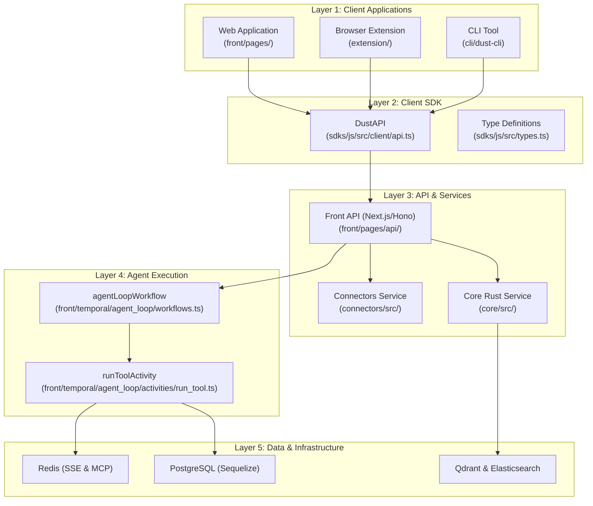
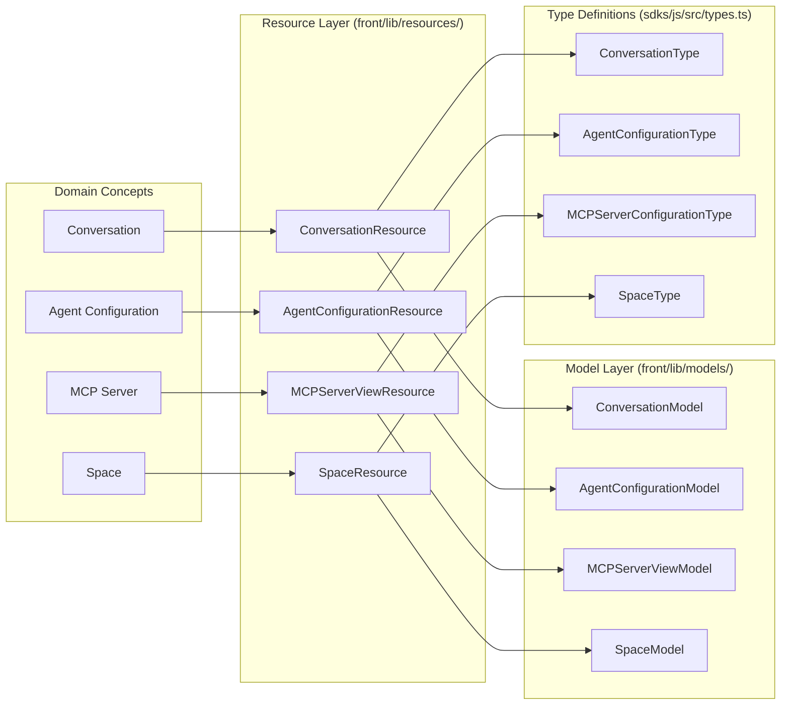

<!-- source: DeepWiki mcp.deepwiki.com · repo dust-tt/dust · page 1 Overview · fetched 2026-10-27 -->

# Overview

Relevant source files

The following files were used as context for generating this wiki page:

- [.claude/skills/dust-audit-log-event/SKILL.md](.claude/skills/dust-audit-log-event/SKILL.md)
- [.claude/skills/dust-breaking-changes/SKILL.md](.claude/skills/dust-breaking-changes/SKILL.md)
- [.claude/skills/dust-elasticsearch/SKILL.md](.claude/skills/dust-elasticsearch/SKILL.md)
- [.claude/skills/dust-elasticsearch/references/create-index.md](.claude/skills/dust-elasticsearch/references/create-index.md)
- [.claude/skills/dust-elasticsearch/references/indexing.md](.claude/skills/dust-elasticsearch/references/indexing.md)
- [.claude/skills/dust-elasticsearch/references/overview.md](.claude/skills/dust-elasticsearch/references/overview.md)
- [.claude/skills/dust-elasticsearch/references/querying.md](.claude/skills/dust-elasticsearch/references/querying.md)
- [.claude/skills/dust-elasticsearch/references/relocation.md](.claude/skills/dust-elasticsearch/references/relocation.md)
- [.claude/skills/dust-mcp-server/SKILL.md](.claude/skills/dust-mcp-server/SKILL.md)
- [.claude/skills/dust-swagger/SKILL.md](.claude/skills/dust-swagger/SKILL.md)
- [.claude/skills/dust-test/SKILL.md](.claude/skills/dust-test/SKILL.md)
- [.claude/skills/dust-webhook-source/SKILL.md](.claude/skills/dust-webhook-source/SKILL.md)
- [.cursor/environment.json](.cursor/environment.json)
- [.gitignore](.gitignore)
- [CODING_RULES.md](CODING_RULES.md)
- [connectors/package.json](connectors/package.json)
- [extension/css.d.ts](extension/css.d.ts)
- [extension/package.json](extension/package.json)
- [extension/platforms/chrome/manifests/manifest.base.json](extension/platforms/chrome/manifests/manifest.base.json)
- [extension/platforms/firefox/manifests/manifest.base.json](extension/platforms/firefox/manifests/manifest.base.json)
- [extension/tsconfig.json](extension/tsconfig.json)
- [extension/ui/hooks/useFileUploaderService.ts](extension/ui/hooks/useFileUploaderService.ts)
- [extension/ui/hooks/useSavePageToPod.ts](extension/ui/hooks/useSavePageToPod.ts)
- [front-api/forbid-next.cjs](front-api/forbid-next.cjs)
- [front-spa/TROUBLESHOOTING.md](front-spa/TROUBLESHOOTING.md)
- [front-spa/package.json](front-spa/package.json)
- [front-spa/vite.config.ts](front-spa/vite.config.ts)
- [front/AGENTS.md](front/AGENTS.md)
- [front/CODING_RULES.md](front/CODING_RULES.md)
- [front/admin/register_audit_log_schemas.ts](front/admin/register_audit_log_schemas.ts)
- [front/components/agent_builder/triggers/webhook/WebhookEditionFilters.tsx](front/components/agent_builder/triggers/webhook/WebhookEditionFilters.tsx)
- [front/components/triggers/WebhookSourceViewIcon.tsx](front/components/triggers/WebhookSourceViewIcon.tsx)
- [front/css.d.ts](front/css.d.ts)
- [front/hooks/useFileUploaderService.ts](front/hooks/useFileUploaderService.ts)
- [front/lib/api/audit/audit_log_schemas.test.ts](front/lib/api/audit/audit_log_schemas.test.ts)
- [front/lib/api/triggers/built-in-webhooks/fathom/fathom_client.ts](front/lib/api/triggers/built-in-webhooks/fathom/fathom_client.ts)
- [front/lib/api/triggers/built-in-webhooks/fathom/service.ts](front/lib/api/triggers/built-in-webhooks/fathom/service.ts)
- [front/package.json](front/package.json)
- [package-lock.json](package-lock.json)
- [package.json](package.json)
- [sdks/js/package.json](sdks/js/package.json)
- [sdks/js/tsconfig.json](sdks/js/tsconfig.json)
- [sparkle/package.json](sparkle/package.json)
- [sparkle/tsconfig.json](sparkle/tsconfig.json)
- [temporal/.env](temporal/.env)
- [temporal/docker-compose.yml](temporal/docker-compose.yml)
- [temporal/dynamicconfig/development-sql.yaml](temporal/dynamicconfig/development-sql.yaml)
- [tools/check-start-mprocs.sh](tools/check-start-mprocs.sh)
- [tools/dev.sh](tools/dev.sh)
- [tools/mprocs.yaml](tools/mprocs.yaml)
- [tools/process-compose.yaml](tools/process-compose.yaml)
- [tools/start-mprocs.sh](tools/start-mprocs.sh)
- [tools/wait-for-temporal.sh](tools/wait-for-temporal.sh)
- [viz/package.json](viz/package.json)

Dust is an AI agent platform that enables conversational interactions with language models augmented by tool execution, knowledge integration, and workspace data access. The platform orchestrates multi-step agent workflows, manages persistent conversations, and provides extensibility through the Model Context Protocol (MCP) for tool integration.

**Scope of this document**: This page provides a high-level overview of the Dust platform architecture, major subsystems, and core concepts. For detailed information about specific subsystems, see:
- Architectural and monorepo details: [System Architecture](#1.1)
- Agent system details: [Agent System](#3)
- MCP tool integration: [MCP Tool System](#4)
- Conversation management: [Conversation System](#5)
- Type system and SDK: [Type System and SDK](#2)

## Platform Purpose

Dust serves as a comprehensive AI assistant platform with the following capabilities:

| Capability | Description |
|------------|-------------|
| **Conversational AI** | Multi-turn conversations with AI agents backed by various LLM providers. |
| **Tool Execution** | Extensible tool system via MCP protocol with built-in internal servers and support for remote/client-side servers. |
| **Knowledge Integration** | Access to workspace data sources (Slack, Notion, Drive, etc.) and structured data. |
| **Workflow Orchestration** | Durable agent execution via Temporal with retry policies and streaming updates. |
| **Skill System** | Reusable capability bundles combining instructions, tools, and knowledge. |
| **Trigger System** | Scheduled and webhook-based automated agent invocations. |

**Sources**: [front/package.json:1-200](), [sdks/js/src/types.ts:1-100](), [front/AGENTS.md:1-50]()

## Monorepo Structure

Dust is organized as a monorepo containing multiple packages and services.

| Directory | Role |
|-----------|------|
| `front/` | Main Next.js application, API routes, and Temporal workers. |
| `connectors/` | Node.js service for synchronizing external data sources (Slack, Notion, etc.). |
| `core/` | Rust service handling document indexing, search (Qdrant/Elasticsearch), and OAuth. |
| `sdks/js/` | Shared TypeScript client and type definitions (`@dust-tt/client`). |
| `sparkle/` | Shared design system and UI component library. |
| `extension/` | Browser extension (Chrome/Firefox) for platform integration. |
| `front-spa/` | Vite-based Single Page Application for the Poke admin tool and specific app modules. |
| `viz/` | Next.js application for interactive content and data visualization. |
| `marketing/` | Public-facing marketing website. |
| `cli/dust-cli/` | Command-line interface for interacting with the Dust API. |

**Sources**: [package.json:5-16](), [package-lock.json:10-21](), [front-spa/vite.config.ts:10-47]()

## High-Level Architecture

The Dust platform is organized into layers, from client applications down to agent execution and external LLM providers. For a deep dive, see [System Architecture](#1.1).

**Sources**: [front/package.json:1-50](), [sdks/js/package.json:1-60](), [front-spa/package.json:20-27](), [connectors/package.json:38-115]()

## Core Domain Entities

The following diagram maps high-level concepts to their primary code implementations in the `front` workspace.

**Sources**: [front/lib/resources/conversation_resource.ts:1-50](), [front/lib/resources/agent_configuration_resource.ts:1-50](), [front/lib/resources/space_resource.ts:1-50](), [sdks/js/src/types.ts:1-500]()

## Development and Deployment

The platform uses `mprocs` for local development orchestration, managing the concurrent execution of Node.js workers, Next.js apps, and the Core Rust service.

| Tool | Purpose |
|------|---------|
| `mprocs` | Process manager for local dev environment ([tools/mprocs.yaml]()). |
| `temporal` | Workflow engine for durable agent execution ([temporal/docker-compose.yml]()). |
| `biome` | Linting and formatting ([package.json:22-25]()). |
| `vitest` | Test runner for JavaScript/TypeScript ([front/package.json:21-25]()). |

**Sources**: [tools/mprocs.yaml:1-220](), [package.json:18-29](), [front/package.json:13-42]()

## Subsystem Overviews

### Agent System
The Agent System handles the definition and execution of AI assistants. It includes the **Agent Builder** for UI-based configuration and the **Temporal-based agent loop** for durable execution. Agents can be augmented with **Skills** and **MCP Tools**.
For details, see [Agent System](#3).

### MCP Tool System
Dust integrates tools using the **Model Context Protocol (MCP)**. This includes internal servers (e.g., Google Drive, Slack), remote servers, and client-side servers via the browser extension. The system handles tool discovery, authentication (OAuth), and secure execution.
For details, see [MCP Tool System](#4).

### Conversation System
The Conversation System manages multi-turn interactions, message persistence, and real-time updates via **Server-Sent Events (SSE)**. It uses a rich text **Input Bar** supporting mentions of agents and skills.
For details, see [Conversation System](#5).

### Core Rust Service
The `core` service provides the high-performance backbone for document indexing and retrieval. It manages **Data Sources**, performs vector search via **Qdrant**, and handles **OAuth** credential encryption and storage.
For details, see [Core Rust Service](#14).

### Connectors Service
The `connectors` service is responsible for synchronizing data from external platforms into Dust's managed data sources. It uses Temporal workflows to handle large-scale syncs and webhook processing.
For details, see [Data Connectors](#8).

**Sources**: [front/AGENTS.md:1-52](), [front/package.json:43-160](), [connectors/package.json:38-115](), [sdks/js/package.json:43-49]()

---

