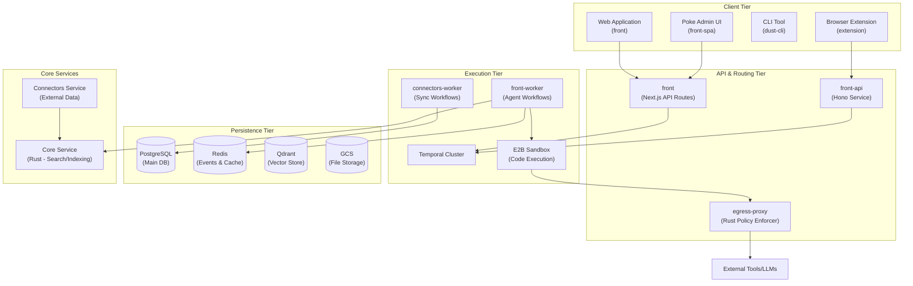
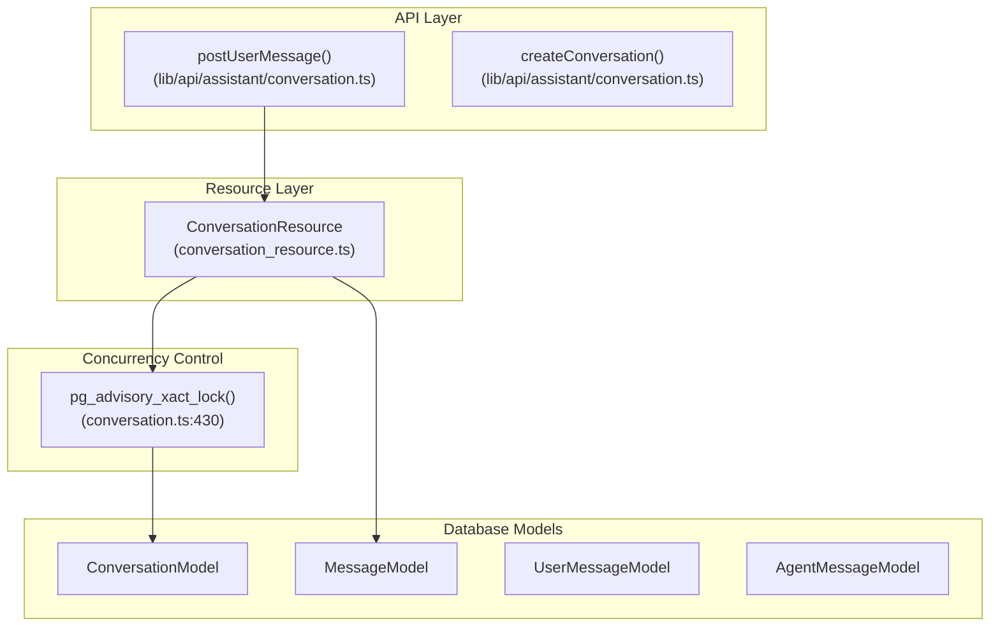
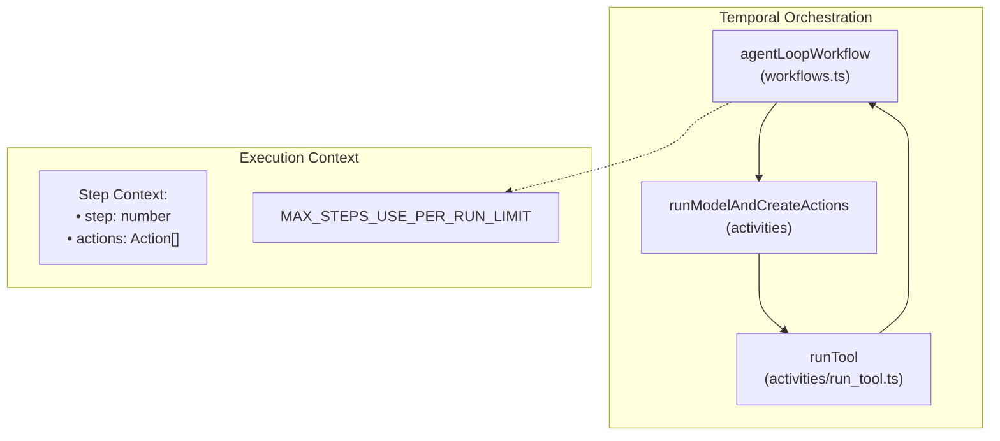
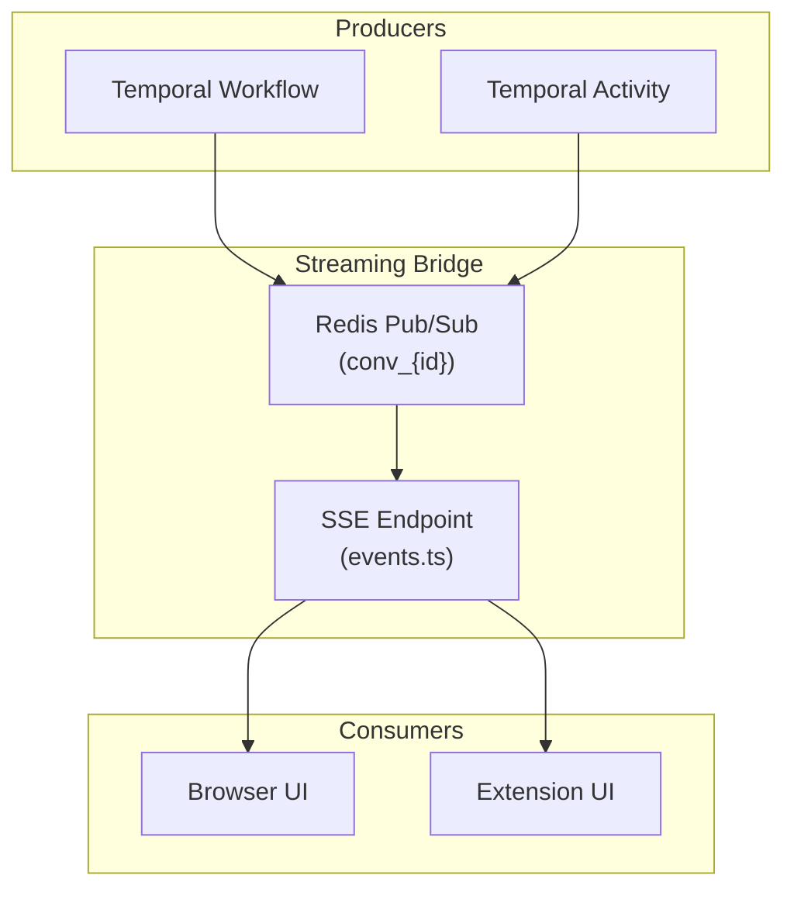

<!-- source: DeepWiki mcp.deepwiki.com · repo dust-tt/dust · page 1.1 System Architecture · fetched 2026-10-27 -->

# System Architecture

Relevant source files

The following files were used as context for generating this wiki page:

- [.github/actions/build-image/action.yml](.github/actions/build-image/action.yml)
- [.github/actions/setup-node-deps/action.yml](.github/actions/setup-node-deps/action.yml)
- [.github/actions/slack-check-deployment-blocked/action.yml](.github/actions/slack-check-deployment-blocked/action.yml)
- [.github/actions/slack-notify/action.yml](.github/actions/slack-notify/action.yml)
- [.github/workflows/build-and-test-core.yml](.github/workflows/build-and-test-core.yml)
- [.github/workflows/build-canary-image.yml](.github/workflows/build-canary-image.yml)
- [.github/workflows/build-dust-sandbox.yml](.github/workflows/build-dust-sandbox.yml)
- [.github/workflows/build-spa.yaml](.github/workflows/build-spa.yaml)
- [.github/workflows/check-migrations.yml](.github/workflows/check-migrations.yml)
- [.github/workflows/claude-code-review.yml](.github/workflows/claude-code-review.yml)
- [.github/workflows/claude.yml](.github/workflows/claude.yml)
- [.github/workflows/deploy-spa-production.yaml](.github/workflows/deploy-spa-production.yaml)
- [.github/workflows/deploy-spa.yaml](.github/workflows/deploy-spa.yaml)
- [.github/workflows/deploy.yml](.github/workflows/deploy.yml)
- [.github/workflows/format-check.yml](.github/workflows/format-check.yml)
- [.github/workflows/lint-github-actions.yml](.github/workflows/lint-github-actions.yml)
- [.github/workflows/list-tags.yaml](.github/workflows/list-tags.yaml)
- [.github/workflows/publish-cli.yml](.github/workflows/publish-cli.yml)
- [.github/workflows/publish-sdk-client.yml](.github/workflows/publish-sdk-client.yml)
- [.github/workflows/release-dsbx-cli.yml](.github/workflows/release-dsbx-cli.yml)
- [.github/workflows/release-sandbox-tool.yml](.github/workflows/release-sandbox-tool.yml)
- [.github/workflows/revert.yml](.github/workflows/revert.yml)
- [.github/workflows/run-dangerjs.yml](.github/workflows/run-dangerjs.yml)
- [.github/workflows/sandbox-bedrock-release.yml](.github/workflows/sandbox-bedrock-release.yml)
- [.github/workflows/sandbox-img-registry.yml](.github/workflows/sandbox-img-registry.yml)
- [.grit/patterns/noClientDeepImports.grit](.grit/patterns/noClientDeepImports.grit)
- [.grit/patterns/noClientDeepImports.md](.grit/patterns/noClientDeepImports.md)
- [.nvmrc](.nvmrc)
- [biome.json](biome.json)
- [cli/dust-sandbox/tests/e2e_local.rs](cli/dust-sandbox/tests/e2e_local.rs)
- [connectors/.nvmrc](connectors/.nvmrc)
- [connectors/esbuild.config.ts](connectors/esbuild.config.ts)
- [connectors/package.json](connectors/package.json)
- [dockerfiles/connectors.Dockerfile](dockerfiles/connectors.Dockerfile)
- [dockerfiles/front.Dockerfile](dockerfiles/front.Dockerfile)
- [dockerfiles/marketing.Dockerfile](dockerfiles/marketing.Dockerfile)
- [dockerfiles/prodbox.Dockerfile](dockerfiles/prodbox.Dockerfile)
- [dockerfiles/sandbox-bedrock.Dockerfile](dockerfiles/sandbox-bedrock.Dockerfile)
- [dockerfiles/sparkle-storybook.Dockerfile](dockerfiles/sparkle-storybook.Dockerfile)
- [dockerfiles/sparkle/sparkle-storybook-nginx.conf](dockerfiles/sparkle/sparkle-storybook-nginx.conf)
- [dockerfiles/viz.Dockerfile](dockerfiles/viz.Dockerfile)
- [extension/css.d.ts](extension/css.d.ts)
- [extension/package.json](extension/package.json)
- [extension/platforms/chrome/manifests/manifest.base.json](extension/platforms/chrome/manifests/manifest.base.json)
- [extension/platforms/firefox/manifests/manifest.base.json](extension/platforms/firefox/manifests/manifest.base.json)
- [extension/tsconfig.json](extension/tsconfig.json)
- [extension/ui/hooks/useFileUploaderService.ts](extension/ui/hooks/useFileUploaderService.ts)
- [extension/ui/hooks/useSavePageToPod.ts](extension/ui/hooks/useSavePageToPod.ts)
- [firebase-functions/webhook-router/Dockerfile](firebase-functions/webhook-router/Dockerfile)
- [front-spa/.nvmrc](front-spa/.nvmrc)
- [front-spa/_headers](front-spa/_headers)
- [front-spa/package.json](front-spa/package.json)
- [front-spa/vite.config.ts](front-spa/vite.config.ts)
- [front-spa/worker/app.ts](front-spa/worker/app.ts)
- [front-spa/worker/poke.ts](front-spa/worker/poke.ts)
- [front-spa/wrangler-app.toml](front-spa/wrangler-app.toml)
- [front-spa/wrangler-poke.toml](front-spa/wrangler-poke.toml)
- [front/.nvmrc](front/.nvmrc)
- [front/components/dev/devStyleOverrides.ts](front/components/dev/devStyleOverrides.ts)
- [front/components/sparkle/ThemeContext.tsx](front/components/sparkle/ThemeContext.tsx)
- [front/config/cors.ts](front/config/cors.ts)
- [front/css.d.ts](front/css.d.ts)
- [front/dangerfile.ts](front/dangerfile.ts)
- [front/esbuild.worker.ts](front/esbuild.worker.ts)
- [front/hooks/useFileUploaderService.ts](front/hooks/useFileUploaderService.ts)
- [front/lib/api/config.ts](front/lib/api/config.ts)
- [front/lib/api/credits/purchase.ts](front/lib/api/credits/purchase.ts)
- [front/lib/api/poke/plugins/workspaces/buy_programmatic_usage_credits.ts](front/lib/api/poke/plugins/workspaces/buy_programmatic_usage_credits.ts)
- [front/lib/api/sandbox/image/index.ts](front/lib/api/sandbox/image/index.ts)
- [front/lib/api/sandbox/image/sandbox_image.test.ts](front/lib/api/sandbox/image/sandbox_image.test.ts)
- [front/lib/api/sandbox/image/sandbox_image.ts](front/lib/api/sandbox/image/sandbox_image.ts)
- [front/lib/api/sandbox/image/tool_manifest.test.ts](front/lib/api/sandbox/image/tool_manifest.test.ts)
- [front/lib/api/sandbox/image/tool_manifest.ts](front/lib/api/sandbox/image/tool_manifest.ts)
- [front/lib/api/sandbox/image/types.ts](front/lib/api/sandbox/image/types.ts)
- [front/lib/api/sandbox/providers/e2b_template.test.ts](front/lib/api/sandbox/providers/e2b_template.test.ts)
- [front/lib/api/sandbox/providers/e2b_template.ts](front/lib/api/sandbox/providers/e2b_template.ts)
- [front/lib/credits/committed.test.ts](front/lib/credits/committed.test.ts)
- [front/lib/credits/committed.ts](front/lib/credits/committed.ts)
- [front/lib/credits/limits.test.ts](front/lib/credits/limits.test.ts)
- [front/lib/credits/limits.ts](front/lib/credits/limits.ts)
- [front/package.json](front/package.json)
- [front/scripts/backfill_metronome_credits.ts](front/scripts/backfill_metronome_credits.ts)
- [front/scripts/metronome_initial_contract_setup.ts](front/scripts/metronome_initial_contract_setup.ts)
- [front/scripts/sandbox_image_build.ts](front/scripts/sandbox_image_build.ts)
- [front/scripts/sandbox_image_check.ts](front/scripts/sandbox_image_check.ts)
- [front/workers-build/scripts/esbuild.worker.ts](front/workers-build/scripts/esbuild.worker.ts)
- [lefthook.yml](lefthook.yml)
- [package-lock.json](package-lock.json)
- [package.json](package.json)
- [scripts/db/run-migrate.cjs](scripts/db/run-migrate.cjs)
- [sdks/js/esbuild.config.ts](sdks/js/esbuild.config.ts)
- [sdks/js/package.json](sdks/js/package.json)
- [sdks/js/tsconfig.json](sdks/js/tsconfig.json)
- [sparkle/package.json](sparkle/package.json)
- [sparkle/tsconfig.json](sparkle/tsconfig.json)
- [viz/.nvmrc](viz/.nvmrc)
- [viz/next.config.mjs](viz/next.config.mjs)
- [viz/package.json](viz/package.json)

## Purpose and Scope

This document describes the high-level architecture of the Dust platform, a system for building and running AI agents with conversation management, tool integration via the Model Context Protocol (MCP), and skill-based capabilities. The platform is managed as a monorepo containing multiple services, SDKs, and a design system.

For detailed information about specific subsystems:
- Type definitions and SDK client implementation: see [Type System and SDK](#2)
- Agent execution and configuration: see [Agent System](#3)
- MCP tool system: see [MCP Tool System](#4)
- Conversation management: see [Conversation System](#5)
- UI component library: see [Sandbox Execution Environment](#6)

**Sources:** [package.json:1-16](), [front/package.json:1-12](), [sdks/js/package.json:1-10](), [extension/package.json:1-15]()

---

## Workspace Layout

Dust uses an NPM workspace monorepo structure to manage its major components and service boundaries.

| Workspace | Description | Key Technologies |
| :--- | :--- | :--- |
| `front` | Main Next.js application, API routes, and Temporal workers. | Next.js, Sequelize, Temporal |
| `front-api` | Dedicated Hono-based API server for high-performance endpoints. | Hono, Node.js |
| `front-spa` | Vite-based Single Page Application for internal tools (Poke). | Vite, React |
| `connectors` | Service managing data synchronization from external sources. | Temporal, Sequelize, Express |
| `sparkle` | Dust's internal design system and component library. | React, Tailwind CSS, Radix UI |
| `extension` | Browser extension (Chrome/Firefox) for platform integration. | Webpack, React |
| `sdks/js` | Shared JavaScript/TypeScript client library and type system. | Zod, TypeScript |
| `viz` | Visualization service for interactive agent content. | Next.js |

**Sources:** [package.json:5-16](), [front/package.json:1-12](), [connectors/package.json:1-15]()

---

## Architectural Layers

The Dust platform implements a multi-layer architecture separating concerns between client interfaces, API layers, business logic, execution engines, data persistence, and external integrations.

### Service Boundaries and Communication

The platform consists of several distinct services communicating primarily via HTTP/REST, Redis Pub/Sub, and Temporal task queues.

**Sources:** [dockerfiles/front.Dockerfile:1-190](), [dockerfiles/connectors.Dockerfile:1-50](), [front/lib/api/config.ts:63-93](), [package.json:5-16]()

---

## Subsystem Interactions

### Conversation Management System

The conversation system manages multi-turn interactions. It uses advisory locks to prevent race conditions during concurrent message posting.

The conversation posting flow:
1. **Lock Acquisition**: Advisory lock prevents concurrent rank/version conflicts [front/lib/api/assistant/conversation.ts:430-454]().
2. **Message Creation**: Atomic creation of `UserMessage` and `AgentMessage` placeholders [front/lib/api/assistant/conversation.ts:670-750]().
3. **Workflow Launch**: Async agent execution via `launchAgentLoopWorkflow` [front/lib/api/assistant/conversation.ts:800-850]().

**Sources:** [front/lib/api/assistant/conversation.ts:430-1000](), [front/lib/resources/conversation_resource.ts:1-150]()

---

### Agent Execution Workflow

Agent execution is orchestrated by Temporal, providing durability and fault tolerance for long-running LLM interactions and tool calls.

- **Multi-step execution**: The loop supports iterative reasoning up to a defined limit [front/temporal/agent_loop/workflows.ts:36-250]().
- **Tool Handling**: Tools are executed via the `runTool` activity, which handles MCP communication [front/temporal/agent_loop/activities/run_tool.ts:18-250]().

**Sources:** [front/temporal/agent_loop/workflows.ts:1-300](), [front/temporal/agent_loop/activities/run_tool.ts:1-250]()

---

## Infrastructure and Data Flow

### Event Streaming Architecture

Real-time updates use Server-Sent Events (SSE) backed by Redis Pub/Sub to stream LLM tokens and tool status to clients.

**Sources:** [front/lib/api/assistant/streaming/events.ts:1-202](), [front/pages/api/w/[wId]/assistant/conversations/[cId]/events.ts:1-250]()

### Network Security and Egress

The platform uses a Rust-based `egress-proxy` to control outbound traffic from sandboxed execution environments, ensuring security and compliance.

- **Egress Proxy**: Enforces domain allowlisting and JWT-based policy checks [front/lib/api/config.ts:86-93]().
- **Sandbox Isolation**: Code execution happens in isolated E2B sandboxes [front/lib/api/sandbox/providers/e2b_template.ts:1-50]().

**Sources:** [front/lib/api/config.ts:86-93](), [dockerfiles/front.Dockerfile:150-166]()

---

## Technology Stack Summary

| Layer | Technology |
| :--- | :--- |
| **Frontend Framework** | Next.js 14, Vite (SPA) |
| **Backend Services** | Node.js (Hono/Express), Rust (Core/Proxy) |
| **Workflow Engine** | Temporal |
| **Database** | PostgreSQL (Sequelize ORM) |
| **Vector Search** | Qdrant |
| **Caching/PubSub** | Redis |
| **Infrastructure** | Docker, Cloudflare Workers (SPA), Google Cloud Platform |

**Sources:** [front/package.json:43-160](), [connectors/package.json:38-115](), [package.json:30-53]()

---

