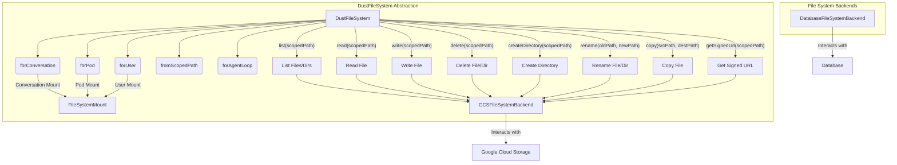
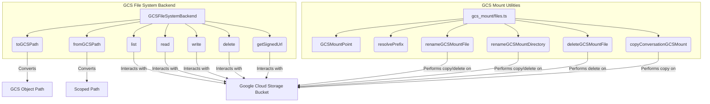
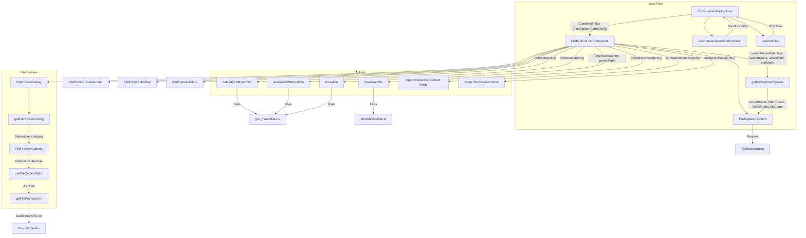

<!-- source: DeepWiki mcp.deepwiki.com · repo dust-tt/dust · page 10.2 DustFileSystem and GCS Mount · fetched 2026-10-27 -->

# DustFileSystem and GCS Mount

Relevant source files

The following files were used as context for generating this wiki page:

- [front-api/routes/poke/workspaces/[wId]/files/[sId].ts](front-api/routes/poke/workspaces/[wId]/files/[sId].ts)
- [front-api/routes/v1/w/[wId]/spaces/[spaceId]/conversation_ids.test.ts](front-api/routes/v1/w/[wId]/spaces/[spaceId]/conversation_ids.test.ts)
- [front-api/routes/v1/w/[wId]/spaces/[spaceId]/conversation_ids.ts](front-api/routes/v1/w/[wId]/spaces/[spaceId]/conversation_ids.ts)
- [front-api/routes/v1/w/[wId]/spaces/[spaceId]/project_files/index.test.ts](front-api/routes/v1/w/[wId]/spaces/[spaceId]/project_files/index.test.ts)
- [front-api/routes/v1/w/[wId]/spaces/[spaceId]/project_files/index.ts](front-api/routes/v1/w/[wId]/spaces/[spaceId]/project_files/index.ts)
- [front-api/routes/v1/w/[wId]/spaces/[spaceId]/project_metadata.ts](front-api/routes/v1/w/[wId]/spaces/[spaceId]/project_metadata.ts)
- [front-api/routes/w/[wId]/spaces/[spaceId]/files/index.test.ts](front-api/routes/w/[wId]/spaces/[spaceId]/files/index.test.ts)
- [front-api/routes/w/[wId]/spaces/[spaceId]/files/index.ts](front-api/routes/w/[wId]/spaces/[spaceId]/files/index.ts)
- [front/components/assistant/conversation/ConversationSidePanelHeader.tsx](front/components/assistant/conversation/ConversationSidePanelHeader.tsx)
- [front/components/assistant/conversation/attachment/utils.test.tsx](front/components/assistant/conversation/attachment/utils.test.tsx)
- [front/components/assistant/conversation/files_panel/ConversationFileExplorer.tsx](front/components/assistant/conversation/files_panel/ConversationFileExplorer.tsx)
- [front/components/assistant/conversation/files_panel/ConversationFilesPanel.tsx](front/components/assistant/conversation/files_panel/ConversationFilesPanel.tsx)
- [front/components/assistant/conversation/files_panel/FilePreviewPanel.tsx](front/components/assistant/conversation/files_panel/FilePreviewPanel.tsx)
- [front/components/assistant/conversation/files_panel/FilesTab.tsx](front/components/assistant/conversation/files_panel/FilesTab.tsx)
- [front/components/assistant/conversation/files_panel/SandboxTab.tsx](front/components/assistant/conversation/files_panel/SandboxTab.tsx)
- [front/components/assistant/conversation/files_panel/types.ts](front/components/assistant/conversation/files_panel/types.ts)
- [front/components/assistant/conversation/files_panel/utils.ts](front/components/assistant/conversation/files_panel/utils.ts)
- [front/components/assistant/conversation/interactive_content/UnsupportedContentRenderer.tsx](front/components/assistant/conversation/interactive_content/UnsupportedContentRenderer.tsx)
- [front/components/file_explorer/FileExplorer.test.tsx](front/components/file_explorer/FileExplorer.test.tsx)
- [front/components/file_explorer/FileExplorer.tsx](front/components/file_explorer/FileExplorer.tsx)
- [front/components/file_explorer/FileExplorerBreadcrumb.tsx](front/components/file_explorer/FileExplorerBreadcrumb.tsx)
- [front/components/file_explorer/FileExplorerContent.tsx](front/components/file_explorer/FileExplorerContent.tsx)
- [front/components/file_explorer/FileExplorerItem.tsx](front/components/file_explorer/FileExplorerItem.tsx)
- [front/components/file_explorer/FilePreviewContent.tsx](front/components/file_explorer/FilePreviewContent.tsx)
- [front/components/file_explorer/FilePreviewDialog.tsx](front/components/file_explorer/FilePreviewDialog.tsx)
- [front/components/file_explorer/PDFViewer.tsx](front/components/file_explorer/PDFViewer.tsx)
- [front/components/file_explorer/fileExplorerDragDrop.test.ts](front/components/file_explorer/fileExplorerDragDrop.test.ts)
- [front/components/file_explorer/fileExplorerDragDrop.ts](front/components/file_explorer/fileExplorerDragDrop.ts)
- [front/components/file_explorer/fileExplorerPipeline.test.ts](front/components/file_explorer/fileExplorerPipeline.test.ts)
- [front/components/file_explorer/fileExplorerPipeline.ts](front/components/file_explorer/fileExplorerPipeline.ts)
- [front/components/file_explorer/types.ts](front/components/file_explorer/types.ts)
- [front/components/file_explorer/utils.test.ts](front/components/file_explorer/utils.test.ts)
- [front/components/file_explorer/utils.ts](front/components/file_explorer/utils.ts)
- [front/components/pod/files/EditPodFrameTabDialog.tsx](front/components/pod/files/EditPodFrameTabDialog.tsx)
- [front/components/pod/files/PodFileExplorer.tsx](front/components/pod/files/PodFileExplorer.tsx)
- [front/components/pod/files/PodFrameTabButton.tsx](front/components/pod/files/PodFrameTabButton.tsx)
- [front/components/poke/pages/FramePage.tsx](front/components/poke/pages/FramePage.tsx)
- [front/hooks/conversations/useConversationSandboxFiles.ts](front/hooks/conversations/useConversationSandboxFiles.ts)
- [front/hooks/conversations/useConversationSandboxStatus.ts](front/hooks/conversations/useConversationSandboxStatus.ts)
- [front/hooks/useFolderPathUrlState.ts](front/hooks/useFolderPathUrlState.ts)
- [front/hooks/usePodFrameTabs.ts](front/hooks/usePodFrameTabs.ts)
- [front/lib/api/file_system/backends/file_system_backend.ts](front/lib/api/file_system/backends/file_system_backend.ts)
- [front/lib/api/file_system/backends/gcs_file_system_backend.test.ts](front/lib/api/file_system/backends/gcs_file_system_backend.test.ts)
- [front/lib/api/file_system/backends/gcs_file_system_backend.ts](front/lib/api/file_system/backends/gcs_file_system_backend.ts)
- [front/lib/api/file_system/dust_file_system.test.ts](front/lib/api/file_system/dust_file_system.test.ts)
- [front/lib/api/file_system/dust_file_system.ts](front/lib/api/file_system/dust_file_system.ts)
- [front/lib/api/files/gcs_mount/files.test.ts](front/lib/api/files/gcs_mount/files.test.ts)
- [front/lib/api/files/gcs_mount/files.ts](front/lib/api/files/gcs_mount/files.ts)
- [front/lib/api/files/mount_path.test.ts](front/lib/api/files/mount_path.test.ts)
- [front/lib/api/files/read.ts](front/lib/api/files/read.ts)
- [front/lib/api/mcp_server/tools/files/list.ts](front/lib/api/mcp_server/tools/files/list.ts)
- [front/lib/api/mcp_server/tools/files/list_output.ts](front/lib/api/mcp_server/tools/files/list_output.ts)
- [front/lib/api/mcp_server/tools/pods/get.ts](front/lib/api/mcp_server/tools/pods/get.ts)
- [front/lib/api/projects/context.ts](front/lib/api/projects/context.ts)
- [front/lib/swr/files.ts](front/lib/swr/files.ts)
- [front/poke/swr/frame_details.ts](front/poke/swr/frame_details.ts)

This page details the `DustFileSystem` abstraction, its GCS-backed implementation, the GCS mount adapter for the sandbox environment, how project context files are managed, and the `FileExplorer` UI component that allows users to interact with these files.

## DustFileSystem Abstraction

The `DustFileSystem` class [front/lib/api/file_system/dust_file_system.ts:2-17]() serves as the unified entry point for all file system operations within the Dust platform. It provides a consistent interface for interacting with various file storage backends, abstracting away the underlying storage mechanisms.

### Scoped Paths

`DustFileSystem` operates on "scoped paths," which are agent/API-visible paths that include a prefix indicating the scope of the file. Examples include:
*   `conversation-{cId}/report.pdf` [front/lib/api/file_system/dust_file_system.ts:3]()
*   `pod-{pId}/data.csv` [front/lib/api/file_system/dust_file_system.ts:4]()
*   `user-{uId}/MEMORY.md` [front/lib/api/file_system/dust_file_system.ts:5]()

Legacy paths (`conversation/...`, `project/...`) are also supported for backward compatibility [front/lib/api/file_system/dust_file_system.ts:6](). The `parseScopedPrefix` function [front/lib/api/file_system/dust_file_system.ts:86-112]() is responsible for extracting the kind and ID from a scoped path.

### File System Mounts

`DustFileSystem` manages different types of file system mounts, each representing a specific context:
*   **Conversation Mount**: Created for individual conversations, allowing agents to access files related to that conversation [front/lib/api/file_system/dust_file_system.ts:114-130]().
*   **Pod Mount**: Represents files associated with a project space (referred to as "pod" in some contexts), providing a shared file system for project-related data [front/lib/api/file_system/dust_file_system.ts:132-148]().
*   **User Mount**: For files specific to an authenticated user, such as personal memory files [front/lib/api/file_system/dust_file_system.ts:150-164]().

Each mount defines a `kind`, `id`, `scopedPrefix`, `sandboxMountPoint`, and `permissions` [front/lib/api/file_system/dust_file_system.ts:45]().

### Factories

`DustFileSystem` provides several factory methods to create instances with specific mounts:
*   `DustFileSystem.forConversation(auth, conversation)`: Creates a file system for a single conversation, including a pod mount if the conversation belongs to a project space [front/lib/api/file_system/dust_file_system.ts:9]().
*   `DustFileSystem.forConversations(auth, conversations)`: For multiple conversation mounts [front/lib/api/file_system/dust_file_system.ts:10]().
*   `DustFileSystem.forPod(auth, space)`: Creates a file system for a single pod mount [front/lib/api/file_system/dust_file_system.ts:11]().
*   `DustFileSystem.forUser(auth)`: For the authenticated user's memory scope [front/lib/api/file_system/dust_file_system.ts:12]().
*   `DustFileSystem.fromScopedPath(auth, scopedPath)`: Infers the context from the path prefix [front/lib/api/file_system/dust_file_system.ts:13]().
*   `DustFileSystem.forAgentLoop(auth, { conversation, scopedPaths })`: Defaults to the agent loop conversation and its pod, plus any other referenced conversation/pod mounts [front/lib/api/file_system/dust_file_system.ts:14-17]().

### File System Operations

The `DustFileSystem` class exposes methods for common file system operations:
*   `list(scopedPath, options)`: Lists files and directories within a given scoped path [front/lib/api/file_system/dust_file_system.ts:300-303]().
*   `read(scopedPath)`: Reads the content of a file [front/lib/api/file_system/dust_file_system.ts:349]().
*   `write(scopedPath, content, contentType)`: Writes content to a file [front/lib/api/file_system/dust_file_system.ts:386]().
*   `delete(scopedPath)`: Deletes a file or directory [front/lib/api/file_system/dust_file_system.ts:423]().
*   `createDirectory(scopedPath)`: Creates a new directory [front/lib/api/file_system/dust_file_system.ts:458]().
*   `rename(oldScopedPath, newScopedPath)`: Renames a file or directory [front/lib/api/file_system/dust_file_system.ts:493]().
*   `copy(sourceScopedPath, destinationScopedPath)`: Copies a file [front/lib/api/file_system/dust_file_system.ts:530]().
*   `getSignedUrl(scopedPath)`: Generates a signed URL for a file [front/lib/api/file_system/dust_file_system.ts:567]().

**Diagram: DustFileSystem Architecture**

Sources:
- [front/lib/api/file_system/dust_file_system.ts:2-17]()
- [front/lib/api/file_system/dust_file_system.ts:45]()
- [front/lib/api/file_system/dust_file_system.ts:86-112]()
- [front/lib/api/file_system/dust_file_system.ts:114-130]()
- [front/lib/api/file_system/dust_file_system.ts:132-148]()
- [front/lib/api/file_system/dust_file_system.ts:150-164]()
- [front/lib/api/file_system/dust_file_system.ts:9]()
- [front/lib/api/file_system/dust_file_system.ts:10]()
- [front/lib/api/file_system/dust_file_system.ts:11]()
- [front/lib/api/file_system/dust_file_system.ts:12]()
- [front/lib/api/file_system/dust_file_system.ts:13]()
- [front/lib/api/file_system/dust_file_system.ts:14-17]()
- [front/lib/api/file_system/dust_file_system.ts:300-303]()
- [front/lib/api/file_system/dust_file_system.ts:349]()
- [front/lib/api/file_system/dust_file_system.ts:386]()
- [front/lib/api/file_system/dust_file_system.ts:423]()
- [front/lib/api/file_system/dust_file_system.ts:458]()
- [front/lib/api/file_system/dust_file_system.ts:493]()
- [front/lib/api/file_system/dust_file_system.ts:530]()
- [front/lib/api/file_system/dust_file_system.ts:567]()

## GCS File System Backend

The `GCSFileSystemBackend` [front/lib/api/file_system/backends/gcs_file_system_backend.ts:90]() is the primary implementation of the `FileSystemBackend` interface, leveraging Google Cloud Storage (GCS) for file persistence.

### Path Translation

A key responsibility of `GCSFileSystemBackend` is translating between `DustFileSystem`'s scoped paths and GCS object paths.
*   `toGCSPath(scopedPath)`: Converts a scoped path (e.g., `conversation-{cId}/report.pdf`) into a GCS object path (e.g., `w/{wId}/conversations/{cId}/files/report.pdf`) [front/lib/api/file_system/backends/gcs_file_system_backend.ts:96-115]().
*   `fromGCSPath(gcsPath)`: Performs the inverse translation, converting a GCS path back to a scoped path [front/lib/api/file_system/backends/gcs_file_system_backend.ts:117-140]().

This translation ensures that files are stored in a structured manner within GCS, organized by workspace, conversation, pod, or user.

### GCS Operations

The backend implements core file system operations by interacting with the GCS bucket:
*   `list`: Fetches files from GCS using prefixes, handling pagination and converting GCS objects into `FileSystemEntry` objects [front/lib/api/file_system/backends/gcs_file_system_backend.ts:159-211](). It also synthesizes directory entries from GCS object paths [front/lib/api/file_system/backends/gcs_file_system_backend.ts:213-214]().
*   `read`: Retrieves a file's content from GCS [front/lib/api/file_system/backends/gcs_file_system_backend.ts:290-306]().
*   `write`: Uploads a file's content to GCS [front/lib/api/file_system/backends/gcs_file_system_backend.ts:310-330]().
*   `delete`: Deletes a file or all files under a prefix for directories [front/lib/api/file_system/backends/gcs_file_system_backend.ts:334-350]().
*   `getSignedUrl`: Generates a signed URL for direct access to a GCS object [front/lib/api/file_system/backends/gcs_file_system_backend.ts:354-366]().

### GCS Mount Point Management

The `front/lib/api/files/gcs_mount/files.ts` module provides utilities for managing GCS mount points directly, particularly for operations like renaming and copying.
*   `GCSMountPoint` type: Defines the scope of a GCS mount, either `conversation` or `pod` [front/lib/api/files/gcs_mount/files.ts:33-35]().
*   `resolvePrefix`: Determines the base GCS path prefix for a given workspace and `GCSMountPoint` [front/lib/api/files/gcs_mount/files.ts:37-57]().
*   `renameGCSMountFile`: Renames a single file within a GCS mount point by copying and deleting GCS objects [front/lib/api/files/gcs_mount/files.ts:105-130]().
*   `renameGCSMountDirectory`: Renames a directory by moving all objects under its prefix [front/lib/api/files/gcs_mount/files.ts:137-185]().
*   `deleteGCSMountFile`: Deletes a file from a GCS mount point [front/lib/api/files/gcs_mount/files.ts:217-231]().
*   `copyConversationGCSMount`: Copies all files from one conversation's GCS mount to another [front/lib/api/files/gcs_mount/files.ts:238-299]().

**Diagram: GCS Backend and Mount Utilities**

Sources:
- [front/lib/api/file_system/backends/gcs_file_system_backend.ts:90]()
- [front/lib/api/file_system/backends/gcs_file_system_backend.ts:96-115]()
- [front/lib/api/file_system/backends/gcs_file_system_backend.ts:117-140]()
- [front/lib/api/file_system/backends/gcs_file_system_backend.ts:159-211]()
- [front/lib/api/file_system/backends/gcs_file_system_backend.ts:213-214]()
- [front/lib/api/file_system/backends/gcs_file_system_backend.ts:290-306]()
- [front/lib/api/file_system/backends/gcs_file_system_backend.ts:310-330]()
- [front/lib/api/file_system/backends/gcs_file_system_backend.ts:334-350]()
- [front/lib/api/file_system/backends/gcs_file_system_backend.ts:354-366]()
- [front/lib/api/files/gcs_mount/files.ts:33-35]()
- [front/lib/api/files/gcs_mount/files.ts:37-57]()
- [front/lib/api/files/gcs_mount/files.ts:105-130]()
- [front/lib/api/files/gcs_mount/files.ts:137-185]()
- [front/lib/api/files/gcs_mount/files.ts:217-231]()
- [front/lib/api/files/gcs_mount/files.ts:238-299]()

## Sandbox GCS Mount Adapter

The `GCSSandboxMountAdapter` [front/lib/api/file_system/sandbox/gcs_sandbox_mount_adapter.ts:17]() facilitates mounting GCS-backed file systems into the sandbox execution environment. This allows agents running in the sandbox to access and manipulate files stored in GCS.

### Mount Configuration

The adapter takes a list of `FileSystemMount` objects and converts them into `GCSMountTarget` configurations suitable for the sandbox. Each `GCSMountTarget` specifies:
*   `bucketName`: The GCS bucket to mount.
*   `gcsPrefix`: The GCS prefix to expose.
*   `mountPath`: The path within the sandbox where the GCS prefix will be mounted.
*   `readOnly`: Whether the mount is read-only.

The `getSandboxMounts` method [front/lib/api/file_system/sandbox/gcs_sandbox_mount_adapter.ts:30-100]() iterates through the `FileSystemMount` objects, resolves their GCS prefixes using `mountRootGCSPrefix` [front/lib/api/file_system/backends/gcs_file_system_backend.ts:143-157](), and constructs the `GCSMountTarget` array. It also handles legacy mount points for backward compatibility.

### Sandbox Interaction

The `GCSSandboxMountAdapter` is used by the sandbox infrastructure to configure the file system for agent execution. This enables agents to:
*   Read files from conversation or project contexts.
*   Write files to conversation or project contexts (if permissions allow).
*   Access tool outputs stored in GCS.

Sources:
- [front/lib/api/file_system/sandbox/gcs_sandbox_mount_adapter.ts:17]()
- [front/lib/api/file_system/sandbox/gcs_sandbox_mount_adapter.ts:30-100]()
- [front/lib/api/file_system/backends/gcs_file_system_backend.ts:143-157]()

## Project Context Files

Project context files are files associated with a project space (pod) that can be accessed by agents. These files are managed through the `DustFileSystem` and stored in GCS.

The `front/lib/api/projects/context.ts` module handles the management of project context, including both file-backed attachments and content-node fragments.
*   `listProjectContextAttachments`: Retrieves content-node fragments for a given space, filtering out file-backed attachments which are handled separately by the GCS-backed endpoints [front/lib/api/projects/context.ts:97-134]().
*   File operations for project context (e.g., `deleteGCSMountFile`, `renameGCSMountDirectory`, `renameGCSMountFile`) are delegated to the `gcs_mount/files.ts` utilities [front/lib/api/projects/context.ts:9-13]().
*   `requestDustProjectIncrementalSync`: Triggers an incremental sync for the Dust project data source, ensuring that changes to project files are reflected in the indexing system [front/lib/api/projects/context.ts:15]().

Sources:
- [front/lib/api/projects/context.ts]()
- [front/lib/api/projects/context.ts:97-134]()
- [front/lib/api/projects/context.ts:9-13]()
- [front/lib/api/projects/context.ts:15]()

## File Explorer UI Component

The `FileExplorer` React component [front/components/file_explorer/FileExplorer.tsx:38]() provides a user interface for browsing, managing, and interacting with files within the `DustFileSystem`. It is used in various parts of the application, such as the conversation side panel and pod file management.

### Key Features

*   **File and Folder Display**: Shows a hierarchical view of files and folders.
*   **Breadcrumbs**: Navigational breadcrumbs for easy folder traversal [front/components/file_explorer/FileExplorerBreadcrumb.tsx]().
*   **Filtering and Sorting**: Allows users to filter files by type and sort them by various criteria [front/components/file_explorer/FileExplorerFilters.tsx]().
*   **Search**: Provides a search bar to find files within the current folder [front/components/file_explorer/FileExplorer.tsx:90]().
*   **File Preview**: Supports previewing various file types, including interactive content, PDFs, code, and text [front/components/file_explorer/FilePreviewDialog.tsx]().
*   **Actions**: Supports actions like download, rename, delete, and move [front/components/file_explorer/FileExplorer.tsx:79-81]().
*   **Drag and Drop**: Enables moving files between folders via drag and drop [front/components/file_explorer/fileExplorerDragDrop.ts]().
*   **Virtual Scope Roots**: For contexts like pod conversations, it can display multiple top-level scopes (e.g., `conversation`, `pod`) as virtual roots [front/components/file_explorer/FileExplorer.tsx:64]().

### Data Flow

1.  **`ConversationFileExplorer`**: This component [front/components/assistant/conversation/files_panel/ConversationFileExplorer.tsx:28]() is responsible for fetching files relevant to a conversation.
    *   It uses `useConversationSandboxFiles` to get files from the conversation's sandbox mount [front/hooks/conversations/useConversationSandboxFiles.ts]().
    *   If the conversation is a "pod conversation" (i.e., associated with a project space), it also uses `usePodFiles` to fetch files from the project's mount [front/lib/swr/pods]().
    *   It combines these files, potentially adding virtual explorer paths to distinguish between conversation and pod files [front/components/assistant/conversation/files_panel/ConversationFileExplorer.tsx:54-56]().
2.  **`FileExplorer`**: Receives the combined list of `FileExplorerPathEntry` objects [front/components/file_explorer/FileExplorer.tsx:45]() and `currentFolderPath` [front/components/file_explorer/FileExplorer.tsx:44]().
3.  **`getFileExplorerPipeline`**: Processes the raw file data, applying search queries, filters, and sorting to generate the `sortedNodes` for display [front/components/file_explorer/fileExplorerPipeline.ts](). It also builds a folder tree for navigation [front/components/file_explorer/FileExplorer.tsx:129]().
4.  **`FileExplorerContent`**: Renders the files and folders based on the processed data [front/components/file_explorer/FileExplorerContent.tsx]().
5.  **Actions**: When a user performs an action (e.g., rename, delete, move), the `FileExplorer` component calls the appropriate callback props (`onRename`, `onDelete`, `onMoveFile`) [front/components/file_explorer/FileExplorer.tsx:79-81](). These callbacks then interact with the `DustFileSystem` or GCS mount utilities to perform the actual file system operation.

### File Preview and Download

*   `getFileUrl`: Generates a URL for viewing a file's content [front/components/file_explorer/FileExplorer.tsx:46](), typically using `getFilePathViewUrl` [front/lib/swr/files:51-54]().
*   `onFileDownload`: Handles downloading files, often using `downloadFile` from `front/lib/swr/files` [front/lib/swr/files:180-201]().
*   `FilePreviewDialog`: Displays file content based on its `contentType`, supporting various categories like `frame`, `code`, `text`, `pdf`, `image`, etc. [front/components/file_explorer/utils:40-50]().

**Diagram: File Explorer UI Data Flow and Interactions**

Sources:
- [front/components/file_explorer/FileExplorer.tsx:38]()
- [front/components/file_explorer/FileExplorerBreadcrumb.tsx]()
- [front/components/file_explorer/FileExplorerFilters.tsx]()
- [front/components/file_explorer/FileExplorer.tsx:90]()
- [front/components/file_explorer/FilePreviewDialog.tsx]()
- [front/components/file_explorer/FileExplorer.tsx:79-81]()
- [front/components/file_explorer/fileExplorerDragDrop.ts]()
- [front/components/file_explorer/FileExplorer.tsx:64]()
- [front/components/assistant/conversation/files_panel/ConversationFileExplorer.tsx:28]()
- [front/hooks/conversations/useConversationSandboxFiles.ts]()
- [front/lib/swr/pods]()
- [front/components/assistant/conversation/files_panel/ConversationFileExplorer.tsx:54-56]()
- [front/components/file_explorer/FileExplorer.tsx:45]()
- [front/components/file_explorer/FileExplorer.tsx:44]()
- [front/components/file_explorer/fileExplorerPipeline.ts]()
- [front/components/file_explorer/FileExplorer.tsx:129]()
- [front/components/file_explorer/FileExplorerContent.tsx]()
- [front/components/file_explorer/FileExplorer.tsx:79-81]()
- [front/components/file_explorer/FileExplorer.tsx:46]()
- [front/lib/swr/files:51-54]()
- [front/lib/swr/files:180-201]()
- [front/components/file_explorer/utils:40-50]()

---

