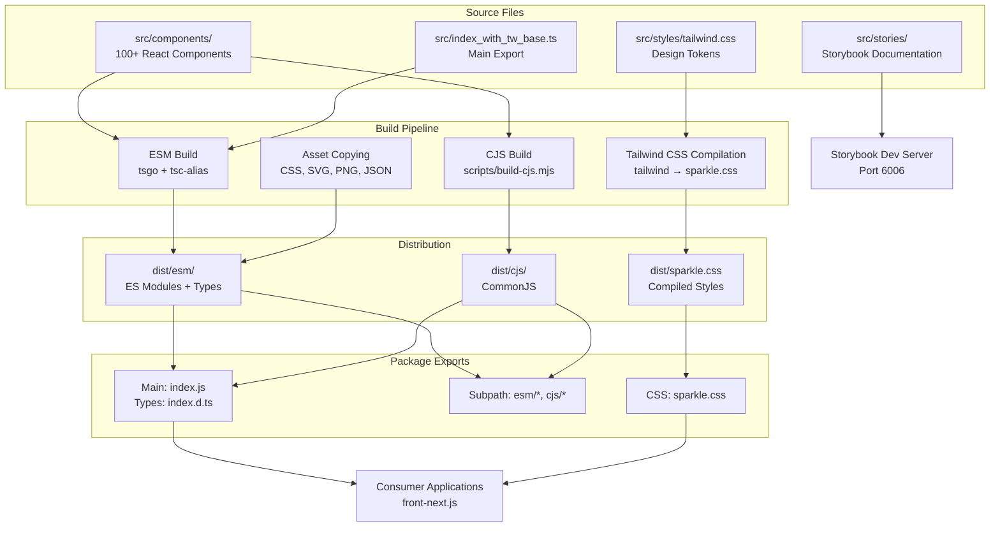
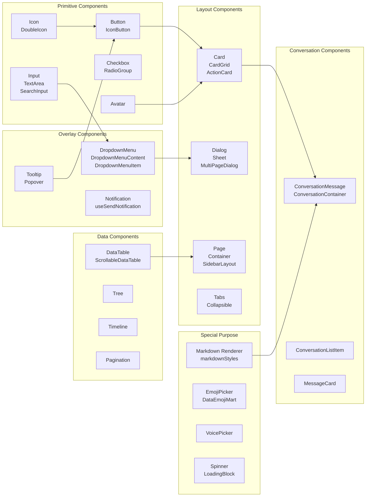
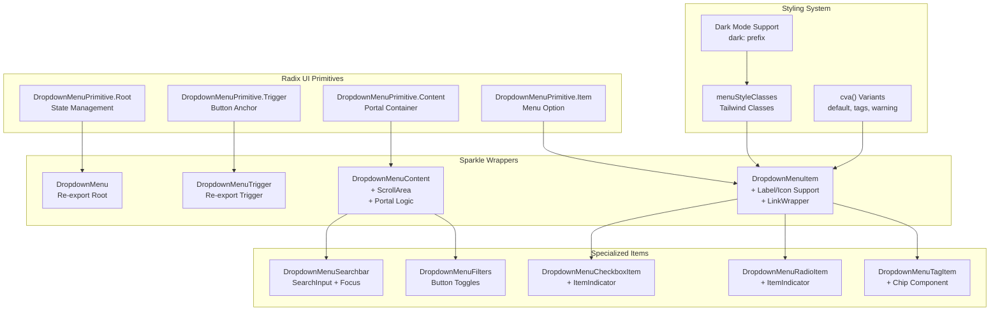
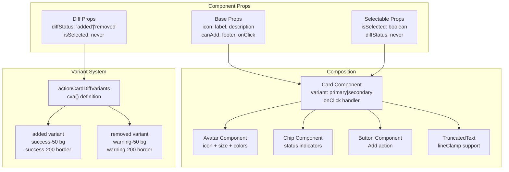
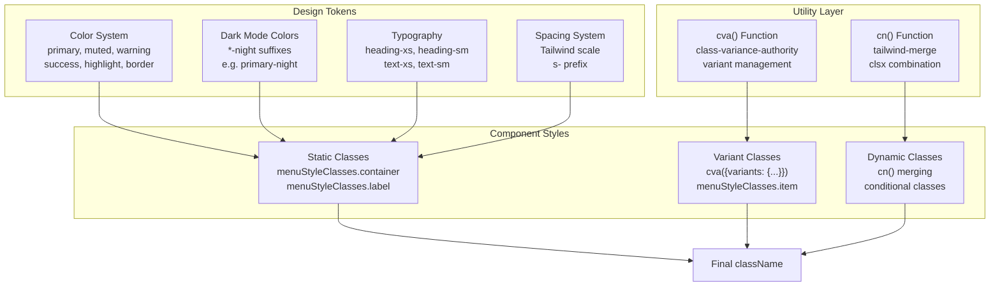
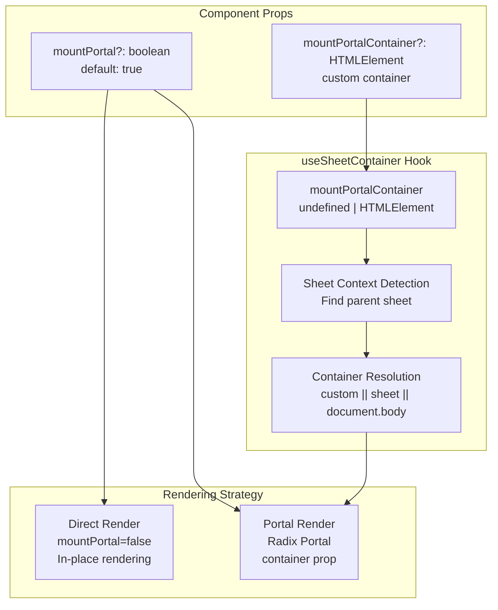
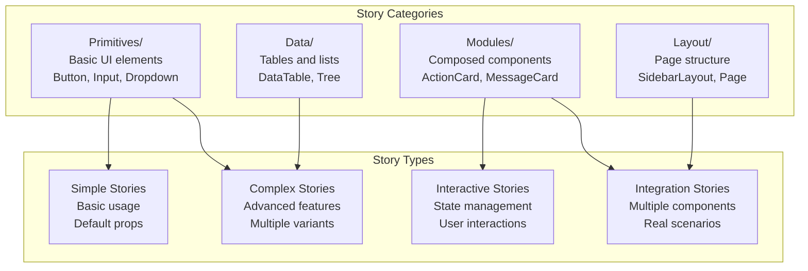

<!-- source: DeepWiki mcp.deepwiki.com · repo dust-tt/dust · page 12 Sparkle Design System · fetched 2026-10-27 -->

# Sparkle Design System

<details>
<summary>Relevant source files</summary>

The following files were used as context for generating this wiki page:

- [front/components/agent_builder/AgentTemplateGrid.tsx](front/components/agent_builder/AgentTemplateGrid.tsx)
- [front/components/assistant/WelcomeTourGuide.tsx](front/components/assistant/WelcomeTourGuide.tsx)
- [front/components/assistant/conversation/AgentHandle.tsx](front/components/assistant/conversation/AgentHandle.tsx)
- [front/components/assistant/conversation/UserHandle.tsx](front/components/assistant/conversation/UserHandle.tsx)
- [front/components/assistant/conversation/agent_browser/AgentBrowser.tsx](front/components/assistant/conversation/agent_browser/AgentBrowser.tsx)
- [front/components/assistant/conversation/agent_browser/MobileOrExtensionAgentBrowser.tsx](front/components/assistant/conversation/agent_browser/MobileOrExtensionAgentBrowser.tsx)
- [front/components/assistant/conversation/agent_browser/WebAgentBrowser.tsx](front/components/assistant/conversation/agent_browser/WebAgentBrowser.tsx)
- [front/components/assistant/conversation/agent_browser/shared.tsx](front/components/assistant/conversation/agent_browser/shared.tsx)
- [front/components/assistant/conversation/input_bar/InputBarAttachmentsPicker.tsx](front/components/assistant/conversation/input_bar/InputBarAttachmentsPicker.tsx)
- [front/lib/swr/permissions.ts](front/lib/swr/permissions.ts)
- [sparkle/src/components/AssistantCard.tsx](sparkle/src/components/AssistantCard.tsx)
- [sparkle/src/components/Button.tsx](sparkle/src/components/Button.tsx)
- [sparkle/src/components/ButtonsSwitch.tsx](sparkle/src/components/ButtonsSwitch.tsx)
- [sparkle/src/components/Card.tsx](sparkle/src/components/Card.tsx)
- [sparkle/src/components/Citation.tsx](sparkle/src/components/Citation.tsx)
- [sparkle/src/components/CollapseButton.tsx](sparkle/src/components/CollapseButton.tsx)
- [sparkle/src/components/DataTable.tsx](sparkle/src/components/DataTable.tsx)
- [sparkle/src/components/Dialog.tsx](sparkle/src/components/Dialog.tsx)
- [sparkle/src/components/Dropdown.tsx](sparkle/src/components/Dropdown.tsx)
- [sparkle/src/components/DropzoneOverlay.tsx](sparkle/src/components/DropzoneOverlay.tsx)
- [sparkle/src/components/FaviconIcon.tsx](sparkle/src/components/FaviconIcon.tsx)
- [sparkle/src/components/FilterChips.tsx](sparkle/src/components/FilterChips.tsx)
- [sparkle/src/components/Hover3D.tsx](sparkle/src/components/Hover3D.tsx)
- [sparkle/src/components/ImageZoomDialog.tsx](sparkle/src/components/ImageZoomDialog.tsx)
- [sparkle/src/components/MessageCard.tsx](sparkle/src/components/MessageCard.tsx)
- [sparkle/src/components/Pagination.tsx](sparkle/src/components/Pagination.tsx)
- [sparkle/src/components/Popover.tsx](sparkle/src/components/Popover.tsx)
- [sparkle/src/components/SearchInput.tsx](sparkle/src/components/SearchInput.tsx)
- [sparkle/src/components/Sheet.tsx](sparkle/src/components/Sheet.tsx)
- [sparkle/src/components/Spinner.tsx](sparkle/src/components/Spinner.tsx)
- [sparkle/src/components/Tabs.tsx](sparkle/src/components/Tabs.tsx)
- [sparkle/src/components/TruncatedText.tsx](sparkle/src/components/TruncatedText.tsx)
- [sparkle/src/components/TypingAnimation.tsx](sparkle/src/components/TypingAnimation.tsx)
- [sparkle/src/components/index.ts](sparkle/src/components/index.ts)
- [sparkle/src/components/markdown/ContentBlockWrapper.tsx](sparkle/src/components/markdown/ContentBlockWrapper.tsx)
- [sparkle/src/stories/AssistantCard.stories.tsx](sparkle/src/stories/AssistantCard.stories.tsx)
- [sparkle/src/stories/Chip.stories.tsx](sparkle/src/stories/Chip.stories.tsx)
- [sparkle/src/stories/Dialog.stories.tsx](sparkle/src/stories/Dialog.stories.tsx)
- [sparkle/src/stories/Dropdown.stories.tsx](sparkle/src/stories/Dropdown.stories.tsx)
- [sparkle/src/stories/SidebarLayout.stories.tsx](sparkle/src/stories/SidebarLayout.stories.tsx)
- [sparkle/src/stories/Tree.stories.tsx](sparkle/src/stories/Tree.stories.tsx)

</details>


## Purpose and Scope

Sparkle is Dust's standalone design system implemented as an npm package (`@dust-tt/sparkle`). It provides a comprehensive React component library built on Radix UI primitives, styled with Tailwind CSS, and documented through Storybook. This page covers the package architecture, build system, component library structure, and composition patterns.

For information about how Sparkle components are used in the frontend application, see [Conversation UI Components](#5.4). For the overall frontend architecture, see [System Architecture](#1.1).

---

## Package Architecture and Build System

### Package Structure

The Sparkle package is organized as a standalone npm workspace with dual ESM/CJS distribution support. The package exports over 100 components through a centralized index, provides type definitions, and includes compiled CSS for Tailwind styles.

**Sources:** [sparkle/package.json:1-147]()



**Sources:** [sparkle/package.json:8-15](), [sparkle/package.json:24-44]()

### Build Configuration

The build system supports multiple output formats with optimized asset handling. For details on the build process and consumption patterns, see [Build System and Distribution](#12.2).

| Build Target | Command | Output Location | Purpose |
|-------------|---------|-----------------|---------|
| **ESM** | `npm run build:esm` | `dist/esm/` | Modern module format, tree-shakeable |
| **CJS** | `npm run build:cjs` | `dist/cjs/` | Legacy compatibility for Node.js |
| **Tailwind** | `npm run tailwind` | `dist/sparkle.css` | Compiled design tokens and utilities |
| **Storybook** | `npm run storybook` | In-memory | Component development and documentation |

**Sources:** [sparkle/package.json:8-15]()

The package exports configuration ensures proper resolution across different module systems:

```typescript
// Main entry points
"main": "dist/cjs/index.js"        // CommonJS default
"module": "dist/esm/index.js"      // ESM for bundlers
"types": "dist/esm/index.d.ts"     // TypeScript definitions

// Conditional exports for Node.js resolution
".": {
  "types": "./dist/esm/index.d.ts",
  "import": "./dist/esm/index.js",    // ESM import
  "require": "./dist/cjs/index.js",   // CJS require
  "default": "./dist/esm/index.js"
}
```

**Sources:** [sparkle/package.json:24-44]()

---

## Component Library Architecture

### Component Catalog

Sparkle exports 100+ components organized into functional categories. The component index provides a single import point for all components and their type definitions. For a detailed list and usage of core components, see [Component Library and Architecture](#12.1).

**Sources:** [sparkle/src/components/index.ts:1-248]()



**Sources:** [sparkle/src/components/index.ts:1-248]()

### Foundation Dependencies

Sparkle is built on a curated set of third-party libraries that provide accessible primitives and utilities:

| Dependency | Purpose | Key Exports |
|-----------|---------|-------------|
| **@radix-ui/react-*** | Unstyled accessible primitives | Dialog, Dropdown, Tooltip, Checkbox, RadioGroup, Tabs |
| **@headlessui/react** | Additional primitives | Menu components |
| **class-variance-authority** | Variant management | `cva()` for component variants |
| **tailwind-merge** | Class merging | `cn()` utility function |
| **framer-motion** | Animation | Motion components |
| **react-markdown** | Markdown rendering | Markdown component with plugins |
| **@tanstack/react-table** | Table functionality | DataTable implementation |
| **mermaid** | Diagram rendering | Mermaid chart support |

**Sources:** [sparkle/package.json:105-147]()

---

## Core Component Patterns

### Dropdown Menu System

The `DropdownMenu` component family demonstrates Sparkle's composition patterns and Radix UI integration. It provides a comprehensive menu system with search, filters, radio/checkbox selection, and keyboard navigation. For a detailed breakdown of the Dropdown Menu and other core components, see [Component Library and Architecture](#12.1).

**Sources:** [sparkle/src/components/Dropdown.tsx:1-899]()



**Sources:** [sparkle/src/components/Dropdown.tsx:26-94](), [sparkle/src/components/Dropdown.tsx:344-417]()

#### Component API Example

The `DropdownMenuItem` component demonstrates the pattern of wrapping Radix primitives with enhanced functionality:

```typescript
type DropdownMenuItemProps = {
  // Label/Icon pattern (mutually exclusive with children)
  label?: string
  icon?: React.ComponentType | React.ReactNode
  description?: string
  truncateText?: boolean
  endComponent?: React.ReactNode
  
  // Styling
  variant?: "default" | "warning"
  inset?: boolean
  className?: string
  
  // Link behavior
  href?: string
  target?: string
  rel?: string
  
  // Radix passthrough
  disabled?: boolean
  onSelect?: (event: Event) => void
}
```

**Sources:** [sparkle/src/components/Dropdown.tsx:344-354]()

The implementation uses composition to combine `LinkWrapper`, `ItemWithLabelIconAndDescription`, and Radix's `Item` primitive:

**Sources:** [sparkle/src/components/Dropdown.tsx:356-417]()

#### Specialized Menu Components

The dropdown system includes several specialized components built on the base primitives:

| Component | Purpose | Key Features |
|-----------|---------|-------------|
| `DropdownMenuSearchbar` | Search filtering | Auto-focus, Enter key handling, keyboard navigation |
| `DropdownMenuFilters` | Multi-select filters | Button toggles, visual feedback |
| `DropdownMenuCheckboxItem` | Multi-select options | Check indicator, label/icon support |
| `DropdownMenuRadioItem` | Single-select options | Radio indicator, grouped selection |
| `DropdownMenuTagItem` | Tag selection | Chip component, remove action |
| `DropdownTooltipTrigger` | Item with tooltip | Hover description, media support |

**Sources:** [sparkle/src/components/Dropdown.tsx:628-752](), [sparkle/src/components/Dropdown.tsx:786-839]()

### Action Card Component

The `ActionCard` component demonstrates variant management and conditional rendering patterns used throughout Sparkle.

**Sources:** [sparkle/src/components/Card.tsx:1-238](), [sparkle/src/components/AssistantCard.tsx:1-210]()



**Sources:** [sparkle/src/components/Card.tsx:14-26](), [sparkle/src/components/Card.tsx:43-78]()

The component uses TypeScript discriminated unions to enforce mutually exclusive props:

```typescript
interface ActionCardSelectableProps extends ActionCardBaseProps {
  isSelected: boolean
  diffStatus?: never  // Cannot be set when isSelected is present
}

interface ActionCardDiffProps extends ActionCardBaseProps {
  diffStatus: ActionCardDiffStatus
  isSelected?: never  // Cannot be set when diffStatus is present
}

type ActionCardProps = ActionCardSelectableProps | ActionCardDiffProps
```

**Sources:** [sparkle/src/components/Card.tsx:201-216]()

---

## Styling and Theming System

### Tailwind Integration

Sparkle uses Tailwind CSS with custom design tokens and dark mode support. The styling system is organized into three layers:

**Sources:** [sparkle/package.json:9](), [sparkle/src/components/Dropdown.tsx:30-94]()



**Sources:** [sparkle/src/components/Dropdown.tsx:21](), [sparkle/src/components/Dropdown.tsx:40-73]()

#### Style Class Organization

The dropdown component demonstrates the pattern of organizing styles into reusable objects:

```typescript
export const menuStyleClasses = {
  inset: "pl-8",
  container: cn(
    "rounded-xl border-hovering p-1",
    "border border-border",
    "bg-overlay-background",
    "text-foreground",
    "z-50 min-w-[8rem]",
    // Animation classes...
  ),
  item: cva(
    // Base classes
    cn(
      "relative flex gap-2 cursor-pointer select-none items-center outline-hidden rounded-lg heading-sm transition-colors duration-150 motion-reduce:transition-none data-[disabled]:pointer-events-none",
      "data-[disabled]:text-primary-400"
    ),
    {
      variants: {
        variant: {
          default: "hover:bg-hover",
          tags: "p-0.5",
          warning: "text-warning-500 hover:bg-warning-50"
        }
      }
    }
  )
}
```

**Sources:** [sparkle/src/components/Dropdown.tsx:30-94]()

### Dark Mode Support

All components support dark mode through Tailwind's `dark:` variant system. The pattern consistently applies night-suffixed color tokens:

| Light Mode Token | Dark Mode Token | Usage |
|-----------------|-----------------|-------|
| `bg-background` | `dark:bg-muted-background` | Container backgrounds |
| `text-foreground` | `dark:text-foreground` | Primary text |
| `text-muted-foreground` | `dark:text-muted-foreground` | Secondary text |
| `border-border` | `dark:border-border` | Border colors |

**Sources:** [sparkle/src/components/Dropdown.tsx:32-36]()

---

## Composition Patterns and Hooks

### Portal Mounting Strategy

Components that render overlays (dropdowns, dialogs, tooltips) support flexible portal mounting through the `useSheetContainer` hook. This enables proper rendering context when components are nested inside sheets or modals.

**Sources:** [sparkle/src/components/Dropdown.tsx:19](), [sparkle/src/components/Sheet.tsx:6]()



**Sources:** [sparkle/src/components/Dropdown.tsx:275-341]()

Example from `DropdownMenuContent`:

```typescript
const DropdownMenuContent = React.forwardRef<
  React.ElementRef<typeof DropdownMenuPrimitive.Content>,
  DropdownMenuContentProps
>(({ mountPortal = true, mountPortalContainer, children, ...props }, ref) => {
  const container = useSheetContainer(mountPortalContainer)
  
  const content = (
    <DropdownMenuPrimitive.Content {...props}>
      {children}
    </DropdownMenuPrimitive.Content>
  )
  
  return mountPortal ? (
    <DropdownMenuPrimitive.Portal container={container}>
      {content}
    </DropdownMenuPrimitive.Portal>
  ) : content
})
```

**Sources:** [sparkle/src/components/Dropdown.tsx:275-341]()

### Render Props and Component Functions

Sparkle components support both component types and React elements as icon props, using a `renderIcon` helper to normalize rendering:

```typescript
const renderIcon = (
  icon: React.ComponentType | React.ReactNode,
  size: "xs" | "sm" = "xs"
) => {
  // Already rendered element
  if (React.isValidElement(icon)) {
    return icon
  }
  
  // Component type - render with Icon wrapper
  if (typeof icon === "function" || typeof icon === "object") {
    return <Icon size={size} visual={icon as React.ComponentType} />
  }
  
  return null
}
```

**Sources:** [sparkle/src/components/Dropdown.tsx:150-173]()

This pattern allows flexible icon usage:

```typescript
// Component type
<DropdownMenuItem icon={UserIcon} label="Profile" />

// Pre-rendered element
<DropdownMenuItem 
  icon={() => <Avatar size="xs" visual="..." />} 
  label="Profile" 
/>
```

**Sources:** [sparkle/src/stories/Dropdown.stories.tsx:89-101]()

---

## Storybook Documentation

### Story Organization

Sparkle uses Storybook to document components with interactive examples. Stories are organized by component type and demonstrate real-world usage patterns. For more details on Storybook usage and component documentation, see [Component Library and Architecture](#12.1).

**Sources:** [sparkle/src/stories/Dropdown.stories.tsx:1-899](), [sparkle/src/stories/AssistantCard.stories.tsx:1-97]()



**Sources:** [sparkle/src/stories/Dropdown.stories.tsx:73-77](), [sparkle/src/stories/AssistantCard.stories.tsx:12-15]()

### Example Story Structure

The Dropdown stories demonstrate progressive complexity:

| Story Name | Purpose | Key Features |
|-----------|---------|--------------|
| `SimpleDropdown` | Basic usage | Label, description, onClick handler |
| `ComplexDropdown` | Full features | Groups, separators, sub-menus, icons |
| `WithShortcuts` | Keyboard navigation | Keyboard shortcuts, focus management |
| `WithCheckboxes` | Multi-select | Checkbox items, state management |
| `WithRadioGroup` | Single-select | Radio items, grouped selection |
| `ModelSelector` | Real scenario | Model selection with icons/descriptions |
| `WithSearchAndPicker` | Advanced | Search, filters, scroll areas |

**Sources:** [sparkle/src/stories/Dropdown.stories.tsx:82-717]()

---

## Integration with Frontend Application

### Import and Usage Pattern

Frontend applications consume Sparkle through standard npm imports. The package provides both individual component imports and a centralized export. For more details on how `front`, `extension`, and `marketing` consume Sparkle, see [Build System and Distribution](#12.2).

```typescript
// Individual component imports
import { Button, DropdownMenu, ActionCard } from "@dust-tt/sparkle"
import "@dust-tt/sparkle/dist/sparkle.css"

// Or direct subpath imports
import { Button } from "@dust-tt/sparkle/dist/esm/components/Button"
```

**Sources:** [sparkle/package.json:27-43]()

### Type Safety Integration

All components export their prop types, enabling type-safe consumption:

```typescript
// Export pattern from components/index.ts
export type { ButtonProps, IconOnlyButtonProps, RegularButtonProps } from "./Button"
export type { DropdownMenuItemProps, DropdownTooltipProps } from "./Dropdown"
export type { ActionCardDiffStatus } from "./ActionCard"

// Consumer usage
import type { ButtonProps, DropdownMenuItemProps } from "@dust-tt/sparkle"
```

**Sources:** [sparkle/src/components/index.ts:1-6](), [sparkle/src/components/index.ts:18-22](), [sparkle/src/components/index.ts:121-125]()

### CSS Distribution

The compiled Tailwind CSS must be imported alongside component code:

```typescript
// In application entry point
import "@dust-tt/sparkle/dist/sparkle.css"
```

The CSS includes:
- All Tailwind utilities with `s-` prefix
- Custom design tokens
- Dark mode variants
- Animation definitions

**Sources:** [sparkle/package.json:43]()

---

## Development Workflow

### Build and Watch Scripts

The package includes development scripts for iterative work:

```bash
# Full build (Tailwind + ESM + CJS)
npm run build

# Watch mode for development
npm run watch  # Watches src/ for changes, rebuilds on save

# Storybook development
npm run storybook  # Starts dev server on port 6006
npm run build-storybook  # Static build for deployment
```

**Sources:** [sparkle/package.json:8-23]()

### Peer Dependencies

Consumer applications must provide React 18.3.1+ as a peer dependency:

```json
{
  "peerDependencies": {
    "react": "^18.3.1",
    "react-dom": "^18.3.1"
  }
}
```

**Sources:** [sparkle/package.json:90-93]()

---

