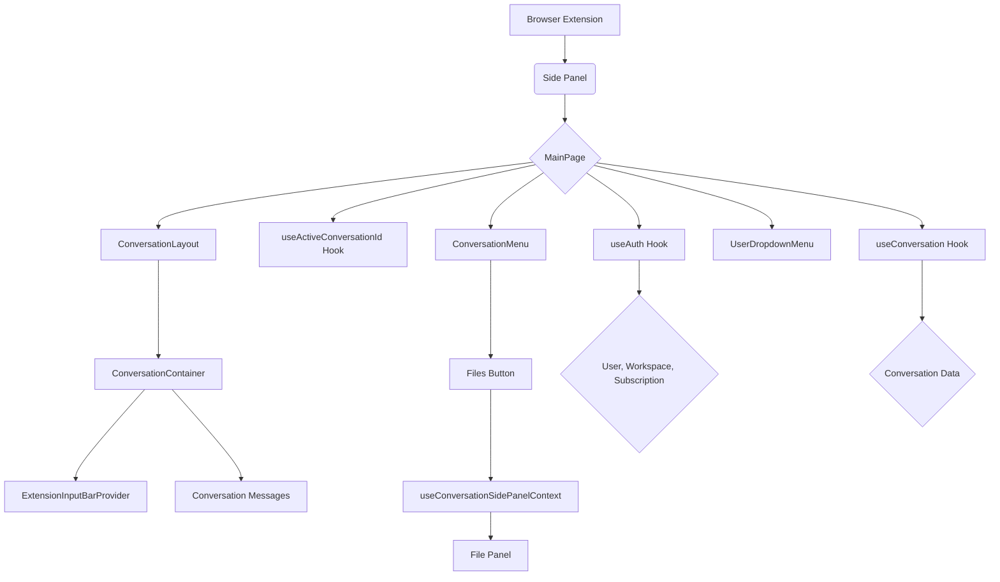
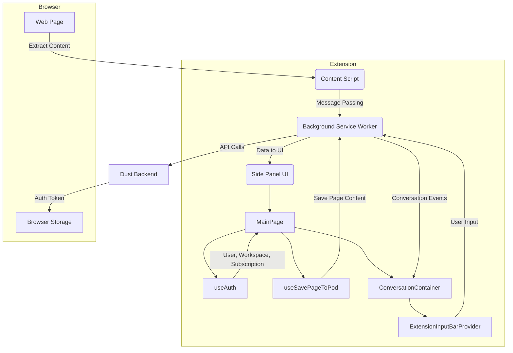

<!-- source: DeepWiki mcp.deepwiki.com · repo dust-tt/dust · page 13.2 Extension UI and Features · fetched 2026-10-27 -->

# Extension UI and Features

Relevant source files

The following files were used as context for generating this wiki page:

- [connectors/package.json](connectors/package.json)
- [extension/css.d.ts](extension/css.d.ts)
- [extension/domino.d.ts](extension/domino.d.ts)
- [extension/package.json](extension/package.json)
- [extension/platforms/chrome/ChromeApp.tsx](extension/platforms/chrome/ChromeApp.tsx)
- [extension/platforms/chrome/ChromeExtensionWrapper.tsx](extension/platforms/chrome/ChromeExtensionWrapper.tsx)
- [extension/platforms/chrome/manifests/manifest.base.json](extension/platforms/chrome/manifests/manifest.base.json)
- [extension/platforms/chrome/services/platform.ts](extension/platforms/chrome/services/platform.ts)
- [extension/platforms/firefox/FirefoxApp.tsx](extension/platforms/firefox/FirefoxApp.tsx)
- [extension/platforms/firefox/background.ts](extension/platforms/firefox/background.ts)
- [extension/platforms/firefox/manifests/manifest.base.json](extension/platforms/firefox/manifests/manifest.base.json)
- [extension/platforms/firefox/services/platform.ts](extension/platforms/firefox/services/platform.ts)
- [extension/platforms/front/context/FrontPlatformProvider.tsx](extension/platforms/front/context/FrontPlatformProvider.tsx)
- [extension/platforms/front/services/platform.ts](extension/platforms/front/services/platform.ts)
- [extension/shared/AuthenticatedImage.tsx](extension/shared/AuthenticatedImage.tsx)
- [extension/shared/background.ts](extension/shared/background.ts)
- [extension/shared/hooks/useCaptureActions.ts](extension/shared/hooks/useCaptureActions.ts)
- [extension/shared/lib/extraction.ts](extension/shared/lib/extraction.ts)
- [extension/shared/lib/html_to_markdown.ts](extension/shared/lib/html_to_markdown.ts)
- [extension/shared/lib/utils.ts](extension/shared/lib/utils.ts)
- [extension/shared/messages.ts](extension/shared/messages.ts)
- [extension/shared/platform.tsx](extension/shared/platform.tsx)
- [extension/shared/services/browser_messaging.ts](extension/shared/services/browser_messaging.ts)
- [extension/shared/services/platform.ts](extension/shared/services/platform.ts)
- [extension/tsconfig.json](extension/tsconfig.json)
- [extension/ui/components/ErrorFallback.tsx](extension/ui/components/ErrorFallback.tsx)
- [extension/ui/components/auth/ProtectedRoute.tsx](extension/ui/components/auth/ProtectedRoute.tsx)
- [extension/ui/components/conversation/ConversationContainer.tsx](extension/ui/components/conversation/ConversationContainer.tsx)
- [extension/ui/components/conversation/ConversationLayout.tsx](extension/ui/components/conversation/ConversationLayout.tsx)
- [extension/ui/components/conversation/ExtensionInputBarProvider.tsx](extension/ui/components/conversation/ExtensionInputBarProvider.tsx)
- [extension/ui/components/navigation/UserDropdownMenu.tsx](extension/ui/components/navigation/UserDropdownMenu.tsx)
- [extension/ui/components/quick_actions/ExtensionQuickActionsProvider.tsx](extension/ui/components/quick_actions/ExtensionQuickActionsProvider.tsx)
- [extension/ui/components/quick_actions/SavePageToPodDialog.tsx](extension/ui/components/quick_actions/SavePageToPodDialog.tsx)
- [extension/ui/css/custom.css](extension/ui/css/custom.css)
- [extension/ui/css/fonts.css](extension/ui/css/fonts.css)
- [extension/ui/css/global.css](extension/ui/css/global.css)
- [extension/ui/fonts/GeistMonoVariable.woff2](extension/ui/fonts/GeistMonoVariable.woff2)
- [extension/ui/fonts/GeistVariable-Italic.woff2](extension/ui/fonts/GeistVariable-Italic.woff2)
- [extension/ui/fonts/GeistVariable.woff2](extension/ui/fonts/GeistVariable.woff2)
- [extension/ui/hooks/useFileUploaderService.ts](extension/ui/hooks/useFileUploaderService.ts)
- [extension/ui/hooks/useSavePageToPod.ts](extension/ui/hooks/useSavePageToPod.ts)
- [extension/ui/pages/LoginPage.tsx](extension/ui/pages/LoginPage.tsx)
- [extension/ui/pages/MainPage.tsx](extension/ui/pages/MainPage.tsx)
- [extension/ui/pages/SubscribePage.tsx](extension/ui/pages/SubscribePage.tsx)
- [extension/ui/pages/routes.tsx](extension/ui/pages/routes.tsx)
- [front-spa/package.json](front-spa/package.json)
- [front-spa/vite.config.ts](front-spa/vite.config.ts)
- [front/css.d.ts](front/css.d.ts)
- [front/hooks/useFileUploaderService.ts](front/hooks/useFileUploaderService.ts)
- [front/package.json](front/package.json)
- [package-lock.json](package-lock.json)
- [package.json](package.json)
- [sdks/js/package.json](sdks/js/package.json)
- [sdks/js/tsconfig.json](sdks/js/tsconfig.json)
- [sparkle/package.json](sparkle/package.json)
- [sparkle/src/components/ImageGenerationPlaceholder.tsx](sparkle/src/components/ImageGenerationPlaceholder.tsx)
- [sparkle/src/components/ImagePreview.tsx](sparkle/src/components/ImagePreview.tsx)
- [sparkle/src/components/ImageWrapper.tsx](sparkle/src/components/ImageWrapper.tsx)
- [sparkle/src/components/InteractiveImageGrid.tsx](sparkle/src/components/InteractiveImageGrid.tsx)
- [sparkle/src/stories/ImageGenerationPlaceholder.stories.tsx](sparkle/src/stories/ImageGenerationPlaceholder.stories.tsx)
- [sparkle/tsconfig.json](sparkle/tsconfig.json)
- [viz/package.json](viz/package.json)

This page details the user interface (UI) and key features of the Dust browser extension. It covers the main components that users interact with, including the side panel, conversation display, authentication mechanisms, and functionalities like saving web page content to a Dust "pod" and the enhanced input bar.

## Side Panel UI

The Dust browser extension primarily operates within a side panel, providing a dedicated space for user interaction without navigating away from the current web page. The `MainPage` component serves as the entry point for this side panel UI.

The side panel is configured in the browser's manifest file. For Chrome, this is specified by `"side_panel": { "default_path": "main.html" }` [extension/platforms/chrome/manifests/manifest.base.json:26-28](). For Firefox, it's `"sidebar_action": { "default_panel": "main.html" }` [extension/platforms/firefox/manifests/manifest.base.json:27-35]().

The `MainPage` component orchestrates the display of conversations and other features. It uses `ConversationLayout` for overall structure and `ConversationContainer` to render the actual conversation content [extension/ui/pages/MainPage.tsx:55-118]().

### MainPage

The `MainPage` component is the root of the extension's UI. It handles:
*   **Authentication**: It retrieves user, workspace, and subscription information using the `useAuth` hook [extension/ui/pages/MainPage.tsx:20]().
*   **Notifications**: It sets up notifications using `useSetupNotifications` [extension/ui/pages/MainPage.tsx:21]().
*   **Active Conversation Management**: It determines the active conversation ID using `useActiveConversationId` [extension/ui/pages/MainPage.tsx:25]() and fetches conversation data with `useConversation` [extension/ui/pages/MainPage.tsx:28-32]().
*   **Header Display**: It dynamically sets the header title based on the conversation status (loading, error, or title) [extension/ui/pages/MainPage.tsx:41-52]().
*   **Right Actions**: It provides actions like "Files" to open the file panel and a `ConversationMenu` for conversation-specific options [extension/ui/pages/MainPage.tsx:63-91](). If no conversation is active, it displays a `UserDropdownMenu` [extension/ui/pages/MainPage.tsx:94-96]().
*   **Keyboard Shortcut Hint**: Displays a keyboard shortcut hint (`⇧⌘E` or `⇧+Ctrl+E`) when no conversation is active [extension/ui/pages/MainPage.tsx:100-105]().
*   **Context Providers**: Wraps the `ConversationContainer` with `BlockedActionsProvider` and `GenerationContextProvider` to manage agent actions and generation states [extension/ui/pages/MainPage.tsx:107-117]().

Sources:
- [extension/platforms/chrome/manifests/manifest.base.json:26-28]()
- [extension/platforms/firefox/manifests/manifest.base.json:27-35]()
- [extension/ui/pages/MainPage.tsx:20]()
- [extension/ui/pages/MainPage.tsx:21]()
- [extension/ui/pages/MainPage.tsx:25]()
- [extension/ui/pages/MainPage.tsx:28-32]()
- [extension/ui/pages/MainPage.tsx:41-52]()
- [extension/ui/pages/MainPage.tsx:55-118]()
- [extension/ui/pages/MainPage.tsx:63-91]()
- [extension/ui/pages/MainPage.tsx:94-96]()
- [extension/ui/pages/MainPage.tsx:100-105]()
- [extension/ui/pages/MainPage.tsx:107-117]()

## Conversation Container

The `ConversationContainer` component is responsible for rendering the actual conversation messages and the input bar within the extension's side panel. It receives `workspace`, `user`, `subscription`, `conversationId`, and `conversation` as props [extension/ui/pages/MainPage.tsx:110-115]().

Sources:
- [extension/ui/pages/MainPage.tsx:110-115]()

## Conversation Layout

The `ConversationLayout` component provides the structural layout for the conversation view within the extension. It includes a title, an optional back button, and a slot for right-aligned actions.

Sources:
- [extension/ui/components/conversation/ConversationLayout.tsx]()

## Authentication Provider (`useAuth`)

The extension uses a custom authentication provider, exposed via the `useAuth` hook [extension/ui/pages/MainPage.tsx:11](). This hook provides access to the authenticated `user`, `workspace`, and `subscription` objects.

The authentication flow typically involves:
1.  **Login Page**: If a user is not authenticated, they are redirected to the `LoginPage` [extension/ui/pages/LoginPage.tsx]().
2.  **ProtectedRoute**: Components requiring authentication are wrapped in `ProtectedRoute` [extension/ui/components/auth/ProtectedRoute.tsx](), which redirects unauthenticated users.
3.  **Session Management**: The extension manages user sessions, likely storing authentication tokens in browser storage (`storage` permission is requested in manifest [extension/platforms/chrome/manifests/manifest.base.json:46](), [extension/platforms/firefox/manifests/manifest.base.json:42]()).

Sources:
- [extension/platforms/chrome/manifests/manifest.base.json:46]()
- [extension/platforms/firefox/manifests/manifest.base.json:42]()
- [extension/ui/components/auth/ProtectedRoute.tsx]()
- [extension/ui/pages/LoginPage.tsx]()
- [extension/ui/pages/MainPage.tsx:11]()

## File Capture (`useSavePageToPod`)

The `useSavePageToPod` hook provides functionality to capture the content of the currently active web page and save it to a Dust "pod" (a personal knowledge base). This is a key feature for integrating web content into Dust's AI capabilities.

The hook likely interacts with content scripts to extract page content and then sends this data to the Dust backend via the extension's background service worker. The `scripting` permission in the manifest [extension/platforms/chrome/manifests/manifest.base.json:48](), [extension/platforms/firefox/manifests/manifest.base.json:42]() is crucial for content script injection and interaction with web pages.

Sources:
- [extension/platforms/chrome/manifests/manifest.base.json:48]()
- [extension/platforms/firefox/manifests/manifest.base.json:42]()
- [extension/ui/hooks/useSavePageToPod.ts]()

## Extension Input Bar Provider

The `ExtensionInputBarProvider` component is responsible for managing the state and functionality of the input bar within the extension. This likely includes handling user input, agent mentions, file attachments, and submitting messages to the conversation.

Sources:
- [extension/ui/components/conversation/ExtensionInputBarProvider.tsx]()

## UI Component Interaction Diagram

**Diagram: Extension UI Component Flow**

Sources:
- [extension/ui/components/conversation/ConversationContainer.tsx]()
- [extension/ui/components/conversation/ConversationLayout.tsx]()
- [extension/ui/components/conversation/ExtensionInputBarProvider.tsx]()
- [extension/ui/components/navigation/UserDropdownMenu.tsx]()
- [extension/ui/pages/MainPage.tsx]()

## Extension Data Flow Diagram

**Diagram: Extension Data Flow**

Sources:
- [extension/shared/background.ts]()
- [extension/shared/messages.ts]()
- [extension/shared/services/browser_messaging.ts]()
- [extension/ui/hooks/useSavePageToPod.ts]()
- [extension/ui/pages/MainPage.tsx]()

---

