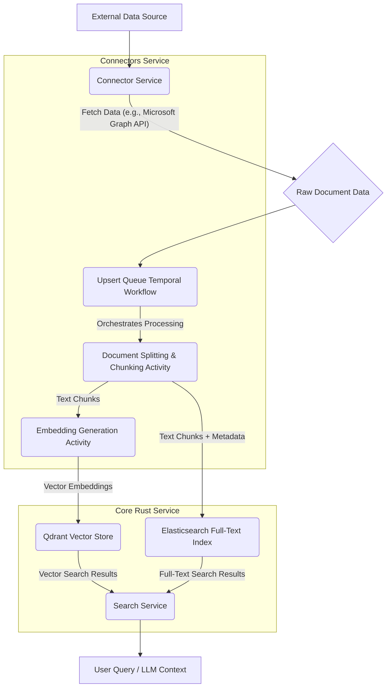

<!-- source: DeepWiki mcp.deepwiki.com · repo dust-tt/dust · page 14.1 Data Sources and Search · fetched 2026-10-27 -->

# 14.1. Data Sources and Search

<details>
<summary>Relevant source files</summary>

The following files were used as context for generating this wiki page:

- [connectors/migrations/20260227_clear_gdrive_first_sync_progress.ts](connectors/migrations/20260227_clear_gdrive_first_sync_progress.ts)
- [connectors/migrations/20260313_clear_microsoft_first_sync_progress.ts](connectors/migrations/20260313_clear_microsoft_first_sync_progress.ts)
- [connectors/scripts/microsoft_terminate_sensitivity_labels_workflows.ts](connectors/scripts/microsoft_terminate_sensitivity_labels_workflows.ts)
- [connectors/src/connectors/confluence/temporal/workflows.ts](connectors/src/connectors/confluence/temporal/workflows.ts)
- [connectors/src/connectors/github/lib/code/gcs_repository.ts](connectors/src/connectors/github/lib/code/gcs_repository.ts)
- [connectors/src/connectors/google_drive/temporal/activities/get_drives_to_sync.ts](connectors/src/connectors/google_drive/temporal/activities/get_drives_to_sync.ts)
- [connectors/src/connectors/google_drive/temporal/config.ts](connectors/src/connectors/google_drive/temporal/config.ts)
- [connectors/src/connectors/google_drive/temporal/workflows.ts](connectors/src/connectors/google_drive/temporal/workflows.ts)
- [connectors/src/connectors/microsoft/index.ts](connectors/src/connectors/microsoft/index.ts)
- [connectors/src/connectors/microsoft/lib/errors.ts](connectors/src/connectors/microsoft/lib/errors.ts)
- [connectors/src/connectors/microsoft/lib/graph_api.ts](connectors/src/connectors/microsoft/lib/graph_api.ts)
- [connectors/src/connectors/microsoft/lib/types.ts](connectors/src/connectors/microsoft/lib/types.ts)
- [connectors/src/connectors/microsoft/temporal/activities.ts](connectors/src/connectors/microsoft/temporal/activities.ts)
- [connectors/src/connectors/microsoft/temporal/cast_known_errors.ts](connectors/src/connectors/microsoft/temporal/cast_known_errors.ts)
- [connectors/src/connectors/microsoft/temporal/client.ts](connectors/src/connectors/microsoft/temporal/client.ts)
- [connectors/src/connectors/microsoft/temporal/file.ts](connectors/src/connectors/microsoft/temporal/file.ts)
- [connectors/src/connectors/microsoft/temporal/sensitivity_labels.test.ts](connectors/src/connectors/microsoft/temporal/sensitivity_labels.test.ts)
- [connectors/src/connectors/microsoft/temporal/workflows.ts](connectors/src/connectors/microsoft/temporal/workflows.ts)
- [connectors/src/connectors/notion/index.ts](connectors/src/connectors/notion/index.ts)
- [connectors/src/connectors/notion/lib/cli.ts](connectors/src/connectors/notion/lib/cli.ts)
- [connectors/src/connectors/notion/lib/notion_api.test.ts](connectors/src/connectors/notion/lib/notion_api.test.ts)
- [connectors/src/connectors/notion/lib/notion_api.ts](connectors/src/connectors/notion/lib/notion_api.ts)
- [connectors/src/connectors/notion/temporal/activities.ts](connectors/src/connectors/notion/temporal/activities.ts)
- [connectors/src/connectors/notion/temporal/config.ts](connectors/src/connectors/notion/temporal/config.ts)
- [connectors/src/connectors/notion/temporal/workflows/admins.ts](connectors/src/connectors/notion/temporal/workflows/admins.ts)
- [connectors/src/connectors/notion/temporal/workflows/garbage_collection.ts](connectors/src/connectors/notion/temporal/workflows/garbage_collection.ts)
- [connectors/src/connectors/slack/lib/utils.ts](connectors/src/connectors/slack/lib/utils.ts)
- [connectors/src/connectors/zendesk/lib/zendesk_api.ts](connectors/src/connectors/zendesk/lib/zendesk_api.ts)
- [connectors/src/connectors/zendesk/temporal/activities.ts](connectors/src/connectors/zendesk/temporal/activities.ts)
- [connectors/src/lib/models/microsoft.ts](connectors/src/lib/models/microsoft.ts)
- [connectors/src/lib/sync_status.ts](connectors/src/lib/sync_status.ts)
- [connectors/src/resources/microsoft_resource.ts](connectors/src/resources/microsoft_resource.ts)
- [dockerfiles/sandbox-bedrock.Dockerfile](dockerfiles/sandbox-bedrock.Dockerfile)
- [front/lib/api/config.ts](front/lib/api/config.ts)
- [front/lib/api/credits/purchase.ts](front/lib/api/credits/purchase.ts)
- [front/lib/api/poke/plugins/data_sources/notion_unstuck_syncing_nodes.ts](front/lib/api/poke/plugins/data_sources/notion_unstuck_syncing_nodes.ts)
- [front/lib/api/poke/plugins/workspaces/buy_programmatic_usage_credits.ts](front/lib/api/poke/plugins/workspaces/buy_programmatic_usage_credits.ts)
- [front/lib/api/sandbox/image/index.ts](front/lib/api/sandbox/image/index.ts)
- [front/lib/api/sandbox/image/sandbox_image.test.ts](front/lib/api/sandbox/image/sandbox_image.test.ts)
- [front/lib/api/sandbox/image/sandbox_image.ts](front/lib/api/sandbox/image/sandbox_image.ts)
- [front/lib/api/sandbox/image/tool_manifest.test.ts](front/lib/api/sandbox/image/tool_manifest.test.ts)
- [front/lib/api/sandbox/image/tool_manifest.ts](front/lib/api/sandbox/image/tool_manifest.ts)
- [front/lib/api/sandbox/image/types.ts](front/lib/api/sandbox/image/types.ts)
- [front/lib/api/sandbox/providers/e2b_template.test.ts](front/lib/api/sandbox/providers/e2b_template.test.ts)
- [front/lib/api/sandbox/providers/e2b_template.ts](front/lib/api/sandbox/providers/e2b_template.ts)
- [front/lib/credits/committed.test.ts](front/lib/credits/committed.test.ts)
- [front/lib/credits/committed.ts](front/lib/credits/committed.ts)
- [front/lib/credits/limits.test.ts](front/lib/credits/limits.test.ts)
- [front/lib/credits/limits.ts](front/lib/credits/limits.ts)
- [front/scripts/backfill_metronome_credits.ts](front/scripts/backfill_metronome_credits.ts)
- [front/scripts/metronome_initial_contract_setup.ts](front/scripts/metronome_initial_contract_setup.ts)

</details>


This page details the core components involved in managing data sources, ingesting documents, and enabling search capabilities within the Dust platform. It covers the document upsert pipeline, Qdrant vector search, Elasticsearch full-text search, and the logic for splitting and chunking documents. Key Rust modules like `data_source.rs` and `search_stores` are central to this process, along with the Temporal workflow for the upsert queue.

## Data Source Management

Data sources in Dust are external systems from which information is ingested. Connectors (e.g., Microsoft, Google Drive, Notion) are responsible for fetching data from these external systems and pushing it into Dust's data ingestion pipeline.

### Connector Integration

Connectors, such as the Microsoft connector, interact with external APIs to retrieve data. For instance, the Microsoft connector uses the Microsoft Graph API to fetch sites, drives, files, and folders [connectors/src/connectors/microsoft/lib/graph_api.ts](). It handles pagination, delta synchronization, and error management, including throttling and OAuth token errors [connectors/src/connectors/microsoft/lib/graph_api.ts:37-88]().

The `MicrosoftConnectorManager` class orchestrates the creation, update, and deletion of Microsoft data sources [connectors/src/connectors/microsoft/index.ts:92-177](). It launches Temporal workflows for full synchronization, incremental synchronization, and garbage collection [connectors/src/connectors/microsoft/index.ts:151-162]().

### Temporal Workflows for Synchronization

Synchronization processes are managed by Temporal workflows to ensure reliability and scalability.

#### Full Sync Workflows

For Google Drive, the `googleDriveFullSyncV2` workflow coordinates the initial ingestion of data [connectors/src/connectors/google_drive/temporal/workflows.ts:203-215](). It populates sync tokens, upserts shared-with-me folders, and launches child workflows (`googleDriveFolderSync`) for each selected root folder to process subtrees in parallel [connectors/src/connectors/google_drive/temporal/workflows.ts:223-231, 106-178]().

#### Incremental Sync Workflows

Incremental sync workflows, like `launchMicrosoftIncrementalSyncWorkflow` [connectors/src/connectors/microsoft/index.ts:151-153](), are designed to process changes (deltas) from external data sources efficiently. For Microsoft, this involves fetching delta results from the Graph API [connectors/src/connectors/microsoft/lib/graph_api.ts:207-236]() and storing them in GCS for batch processing [connectors/src/connectors/microsoft/temporal/activities.ts:96-102](). The `createDeltaJsonStream` and `readDeltaFromGCSStream` functions handle large JSON payloads by streaming them to and from GCS to avoid memory issues [connectors/src/connectors/microsoft/temporal/activities.ts:127-165, 167-197]().

#### Garbage Collection Workflows

Garbage collection workflows, such as `googleDriveGarbageCollectorWorkflow` [connectors/src/connectors/google_drive/temporal/workflows.ts:68-78](), are responsible for identifying and deleting documents that are no longer part of the connected data source.

Sources:
- [connectors/src/connectors/microsoft/temporal/activities.ts:96-102]()
- [connectors/src/connectors/microsoft/temporal/activities.ts:127-165]()
- [connectors/src/connectors/microsoft/temporal/activities.ts:167-197]()
- [connectors/src/connectors/microsoft/index.ts:92-177]()
- [connectors/src/connectors/microsoft/index.ts:151-153]()
- [connectors/src/connectors/microsoft/index.ts:151-162]()
- [connectors/src/connectors/microsoft/lib/graph_api.ts]()
- [connectors/src/connectors/microsoft/lib/graph_api.ts:37-88]()
- [connectors/src/connectors/microsoft/lib/graph_api.ts:207-236]()
- [connectors/src/connectors/google_drive/temporal/workflows.ts:68-78]()
- [connectors/src/connectors/google_drive/temporal/workflows.ts:106-178]()
- [connectors/src/connectors/google_drive/temporal/workflows.ts:203-215]()
- [connectors/src/connectors/google_drive/temporal/workflows.ts:223-231]()

## Document Upsert Pipeline

The document upsert pipeline is responsible for processing raw data from connectors, splitting it into manageable chunks, and storing it in both vector and full-text search indexes.

### Upsert Queue Temporal Workflow

The `upsertQueueWorkflow` (not explicitly provided in the snippets but referenced by context) is a Temporal workflow that manages the asynchronous processing of documents for upsertion. Connectors enqueue documents into this workflow, which then orchestrates the splitting, chunking, and indexing activities.

### Document Splitting and Chunking

Before indexing, documents are split into smaller, semantically meaningful chunks. This process is crucial for effective retrieval augmented generation (RAG) and search.

The splitting logic typically involves:
1.  **Loading the document**: Retrieving the content of the document.
2.  **Text extraction**: Extracting plain text from various document formats (e.g., PDF, HTML, Markdown).
3.  **Recursive character text splitter**: This is a common strategy that attempts to split text based on a list of characters (e.g., `\n\n`, `\n`, ` `, `.`). It recursively tries smaller delimiters if a chunk is still too large.
4.  **Chunk size and overlap**: Chunks are configured with a maximum size and an overlap to maintain context between adjacent chunks.

This process ensures that each chunk is small enough to be processed by LLMs while retaining sufficient context for relevance.

### Qdrant Vector Search

Qdrant is used for vector similarity search. After documents are chunked, each chunk is embedded into a vector representation using an embedding model. These vectors are then stored in Qdrant.

When a query is made, the query itself is embedded, and Qdrant is used to find the most semantically similar document chunks based on their vector representations.

### Elasticsearch Full-Text Search

Elasticsearch provides full-text search capabilities. Document chunks, along with their metadata, are indexed in Elasticsearch. This allows for keyword-based searches, filtering, and more traditional information retrieval.

Elasticsearch is particularly useful for:
*   **Exact keyword matching**: Finding documents containing specific terms.
*   **Faceted search**: Filtering results based on metadata.
*   **Hybrid search**: Combining keyword search with vector search for improved relevance.

### Data Flow Diagram



Sources:
- [connectors/src/connectors/microsoft/lib/graph_api.ts]()

## `data_source.rs` and `search_stores`

The Rust codebase, particularly `data_source.rs` and the `search_stores` module, implements the core logic for interacting with Qdrant and Elasticsearch.

### `data_source.rs`

This module likely defines the data structures and functions for managing data sources, documents, and their associated metadata within the Rust service. It would handle:
*   **Document ingestion**: Receiving processed chunks from the Temporal workflow.
*   **Metadata management**: Storing and retrieving document metadata.
*   **Interaction with search stores**: Calling functions in `search_stores` to index data.

### `search_stores` Module

The `search_stores` module abstracts the interactions with Qdrant and Elasticsearch. It provides a unified interface for indexing and searching across both vector and full-text stores.

Key functionalities would include:
*   **Qdrant client**: Managing connections and operations (e.g., `upsert_points`, `search_points`) with Qdrant.
*   **Elasticsearch client**: Managing connections and operations (e.g., `index_document`, `search_document`) with Elasticsearch.
*   **Hybrid search logic**: Combining results from both Qdrant and Elasticsearch to provide comprehensive search results. This often involves re-ranking or fusing results based on relevance scores.

### Code Entity to Natural Language Space Mapping

```mermaid
graph TD
    subgraph "Natural Language Space"
        NL1["Data Source Management"]
        NL2["Document Ingestion Pipeline"]
        NL3["Vector Search"]
        NL4["Full-Text Search"]
        NL5["Document Chunking"]
    end

    subgraph "Code Entity Space"
        CE1["`connectors/src/connectors/microsoft/index.ts` (MicrosoftConnectorManager)"]
        CE2["`connectors/src/connectors/google_drive/temporal/workflows.ts` (Full/Incremental Sync Workflows)"]
        CE3["`connectors/src/connectors/microsoft/temporal/activities.ts` (Delta Processing, GCS Streaming)"]
        CE4["`core/src/data_source.rs` (Document Ingestion Logic)"]
        CE5["`core/src/search_stores/qdrant.rs` (Qdrant Client, Vector Operations)"]
        CE6["`core/src/search_stores/elastic.rs` (Elasticsearch Client, Full-Text Operations)"]
        CE7["`core/src/search_stores/splitter.rs` (Document Splitting Logic)"]
        CE8["`core/src/search_stores/mod.rs` (Search Store Abstraction, Hybrid Search)"]
    end

    NL1 --> CE1;
    NL1 --> CE2;
    NL2 --> CE3;
    NL2 --> CE4;
    NL5 --> CE7;
    NL3 --> CE5;
    NL4 --> CE6;
    NL3 & NL4 --> CE8;
```

Sources:
- [connectors/src/connectors/microsoft/temporal/activities.ts]()
- [connectors/src/connectors/microsoft/index.ts]()
- [connectors/src/connectors/google_drive/temporal/workflows.ts]()

---

