<!-- source: DeepWiki mcp.deepwiki.com · repo dust-tt/dust · page 15 Infrastructure and DevOps · fetched 2026-10-27 -->

# Infrastructure and DevOps

Relevant source files

The following files were used as context for generating this wiki page:

- [.cursor/environment.json](.cursor/environment.json)
- [.github/actions/build-image/action.yml](.github/actions/build-image/action.yml)
- [.github/actions/setup-node-deps/action.yml](.github/actions/setup-node-deps/action.yml)
- [.github/actions/slack-check-deployment-blocked/action.yml](.github/actions/slack-check-deployment-blocked/action.yml)
- [.github/actions/slack-notify/action.yml](.github/actions/slack-notify/action.yml)
- [.github/workflows/build-and-test-core.yml](.github/workflows/build-and-test-core.yml)
- [.github/workflows/build-canary-image.yml](.github/workflows/build-canary-image.yml)
- [.github/workflows/build-dust-sandbox.yml](.github/workflows/build-dust-sandbox.yml)
- [.github/workflows/build-spa.yaml](.github/workflows/build-spa.yaml)
- [.github/workflows/check-migrations.yml](.github/workflows/check-migrations.yml)
- [.github/workflows/claude-code-review.yml](.github/workflows/claude-code-review.yml)
- [.github/workflows/claude.yml](.github/workflows/claude.yml)
- [.github/workflows/deploy-spa-production.yaml](.github/workflows/deploy-spa-production.yaml)
- [.github/workflows/deploy-spa.yaml](.github/workflows/deploy-spa.yaml)
- [.github/workflows/deploy.yml](.github/workflows/deploy.yml)
- [.github/workflows/format-check.yml](.github/workflows/format-check.yml)
- [.github/workflows/lint-github-actions.yml](.github/workflows/lint-github-actions.yml)
- [.github/workflows/list-tags.yaml](.github/workflows/list-tags.yaml)
- [.github/workflows/publish-cli.yml](.github/workflows/publish-cli.yml)
- [.github/workflows/publish-sdk-client.yml](.github/workflows/publish-sdk-client.yml)
- [.github/workflows/release-dsbx-cli.yml](.github/workflows/release-dsbx-cli.yml)
- [.github/workflows/release-sandbox-tool.yml](.github/workflows/release-sandbox-tool.yml)
- [.github/workflows/revert.yml](.github/workflows/revert.yml)
- [.github/workflows/run-dangerjs.yml](.github/workflows/run-dangerjs.yml)
- [.github/workflows/sandbox-bedrock-release.yml](.github/workflows/sandbox-bedrock-release.yml)
- [.github/workflows/sandbox-img-registry.yml](.github/workflows/sandbox-img-registry.yml)
- [.gitignore](.gitignore)
- [.grit/patterns/noClientDeepImports.grit](.grit/patterns/noClientDeepImports.grit)
- [.grit/patterns/noClientDeepImports.md](.grit/patterns/noClientDeepImports.md)
- [.nvmrc](.nvmrc)
- [biome.json](biome.json)
- [cli/dust-sandbox/tests/e2e_local.rs](cli/dust-sandbox/tests/e2e_local.rs)
- [connectors/.nvmrc](connectors/.nvmrc)
- [connectors/esbuild.config.ts](connectors/esbuild.config.ts)
- [dockerfiles/connectors.Dockerfile](dockerfiles/connectors.Dockerfile)
- [dockerfiles/front.Dockerfile](dockerfiles/front.Dockerfile)
- [dockerfiles/marketing.Dockerfile](dockerfiles/marketing.Dockerfile)
- [dockerfiles/prodbox.Dockerfile](dockerfiles/prodbox.Dockerfile)
- [dockerfiles/sparkle-storybook.Dockerfile](dockerfiles/sparkle-storybook.Dockerfile)
- [dockerfiles/sparkle/sparkle-storybook-nginx.conf](dockerfiles/sparkle/sparkle-storybook-nginx.conf)
- [dockerfiles/viz.Dockerfile](dockerfiles/viz.Dockerfile)
- [firebase-functions/webhook-router/Dockerfile](firebase-functions/webhook-router/Dockerfile)
- [front-api/forbid-next.cjs](front-api/forbid-next.cjs)
- [front-spa/.nvmrc](front-spa/.nvmrc)
- [front-spa/_headers](front-spa/_headers)
- [front-spa/worker/app.ts](front-spa/worker/app.ts)
- [front-spa/worker/poke.ts](front-spa/worker/poke.ts)
- [front-spa/wrangler-app.toml](front-spa/wrangler-app.toml)
- [front-spa/wrangler-poke.toml](front-spa/wrangler-poke.toml)
- [front/.nvmrc](front/.nvmrc)
- [front/components/dev/devStyleOverrides.ts](front/components/dev/devStyleOverrides.ts)
- [front/components/sparkle/ThemeContext.tsx](front/components/sparkle/ThemeContext.tsx)
- [front/config/cors.ts](front/config/cors.ts)
- [front/dangerfile.ts](front/dangerfile.ts)
- [front/esbuild.worker.ts](front/esbuild.worker.ts)
- [front/scripts/sandbox_image_build.ts](front/scripts/sandbox_image_build.ts)
- [front/scripts/sandbox_image_check.ts](front/scripts/sandbox_image_check.ts)
- [front/workers-build/scripts/esbuild.worker.ts](front/workers-build/scripts/esbuild.worker.ts)
- [lefthook.yml](lefthook.yml)
- [scripts/db/run-migrate.cjs](scripts/db/run-migrate.cjs)
- [sdks/js/esbuild.config.ts](sdks/js/esbuild.config.ts)
- [temporal/.env](temporal/.env)
- [temporal/docker-compose.yml](temporal/docker-compose.yml)
- [temporal/dynamicconfig/development-sql.yaml](temporal/dynamicconfig/development-sql.yaml)
- [tools/check-start-mprocs.sh](tools/check-start-mprocs.sh)
- [tools/dev.sh](tools/dev.sh)
- [tools/mprocs.yaml](tools/mprocs.yaml)
- [tools/process-compose.yaml](tools/process-compose.yaml)
- [tools/start-mprocs.sh](tools/start-mprocs.sh)
- [tools/wait-for-temporal.sh](tools/wait-for-temporal.sh)
- [viz/.nvmrc](viz/.nvmrc)
- [viz/next.config.mjs](viz/next.config.mjs)

This page provides a high-level overview of the Dust platform's infrastructure and DevOps practices. It covers deployment strategies, continuous integration/continuous delivery (CI/CD) pipelines, Docker image management, local development tooling, and the egress proxy for network security. Detailed information for each of these topics can be found in their respective child pages.

## Deployment Infrastructure

The Dust platform leverages a robust deployment infrastructure primarily based on Google Cloud Platform (GCP) and Cloudflare Workers. Services are deployed across multiple regions (e.g., `us-central1`, `europe-west1`) to ensure high availability and low latency. Deployments are managed through GitHub Actions workflows, which automate the build, test, and deployment processes for various components like the `front` (Next.js application), `front-spa` (Single Page Application), `connectors` service, and `core` Rust service.

For details, see [CI/CD and Deployment](#15.1).

## CI/CD Pipelines

The CI/CD pipelines are orchestrated using GitHub Actions. These pipelines automate the entire software delivery lifecycle, from code commit to production deployment. Key workflows include:

*   **`deploy.yml`**: Handles the deployment of backend services and Next.js applications (e.g., `front`, `connectors`, `core`, `marketing`). It supports regional deployments and various environments (prod, edge, canary). [deploy.yml]().
*   **`deploy-spa.yaml`**: Manages the deployment of Single Page Applications (SPAs) like `front-spa` and `poke` to Cloudflare Workers. [deploy-spa.yaml]().
*   **`build-image` action**: A reusable GitHub Action that encapsulates the logic for building Docker images using Depot, pushing them to Google Artifact Registry, and handling environment-specific configurations. [.github/actions/build-image/action.yml]().

Beyond deployment, the CI/CD system also incorporates quality gates:

*   **Biome Linting**: Enforces code style and catches common errors across the monorepo's JavaScript/TypeScript files. [biome.json](), [.github/workflows/format-check.yml]().
*   **Lefthook**: A Git hook manager that runs pre-commit checks, including linting, type-checking, and custom scripts, to maintain code quality before commits are made. [lefthook.yml]().
*   **Danger.js PR Checks**: Automates code review feedback by running checks on pull requests, such as verifying SDK changes, migration acknowledgments, and documentation updates. [front/dangerfile.ts](), [.github/workflows/run-dangerjs.yml]().

For details, see [CI/CD and Deployment](#15.1).

## Docker Images

Docker images are central to the deployment strategy, providing consistent and isolated environments for each service. Each major component of the Dust platform has its own Dockerfile, defining its build process and dependencies.

*   **`front.Dockerfile`**: Defines the build for the `front` Next.js application and its associated Temporal workers. It includes multi-stage builds for base dependencies, worker-specific builds, and the `front-api` Hono server. [dockerfiles/front.Dockerfile]().
*   **`connectors.Dockerfile`**: Specifies the build for the `connectors` service, including its Temporal workers and API server. [dockerfiles/connectors.Dockerfile]().
*   **`viz.Dockerfile`**: Used for the visualization service. [dockerfiles/viz.Dockerfile]().
*   **`marketing.Dockerfile`**: For the marketing website. [dockerfiles/marketing.Dockerfile]().
*   **`prodbox.Dockerfile`**: For the production sandbox environment. [dockerfiles/prodbox.Dockerfile]().

These Dockerfiles often include steps for:
*   Installing Node.js dependencies using `npm ci`.
*   Building TypeScript projects (e.g., `sdks/js`, `sparkle`).
*   Copying source code and configuration files.
*   Uploading source maps to Datadog for error tracking.

## Local Development Tooling

Local development is streamlined using a combination of tools to manage multiple concurrent processes and ensure a consistent environment.

*   **`mprocs` / `process-compose`**: These tools are used to run various services (e.g., `core`, `front-api-hono`, `front-workers`, `connectors`, `front-spa`, `sparkle`) simultaneously in development. The `tools/mprocs.yaml` configuration defines the processes and their dependencies. [tools/mprocs.yaml]().
*   **`dev.sh` script**: A wrapper script that sets up the local environment and starts the necessary services.
*   **Temporal Local Setup**: The `mprocs.yaml` includes commands to start Temporal's local Docker Compose setup, ensuring that search attributes are created for `connectorId`, `conversationId`, and `workspaceId`. [tools/mprocs.yaml:28-42]().
*   **Database Seeding**: The local environment supports database seeding, including `dust_hive_seed.sql` and seed factories, to populate the database with development data.
*   **`front-spa` Vite Configuration**: The `front-spa` application uses Vite for development, with specific configurations to handle module isolation and ensure proper integration with other services. [front-spa/worker/app.ts](), [front-spa/wrangler-app.toml]().

For details, see [Local Development](#15.2).

## Egress Proxy and Network Security

The platform employs a Rust-based egress proxy to control and secure outbound network access, particularly for sandboxed environments.

*   **Rust-based Egress Proxy**: The `egress-proxy` service, written in Rust, acts as a gatekeeper for all outbound network requests from sandboxes and other services. [egress-proxy/src]().
*   **JWT-based Policy Enforcement**: The proxy enforces policies using JSON Web Tokens (JWTs), which contain information about allowed domains and other network restrictions. The `mintEgressJwt` function is responsible for generating these tokens.
*   **Domain Allowlisting**: Outbound access is restricted to a predefined list of allowed domains, preventing unauthorized connections.
*   **`nftables` Integration**: For sandboxed environments, `nftables` (a Linux packet filtering framework) is used in conjunction with the egress proxy to enforce network policies at the kernel level, providing a robust layer of security. The `sandbox egress nftables scripts` configure these rules.
*   **Sandbox Control**: This system ensures that sandboxes, which execute untrusted code, have tightly controlled outbound network access, mitigating potential security risks.

For details, see [Egress Proxy and Network Security](#15.3).

```mermaid
graph TD
    subgraph "CI/CD Pipelines"
        GH_Actions["GitHub Actions"] --> Deploy_YML["deploy.yml (Backend/Next.js)"]
        GH_Actions --> Deploy_SPA_YML["deploy-spa.yaml (Cloudflare Workers)"]
        Deploy_YML --> Build_Image_Action["build-image Action"]
        Deploy_SPA_YML --> Build_Image_Action
        GH_Actions --> Format_Check_YML["format-check.yml (Biome)"]
        GH_Actions --> Run_DangerJS_YML["run-dangerjs.yml (Danger.js)"]
        Lefthook["Lefthook (Pre-commit hooks)"] --> Biome_Lint["Biome Linting"]
        Lefthook --> Type_Check["Type Checking"]
        Lefthook --> Custom_Scripts["Custom Scripts"]
        Format_Check_YML --> Biome_Lint
        Run_DangerJS_YML --> DangerJS_Checks["Danger.js PR Checks"]
    end

    subgraph "Deployment Targets"
        Deploy_YML --> GCP_Artifact_Registry["GCP Artifact Registry"]
        Deploy_YML --> GKE["Google Kubernetes Engine (GKE)"]
        Deploy_SPA_YML --> Cloudflare_Workers["Cloudflare Workers"]
    end

    subgraph "Docker Images"
        Front_Dockerfile["front.Dockerfile"] --> Front_Image["front Image"]
        Connectors_Dockerfile["connectors.Dockerfile"] --> Connectors_Image["connectors Image"]
        Viz_Dockerfile["viz.Dockerfile"] --> Viz_Image["viz Image"]
        Marketing_Dockerfile["marketing.Dockerfile"] --> Marketing_Image["marketing Image"]
        Prodbox_Dockerfile["prodbox.Dockerfile"] --> Prodbox_Image["prodbox Image"]
        Front_Image --> GCP_Artifact_Registry
        Connectors_Image --> GCP_Artifact_Registry
        Viz_Image --> GCP_Artifact_Registry
        Marketing_Image --> GCP_Artifact_Registry
        Prodbox_Image --> GCP_Artifact_Registry
    end

    subgraph "Local Development"
        Mprocs_YAML["tools/mprocs.yaml"] --> Mprocs_Tool["mprocs/process-compose"]
        Mprocs_Tool --> Core_Service["core (Rust)"]
        Mprocs_Tool --> Front_API_Hono["front-api-hono"]
        Mprocs_Tool --> Front_Workers["front-workers"]
        Mprocs_Tool --> Connectors_Service["connectors"]
        Mprocs_Tool --> Front_SPA["front-spa (Vite)"]
        Mprocs_Tool --> Sparkle_Dev["sparkle (watch)"]
        Mprocs_Tool --> Temporal_Local["Temporal Local Setup"]
        Dev_SH["dev.sh script"] --> Mprocs_Tool
        DB_Seeding["Database Seeding"]
    end

    subgraph "Egress Proxy"
        Egress_Proxy_Service["egress-proxy (Rust)"]
        Egress_Proxy_Service --> JWT_Enforcement["JWT-based Policy Enforcement"]
        Egress_Proxy_Service --> Domain_Allowlisting["Domain Allowlisting"]
        Egress_Proxy_Service --> NFTables_Integration["nftables Integration"]
        Sandbox_Env["Sandbox Execution Environment"] --> Egress_Proxy_Service
        Sandbox_Env --> NFTables_Integration
    end

    GKE --> Front_Image
    GKE --> Connectors_Image
    GKE --> Viz_Image
    GKE --> Marketing_Image
    GKE --> Prodbox_Image

    style GH_Actions fill:#ECECFF,stroke:#9370DB,stroke-width:2px
    style Deploy_YML fill:#D4EDDA,stroke:#28A745,stroke-width:2px
    style Deploy_SPA_YML fill:#D4EDDA,stroke:#28A745,stroke-width:2px
    style Build_Image_Action fill:#D4EDDA,stroke:#28A745,stroke-width:2px
    style Format_Check_YML fill:#F8D7DA,stroke:#DC3545,stroke-width:2px
    style Run_DangerJS_YML fill:#F8D7DA,stroke:#DC3545,stroke-width:2px
    style Lefthook fill:#FFF3CD,stroke:#FFC107,stroke-width:2px
    style Biome_Lint fill:#FFF3CD,stroke:#FFC107,stroke-width:2px
    style Type_Check fill:#FFF3CD,stroke:#FFC107,stroke-width:2px
    style Custom_Scripts fill:#FFF3CD,stroke:#FFC107,stroke-width:2px
    style DangerJS_Checks fill:#F8D7DA,stroke:#DC3545,stroke-width:2px

    style GCP_Artifact_Registry fill:#E0F2F7,stroke:#00BCD4,stroke-width:2px
    style GKE fill:#E0F2F7,stroke:#00BCD4,stroke-width:2px
    style Cloudflare_Workers fill:#E0F2F7,stroke:#F48C06,stroke-width:2px

    style Front_Dockerfile fill:#D1ECF1,stroke:#17A2B8,stroke-width:2px
    style Connectors_Dockerfile fill:#D1ECF1,stroke:#17A2B8,stroke-width:2px
    style Viz_Dockerfile fill:#D1ECF1,stroke:#17A2B8,stroke-width:2px
    style Marketing_Dockerfile fill:#D1ECF1,stroke:#17A2B8,stroke-width:2px
    style Prodbox_Dockerfile fill:#D1ECF1,stroke:#17A2B8,stroke-width:2px
    style Front_Image fill:#D1ECF1,stroke:#17A2B8,stroke-width:2px
    style Connectors_Image fill:#D1ECF1,stroke:#17A2B8,stroke-width:2px
    style Viz_Image fill:#D1ECF1,stroke:#17A2B8,stroke-width:2px
    style Marketing_Image fill:#D1ECF1,stroke:#17A2B8,stroke-width:2px
    style Prodbox_Image fill:#D1ECF1,stroke:#17A2B8,stroke-width:2px

    style Mprocs_YAML fill:#F0F8FF,stroke:#6A5ACD,stroke-width:2px
    style Mprocs_Tool fill:#F0F8FF,stroke:#6A5ACD,stroke-width:2px
    style Core_Service fill:#F0F8FF,stroke:#6A5ACD,stroke-width:2px
    style Front_API_Hono fill:#F0F8FF,stroke:#6A5ACD,stroke-width:2px
    style Front_Workers fill:#F0F8FF,stroke:#6A5ACD,stroke-width:2px
    style Connectors_Service fill:#F0F8FF,stroke:#6A5ACD,stroke-width:2px
    style Front_SPA fill:#F0F8FF,stroke:#6A5ACD,stroke-width:2px
    style Sparkle_Dev fill:#F0F8FF,stroke:#6A5ACD,stroke-width:2px
    style Temporal_Local fill:#F0F8FF,stroke:#6A5ACD,stroke-width:2px
    style Dev_SH fill:#F0F8FF,stroke:#6A5ACD,stroke-width:2px
    style DB_Seeding fill:#F0F8FF,stroke:#6A5ACD,stroke-width:2px

    style Egress_Proxy_Service fill:#F5F5DC,stroke:#8B4513,stroke-width:2px
    style JWT_Enforcement fill:#F5F5DC,stroke:#8B4513,stroke-width:2px
    style Domain_Allowlisting fill:#F5F5DC,stroke:#8B4513,stroke-width:2px
    style NFTables_Integration fill:#F5F5DC,stroke:#8B4513,stroke-width:2px
    style Sandbox_Env fill:#F5F5DC,stroke:#8B4513,stroke-width:2px
```

**Diagram: Infrastructure and DevOps Overview**
Sources: [.github/workflows/deploy-spa.yaml](), [.github/workflows/deploy.yml](), [dockerfiles/front.Dockerfile](), [dockerfiles/connectors.Dockerfile](), [biome.json](), [lefthook.yml](), [front/dangerfile.ts](), [tools/mprocs.yaml](), [.github/actions/build-image/action.yml](), [.github/workflows/format-check.yml](), [dockerfiles/viz.Dockerfile](), [dockerfiles/marketing.Dockerfile](), [dockerfiles/prodbox.Dockerfile]()

---

