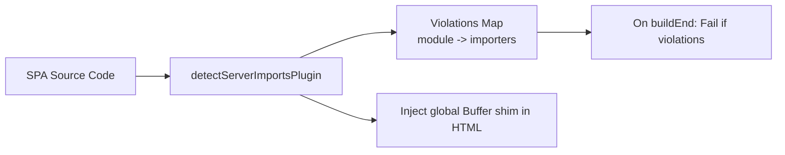

<!-- source: DeepWiki mcp.deepwiki.com · repo dust-tt/dust · page 16.2 Poke SPA Architecture · fetched 2026-10-27 -->

# 16.2 Poke SPA Architecture

<details>
<summary>Relevant source files</summary>

The following files were used as context for generating this wiki page:

- [connectors/package.json](connectors/package.json)
- [extension/css.d.ts](extension/css.d.ts)
- [extension/package.json](extension/package.json)
- [extension/platforms/chrome/manifests/manifest.base.json](extension/platforms/chrome/manifests/manifest.base.json)
- [extension/platforms/firefox/manifests/manifest.base.json](extension/platforms/firefox/manifests/manifest.base.json)
- [extension/tsconfig.json](extension/tsconfig.json)
- [extension/ui/hooks/useFileUploaderService.ts](extension/ui/hooks/useFileUploaderService.ts)
- [extension/ui/hooks/useSavePageToPod.ts](extension/ui/hooks/useSavePageToPod.ts)
- [front-spa/index.html](front-spa/index.html)
- [front-spa/package.json](front-spa/package.json)
- [front-spa/src/app/App.tsx](front-spa/src/app/App.tsx)
- [front-spa/src/app/components/AuthErrorPage.tsx](front-spa/src/app/components/AuthErrorPage.tsx)
- [front-spa/src/app/layouts/WorkspacePage.tsx](front-spa/src/app/layouts/WorkspacePage.tsx)
- [front-spa/src/app/main.tsx](front-spa/src/app/main.tsx)
- [front-spa/src/app/pages/IndexPage.tsx](front-spa/src/app/pages/IndexPage.tsx)
- [front-spa/src/index.css](front-spa/src/index.css)
- [front-spa/src/lib/initDatadog.ts](front-spa/src/lib/initDatadog.ts)
- [front-spa/src/lib/platform.tsx](front-spa/src/lib/platform.tsx)
- [front-spa/src/poke/PokeApp.tsx](front-spa/src/poke/PokeApp.tsx)
- [front-spa/src/poke/layouts/PokePage.tsx](front-spa/src/poke/layouts/PokePage.tsx)
- [front-spa/src/poke/layouts/PokeWorkspacePage.tsx](front-spa/src/poke/layouts/PokeWorkspacePage.tsx)
- [front-spa/vite.config.ts](front-spa/vite.config.ts)
- [front/components/pages/workspace/AnalyticsPage.tsx](front/components/pages/workspace/AnalyticsPage.tsx)
- [front/components/workspace/analytics/AnalyticsExportPanel.tsx](front/components/workspace/analytics/AnalyticsExportPanel.tsx)
- [front/css.d.ts](front/css.d.ts)
- [front/hooks/useFileUploaderService.ts](front/hooks/useFileUploaderService.ts)
- [front/lib/swr/poke.ts](front/lib/swr/poke.ts)
- [front/lib/swr/workspaces.ts](front/lib/swr/workspaces.ts)
- [front/package.json](front/package.json)
- [front/public/manifest.webmanifest](front/public/manifest.webmanifest)
- [front/public/sw.js](front/public/sw.js)
- [package-lock.json](package-lock.json)
- [package.json](package.json)
- [sdks/js/package.json](sdks/js/package.json)
- [sdks/js/tsconfig.json](sdks/js/tsconfig.json)
- [sparkle/package.json](sparkle/package.json)
- [sparkle/tsconfig.json](sparkle/tsconfig.json)
- [viz/package.json](viz/package.json)

</details>


## Purpose and Scope

This document provides a comprehensive technical overview of the **front-spa** Vite application within the Dust monorepo, focusing on the **Poke SPA** (single-page application) architecture. It details how the Poke SPA integrates with and consumes the shared front workspace code, manages routing between the Poke app and the main app, provides module isolation to prevent server-only code leakage, and utilizes region context to configure the app environment. This page explains key implementation details, data flows, critical functions and classes, and essential build-time and runtime plugin mechanisms that maintain the SPA's stability and security.

---

## 1. Front-SPA Vite Application Overview

The **front-spa** package is a React-based Vite application that builds and serves SPA versions of Dust's frontend. It hosts two main application entrypoints:

- **Main App**: The primary Dust user-facing SPA.
- **Poke App**: An internal admin SPA called Poke used for workspace management and administrative tasks.

Both apps share code from the front workspace and sparkle design system but are built and served as isolated SPAs with separate routing and separate HTML entrypoints.

The Vite project configuration leverages multi-entry builds to generate distinct builds for each app for optimized loading and deployment.

Sources:  
`front-spa/vite.config.ts:10-47`  
`front-spa/package.json:1-43`  
`front-spa/src/app/App.tsx:1-43`  

---

## 2. Application Routing and Layout

### 2.1 Router Setup

- The **main app** routing is defined in `@spa/app/routes` (imported in `App.tsx`).
- React Router's `createBrowserRouter` is used to create the router with a configurable `basename` based on the environment variable `VITE_BASE_PATH`.
- The `<RouterProvider>` component mounts the router inside the SPA layout.
- The app root component hierarchy wraps the entire app with critical context providers like:
  - `AppReadyProvider` (app-wide readiness state)
  - `RegionProvider` (regional environment context)
  - `FetcherProvider` (provides wrapped fetch APIs)
  - `PostHogTracker` (analytics tracking)
  - `SparkleContext.Provider` (design system context with route-aware link component)
  - `ErrorBoundary` for error handling

This layered context ensures consistent environment, data fetching, and styling integration.

### 2.2 Poke App Routing

- The Poke admin SPA is separately built and served with the entrypoint `poke.html` (renamed to `index.html` in output).
- It uses distinct routing defined within its own source tree (`src/poke`).
- Served from a different port in dev (`3010`) vs main app (`3011`).

Sources:  
`front-spa/src/app/App.tsx:1-43`  
`front-spa/vite.config.ts:10-47`  

---

## 3. Module Isolation With `detectServerImportsPlugin`

A critical challenge for the SPA is avoiding leakage of server-only or Node.js built-in modules into the client bundle. The front workspace codebase integrates many server-side-only modules which must be stubbed or excluded in the SPA build.

To enforce this, the Vite build uses a custom plugin:

### Key Features:

- **Detects server-only imports by pattern** and Node.js built-in modules (like `"fs"`, `"path"`, `"crypto"`, etc.).
- **Fails the build if unwanted server-only modules are imported** by any SPA source file.
- Specifies a whitelist of allowed exceptions like `"buffer"` (shimmed), or some known import exceptions.
- Injects a runtime global shim for Node.js `Buffer` API for client usage shimming.
- Shamelessly enforces strict separation by scanning all modules during resolve and transform lifecycle hooks.
- Provides a clear error log specifying offending modules and importers if violations occur.

This plugin guarantees the SPA bundles only frontend-compatible code and avoids runtime errors or unintended client exposure of server logic.

### Implementation Highlights:

- Maintains a set of Node.js core modules to detect.
- Defines regex patterns for known server-only paths (e.g., `/front/temporal/` or `/front/lib/resources/`).
- Tracks violations in a map of module -> importers.
- On build end, errors if violations found except those explicitly allowed.
- Adds a global `Buffer` shim script inside HTML head.

Sources:  
`front-spa/vite.config.ts:52-161`  

---

## 4. Region Context and Environment Isolation

The SPA uses a React context provider named `RegionProvider` defined in the shared front workspace (`@dust-tt/front/lib/auth/RegionContext`). This context:

- Provides a **region-aware configuration** so the SPA knows which backend region it is operating against (e.g., US, EU).
- Influences API URLs, feature flags, and state isolation.
- Ensures that workspace and subscription data fetches honor regional routing and security constraints.

The region context is injected near the root of the app hierarchy (`App.tsx`), enabling deep subtree queries that require region-specific behavior or data.

Sources:  
`front-spa/src/app/App.tsx:4,27`  
`front/lib/swr/workspaces.ts:35-165`  

---

## 5. Consuming Front Workspace Code with Stubs for Server-Only Modules

The Poke SPA and the main SPA consume a shared front workspace codebase.

### How is this done?

- The **front workspace code** lives primarily in the `front` package (a monorepo sibling).
- `front-spa` depends on `@dust-tt/front` as a package, importing React components, hooks, and utilities directly.
- Server-only modules in the front workspace are **excluded or stubbed** by the `detectServerImportsPlugin` to ensure the SPA does not bundle them.
- Some server-only functionality is either:
  - Isolated behind dynamic imports that only run on the server.
  - Replaced by client-safe stubs or polyfills.
- This enables SPA code reuse while ensuring client code safety.
  
Example:  
- The `string_ids.ts` file is allowed in SPA but its server-only counterpart `string_ids_server.ts` is excluded.  
- Node.js built-ins like `"fs"` or `"path"` that appear transitively cause build errors if used in SPA builds.  

This approach allows maximal reuse of front workspace UI and logic code without server bundling leakage.

Sources:  
`front-spa/vite.config.ts:52-161`  
`front/package.json:2-49`  
`front-spa/package.json:1-43`  

---

## 6. Data Flow and Key Classes/Functions

### 6.1 Root App Component (`App.tsx`)

The SPA root renders:

```tsx
<AppReadyProvider>
  <RegionProvider>
    <FetcherProvider fetcher={fetcher} fetcherWithBody={fetcherWithBody}>
      <PostHogTracker authenticated>
        <SparkleContext.Provider value={sparkleContextValue}>
          <RootLayout>
            <ErrorBoundary fallback={<GlobalErrorFallback />}>
              <RouterProvider router={router} />
            </ErrorBoundary>
          </RootLayout>
        </SparkleContext.Provider>
      </PostHogTracker>
    </FetcherProvider>
  </RegionProvider>
</AppReadyProvider>
```

- `fetcher` and `fetcherWithBody` provide wrapped fetch calls using `clientFetch` from front workspace helpers.
- `RootLayout` provides the core UI shell including navigation, sidebars, and app chrome.
- The router is configured with `routes` from the main app.

### 6.2 Vite Multi-Entry Build Config

The `vite.config.ts` defines two distinct apps:

- **app** (main SPA) with HTML inputs `index.html`, `share.html`, `oauth.html`, `email.html`.
- **poke** (admin SPA) with single HTML input `poke.html` built into `/poke/index.html` in output.

Dev servers run two servers at ports 3011 and 3010 respectively for isolation.

Build plugins enforce:

- Correct serving of URLs to correct inputs.
- Asset output organization for multi-page SPA.
- Server import detection and runtime shims.

### 6.3 Detect Server Imports Plugin

Key functions:

- `addViolation(mod: string, importer?: string)` - records improper imports.
- `resolveId` hook - checks imports against Node builtins.
- `transform` hook - checks source matches server-only patterns.
- `buildEnd` hook - produces detailed errors for violations.
- Injects global shim script for `Buffer` in `transformIndexHtml`.

Sources:  
`front-spa/src/app/App.tsx:1-43`  
`front-spa/vite.config.ts:10-161`  

---

## 7. Mermaid Diagrams

### Diagram 1: SPA Application Structure and Routing

```mermaid
flowchart TB
  subgraph Poke_SPA [Poke SPA (Admin SPA)]
    PokeEntry["poke.html (Entry)"]
    PokeRouter["React Router (poke routes)"]
    PokeComponents["Poke Components<br>(Layouts, Pages)"]
  end

  subgraph Main_App_SPA [Main App SPA]
    MainEntry["index.html (Entry)"]
    MainRouter["React Router (main routes)"]
    MainComponents["Main App Components<br>(Layouts, Pages)"]
  end

  subgraph Shared_Front_Workspace ["Shared Front Workspace Code"]
    UIComponents["React Components"]
    Hooks["Hooks (e.g. useWorkspace, useRegionContext)"]
    Libs["Utility Libraries"]
  end

  PokeEntry --> PokeRouter --> PokeComponents
  MainEntry --> MainRouter --> MainComponents

  PokeComponents --- UIComponents
  MainComponents --- UIComponents

  UIComponents --- Hooks
  UIComponents --- Libs

  classDef sharedCode fill:#eee,stroke:#000,stroke-width:1px;
  class Shared_Front_Workspace sharedCode;
```

### Diagram 2: Vite Build Plugins & Module Isolation Flow



---

## 8. Summary

- The front-spa Vite app enables two isolated SPAs: the main Dust app and the internal Poke admin app.
- Routing is managed with React Router with carefully layered app contexts for region, data fetching, theming, and error handling.
- Module isolation via `detectServerImportsPlugin` preserves the boundary between server-only modules and client bundles, preventing runtime failures or security issues.
- Front workspace code is shared but carefully guarded with stubs or exclusions to support SPA consumption.
- Region context maintains environment awareness to route API calls and configure features by region.

This design achieves a robust, flexible, and secure SPA architecture for Dust frontends.

---

# References

- `front-spa/vite.config.ts:10-161`  
- `front-spa/src/app/App.tsx:1-43`  
- `front/lib/swr/workspaces.ts:35-165`  
- `front/package.json:2-49`  
- `front-spa/package.json:1-43`

---

