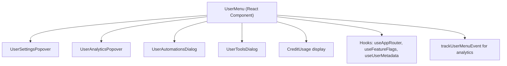
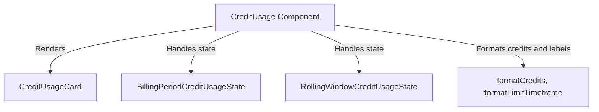
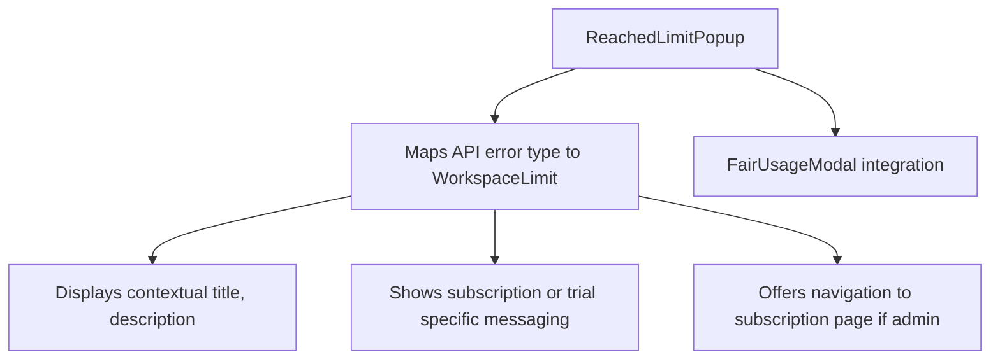
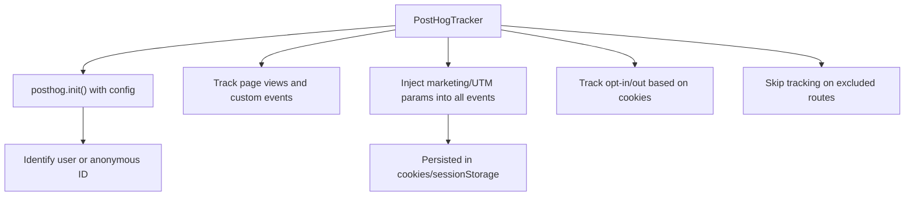
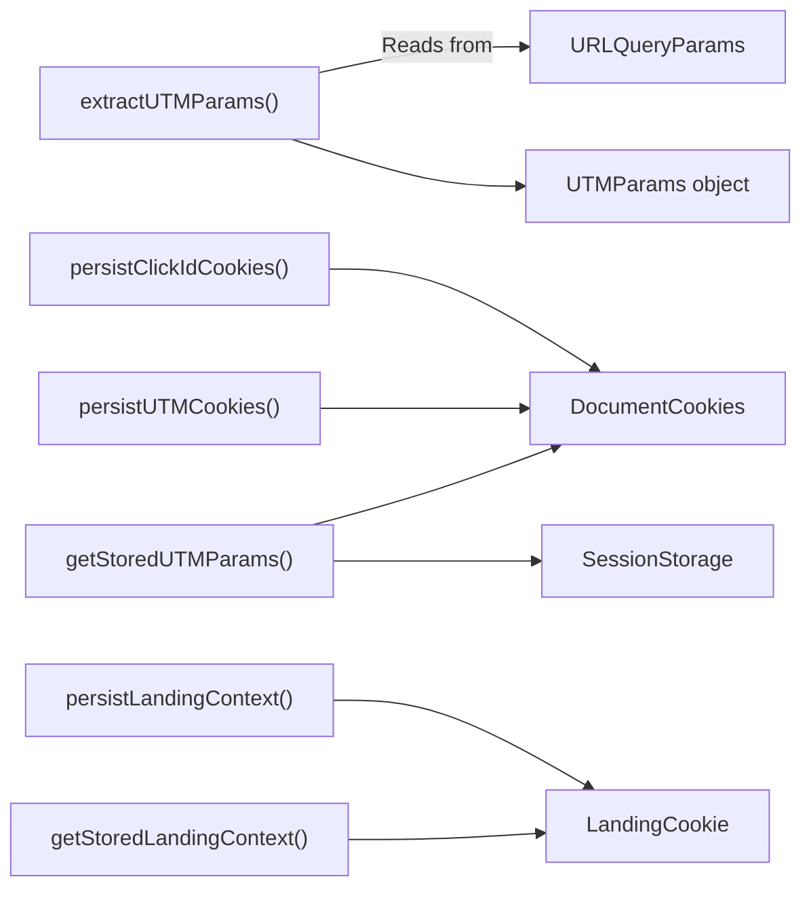
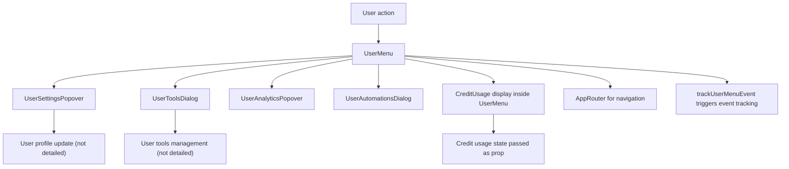
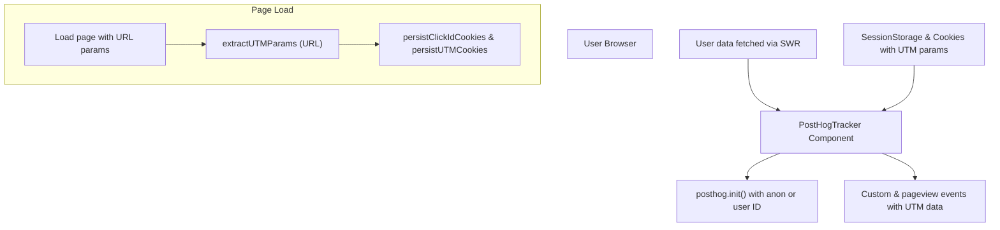

<!-- source: DeepWiki mcp.deepwiki.com · repo dust-tt/dust · page 17.2 User Settings and Analytics Tracking · fetched 2026-10-27 -->

# User Settings and Analytics Tracking

Relevant source files

The following files were used as context for generating this wiki page:

- [front-api/routes/poke/workspaces/[wId]/analytics/consumption/index.ts](front-api/routes/poke/workspaces/[wId]/analytics/consumption/index.ts)
- [front-api/routes/poke/workspaces/[wId]/analytics/consumption/top-reasoning-efforts.ts](front-api/routes/poke/workspaces/[wId]/analytics/consumption/top-reasoning-efforts.ts)
- [front-api/routes/poke/workspaces/[wId]/analytics/consumption/top.ts](front-api/routes/poke/workspaces/[wId]/analytics/consumption/top.ts)
- [front-api/routes/w/[wId]/analytics/consumption/top-reasoning-efforts.ts](front-api/routes/w/[wId]/analytics/consumption/top-reasoning-efforts.ts)
- [front-api/routes/w/[wId]/extension/config.test.ts](front-api/routes/w/[wId]/extension/config.test.ts)
- [front-api/routes/w/[wId]/extension/config.ts](front-api/routes/w/[wId]/extension/config.ts)
- [front-api/routes/w/[wId]/me/slack-notifications.ts](front-api/routes/w/[wId]/me/slack-notifications.ts)
- [front-api/routes/w/[wId]/subscriptions/checkout-status.ts](front-api/routes/w/[wId]/subscriptions/checkout-status.ts)
- [front/components/UserMenu.tsx](front/components/UserMenu.tsx)
- [front/components/app/CreditUsage.test.tsx](front/components/app/CreditUsage.test.tsx)
- [front/components/app/CreditUsage.tsx](front/components/app/CreditUsage.tsx)
- [front/components/app/CreditUsageCard.tsx](front/components/app/CreditUsageCard.tsx)
- [front/components/app/PostHogTracker.tsx](front/components/app/PostHogTracker.tsx)
- [front/components/app/ReachedLimitPopup.tsx](front/components/app/ReachedLimitPopup.tsx)
- [front/components/app/RootLayout.tsx](front/components/app/RootLayout.tsx)
- [front/components/credits/PersonalUsageCard.tsx](front/components/credits/PersonalUsageCard.tsx)
- [front/components/navigation/SidebarUserMenu.tsx](front/components/navigation/SidebarUserMenu.tsx)
- [front/components/workspace/analytics/consumption/ConsumptionAttributionBreakdown.test.tsx](front/components/workspace/analytics/consumption/ConsumptionAttributionBreakdown.test.tsx)
- [front/hooks/conversations/useCancelMessage.ts](front/hooks/conversations/useCancelMessage.ts)
- [front/hooks/useConsumptionTop.test.ts](front/hooks/useConsumptionTop.test.ts)
- [front/hooks/useServerPageView.ts](front/hooks/useServerPageView.ts)
- [front/hooks/useStripUtmParams.ts](front/hooks/useStripUtmParams.ts)
- [front/lib/analytics/events.ts](front/lib/analytics/events.ts)
- [front/lib/api/assistant/rate_limits.test.ts](front/lib/api/assistant/rate_limits.test.ts)
- [front/lib/api/assistant/rate_limits.ts](front/lib/api/assistant/rate_limits.ts)
- [front/lib/api/credits/usage_status.test.ts](front/lib/api/credits/usage_status.test.ts)
- [front/lib/api/credits/usage_status.ts](front/lib/api/credits/usage_status.ts)
- [front/lib/api/signup.test.ts](front/lib/api/signup.test.ts)
- [front/lib/api/signup.ts](front/lib/api/signup.ts)
- [front/lib/client/credits.test.ts](front/lib/client/credits.test.ts)
- [front/lib/client/credits.ts](front/lib/client/credits.ts)
- [front/lib/development.ts](front/lib/development.ts)
- [front/lib/iam/workspaces.ts](front/lib/iam/workspaces.ts)
- [front/lib/invitations.ts](front/lib/invitations.ts)
- [front/lib/plans/pro_plans.test.ts](front/lib/plans/pro_plans.test.ts)
- [front/lib/tracking/posthog/server.ts](front/lib/tracking/posthog/server.ts)
- [front/lib/utils/anonymous_id.ts](front/lib/utils/anonymous_id.ts)
- [front/lib/utils/rate_limiter.test.ts](front/lib/utils/rate_limiter.test.ts)
- [front/lib/utils/rate_limiter.ts](front/lib/utils/rate_limiter.ts)
- [front/lib/utils/utm.ts](front/lib/utils/utm.ts)
- [front/types/api/credits/usage_status.ts](front/types/api/credits/usage_status.ts)
- [front/types/extension.test.ts](front/types/extension.test.ts)
- [front/types/extension.ts](front/types/extension.ts)
- [front/types/shared/utils/date_utils.ts](front/types/shared/utils/date_utils.ts)

This page documents the user settings interface components, credit usage display, rate limit UI, and the analytics tracking mechanisms integrated into the Dust platform frontend. It also covers the handling of UTM parameters for marketing attribution and the integration of Datadog logger for frontend monitoring. The content includes detailed explanations of key React components such as `UserSettingsPopover` and `UserMenu`, the credit usage display via `CreditUsage`, rate limiting UI through `ReachedLimitPopup`, PostHog event tracking flows, UTM parameter management, and Datadog logs setup.

---

## 1. User Settings UI Components

### 1.1 UserSettingsPopover

- The `UserSettingsPopover` component presents a UI dialog for the user's account and workspace settings.
- It is integrated as a modal popover triggered from the user menu.
- It allows users to view and adjust personal preferences and workspace configurations.
- Internally, the popover manages open/close state and contains various settings form controls (not detailed in the included files but indicated in usage).

### 1.2 UserMenu

- The `UserMenu` component provides a dropdown menu for user actions including access to settings, analytics, automations, and tools dialogs.
- Props:
  - `user`: The current user's information.
  - `owner`: The current active workspace.
  - `subscription`: Optional subscription info for the workspace.
  - `creditUsageState`: Optional credit usage data.
- State management includes multiple booleans to track open modals (settings, tools, automations, analytics).
- Uses React hooks:
  - `useAppRouter()` for navigation routes.
  - `useFeatureFlags()` for feature-flags gating.
  - `useUserMetadata()` to optionally show extension-related menu items.
  - Custom hooks like `useSendNotification()`, `useDevMode()`, `usePrivacyMask()`, and conversation draft management.
- Event tracking is annotated for user menu actions using a helper `trackUserMenuEvent()`, which wraps the common tracking function to report navigation clicks with specific menu item context.
- The component includes an assistant ask-help functionality that directs to a global "HELPER" agent as a conversational helper.
- The user menu renders various menu items conditionally (like extension menu for Firefox users) and handles navigation or modal toggling on clicks.

Sources: `front/components/UserMenu.tsx:1-198`()

---

## 2. Credit Usage Display

### 2.1 CreditUsage Component

- Displays user's credit consumption and reset info.
- Supports two states:
  - `"billing_period"`: Shows percentage used, reset in days, and usage target levels (`on_target`, `elevated`, `critical`).
  - `"rolling_window"`: Shows credits consumed in the current rolling window with limits and timeframe label.
- Variants:
  - `profile_menu`: Compact display intended for profile dropdown.
  - `companion`: Relative contextual usage display with status messages.
- Provides a "See your usage" button for further exploration.
- Includes logic to format credits (using localized strings and decimals), reset countdown messages, and tone styling (highlight/warning/critical).

### 2.2 CreditUsageCard

- The actual UI card rendering component receiving props for label ("Credits"), usage percentage, tone, variant, and content.
- Used by `CreditUsage` to present usage with progress bar visuals and text.

Sources: `front/components/app/CreditUsage.tsx:1-105`(), `front/components/app/CreditUsage.test.tsx:1-102`()

---

## 3. Rate Limiting UI for Message and Credit Limits

### 3.1 ReachedLimitPopup

- A modal dialog that surfaces workspace usage limits or credit exhaustion states encountered by users.
- It accepts a `WorkspaceLimit` code which can map to different underlying API error types (e.g., message limits exceeded, credits exhausted, no available seats).
- Provides specific user-facing messages depending on the limit type and subscription state (e.g., trialing users get trial-specific messaging).
- Actions may redirect users to the subscription/plan management page when applicable (for admins).
- Incorporates a "FairUsageModal" component to explain fair usage policies.
- Uses Sparkle UI dialog primitives for layout and accessibility.

Sources: `front/components/app/ReachedLimitPopup.tsx:1-200`()

---

## 4. PostHog Analytics Tracking

### 4.1 PostHogTracker Component

- Provides the integration of the PostHog analytics client for event tracking.
- Uses the `PostHogProvider` context from `posthog-js/react` to wrap the app components, maintaining the PostHog client globally.
- The inner component `PostHogTrackerInner` controls:
  - Initialization of the PostHog client on first render (only once per app load).
  - Handling of user identification based on authenticated user info or an anonymous ID from cookies.
  - Opt-in/out logic for tracking depending on cookie consent or authentication status.
  - Page view and workspace events tracking, with workspace grouping for admins.
  - Enriched event sending with marketing parameters and UTM tags injected from session storage and cookies.
  - Excludes sensitive or unwanted routes from auto-tracking.
  - Prevents IP address capturing as per privacy compliance.
- Uses environment variable `NEXT_PUBLIC_POSTHOG_KEY`.

### 4.2 UTM Parameter Handling with PostHog

- PostHog events include UTM parameters from the marketing tracking context to correlate user acquisition channels.
- UTM parameters and click IDs are persisted in first-party cookies or session storage for later inclusion in events.
- Provides utilities for extracting UTM params from URL and cookies, persisting click IDs as cookies, and persisting landing context for attribution.
- The functions `persistClickIdCookies()`, `persistUTMCookies()`, and `persistLandingContext()` set cookies and session storage with expiration for tracking marketing attribution across sessions and redirects.

### 4.3 UTM Utils Diagram

Sources:  
- `front/components/app/PostHogTracker.tsx:1-100` (truncated large file but core tracking logic)  
- `front/lib/utils/utm.ts:1-250`()

---

## 5. Datadog Logger Integration

- The frontend uses `datadogLogs` from the `@datadog/browser-logs` package.
- Imported and utilized in `UserMenu` to log errors and warnings for client-side issues, including usage data and feature state.
- Provides real-time observability for frontend runtime errors and user interaction telemetry.
- Used internally within event handling logic and error reporting in UI components.
- The integration is visible in `front/components/UserMenu.tsx` where the imported `datadogLogs` instance logs specific states and errors.

Sources:  
`front/components/UserMenu.tsx:45-45`(), `front/components/UserMenu.tsx:104-198`()

---

## 6. Data Flow and Component Interactions

### 6.1 User Menu and Settings Flow

### 6.2 Analytics and UTM Tracking Workflow

Sources: Combined from above components and utils.

---

## Summary

| Area                          | Key Components / Modules                      | Description                                                  |
|-------------------------------|----------------------------------------------|--------------------------------------------------------------|
| User Settings UI               | `UserMenu`, `UserSettingsPopover`            | Popover and menus for user and workspace settings.           |
| Credit Usage Display           | `CreditUsage`, `CreditUsageCard`              | Visualizes credit consumption and reset timeline.            |
| Rate Limiting UI               | `ReachedLimitPopup`                            | Popup dialogs for message or credit usage limits.            |
| Analytics Tracking (PostHog)  | `PostHogTracker` & `PostHogTrackerInner`     | Controls PostHog client lifecycle, user/workspace identity, and event injection with UTM data. |
| UTM Parameter Handling         | `extractUTMParams`, `persistClickIdCookies`, `persistUTMCookies`, `persistLandingContext` | Utilities managing marketing attribution UTM tags and click IDs across sessions/cookies. |
| Datadog Logger Integration     | `datadogLogs` imported in key components     | Frontend error and event logging to Datadog.                  |

---

## Appendix: Key Functions and Types

| Symbol                                    | Description                                                              | Location (File:Lines)                |
|-------------------------------------------|--------------------------------------------------------------------------|------------------------------------|
| `UserMenu`                                | Main user menu dropdown component with dialogs and credit display        | `front/components/UserMenu.tsx:104-198` |
| `trackUserMenuEvent`                      | Helper for tracking clicks on user menu items                            | `front/components/UserMenu.tsx:92-102` |
| `CreditUsage`                             | Displays current credit consumption, usage percentage, and reset         | `front/components/app/CreditUsage.tsx:52-104` |
| `ReachedLimitPopup`                       | Dialog UI to show workspace usage or message limits                      | `front/components/app/ReachedLimitPopup.tsx:1-200` |
| `PostHogTracker`                         | React component setting up PostHog tracking context                      | `front/components/app/PostHogTracker.tsx:44-147` |
| `persistClickIdCookies`                   | Stores click IDs like `gclid` as cookies for attribution                 | `front/lib/utils/utm.ts:68-86`      |
| `persistUTMCookies`                       | Persists UTM marketing cookies                                          | `front/lib/utils/utm.ts:105-121`    |
| `persistLandingContext`                   | Stores landing page context in cookie                                   | `front/lib/utils/utm.ts:195-230`    |
| `datadogLogs`                            | Datadog's browser logs interface for frontend error telemetry           | `front/components/UserMenu.tsx:45` |

---

This page documents the links between user interface settings, credit usage display, rate limiting feedback, and the incorporation of user and workspace telemetry events via PostHog enhanced with marketing attribution support. It also highlights how the system collects and persists UTM and click ID parameters for accurate analytics attribution, ensuring compliance and feature gating through cookie consent. Additionally, the frontend monitoring integration using Datadog allows real-time error tracking and insights across these user-facing features.

Sources:  
- `front/components/UserMenu.tsx:1-198`  
- `front/components/app/CreditUsage.tsx:1-105`  
- `front/components/app/ReachedLimitPopup.tsx:1-200`  
- `front/components/app/PostHogTracker.tsx:1-147` (partial)  
- `front/lib/utils/utm.ts:1-250`  
- `front/components/app/CreditUsage.test.tsx:1-102`  
- `front/lib/utils/rate_limiter.ts:1-136` (for rate limiting concepts)

---

