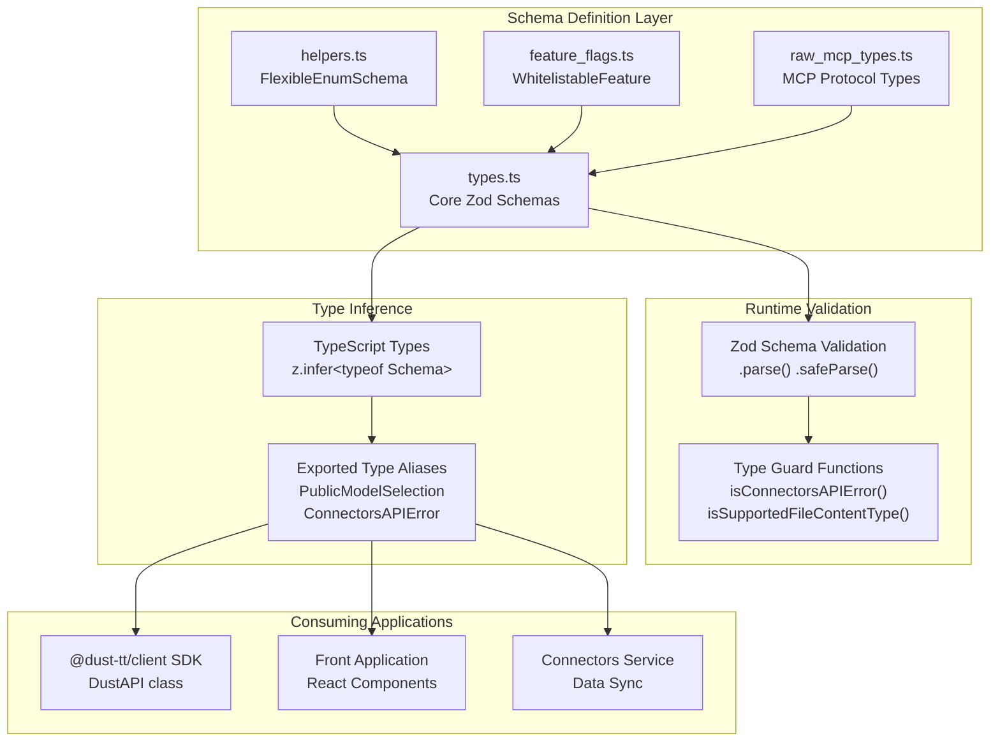
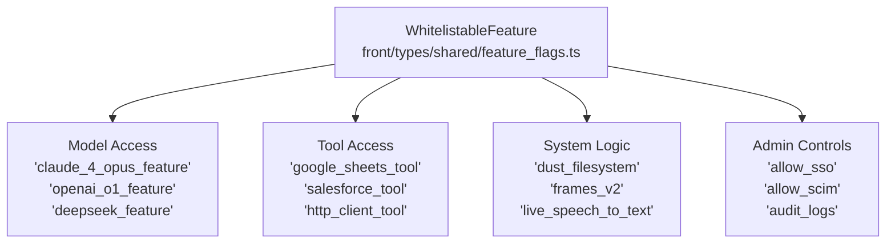

<!-- source: DeepWiki mcp.deepwiki.com · repo dust-tt/dust · page 2.1 Core Types and Schemas · fetched 2026-10-27 -->

# Core Types and Schemas

<details>
<summary>Relevant source files</summary>

The following files were used as context for generating this wiki page:

- [extension/ui/components/auth/AuthProvider.tsx](extension/ui/components/auth/AuthProvider.tsx)
- [front-api/routes/poke/plans.ts](front-api/routes/poke/plans.ts)
- [front/components/poke/plans/form.tsx](front/components/poke/plans/form.tsx)
- [front/lib/actions/data_source_file_system_read_targets.ts](front/lib/actions/data_source_file_system_read_targets.ts)
- [front/lib/actions/mcp_internal_actions/__snapshots__/mcp_servers_metadata.test.ts.snap](front/lib/actions/mcp_internal_actions/__snapshots__/mcp_servers_metadata.test.ts.snap)
- [front/lib/actions/mcp_internal_actions/constants.test.ts](front/lib/actions/mcp_internal_actions/constants.test.ts)
- [front/lib/actions/mcp_internal_actions/constants.ts](front/lib/actions/mcp_internal_actions/constants.ts)
- [front/lib/actions/mcp_internal_actions/internal_mcp_server_availability.snapshot.json](front/lib/actions/mcp_internal_actions/internal_mcp_server_availability.snapshot.json)
- [front/lib/actions/mcp_internal_actions/servers/index.ts](front/lib/actions/mcp_internal_actions/servers/index.ts)
- [front/lib/actions/tool_display_labels.test.ts](front/lib/actions/tool_display_labels.test.ts)
- [front/lib/actions/tool_display_labels.ts](front/lib/actions/tool_display_labels.ts)
- [front/lib/api/actions/servers/bm25_tool_search.test.ts](front/lib/api/actions/servers/bm25_tool_search.test.ts)
- [front/lib/api/actions/servers/bm25_tool_search_utils.test.ts](front/lib/api/actions/servers/bm25_tool_search_utils.test.ts)
- [front/lib/api/actions/servers/shopify/client.test.ts](front/lib/api/actions/servers/shopify/client.test.ts)
- [front/lib/api/actions/servers/shopify/client.ts](front/lib/api/actions/servers/shopify/client.ts)
- [front/lib/api/actions/servers/shopify/helpers.ts](front/lib/api/actions/servers/shopify/helpers.ts)
- [front/lib/api/actions/servers/shopify/metadata.test.ts](front/lib/api/actions/servers/shopify/metadata.test.ts)
- [front/lib/api/actions/servers/shopify/metadata.ts](front/lib/api/actions/servers/shopify/metadata.ts)
- [front/lib/api/actions/servers/shopify/rendering.ts](front/lib/api/actions/servers/shopify/rendering.ts)
- [front/lib/api/actions/servers/shopify/tools/index.ts](front/lib/api/actions/servers/shopify/tools/index.ts)
- [front/lib/api/actions/servers/shopify/types.ts](front/lib/api/actions/servers/shopify/types.ts)
- [front/lib/api/marketing/integrations.ts](front/lib/api/marketing/integrations.ts)
- [front/lib/assistant.test.ts](front/lib/assistant.test.ts)
- [front/lib/assistant.ts](front/lib/assistant.ts)
- [front/lib/models/plan.ts](front/lib/models/plan.ts)
- [front/lib/plans/free_plans.ts](front/lib/plans/free_plans.ts)
- [front/lib/plans/plan_codes.ts](front/lib/plans/plan_codes.ts)
- [front/lib/plans/pro_plans.ts](front/lib/plans/pro_plans.ts)
- [front/lib/plans/renderers.ts](front/lib/plans/renderers.ts)
- [front/lib/resources/storage/models/workspace.ts](front/lib/resources/storage/models/workspace.ts)
- [front/scripts/fetch-custom-models.ts](front/scripts/fetch-custom-models.ts)
- [front/scripts/seed/byok/seed.ts](front/scripts/seed/byok/seed.ts)
- [front/temporal/agent_loop/lib/run_model.test.ts](front/temporal/agent_loop/lib/run_model.test.ts)
- [front/temporal/agent_loop/lib/run_model.ts](front/temporal/agent_loop/lib/run_model.ts)
- [front/types/assistant/models/anthropic.ts](front/types/assistant/models/anthropic.ts)
- [front/types/assistant/models/custom_models.generated.ts](front/types/assistant/models/custom_models.generated.ts)
- [front/types/assistant/models/types.ts](front/types/assistant/models/types.ts)
- [front/types/plan.ts](front/types/plan.ts)
- [front/types/shared/feature_flags.ts](front/types/shared/feature_flags.ts)
- [sdks/js/src/types.ts](sdks/js/src/types.ts)

</details>


This document describes the core type system built using Zod schemas in `@dust-tt/client` and shared across the Dust monorepo. The type system provides runtime validation and TypeScript type inference for all data structures exchanged between the SDK, frontend, backend services, and external integrations.

Related pages: [DustAPI Client](#2.2) for SDK client interface, [MCP Transport Protocol](#2.3) for transport details.

## Overview and Architecture

The type system is centralized in `sdks/js/src/types.ts` with supporting files for specialized domains. Key components:

| File | Purpose | Key Exports |
|------|---------|-------------|
| `types.ts` | Core domain types | `PublicModelSelectionSchema`, `UserMessageOrigin`, `SupportedFileContentType` |
| `feature_flags.ts` | Feature gating | `WHITELISTABLE_FEATURES_CONFIG`, `WhitelistableFeature` |
| `raw_mcp_types.ts` | MCP protocol types | `CallToolResultSchema`, `ContentBlockSchema` |
| `helpers.ts` | Schema utilities | `FlexibleEnumSchema` for extensible enums |
| `models/types.ts` | LLM configurations | `ModelConfigurationSchema`, `ModelSelectionSchema` |

The schemas are distributed in the `@dust-tt/client` npm package and consumed by frontend, extension, and connectors services.

**Sources**: [sdks/js/src/types.ts:1-30](), [front/types/shared/feature_flags.ts:1-20](), [sdks/js/src/raw_mcp_types.ts:1-15]()

## Core Type System Architecture



**Sources**: [sdks/js/src/types.ts:1-170](), [front/types/shared/feature_flags.ts:1-100](), [sdks/js/src/helpers.ts:1-10]()

## FlexibleEnumSchema Pattern

The `FlexibleEnumSchema` utility [sdks/js/src/helpers.ts]() creates Zod schemas that accept known values (with autocomplete) while allowing unknown string values for extensibility. This is critical for model IDs where new models are added frequently without requiring SDK updates.

```typescript
// Example usage in sdks/js/src/types.ts
const ModelProviderIdSchema = FlexibleEnumSchema<
  | "openai" | "anthropic" | "mistral" | "google_ai_studio"
  | "deepseek" | "fireworks" | "xai" | "noop"
>();
```

**Sources**: [sdks/js/src/types.ts:17-29](), [sdks/js/src/helpers.ts:1-5]()

## Model Provider and LLM IDs

### Model Provider ID Schema
`ModelProviderIdSchema` defines the supported LLM providers [sdks/js/src/types.ts:17-29]().

### Model LLM ID Schema
`ModelLLMIdSchema` supports a wide array of specific models, including `gpt-4o`, `claude-3-7-sonnet-20250219`, `gemini-2.5-pro`, and `grok-3-latest` [sdks/js/src/types.ts:31-117]().

### Public Model Selection
The `PublicModelSelectionSchema` [sdks/js/src/types.ts:136-140]() allows per-message model overrides. When provided, the agent runs the selected model instead of its default configuration.

| Field | Type | Description |
|-------|------|-------------|
| `providerId` | `ModelProviderIdSchema` | The LLM provider (e.g., "anthropic") |
| `modelId` | `ModelLLMIdSchema` | The specific model ID |
| `reasoningEffort` | `ReasoningEffortSchema` | Optional: "none", "light", "medium", "high" |

**Sources**: [sdks/js/src/types.ts:31-117](), [sdks/js/src/types.ts:136-140](), [sdks/js/src/types.ts:127-129]()

## Feature Flags System

Feature flags gate access to specific models, tools, and UI capabilities. The source of truth is `WHITELISTABLE_FEATURES_CONFIG` [front/types/shared/feature_flags.ts:1-268]().

### WhitelistableFeature Categories



Each flag is associated with a `stage` (`dust_only`, `self_serve`, `ask_owner`) and an `owner` [front/types/shared/feature_flags.ts:1-268]().

**Sources**: [front/types/shared/feature_flags.ts:1-268](), [front/lib/assistant.ts:20-62]()

## Content and File Type Schemas

### Supported File Content Types
Dust supports a wide range of file formats for conversation attachments and knowledge base indexing. These are categorized into plain text, images, and audio.

**Supported Document Formats (Plain Text Fragment)**
`supportedOtherFileFormats` [sdks/js/src/types.ts:195-223]() defines types that can be sent as file-less content fragments, including:
- **PDF**: `application/pdf`
- **Microsoft Office**: `.doc`, `.docx`, `.ppt`, `.pptx`, `.xls`, `.xlsx`
- **Structured Data**: `text/csv`, `text/tsv`, `application/json`
- **Markup**: `text/markdown`, `text/html`

**Sources**: [sdks/js/src/types.ts:195-223](), [sdks/js/src/types.ts:261-281]()

### User Message Origin
`UserMessageOrigin` [sdks/js/src/types.ts:109-128]() tracks where a message was initiated. This is used to block certain tools (like `ask_user_question`) in programmatic contexts.

**Blocked Origins for User Questions**:
`ASK_USER_QUESTION_BLOCKED_ORIGINS` includes `api`, `slack_workflow`, `zapier`, `n8n`, and `transcript` [front/temporal/agent_loop/lib/run_model.ts:109-128]().

**Sources**: [front/temporal/agent_loop/lib/run_model.ts:109-128](), [sdks/js/src/types.ts:109-128]()

## MCP (Model Context Protocol) Type Definitions

### MCP Internal Servers
Internal MCP servers are registered in a central constant, defining their availability and tool stake levels.

| Server Name | Availability | Stake Level (Example) |
|-------------|--------------|-----------------------|
| `google_drive` | `manual` | `list_files`: `never_ask` |
| `slack` | `manual` | `post_message`: `low` |
| `sandbox` | `auto` | `exec`: `never_ask` |
| `search` | `auto` | `search`: `never_ask` |

**Sources**: [front/lib/actions/mcp_internal_actions/constants.ts:217-892](), [front/lib/actions/mcp_internal_actions/servers/index.ts:1-87]()

### Tool Discovery and BM25
Tools are discovered via a BM25 ranking system that matches user queries against tool descriptions. The `rank` function uses indices built from tool metadata [front/lib/api/actions/servers/bm25_tool_search.test.ts:1-20]().

**Sources**: [front/lib/api/actions/servers/bm25_tool_search.test.ts:1-20](), [front/lib/actions/tool_display_labels.ts:1-10]()

## Error Handling Schemas

### Connectors API Error Schema
`ConnectorsAPIErrorSchema` [sdks/js/src/types.ts:169-172]() standardizes errors returned by the connectors service.

**Common Error Types**:
- `authorization_error`: Credential issues.
- `connector_rate_limit_error`: External API throttling.
- `slack_channel_not_found`: Specific integration failures.

**Sources**: [sdks/js/src/types.ts:146-172](), [sdks/js/src/types.ts:182-192]()

## Model Availability Logic

The `isModelAvailable` function [front/lib/assistant.ts:65-97]() determines if a workspace can use a specific model based on:
1. **Plan Tier**: Large models require an upgraded plan [front/lib/assistant.ts:33-35]().
2. **Feature Flags**: Some models (like DeepSeek or Grok) require specific flags [front/lib/assistant.ts:50-52]().
3. **Region**: Regional availability constraints [front/lib/assistant.ts:92-94]().

**Sources**: [front/lib/assistant.ts:20-97](), [front/lib/assistant.test.ts:65-157](), [front/lib/plans/plan_codes.ts:158-164]()

---

