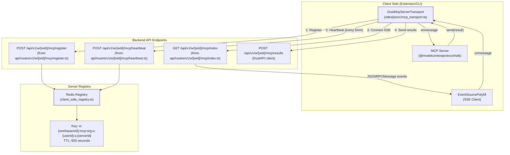
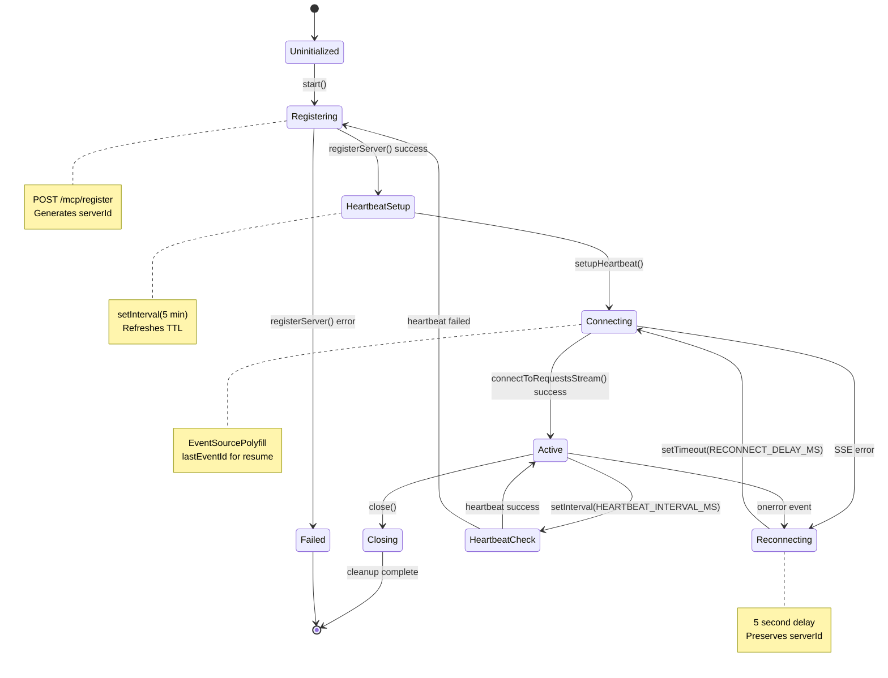
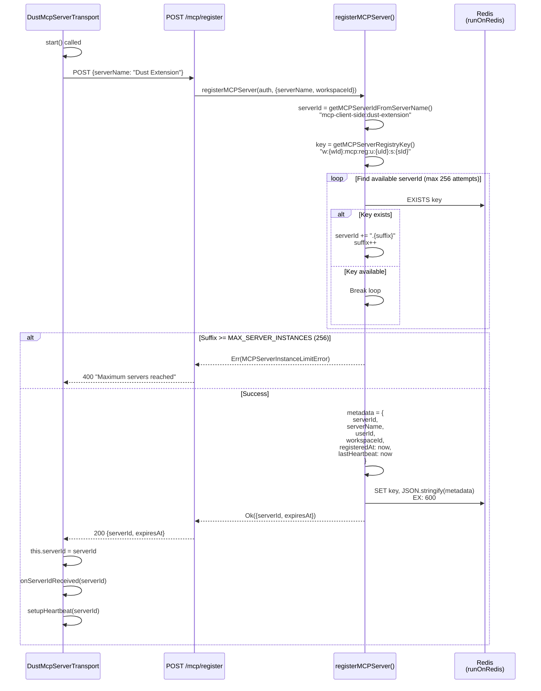
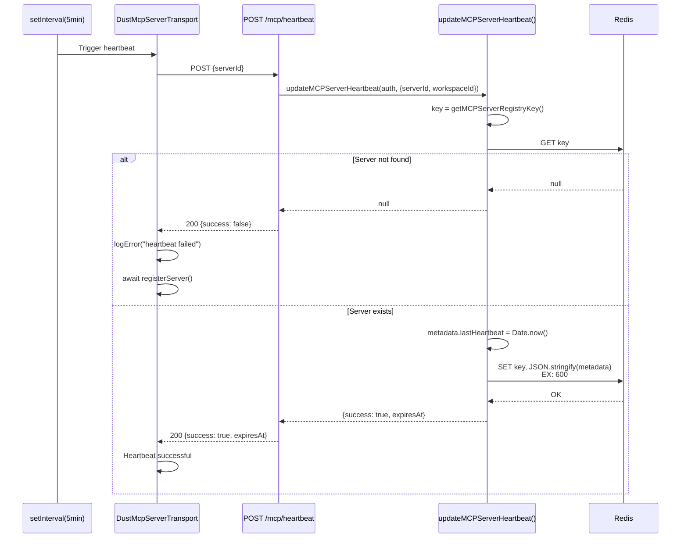
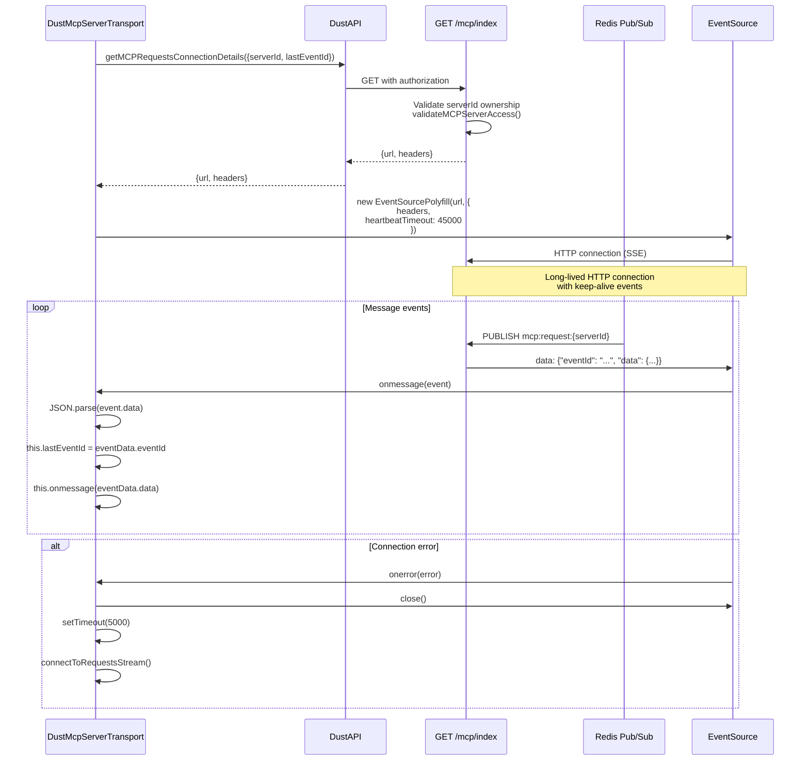
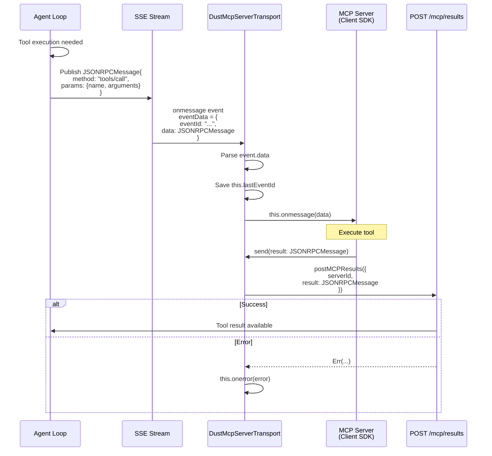

<!-- source: DeepWiki mcp.deepwiki.com · repo dust-tt/dust · page 2.3 MCP Transport Protocol · fetched 2026-10-27 -->

# MCP Transport Protocol

<details>
<summary>Relevant source files</summary>

The following files were used as context for generating this wiki page:

- [extension/platforms/chrome/background.ts](extension/platforms/chrome/background.ts)
- [extension/platforms/chrome/content-script.ts](extension/platforms/chrome/content-script.ts)
- [extension/platforms/chrome/main.tsx](extension/platforms/chrome/main.tsx)
- [extension/platforms/front/FrontApp.tsx](extension/platforms/front/FrontApp.tsx)
- [extension/platforms/front/main.tsx](extension/platforms/front/main.tsx)
- [extension/platforms/front/services/auth.ts](extension/platforms/front/services/auth.ts)
- [extension/shared/lib/ExtensionFetcherProvider.tsx](extension/shared/lib/ExtensionFetcherProvider.tsx)
- [extension/shared/lib/fetcher.ts](extension/shared/lib/fetcher.ts)
- [extension/shared/services/auth.ts](extension/shared/services/auth.ts)
- [extension/ui/components/auth/useAuth.ts](extension/ui/components/auth/useAuth.ts)
- [front-api/routes/v1/w/[wId]/mcp/deregister.ts](front-api/routes/v1/w/[wId]/mcp/deregister.ts)
- [front-api/routes/v1/w/[wId]/mcp/heartbeat.ts](front-api/routes/v1/w/[wId]/mcp/heartbeat.ts)
- [front-api/routes/v1/w/[wId]/mcp/index.ts](front-api/routes/v1/w/[wId]/mcp/index.ts)
- [front-api/routes/v1/w/[wId]/mcp/register.ts](front-api/routes/v1/w/[wId]/mcp/register.ts)
- [front-api/routes/w/[wId]/mcp/deregister.ts](front-api/routes/w/[wId]/mcp/deregister.ts)
- [front-api/routes/w/[wId]/mcp/heartbeat.ts](front-api/routes/w/[wId]/mcp/heartbeat.ts)
- [front-api/routes/w/[wId]/mcp/register.test.ts](front-api/routes/w/[wId]/mcp/register.test.ts)
- [front-api/routes/w/[wId]/mcp/register.ts](front-api/routes/w/[wId]/mcp/register.ts)
- [front/hooks/useDebounce.ts](front/hooks/useDebounce.ts)
- [front/hooks/useEventSource.ts](front/hooks/useEventSource.ts)
- [front/lib/actions/data_source_file_system_read_targets.ts](front/lib/actions/data_source_file_system_read_targets.ts)
- [front/lib/actions/mcp_internal_actions/__snapshots__/mcp_servers_metadata.test.ts.snap](front/lib/actions/mcp_internal_actions/__snapshots__/mcp_servers_metadata.test.ts.snap)
- [front/lib/actions/mcp_internal_actions/constants.test.ts](front/lib/actions/mcp_internal_actions/constants.test.ts)
- [front/lib/actions/mcp_internal_actions/constants.ts](front/lib/actions/mcp_internal_actions/constants.ts)
- [front/lib/actions/mcp_internal_actions/internal_mcp_server_availability.snapshot.json](front/lib/actions/mcp_internal_actions/internal_mcp_server_availability.snapshot.json)
- [front/lib/actions/mcp_internal_actions/servers/index.ts](front/lib/actions/mcp_internal_actions/servers/index.ts)
- [front/lib/actions/tool_display_labels.test.ts](front/lib/actions/tool_display_labels.test.ts)
- [front/lib/actions/tool_display_labels.ts](front/lib/actions/tool_display_labels.ts)
- [front/lib/api/actions/mcp/client_side_registry.test.ts](front/lib/api/actions/mcp/client_side_registry.test.ts)
- [front/lib/api/actions/mcp/client_side_registry.ts](front/lib/api/actions/mcp/client_side_registry.ts)
- [front/lib/api/actions/mcp_client_side.ts](front/lib/api/actions/mcp_client_side.ts)
- [front/lib/api/actions/servers/bm25_tool_search.test.ts](front/lib/api/actions/servers/bm25_tool_search.test.ts)
- [front/lib/api/actions/servers/bm25_tool_search_utils.test.ts](front/lib/api/actions/servers/bm25_tool_search_utils.test.ts)
- [front/lib/api/actions/servers/shopify/client.test.ts](front/lib/api/actions/servers/shopify/client.test.ts)
- [front/lib/api/actions/servers/shopify/client.ts](front/lib/api/actions/servers/shopify/client.ts)
- [front/lib/api/actions/servers/shopify/helpers.ts](front/lib/api/actions/servers/shopify/helpers.ts)
- [front/lib/api/actions/servers/shopify/metadata.test.ts](front/lib/api/actions/servers/shopify/metadata.test.ts)
- [front/lib/api/actions/servers/shopify/metadata.ts](front/lib/api/actions/servers/shopify/metadata.ts)
- [front/lib/api/actions/servers/shopify/rendering.ts](front/lib/api/actions/servers/shopify/rendering.ts)
- [front/lib/api/actions/servers/shopify/tools/index.ts](front/lib/api/actions/servers/shopify/tools/index.ts)
- [front/lib/api/actions/servers/shopify/types.ts](front/lib/api/actions/servers/shopify/types.ts)
- [front/lib/api/marketing/integrations.ts](front/lib/api/marketing/integrations.ts)
- [front/lib/client/BrowserMCPTransport.ts](front/lib/client/BrowserMCPTransport.ts)
- [front/lib/egress/client.ts](front/lib/egress/client.ts)
- [front/lib/swr/search.ts](front/lib/swr/search.ts)
- [front/lib/swr/useIsMobile.ts](front/lib/swr/useIsMobile.ts)
- [front/temporal/agent_loop/lib/run_model.test.ts](front/temporal/agent_loop/lib/run_model.test.ts)
- [front/temporal/agent_loop/lib/run_model.ts](front/temporal/agent_loop/lib/run_model.ts)
- [front/types/shared/feature_flags.ts](front/types/shared/feature_flags.ts)
- [sdks/js/src/mcp_transport.ts](sdks/js/src/mcp_transport.ts)
- [sdks/js/src/types.ts](sdks/js/src/types.ts)

</details>


## Purpose and Scope

This document describes the client-side MCP (Model Context Protocol) transport implementation that enables browser extensions and other client applications to register as MCP servers and communicate with the Dust backend. The transport uses Server-Sent Events (SSE) for receiving tool execution requests from Dust and HTTP POST for sending tool results back. For information about MCP server types and tool discovery, see [MCP Server Architecture](#4.1).

**Scope**: This page covers the transport protocol layer only - registration, heartbeat, SSE connection management, and request/response routing. It does not cover MCP tool semantics, authentication flows, or the broader MCP server configuration system.

---

## Architecture Overview

The client-side MCP transport architecture consists of three main components: a client-side transport implementation, Redis-based server registration, and bidirectional communication channels.

### System Components Diagram



**Sources**: [sdks/js/src/mcp_transport.ts:1-274](), [front/lib/api/actions/mcp/client_side_registry.ts:1-281]()

---

## Transport Lifecycle

The transport follows a strict lifecycle from registration through active operation to graceful shutdown.

### Lifecycle State Machine



**Sources**: [sdks/js/src/mcp_transport.ts:91-108](), [sdks/js/src/mcp_transport.ts:64-85](), [sdks/js/src/mcp_transport.ts:180-207]()

---

## Registration Flow

When a client starts, it must register with the Dust backend to obtain a unique `serverId`. The registration system supports multiple concurrent instances of the same server name by automatically appending numeric suffixes.

### Registration Sequence



**Sources**: [front/lib/api/actions/mcp/client_side_registry.ts:78-155](), [front-api/routes/v1/w/[wId]/mcp/register.ts:36-95](), [sdks/js/src/mcp_transport.ts:41-59]()

### Server ID Generation

The registration system ensures unique server IDs through a suffix mechanism:

| serverName | Generated serverId | Notes |
|------------|-------------------|-------|
| "Dust Extension" | `mcp-client-side:dust-extension` | First instance |
| "Dust Extension" | `mcp-client-side:dust-extension.1` | Second concurrent instance |
| "Dust Extension" | `mcp-client-side:dust-extension.2` | Third concurrent instance |

The `getBaseServerId()` function at [front/lib/api/actions/mcp/client_side_registry.ts:46-49]() safely removes numeric suffixes by matching the pattern `/\.\d+$/`.

**Sources**: [front/lib/api/actions/mcp/client_side_registry.ts:51-57](), [front/lib/api/actions/mcp/client_side_registry.ts:46-49]()

---

## Heartbeat Mechanism

After successful registration, the transport maintains server liveness through periodic heartbeat requests.

### Heartbeat Configuration

```typescript
// Constants from sdks/js/src/mcp_transport.ts:9-10
const HEARTBEAT_INTERVAL_MS = 5 * 60 * 1000; // 5 minutes
const MCP_SERVER_REGISTRATION_TTL_SECONDS = 10 * 60; // 10 minutes (backend)
```

The heartbeat interval (5 minutes) is deliberately shorter than the Redis TTL (10 minutes) to provide a 5-minute buffer against network delays or transient failures.

### Heartbeat Processing



**Sources**: [sdks/js/src/mcp_transport.ts:64-85](), [front/lib/api/actions/mcp/client_side_registry.ts:196-250](), [front-api/routes/v1/w/[wId]/mcp/heartbeat.ts:32-77]()

---

## Request/Response Flow

The core communication uses a bidirectional protocol: SSE for receiving requests, HTTP POST for sending responses.

### SSE Connection Establishment



**Sources**: [sdks/js/src/mcp_transport.ts:113-207](), [sdks/js/src/mcp_transport.ts:145-178]()

### Tool Execution Request/Response



**Sources**: [sdks/js/src/mcp_transport.ts:145-178](), [sdks/js/src/mcp_transport.ts:213-231]()

---

## Redis Schema and TTL Management

The registration system uses Redis as a lightweight, TTL-based registry for active MCP servers.

### Redis Key Structure

```
Pattern: w:{workspaceId}:mcp:reg:u:{userId}:s:{serverId}

Example: w:abc123:mcp:reg:u:456:s:mcp-client-side:dust-extension.1

Value (JSON): {
  "serverId": "mcp-client-side:dust-extension.1",
  "serverName": "Dust Extension",
  "userId": "456",
  "workspaceId": "abc123",
  "registeredAt": 1703001234567,
  "lastHeartbeat": 1703001234567
}

TTL: 600 seconds (10 minutes)
```

**Sources**: [front/lib/api/actions/mcp/client_side_registry.ts:26-36](), [front/lib/api/actions/mcp/client_side_registry.ts:62-69]()

### TTL Refresh Strategy

The 10-minute TTL is refreshed through three mechanisms:

| Mechanism | Trigger | Implementation |
|-----------|---------|----------------|
| **Registration** | Initial `registerMCPServer()` call | [front/lib/api/actions/mcp/client_side_registry.ts:142-144]() `SET key, value, {EX: 600}` |
| **Heartbeat** | Every 5 minutes via client timer | [front/lib/api/actions/mcp/client_side_registry.ts:230-232]() `SET key, value, {EX: 600}` |
| **Access validation** | Each SSE request | [front/lib/api/actions/mcp/client_side_registry.ts:278]() `EXPIRE key, 600` |

**Sources**: [front/lib/api/actions/mcp/client_side_registry.ts:7-10](), [front/lib/api/actions/mcp/client_side_registry.ts:256-281]()

---

## Error Handling and Reconnection

### Reconnection Logic

```typescript
// From sdks/js/src/mcp_transport.ts:180-196
this.eventSource.onerror = (error) => {
  this.eventSource?.close();
  this.logError("Error in MCP EventSource connection:", error);
  this.onerror?.(new Error(`SSE connection error: ${error}`));
  
  setTimeout(() => {
    if (this.eventSource) {
      this.logInfo("Attempting to reconnect to SSE...");
      void this.connectToRequestsStream().catch((reconnectError) => {
        this.logError("Failed to reconnect:", reconnectError);
      });
    }
  }, RECONNECT_DELAY_MS); // 5000ms
};
```

**Sources**: [sdks/js/src/mcp_transport.ts:10](), [sdks/js/src/mcp_transport.ts:180-196]()

### LastEventId Resume Mechanism

When reconnecting after an SSE error, the transport preserves `lastEventId` to resume from the last received event:

```typescript
// From sdks/js/src/mcp_transport.ts:145-158
this.eventSource.onmessage = (event) => {
  const eventData = JSON.parse(event.data);
  if (eventData.eventId) {
    this.lastEventId = eventData.eventId;
  }
};
```

**Sources**: [sdks/js/src/mcp_transport.ts:145-158](), [sdks/js/src/mcp_transport.ts:125-136]()

---

## Implementation Details

### Browser Extension Integration

The browser extension uses the `useAuth` hook to manage authentication tokens which are passed to the `DustAPI` client used by the `BrowserMCPTransport`.

```typescript
// From extension/ui/components/auth/useAuth.ts:37-45
setDefaultInitResolver(async (): Promise<RequestInit> => {
  const accessToken = await platform.auth.getAccessToken();
  return {
    credentials: "omit",
    headers: accessToken
      ? { Authorization: `Bearer ${accessToken}` }
      : {},
  };
});
```

**Sources**: [extension/ui/components/auth/useAuth.ts:35-55](), [extension/platforms/chrome/background.ts:122-206]()

### Transport Interface Compliance

The `DustMcpServerTransport` class implements the `Transport` interface from `@modelcontextprotocol/sdk`:

```typescript
// From sdks/js/src/mcp_transport.ts:18-29
export class DustMcpServerTransport implements Transport {
  public onmessage?: (message: JSONRPCMessage) => void;
  public onclose?: () => void;
  public onerror?: (error: Error) => void;
  
  async start(): Promise<void>
  async send(message: JSONRPCMessage): Promise<void>
  async close(): Promise<void>
}
```

**Sources**: [sdks/js/src/mcp_transport.ts:18-29]()

---

