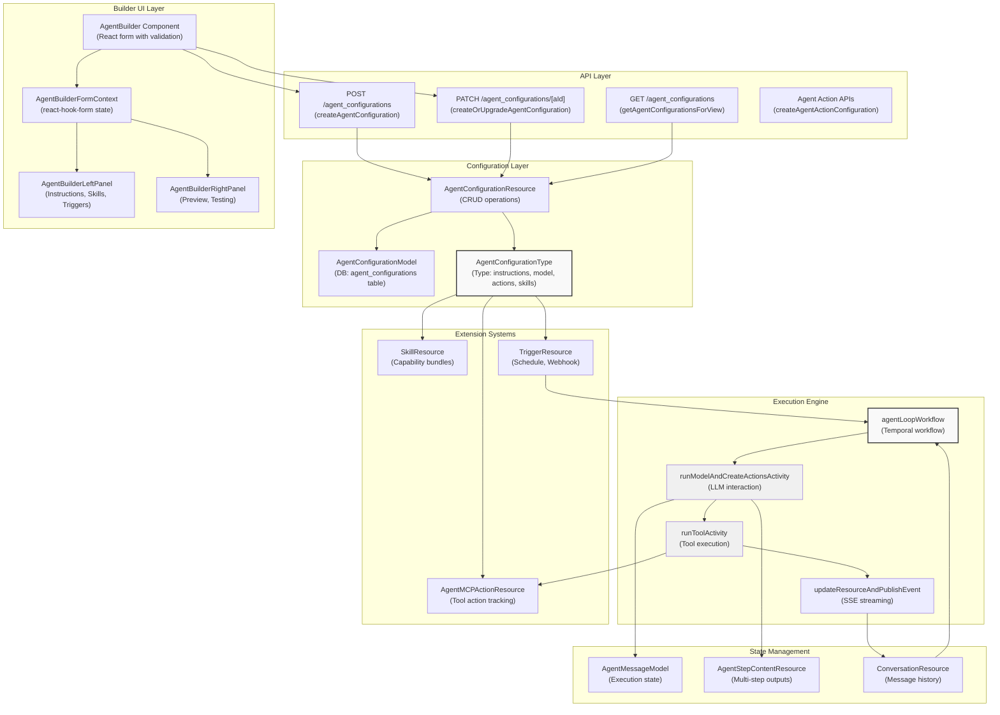
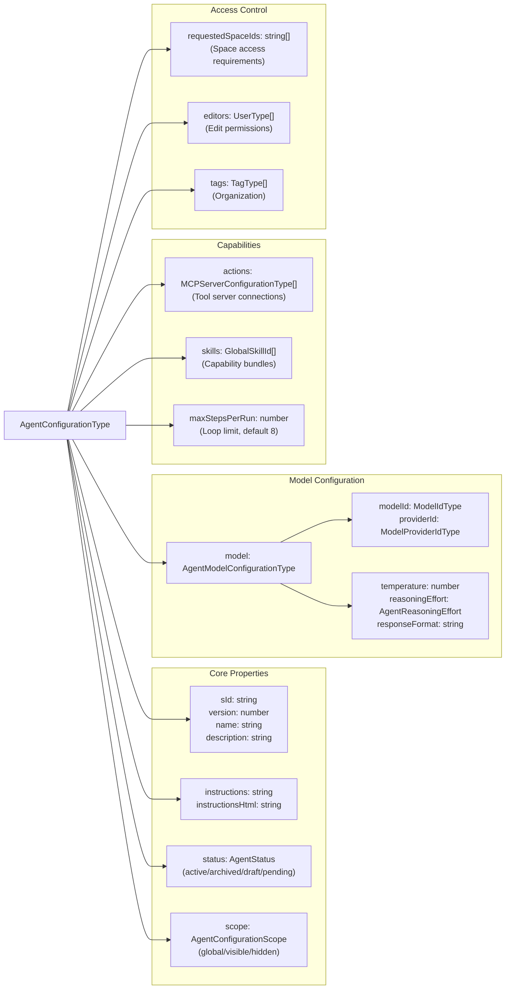
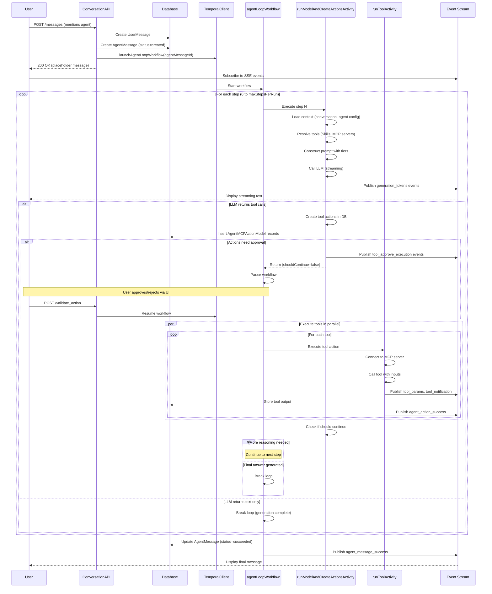

<!-- source: DeepWiki mcp.deepwiki.com · repo dust-tt/dust · page 3 Agent System · fetched 2026-10-27 -->

# Agent System

Relevant source files

The following files were used as context for generating this wiki page:

- [front-api/routes/poke/workspaces/[wId]/conversations/index.ts](front-api/routes/poke/workspaces/[wId]/conversations/index.ts)
- [front-api/routes/poke/workspaces/[wId]/spaces/[spaceId]/details.ts](front-api/routes/poke/workspaces/[wId]/spaces/[spaceId]/details.ts)
- [front-api/routes/w/[wId]/spaces/[spaceId]/leave.test.ts](front-api/routes/w/[wId]/spaces/[spaceId]/leave.test.ts)
- [front-api/routes/w/[wId]/spaces/[spaceId]/leave.ts](front-api/routes/w/[wId]/spaces/[spaceId]/leave.ts)
- [front/components/providers/model_configs.ts](front/components/providers/model_configs.ts)
- [front/lib/api/assistant/content_fragments.test.ts](front/lib/api/assistant/content_fragments.test.ts)
- [front/lib/api/assistant/conversation_rendering/helpers.test.ts](front/lib/api/assistant/conversation_rendering/helpers.test.ts)
- [front/lib/api/assistant/conversation_rendering/helpers.ts](front/lib/api/assistant/conversation_rendering/helpers.ts)
- [front/lib/api/assistant/conversation_rendering/message_rendering.test.ts](front/lib/api/assistant/conversation_rendering/message_rendering.test.ts)
- [front/lib/api/assistant/conversation_rendering/message_rendering.ts](front/lib/api/assistant/conversation_rendering/message_rendering.ts)
- [front/lib/api/assistant/generation.test.ts](front/lib/api/assistant/generation.test.ts)
- [front/lib/api/assistant/generation.ts](front/lib/api/assistant/generation.ts)
- [front/lib/api/assistant/global_agents/configurations/dust/deep-dive.ts](front/lib/api/assistant/global_agents/configurations/dust/deep-dive.ts)
- [front/lib/api/assistant/global_agents/configurations/dust/dust.ts](front/lib/api/assistant/global_agents/configurations/dust/dust.ts)
- [front/lib/api/assistant/global_agents/global_agent_metadata.ts](front/lib/api/assistant/global_agents/global_agent_metadata.ts)
- [front/lib/api/assistant/global_agents/global_agents.test.ts](front/lib/api/assistant/global_agents/global_agents.test.ts)
- [front/lib/api/assistant/global_agents/global_agents.ts](front/lib/api/assistant/global_agents/global_agents.ts)
- [front/lib/api/assistant/skills_rendering.test.ts](front/lib/api/assistant/skills_rendering.test.ts)
- [front/lib/api/assistant/skills_rendering.ts](front/lib/api/assistant/skills_rendering.ts)
- [front/lib/api/assistant/token_pricing/global.ts](front/lib/api/assistant/token_pricing/global.ts)
- [front/lib/auth.fromjson.test.ts](front/lib/auth.fromjson.test.ts)
- [front/lib/duration_recorder.ts](front/lib/duration_recorder.ts)
- [front/lib/resources/skill/code_defined/global/go_deep.test.ts](front/lib/resources/skill/code_defined/global/go_deep.test.ts)
- [front/lib/resources/skill/code_defined/global/go_deep.ts](front/lib/resources/skill/code_defined/global/go_deep.ts)
- [front/lib/utils/async_utils.ts](front/lib/utils/async_utils.ts)
- [front/temporal/agent_loop/activities/compaction.ts](front/temporal/agent_loop/activities/compaction.ts)
- [front/temporal/agent_loop/activities/cost_threshold_warnings.ts](front/temporal/agent_loop/activities/cost_threshold_warnings.ts)
- [front/temporal/agent_loop/activities/finalize_sandbox_child_tool.test.ts](front/temporal/agent_loop/activities/finalize_sandbox_child_tool.test.ts)
- [front/temporal/agent_loop/activities/finalize_sandbox_child_tool.ts](front/temporal/agent_loop/activities/finalize_sandbox_child_tool.ts)
- [front/temporal/agent_loop/activities/instrumentation.ts](front/temporal/agent_loop/activities/instrumentation.ts)
- [front/temporal/agent_loop/activities/run_model_and_create_actions_wrapper.ts](front/temporal/agent_loop/activities/run_model_and_create_actions_wrapper.ts)
- [front/temporal/agent_loop/client.ts](front/temporal/agent_loop/client.ts)
- [front/temporal/agent_loop/config.ts](front/temporal/agent_loop/config.ts)
- [front/temporal/agent_loop/lib/compaction.test.ts](front/temporal/agent_loop/lib/compaction.test.ts)
- [front/temporal/agent_loop/lib/compaction.ts](front/temporal/agent_loop/lib/compaction.ts)
- [front/temporal/agent_loop/lib/workflow_ids.ts](front/temporal/agent_loop/lib/workflow_ids.ts)
- [front/temporal/agent_loop/sinks.ts](front/temporal/agent_loop/sinks.ts)
- [front/temporal/agent_loop/worker.ts](front/temporal/agent_loop/worker.ts)
- [front/temporal/agent_loop/workflows.test.ts](front/temporal/agent_loop/workflows.test.ts)
- [front/temporal/agent_loop/workflows.ts](front/temporal/agent_loop/workflows.ts)
- [front/tests/utils/conversation_test_factories.ts](front/tests/utils/conversation_test_factories.ts)
- [front/types/assistant/assistant.ts](front/types/assistant/assistant.ts)
- [front/types/assistant/compaction.ts](front/types/assistant/compaction.ts)
- [front/types/assistant/models/models.ts](front/types/assistant/models/models.ts)
- [x/pr/branching.md](x/pr/branching.md)
- [x/spolu/compaction/compaction.md](x/spolu/compaction/compaction.md)
- [x/spolu/compaction/plan.md](x/spolu/compaction/plan.md)

The Agent System is the core orchestration layer of the Dust platform, responsible for managing the lifecycle, configuration, and execution of AI agents. This document covers the overall architecture, component interactions, and execution flow of agents. For specific subsystems, see [Agent Configuration and Management](#3.1), [Agent Builder Interface](#3.2), [Agent Execution and Temporal Workflows](#3.3), [Prompt Construction and LLM Integration](#3.4), [Skill System](#3.5), [Trigger System](#3.6), and [Global Agents](#3.7). For details on tool integration, see [MCP Tool System](#4).

## System Architecture

The agent system consists of five primary layers: configuration management, user interface, execution orchestration, skill and trigger extensions, and data persistence.

**Diagram: Agent System Component Architecture**

**Sources:** 
- [front/types/assistant/agent.ts:132-191]()
- [front/temporal/agent_loop/workflows.ts:186-257]()
- [front/temporal/agent_loop/activities/run_model_and_create_actions_wrapper.ts:69-106]()

## Agent Configuration

An agent configuration defines the agent's behavior, capabilities, and execution parameters. The configuration is versioned to support safe updates without disrupting running executions.

**Diagram: AgentConfigurationType Structure**

**Sources:**
- [front/types/assistant/agent.ts:132-191]()
- [front/types/assistant/agent.ts:116-123]()
- [front/types/assistant/agent.ts:42-57]()

### Agent Statuses

| Status | Description | Usage |
|--------|-------------|-------|
| `active` | Agent is available for use | Production agents |
| `archived` | Agent was deleted or superseded by newer version | Historical record |
| `draft` | Agent is being tested, not saved to database | Builder preview mode |
| `pending` | Agent stub created before first save | New agent creation |

**Sources:** [front/types/assistant/agent.ts:38-43]()

### Agent Scopes

| Scope | Description | Visibility | Editability |
|-------|-------------|------------|-------------|
| `global` | Dust-provided agents | All users | Read-only |
| `visible` | Published workspace agents | Workspace members | Editors only |
| `hidden` | Unpublished agents | Editors only | Editors only |

**Sources:** [front/types/assistant/agent.ts:46-55]()

## Agent Execution Flow

Agent execution is orchestrated through Temporal workflows, enabling durable, resumable execution with built-in retry logic and state management.

**Diagram: Agent Loop Execution Sequence**

**Sources:**
- [front/temporal/agent_loop/workflows.ts:186-257]()
- [front/temporal/agent_loop/activities/run_model_and_create_actions_wrapper.ts:69-106]()
- [front/temporal/agent_loop/worker.ts:99-164]()

### Step Execution and Multi-Step Reasoning

Each agent execution consists of multiple steps, allowing the agent to perform iterative reasoning and tool usage. The `MAX_STEPS_USE_PER_RUN_LIMIT` constant defines the upper bound for execution steps to prevent infinite loops.

**Sources:**
- [front/types/assistant/agent.ts:33]()
- [front/temporal/agent_loop/workflows.ts:33]()
- [front/temporal/agent_loop/activities/run_model_and_create_actions_wrapper.ts:28]()

### Conversation Compaction

To maintain performance and manage context window limits, the system uses a compaction mechanism. This process summarizes previous conversation history into a `
` block that provides the necessary context for the LLM to continue the conversation without processing every historical message.

**Sources:**
- [front/temporal/agent_loop/lib/compaction.ts:28-67]()
- [front/temporal/agent_loop/activities/compaction.ts]()

## Global Agents

Dust includes several pre-configured global agents with specialized behaviors and instructions. These are identified by the `GLOBAL_AGENTS_SID` enum.

| Agent ID | Name | Role |
|----------|------|------|
| `dust` | @dust | The primary workspace agent capable of searching internal data and the web. |
| `helper` | @help | Specialized in helping users navigate and use the Dust platform. |
| `deep-dive` | @deep-dive | Orchestrates complex research tasks by spawning sub-agents. |
| `analyst` | @analyst | Specialized in data analysis and visualization. |

**Sources:**
- [front/types/assistant/assistant.ts:42-149]()
- [front/lib/api/assistant/global_agents/configurations/dust/dust.ts:97-128]()
- [front/lib/api/assistant/global_agents/configurations/dust/deep-dive.ts:60-67]()
- [front/lib/api/assistant/global_agents/global_agents.ts:176-250]()

## Prompt Construction

The system constructs prompts by combining agent instructions, conversation history (or compaction summary), and platform-specific context. For model efficiency, sections are organized to maximize prompt caching effectiveness.

**Context Sections:**
- **# CONTEXT**: Basic metadata like current date, workspace name, and agent identity.
- **# BRANCH CONTEXT**: Details if the conversation was forked from another.
- **# PLATFORM-SPECIFIC CONTEXT**: Instructions for specific interfaces like the browser extension or Slack.
- **# TOOLS**: Tool use directives and specific tool instructions.

**Sources:**
- [front/lib/api/assistant/generation.ts:46-74]()
- [front/lib/api/assistant/generation.ts:80-104]()
- [front/lib/api/assistant/generation.ts:106-121]()
- [front/lib/api/assistant/generation.ts:123-160]()

## Infrastructure and Workers

Agent execution is distributed across specialized Temporal workers based on the nature of the task.

| Worker Queue | Purpose |
|--------------|---------|
| `INTERACTIVE_QUEUE_NAME` | Real-time user conversations requiring low latency. |
| `BATCH_QUEUE_NAME` | Large-scale background processing tasks. |
| `PROGRAMMATIC_QUEUE_NAME` | API-triggered agent executions. |
| `SCHEDULES_QUEUE_NAME` | Time-based triggers and automations. |

**Sources:**
- [front/temporal/agent_loop/worker.ts:57-83]()
- [front/temporal/agent_loop/config.ts:29-32]()

---

### Child Pages
- [Agent Configuration and Management](#3.1)
- [Agent Builder Interface](#3.2)
- [Agent Execution and Temporal Workflows](#3.3)
- [Prompt Construction and LLM Integration](#3.4)
- [Skill System](#3.5)
- [Trigger System](#3.6)
- [Global Agents](#3.7)

---

