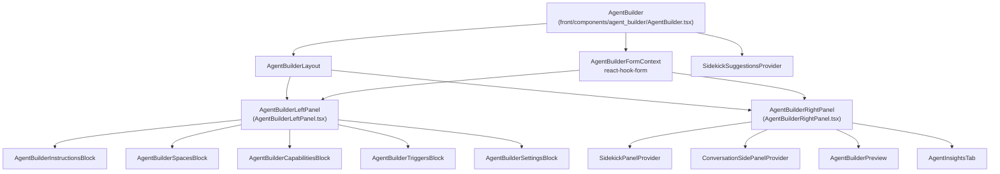
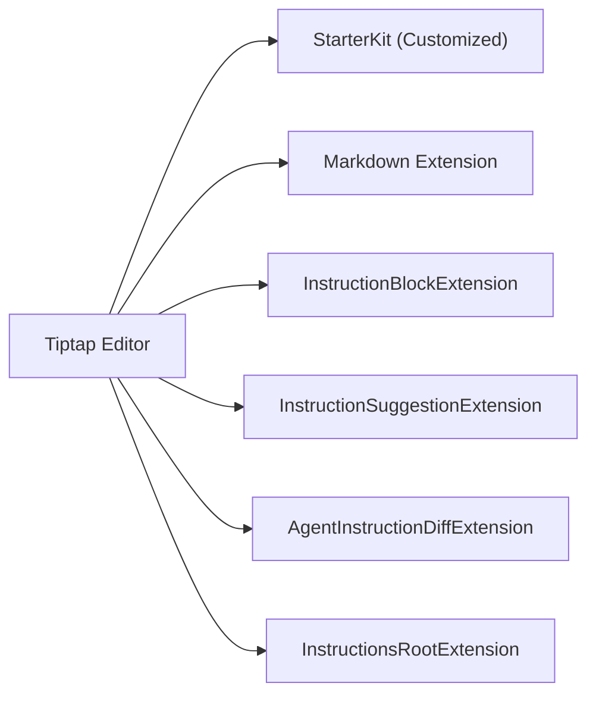
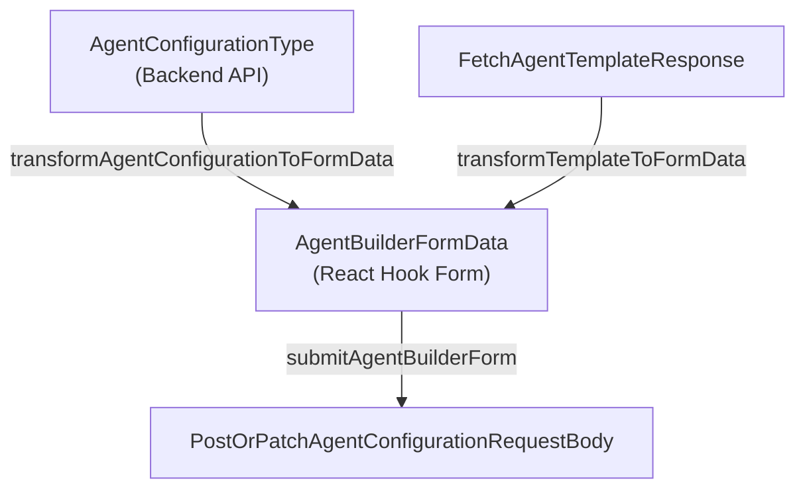

<!-- source: DeepWiki mcp.deepwiki.com · repo dust-tt/dust · page 3.2 Agent Builder Interface · fetched 2026-10-27 -->

# Agent Builder Interface

<details>
<summary>Relevant source files</summary>

The following files were used as context for generating this wiki page:

- [front-api/routes/poke/templates/index.ts](front-api/routes/poke/templates/index.ts)
- [front-spa/index.html](front-spa/index.html)
- [front-spa/src/app/App.tsx](front-spa/src/app/App.tsx)
- [front-spa/src/app/components/AuthErrorPage.tsx](front-spa/src/app/components/AuthErrorPage.tsx)
- [front-spa/src/app/layouts/WorkspacePage.tsx](front-spa/src/app/layouts/WorkspacePage.tsx)
- [front-spa/src/app/main.tsx](front-spa/src/app/main.tsx)
- [front-spa/src/app/pages/IndexPage.tsx](front-spa/src/app/pages/IndexPage.tsx)
- [front-spa/src/index.css](front-spa/src/index.css)
- [front-spa/src/lib/initDatadog.ts](front-spa/src/lib/initDatadog.ts)
- [front-spa/src/lib/platform.tsx](front-spa/src/lib/platform.tsx)
- [front-spa/src/poke/PokeApp.tsx](front-spa/src/poke/PokeApp.tsx)
- [front-spa/src/poke/layouts/PokePage.tsx](front-spa/src/poke/layouts/PokePage.tsx)
- [front-spa/src/poke/layouts/PokeWorkspacePage.tsx](front-spa/src/poke/layouts/PokeWorkspacePage.tsx)
- [front/components/agent_builder/AgentBuilder.tsx](front/components/agent_builder/AgentBuilder.tsx)
- [front/components/agent_builder/AgentBuilderRightPanel.tsx](front/components/agent_builder/AgentBuilderRightPanel.tsx)
- [front/components/agent_builder/AgentBuilderSidekick.tsx](front/components/agent_builder/AgentBuilderSidekick.tsx)
- [front/components/agent_builder/SidekickPanelContext.tsx](front/components/agent_builder/SidekickPanelContext.tsx)
- [front/components/agent_builder/instructions/AgentBuilderInstructionsEditor.tsx](front/components/agent_builder/instructions/AgentBuilderInstructionsEditor.tsx)
- [front/components/agent_builder/instructions/utils.ts](front/components/agent_builder/instructions/utils.ts)
- [front/components/agent_builder/transformAgentConfiguration.ts](front/components/agent_builder/transformAgentConfiguration.ts)
- [front/components/agent_builder/utils.ts](front/components/agent_builder/utils.ts)
- [front/components/editor/extensions/ListItemExtension.ts](front/components/editor/extensions/ListItemExtension.ts)
- [front/components/editor/extensions/agent_builder/InstructionBlockExtension.test.ts](front/components/editor/extensions/agent_builder/InstructionBlockExtension.test.ts)
- [front/components/editor/extensions/agent_builder/InstructionBlockExtension.tsx](front/components/editor/extensions/agent_builder/InstructionBlockExtension.tsx)
- [front/components/editor/extensions/agent_builder/InstructionSuggestionExtension.test.ts](front/components/editor/extensions/agent_builder/InstructionSuggestionExtension.test.ts)
- [front/components/editor/extensions/agent_builder/InstructionSuggestionExtension.ts](front/components/editor/extensions/agent_builder/InstructionSuggestionExtension.ts)
- [front/components/editor/extensions/agent_builder/instructionBlockUtils.ts](front/components/editor/extensions/agent_builder/instructionBlockUtils.ts)
- [front/components/editor/extensions/instructions/BlockIdExtension.test.ts](front/components/editor/extensions/instructions/BlockIdExtension.test.ts)
- [front/components/editor/extensions/instructions/BlockIdExtension.tsx](front/components/editor/extensions/instructions/BlockIdExtension.tsx)
- [front/components/editor/extensions/instructions/InstructionsDocumentExtension.tsx](front/components/editor/extensions/instructions/InstructionsDocumentExtension.tsx)
- [front/components/editor/extensions/instructions/InstructionsRootExtension.test.ts](front/components/editor/extensions/instructions/InstructionsRootExtension.test.ts)
- [front/components/editor/extensions/instructions/InstructionsRootExtension.tsx](front/components/editor/extensions/instructions/InstructionsRootExtension.tsx)
- [front/components/editor/lib/preprocessMarkdownForEditor.ts](front/components/editor/lib/preprocessMarkdownForEditor.ts)
- [front/components/pages/CustomErrorPage.tsx](front/components/pages/CustomErrorPage.tsx)
- [front/components/pages/builder/agents/CreateAgentPage.tsx](front/components/pages/builder/agents/CreateAgentPage.tsx)
- [front/components/pages/builder/agents/EditAgentPage.tsx](front/components/pages/builder/agents/EditAgentPage.tsx)
- [front/components/pages/builder/agents/NewAgentPage.tsx](front/components/pages/builder/agents/NewAgentPage.tsx)
- [front/components/pages/builder/agents/NotAvailableErrorPage.tsx](front/components/pages/builder/agents/NotAvailableErrorPage.tsx)
- [front/components/pages/workspace/AnalyticsPage.tsx](front/components/pages/workspace/AnalyticsPage.tsx)
- [front/components/poke/pages/AssistantInstructionsPage.tsx](front/components/poke/pages/AssistantInstructionsPage.tsx)
- [front/components/poke/pages/TemplateDetailPage.tsx](front/components/poke/pages/TemplateDetailPage.tsx)
- [front/components/poke/templates/TemplatesDataTable.tsx](front/components/poke/templates/TemplatesDataTable.tsx)
- [front/components/providers/types.ts](front/components/providers/types.ts)
- [front/components/workspace/analytics/AnalyticsExportPanel.tsx](front/components/workspace/analytics/AnalyticsExportPanel.tsx)
- [front/hooks/useSidekickFirstMessage.ts](front/hooks/useSidekickFirstMessage.ts)
- [front/lib/api/poke/templates.ts](front/lib/api/poke/templates.ts)
- [front/lib/resources/storage/models/templates.ts](front/lib/resources/storage/models/templates.ts)
- [front/lib/resources/template_resource.ts](front/lib/resources/template_resource.ts)
- [front/lib/swr/poke.ts](front/lib/swr/poke.ts)
- [front/lib/swr/workspaces.ts](front/lib/swr/workspaces.ts)
- [front/lib/utils/providersHealth.ts](front/lib/utils/providersHealth.ts)
- [front/migrations/20250928_check_templates_id_match.ts](front/migrations/20250928_check_templates_id_match.ts)
- [front/poke/swr/index.ts](front/poke/swr/index.ts)
- [front/public/manifest.webmanifest](front/public/manifest.webmanifest)
- [front/public/sw.js](front/public/sw.js)
- [front/scripts/seed/factories/seedTemplate.ts](front/scripts/seed/factories/seedTemplate.ts)
- [front/tests/utils/TemplateFactory.ts](front/tests/utils/TemplateFactory.ts)
- [front/types/assistant/models/google_ai_studio.ts](front/types/assistant/models/google_ai_studio.ts)
- [front/types/assistant/models/openai.ts](front/types/assistant/models/openai.ts)
- [front/types/assistant/templates.ts](front/types/assistant/templates.ts)

</details>


## Purpose and Scope

This page documents the Agent Builder UI, which provides the interactive interface for creating and configuring AI agents. It covers the React component architecture, form management with `react-hook-form`, data transformation pipelines between API types and form state, the model selection system, and the Tiptap-based instructions editor.

For backend agent configuration APIs and resources, see [Agent Configuration and Management](3.1). For the execution of agents once configured, see [Agent Execution and Temporal Workflows](3.3). For skill configuration interfaces, see [Skill System](3.5). For trigger execution logic, see [Trigger System](3.6).

## Component Architecture

### Main Components

The Agent Builder is composed of three main layout components:



**Sources:** [front/components/agent_builder/AgentBuilder.tsx:1-74]() | [front/components/agent_builder/AgentBuilderRightPanel.tsx:1-21]()

### AgentBuilder Component Structure

The `AgentBuilder` component serves as the root orchestrator:

| Responsibility | Implementation |
|---------------|----------------|
| **Mode Detection** | Determines if creating new, editing existing, or duplicating agent via props `agentConfiguration` and `duplicateAgentId`. |
| **Data Loading** | Uses SWR hooks `useAgentConfigurationActions`, `useAgentTriggers`, `useAgentConfigurationSkills`. |
| **Form Initialization** | Creates `useForm` with Zod resolver and computed default values via `transformAgentConfigurationToFormData`. |
| **Model Selection** | Loads available models via `useModels` hook to set defaults for new agents. |
| **Submit Orchestration** | Validates and submits via `submitAgentBuilderForm`. |
| **Context Providers** | Wraps children with `FormProvider`, `SidekickSuggestionsProvider`, and `SidekickPanelProvider`. |

**Sources:** [front/components/agent_builder/AgentBuilder.tsx:120-164]() | [front/components/agent_builder/AgentBuilder.tsx:170-571]()

### AgentBuilderRightPanel

The `AgentBuilderRightPanel` provides a multi-tab interface for agent development feedback:

*   **Sidekick**: AI-assisted builder suggestions and chat.
*   **Preview**: Live testing of the agent's current configuration.
*   **Insights**: Usage metrics and analytics for the agent (if existing).

The panel state (open/closed) is managed via `usePreviewPanelContext`.

**Sources:** [front/components/agent_builder/AgentBuilderRightPanel.tsx:23-220]()

## Form Management System

### Schema Definition

The form schema is defined using Zod in `AgentBuilderFormContext.tsx`. It enforces strict validation on agent settings and generation parameters.

```typescript
// Core schema structure
export const agentBuilderFormSchema = z.object({
  agentSettings: agentSettingsSchema,
  instructions: z.string().trim().min(1, "Instructions are required"),
  instructionsHtml: z.string().optional(),
  generationSettings: generationSettingsSchema,
  skills: z.array(skillsSchema),
  additionalSpaces: z.array(z.string()),
  actions: z.array(actionSchema),
  triggersToCreate: z.array(triggerSchema),
  triggersToUpdate: z.array(triggerSchema),
  triggersToDelete: z.array(z.string()),
  maxStepsPerRun: z.number().min(1).default(8),
});
```

**Sources:** [front/components/agent_builder/AgentBuilderFormContext.tsx:105-120]()

### Model Provider Selection

Model selection is managed within the `generationSettings` field. The UI renders logos and metadata based on the provider and model IDs defined in the assistant type system.

| Provider | Logo Component | Config Source |
|----------|----------------|---------------|
| `openai` | `OpenaiLogo` | `GPT_4O_MODEL_CONFIG` |
| `anthropic` | `AnthropicLogo` | `CLAUDE_3_5_SONNET_DEFAULT_CONFIG` |
| `google_ai_studio` | `GeminiLogo` | `GEMINI_2_FLASH_CONFIG` |
| `mistral` | `MistralLogo` | `MISTRAL_LARGE_MODEL_CONFIG` |

**Sources:** [front/components/providers/types.ts:33-67]() | [front/types/assistant/models/openai.ts:93-121]()

## Instructions Editor

The instructions editor is a sophisticated rich-text environment built on Tiptap, supporting markdown, block-based structure, and AI-driven suggestions.

### Extension Pipeline

The editor uses a custom set of extensions to enforce the agent builder's schema (Doc > Root > Blocks).



**Sources:** [front/components/agent_builder/instructions/AgentBuilderInstructionsEditor.tsx:52-116]()

### AI Suggestions and Diffing

The `InstructionSuggestionExtension` handles the logic for applying AI-generated changes to instructions without immediately overwriting the document.

1.  **Apply**: When a suggestion is received, the extension diffs the new content against the current block using `diffBlockContent`.
2.  **Render**: Changes are rendered as decorations (`suggestion-deletion` and `suggestion-addition`).
3.  **Accept/Reject**: The user can accept a suggestion, which triggers a Prosemirror transaction to replace the old content with the new content.

**Sources:** [front/components/editor/extensions/agent_builder/InstructionSuggestionExtension.ts:58-117]() | [front/components/editor/extensions/agent_builder/InstructionSuggestionExtension.ts:245-280]()

## Data Transform Pipeline

### Transform Function Overview

The transform pipeline converts between API representations and form state.



**Sources:** [front/components/agent_builder/transformAgentConfiguration.ts:15-51]() | [front/components/agent_builder/submitAgentBuilderForm.ts:381-430]()

### transformAgentConfigurationToFormData

This function maps the backend resource to the UI form. Note that `actions` and `skills` are initially empty and populated via SWR hooks to ensure the builder has the most recent tool definitions.

```typescript
export function transformAgentConfigurationToFormData(
  agentConfiguration: AgentConfigurationType
): AgentBuilderFormData {
  return {
    agentSettings: {
      name: agentConfiguration.name,
      description: agentConfiguration.description,
      pictureUrl: agentConfiguration.pictureUrl,
      scope: agentConfiguration.scope === "global" ? "visible" : agentConfiguration.scope,
      editors: [], // Populated reactively
      tags: agentConfiguration.tags,
      // ...
    },
    instructions: agentConfiguration.instructions ?? "",
    generationSettings: {
      modelSettings: {
        modelId: agentConfiguration.model.modelId,
        providerId: agentConfiguration.model.providerId,
      },
      temperature: agentConfiguration.model.temperature,
      // ...
    },
    actions: [], // Populated reactively
    skills: [], // Populated reactively
  };
}
```

**Sources:** [front/components/agent_builder/transformAgentConfiguration.ts:15-51]()

## Form Submission Flow

The submission process involves transforming the form data back into a format acceptable by the backend, including flattening configuration objects for MCP actions.

1.  **Validation**: `react-hook-form` validates the schema.
2.  **Action Processing**: MCP actions are processed to handle folder expansions and parameter flattening via `processAdditionalConfiguration`.
3.  **API Call**: A `POST` (new) or `PATCH` (edit) request is sent to `/api/w/[wId]/assistant/agent_configurations`.
4.  **Trigger Sync**: Triggers are synchronized in a separate batch process (Delete -> Update -> Create).

**Sources:** [front/components/agent_builder/submitAgentBuilderForm.ts:381-672]() | [front/components/agent_builder/submitAgentBuilderForm.ts:176-201]()

---

