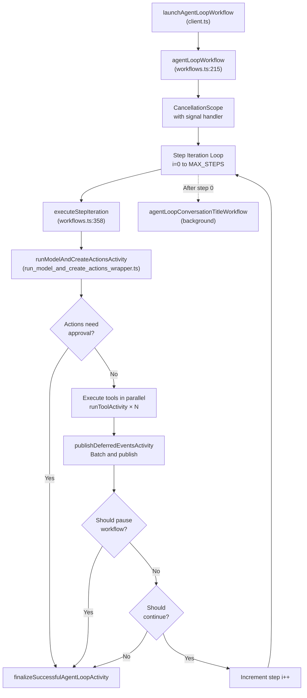
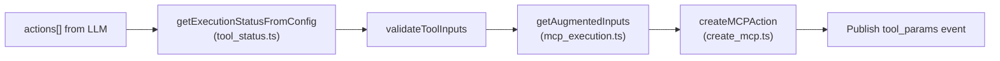

<!-- source: DeepWiki mcp.deepwiki.com · repo dust-tt/dust · page 3.3 Agent Execution and Temporal Workflows · fetched 2026-10-27 -->

# Agent Execution and Temporal Workflows

Relevant source files

The following files were used as context for generating this wiki page:

- [front-api/middlewares/sandbox_auth.ts](front-api/middlewares/sandbox_auth.ts)
- [front-api/routes/poke/workspaces/[wId]/conversations/[cId]/render.ts](front-api/routes/poke/workspaces/[wId]/conversations/[cId]/render.ts)
- [front-api/routes/poke/workspaces/[wId]/spaces/[spaceId]/details.ts](front-api/routes/poke/workspaces/[wId]/spaces/[spaceId]/details.ts)
- [front-api/routes/v1/w/[wId]/sandbox/actions/[aId]/index.test.ts](front-api/routes/v1/w/[wId]/sandbox/actions/[aId]/index.test.ts)
- [front-api/routes/v1/w/[wId]/sandbox/actions/[aId]/index.ts](front-api/routes/v1/w/[wId]/sandbox/actions/[aId]/index.ts)
- [front-api/routes/v1/w/[wId]/sandbox/actions/call.test.ts](front-api/routes/v1/w/[wId]/sandbox/actions/call.test.ts)
- [front-api/routes/v1/w/[wId]/sandbox/actions/call.ts](front-api/routes/v1/w/[wId]/sandbox/actions/call.ts)
- [front-api/routes/v1/w/[wId]/sandbox/actions/index.test.ts](front-api/routes/v1/w/[wId]/sandbox/actions/index.test.ts)
- [front-api/routes/v1/w/[wId]/sandbox/actions/index.ts](front-api/routes/v1/w/[wId]/sandbox/actions/index.ts)
- [front-api/routes/v1/w/[wId]/sandbox/index.ts](front-api/routes/v1/w/[wId]/sandbox/index.ts)
- [front-api/routes/w/[wId]/spaces/[spaceId]/leave.test.ts](front-api/routes/w/[wId]/spaces/[spaceId]/leave.test.ts)
- [front-api/routes/w/[wId]/spaces/[spaceId]/leave.ts](front-api/routes/w/[wId]/spaces/[spaceId]/leave.ts)
- [front/components/assistant/conversation/ErrorMessage.tsx](front/components/assistant/conversation/ErrorMessage.tsx)
- [front/lib/actions/constants.ts](front/lib/actions/constants.ts)
- [front/lib/actions/mcp_internal_actions/events.ts](front/lib/actions/mcp_internal_actions/events.ts)
- [front/lib/actions/mcp_internal_actions/tool_definition.ts](front/lib/actions/mcp_internal_actions/tool_definition.ts)
- [front/lib/actions/mcp_internal_actions/wrappers.test.ts](front/lib/actions/mcp_internal_actions/wrappers.test.ts)
- [front/lib/actions/mcp_internal_actions/wrappers.ts](front/lib/actions/mcp_internal_actions/wrappers.ts)
- [front/lib/actions/statuses.ts](front/lib/actions/statuses.ts)
- [front/lib/actions/tool_status.test.ts](front/lib/actions/tool_status.test.ts)
- [front/lib/actions/tool_status.ts](front/lib/actions/tool_status.ts)
- [front/lib/api/actions/servers/interactive_content/template_utils.ts](front/lib/api/actions/servers/interactive_content/template_utils.ts)
- [front/lib/api/assistant/credit_check.test.ts](front/lib/api/assistant/credit_check.test.ts)
- [front/lib/api/assistant/credit_check.ts](front/lib/api/assistant/credit_check.ts)
- [front/lib/api/assistant/errors.ts](front/lib/api/assistant/errors.ts)
- [front/lib/api/assistant/jit/common_utilities.ts](front/lib/api/assistant/jit/common_utilities.ts)
- [front/lib/api/assistant/jit/conversation.ts](front/lib/api/assistant/jit/conversation.ts)
- [front/lib/api/assistant/jit/folder.ts](front/lib/api/assistant/jit/folder.ts)
- [front/lib/api/assistant/jit/query_tables_v2.ts](front/lib/api/assistant/jit/query_tables_v2.ts)
- [front/lib/api/assistant/jit/skills.ts](front/lib/api/assistant/jit/skills.ts)
- [front/lib/api/assistant/jit_actions.test.ts](front/lib/api/assistant/jit_actions.test.ts)
- [front/lib/api/assistant/jit_actions.ts](front/lib/api/assistant/jit_actions.ts)
- [front/lib/api/assistant/provider_whitelist.ts](front/lib/api/assistant/provider_whitelist.ts)
- [front/lib/api/assistant/skill_actions.test.ts](front/lib/api/assistant/skill_actions.test.ts)
- [front/lib/api/assistant/skill_actions.ts](front/lib/api/assistant/skill_actions.ts)
- [front/lib/api/cancel.ts](front/lib/api/cancel.ts)
- [front/lib/api/file_system/index.ts](front/lib/api/file_system/index.ts)
- [front/lib/api/llm/batch_llm.ts](front/lib/api/llm/batch_llm.ts)
- [front/lib/api/llm/cache_diagnostics.ts](front/lib/api/llm/cache_diagnostics.ts)
- [front/lib/api/llm/types/errors.ts](front/lib/api/llm/types/errors.ts)
- [front/lib/api/llm/types/options.ts](front/lib/api/llm/types/options.ts)
- [front/lib/api/sandbox/access_tokens.test.ts](front/lib/api/sandbox/access_tokens.test.ts)
- [front/lib/api/sandbox/access_tokens.ts](front/lib/api/sandbox/access_tokens.ts)
- [front/lib/api/sandbox/create_child_action.test.ts](front/lib/api/sandbox/create_child_action.test.ts)
- [front/lib/api/sandbox/create_child_action.ts](front/lib/api/sandbox/create_child_action.ts)
- [front/lib/api/sandbox/image/profile.exec.test.ts](front/lib/api/sandbox/image/profile.exec.test.ts)
- [front/lib/api/sandbox/image/profile.test.ts](front/lib/api/sandbox/image/profile.test.ts)
- [front/lib/api/sandbox/image/profile.ts](front/lib/api/sandbox/image/profile.ts)
- [front/lib/api/sandbox/image/profile/common.sh](front/lib/api/sandbox/image/profile/common.sh)
- [front/lib/api/sandbox/image/profile/tests/_test_utils.ts](front/lib/api/sandbox/image/profile/tests/_test_utils.ts)
- [front/lib/api/sandbox/image/profile/tests/wrap_command.test.ts](front/lib/api/sandbox/image/profile/tests/wrap_command.test.ts)
- [front/lib/api/sandbox_functions/create_sandbox_function_mcp_action.ts](front/lib/api/sandbox_functions/create_sandbox_function_mcp_action.ts)
- [front/lib/api/sandbox_functions/self_heal_execution_mode.ts](front/lib/api/sandbox_functions/self_heal_execution_mode.ts)
- [front/lib/auth.fromjson.test.ts](front/lib/auth.fromjson.test.ts)
- [front/lib/duration_recorder.ts](front/lib/duration_recorder.ts)
- [front/lib/resources/sandbox_function_mcp_action_resource.test.ts](front/lib/resources/sandbox_function_mcp_action_resource.test.ts)
- [front/lib/resources/sandbox_function_mcp_action_resource.ts](front/lib/resources/sandbox_function_mcp_action_resource.ts)
- [front/lib/resources/skill/code_defined/shared.ts](front/lib/resources/skill/code_defined/shared.ts)
- [front/lib/resources/skill/code_defined/system_registry.ts](front/lib/resources/skill/code_defined/system_registry.ts)
- [front/lib/utils/async_utils.ts](front/lib/utils/async_utils.ts)
- [front/scripts/investigate_render_conversation.ts](front/scripts/investigate_render_conversation.ts)
- [front/temporal/agent_loop/activities/common.test.ts](front/temporal/agent_loop/activities/common.test.ts)
- [front/temporal/agent_loop/activities/common.ts](front/temporal/agent_loop/activities/common.ts)
- [front/temporal/agent_loop/activities/compaction.ts](front/temporal/agent_loop/activities/compaction.ts)
- [front/temporal/agent_loop/activities/cost_threshold_warnings.ts](front/temporal/agent_loop/activities/cost_threshold_warnings.ts)
- [front/temporal/agent_loop/activities/credit_check.test.ts](front/temporal/agent_loop/activities/credit_check.test.ts)
- [front/temporal/agent_loop/activities/credit_check.ts](front/temporal/agent_loop/activities/credit_check.ts)
- [front/temporal/agent_loop/activities/finalize.test.ts](front/temporal/agent_loop/activities/finalize.test.ts)
- [front/temporal/agent_loop/activities/finalize.ts](front/temporal/agent_loop/activities/finalize.ts)
- [front/temporal/agent_loop/activities/finalize_sandbox_child_tool.test.ts](front/temporal/agent_loop/activities/finalize_sandbox_child_tool.test.ts)
- [front/temporal/agent_loop/activities/finalize_sandbox_child_tool.ts](front/temporal/agent_loop/activities/finalize_sandbox_child_tool.ts)
- [front/temporal/agent_loop/activities/instrumentation.ts](front/temporal/agent_loop/activities/instrumentation.ts)
- [front/temporal/agent_loop/activities/run_model_and_create_actions_wrapper.ts](front/temporal/agent_loop/activities/run_model_and_create_actions_wrapper.ts)
- [front/temporal/agent_loop/client.ts](front/temporal/agent_loop/client.ts)
- [front/temporal/agent_loop/config.ts](front/temporal/agent_loop/config.ts)
- [front/temporal/agent_loop/lib/compaction.test.ts](front/temporal/agent_loop/lib/compaction.test.ts)
- [front/temporal/agent_loop/lib/compaction.ts](front/temporal/agent_loop/lib/compaction.ts)
- [front/temporal/agent_loop/lib/create_tool_actions.ts](front/temporal/agent_loop/lib/create_tool_actions.ts)
- [front/temporal/agent_loop/lib/deferred_events.ts](front/temporal/agent_loop/lib/deferred_events.ts)
- [front/temporal/agent_loop/lib/event_coalescer.test.ts](front/temporal/agent_loop/lib/event_coalescer.test.ts)
- [front/temporal/agent_loop/lib/event_coalescer.ts](front/temporal/agent_loop/lib/event_coalescer.ts)
- [front/temporal/agent_loop/lib/get_output_from_llm.ts](front/temporal/agent_loop/lib/get_output_from_llm.ts)
- [front/temporal/agent_loop/lib/prompt_commands.ts](front/temporal/agent_loop/lib/prompt_commands.ts)
- [front/temporal/agent_loop/lib/types.ts](front/temporal/agent_loop/lib/types.ts)
- [front/temporal/agent_loop/lib/workflow_ids.ts](front/temporal/agent_loop/lib/workflow_ids.ts)
- [front/temporal/agent_loop/sinks.ts](front/temporal/agent_loop/sinks.ts)
- [front/temporal/agent_loop/worker.ts](front/temporal/agent_loop/worker.ts)
- [front/temporal/agent_loop/workflows.test.ts](front/temporal/agent_loop/workflows.test.ts)
- [front/temporal/agent_loop/workflows.ts](front/temporal/agent_loop/workflows.ts)
- [front/tests/utils/SandboxFunctionMCPActionFactory.ts](front/tests/utils/SandboxFunctionMCPActionFactory.ts)
- [front/tests/utils/SandboxTokenFactory.ts](front/tests/utils/SandboxTokenFactory.ts)
- [front/types/assistant/compaction.ts](front/types/assistant/compaction.ts)
- [front/types/provider_selection.ts](front/types/provider_selection.ts)
- [x/pr/branching.md](x/pr/branching.md)
- [x/spolu/compaction/compaction.md](x/spolu/compaction/compaction.md)
- [x/spolu/compaction/plan.md](x/spolu/compaction/plan.md)

This page documents the agent execution engine built on Temporal workflows. It covers how agent loops orchestrate multi-step LLM interactions, tool executions, and event streaming through durable, resumable workflows. For agent configuration, see [Agent Configuration and Management](#3.1). For prompt construction details, see [Prompt Construction and LLM Integration](#3.4). For event streaming to clients, see [Event Streaming and Real-time Updates](#5.3).

## Overview

The agent execution system runs asynchronous multi-step agent interactions using Temporal workflows. Each agent message triggers a workflow that:

1. Resolves available tools from multiple sources (JIT, skills, built-in).
2. Calls the LLM with conversation context.
3. Executes tool calls in parallel.
4. Handles human-in-the-loop approvals or authentication pauses.
5. Repeats until completion or max steps reached.
6. Publishes events for real-time UI updates.

The system ensures durability through Temporal's execution guarantees, allowing workflows to survive worker restarts, handle approval pauses, and recover from transient failures.

**Sources:** [front/temporal/agent_loop/workflows.ts:1-257](), [front/temporal/agent_loop/lib/run_model.ts:99-895]()

## Workflow Architecture

### Temporal Workflow and Activities

The `agentLoopWorkflow` is the main orchestrator defined in `front/temporal/agent_loop/workflows.ts`. It coordinates multiple activities:

| Activity | Purpose | Retry Policy |
|----------|---------|--------------|
| `runModelAndCreateActionsActivity` | Runs LLM, checks cost caps, and creates tool actions. | Max 15 attempts (RETRY_ON_INTERRUPT_MAX_ATTEMPTS) |
| `runToolActivity` | Executes a single tool (non-idempotent). | Max 1 attempt (no retry) |
| `runRetryableToolActivity` | Executes a tool with `retry_on_interrupt` policy. | Max 15 attempts |
| `publishDeferredEventsActivity` | Publishes batched events (e.g., tool approvals). | Default |
| `compactionActivity` | Summarizes conversation history when token limits are reached. | Max 1 attempt |
| `finalizeSuccessfulAgentLoopActivity` | Marks completion and triggers analytics/notifications. | Default |

Activities are configured with specific timeouts and heartbeat requirements to detect worker failures promptly. The model activity has a 10-minute timeout with a heartbeat requirement.

**Sources:** [front/temporal/agent_loop/workflows.ts:58-185](), [front/temporal/agent_loop/config.ts:1-33](), [front/temporal/agent_loop/worker.ts:104-119]()

### Task Queue Routing

Dust routes agent loop tasks to different Temporal task queues based on the execution context to isolate workloads and manage capacity:

- **interactive**: User-facing real-time conversations.
- **programmatic**: API-driven agent calls.
- **batch**: High-volume background processing.
- **schedules**: Recurring triggered agent tasks.

**Sources:** [front/temporal/agent_loop/config.ts:29-32](), [front/temporal/agent_loop/worker.ts:57-83]()

### Workflow Execution Flow

**Sources:** [front/temporal/agent_loop/workflows.ts:215-356](), [front/temporal/agent_loop/workflows.ts:358-479](), [front/temporal/agent_loop/client.ts:24-86]()

## Step Execution Coordination

### runModelAndCreateActionsActivity Wrapper

The `runModelAndCreateActionsActivity` in `front/temporal/agent_loop/activities/run_model_and_create_actions_wrapper.ts` handles the heavy lifting of a step's "thinking" phase:

1. **Resume Check**: If `checkForResume` is true, it checks `AgentMCPActionModel` for existing actions for this step. If found, it returns them immediately to avoid re-running the LLM [lines 374-431]().
2. **Guardrails**: Validates cost thresholds using `checkCostAndSubagentsThresholds` [lines 165-187]().
3. **Model Execution**: Calls `runModel` which constructs the prompt and streams the LLM response [lines 222-251]().
4. **Action Persistence**: Calls `createToolActionsActivity` to save the tool calls to the database [lines 266-273]().

**Sources:** [front/temporal/agent_loop/activities/run_model_and_create_actions_wrapper.ts:69-315](), [front/temporal/agent_loop/activities/run_model_and_create_actions_wrapper.ts:374-428]()

### Tool Action Creation

`createToolActionsActivity` resolves the execution status for every tool call generated by the LLM. It checks if tools require validation (approvals), authentication, or file authorization.

**Sources:** [front/temporal/agent_loop/lib/create_tool_actions.ts:45-154](), [front/lib/actions/tool_status.ts:32-132]()

## LLM Interaction and Streaming

### Heartbeat Monitoring

LLM calls can be slow. To prevent Temporal from timing out the activity, `withPeriodicHeartbeat` wraps the LLM stream. It sends a heartbeat to Temporal every 10 seconds and enforces a 2-minute timeout between individual stream events.

**Sources:** [front/temporal/agent_loop/lib/get_output_from_llm.ts:105-236](), [front/temporal/agent_loop/lib/get_output_from_llm.ts:26-31]()

### Tool Call Disambiguation

When an LLM generates a tool call, the system must map the streamed name back to a stable configuration. `resolveStableToolCallName` matches the streamed name against the provided tool specifications.

**Sources:** [front/temporal/agent_loop/lib/get_output_from_llm.ts:37-46]()

## Compaction and History Management

When a conversation exceeds token limits, the `agentLoopWorkflow` triggers `compactionActivity`.

1. **Summarization**: It uses a dedicated prompt (`COMPACTION_PROMPT`) to ask the LLM for a thorough summary of intent, information exchanged, and pending tasks.
2. **Persistence**: The summary is stored in a `CompactionMessageType` in the conversation.
3. **Cleanup**: Previous messages are marked as "pruned" to reduce the context window size for future steps.
4. **History File**: A `.history` file is created in the conversation's `DustFileSystem` to preserve the original text for reference.

**Sources:** [front/temporal/agent_loop/lib/compaction.ts:28-67](), [front/temporal/agent_loop/activities/compaction.ts:18-58](), [front/temporal/agent_loop/lib/compaction.ts:124-182]()

## Signals and Cancellation

The workflow listens for three primary signals defined in `front/temporal/agent_loop/signals.ts`:

- `cancelAgentLoopSignal`: Triggers an immediate `CancellationScope` cancellation.
- `gracefullyStopAgentLoopSignal`: Stops the iteration loop after the current step completes.
- `interruptAgentLoopSignal`: Stops the current loop to allow a new user message to take precedence (used for "stop and regenerate" patterns).

**Sources:** [front/temporal/agent_loop/workflows.ts:228-246](), [front/temporal/agent_loop/signals.ts:1-12]()

## Finalization and Analytics

Once the loop completes (successfully, cancelled, or errored), a finalization activity is called (e.g., `finalizeSuccessfulAgentLoopActivity`). These activities perform critical side effects:

- **Credit Calculation**: `computeAndStoreAgentMessageCredits` materializes the cost of the run.
- **Consumption Attribution**: `launchAgentMessageConsumptionAttribution` records usage for billing.
- **Notifications**: Sends `conversationUnreadNotification` or email replies.
- **Analytics**: `launchAgentMessageAnalytics` tracks performance and model usage.
- **Mentions**: `handleMentions` processes any new @-mentions in the agent's response.

**Sources:** [front/temporal/agent_loop/activities/finalize.ts:53-72](), [front/temporal/agent_loop/activities/finalize.ts:36-51](), [front/temporal/agent_loop/activities/common.ts:193-214]()

## Sandbox Child Tools

Agents running in a `sandbox` tool (e.g., executing code) can invoke other MCP tools via `createSandboxChildAction`. This creates a child action linked to the parent sandbox action. If the child tool requires approval, the parent sandbox process is paused (`pauseSandboxBashForBlockedChild`) until the user validates the request.

**Sources:** [front/lib/api/sandbox/create_child_action.ts:45-106](), [front/lib/api/sandbox/create_child_action.ts:189-234]()

---

